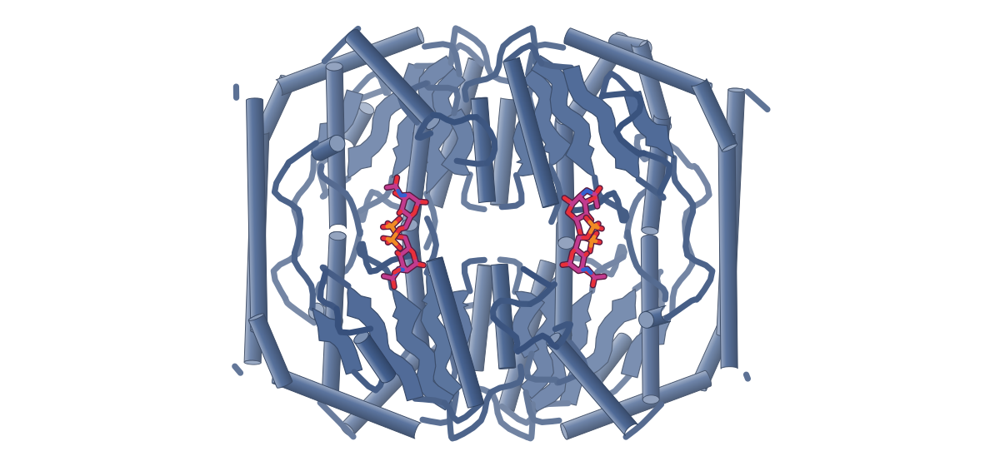
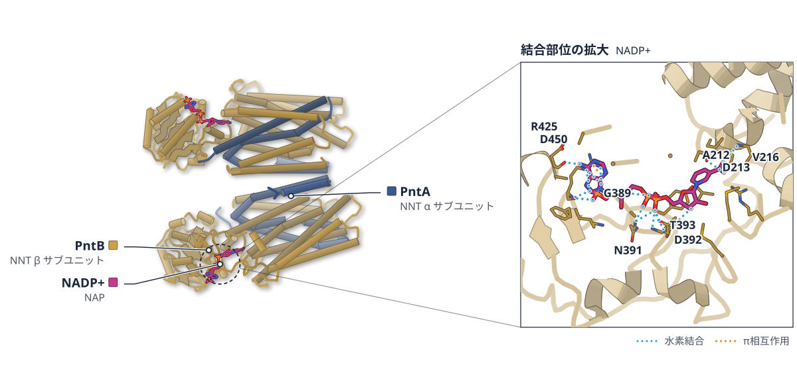

# 2026-10-07 号

**今日の新しい構造：4 本**　Europe PMC に 2026-10-06 に登録されたオープンアクセス論文 25 本のうち、新しい構造を報告した論文は 4 本。すべて紹介する。

**New Structure 1 本** · **Structure Update 3 本**（New Structure：構造が初めて解かれたタンパク質。Structure Update：既知のタンパク質の新しい構造。Structure-Based Study：既存の構造を使った注目の研究）

## Today's Structure（今日の一本）

**1｜PARP2は、ヌクレオソームの2周にまたがって切断を認識する**（ヒトPARP2–HPF1／ヌクレオソーム）

選んだ理由（構造生物学・生命科学・創薬）：PARP 阻害剤の働きの鍵とされる「捕捉」を、ヌクレオソーム上の DNA 切断への結合の仕方から説明する構造。

> This configuration explains the higher affinity of PARP2 for nucleosomal SSBs relative to free DNA.  
> — Abstract

> Together, these structures provide a chromatin-context framework for understanding PARP2 recognition of nucleosomal DNA breaks and how PARPis reshape these interactions to promote PARP retention and local chromatin remodeling.  
> — Abstract

- 迷った論文：SpNanR（肺炎球菌） — NanR は構造の新規性が高いが、波及する範囲が肺炎球菌の転写調節に限られるため見送った。

| # | 標的 | 手法・分解能 | 見出し |
|---|---|---|---|
| 1 | ヒトPARP2–HPF1／ヌクレオソーム | Cryo-EM・全体 2.8 Å | PARP2は、ヌクレオソームの2周にまたがって切断を認識する |
| 2 | SpNanR（肺炎球菌） | X-ray・2.01–2.99 Å（4 構造） | 肺炎球菌のNanRは、代謝物が四量体をつなぎとめて安定化する |
| 3 | LbCas12a Lid2変異体 | PDB 公開待ち | Lidをループに置き換えると、Cas12aは非標的鎖だけを切る |
| 4 | 大腸菌NNT（PntA/PntB） | Cryo-EM・2.74–3.85 Å（9 構造） | NNTは基質の結合でdIIIを外し、プロトン通路を切り替える |

> この号は AI が論文本文から作成した**レビュー用の下書き**です。数値・ID・リガンドは PDB / UniProt から取得し、AI の記述には本文からの引用を付けています。

---

# Picked up Today's Structure

## 1｜ヒトPARP2–HPF1／ヌクレオソーム

### Structural basis of PARP2 recognition of nucleosomal DNA breaks and inhibitor trapping

*Nucleic Acids Research*（2026-10-05） · [論文](https://doi.org/10.1093/nar/gkag939) · ライセンス: cc by

筆頭著者：Chathuni Jayathilake（Case Western Reserve University, United States）　責任著者：Tae Hun Kim（Case Western Reserve University, United States）

**PARP2は、ヌクレオソームの2周にまたがって切断を認識する**

阻害剤はDNA結合面を固めており、PARP2がクロマチンに捕捉される理由の説明になりうる

- **疑問・課題**：クロマチンの狭い構造の中で、PARP2が一本鎖切断をどう認識するかは不明だった。
- **アプローチ**：一本鎖切断を入れたヌクレオソームとPARP2・HPF1の複合体を、クライオ電顕で解析した。
- **結果**：WGRドメインが切断部位に、ヘリカルドメインとHPF1が反対側のDNAに結合し、DNAの2周にまたがる。
- **わかったこと**：この結合様式が、遊離DNAよりヌクレオソーム上の切断を好む理由を説明する。
- **残された課題**：切断の位置が結合・活性化・クロマチン保持をどう左右するかは、今後の研究が必要とされる。

この紹介文の根拠（論文本文）

> Single-strand DNA breaks are among the most frequent forms of DNA damage, yet how PARP2 recognizes these lesions within the constrained geometry of chromatin remains unclear.  
> — 疑問・課題／Abstract

> Here we use cryogenic electron microscopy (cryo-EM) to determine structures of PARP2 and HPF1 bound to nucleosomes containing a site-specific single-strand break (SSB) at superhelical location + 5.3.  
> — アプローチ／Abstract

> The structures reveal a multivalent binding mode in which the Trp-Gly-Arg (WGR) domain engages the break while the helical domain and HPF1 contact the opposing DNA gyre, spanning both DNA gyres of the nucleosome.  
> — 結果／Abstract

> This configuration explains the higher affinity of PARP2 for nucleosomal SSBs relative to free DNA.  
> — わかったこと／Abstract

> Future studies comparing additional lesion positions will be essential to determine how location tunes PARP2 binding, activation, and chromatin retention.  
> — 残された課題／Discussion

分類：クロマチン・ヒストン・DNA・RNA に関わるもの・酵素（その他）

#### 読みどころ

WGRドメインが上側のDNAジャイアで切断を認識し、HDのArg296とHPF1の塩基性残基が下側のジャイアに接触。ヌクレオソームDNAの2周分をまたぐ結合が、裸のDNA（Kd 653 nM）よりヌクレオソーム上の切断（Kd 約55 nM）を強く好む理由を説明する。

根拠（論文本文）

> The WGR domain recognizes the break on the upper DNA gyre through conserved contacts, while Arg296 on helix αE of the HD and basic residues in HPF1 contact the lower gyre, together spanning both DNA gyres and the inter-gyre space  
> — Results

> free DNA containing the same SSB was bound with substantially lower affinity (Kd = 653 nM)  
> — Results

オラパリブ・タラゾパリブ・EB-47はいずれもWGRの揺らぎを抑えてWGR–HD界面を安定化し、ART–HPF1触媒モジュールはむしろ動的になった。DNA結合面が固まることが、阻害剤によるPARP2のクロマチン上への「捕捉」の構造的な説明になりうる。阻害剤はDNAの非対称なほどけも促した。

根拠（論文本文）

> Together, these results indicate that the three PARPis tested in this study induce a common structural response characterized by reduced conformational heterogeneity of the WGR domain and stabilization of WGR–HD interactions.  
> — Results

> Thus, inhibitor-associated nucleosome unwrapping is coupled to PARP2–HPF1 binding, rather than arising from a direct, global effect of PARPis on nucleosome structure.  
> — Results

当初は複合体がグリッド上（空気–水界面）で壊れて見えなかった。ヌクレオソームのacidic patchに結合するscFv（PL2-6抗体由来）で安定化し、凝集しやすいN末端の天然変性領域を除いたPARP2（90–583）を使うことで構造決定に成功した。

根拠（論文本文）

> Despite extensive optimization of sample and vitrification conditions, we were initially unable to detect nucleosome particles with PARP2 and HPF1, suggesting disruption of the complex at the air–water interface.  
> — Results

> we employed the scFv derived from the PL2-6 antibody, which is known to bind the acidic patch and stabilize nucleosomes for cryo-EM  
> — Results

#### 構造データ

寄託の記載はあるが、ID は補足資料にのみ記載されている。

#### 実験メモ

- **発現系**：PARP2はpET-SUMOでE. coli Rosetta 2 pLysS、20°Cで一晩誘導。HPF1はBL21(DE3)-CodonPlus（RIPL）、16°Cで一晩。
- **コンストラクト**：ヒトPARP2 isoform 1の90–583（最初の89残基を除去）。全長はグリッド上で凝集した。WGRドメインのみ（90–212）も使用。
- **精製**：Ni-NTA → ULP1でHis-SUMOタグ切断 → 逆Ni-NTA → HiTrap Heparin → Superdex 200。
- **結晶化／グリッド作製**：ヌクレオソーム 2 µMにscFv 8 µMを先に加え、PARP2 5 µM・HPF1 8 µM（阻害剤は10 µM）を添加。架橋やゲルろ過はなし。Quantifoil R2/1 Cu、Vitrobot 4°C・湿度100%。
- **データ収集・解析**：Titan Krios G3i（300 kV）＋K3、エネルギーフィルター（スリット20 eV）。CryoSPARC v4.7.0で処理。

根拠（論文本文）

> PARP2 construct (residues 90–583) lacking the first 89 amino acids and PARP2-WGR construct (residues 90–212) were generated by PCR and cloned into the pET-SUMO expression vector using Gibson assembly.  
> — Methods

> First, nucleosomes containing an SSB at SHL +5.3 (2 µM) were incubated with scFv (8 µM) for 15 min at ambient temperature.  
> — Methods

> No chemical crosslinking, gel filtration, or other enrichment or purification steps were performed before vitrification.  
> — Methods

> Cryo-EM data were collected on a Titan Krios G3i transmission electron microscope (Thermo Fisher Scientific) operated at 300 kV  
> — Methods

> 📝 編集者への確認事項：PDB/EMDB の ID は補足資料（Table S5）にのみ記載されており、構造データ表と構造図は空欄。ヒストンはショウジョウバエ由来。

---

# New Structure

## 2｜SpNanR（肺炎球菌）

### Mechanism of NanR transcriptional activation of sialic acid metabolism in Streptococcus pneumoniae

*Nucleic Acids Research*（2026-10-05） · [論文](https://doi.org/10.1093/nar/gkag953) · ライセンス: cc by

筆頭著者：David M Wood（University of Canterbury, New Zealand）　責任著者：Renwick C J Dobson, Christopher R Horne（University of Canterbury, New Zealand）

色（順に）：SpNanR（転写調節因子）　スティック：ManNAc-6-P（BMX）

**肺炎球菌のNanRは、代謝物が四量体をつなぎとめて安定化する**

全長のapo型とDNA結合型の構造を決定。Arg67の対がDNAの副溝に入り込む

- **疑問・課題**：NanRがシアル酸の代謝遺伝子をどう活性化するのか、分子レベルでは不明だった。
- **アプローチ**：代謝物の探索と解析に加え、apo型・代謝物結合型・DNA結合型の全長構造を決めた。
- **結果**：代謝物が結合すると四量体が安定化するが、DNAへの親和性は変わらない。
- **わかったこと**：DNA結合ドメインが糖イソメラーゼドメインと構造的に連動しないためと説明される。
- **残された課題**：ここで示した機構を生体内で確かめることが、今後の課題とされる。

この紹介文の根拠（論文本文）

> In Streptococcus pneumoniae, the RpiR transcriptional regulator NanR (SpNanR) senses sialic acid in the environment and upregulates transcription of the nan and sia A operons to increase uptake and metabolism of sialic acid.  
> — 疑問・課題／Abstract

> The molecular basis of this activation is unknown.  
> — 疑問・課題／Abstract

> We identify the effector that binds SpNanR to regulate expression of the nan and siaA operons.  
> — アプローチ／Introduction

> We report the first full-length structures of the RpiR family transcriptional regulator SpNanR, including the unbound (apo) SpNanR crystal structure, SpNanR in complex with N-acetylmannosamine-6-phosphate, and SpNanR in complex with its cognate DNA recognition sequence.  
> — アプローチ／Introduction

> SpNanR exists in a dimer–tetramer equilibrium, and N-acetylmannosamine-6-phosphate binding strongly stabilizes the tetramer.  
> — 結果／Abstract

> Notably, the effector N-acetylmannosamine-6-phosphate does not affect the affinity of SpNanR for DNA.  
> — 結果／Abstract

> The DNA-binding domains are not structurally coupled to the sugar isomerase domains, explaining why N-acetylmannosamine-6-phosphate binding does not affect DNA binding.  
> — わかったこと／Abstract

> future work should aim to validate these mechanisms in vivo  
> — 残された課題／Conclusions

分類：転写調節・シグナル伝達

#### 読みどころ

RpiRファミリー転写因子で、エフェクターなし（apo）とDNA複合体の全長構造は初めて。これまで全長のRpiR構造は2例しかなく、いずれもこの2状態ではなかった。

根拠（論文本文）

> To date, no crystal structures of full-length RpiR bound to DNA or in the apo form (i.e. without effector) have been reported, representing a key knowledge gap in understanding the molecular mechanism of RpiR transcriptional regulators.  
> — Introduction

ManNAc-6-Pは1分子で3つのプロトマーにまたがって結合し（リン酸基はSer135・Ser179・Ser181・Thr184、糖部分はArg148・Tyr229と隣の二量体のAsp160）、界面を組み替えずに四量体を「橋渡し」して安定化する。R148A変異体はエフェクターがあっても二量体のまま。

根拠（論文本文）

> Instead, each N-acetylmannosamine-6-phosphate molecule bridges three monomers across the tetrameric interface, thereby stabilizing the tetrameric state  
> — Results

> In contrast, SpNanRR148A is exclusively dimeric at the same concentration as wild type even in the presence of N-acetylmannosamine-6-phosphate  
> — Results

各サブユニットのArg67がDNAの副溝に入り込み、2つのグアニジノ基が約3.6 Åの距離でπスタックする珍しい配置をとる。塩基との直接の接触は少なく、TpAステップでの副溝の歪みを読む「間接読み取り」で配列特異性を出していると考えられる。

根拠（論文本文）

> The guanidinium groups π-stack ∼3.6 Å apart (averaged across the two dimers) and each forms a weak hydrogen bond with the N3 nitrogen of adenine at position 10  
> — Results

> These observations suggest that specificity is achieved through recognition of a sequence-dependent distorted B-DNA structure—the “indirect read-out” mechanism—while affinity is primarily driven by interactions between the DNA-binding domain and the phosphate backbone.  
> — Results

#### 構造データ

| PDB | 手法 | 分解能 | 公開 | 生物種 | リガンド |
|---|---|---|---|---|---|
| [8V5F](https://www.rcsb.org/structure/8V5F) | X-ray | 2.55 Å | 2024-12-04 | Streptococcus pneumoniae | — |
| [8TX9](https://www.rcsb.org/structure/8TX9) | X-ray | 2.01 Å | 2024-09-11 | Streptococcus pneumoniae | BMX |
| [8V4V](https://www.rcsb.org/structure/8V4V) | X-ray | 2.95 Å | 2024-12-04 | Streptococcus pneumoniae | BMX |
| [9DQN](https://www.rcsb.org/structure/9DQN) | X-ray | 2.99 Å | 2025-08-20 | Streptococcus pneumoniae, synthetic construct | — |

- [A0A064C3N8](https://www.uniprot.org/uniprotkb/A0A064C3N8) ybbH MurR/RpiR family transcriptional regulator — *Streptococcus pneumoniae* （PDB で初めての構造）
- [A0A0H2ZPE9](https://www.uniprot.org/uniprotkb/A0A0H2ZPE9)  Phosphosugar-binding transcriptional regulator, putative — *Streptococcus pneumoniae serotype 2 (strain D39 / NCTC 7466)* （PDB で初めての構造）

#### 実験メモ

- **発現系**：pET30ΔSEでE. coli BL21(DE3)。1 mM IPTGで誘導し、25°Cで一晩（14–16時間）。
- **コンストラクト**：全長SpNanR（WP_000360349.1）を親和性タグなしで発現。
- **精製**：硫安沈殿（50%飽和）→ 陰イオン交換 → ヘパリン → Superdex 200 Increase。タグを使わず電荷とDNA結合性で精製。
- **結晶化／グリッド作製**：タンパク質1 µL＋リザーバー1 µLで、結晶は4–16週かけて成長。初期位相は三ヨウ化物ソーキング（1–5分、それ以上は結晶が割れる）によるSAD。
- **データ収集・解析**：Australian Synchrotron MX2（EIGER 16M）。弱い異常分散シグナルを補うため7データセットを統合。

根拠（論文本文）

> The pET30ΔSE-SpNanR and mutated constructs were transformed into Escherichia coli BL21(DE3) competent cells  
> — Methods

> purified without an affinity tag, instead utilizing charge-based (ion exchange) and DNA-binding (heparin) characteristics  
> — Results

> Briefly, 1 μL protein solution was mixed with 1 μL reservoir solution. The drops were incubated for 4–16 weeks before harvest.  
> — Methods

> Protein crystals of SpNanR + N-acetylmannosamine-6-phosphate were added to mother liquor that had been supplemented with triiodide (10 mM) and soaked for 1–5 min; the crystals cracked if soaked longer.  
> — Methods

> To enhance the weak anomalous signal, seven data sets were merged  
> — Methods

> 📝 編集者への確認事項：PDB エントリーは 2024–2025 年に公開済みで、論文の引用情報はまだ PDB に反映されていない（データ可用性の記載から本論文の寄託と判定）。

---

# Structure Update

## 3｜LbCas12a Lid2変異体

### Size and sequence variation of the Lid of the Cas12a nuclease domain results in a nickase phenotype

*Nucleic Acids Research*（2026-10-05） · [論文](https://doi.org/10.1093/nar/gkag934) · ライセンス: cc by

筆頭著者：Ricardo Villegas Warren（Wageningen University & Research, Netherlands）　責任著者：John van der Oost（Wageningen University & Research, Netherlands）

**Lidをループに置き換えると、Cas12aは非標的鎖だけを切る**

Lid2変異体のクライオ電顕構造（2.5 Å）では、標的鎖を活性部位に装填する動きが妨げられていた

- **疑問・課題**：Cas12aは1つのRuvCで両鎖を切るため、ニッカーゼへの改変は容易でなかった。
- **アプローチ**：大腸菌でLid領域の変異体を探し、Lid2を2.5 Åのクライオ電顕で解析した。
- **結果**：Lid2ではαヘリックス状のLidが置き換わり、非標的鎖だけを切るニッカーゼになった。
- **わかったこと**：作り替えたLidが非標的鎖を活性部位に保ち、標的鎖の切断に必要な動きを妨げるとみられる。
- **残された課題**：このスクリーニングは、ニッカーゼ候補を見分ける定性的なもので、定量的ではない。

この紹介文の根拠（論文本文）

> Because Cas12a nucleases have a single nuclease domain (RuvC) that cuts both strands, it is not straightforward to engineer a nickase [6].  
> — 疑問・課題／Introduction

> We describe an unbiased in vivo screen in Escherichia coli to identify LbCas12a nickase variants.  
> — アプローチ／Abstract

> Cryo-electron microscopy (cryo-EM) at 2.5 Å resolution reveals that, in Lid2, the native α-helical Lid is replaced, uncoupling the concerted cleavage mechanism.  
> — アプローチ／Abstract

> Biochemical characterization confirms that Lid2 robustly nicks the non-target strand (NTS) with minor cleavage activity observed for the target strand (TS), accumulating predominantly nicked substrates.  
> — 結果／Abstract

> Cryo-electron microscopy (cryo-EM) at 2.5 Å resolution reveals that, in Lid2, the native α-helical Lid is replaced, uncoupling the concerted cleavage mechanism.  
> — 結果／Abstract

> Specifically, the remodeled Lid appears to stabilize the NTS in the active site, whereas it hampers the conformational transitions required for subsequent TS cleavage.  
> — わかったこと／Abstract

> The system is therefore best regarded as a qualitative screen whether or not a certain variant acts as a potential nickase, rather than a quantitative one.  
> — 残された課題／Discussion

分類：DNA・RNA に関わるもの・酵素（その他）

#### 読みどころ

野生型LbCas12aではαヘリックス状のLidがガイド–標的ヘテロ二重鎖やブリッジヘリックスと接触して開いた状態を保つ。Lid2ではこの接触が失われ、REC2ドメインのW355が外側へ約3.4 Å動く。Lid–REC2–TNBドメイン間のアロステリックな連携が崩れ、標的鎖の活性部位への装填が妨げられる。

根拠（論文本文）

> the absence of the α-helical Lid interactions in LbCas12a–Lid2 does disturb the allosteric regulation among the Lid, REC2, and TNB domains that is required for TS loading into the active site, thereby explaining its nickase phenotype  
> — Results

> W355 undergoes a 3.4-Å outward movement from the terminus of the heteroduplex  
> — Results

野生型の結晶構造にはなかった一本鎖DNA（非標的鎖）の密度が、Lid2のRuvC活性部位に見えた。切断されるリン酸がマグネシウム2個（D832・E925・D1172が配位）とともに切断可能な位置にあり、Sanger配列解析で決めたPAMの14塩基下流という切断位置と一致する。変異したYCSSモチーフのY930が糖部分と疎水結合して非標的鎖をつなぎとめる。

根拠（論文本文）

> we observed a density corresponding to a single-stranded DNA (ssDNA) substrate within the RuvC active site of the LbCas12a variant, that is not observed in the crystal structure of the wild-type LbCas12a  
> — Results

> Y930 in the YCSS motif forms a hydrophobic interaction with the ribose moiety of dG15*, facilitating the stable binding of the NTS within the RuvC active site  
> — Results

狙った点変異（Lid1）だけでなく、設計が思いつかないような解も拾えたのがこのスクリーニングの強み。12アミノ酸のLidコアが全く別の4アミノ酸ペプチド（YCSS、8残基の欠失を伴う）に置き換わったLid2が偶然得られた。順序立った設計では見落とすタイプの変異だと著者は述べる。

根拠（論文本文）

> This discovery highlights the power of the developed unbiased screening system to identify semi-rationally designed (Lid1) as well as non-intuitive (Lid2) structural solutions.  
> — Discussion

> the ordered α-helical Lid structure is replaced by a flexible loop, a solution that rational design would most likely have overlooked  
> — Discussion

#### 構造データ

| PDB | 手法 | 分解能 | 公開 | 生物種 | リガンド |
|---|---|---|---|---|---|
| 9WNE | — | — | 公開待ち | — | — |

#### 実験メモ

- **発現系**：N末端His6タグ付きLbCas12a-Lid2をE. coli Rosetta2 (DE3)で発現。37°CでOD600 0.8まで培養し、0.1 mM IPTGで誘導、20°Cで18時間。
- **コンストラクト**：LbCas12a-Lid2（930–941のGFKNSRVKVEKQを YCSS に置換、8残基欠失）。
- **精製**：Ni-NTA → HiTrap Heparin HP（0.3–2 M NaCl勾配）。40-nt crRNA・39-bp標的DNAと1:1.2:1.2:1.2で再構成し、Superdex 200 Increaseでゲルろ過。
- **結晶化／グリッド作製**：アミルアミン処理したAu 300メッシュ R1.2/1.3グリッド、Vitrobot Mark IV 4°C・湿度100%、待機10秒・ブロット4秒。A260が4.0になるまで濃縮。
- **データ収集・解析**：Titan Krios G3i（300 kV）＋GIF＋Gatan K3（カウンティング、東京大学）。cryoSPARC v4.4.0で処理。

根拠（論文本文）

> N-terminally His₆-tagged LbCas12a–Lid2 was expressed in E. coli Rosetta2 (DE3).  
> — Methods

> the purified LbCas12a–Lid2, the 40-nt crRNA, the 39-nt target DNA, and the 39-nt non-target DNA at a molar ratio of 1:1.2:1.2:1.2  
> — Methods

> applied to amylamine-treated Au 300-mesh R1.2/1.3 grids (Quantifoil) that were glow-discharged in a Vitrobot Mark IV (FEI) at 4°C, with a waiting time of 10 s and a blotting time of 4 s under 100% humidity conditions  
> — Methods

> Micrographs for all datasets were collected with a Titan Krios G3i microscope (Thermo Fisher Scientific) running at 300 kV  
> — Methods

> 📝 編集者への確認事項：ゲノム編集ツールの基礎構造研究。Lid2 は人工の変異体なので初構造タグは付けていない。標的鎖もごく一部は切れる（完全な一本鎖切断ではない）点は本文どおり記述。

---

## 4｜大腸菌NNT（PntA/PntB）

### Structures of multiple states of the nicotinamide nucleotide transhydrogenase from Escherichia coli

*iScience*（2026-09-24） · [論文](https://doi.org/10.1016/j.isci.2026.117657) · ライセンス: cc by

筆頭著者：Jiao Li（University of Science and Technology of China）　責任著者：Jiao Li, Kai Zhang（University of Science and Technology of China）、Robert B Gennis（University of Illinois at Urbana-Champaign, USA） ほか 1 名

色（順に）：PntA（NNT α サブユニット） / PntB（NNT β サブユニット）　スティック：NADP+（NAP）

**NNTは基質の結合でdIIIを外し、プロトン通路を切り替える**

全長の大腸菌NNTを複数の状態で解析。阻害剤パルミトイルCoAはapoに近い状態で固定する

- **疑問・課題**：全長の大腸菌NNTの構造と、状態の変化は分かっていなかった。
- **アプローチ**：全長の大腸菌NNTを、apo・基質結合・阻害剤結合の状態でクライオ電顕で解析した。
- **結果**：apoでは2つのdIIIが膜ドメインに張り付き、基質が結合すると外れて通路の向きが変わる。
- **わかったこと**：dIIIの位置が、プロトン通路の開閉と触媒サイクルを左右する。
- **残された課題**：プロトン勾配下のリポソーム再構成で、共役効率を直接調べることが今後必要とされる。

この紹介文の根拠（論文本文）

> Although the structures of isolated (dI)2 and (dI)2(dIII) complexes of E. coli transhydrogenase (EcTH) have been reported,21,31 the architecture and conformational landscape of the full-length enzyme have remained unknown despite extensive biochemical investigation.  
> — 疑問・課題／Introduction

> Here we present cryo-EM structures of full-length Escherichia coli transhydrogenase in apo, substrate-bound, and inhibitor-bound states.  
> — アプローチ／Abstract

> In the apo state, both copies of the NADP(H)-binding domain (dIII) adopt a face-down configuration, with the binding pocket partially embedded in transmembrane domain dII, plugging the cytoplasmic side of the proton channel.  
> — 結果／Abstract

> Detachment of dIII from dII allows a conformation compatible with hydride transfer between NADP(H) in dIII and NAD(H) in dI, and is accompanied by conformational changes in the dII proton channel that close periplasmic access and open cytoplasmic access.  
> — 結果／Abstract

> These observations indicate that ligand-dependent positioning of dIII regulates access to the proton channel and shapes the catalytic cycle.  
> — わかったこと／Introduction

> Future studies using proteoliposome reconstitution under a proton gradient will be required to directly assess the coupling efficiency of the chimera in the forward direction.  
> — 残された課題／Discussion

分類：酵素（その他）・トランスポーター

#### 読みどころ

dIIIの着脱がプロトン通路の開閉と連動する。さらに外れた2つのdIIIは同時には(dI)2と組まず、片方だけが上向きで寄り添う。二量体の左右で交互にヒドリド転移が進むという触媒サイクルのモデルを提示した。

根拠（論文本文）

> Detachment of dIII is associated with rearrangements in the transmembrane helices that form the proton channel, opening toward the cytoplasmic side and closing it on the periplasmic side.  
> — Discussion

> The structures further indicate that two detached dIII domains do not engage (dI)2 simultaneously; only one adopts a (dI)2-associated orientation while the second dIII remains distal.  
> — Discussion

阻害剤パルミトイルCoAはdIIIのNADP(H)結合ポケットに入り込み（アデニンのN6がAsp450と水素結合）、dIIIを下向き・膜付着のapo様状態に固定する。生化学で知られていた競合阻害の構造的な根拠になる。

根拠（論文本文）

> The N6 atom of the purine ring in palmitoyl-CoA forms a hydrogen bond with the OD1 atom of Asp450, located near the NADP(H)-binding site of dIII  
> — Results

> Palmitoyl-CoA is buried within the pocket, partially occupying the position normally taken by NADP(H).  
> — Results

柔軟で見えにくいdIを捉えるため、βのC末端とαのN末端を原生生物Paratrimastix pyriformis由来のリンカーでつないだ一本鎖変異体を設計。活性は野生型の約1/3を保ち、apoでdIまで含めてモデル化できた。著者はリンカーが動きを制約しうる点も注意している。

根拠（論文本文）

> a single-subunit variant was genetically engineered by fusing the two native subunits, α (PntA) and β (PntB), with a linker joining the C-terminus of β to the N-terminus of α  
> — Results

> its steady-state turnover rate (kcat) was reduced to 14.3 s−1, approximately 3-fold lower than that of WT EcTH (42 s−1; Figure 1D)  
> — Results

> the linker could potentially restrict or bias the movements of dIII relative to dI  
> — Discussion

#### 構造データ

| PDB | 手法 | 分解能 | 公開 | 生物種 | リガンド |
|---|---|---|---|---|---|
| [9UUY](https://www.rcsb.org/structure/9UUY) | Cryo-EM | 3.85 Å | 2026-05-27 | Escherichia coli K-12 | — |
| [9UV7](https://www.rcsb.org/structure/9UV7) | Cryo-EM | 3.43 Å | 2026-05-27 | Escherichia coli K-12 | — |
| [9UV2](https://www.rcsb.org/structure/9UV2) | Cryo-EM | 2.83 Å | 2026-05-27 | Escherichia coli K-12 | — |
| [9WWS](https://www.rcsb.org/structure/9WWS) | Cryo-EM | 2.74 Å | 2026-09-30 | Escherichia coli K-12 | NAP |
| [9WWU](https://www.rcsb.org/structure/9WWU) | Cryo-EM | 3.42 Å | 2026-09-30 | Escherichia coli K-12 | NAP |
| [9WWV](https://www.rcsb.org/structure/9WWV) | Cryo-EM | 3.38 Å | 2026-09-30 | Escherichia coli K-12 | NAD |
| [9UV3](https://www.rcsb.org/structure/9UV3) | Cryo-EM | 2.88 Å | 2026-05-27 | Escherichia coli K-12 | COA |
| [9UVB](https://www.rcsb.org/structure/9UVB) | Cryo-EM | 3.23 Å | 2026-05-27 | Escherichia coli K-12 | — |
| [9WWW](https://www.rcsb.org/structure/9WWW) | Cryo-EM | 3.81 Å | 2026-09-30 | Escherichia coli K-12 | NDP |

- [P07001](https://www.uniprot.org/uniprotkb/P07001) pntA NAD(P) transhydrogenase subunit alpha — *Escherichia coli (strain K12)* （既存の PDB 構造 6 件）
- [P0AB67](https://www.uniprot.org/uniprotkb/P0AB67) pntB NAD(P) transhydrogenase subunit beta — *Escherichia coli (strain K12)* （既存の PDB 構造 3 件）

#### 実験メモ

- **発現系**：pntAB欠損株 C43(DE3) Δcyo ΔpntAB（THO株）にpET16b-EcTHを導入して発現。
- **コンストラクト**：N末端Hisタグ付き。野生型と、β–リンカー–αの一本鎖融合体（102 kDa）。
- **精製**：LMNGで可溶化し、IMAC → サイズ排除クロマトグラフィー。
- **結晶化／グリッド作製**：Quantifoil R 2/1 金グリッド（300メッシュ）、Vitrobot Mark IV 8°C・湿度100%、ブロット2.5–4秒。阻害剤は1 mMで事前に添加。
- **データ収集・解析**：Titan Krios＋Gatan K3（カウンティングモード）。

根拠（論文本文）

> The pntAB knockout strain (THO, C43(DE3) Δcyo ΔpntAB), in which the pnt genes were replaced by a chloramphenicol resistance gene, was transformed with the pET16b-EcTH plasmid  
> — Methods

> Recombinant proteins with N-terminal His-tags were purified in LMNG detergent using immobilized metal-affinity chromatography followed by size-exclusion chromatography.  
> — Results

> For each sample, 3 μl was applied to a freshly glow-discharged 300-mesh Quantifoil R 2/1 gold grid and blotted for 2.5–4 s with a blotting force of −4 at 8°C and 100% humidity in a FEI Vitrobot Mark IV (Thermo Fisher).  
> — Methods

> the single-subunit EcTH was incubated with 1 mM palmitoyl-CoA prior to cryo-EM grid preparation  
> — Results

> 📝 編集者への確認事項：大腸菌の dI2 と dI2–dIII の構造は既報で、本論文の新規性は全長酵素の状態変化。UniProt 上は既存の PDB 構造がある（初構造ではない）。

---
