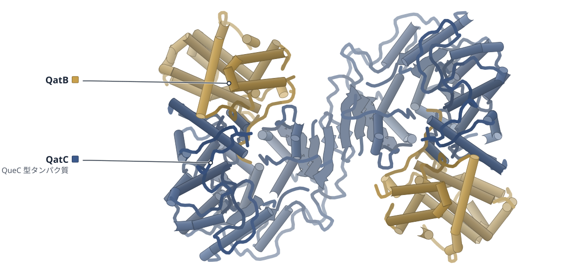
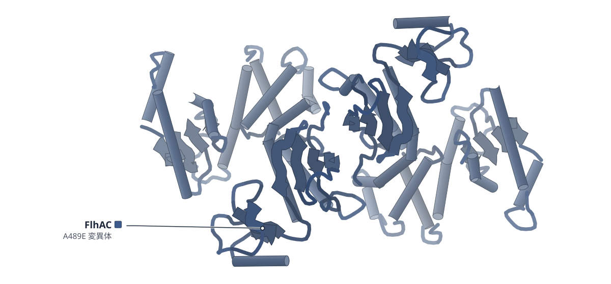
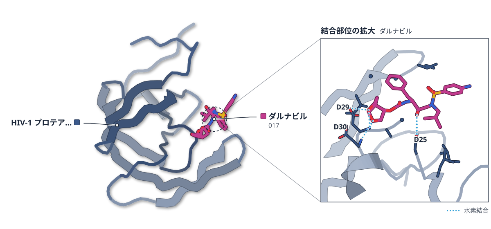
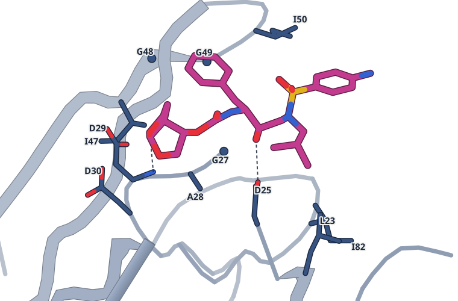

# 2026-10-08 号

**今日の新しい構造：4 本**　Europe PMC に 2026-10-07 に登録されたオープンアクセス論文 33 本のうち、新しい構造を報告した論文は 4 本。すべて紹介する。

## 今日の一本

**1｜QatBのN末端が、QatCの活性部位に入り込んでいた**（QatBC（大腸菌 QatABCD））

選んだ理由（構造生物学・生命科学）：広く存在する抗ファージ防御系で、中心の QatC が何をするかを、結晶構造と変異体の防御実験の両方で示した。

> We show that the QatB N-terminal loop, its binding with QatC and QatC catalytic site are essential for QatABCD defense in vivo, suggesting a modification might occur analogous to CBASS.  
> — Abstract

- 迷った論文：HIV-1プロテアーゼ PRp51 — HIV プロテアーゼの耐性は創薬に近いが、結晶構造では差が出ず結論の中心が MD のため見送った。

| # | 標的 | 手法・分解能 | 見出し |
|---|---|---|---|
| 1 | QatBC（大腸菌 QatABCD） | X線結晶構造解析・2.09–2.66 Å（2 構造） | QatBのN末端が、QatCの活性部位に入り込んでいた |
| 2 | FlhAC A489E（サルモネラ） | X線結晶構造解析・2.90–3.28 Å（2 構造） | A489Eは塩橋網を組み換え、基質切り替えを助ける可能性がある |
| 3 | HIV-1プロテアーゼ PRp51 | X線結晶構造解析・1.55 Å | HIVプロテアーゼでは、離れた置換が活性部位を広げる可能性がある |
| 4 | ホタルルシフェラーゼ（翻訳中） | クライオ電顕・平均 2.3 Å（リボソーム–新生鎖複合体） | ホタルルシフェラーゼは、翻訳されながら少しずつ折りたたまれる |

> この号は AI が論文本文から作成した**レビュー用の下書き**です。数値・ID・リガンドは PDB / UniProt から取得し、AI の記述には本文からの引用を付けています。

---

## 1｜QatBC（大腸菌 QatABCD）

### Structural and functional insights into QueC-family protein in QatABCD anti-phage system

*Nature Communications*（2026-01-01） · [論文](https://doi.org/10.1038/s41467-026-77369-4) · ライセンス: cc by-nc-nd

色（順に）：QatC（QueC 型タンパク質） / QatB

**QatBのN末端が、QatCの活性部位に入り込んでいた**

抗ファージ防御系QatBCの結晶構造。挿入部に変異を入れると防御が弱まった

- **これまでの疑問・課題**：QatABCDの作用機構と、特徴的な構成要素QatCの機能は不明だった。
- **アプローチ**：QatBC複合体のapo型とATP結合型を結晶構造解析し、変異体の抗ファージ活性を調べた。
- **結果**：QatBのN末端ループがQatCの触媒中心に入り込む。この部分や触媒残基は防御に必須だった。
- **わかったこと**：QatCはCap9と同様に、タンパク質を修飾する酵素とみられる。

この4行の根拠（論文本文）

> However, the mechanism of QatABCD, even the function of QatC in this system, remains unclear.  
> — これまでの疑問・課題／Abstract

> Crystal structures of the QatBC complex in apo and ATP-bound form support a shared role for QueC-family proteins in targeting protein substrates for N-terminal modification as in type IV CBASS.  
> — アプローチ／Abstract

> Structure-guided mutational analyses further demonstrate that the catalytic residues of QatC, the zinc-binding motif, and the QatB N-terminal tail are indispensable for anti-phage activity.  
> — アプローチ／Introduction

> We show that QatC forms a stable complex with QatB, in which the N-terminal loop of QatB inserts into the catalytic center of QatC.  
> — 結果／Introduction

> Structure-guided mutational analyses further demonstrate that the catalytic residues of QatC, the zinc-binding motif, and the QatB N-terminal tail are indispensable for anti-phage activity.  
> — 結果／Introduction

> Together, our findings demonstrate that QatC likely acts as a functional analog of Cap9, mediating protein modification within the QatABCD system, and highlight the evolutionary diversification of QueC-like enzymes as a general strategy in prokaryotic immune defense.  
> — わかったこと／Introduction

分類：感染・ウイルス・防御系・酵素（その他）

#### 読みどころ

QatBのN末端ループがQatCの推定活性部位に挿入され、CBASSのCap9–CdnDと同様の配置をとる。QatBがQatCの基質である可能性を示唆し、ペプチド解析ではQatB N末端のNDG修飾も検出された（修飾効率は低いとみられる）。

根拠（論文本文）

> The most notable feature of the interaction is that the QatB N-terminal loop is inserted into the putative active site of QatC  
> — Results

> identified an NDG-modified N-terminal peptide (GTSKAY) from QatB  
> — Results

ATP結合型（2.66 Å）ではF235がアデニンとπ–πスタッキングし、SXGXDSモチーフがβ・γリン酸を配位する。CDGの密度はなく、ATPピロホスファターゼ活性も検出できず、QatCの本来の基質は未解明のままだ。

根拠（論文本文）

> QatC F235 displays a marked conformational change compared with its apo state, to form π-π stacking with the adenine base of the ATP molecule.  
> — Results

> EcQatC does not exhibit obvious ATP pyrophosphatase activity either in the presence or absence of CDG  
> — Results

QatBのN末端を天然のまま得るため、Gly2のコドンをUlp1切断部位に直結した。N末端へのHisタグ付加は防御活性を著しく下げることが分かっており、この工夫が必要な理由になる。

根拠（論文本文）

> we directly linked the codon corresponding to the second glycine residue of QatB to the codon corresponding to the cleavage site of Ulp1  
> — Methods

> adding an N-terminal His-tag before QatB M1 all severely decreased the anti-phage activity of the Qat system  
> — Results

#### 構造データ

| PDB | 手法 | 分解能 | 公開 | 生物種 | リガンド |
|---|---|---|---|---|---|
| [9WVJ](https://www.rcsb.org/structure/9WVJ) | X線結晶構造解析 | 2.09 Å | 2026-09-16 | Escherichia coli | — |
| [9X6C](https://www.rcsb.org/structure/9X6C) | X線結晶構造解析 | 2.66 Å | 2026-09-16 | Escherichia coli | ATP |

- [A0A4Q0WMG2](https://www.uniprot.org/uniprotkb/A0A4Q0WMG2)  Uncharacterized protein — *Escherichia coli* （既存の PDB 構造 2 件）
- [A0A6N2XJ30](https://www.uniprot.org/uniprotkb/A0A6N2XJ30)  Uncharacterized protein — *Citrobacter amalonaticus* （既存の PDB 構造 1 件）

#### 実験メモ

- **発現系**：大腸菌BL21(DE3)。OD600 0.8で0.2 mM IPTG、18 ℃で12時間誘導
- **コンストラクト**：N末端His6-SUMO融合（Ulp1切断）。QatBはGly2から始まる天然のN末端を再現
- **精製**：Ni-NTAでUlp1切断後、Superdex 200 increase 10/300 GLでゲルろ過
- **結晶化／グリッド作製**：15 mg/mL、シッティングドロップ蒸気拡散、18 ℃。ATP型は1 mM ATP・1 mM CDG・2 mM MgCl2を氷上1時間プレインキュベート
- **データ収集・解析**：SSRF BL02U1、0.979 Å、EIGER2 X 9M。AlphaFold2予測モデルで分子置換、PHENIXで精密化

根拠（論文本文）

> The cells were grown at 37 °C until OD600 nm reached 0.8 and then induced at 18 °C for 12 h.  
> — Methods

> Both crystal forms of protein complexes were obtained using the sitting-drop vapor diffusion method at 18 °C by mixing 0.8 μL of protein solution with 0.8 μL of reservoir solution.  
> — Methods

> All diffraction data were collected at the SSRF beamlines BL02U1 using a wavelength of 0.979 Å and a DECTRIS EIGER2 X 9M detector.  
> — Methods

> The initial model was solved by molecular replacement with a structure predicted by AlphaFold2  
> — Methods

> 📝 編集者への確認事項：本文によれば同時期に別グループもQatBC構造を報告している（本文の引用31, 32）。初構造とは書いていない。QatCの触媒反応は未再構成で、N末端修飾はペプチドレベルのMSのみ。

---

## 2｜FlhAC A489E（サルモネラ）

### Structural basis for substrate specificity switching revealed by the FlhA(A489E) suppressor mutation

*Biophysics and Physicobiology*（2026-01-01） · [論文](https://doi.org/10.2142/biophysico.bppb-v23.0030) · ライセンス: cc by-nc-sa

色（順に）：FlhAC（A489E 変異体）

**A489Eは塩橋網を組み換え、基質切り替えを助ける可能性がある**

サルモネラのFlhAC A489E抑制変異体の結晶構造。Arg-386周辺の塩橋網が変わっていた

- **これまでの疑問・課題**：鞭毛のIII型分泌装置が基質特異性を切り替える構造的な仕組みは不明だった。
- **アプローチ**：FlhAC(A489E)を結晶構造解析し、FlhBとの結合をAlphaFold3で予測した。
- **結果**：A489EはArg-386とGlu-483周辺の塩橋網を組み換え、α2ヘリックスの位置が少しずれた。
- **わかったこと**：この変化が、基質特異性の切り替えに伴う構造変化の障壁を下げる可能性がある。

この4行の根拠（論文本文）

> This process is regulated by the coordinated actions of FliK, FlhB, and FlhA, but the structural mechanism underlying substrate specificity switching remains unclear.  
> — これまでの疑問・課題／Abstract

> Here, we determined the crystal structures of the C-terminal cytoplasmic domain of FlhA(FlhAC) carrying the A489E substitution, which partially restores motility of the cleavage-defective flhB(P270A) mutant.  
> — アプローチ／Abstract

> In parallel, AlphaFold3-based structural predictions suggested that the flexible C-terminal cytoplasmic tail of FlhB (FlhBCCT) binds to a groove formed between the α2 helix and β2 strand of FlhAC, overlapping with the intersubunit linker-binding site within the FlhAC ring.  
> — アプローチ／Abstract

> Structural analyses further revealed that the A489E substitution rearranges a local salt-bridge network involving Arg-386 and Glu-483, leading to subtle positional shifts of the α2 helix and remodeling of the predicted FlhBCCT-binding surface.  
> — 結果／Abstract

> These structural changes may alter the predicted interaction between FlhAC and FlhBCCT, thereby lowering the energetic barrier associated with conformational remodeling of the FlhAC ring during substrate specificity switching.  
> — わかったこと／Abstract

分類：トランスポーター

#### 読みどころ

野生型ではArg-386がGlu-483と塩橋を作る。A489Eの半閉型ではArg-386がGlu-489側に引かれてGlu-483から離れ、開型ではGlu-489とGlu-483の両方と塩橋を作る。野生型にない静電ネットワークが現れた。

根拠（論文本文）

> Thus, the introduced Glu-489 establishes a new electrostatic interaction with Arg-386, altering the orientation of the Arg-386 side chain and disrupting its original interaction with Glu-483.  
> — Results

> These interactions generate an alternative electrostatic network that is not observed in the wild-type structure  
> — Results

AlphaFold3の5モデルすべてで、FlhBのC末端尾部がFlhA D1ドメインのα2–β2の溝に置かれた。この溝はフィラメント型リングでの隣接サブユニットのリンカー結合部位と重なる。ただし結合は予測であり、実験では示していない。

根拠（論文本文）

> all five independently generated models consistently positioned FlhBCCT at a groove formed between the α2 helix and β2 strand of the D1 domain of FlhAC  
> — Results

> the α2–β2 groove overlaps with the binding site for the flexible linker region of FlhAC  
> — Results

Arg-386をAlaに置換した変異体は、FliH・FliIがあれば運動性と分泌が正常だが、FliH・FliIを欠くと両方が阻害された。ATPase複合体が働かない条件でこの塩橋網が重要になることを示唆する。

根拠（論文本文）

> the flhA(R386A) substitution inhibited both motility (Figure 5A, middle panel) and protein export (Figure 5B, middle panel) in the absence of FliH and FliI.  
> — Results

#### 構造データ

| PDB | 手法 | 分解能 | 公開 | 生物種 | リガンド |
|---|---|---|---|---|---|
| [23TM](https://www.rcsb.org/structure/23TM) | X線結晶構造解析 | 3.28 Å | 2026-10-07 | Salmonella enterica subsp. enterica serovar Typhimurium | — |
| [23TK](https://www.rcsb.org/structure/23TK) | X線結晶構造解析 | 2.90 Å | 2026-10-07 | Salmonella enterica subsp. enterica serovar Typhimurium | — |

- [P40729](https://www.uniprot.org/uniprotkb/P40729) flhA Flagellar biosynthesis protein FlhA — *Salmonella typhimurium (strain LT2 / SGSC1412 / ATCC 700720)* （既存の PDB 構造 12 件）

#### 実験メモ

- **発現系**：大腸菌BL21(DE3)、LB培地、30 ℃で一晩培養
- **コンストラクト**：N末端His-tag付きFlhAC(A489E)（pYI104-SP3）
- **精製**：HisTrap HP 5 mL、続いてSuperdex 75 10/300 GL。10 mg/mLに濃縮
- **結晶化／グリッド作製**：シッティングドロップ蒸気拡散。形態1はPEG 3000・リン酸pH 6.2・グリセロール、形態2はPEG 3000・HEPES pH 7.5・NaCl、いずれも20 ℃
- **データ収集・解析**：SPring-8 BL41XU・BL45XU。MOSFLM・AIMLESSで処理し、6AI0と3A5Iを鋳型に分子置換

根拠（論文本文）

> His-FlhAC(A489E) was purified by affinity chromatography using a HisTrap HP 5 mL column (Cytiva), followed by size-exclusion chromatography on a Superdex 75 10/300 GL column (Cytiva)  
> — Materials and methods

> Form 1 crystals were grown at 20°C using a reservoir solution containing 0.1 M K2HPO4/Na2HPO4 (pH 6.2), 10% (w/v) polyethylene glycol 3000, and 10% (w/v) glycerol.  
> — Materials and methods

> X-ray diffraction data were collected at beamlines BL41XU and BL45XU at SPring-8  
> — Materials and methods

> Initial phases for Form 1 and Form 2 crystals were obtained by molecular replacement using Phaser-MR [20] in Phenix [21] with PDB entries 6AI0 and 3A5I, respectively.  
> — Materials and methods

> 📝 編集者への確認事項：FlhBとの相互作用はAlphaFold3予測のみで、実験的には未検証。本文の記載どおり「予測」「考えられる」で書いた。

---

## 3｜HIV-1プロテアーゼ PRp51

### Distal amino-acid substitutions contribute to HIV protease inhibitor resistance as directly as proximal amino-acid substitutions

*Scientific Reports*（2026-01-01） · [論文](https://doi.org/10.1038/s41598-026-64620-7) · ライセンス: cc by

色（順に）：HIV-1 プロテアーゼ　スティック：ダルナビル（017）

ダルナビルの結合部位。4 Å 以内の残基：L23, D25, G27, A28, D29, D30, I47, G48, G49, I50, I82。点線は 3.3 Å 以内の N・O の組（2 組）

**HIVプロテアーゼでは、離れた置換が活性部位を広げる可能性がある**

14置換のPRp51とダルナビルの結晶構造では差が小さく、違いはMDで現れた

- **これまでの疑問・課題**：耐性置換は主要と副次に分けられるが、この二分類に明確な定義はなかった。
- **アプローチ**：14置換のPRp51とダルナビルの複合体を結晶構造解析し、分子動力学（MD）で調べた。
- **結果**：野生型との差は、残基間距離も活性部位の容積も、ダルナビル複合体の方がGRL142複合体より大きかった。
- **わかったこと**：近い置換と離れた置換が協調して働く。主要・副次の二分類は単純すぎる可能性がある。

この4行の根拠（論文本文）

> However, no precise definitions of such two categories exist.  
> — これまでの疑問・課題／Abstract

> Herein, using X-ray crystallography and molecular dynamics (MD) simulations we examined the structural basis of antiviral resistance of HIVDRVRp51, an HIV-1 variant that has three proximal (V32I, V82I, I84V) and eleven distal substitutions (L10I/I15V/K20R/L24I/L33F/M36I/ M46L/ I54M/L63P/K70Q/L89M) in the protease region (PRp51), and has high resistance against a protease inhibitor darunavir (DRV), but not against another protease inhibitor GRL142.  
> — アプローチ／Abstract

> MD demonstrated that the proximal and distal substitutions work in concert to carry out structural changes that result in larger perturbations in inter-residue distances and active site cavity volume for DRV-PRp51 over DRV-PRwt compared to GRL142-PRp51 over GRL142-PRwt.  
> — 結果／Abstract

> MD demonstrated that the proximal and distal substitutions work in concert to carry out structural changes that result in larger perturbations in inter-residue distances and active site cavity volume for DRV-PRp51 over DRV-PRwt compared to GRL142-PRp51 over GRL142-PRwt.  
> — わかったこと／Abstract

> The results also suggest reconsideration of the simplistic classification of substitutions as either major or minor.Supplementary InformationThe online version contains supplementary material available at https://doi.org/10.1038/s41598-026-64620-7.  
> — わかったこと／Abstract

分類：プロテアーゼ・感染・ウイルス・防御系

#### 読みどころ

PRp51はダルナビルに対しKiで大きく低下するが、GRL142では低下が小さい。抗ウイルス活性（EC50）の低下はダルナビルが353倍、GRL142が88倍だった。構造に基づく設計で耐性変異に強い阻害剤を作れる余地を示す。

根拠（論文本文）

> In summary, DRV had significant reductions in enzymatic and antiviral activities against PRp51 and HIVp51, respectively.  
> — Results

> GRL142 maintained good potency and had much smaller fold reductions in its Ki and EC50 values  
> — Results

結晶構造だけでは耐性を説明できなかった。14置換のうち活性部位に直接接するのは主にVal82とIle84で、残り11個は直接結合しない。MDで初めて、フラップの開閉と活性部位容積の差として違いが現れた。

根拠（論文本文）

> in their respective crystal structures, there were no noteworthy differences in polar and van der Waals interactions of DRV-PRwt over DRV-PRp51.  
> — Results

> The other eleven residues that underwent substitutions did not have a direct binding interaction with DRV.  
> — Results

MDでは、活性部位容積が結晶構造の値から100 Å3以内に収まる集団がダルナビル–PRwtで61%、ダルナビル–PRp51で29%だった。GRL142では84%と61%。著者は離れた置換が拡張に寄与すると解釈している。

根拠（論文本文）

> only 29% of the DRV-PRp51 population has an active site volume within 100 Å3 of the DRV- PRwt active site volume  
> — Results

> The results suggest that the minor substitutions have a more direct impact on the loss of binding of DRV and in causing HIV’s drug resistance against DRV.  
> — Discussion

#### 構造データ

| PDB | 手法 | 分解能 | 公開 | 生物種 | リガンド |
|---|---|---|---|---|---|
| [9CTX](https://www.rcsb.org/structure/9CTX) | X線結晶構造解析 | 1.55 Å | 2024-08-07 | Human immunodeficiency virus 1 | 017 |

- [O38893](https://www.uniprot.org/uniprotkb/O38893) pol HIV-1 retropepsin — *Human immunodeficiency virus type 1* （既存の PDB 構造 1 件）

#### 実験メモ

- **発現系**：大腸菌Rosetta (DE3) pLysS、ZYM-5052系の自己誘導培地、37 ℃で20〜22時間。封入体として回収
- **精製**：封入体を尿素で洗浄後、ギ酸で変性。逆相クロマトグラフィー（RESOURCE RPC）後に脱塩し、中和バッファーでリフォールド
- **結晶化／グリッド作製**：ハンギングドロップ蒸気拡散。ダルナビル複合体は0.15 M 硫酸アンモニウム、0.1 M HEPES pH 7.0、20% PEG 4000。30%グリセロールで凍結保護
- **データ収集・解析**：ダルナビル複合体はSPring-8 BL44XU（0.9 Å）。既報の別のプロテアーゼ構造を探索モデルに分子置換、Refmacで精密化

根拠（論文本文）

> Rosetta (DE3) pLysS strain (Novagen) was transformed with PRDRVRp51 expression vector  
> — Materials and methods

> The unfolded PRDRVRp51 was refolded with the addition of a neutralizing buffer A  
> — Crystallization of Darunavir-PRp51 and GRL142-PRp51 complexes

> PRDRVRp51-DRV complexes were formed in 0.15 M (NH4)2SO4, 0.1 M HEPES pH 7.0, 20% (w/v) PEG 4000.  
> — Crystallization of Darunavir-PRp51 and GRL142-PRp51 complexes

> were collected under cryogenic temperatures at SPring-8 BL44XU using X-rays of 0.9 Å wavelength  
> — Materials and methods

> the structure 6OGL was used as the search model for molecular replacement using Molrep  
> — Materials and methods

> 📝 編集者への確認事項：GRL142複合体(6MKL)も本論文の構造だが、今回の候補一覧にはダルナビル複合体9CTXのみが載る。結論の多くは著者のMD解析に基づく。本文中でKi倍率が1,432倍（本文）と1,438（表）で食い違うため数値は引用していない。

---

## 4｜ホタルルシフェラーゼ（翻訳中）

### Quasi-continuous cotranslational compaction and folding of a multidomain protein

*Nature Communications*（2026-01-01） · [論文](https://doi.org/10.1038/s41467-026-78090-y) · ライセンス: cc by

**ホタルルシフェラーゼは、翻訳されながら少しずつ折りたたまれる**

力プロファイル解析とクライオ電顕（平均2.3 Å）で、リボソーム上の新生鎖を追った

- **これまでの疑問・課題**：共翻訳フォールディングの研究は、小さな単一ドメインのタンパク質に偏っていた。
- **アプローチ**：力プロファイル解析で、550残基のホタルルシフェラーゼの折りたたみを追った。
- **結果**：中程度の力を生む圧縮・折りたたみが連なり、RF-2ドメインの折りたたみで大きな力が出た。
- **わかったこと**：折りたたみは、少数の協同的な段階が順に進むだけの単純な過程ではなかった。

この4行の根拠（論文本文）

> So far, studies of cotranslational folding have focused mainly on small, single-domain proteins.  
> — これまでの疑問・課題／Abstract

> Here, we have used Force Profile Analysis to study the cotranslational folding of Firefly Luciferase, a complex 550-residue protein composed of an N-terminal domain (NTD) encompassing two split Rossmann folds (RF-1, RF-2) and a β-roll, and a flexibly attached C-terminal domain (CTD).  
> — アプローチ／Abstract

> The folding process is characterized by a quasi-continuous series of compaction/folding steps that generate intermediate-size pulling forces on the nascent chain, punctuated by a prominent high-force event that represents the folding of the RF-2 domain, and a few low-force instances that likely indicate the formation of distinct folding intermediates.  
> — 結果／Abstract

> Our analysis uncovers a cotranslational compaction/folding process that is rich in detail and not just a simple succession of a few distinct, cooperative folding transitions.Subject terms: Protein folding, Computational biophysics, Cryoelectron microscopy, Single-molecule biophysics  
> — わかったこと／Abstract

分類：リボソーム・翻訳・フォールディング

#### 読みどころ

共翻訳フォールディングは、はっきりした少数の折りたたみ転移の連続ではなく、準連続的な圧縮・折りたたみの連なりだった。RF-2ドメインの折りたたみが突出した大きな力のイベントを生み、低い力の数か所は別々の折りたたみ中間体の形成を示すと考えられる。

根拠（論文本文）

> The folding process is characterized by a quasi-continuous series of compaction/folding steps that generate intermediate-size pulling forces on the nascent chain, punctuated by a prominent high-force event that represents the folding of the RF-2 domain  
> — Abstract

> Our analysis uncovers a cotranslational compaction/folding process that is rich in detail and not just a simple succession of a few distinct, cooperative folding transitions.  
> — Abstract

力プロファイルの初期ピークに対応する3つの新生鎖（N=110, 130, 190残基）をクライオ電顕（平均2.3 Å）で見ると、出口トンネル内に大きな折りたたみドメインは見えなかった。初期のピークはトンネル内での安定な部分構造の形成ではなく、リボソームの外での新生鎖の圧縮を表す。

根拠（論文本文）

> structures were determined at an average resolution of 2.3 Å. For all three constructs, stalled NCs were readily apparent in the ET but with only small compact densities evident near the uL24 loop in the exit port  
> — Results

> The absence of more extensive folded domains in the ET shows that these early FP peaks are not generated by the formation of stable substructures within the ET, but rather represent compaction of the NC outside the ribosome.  
> — Results

シャペロンTrigger Factorは、RF-2ドメインの中央部とC末端ドメインの初期が合成されるタイミングで新生鎖と広く相互作用する。折りたたみのどの段階でシャペロンが働くかを、力プロファイルの変化として残基解像度で捉えている。

根拠（論文本文）

> Trigger Factor interacts extensively with the nascent chain when the central part of RF-2 and the early parts of the CTD are synthesized.  
> — Abstract

#### 構造データ

原子モデルのない cryo-EM マップ（EMDB）：[EMD-56368](https://www.ebi.ac.uk/emdb/EMD-56368), [EMD-56453](https://www.ebi.ac.uk/emdb/EMD-56453), [EMD-56462](https://www.ebi.ac.uk/emdb/EMD-56462)

#### 実験メモ

- **発現系**：クライオ電顕用はN末端に6xHisタグを付けたFLucをpET19bから、E. coli BL21(DE3)で1 mM IPTG誘導。SecM(3W)の強い翻訳停止配列で新生鎖を停止させた。
- **コンストラクト**：N=110, 130, 190残基の3つの停止コンストラクト。
- **精製**：停止させたリボソーム–新生鎖複合体（RNC）を精製。
- **結晶化／グリッド作製**：Vitrobotでプランジ凍結（ブロット3秒・待機15秒、湿度100%、4°C）。
- **データ収集・解析**：Krios G3i（300 kV）＋Gatan K3、ピクセルサイズ0.825 Å、総線量40 e–/Ų。CryoSPARC 4.3.0で処理（P-site tRNAを持つ粒子を選別）。

根拠（論文本文）

> a 6xHis tag was added to the N-terminus of FLuc to facilitate purification of RNCs  
> — Methods

> expression from pET19b was induced with 1 mM IPTG in E.coli BL21(DE3)  
> — Methods

> Data were collected on a Krios G3i microscope (Thermo Fisher Scientific, Waltham, Massachusetts, USA) equipped with a Gatan K3 DED at 300 kV with a pixel size of 0.825 Å/pixel, over 40 frames with a total dose of 40 e–/Å2  
> — Methods

> 📝 編集者への確認事項：原子モデルのない cryo-EM マップのみ（EMD-56368 ほか）で、PDB 構造はない。主結果は力プロファイル解析とMDで、クライオ電顕は補強。Europe PMC 上の公開日が 2026-01-01 と表示されるが、索引日は 2026-10-07。構造図は出せないため EMDB マップのみの表示になる。

---
