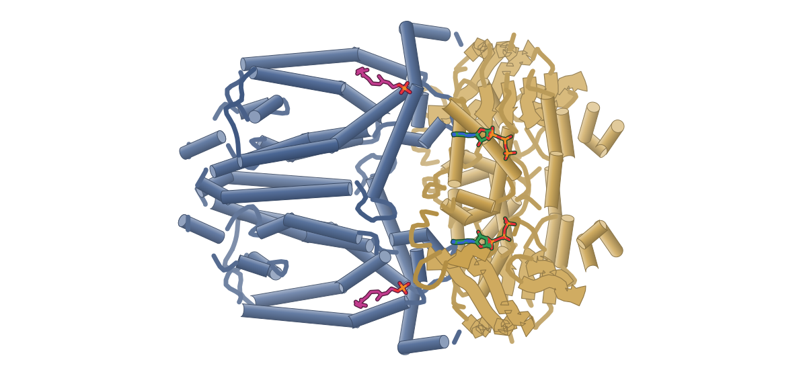
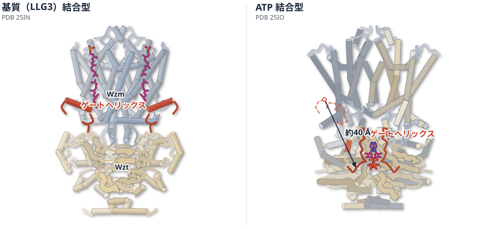
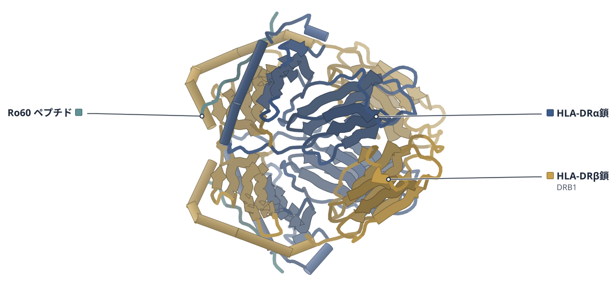
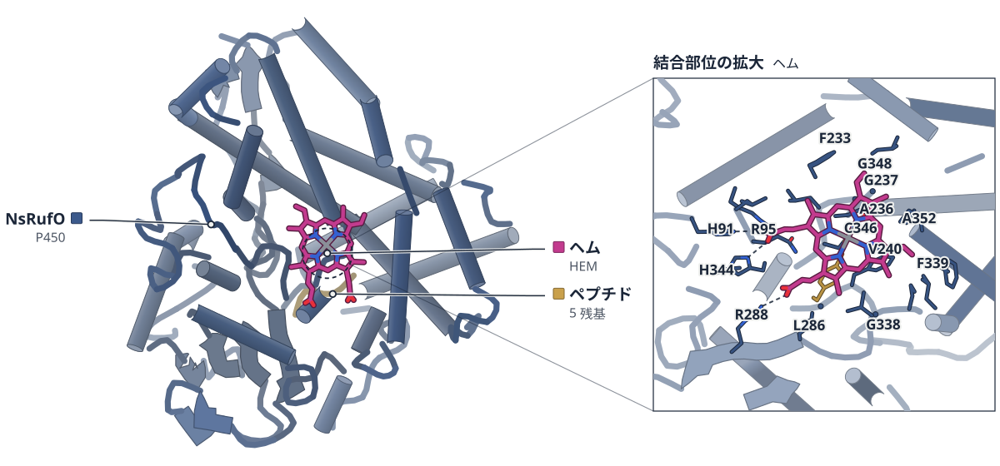
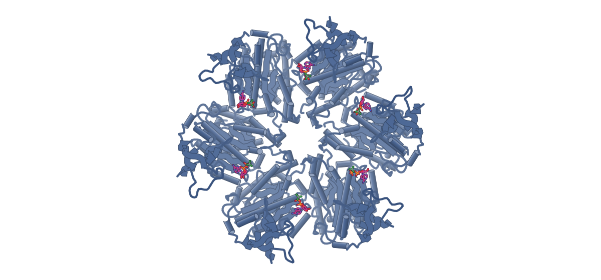
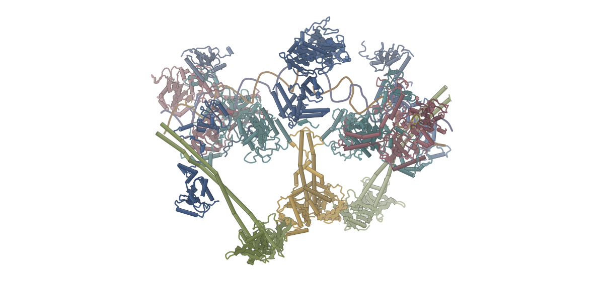
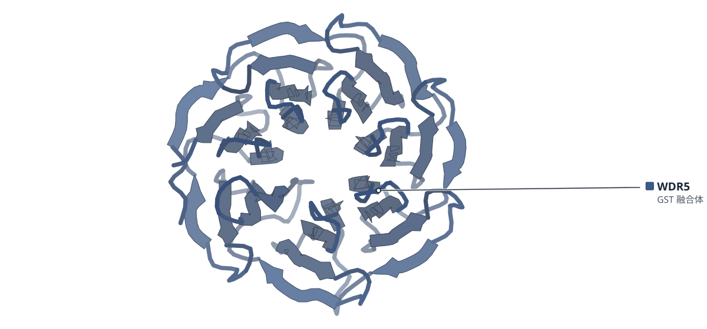

# 2026-10-11 号

**今日の新しい構造：7 本**　Europe PMC に 2026-10-10 に登録されたオープンアクセス論文 22 本のうち、新しい構造を報告した論文は 7 本。すべて紹介する。

**New Structure 4 本** · **Structure Update 3 本**（New Structure：構造が初めて解かれたタンパク質。Structure Update：既知のタンパク質の新しい構造。Structure-Based Study：既存の構造を使った注目の研究）

## Today's Structure（今日の一本）

**1｜基質とATPで構造が切り替わる、結核菌のガラクタン輸送体**（WzmWzt（結核菌））

選んだ理由（構造生物学・生命科学・創薬）：結核菌の細胞壁の材料を運ぶ輸送体の3つの状態を捉え、変異体で機能も確かめた。細胞壁を狙う薬の足場になると著者は述べる。

> The ATP-bound structure revealed a remarkable downward movement of the gate helix, together with the Wzt dimerization.  
> — Abstract

> These data provide a clear structural basis for the development of Mtb cell wall targeted therapeutics for global tuberculosis treatment.  
> — Abstract

- 迷った論文：HLA-DR3–Ro60ペプチド（ヒト） — HLA-DR3 の構造は Treg 療法の設計根拠だが、論文の中心は細胞療法で構造は一部のため見送った。
- 迷った論文：Rho（結核菌） — Rho の NID はゲノムワイドの解析が中心で、構造は補助的なため見送った。

| # | 標的 | 手法・分解能 | 見出し |
|---|---|---|---|
| 1 | WzmWzt（結核菌） | Cryo-EM・2.61–2.91 Å（3 構造） | 基質とATPで構造が切り替わる、結核菌のガラクタン輸送体 |
| 2 | HLA-DR3–Ro60ペプチド（ヒト） | X-ray・2.87 Å | Ro60ペプチドは、HLA-DR3の上で3つの残基をTCRに向ける |
| 3 | NsRufO（P450） | X-ray・1.59 Å | P450酵素RufOのニトロ化には、基質のヒスチジンが欠かせない |
| 4 | Rho（結核菌） | Cryo-EM・3.15–3.40 Å（2 構造） | 結核菌のRhoは、天然変性のNIDで転写停止の目印を選ぶ |
| 5 | NHEJ短距離複合体＋Pol λ（ヒト） | Cryo-EM・7.23 Å | DNA修復の複合体に、Pol λはBRCTとN末端で取り付く |
| 6 | WDR5–PER2 WBMペプチド（マウス） | X-ray・1.38–1.85 Å（2 構造） | 体内時計のPER1とPER2は、WDR5の別々の場所に結合する |
| 7 | PSII C2S2（シロイヌナズナ） | Cryo-EM・全体 2.74 Å | 強光と高温でPSIIはアンテナを失い、重炭酸イオンも抜ける |

> この号は AI が論文本文から作成した**レビュー用の下書き**です。数値・ID・リガンドは PDB / UniProt から取得し、AI の記述には本文からの引用を付けています。

---

# Picked up Today's Structure

## 1｜WzmWzt（結核菌）

### Recognition and mechanism of M. tuberculosis cell wall galactan transport

*Nature Communications*（2026-01-01） · [論文](https://doi.org/10.1038/s41467-026-78496-8) · ライセンス: cc by-nc-nd

筆頭著者：Chuancun Wei（ShanghaiTech University, China）　責任著者：Rainer Kalscheuer（Heinrich Heine University Düsseldorf, Germany）、Gurdyal S. Besra（University of Birmingham, UK）、Lu Zhang（ShanghaiTech University, China）

色（順に）：Wzm（膜貫通） / Wzt（ATP 結合）　スティック：LLG3の脂質（推定）（A1E8P）

この比較図の根拠（論文本文）

> except for N-terminal 1–10 of the TMD and N-terminal 1–5 of the NBD in both states, the C-terminus 40-46 of the NBD gate helix, and 265–273 of the NBD subunit in the open state, the N-terminal 23–33 of the NBD gate helix region  
> — Results

> The distance between the upward and downward gate helix is ~ 40 Å by measuring the Cα of Ala36  
> — Results

> Consequently, the gate helix region is dissociated from the TMDs and participates in ATP binding and NBD dimerization  
> — Results

**基質とATPで構造が切り替わる、結核菌のガラクタン輸送体**

3つの状態をクライオ電顕で解析。ゲートヘリックスの動きが輸送のカギを握る

- **疑問・課題**：ABC輸送体のWzmWztは、結核菌の細胞壁の材料になる糖鎖（ガラクタン）を膜の向こう側へ運ぶ。その運び方は未解明だった。
- **アプローチ**：基質とみられる分子が結合した状態、ATPが結合した状態など、WzmWztの3つの姿をクライオ電顕で調べた。
- **結果**：基質が結合した状態ではゲートヘリックスが上向きに伸び、ATPが結合すると約40 Å下向きに動いて、2つのWztが合わさって二量体になった。
- **わかったこと**：基質が結合するとゲートヘリックスが伸び、二量体になる準備が整う。ATPで二量体になると基質の居場所がつぶれ、基質は膜の通路へ押し出されると考えられる。
- **残された課題**：界面活性剤DDMが入った中間的な状態が、細胞内でも起こるかは未確認。

この紹介文の根拠（論文本文）

> Cross-membrane translocation of LLG is energetically unfavorable and is therefore catalyzed by WzmWzt, a prominent member of the polysaccharide ABC transporter sub-family.  
> — 疑問・課題／Abstract

> However, due to the complex chemical structure of the natural LLP substrates and the existence of detergent micelles or phospholipids used in nanodisc reconstitution, the molecular basis of natural bacterial LLP recognition by these ABC transporters, in particular the transmembrane domains (TMDs), remains largely unresolved.  
> — 疑問・課題／Introduction

> Notably, densities suggestive of the mycobacterial-derived LLG substrates were observed in the structure of WzmWztMtb, indicating that the substrate may bind through two Wzm and two Wzt subunits.  
> — アプローチ／Abstract

> The third, DDM/ATP-bound structure captured WztWzmMtb in an intermediate state with two DDM molecules in the Wzm central cavity.  
> — アプローチ／Abstract

> This proposed LLG binding is fulfilled by a fully upward extension of the Wzt gate helix, which serves as a critical step to prime Wzt for dimerization.  
> — 結果／Abstract

> The ATP-bound structure revealed a remarkable downward movement of the gate helix, together with the Wzt dimerization.  
> — 結果／Abstract

> The distance between the upward and downward gate helix is ~ 40 Å  
> — 結果／Results

> This proposed LLG binding is fulfilled by a fully upward extension of the Wzt gate helix, which serves as a critical step to prime Wzt for dimerization.  
> — わかったこと／Abstract

> ATP binding-induced NBD dimerization, together with the local conformational changes on the TMD interface, crushes the LLG3 binding cavity and forces the substrate to translocate through the TMD cavity.  
> — わかったこと／Discussion

> Whether the DDM-bound conformation is physiologically relevant remains to be determined  
> — 残された課題／Results

分類：トランスポーター・感染・ウイルス・防御系

#### 読みどころ

LLG3と推定した密度は、TMDだけでなくNBDにも接する。ABC輸送体の構造では見られていなかった様式だ。ただし密度から基質の完全な同定はできず、著者は追加の検証が必要だとしている。

根拠（論文本文）

> Unexpectedly, each LLG3 is engaged in interactions not only with the two TMDs, but also with the two NBDs  
> — Results

> The modeling of LLG3 suggests that the substrate is bound, the EM density does not support unambiguous assignment to the intact LLG, and further orthogonal validation would be required for confident assignment.  
> — Results

基質結合状態ではNBDのゲートヘリックスが完全に上向きに伸びてTMDと基質に接する。ATPが結合するとゲートヘリックスは約40 Å離れた下向きの状態に移り、NBDが二量化する。TMDのArg48が基質結合部位から外れ、基質が上へ動く足がかりになると推定している。

根拠（論文本文）

> Notably, the structure revealed a dramatic downward conformation of the gate helix region upon ATP binding, which has never been observed in the WztAa or TarH structures.  
> — Results

> The distance between the upward and downward gate helix is ~ 40 Å by measuring the Cα of Ala36  
> — Results

TMD中央の空洞にはDDM分子が2つ入った中間的な状態も捉えた。著者はこの状態が生理的かどうかは未確定とし、LLG3とDDMの結合部位を、立体構造特異的な阻害剤探索の足場になるとしている。ガラクタン経路の阻害剤は報告がない。

根拠（論文本文）

> Whether the DDM-bound conformation is physiologically relevant remains to be determined.  
> — Results

> The LLG3 and DDM binding sites determined in this study provide a foundation for the discovery of conformational-specific inhibitors  
> — Discussion

#### 構造データ

| PDB | 手法 | 分解能 | 公開 | 生物種 | リガンド |
|---|---|---|---|---|---|
| [25IN](https://www.rcsb.org/structure/25IN) | Cryo-EM | 2.91 Å | 2026-10-07 | Mycobacterium tuberculosis H37Rv | A1E8P |
| [25IO](https://www.rcsb.org/structure/25IO) | Cryo-EM | 2.78 Å | 2026-10-07 | Mycobacterium tuberculosis H37Rv | ATP |
| [25IP](https://www.rcsb.org/structure/25IP) | Cryo-EM | 2.61 Å | 2026-10-07 | Mycobacterium tuberculosis H37Rv | A1E8P, ATP |

- [P72047](https://www.uniprot.org/uniprotkb/P72047) rfbE Probable O-antigen/lipopolysaccharide transport ATP-binding protein ABC transporter RfbE — *Mycobacterium tuberculosis (strain ATCC 25618 / H37Rv)* （PDB で初めての構造）
- [P72049](https://www.uniprot.org/uniprotkb/P72049) rfbD Probable O-antigen/lipopolysaccharide transport integral membrane protein ABC transporter RfbD — *Mycobacterium tuberculosis (strain ATCC 25618 / H37Rv)* （PDB で初めての構造）

#### 実験メモ

- **発現系**：スメグマ菌（M. smegmatis）で共発現。内在の脂質を複合体ごと回収できる。
- **コンストラクト**：Wzt N末端にFLAGタグ。野生型は精製できず、Walker B変異E183Qで精製に成功。
- **精製**：LMNGまたはDDMで可溶化し、抗Flagレジン → サイズ排除クロマトグラフィー（Superose 6）。LMNG試料はGDNに置換。
- **結晶化／グリッド作製**：Quantifoil R0.6/1 Cu 300メッシュ、Vitrobot Mark IV 4°C・湿度100%、ブロット3秒。
- **データ収集・解析**：Titan Krios＋Gatan K3、ピクセルサイズ0.832 Å、総線量60 e⁻/Ų。cryoSPARCで処理。

根拠（論文本文）

> Our attempts to purify the stable wild-type WzmWztMtb complex were unsuccessful. We therefore introduced the Walker B mutation E183Q into Wzt  
> — Results

> Grids were blotted for 3 s using an FEI Mark IV Vitrobot (humidity 100%, temperature 4 °C), followed by flash-freezing in liquid ethane.  
> — Methods

> The protein complex solubilized in LMNG was washed with an additional 15 mL of Buffer 4(Buffer 1 supplemented with 0.04% GDN, 2 mM DTT) to replace the detergent micelle.  
> — Methods

> images were recorded in super-resolution mode at a magnification of 105,000×, corresponding to a calibrated pixel size of 0.832 Å.  
> — Methods

> 📝 編集者への確認事項：初構造の判定は candidates の first_structure に従った（論文は『初』とは明言せず、関連する Mab 類縁体の構造が直前に報告されている）。LLG3の割り当ては論文自身が暫定としている。構造図は PDB 25IN（最高分解能は 25IP の 2.61 Å）。

---

# New Structure

## 2｜HLA-DR3–Ro60ペプチド（ヒト）

### Tregs transduced with a Ro60-reactive TCR have increased immunosuppressive functions in Sjögren’s disease

*iScience*（2026-09-28） · [論文](https://doi.org/10.1016/j.isci.2026.117642) · ライセンス: cc by

筆頭著者：Zhi Feng Sherman Lim（Monash University, Australia）　責任著者：Joshua D. Ooi（Monash University, Australia）

色（順に）：HLA-DRα鎖 / HLA-DRβ鎖（DRB1） / Ro60 ペプチド

**Ro60ペプチドは、HLA-DR3の上で3つの残基をTCRに向ける**

自己抗原ペプチドと結合したHLA-DR3の初の結晶構造（2.87 Å）。TCRを組み込んだTregは抑制力が約2倍に

- **疑問・課題**：シェーグレン病では、HLA-DR3が自己抗原Ro60の断片をT細胞に見せる。しかしその結合の構造は、これまで分かっていなかった。
- **アプローチ**：Ro60ペプチドを結合したHLA-DR3の結晶構造を決め、Ro60に反応するTCR（T細胞の受容体）を組み込んだ制御性T細胞（Treg）も作った。
- **結果**：ペプチドは標準的な向きで結合し、P2・P5・P8の3つの残基が外に出てTCRと接する位置にあった。
- **わかったこと**：このTCRを組み込んだTregは、Ro60に反応する炎症を、通常のTregより約2倍強く抑えた。
- **残された課題**：導入したTregの性質と安定性を、さまざまな条件で調べることが今後の課題とされる。

この紹介文の根拠（論文本文）

> This allele is particularly efficient at presenting peptides derived from the Ro autoantigen  
> — 疑問・課題／Introduction

> Notably, this is the first structure of HLA-DR3 bound to an autoantigenic peptide, as previous structural data have been limited to complexes with CLIP peptides.  
> — 疑問・課題／Results

> Using this optimized platform, we determined the crystal structure of HLA-DR3 bound to the immunodominant Ro60369–383 peptide (PDB 9YZ3) at 2.87 Å resolution (R_work 23.7%, R_free 29.9%).  
> — アプローチ／Results

> We designed a TCR-Treg that recognizes a dominant epitope of the Ro60 antigen (Ro60369-383) presented by HLA-DRB1∗03:01 and demonstrate that these cells can selectively suppress autoreactive T cells more effectively than polyclonal Treg.  
> — アプローチ／Abstract

> Three residues: P2-Leucine, P5-Valine, and P8-Serine were solvent-exposed and positioned for TCR recognition (Figure 3).  
> — 結果／Results

> the Ro60369–383 peptide adopts a canonical register  
> — 結果／Results

> Importantly, Ro60-Treg exhibited approximately 2-fold enhanced suppression of Ro60-driven inflammatory responses compared with non-engineered Treg, demonstrating robust antigen-specific regulatory function across both donor types.  
> — わかったこと／Results

> We designed a TCR-Treg that recognizes a dominant epitope of the Ro60 antigen (Ro60369-383) presented by HLA-DRB1∗03:01 and demonstrate that these cells can selectively suppress autoreactive T cells more effectively than polyclonal Treg.  
> — わかったこと／Abstract

> Future studies will therefore focus on systematically evaluating the phenotype and stability of the engineered Treg across these settings.  
> — 残された課題／Discussion

分類：免疫（抗体・MHC・TCR・自然免疫）

#### 読みどころ

HLA-DR3に自己抗原ペプチドが結合した初の構造だと著者は述べる。これまではCLIP複合体に限られていた。分解能は2.87 Åで、Rfreeは29.9%とやや高い。

根拠（論文本文）

> Notably, this is the first structure of HLA-DR3 bound to an autoantigenic peptide, as previous structural data have been limited to complexes with CLIP peptides.  
> — Results

> the Ro60369–383 peptide adopts a canonical register, with the 9-mer binding core defined as FLLAVDVSA.  
> — Results

HLA-DR3は発現収量が低く、Ro60ペプチドの直接発現は約0.3 mg/Lだった。CLIPのポケット4をAspにした変異（P4D）で約11 mg/Lに上がり、熱安定性も改善したため、ペプチド交換で結晶化に必要な量を確保できた。

根拠（論文本文）

> Substituting aspartic acid at Pocket 4 from alanine (P4D) or lysine at Pocket 6 from proline (P6K) markedly improved yields, with CLIP_P6K reaching ∼1.3 mg/L and CLIP_P4D achieving ∼11 mg/L  
> — Results

> These findings demonstrate that rationally designed point mutations can enhance the stability and expression of soluble HLA-DR3, enabling structural characterization of low-yield peptide-MHC complexes.  
> — Results

この構造は、Ro60に反応するTCRを導入したTreg療法の設計根拠になる。患者TregにこのTCRを導入するとin vitroで抑制能が約2倍になったが、in vivoの検証は今後の課題だ。

根拠（論文本文）

> Importantly, Ro60-Treg exhibited approximately 2-fold enhanced suppression of Ro60-driven inflammatory responses compared with non-engineered Treg  
> — Results

> extending these findings into in vivo models will be an important next step to further validate functional efficacy  
> — Limitations of the study

#### 構造データ

| PDB | 手法 | 分解能 | 公開 | 生物種 | リガンド |
|---|---|---|---|---|---|
| [9YZ3](https://www.rcsb.org/structure/9YZ3) | X-ray | 2.87 Å | 2026-09-09 | Homo sapiens | — |

- [P01903](https://www.uniprot.org/uniprotkb/P01903) HLA-DRA HLA class II histocompatibility antigen, DR alpha chain — *Homo sapiens* （既存の PDB 構造 142 件）
- [P10155](https://www.uniprot.org/uniprotkb/P10155) RO60 RNA-binding protein RO60 — *Homo sapiens* （PDB で初めての構造）
- [Q5Y7D1](https://www.uniprot.org/uniprotkb/Q5Y7D1) HLA-DRB1 HLA class II histocompatibility antigen DR beta chain — *Homo sapiens* （既存の PDB 構造 2 件）

#### 実験メモ

- **発現系**：Expi293 GnTI⁻細胞で一過性発現（PEI）。培養7日後に上清を回収。
- **コンストラクト**：α鎖・β鎖の細胞外領域をFos/Junジッパーで二量化。β鎖N末端にペプチドを共有結合（CLIP変異体）。
- **精製**：HisTrap → サイズ排除。Factor Xaで切断後、Ro60 369–383を20倍モルで37°C・72時間交換、StrepTactinで未交換体を除去。
- **結晶化／グリッド作製**：4 mg/mL。0.2 M マロン酸ナトリウム、20% PEG 3350で結晶化。20%グリセロールで凍結保護。
- **データ収集・解析**：オーストラリア・シンクロトロンMX2。XDS/Aimlessで処理、PDB 1A6Aで分子置換。

根拠（論文本文）

> The recombinant HLA-DR3 with a covalently linked peptide was transiently expressed in Expi293 GnTI− cells (ThermoFisher) using Polyethylene  
> — STAR Methods

> Synthetic Ro60369-383 peptide (GL Biochem) was added at a 20:1 M ratio and incubated with HLA-DR3 at 37 °C for 72 h to enable peptide exchange.  
> — STAR Methods

> Crystals of HLA-DR3-Ro60369-383 were obtained in 0.2M of sodium malon salt and 20%w/v polyethylene glycol (PEG) 3350.  
> — STAR Methods

> Molecular replacement was performed in PhaserMR (CCP4) using the coordinates of PDB entry 1A6A as the search model.  
> — STAR Methods

> 📝 編集者への確認事項：構造は論文の一部（機能試験が中心）。『HLA-DR3に自己抗原が結合した初の構造』は著者の主張で、独自には確認していない。構造図はPDB 9YZ3。

---

## 3｜NsRufO（P450）

### Mechanism for Aromatic Nitration Catalyzed by Cytochrome P450 Enzymes from Rufomycin Biosynthesis

*Journal of the American Chemical Society*（2026-10-10） · [論文](https://doi.org/10.1021/jacs.6c05584) · ライセンス: cc by

筆頭著者：Alicia M Kirk（The University of Queensland, Australia）　責任著者：Alicia M Kirk（The University of Queensland, Australia）、Max J Cryle（Monash University, Australia）、Marc Garcia-Borràs（Universitat de Girona, Spain）

色（順に）：NsRufO（P450） / ペプチド（5 残基）　スティック：ヘム（HEM）

**P450酵素RufOのニトロ化には、基質のヒスチジンが欠かせない**

抗生物質ルフォマイシンの合成で、His-5を介したプロトンの受け渡しが関わる可能性がある

- **疑問・課題**：P450酵素RufOは、ペプチド中のチロシンにニトロ基を付ける。この珍しい反応がどう進むのかは、はっきりしていなかった。
- **アプローチ**：基質ペプチドを変えて反応を調べ、分子動力学とQM/MM計算を行い、基質が結合したNsRufOの結晶構造も決めた。
- **結果**：基質ペプチド中のヒスチジン（His-5）が、ニトロ化を効率よく進めるのに必要だった。
- **わかったこと**：His-5を経由してプロトンを受け渡す経路が、計算で見つかった。これが副産物の硝酸の生成を避けるのに役立つ可能性がある。
- **残された課題**：計算は硝酸生成の抑制を定量的に証明するものではなく、プロトン中継の役割がありうることを支持するにとどまる。

この紹介文の根拠（論文本文）

> During the biosynthesis of the peptide antibiotic rufomycin, the cytochrome P450 (P450) enzyme RufO catalyzes the aromatic nitration of a tyrosine residue in a ribosomal pentapeptide that serves as a precursor for nonribosomal peptide synthesis.  
> — 疑問・課題／Abstract

> Thus, the underlying mechanisms that allow these two homologous P450s to catalyze different chemistry remain elusive.  
> — 疑問・課題／Introduction

> To understand the mechanism of this unusual P450-mediated reaction, a series of pentapeptides were tested as substrates alongside molecular dynamics simulations and quantum mechanics/molecular mechanics (QM/MM, ONIOM approach) calculations.  
> — アプローチ／Abstract

> A new substrate-bound crystal structure of the homologue NsRufO was also obtained.  
> — アプローチ／Abstract

> These experiments revealed the intimate and necessary involvement of a histidine residue within the pentapeptide substrate of RufO in supporting effective nitration, with the protonation state of the intermediate compound II proposed to influence the production of nitrated tyrosine over unwanted nitrate formation.  
> — 結果／Abstract

> Instead, an energetically favored proton relay transition state was found, where a proton is shuttled from protonated H235 through His-5 and Tyr-3 to Cpd II (TS-5, DE+ZPE = 6.6 kcal mol–1) (Figure blue and Figure S94).  
> — わかったこと／Results and Discussion

> Now, through a combination of substrate turnover experiments, molecular dynamics (MD) simulations, and quantum mechanics (QM) calculations, we present results that strongly implicate tyrosyl radical formation as essential in the proposed mechanism of nitration and suggest that differences in the hydrogen-bonding network in RufO may facilitate a key proton-transfer step to avoid nitrate formation.  
> — わかったこと／Introduction

> these calculations, rather than quantitatively proving kinetic suppression of nitrate formation, should be interpreted as supporting a plausible role of the Tyr-3/His-5/H235/water proton relay in biasing product formation  
> — 残された課題／Results and Discussion

分類：酵素（その他）

#### 読みどころ

ペプチドの変異実験でTyr-3のOHが必須と分かり、計算はチロシルラジカルと・NO2の再結合による経路が最も有利だと示した。ただし競合する硝酸生成との障壁差は1 kcal/mol未満で、著者は定量的な証明ではなく、プロトン中継が反応を偏らせる可能性を支持するにとどめている。

根拠（論文本文）

> Mutation of the crucial Tyr-3 to Phe (Nle-RFLH) or O-Me-tyrosine (Nle-R-(OMe)­Tyr-LH) prevented nitration altogether  
> — Results and Discussion

> these calculations, rather than quantitatively proving kinetic suppression of nitrate formation, should be interpreted as supporting a plausible role of the Tyr-3/His-5/H235/water proton relay in biasing product formation.  
> — Results and Discussion

NsRufOの基質結合型構造（1.59 Å）では、Tyr-3とHis-5がヘムの真上に位置する。RufOとほぼ同じ結合様式だが、I-ヘリックスのH235はHis-5と水素結合せず、E239と水を介して結ぶ。H235が複数の配座をとることを裏づける。

根拠（論文本文）

> Although the substrate conformation is highly similar to that seen in RufO, the I-helix H235 of NsRufO does not H-bond to His-5 as is seen in RufO.  
> — Results and Discussion

> Nle-RYLH is accommodated in the active-site pocket of NsRufO in an almost identical way to the structure of Nle-RYLH bound to RufO (PDB ID: 9DUJ).  
> — Results and Discussion

ペプチド選択性の知見は、ペプチド・タンパク質を選択的にニトロ化する生体触媒の設計に使えると著者は述べる。ただしNO源（NONOate）の分解で活性が大きく下がり、結果はすべて対照ペプチド比で報告されている点に注意が必要だ。

根拠（論文本文）

> this study provides a stronger foundation for engineering P450s for selective peptide nitration  
> — Conclusion

> This reduction in activity appeared to result from degradation of the NO source (diethylamine NONOate) despite best efforts to preserve it  
> — Results and Discussion

#### 構造データ

| PDB | 手法 | 分解能 | 公開 | 生物種 | リガンド |
|---|---|---|---|---|---|
| [22YX](https://www.rcsb.org/structure/22YX) | X-ray | 1.59 Å | 2026-08-12 | Nonomuraea solani, synthetic construct | HEM |

- [A0A1H6EVJ0](https://www.uniprot.org/uniprotkb/A0A1H6EVJ0)  Cytochrome P450 — *Nonomuraea solani* （PDB で初めての構造）

#### 実験メモ

- **発現系**：RufOは大腸菌での収量が低く、相同酵素NsRufO（Nonomuraea solani、同一性46%）を使用。
- **結晶化／グリッド作製**：apo結晶（0.1 M Tris-HCl pH 8.0、30% PEG4000、0.35 M 硫酸リチウム）に100 mMの基質をソーキング。針状結晶。
- **データ収集・解析**：空間群P21212、1.59 Å。データ収集の詳細は補足資料（Table S7）。

根拠（論文本文）

> Due to the low yield of RufO in E. coli, we turned to its homologue (NsRufO) from Nonomurae solani (with 46% identity)  
> — Results and Discussion

> By soaking 100 mM substrate into the apo crystals obtained from PEG-containing conditions (0.1 M Tris-HCl, pH 8.0, 30% (w/v) PEG4000, 0.35 M lithium sulfate)  
> — Results and Discussion

> 📝 編集者への確認事項：結晶構造は論文の一部で、中心はMD・QM/MM計算と活性試験。パケットにMethods本文がなく、発現・精製・データ収集は補足資料にあるため lab_notes は null とした。論文中の菌名は 'Nonomurae solani' と綴られている（原文のまま引用）が、通常の学名は Nonomuraea。

---

## 4｜Rho（結核菌）

### An intrinsically disordered domain of transcription terminator Rho governs genome-wide Rho utilization (Rut) site selection in Mycobacterium tuberculosis

*Nucleic Acids Research*（2026-10-09） · [論文](https://doi.org/10.1093/nar/gkag973) · ライセンス: cc by-nc

筆頭著者：Thuy Duong Do（Université d’Orléans, France）　責任著者：Marc Boudvillain（Université d’Orléans, France）

色（順に）：Rho（転写終結因子）　スティック：ADP、BeF3（BEF）

**結核菌のRhoは、天然変性のNIDで転写停止の目印を選ぶ**

NIDを欠くと、Rhoが見つけるRut部位は1759か所から47か所に減った

- **疑問・課題**：Rhoは、RNAのRut部位に取りついて転写を止める。結核菌のRhoに特有の大きなNIDドメインの役割は不明だった。
- **アプローチ**：配列を網羅的に探す実験（Helicase-SELEX）で結核菌ゲノム全体のRut部位を探し、NMRとクライオ電顕でNIDの状態を調べた。
- **結果**：Rut部位は全長のRhoで1759か所、NIDを欠くRhoでは47か所だった。NIDは決まった形をとらない（天然変性）ドメインだった。
- **わかったこと**：決まった形をもたないNIDが、二次構造をもつRut部位をつかまえるのに重要とみられる。
- **残された課題**：MtbRhoとRNAポリメラーゼの相互作用が一過性か安定か、NIDが関わるかは、実験で確かめる必要がある。

この紹介文の根拠（論文本文）

> RDTT relies on the ATP-dependent Rho helicase, which engages nascent transcripts at loosely defined, C > G-biased Rho utilization (Rut) sites to dismantle transcription complexes.  
> — 疑問・課題／Abstract

> In Mycobacterium tuberculosis, Rho features a unique, large N-terminal insertion domain (NID) of uncertain function.  
> — 疑問・課題／Abstract

> Using enzymatic Helicase-SELEX screening, we identified 1759 putative Rut sites across the M. tuberculosis genome with wild-type Rho (MtbRho) but only 47 with a NID-deleted variant (ΔNID-MtbRho), demonstrating NID’s importance for productive substrate recruitment.  
> — アプローチ／Abstract

> Complementary RDTT assays, affinity measurements, solution NMR, and cryogenic electron microscopy analyses show that the NID is intrinsically disordered, yet critical for engaging Rut sites with substantial secondary structure.  
> — アプローチ／Abstract

> Using enzymatic Helicase-SELEX screening, we identified 1759 putative Rut sites across the M. tuberculosis genome with wild-type Rho (MtbRho) but only 47 with a NID-deleted variant (ΔNID-MtbRho), demonstrating NID’s importance for productive substrate recruitment.  
> — 結果／Abstract

> Complementary RDTT assays, affinity measurements, solution NMR, and cryogenic electron microscopy analyses show that the NID is intrinsically disordered, yet critical for engaging Rut sites with substantial secondary structure.  
> — 結果／Abstract

> Complementary RDTT assays, affinity measurements, solution NMR, and cryogenic electron microscopy analyses show that the NID is intrinsically disordered, yet critical for engaging Rut sites with substantial secondary structure.  
> — わかったこと／Abstract

> Collectively, our data demonstrate that the NID of MtbRho is an intrinsically disordered domain (IDR) critical for the efficient recognition and utilization of genuine Rut sites across the mycobacterial transcriptome.  
> — わかったこと／Introduction

> Moreover, the nature of the interaction between MtbRho and MtbRNAP—whether transient or stable, stabilized or not by the NID—remains to be experimentally determined. ### The NID is an intrinsically disordered domain and remains dynamically flexible upon RNA binding Two main scenarios could explain why the N-terminal domain (NTD; residues 1–221, including the NID) is unresolved in the cryo-EM structure of MtbRho [37].  
> — 残された課題／Results and discussion

分類：DNA・RNA に関わるもの

#### 読みどころ

NIDを欠くと、H-SELEXで拾えるRut部位が1759から47に激減する。NID欠失Rhoは二次構造が安定なRNAをほとんど結合できず、NIDが構造化RNAの捕捉に働くと考えられる。

根拠（論文本文）

> we identified 1759 significant Rut peaks with FL MtbRho (hereafter FL-Rut peaks) and only 47 significant Rut peaks with ΔNID-MtbRho  
> — Results and discussion

> the maximal fraction of RNA bound by ΔNID-MtbRho depends on the predicted structural stability of the RNA  
> — Results and discussion

NMRでNIDは広い範囲で化学シフトが狭く、天然変性領域であることが示された。RNAを加えても折りたたまれず、基質RNAとADP-BeF3存在下の全長Rhoのクライオ電顕（2クラス）でもNIDに秩序のある密度は見えなかった。ヘキサマーがRNAを引き込む様子はクラスIIで示唆された。

根拠（論文本文）

> Crucially, we detected no ordered density for the NID in either class, indicating that the NID does not adopt a folded conformation in the context of the FL MtbRho hexamer, even in the presence of RNA.  
> — Results and discussion

> This narrow chemical-shift dispersion is characteristic of a highly flexible, intrinsically disordered protein lacking secondary or tertiary structure  
> — Results and discussion

M495L置換を入れるとRhoが57 bpのRNA–DNAレポーター二重鎖を巻き戻せ、H-SELEXが成立する。ただし著者は、この変異が下流の段階に及ぼすアロステリックな影響を完全には除外できないと述べている。

根拠（論文本文）

> Without this substitution, the enzyme indeed cannot unwind the 57-bp reporter RNA–DNA duplex used in H-SELEX  
> — Results and discussion

> we cannot formally rule out allosteric effects impacting subsequent steps along the duplex unwinding reaction pathway  
> — Limitations of the study

#### 構造データ

| PDB | 手法 | 分解能 | 公開 | 生物種 | リガンド |
|---|---|---|---|---|---|
| [31HX](https://www.rcsb.org/structure/31HX) | Cryo-EM | 3.15 Å | 2026-09-30 | Mycobacterium tuberculosis | ADP, BEF |
| [31HY](https://www.rcsb.org/structure/31HY) | Cryo-EM | 3.40 Å | 2026-09-30 | Mycobacterium tuberculosis | BEF, ADP |

- [P9WHF2](https://www.uniprot.org/uniprotkb/P9WHF2) rho Transcription termination factor Rho — *Mycobacterium tuberculosis (strain CDC 1551 / Oshkosh)* （PDB で初めての構造）

#### 実験メモ

- **発現系**：大腸菌Rosetta-IIで過剰発現（pET28b系）。NMR試料は15N/13C標識の最少培地。
- **コンストラクト**：MtbRho全長とΔNID（NID 76–219欠失）。いずれもM495L置換入りとタグなし。
- **精製**：Ni-NTA → SP Sepharose → トロンビンでHisタグ切断、再度Ni-NTA/ベンズアミジン。
- **結晶化／グリッド作製**：4 µM Rho、16 µM pstC1 RNA、270 µM ADP-BeF3。UltrAufoil 1.2/1.3、Vitrobot IV 10°C・湿度95%、ブロット4秒。
- **データ収集・解析**：Titan Krios G4＋Falcon 4i、22,095ムービー、総線量39.18 e⁻/Ų。cryoSPARC 4.5で処理。

根拠（論文本文）

> overexpressed in E. coli Rosetta-II cells (Novagen) harboring the pET28b-MtbRho or pET28b-ΔMtbRho plasmid  
> — Materials and methods

> A reaction mixture containing 4 µM FL MtbRho and 16 μM pstC1 RNA in 25 μl EM buffer  
> — Materials and methods

> After blotting for 4 s with a filter paper, grids were plunge-frozen in liquid ethane using a Vitrobot Mark IV (FEI) with 95% chamber humidity at 10°C.  
> — Materials and methods

> Twenty-two thousand ninety-five movies were collected with a total electron dose of 39.18 e−/Å2  
> — Materials and methods

> 📝 編集者への確認事項：candidatesのfirst_structureはtrueだが、本文は既報のMtbRho構造（ref 37）と比較しており、初構造とは書いていない。記事ではNIDが天然変性であることの実験的実証として扱った。

---

# Structure Update

## 5｜NHEJ短距離複合体＋Pol λ（ヒト）

### End processing in NHEJ by Polymerase λ and PNKP is coordinated during short-range synapsis

*Nature Communications*（2026-01-01） · [論文](https://doi.org/10.1038/s41467-026-77503-2) · ライセンス: cc by

筆頭著者：Alex Vogt（Northwestern University, USA）　責任著者：Yuan He（Johns Hopkins University, USA）

色（順に）：LIG4（DNA リガーゼ 4） / XLF（NHEJ1） / Ku70（XRCC6） / Ku80（XRCC5） / Pol λ（POLL） / XRCC4 / DNA 鎖 1 / DNA 鎖 2 / PAXX

**DNA修復の複合体に、Pol λはBRCTとN末端で取り付く**

Pol λとPNKPは同じ複合体の中で協力して、切れた末端を整える

- **疑問・課題**：切れたDNAの末端は、そのままではつなげないことがある。末端を整える酵素が修復の中核複合体にどう組み込まれるかは不明だった。
- **アプローチ**：修復の中核複合体にPol λが結合した状態をクライオ電顕で解析し、Pol λとPNKPの働きを試験管内で調べた。
- **結果**：2つのPol λがBRCTドメインでKu70/80に結合し、N末端はXRCC4–LigIVの近くにあった。Pol λとPNKPは同じ複合体の中で末端を処理した。
- **わかったこと**：中核の複合体は安定した足場になり、酵素が出入りして末端を整える。末端処理は切れ目を保持している間に繰り返し起こる、というモデルを示した。
- **残された課題**：ほかの末端処理酵素にも同じ協調が当てはまるかは、今後の研究課題。

この紹介文の根拠（論文本文）

> NHEJ is capable of repairing a variety of damaged DNA, employing various accessory end-processing factors to resolve chemically blocked ends, trim overhangs, and fill gaps in order to achieve directly ligatable DNA ends.  
> — 疑問・課題／Abstract

> Single-molecule studies in Xenopus egg extracts indicate that at least certain end-processing events occur during short-range synapsis19, but the molecular details underlying these processes’ coordination with the core NHEJ machinery remain unclear, particularly in terms of the structural accommodation of the accessory factors within the large protein-DNA complexes that mediate repair.  
> — 疑問・課題／Introduction

> To investigate the molecular mechanisms underlying end-processing, we determine the cryo-EM structure of the NHEJ specific polymerase Pol λ bound to the short-range synaptic complex, detailing the mode of its recruitment to the complex as well as a putative model for its activity.  
> — アプローチ／Abstract

> We also examine the activity of in vitro reconstituted complexes to show that both Pol λ and PNKP can cooperatively process the same DNA substrate within a single protein complex.  
> — アプローチ／Introduction

> We observe two copies of Pol λ’s BRCT domain bound to the bridge region of Ku70/80  
> — 結果／Results

> This revealed a total of 17 crosslinks between the N-terminus of Pol λ and X4L4  
> — 結果／Results

> Furthermore, the coordinated end-processing activities of the short-range (SR) synaptic complex simultaneously bound by both Pol λ and PNKP, another accessory factor, demonstrates the ability of NHEJ to form large, multifunctional repair complexes capable of processing a variety of different DNA end structures to effect repair.Subject terms: Cryoelectron microscopy, DNA  
> — 結果／Abstract

> Our results provide evidence for a model in which NHEJ end-processing occurs iteratively during short-range synapsis, with the core NHEJ factors forming a stable platform for the enzymes to flexibly access the DSB junction.  
> — わかったこと／Introduction

> Future studies investigating the activities of other end-processing factors will be needed to determine if this mechanism of coordination is conserved and to test if the formation of even larger complexes capable of repairing a wider variety of DSBs is feasible.  
> — 残された課題／Discussion

分類：DNA・RNA に関わるもの・酵素（その他）

#### 読みどころ

Pol λのBRCTドメインはKu70/80のブリッジをまたいで結合し、N末端のペプチド（残基8–15と推定）がLigIVのC-BRCT1に接する。BS3架橋MSでN末端とXRCC4・LigIVの間に多数の架橋が見つかり、この係留が裏づけられた。全体分解能は7.23 Åで、局所精密化で3.86–4.58 Åである。

根拠（論文本文）

> We observe two copies of Pol λ’s BRCT domain bound to the bridge region of Ku70/80  
> — Results

> This revealed a total of 17 crosslinks between the N-terminus of Pol λ and X4L4  
> — Results

末端が相補的でない基質では、LigIVは開いた配座でDSBに留まる。Pol λの触媒ドメインが入る際はLigIVのOBDとNTDが退き、DBDは残って複合体を安定化するというモデルを示す。触媒ドメイン結合状態そのものは電顕で捉えられていない。

根拠（論文本文）

> These results support a mechanism whereby the OBD and NTD domains of LigIV’s catalytic domain are displaced by the polymerase during gap filling, while the LigIV DBD maintains its position at the DSB  
> — Results

> we did not capture a population of particles by electron microscopy substantial enough to produce a 3D reconstruction with the polymerase’s catalytic domain bound to the DSB  
> — Discussion

複合体をMg²⁺なしの緩衝液で組み立て、ビオチン化DNAでプルダウンして未結合因子を除いてからMg²⁺を加える。均質な複合体で酵素活性を測れ、同じ試料を電顕にも回せる。Pol λ、PNKP、LigIVが共存して初めて両鎖が連結される基質も示した。

根拠（論文本文）

> The assembly of the complex and its enzymatic activities are separated by first adding components in a buffer free of Mg2+ followed by performing a pulldown on the biotinylated nucleic acid substrate  
> — Results

> This SR-Pol λ-PNKP complex processes and ligates substrates containing both overhangs and chemically blocked ends, with double ligation only occurring in the presence of both end-processing factors  
> — Results

#### 構造データ

| PDB | 手法 | 分解能 | 公開 | 生物種 | リガンド |
|---|---|---|---|---|---|
| [9OX8](https://www.rcsb.org/structure/9OX8) | Cryo-EM | 7.23 Å | 2026-07-01 | Homo sapiens | — |

- [P12956](https://www.uniprot.org/uniprotkb/P12956) XRCC6 DNA repair protein Ku70 — *Homo sapiens* （既存の PDB 構造 64 件）
- [P13010](https://www.uniprot.org/uniprotkb/P13010) XRCC5 DNA repair protein Ku80 — *Homo sapiens* （既存の PDB 構造 67 件）
- [P49917](https://www.uniprot.org/uniprotkb/P49917) LIG4 DNA ligase 4 — *Homo sapiens* （既存の PDB 構造 31 件）
- [Q13426](https://www.uniprot.org/uniprotkb/Q13426) XRCC4 DNA repair protein XRCC4 — *Homo sapiens* （既存の PDB 構造 35 件）
- [Q9BUH6](https://www.uniprot.org/uniprotkb/Q9BUH6) PAXX Protein PAXX — *Homo sapiens* （既存の PDB 構造 20 件）
- [Q9H9Q4](https://www.uniprot.org/uniprotkb/Q9H9Q4) NHEJ1 Non-homologous end-joining factor 1 — *Homo sapiens* （既存の PDB 構造 26 件）
- [Q9UGP5](https://www.uniprot.org/uniprotkb/Q9UGP5) POLL DNA polymerase lambda — *Homo sapiens* （既存の PDB 構造 96 件）

#### 実験メモ

- **発現系**：Pol λは大腸菌Rosetta2(DE3)でGST融合として発現（18°C、IPTG 0.4 mM）。Ku70/80とLigIV-XRCC4はSf9、XLF・PAXX・PNKPは大腸菌。
- **コンストラクト**：ヒトPol λ全長（Met1–Trp575）、N末端GST融合。
- **精製**：グルタチオンSepharoseでTEV切断 → Superdex 200。
- **結晶化／グリッド作製**：1 nt非相補3′突出DNAで複合体を組み立て、GraFix（10–30%グリセロール/グルタルアルデヒド）で安定化。グラフェンオキサイド grid、Vitrobot IV。
- **データ収集・解析**：Titan Krios＋K3、14,845ムービー、総線量62 e⁻/Ų。cryoSPARC 4.6で処理し、全体7.23 Å。

根拠（論文本文）

> The sequence encoding full-length human Pol λ (Met1-Trp575) was cloned into the NotI/EcoRI restriction sites of the pGEXM vector67 to generate an N-terminal GST-tagged fusion protein.  
> — Methods

> GraFix22 was used to capture the SR-Pol λ complex.  
> — Methods

> Homemade graphene oxide (GO) grids70 were made for cryo-EM by applying GO to glow-discharged 2/1, 400 mesh Quantifoil grids  
> — Methods

> Non-uniform refinement of a final set of 179,057 particles yielded a nominal global resolution of 7.23 Å.  
> — Methods

> 📝 編集者への確認事項：全体分解能が7.23 Åと低く、PDB 9OX8 の詳細な側鎖モデルは局所精密化の範囲に限られる。BRCT・N末端ペプチドの位置はAlphaFold3予測を併用して配置している。『初』とは書いていない。

---

## 6｜WDR5–PER2 WBMペプチド（マウス）

### Role of PER-WDR5 interactions in the mammalian circadian clock

*Nature Communications*（2026-01-01） · [論文](https://doi.org/10.1038/s41467-026-77583-0) · ライセンス: cc by

筆頭著者：Arne Börgel（Johannes Gutenberg-University Mainz, Germany）　責任著者：Jürgen A. Ripperger（University of Fribourg, Switzerland）、Eva Wolf（Johannes Gutenberg-University Mainz, Germany）

色（順に）：WDR5（GST 融合体）

**体内時計のPER1とPER2は、WDR5の別々の場所に結合する**

PER2はCRYと取り合う場所に、PER1は別の場所に結合する。PER2側を結晶構造で確認した

- **疑問・課題**：体内時計で遺伝子の働きを抑えるPER1・PER2の複合体に、WDR5が見つかっていた。その役割は不明だった。
- **アプローチ**：WDR5とPER1・PER2の結合の強さを測り、WDR5とPER2の短いペプチドの結晶構造を決めた。
- **結果**：PER2はWBMという短い配列で、PER1は主にWINという別の配列でWDR5に結合した。PER1のほうが約15倍強く結合する。
- **わかったこと**：PER2の結合場所はCRYの結合面と重なるので、WDR5とCRYは取り合いになる。PER1はWDR5とCRYの両方と同時に複合体をつくれる。
- **残された課題**：PER2とWDR5の結合（PER1の約15分の1の強さ）が、生体内で働くかは未確認。

この紹介文の根拠（論文本文）

> The MLL1 complex component WDR5 was also found in a repressive PER complex.  
> — 疑問・課題／Abstract

> While WDR5 is a well characterized MLL1 complex component, its role in repressive PER containing complexes of the mammalian circadian clock is unknown.  
> — 疑問・課題／Introduction

> Here we show that WDR5 directly binds to the CRY binding domain (CBD) regions of PER1 and PER2.  
> — アプローチ／Abstract

> Our 3D-structure revealed that the PER2 WBM motif 1205IDVTG1209 indeed binds to the WBM motif binding pocket of WDR5, inserting Ile1205 and Val1207 into its two hydrophobic sub-pockets (Fig.  
> — アプローチ／Results

> PER2 binds WDR5 via a WBM motif within the PER2/CRY interface, imposing competition between PER2/WDR5-, PER2/CRY- and RbBP5/WDR5 complexes.  
> — 結果／Abstract

> PER1 binds WDR5 predominantly via a WIN motif outside the CBD, enabling formation of trimeric PER1WIN/WDR5/RbBP5WBM - and PER1/WDR5/CRY complexes.  
> — 結果／Abstract

> In contrast, PER1 predominantly binds to the WDR5 WIN site via a WIN motif outside the CBD and exhibits a 15-fold higher affinity for WDR5 than PER2.  
> — 結果／Introduction

> PER2 binds WDR5 via a WBM motif within the PER2/CRY interface, imposing competition between PER2/WDR5-, PER2/CRY- and RbBP5/WDR5 complexes.  
> — わかったこと／Abstract

> PER1 binds WDR5 predominantly via a WIN motif outside the CBD, enabling formation of trimeric PER1WIN/WDR5/RbBP5WBM - and PER1/WDR5/CRY complexes.  
> — わかったこと／Abstract

> The relevance of PER2 and its potential interaction with WDR5 (which is 15 times weaker than the PER1/WDR5 interaction) remains to be confirmed in vivo.  
> — 残された課題／Discussion

分類：転写調節・シグナル伝達・クロマチン・ヒストン

#### 読みどころ

WDR5とPER2の結晶構造で、PER2のIle1205とVal1207がWDR5の2つの疎水性サブポケットに入る。ITCで測ったPER2–WDR5の結合は約50 µMと弱く、I1205GとD1206Aは結合を完全に壊す。

根拠（論文本文）

> Our 3D-structure revealed that the PER2 WBM motif 1205IDVTG1209 indeed binds to the WBM motif binding pocket of WDR5, inserting Ile1205 and Val1207 into its two hydrophobic sub-pockets  
> — Results

> The D1206A mutation completely disrupted the PER2/WDR5 complex in SEC and ITC  
> — Results

PER1はWINモチーフ（1110ARART1114）が主な結合部位で、親和性は3.1 µMとPER2の約15倍強い。WIN部位の三重変異体でPER1–WDR5複合体はほぼ壊れる。この部位はMLL1も使うため、PER1がMLL1を置き換えうる。ただしin vitroの実験は断片タンパク質を使っている。

根拠（論文本文）

> PER1 binds to WDR5 with a KD value of 3.1 µM (Fig. 3a, c), which corresponds to a ~15 times higher affinity than PER2  
> — Results

> The triple mutant mostly disrupted the WDR5/PER1 complex in SEC (Fig. 3d), confirming the importance of the WDR5 WIN site for PER1 binding.  
> — Results

WDR5のWIN部位阻害剤（Inh-4、Inh-5）はPER1–WDR5複合体を部分的に解離させた。Inh-5は培養細胞のPER2::Luc振動の振幅を最大約50%下げたが、Per1欠損細胞では振幅に影響がなく、PER1に依存した作用と考えられる。

根拠（論文本文）

> Both inhibitors led to a partial dissociation of the PER1/WDR5 complex and accumulation of free WDR5  
> — Results

> Our experiments suggest that the effect of Inh-5 on the oscillation amplitude of wildtype MDF cells needs functional PER1.  
> — Results

#### 構造データ

| PDB | 手法 | 分解能 | 公開 | 生物種 | リガンド |
|---|---|---|---|---|---|
| [8OK1](https://www.rcsb.org/structure/8OK1) | X-ray | 1.38 Å | 2024-04-03 | Mus musculus | — |
| [8OKF](https://www.rcsb.org/structure/8OKF) | X-ray | 1.85 Å | 2024-04-10 | Mus musculus | 144 |

- [O54943](https://www.uniprot.org/uniprotkb/O54943) Per2 Period circadian protein homolog 2 — *Mus musculus* （既存の PDB 構造 3 件）
- [P08515](https://www.uniprot.org/uniprotkb/P08515)  Glutathione S-transferase class-mu 26 kDa isozyme — *Schistosoma japonicum* （既存の PDB 構造 68 件）
- [P61965](https://www.uniprot.org/uniprotkb/P61965) Wdr5 WD repeat-containing protein 5 — *Mus musculus* （既存の PDB 構造 4 件）

#### 実験メモ

- **発現系**：PER1、PER2、WDR5、RbBP5、MLL1は大腸菌Rosetta(DE3)・TB培地・18°Cで一晩発現。CRY1/2はSf9。
- **コンストラクト**：マウスWDR5 22–334、PER1 1013–1291、PER2 1132–1252。結晶化にはPER2 Y1198–1211ペプチド。
- **精製**：GSHまたはHisアフィニティ → 3Cプロテアーゼ切断 → Superdex 200（SEC）。
- **結晶化／グリッド作製**：WDR5/PER2ペプチド複合体：12 mg/mL WDR5＋2 mMペプチド、ハンギングドロップ20°C、0.1 M Tris pH 8.0、50 mM NaCl、13% PEG 8000。凍結保護は20% PEG 200。
- **データ収集・解析**：空間群P42212（a=b=78.15 Å, c=101.75 Å）。データ収集・精密化の詳細は補足資料。

根拠（論文本文）

> PER1, PER2, WDR5, RbBP5, and MLL1 proteins were expressed overnight at 18 °C in E. coli Rosetta (DE3) cells using Terrific Broth (TB) medium.  
> — Methods

> WDR5 22-334 was co-crystallized with a synthetic peptide (Genscript) including residues 1198–1211 of mouse PER2  
> — Methods

> obtained at 20 °C using a hanging drop setup with a reservoir solution containing 0.1 M Tris pH 8.0, 50 mM NaCl and 13% PEG 8000  
> — Methods

> 📝 編集者への確認事項：PDBは8OK1（WDR5 N225A、1.38 Å）と8OKF（WDR5–PER2ペプチド、1.85 Å）。8OK1が最高分解能だが、論文の主張に近い8OKFを構造図に指定した。ligand_label の Inh-5 は構造には含まれない（8OKF の 144 は別のリガンドかもしれない）ので、レビューで確認してほしい。

---

## 7｜PSII C2S2（シロイヌナズナ）

### Effects of high light and elevated temperature on the structure of photosystem II isolated from Arabidopsis thaliana

*Photosynthesis Research*（2026-01-01） · [論文](https://doi.org/10.1007/s11120-026-01238-w) · ライセンス: cc by

筆頭著者：Jack Forsman（Umeå University, Sweden）　責任著者：Jack Forsman, Wolfgang P Schröder（Umeå University, Sweden）、Johannes Messinger（Uppsala University, Sweden）

**強光と高温でPSIIはアンテナを失い、重炭酸イオンも抜ける**

シロイヌナズナのPSIIを2.74 Åで解析。D1のHis252が内側を向き、自己切断を招く可能性がある

- **疑問・課題**：強い光や高温は、光合成で水を分解するタンパク質複合体PSIIを傷める。その傷が構造のどこに出るかを知りたかった。
- **アプローチ**：単離したPSII（C2S2型）に強い光と高温を与えてクライオ電顕で解析し、弱い光で凍らせた既存の構造と比べた。
- **結果**：アンテナなどのサブユニットが外れ、電子を受け取る側の非ヘム鉄まわりに損傷があり、重炭酸イオンも失われていた。
- **わかったこと**：D1のHis252が動き、セリンプロテアーゼ（タンパク質を切る酵素）に似た3残基の組ができて、D1を自ら切断させる可能性がある。
- **残された課題**：この3残基の組が実際にD1を切断できるかは、まだ分かっていない。

この紹介文の根拠（論文本文）

> Photosystem II (PS II) is a large membrane-bound pigment-protein complex responsible for extracting electrons and protons from water during photosynthesis and releasing molecular oxygen into the atmosphere.  
> — 疑問・課題／Abstract

> While light is required to drive the photochemical reactions, high light and high temperature can be damaging to PS II.  
> — 疑問・課題／Abstract

> Our aim is to gain structural insight into the photoprotection and photodamage processes in PSII.  
> — 疑問・課題／Introduction

> To gain insight into potential structural consequences of such conditions, we performed an exploratory study where isolated PS II complexes (C2S2) from Arabidopsis thaliana were exposed to high light and elevated temperature and employed cryo-electron microscopy for structural determination.  
> — アプローチ／Abstract

> This resulted in a ‘high light’ structure (2.74 Å global resolution) which is compared to the published 2.44 Å structure of intact Arabidopsis-PSII vitrified under dim light conditions (control).  
> — アプローチ／Abstract

> The high light structure is missing several of the subunits present in the control, including the strongly bound light-harvesting antenna complexes as well as several small transmembrane and extrinsic subunits.  
> — 結果／Abstract

> Beyond the loss of subunits, the clearest evidence of specific photodamage was found on the acceptor side of the D1 and D2 subunits near the non-heme iron, including the loss of the bicarbonate ligand of the non-heme iron.  
> — 結果／Abstract

> Finally, we were able to observe that high light/elevated temperature conditions result in the movement of the D1:His252 residue, potentially forming a serine protease triad that may trigger auto-proteolysis of the D1 subunit.Supplementary InformationThe online version contains supplementary material available at https://doi.org/10.1007/s11120-026-01238-w.Keywords: Photosynthesis, Photosystem II, Structure, Cryo-EM, High light, High temperature  
> — わかったこと／Abstract

> We speculate that this may form an atypical serine-protease triad or diad (Ekici et al.  
> — わかったこと／Results

> It is currently unclear from the high light structure if the proposed serine-protease triad would be capable of auto-catalytic cleavage of D1  
> — 残された課題／Discussion

分類：光合成・電子伝達

#### 読みどころ

非ヘム鉄のあるアクセプター側でD1・D2のDEループ複数箇所の密度が消え、重炭酸イオンの密度も3.0 RMSDでは見えなくなる。高光下で重炭酸が外れて光保護に働くという生化学の知見に、構造の側から補完的な証拠を与える。

根拠（論文本文）

> At a contour level of 3.0 RMSD the Coulomb potential map for the high light treated PS II complexes showed no density above the non-heme iron  
> — Results

> Our result provides complementary structural information to the significant biophysical evidence that high light can cause the bicarbonate to dissociate from the non-heme iron  
> — Results

D1 His252がQB結合ポケット側へ回転し、Ser264・Asn266と非典型的なセリンプロテアーゼ様トライアドを作りうる位置に来る。D1の自己切断を説明する仮説だが、著者自身も距離が長く、攻撃対象も不明確で、自己触媒が可能かは不明としている。

根拠（論文本文）

> We speculate that this may form an atypical serine-protease triad or diad  
> — Results

> It is currently unclear from the high light structure if the proposed serine-protease triad would be capable of auto-catalytic cleavage of D1  
> — Discussion

単離したPSIIを光処理してから凍結することで、プロテアーゼによる分解を受けない損傷状態を捉えられる。一方、C2対称を課した平均構造なので、個々の複合体の損傷の違いや非対称な損傷は平均化される。

根拠（論文本文）

> As the PS II complexes were illuminated after isolation, proteases were largely absent so that damaged PS II complexes remained undigested  
> — Introduction

> It should be noted that C2-symmetry was enforced in the generation of the cryo-EM map, therefore asymmetric damage would be averaged out across both monomers.  
> — Results

#### 構造データ

| PDB | 手法 | 分解能 | 公開 | 生物種 | リガンド |
|---|---|---|---|---|---|
| 31FD | — | — | 公開待ち | — | — |

#### 実験メモ

- **発現系**：シロイヌナズナ（Col-0）を8週間、20°C・8時間明/16時間暗で栽培。暗所16時間後に葉を回収。
- **コンストラクト**：BBY膜からPSII C2S2複合体（強結合アンテナ付き）を単離。
- **精製**：既報の方法（Forsman et al. 2026）に従う。
- **結晶化／グリッド作製**：1.6 mg Chl/mLを2000 µEで30分照射。約30秒後にQuantifoil R1.2/1.3 Cu 300へ。Vitrobot Mk IV 4°C・湿度100%、ブロット5秒。
- **データ収集・解析**：Titan Krios G2＋Falcon 4＋Selectris、15,511ムービー、総線量40 e⁻/Ų。cryoSPARCでC2対称、2.74 Å。

根拠（論文本文）

> The leaves of the plants were harvested after 16 h of darkness, and BBY membranes (PS II-enriched thylakoid membrane fragments, Berthold et al. 1981)  
> — Methods

> The sample (1.6 mg Chl mL− 1) was then put into a glass vial (approx. diameter 10 mm; sample height 10 mm) and exposed to 2000 µE of light for 30 min  
> — Methods

> The grids were then plunge frozen in liquid ethane using an FEI Vitrobot MkIV (Thermo Fisher Scientific) at 100% humidity, 4 °C, a blot force of -5, a wait time of 1 s and a blotting time of 5 s.  
> — Methods

> In total 15,511 movies were collected, which each contained 40 frames.  
> — Methods

> 📝 編集者への確認事項：対照構造は 9I4T（既報）。PDB 31FD は未公開（released ではない）のため、PDB 由来の分解能・リガンドは取得できず、method_label に本文の値（2.74 Å）を入れた。構造図は作れない可能性が高い。探索的研究と著者自身が位置づけており、仮説（セリンプロテアーゼ様トライアド）は推測として書いた。

---
