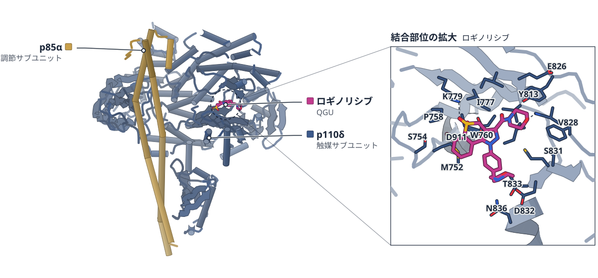
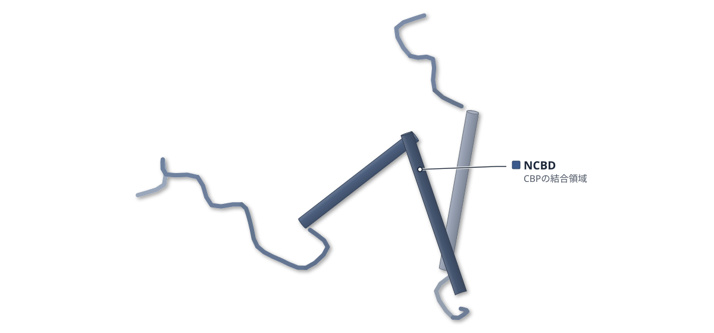
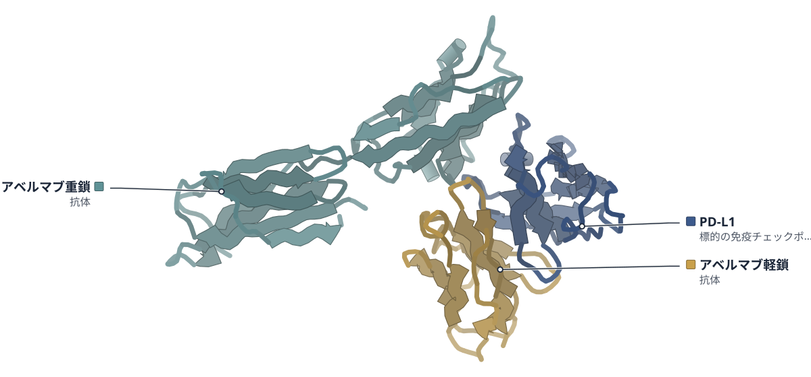

# 2026-10-12 号

**今日の新しい構造：2 本**　PMC に 2026-10-11 に登録されたオープンアクセス論文 23 本のうち、新しい構造を報告した論文は 2 本。うち 3 本を紹介する（残りは末尾に一覧）。

出典：この号の論文情報と全文は、米国国立医学図書館（NLM）の PMC オープンアクセスデータセット（AWS Open Data）から取得した。

**Structure Update 1 本** · **Structure-Based Study 2 本**（New Structure：構造が初めて解かれたタンパク質。Structure Update：既知のタンパク質の新しい構造。Structure-Based Study：既存の構造を使った注目の研究）

## Today's Structure（今日の一本）

**1｜ロギノリシブは、PI3Kδ末端のヘリックスを安定化して阻害する**（ヒトPI3Kδ（p110δ））

選んだ理由（構造生物学・創薬）：新しい創薬候補ロギノリシブの結合様式を、既存薬イデラリシブとの結晶構造の比較で示し、選択性の手がかりをMDとHDX-MSで調べた。

> X-ray crystal structures show distinct binding modes of roginolisib and idelalisib  
> — Results

> Uniquely, binding of roginolisib protected the C-terminal helix kα12 from H/D exchange (region 1022–1044), indicating either direct interaction with this region, and/or stabilisation of the secondary structure  
> — Results

- 迷った論文：CBPのNCBD（マウス） — フルオロプロリンの立体でヘリックスの向きが変わることを NMR で示すが、新しい構造の登録はなく、創薬への結びつきが直接でないため選ばなかった。
- 迷った論文：PD-L1・アベルマブ（ヒト） — HDX-MS と固体 NMR で既存の 5GRJ の結合面を確かめた研究で、新しい構造ではなく手法の確認にとどまるため選ばなかった。

| # | 標的 | 手法・分解能 | 見出し |
|---|---|---|---|
| 1 | ヒトPI3Kδ（p110δ） | X-ray・2.75–2.97 Å（2 構造） | ロギノリシブは、PI3Kδ末端のヘリックスを安定化して阻害する |
| 2 | CBPのNCBD（マウス） | 19F NMR・NOE構造計算・ITC | フルオロプロリンの立体が、NCBDの結合力を左右する |
| 3 | PD-L1・アベルマブ（ヒト） | HDX-MS・固体NMR（既存の5GRJと比較） | アベルマブの結合面は、HDX-MSと固体NMRでも結晶構造と一致した |

> この号は AI が論文本文から作成した**レビュー用の下書き**です。数値・ID・リガンドは PDB / UniProt から取得し、AI の記述には本文からの引用を付けています。

---

# Picked up Today's Structure

## 1｜ヒトPI3Kδ（p110δ）

### PI3Kδ is selectively inhibited by roginolisib by stabilizing the C-terminal helix kα12

*Nature Communications*（2026-10-09） · [論文](https://doi.org/10.1038/s41467-026-77424-0) · ライセンス: cc by

色（順に）：p110δ（触媒サブユニット） / p85α（調節サブユニット）　スティック：ロギノリシブ（QGU）

**ロギノリシブは、PI3Kδ末端のヘリックスを安定化して阻害する**

結晶構造ではkα12は見えず、MDとHDX-MSでイデラリシブとの違いが現れた

- **疑問・課題**：PI3Kのアイソフォームは触媒部位が似ていて選択的に阻害しにくく、ロギノリシブの結合様式がイデラリシブと違うかが課題だった。
- **アプローチ**：ロギノリシブとの結晶構造（2.75 Å）に、分子動力学（MD）と水素重水素交換質量分析（HDX-MS）を組み合わせた。
- **結果**：結晶ではkα12の電子密度が得られなかった。HDX-MSでkα12が交換から守られたのは、ロギノリシブ結合時だけだった。
- **わかったこと**：ロギノリシブはkα12の塩基性残基との相互作用で不活性型を安定化し、δ型への選択性にも関わると著者は考えている。
- **残された課題**：結晶構造ではkα12の電子密度が得られず、その姿はAlphaFoldモデルに基づくMDとHDX-MSから推定している。

この紹介文の根拠（論文本文）

> Achieving high selectivity among PI3K isoforms remains challenging due to the conserved catalytic site.  
> — 疑問・課題／Introduction

> We therefore hypothesized that the binding mode of roginolisib to PI3Kδ might be unique, potentially accounting for its distinct safety profile observed in the clinic.  
> — 疑問・課題／Introduction

> Using a combination of X-ray crystallography, molecular dynamics simulations, and hydrogen-deuterium exchange mass spectrometry, we describe the mechanism driving roginolisib’s potent and isoform-selective inhibition of PI3Kδ.  
> — アプローチ／Abstract

> As a major limitation of the roginolisib crystal structure, only the catalytic p110δ subunit and the p85α iSH2 domain were crystallized and no electron density was obtained for the C-terminal kα12 helix.  
> — 結果／Results

> Uniquely, binding of roginolisib protected the C-terminal helix kα12 from H/D exchange (region 1022–1044), indicating either direct interaction with this region, and/or stabilisation of the secondary structure (Fig. 4a,c).  
> — 結果／Results

> Our work shows that roginolisib, binding in the ATP pocket but not interacting with the specificity pocket, inhibits the enzyme by stabilizing an inactive conformation through interactions with basic residues at the C-terminal end of kα12.  
> — わかったこと／Discussion

> The residues Lys1040 and Arg1043 are unique to the δ and β isoforms and therefore also explain the selectivity of roginolisib for p110δ, and to a lesser extent for the β isoform.  
> — わかったこと／Discussion

> As a major limitation of the roginolisib crystal structure, only the catalytic p110δ subunit and the p85α iSH2 domain were crystallized and no electron density was obtained for the C-terminal kα12 helix.  
> — 残された課題／Results

分類：キナーゼ・酵素（その他）

#### 読みどころ

ロギノリシブは、ヒンジのVal828と水素結合し、Trp760とπ-π相互作用する。イデラリシブが使う特異性ポケットには入らず、DFGモチーフのAsp911は約90°違う向きになる。

根拠（論文本文）

> The solved crystal structure revealed complete electron density for roginolisib within the ATP-binding pocket and indicates an H-bond contact between the morpholine O-atom and the backbone NH of Val828, which belongs to the hinge region.  
> — Results

> The binding of roginolisib pushes Asp911 into a DFG-in-like configuration. By contrast, idelalisib leaves the residue in a rotated (by 90°) orientation resembling the DFG-out aspartate conformation.  
> — Results

MDでは、ロギノリシブ結合時だけkα12が活性部位側へ倒れ、HDX-MSでもkα12が交換から守られた。p85αのcSH2による阻害を外したY685A変異体では守られず、不活性な酵素を選んで結合するとみられる。

根拠（論文本文）

> In multiple simulation replicates (2–5 μs in length) of the roginolisib-bound protein, kα12 further levered towards the kinase active site.  
> — Results

> The situation differs for roginolisib, where protection of the kα12 helix (1022–1044) was only seen for the WT enzyme (Figs. 4a, 5d).  
> — Results

CLL患者の細胞をex vivoで処理すると、ロギノリシブは高用量・2時間でイデラリシブよりPIP3を下げた。ただし解析した患者数は3〜5人と少ない。

根拠（論文本文）

> The analysis revealed that roginolisib was more effective than idelalisib in decreasing PIP3 levels at the 2 h time point and at high dose (Fig. 9c,d).  
> — Results

> Data are shown as individual patient values, with each symbol representing a single patient (a, b: n = 5; c, d: n = 4; e, f: n = 3).  
> — Figure legends

#### 構造データ

| PDB | 手法 | 分解能 | 公開 | 生物種 | リガンド |
|---|---|---|---|---|---|
| [9T07](https://www.rcsb.org/structure/9T07) | X-ray | 2.75 Å | 2026-07-08 | Bos taurus, Homo sapiens | QGU |
| [9T1P](https://www.rcsb.org/structure/9T1P) | X-ray | 2.97 Å | 2026-07-08 | Bos taurus, Homo sapiens | A1JS2 |

- [O00329](https://www.uniprot.org/uniprotkb/O00329) PIK3CD Phosphatidylinositol 4,5-bisphosphate 3-kinase catalytic subunit delta isoform — *Homo sapiens* （既存の PDB 構造 18 件）
- [P23727](https://www.uniprot.org/uniprotkb/P23727) PIK3R1 Phosphatidylinositol 3-kinase regulatory subunit alpha — *Bos taurus* （既存の PDB 構造 28 件）

#### 実験メモ

- **発現系**：ヒトp110δ（1–1044）とウシp85（431–600）を、別々のウイルスでSf9細胞に共発現（26℃、感染48時間後に回収）。
- **コンストラクト**：p110δはN末端に切断可能なHisタグ付き、p85はタグなし。
- **精製**：Ni Sepharose HPで捕捉 → TEVプロテアーゼでHisタグを除去 → Superdex 200 26/60（Tris/NaCl/DTT）。
- **結晶化／グリッド作製**：5 mg/mLのタンパク質に化合物（10 mM DMSO）を加え、12–14% PEG 6000・MES/NaOH pH 5.75のハンギングドロップ蒸気拡散（20℃）。2〜3日で結晶化。
- **データ収集・解析**：Swiss Light Source、100 K。autoPROC/AIMLESSで処理し、PDB 6PYRを探索モデルに分子置換、BUSTERで精密化。

根拠（論文本文）

> The complex of human p110δ (amino acids 1-1044 preceded by an N-terminal cleavable HIS-tag) and bovine p85 (amino acids 431-600, no tag) was co-expressed in Sf9 cells at 26 °C from two separate viruses.  
> — Methods

> The HIS-tag was removed by overnight incubation with TEV-protease and protein was passed over the Ni-column used for the initial capture step.  
> — Methods

> protein at 5 mg/mL concentration was incubated with either roginolisib or idelalisib dissolved at 10 mM in DMSO and crystallized by vapor diffusion in hanging drops.  
> — Methods

> Equal volumes (1 µL:1 µL) of protein and reservoir solution (12-14% PEG 6000, 100 mM MES/NaOH at pH=5.75) were mixed  
> — Methods

> The structures were solved by molecular replacement using Phaser55 and a published human PI3Kdelta crystal structure (PDB ID: 6PYR).  
> — Methods

> 📝 編集者への確認事項：本文は完結。PI3Kδ の結晶構造は既報多数（first_structure は false、『初』は使わない）。新規はロギノリシブ(9T07, 2.75 Å)と類縁体 IOA-288 (9T1P, 2.97 Å)の複合体。kα12 の電子密度は結晶では得られておらず、中心的な主張（kα12 の安定化・不活性型への固定）は AlphaFold モデルに基づく MD と HDX-MS による。そのため見出し・補足は『結晶では見えず MD と HDX-MS で』と限定した。患者試料は n=3〜5。

---

# Structure-Based Study

## 2｜CBPのNCBD（マウス）

### Distinct Molten‐Globule Conformations in an Interacting Protein Domain Resolved by 19F NMR of Fluoroproline Residues

*Angewandte Chemie (International Ed. in English)*（2026-08-22） · [論文](https://doi.org/10.1002/anie.4052471) · ライセンス: cc by-nc-nd

PDB 2KKJ（論文が使った既存の構造）

色（順に）：NCBD（CBPの結合領域）

**フルオロプロリンの立体が、NCBDの結合力を左右する**

既存のNMR構造2KKJなどと比べ、19F NMRでヘリックスの向きを調べた

- **疑問・課題**：モルテングロビュール（折りたたみが緩く揺らぐ状態）のNCBDは、構造の詳細を調べにくい。
- **アプローチ**：ループの2か所のプロリンを、立体が逆の4-フルオロプロリン（4R・4S）に置き換え、19F NMRなどで調べた。
- **結果**：NOEによる構造計算で3本のヘリックスの向きが変種ごとに異なり、AD-ACTRとの結合力も変わった。
- **わかったこと**：炭素4位の立体の反転だけで、ヘリックスの向きと結合力が変わった。プロリンは離れた部位の動きの連動を調節しうる。
- **残された課題**：構造計算は単一の立体配座を仮定しており、各変種が取る構造の広がりを定量的には表せない。

この紹介文の根拠（論文本文）

> However, due to multiple conformations existing in dynamic equilibrium on a wide range of timescales, the detailed structural characterization of molten‐globules remains challenging.  
> — 疑問・課題／Introduction

> To assess the specific role of prolines in the conformational dynamics of the NCBD, we used a chemical biology approach combining NMR with the site‐specific incorporation of stereoisomeric 4‐(R)‐ and 4‐(S)‐fluoroprolines within both loops of NCBD (Figure 1A).  
> — アプローチ／Introduction

> The resulting sets of structures display different orientations of the three helices depending on the fluorination site and fluoroproline stereochemistry (Figures 3 and S22).  
> — 結果／Results

> Among the four fluorinated variants of NCBD, P13(4R) and P30(4R) variants are slightly better binders than WT NCBD  
> — 結果／Results

> Seemingly subtle inversion of chirality at carbon‐4 atom was sufficient to modify the relative orientation of α‐helices and to modulate the binding affinity of the resulting NCBD variants to AD‐ACTR.  
> — わかったこと／Conclusion

> Our results explicitly show how prolines can modulate dynamics and long‐range couplings between protein structural elements  
> — わかったこと／Conclusion

> While the modelling procedure used in this work does not provide a quantitative model of the conformational space sampled by each variants due to the presence of minor conformational states and their effect on NOE values  
> — 残された課題／Discussion

> It should be stressed that the use of a single conformer during the modelling is biasing the set of representative conformations.  
> — 残された課題／Results

分類：転写調節・シグナル伝達

#### 読みどころ

立体が逆のフルオロプロリンで、3本のヘリックスの向きが変わった。4R体のP13だけが、既存の2KKJ（単独）と1KBH（AD-ACTRとの複合体）に近い向きで、他の3変種は別の角度の組み合わせをとった。

根拠（論文本文）

> Out of the four fluorinated NCBDs, only P13(4R) displayed relative helices orientation comparable to a previously reported solution structure of free NCBD [17] (PDB ID: 2KKJ) and in complex with AD‐ACTR (PDB: ID 1KBH) [28].  
> — Discussion

> The three other variants sample helical orientations resulting from different combinations of previously observed α1/α2 and α2/α3 interhelical angles.  
> — Discussion

ITCでは、P13の4R体の方が4S体より強く結合した（KDは277 nMと402 nM）。フッ素は結合界面になくても、19F NMRの信号は結合の有無を反映した。著者はこれを、複合体に近い形に偏った状態が選ばれる機構と考える。

根拠（論文本文）

> Our results are consistent with these data with KD of 277 nM for P13(4R) NCBD and 402 nM for P13(4S) NCBD variants at 25 °C, respectively.  
> — Discussion

> Remarkably, all four fluorine spectra reported on the binding event, despite the fact that the corresponding prolines are not directly located at the protein–protein interface.  
> — Results

> suggesting a conformational selection mechanism involving an allosteric coupling between the loop L1 and the remaining parts of the protein  
> — Discussion

P30の4R体だけが、中性のpHでアミロイドを作った。この変種のモデルでは第1ヘリックスの向きが他と180°違い、著者は、凝集しやすい部位が溶媒に出る可能性を挙げている。

根拠（論文本文）

> Strikingly, for only one variant with 4‐(R)‐Pro at position 30 we observed the self‐assembly into amyloids at neutral pH  
> — Conclusion

> The representative conformations of NCBD P30(4R) variant obtained with the help of ARIA software indicate a particular orientation of the first helix that is rotated by 180° compared to other fluorinated NCBDs.  
> — Discussion

> This local effect may lead to a transient reorientation of NCBD helices exposing ‘aggregation hotspots’ localized in helices α2 and α3  
> — Discussion

#### 構造データ

| PDB | 手法 | 分解能 | 公開 | 生物種 | リガンド |
|---|---|---|---|---|---|
| [2KKJ](https://www.rcsb.org/structure/2KKJ) | Solution NMR | — | 2010-06-30 | Mus musculus | — |
| [1KBH](https://www.rcsb.org/structure/1KBH) | Solution NMR | — | 2002-02-06 | Homo sapiens, Mus musculus | — |

- [P45481](https://www.uniprot.org/uniprotkb/P45481) Crebbp Histone lysine acetyltransferase CREBBP — *Mus musculus* （既存の PDB 構造 0 件）
- [Q9Y6Q9](https://www.uniprot.org/uniprotkb/Q9Y6Q9) NCOA3 Nuclear receptor coactivator 3 — *Homo sapiens* （既存の PDB 構造 0 件）

#### 実験メモ

- **発現系**：発現ではなく、固相ペプチド合成で作成した。
- **コンストラクト**：CBPの2066〜2112（47残基）。2077位（P13）か2094位（P30）をフルオロプロリンに置換。
- **精製**：HPLCで精製し、20 mMリン酸緩衝液 pH 7.2に溶かした。
- **データ収集・解析**：1H-1H NOESYを304 K、700・900 MHzで測定し、ARIAで構造計算。19F NMRは565 MHz。

根拠（論文本文）

> Four 47‐residues NCBD variants (encompassing residues 2066 to 2112 of CBP) were synthesized using solid‐phase peptide synthesis by inserting either a 4‐(R)‐FPro or a 4‐(S)‐FPro at positions 2077 or 2094  
> — Results and Discussion

> The resulting proteins were purified using HPLC (Figures S1–S4) and dissolved in a 20 mM phosphate buffer at pH 7.2.  
> — Results and Discussion

> The 3D structures of the four modified NCBDs were investigated using 1H‐1H NOESY spectra recorded at 304 K and at proton frequencies of 700 and 900 MHz.  
> — Results and Discussion

> 565 MHz 19F NMR spectra of the four modified NCBD variants dissolved in H2O/D2O  
> — Figure legends

> 📝 編集者への確認事項：新しい構造ではない（impact: mechanism）。既存のNMR構造2KKJ・1KBHは、変種のモデルとの比較に使われている。変種のNOE構造モデルは本文ではPDBへの登録に触れておらず、データはZenodoで公開とだけ書かれている。著者自身が単一の立体配座を仮定したモデルは偏るとしている。本文にMethods節はなく（補足資料）、lab_notesは本文中の記述のみ。構造図は2KKJ（遊離型NCBD）。1KBHはAD-ACTRとの複合体。

---

## 3｜PD-L1・アベルマブ（ヒト）

### Characterization of Full‐Length Antibody Complexes Through HDX‐Mass Spectrometry Coupled With NMR Spectroscopy: New Insight Into Avelumab/PD‐L1 Interaction

*Angewandte Chemie (International Ed. in English)*（2026-08-22） · [論文](https://doi.org/10.1002/anie.1540355) · ライセンス: cc by

PDB 5GRJ（論文が使った既存の構造）

色（順に）：PD-L1（標的の免疫チェックポイント） / アベルマブ軽鎖（抗体） / アベルマブ重鎖（抗体）

**アベルマブの結合面は、HDX-MSと固体NMRでも結晶構造と一致した**

既存の5GRJと比べて確かめ、PD-L1のC末端の保護も見えた

- **疑問・課題**：抗体は大きく柔らかいため、標的との複合体の高分解能の構造は得にくい。
- **アプローチ**：全長のアベルマブとPD-L1の複合体を、HDX-MS（重水素の取り込みの測定）と固体NMRで調べ、既存の5GRJと比べた。
- **結果**：HDX-MSと固体NMRは、5GRJの結合面と一致した。HDX-MSでは、PD-L1のC末端にも強い保護が見られた。
- **わかったこと**：アベルマブと融合タンパク質は同じ結合面でPD-L1に結合する。C末端の保護は、一過性の効果か構築物に特有の挙動かもしれない。
- **残された課題**：PD-L1のC末端と軽鎖の相互作用は、存在も意義も仮説にとどまる。

この紹介文の根拠（論文本文）

> In particular, antibodies are large but very flexible macromolecules, and these features prevent the acquisition of high‐resolution structures of their complexes with target proteins.  
> — 疑問・課題／Introduction

> In this study, we introduce an integration of solid‐state nuclear magnetic resonance (SSNMR) and hydrogen–deuterium exchange mass spectrometry (HDX‐MS) to explore the interaction between Avelumab and the programmed cell death‐ligand 1 (PD‐L1).  
> — アプローチ／Abstract

> To better understand the results, we compared the HDX data with findings from Liu et al. [8], which analyzed the complex between PD‐L1 and the single‐chain variable fragment (scFV) of Avelumab using x‐ray crystallography (PDB code: 5GRJ).  
> — アプローチ／Results and Discussion

> Our HDX results are consistent with the previously reported x‐ray data (Figure 4A,B), which identified the C, C′, F, and G strands and the CC′ loop of PD‐L1 as part of the binding epitope  
> — 結果／Results and Discussion

> Specifically, residues K124‐Y134, located at the C‐terminus, of the PD‐L1 construct display strong protection from deuterium exchange (Figures 3 and 4A).  
> — 結果／Results and Discussion

> The strong agreement between SSNMR, HDX‐MS, and previously reported x‐ray data supports the reliability of the interaction model and confirms that Avelumab and the related fusion protein engage PD‐L1 through the same binding interface.  
> — わかったこと／Conclusion

> the additional protection observed at the C‐terminus of the isolated PD‐L1 construct highlights the sensitivity of HDX‐MS to transient or long‐range effects that may not be captured by other structural techniques and may also reflect construct‐specific behavior  
> — わかったこと／Conclusion

> In summary, while the existence and relevance of this interaction remain hypothetical  
> — 残された課題／Results and Discussion

分類：免疫（抗体・MHC・TCR・自然免疫）

#### 読みどころ

既存の5GRJはscFv（抗体の断片）との複合体だった。この研究は全長のアベルマブを使い、HDX-MSで抗体側の結合部位（パラトープ）を、HDX-MSと固体NMRでPD-L1側の結合部位（エピトープ）を調べた。

根拠（論文本文）

> Therefore, these studies typically rely upon fragments of the selected antibodies (such as single‐chain variable fragments, or scFvs) in complex with their targets [23, 24].  
> — Introduction

> With this approach, we were able to obtain epitope (by both NMR and HDX) and paratope mapping (by HDX), together with a detailed characterization of the structural rearrangements arising upon binding.  
> — Abstract

結合面のCDR3（重鎖）では重水素の取り込みが48〜51%減った。一方、定常領域のCH1ループでは取り込みが増えた。著者はCH1ループの再配置と考え、この付近の改変には慎重さが要ると述べる。

根拠（論文本文）

> The strongest effects were observed in segments located in the binding region of the Fab domain, which showed a marked decrease (48%–51%) in deuterium uptake upon binding (residues G102‐T106, CDR3‐VH).  
> — Results and Discussion

> The increased deuterium uptake in segments E206‐S216 of the light chain and Y201‐K213 of the heavy chain (Figures 2B and S5) seems to support these findings.  
> — Results and Discussion

> indicate that any modifications in this region should be approached with caution, given the potential impact on complex formation  
> — Results and Discussion

PD-L1のC末端（K124〜Y134）の強い保護は、HDX-MSだけが示した。5GRJでは見えず、固体NMRでも裏づけられない。ドッキングモデルは軽鎖との相互作用を示すが、著者は一過性か、単離ドメイン由来の見かけとみる。

根拠（論文本文）

> This protection may be due to a potential interaction of the C‐terminus with residues of the Avelumab light chain, which was not observed in the x‐ray structure (5GRJ) [8].  
> — Results and Discussion

> However, the interaction suggested by HDX‐MS between the C‐terminus of the N‐terminal domain of PD‐L1 and the light chain of Avelumab is not supported by either the x‐ray or solid‐state NMR data.  
> — Results and Discussion

> It may merely be an artifact related to the use of the isolated V‐set domain, which has a very flexible C‐terminus.  
> — Results and Discussion

#### 構造データ

| PDB | 手法 | 分解能 | 公開 | 生物種 | リガンド |
|---|---|---|---|---|---|
| [5GRJ](https://www.rcsb.org/structure/5GRJ) | X-ray | 3.21 Å | 2016-11-02 | Homo sapiens | — |

- [Q9NZQ7](https://www.uniprot.org/uniprotkb/Q9NZQ7) CD274 Programmed cell death 1 ligand 1 — *Homo sapiens* （既存の PDB 構造 0 件）

#### 実験メモ

- **発現系**：PD-L1は[U-2H,13C,15N]標識。アベルマブは天然存在比の抗体。
- **コンストラクト**：PD-L1はN末端ドメイン（V-setドメイン）。
- **データ収集・解析**：固体NMRは再水和した凍結乾燥試料を800 MHz、MAS 60 kHz、約290 Kで測定。HDX-MSはPD-L1と複合体（1:2）を比較。

根拠（論文本文）

> Since therapeutic antibodies are available only at natural isotopic abundance and isotopic enrichment remains technically challenging  
> — Introduction

> 2D 15N 1H (H)NH CP of [U‐2H, 13C, 15N] PD‐L1 in complex with Avelumab.  
> — Figure legends

> The spectrum was acquired on rehydrated freeze‐dried material, using a spectrometer operating at 800 MHz (1H Larmor frequency) with a MAS of 60 kHz and a temperature of ∼290 K.  
> — Figure legends

> HDX experiments were performed on free PD‐L1 and on its complex with Avelumab at a 1:2 molar ratio  
> — Results and Discussion

> Avelumab is a mAb directed against PD‐L1  
> — Introduction

> the N‐terminal domain of the programmed cell death‐ligand 1 (PD‐L1)  
> — Introduction

> 📝 編集者への確認事項：新しい構造ではない（impact: method）。構造図は既存の5GRJ（アベルマブのscFvとPD-L1の結晶構造、3.2 Å）で、本論文の実験構造ではない。HDX-MSと固体NMRで調べた対象は全長のアベルマブとPD-L1のN末端ドメインで、5GRJはscFvと全長エクトドメインの複合体なので構築物が異なる。C末端の相互作用はHADDOCKのドッキングモデルによる推定で、著者自身が仮説・見かけの可能性と書いている。本文にMethods節はなく（補足資料）、lab_notesは本文と図の説明のみ。

---

## 注目の構造の採点（21 本を確認し、2 本を採点）

基準は `pipeline/impact.py`（10 点満点、6 点以上から最大 3 本）。

| 選定 | 論文 | 種類 | novelty | reach | structure | support | 計 | 理由 |
|---|---|---|---|---|---|---|---|---|
| ◯ | PMC13653584 Distinct Molten‐Globule Conformations in an Interacting Prot | 既存構造で機構を解明 | 2 | 2 | 2 | 2 | 8 | フルオロプロリンの立体を変えるとモルテングロビュールの三本のヘリックスの向きと結合親和性が変わることを、NOE による構造計算（既存の NMR 構造 2KKJ・1KBH と比較）と ITC・アミロイド解析で示した。 |
| ◯ | PMC13653614 Characterization of Full‐Length Antibody Complexes Through H | 新しい手法・ソフト | 2 | 2 | 1 | 2 | 7 | SSNMR と HDX-MS を組み合わせた抗体-抗原のエピトープ・パラトープ解析で、既存の X 線構造 5GRJ と同じ結合面を再現し、5GRJ にない PD-L1 C 末端の保護も見いだした。 |

novelty：何が初めてか / reach：誰に効くか / structure：実験で決めた構造（X 線・クライオ電顕・NMR / support：裏付けの強さ（2＝独立した実験で検証：変異体・機能測定・既存手法との比較など／1＝一部の検証のみ／0＝計算のみで実験的検証なし）

## 記事にしていない新しい構造

- [Molecular Basis for Activation to Inhibition Switching in Kv7.2 Channel Modulators](https://doi.org/10.1002/anie.7948330) — *Angew Chem Int Ed Engl*（新しい構造：22SA, 22SB）
