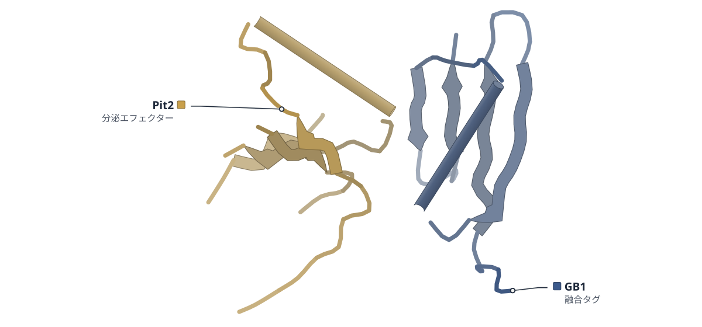

# 2026-10-13 号

**今日の新しい構造：3 本**　PMC に 2026-10-12 に登録されたオープンアクセス論文 13 本のうち、新しい構造を報告した論文は 3 本。うち 1 本を紹介する（残りは末尾に一覧）。

出典：この号の論文情報と全文は、米国国立医学図書館（NLM）の PMC オープンアクセスデータセット（AWS Open Data）から取得した。

| # | 標的 | 手法・分解能 | 見出し |
|---|---|---|---|
| 1 | Pit2（トウモロコシ黒穂病菌） | X-ray・2.35 Å | Pit2から切り出されたペプチドが、カビのGPCRを活性化する |

> この号は AI が論文本文から作成した**レビュー用の下書き**です。数値・ID・リガンドは PDB / UniProt から取得し、AI の記述には本文からの引用を付けています。

---

## 1｜Pit2（トウモロコシ黒穂病菌）

### A co-evolved peptide-GPCR system senses host entry to drive fungal infection

*Nature Communications*（2026-10-09） · [論文](https://doi.org/10.1038/s41467-026-78428-6) · ライセンス: cc by

色（順に）：GB1（融合タグ） / Pit2（分泌エフェクター）

**Pit2から切り出されたペプチドが、カビのGPCRを活性化する**

Pit2の結晶構造で、リガンドのペプチドは二量体の芯に隠れていた

- **これまでの疑問・課題**：菌類のGPCR（細胞外の信号を受け取る7回膜貫通型の受容体）は、リガンドも活性化の仕組みもよく分かっていない。
- **アプローチ**：黒穂病菌のGpe1を酵母に発現させて活性化を測り、Pit2の結晶構造とAlphaFold3のモデルで結合を調べた。
- **結果**：Pit2由来のWWFGFTGSLでGpe1が活性化した（EC50は80 nM）。このペプチドはPit2二量体の界面に埋まっていた。
- **わかったこと**：Pit2はペプチドを二量体の中に隠し、宿主のプロテアーゼが切ると放出されてGpe1を活性化すると考えられる。
- **残された課題**：Pit2から生じる2種類のペプチドが、感染でそれぞれどう寄与するかは今後の課題だ。

この紹介文の根拠（論文本文）

> although the repertoire of ligands and activation mechanisms remains poorly understood  
> — これまでの疑問・課題／Introduction

> We elucidate the crystal structure of Pit2 and model the complex formed by Gpe1 and the Pit2-derived peptide.  
> — アプローチ／Abstract

> Dose-response analysis revealed an EC50 of 80 nM for wildtype Gpe1  
> — 結果／Results

> The dimer interface buries the conserved hydrophobic WWFGFTGSL motif forming β1  
> — 結果／Results

> Our results indicate that Pit2 acts as a structural chassis containing the activating peptide in the homodimer interface, thereby preventing premature activation of Gpe1 prior to host-mediated proteolytic release of Pit2-derived peptides.  
> — わかったこと／Results

> Future work has to investigate the individual contribution of these two peptide versions during U. maydis infection.  
> — 残された課題／Results

分類：GPCR・受容体・感染・ウイルス・防御系

#### 読みどころ

Pit2は5本のβストランドと1本のαヘリックスからなる、絡み合った二量体だった。活性化ペプチドWWFGFTGSLは二量体の界面に埋まり、宿主のプロテアーゼで切られるまでGpe1を活性化できないと考えられる。

根拠（論文本文）

> Pit2 is composed of five β-strands and one α-helix, forming a tightly intertwined homodimer.  
> — Results

> thereby preventing premature activation of Gpe1 prior to host-mediated proteolytic release of Pit2-derived peptides  
> — Results

Gpe1とペプチドの複合体は実験構造ではなく、AlphaFold3のモデルだ。N末端のトリプトファンがTM1とECL2の空洞に入ると予測され、W37AとC178Aは受容体をほぼ無応答にし、菌の毒性も強く下げた。

根拠（論文本文）

> In the predicted structure, the N-terminal tryptophan residues of the Pit2 peptide are buried top-down in a cavity formed by TM1 and ECL2 of Gpe1, with the C-terminus oriented extracellularly  
> — Results

> variation of C178A and W37A strongly decreased EC50 and rendered Gpe1 almost non-responsive  
> — Results

> strains containing C178A and W37A a strong attenuation in virulence  
> — Results

Gpe1に似た担子菌の受容体群で、TM3のR133とTM6のN246・N247が保存されていた。これらはロドプシン型GPCRのイオンロックを思わせ、R133Aなどの変異で活性が消えた。ただし受容体の安定性の低下による可能性も著者は残している。

根拠（論文本文）

> Overall, this residue network is reminiscent of the ionic lock described in rhodopsin/class A GPCRs  
> — Results

> More disruptive substitutions, N246L + N247L and R133A, abolished detectable receptor activation.  
> — Results

> reduced activity of individual variants may also reflect effects on receptor stability or intracellular trafficking competence  
> — Results

#### 構造データ

| PDB | 手法 | 分解能 | 公開 | 生物種 | リガンド |
|---|---|---|---|---|---|
| [9RXK](https://www.rcsb.org/structure/9RXK) | X-ray | 2.35 Å | 2026-07-22 | Mycosarcoma maydis, Streptococcus | — |

- [A0A0D1EAR7](https://www.uniprot.org/uniprotkb/A0A0D1EAR7) PIT2 Secreted effector PIT2 — *Mycosarcoma maydis* （PDB で初めての構造）
- [P19909](https://www.uniprot.org/uniprotkb/P19909) spg Immunoglobulin G-binding protein G — *Streptococcus sp. group G* （既存の PDB 構造 91 件）

#### 実験メモ

- **発現系**：大腸菌で発現（本文はSHuffle (DE3) とBL21 (DE3) の両方を記載）。
- **コンストラクト**：シグナルペプチドを除いたPit2を、GB1タグ・6×His・TEV切断部位をもつpEM-GB1ベクターに組み込んだ。
- **精製**：Ni-NTAのあとTEVで切断し、逆アフィニティとSuperdex S200 Increase 16/600のサイズ排除クロマトグラフィー。
- **結晶化／グリッド作製**：ハンギングドロップ法、室温。20 mg/mLのGB1-Pit2を0.1 M Bicine pH 9、1.6 M硫酸アンモニウムで約2週間かけて結晶化。
- **データ収集・解析**：ESRFで低温データを収集。XDS/XSCALEで処理し、既存の構造を探索モデルに分子置換（Phaser-MR）、Coot・Phenixで精密化。

根拠（論文本文）

> The E. coli strain SHuffle® (DE3) (Novagen) was used to express all produced proteins in this study.  
> — Methods

> For cloning of protein expression constructs, the pEM-GB1 vector was used for, encoding the solubility tag GB1, a hexahistidine (6His) tag and a Tobacco etch virus protease (TEV) recognition site.  
> — Methods

> The cleaved protein was subjected to a reverse affinity chromatography to remove the hexahistidine tag fused with GB1 and the uncleaved protein.  
> — Methods

> Hexahistidine tag fused with GB1-UmPit2 crystallized at 20 mg/mL within 2 weeks in in 0.1 M Bicine and 1.6 M Ammonium sulfate at pH 9.  
> — Methods

> Data were collected under cryogenic conditions at the European Synchrotron Radiation Facility (ESRF)  
> — Methods

> The structure of Pit2 was determined by molecular replacement using Phenix version 1.20.1-448745 integrated Phaser-MR and 5BMH as the search model.  
> — Methods

> 📝 編集者への確認事項：実験構造は Pit2 の結晶構造（9RXK、PDB 2.35 Å、本文は 2.3 Å）だけで、Gpe1–ペプチド複合体は AlphaFold3 のモデル（著者自身が結合様式は不確かで変異の設計にだけ使うと明記）。見出し「活性化する」は酵母レポーター系と植物感染の結果に基づく。PDB には GB1 タグ（Immunoglobulin G-binding protein G）が2つ目の鎖として載っている。本文は GB1-Pit2 が結晶化したと書く一方、精製ではタグを TEV で切ると書き、発現株も SHuffle(DE3) と BL21(DE3) の両方があって矛盾している（lab_notes は両方を記載）。論文は初の構造とは書いていない（PIT2 は first_structure=true）ので見出しで言わない。本文は最後まで読めた。

---

## 記事にしていない新しい構造

- [Integrated computation-guided thermostabilization of the fungal sweet protein Honey Truffle Sweetener](https://doi.org/10.1016/j.crfs.2026.101584) — *Curr Res Food Sci*（新しい構造：21WR）
- [Structural characterization of HCoV-229E and H163A main protease (Mpro) interactions with the inhibitor narlaprevir](https://doi.org/10.1016/j.bbrep.2026.102821) — *Biochem Biophys Rep*（新しい構造：9XXJ, 24DE）
