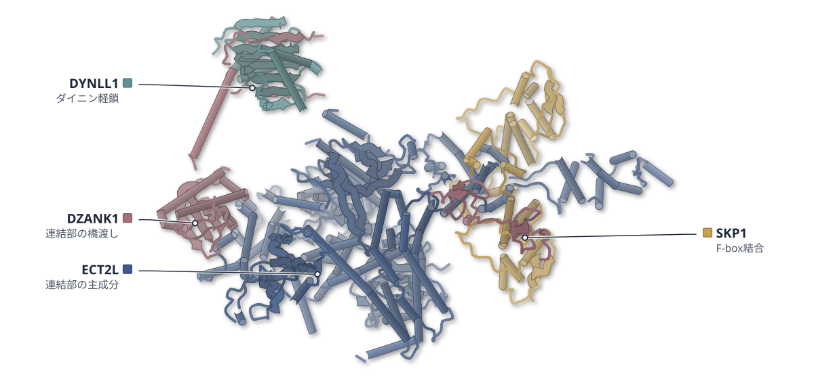
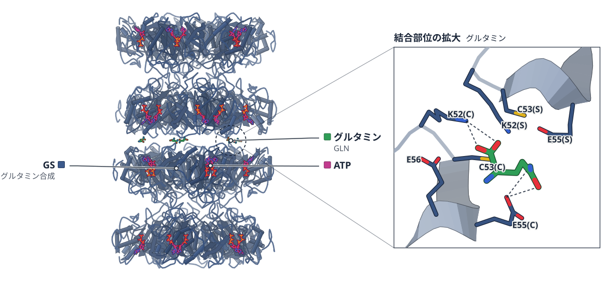
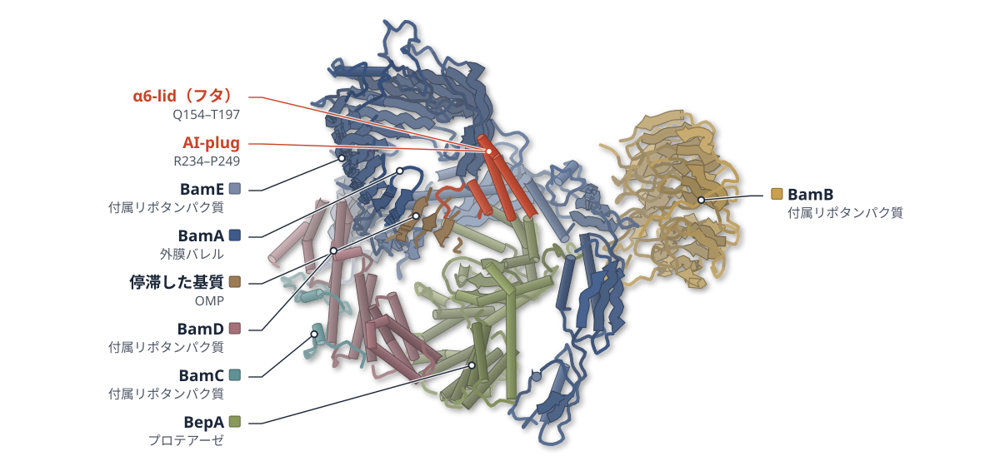
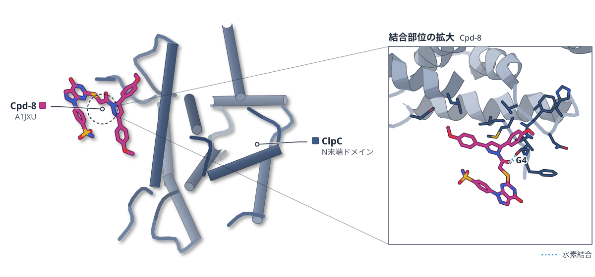
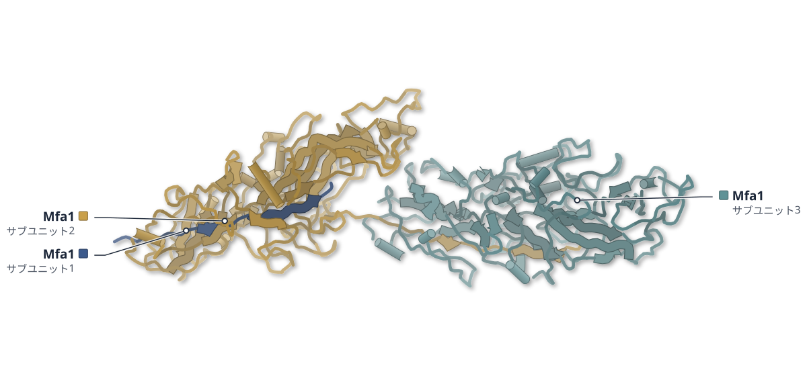

# 2026-10-14 号

**今日の新しい構造：10 本**　PMC に 2026-10-13 に登録されたオープンアクセス論文 44 本のうち、新しい構造を報告した論文は 10 本。うち 5 本を紹介する（残りは末尾に一覧）。

出典：この号の論文情報と全文は、米国国立医学図書館（NLM）の PMC オープンアクセスデータセット（AWS Open Data）から取得した。

**New Structure 1 本** · **Structure Update 4 本**（New Structure：構造が初めて解かれたタンパク質。Structure Update：既知のタンパク質の新しい構造。Structure-Based Study：既存の構造を使った注目の研究）

## Today's Structure（今日の一本）

**1｜ECT2LとDZANK1は、繊毛の根もとで微小管をつなぐ**（ヒト繊毛の移行帯（ECT2L・DZANK1））

選んだ理由（構造生物学・生命科学）：ヒトの細胞の中で繊毛の根もとの連結部を解き、その主役ECT2LとDZANK1の変異が原発性線毛運動異常症の原因になることを示した。

> We found that ECT2L and DZANK1 form the major linker complexes between adjacent TZ doublet microtubules.  
> — Abstract

> Biallelic loss-of-function variants in either gene cause primary ciliary dyskinesia.  
> — Abstract

- 迷った論文：BepA-BAM複合体（大腸菌） — BAM に結合した BepA の 2 つの状態から活性化の仕組みを示すが、基質が特定できず、ナノボディが状態の分布に影響しうるため選ばなかった。
- 迷った論文：ClpC NTD（黄色ブドウ球菌） — ClpC を活性化する低分子を 8 種類見つけたが、結晶構造があるのは 1 化合物だけで、ほかは計算と変異による間接的な推定のため選ばなかった。

| # | 標的 | 手法・分解能 | 見出し |
|---|---|---|---|
| 1 | ヒト繊毛の移行帯（ECT2L・DZANK1） | Cryo-ET・7.30–9.60 Å（2 構造） | ECT2LとDZANK1は、繊毛の根もとで微小管をつなぐ |
| 2 | ヒトグルタミン合成酵素（GS） | Cryo-EM・1.95–2.27 Å（5 構造） | ヒトのグルタミン合成酵素は、産物で繊維になり働きを弱める |
| 3 | BepA-BAM複合体（大腸菌） | Cryo-EM・3.23–6.40 Å（2 構造） | BepAはフタ状の部分を外膜に差し込み、BAMで活性化する |
| 4 | ClpC NTD（黄色ブドウ球菌） | X-ray・1.78–1.90 Å（2 構造） | 黄色ブドウ球菌ClpCを活性化する低分子が8種類見つかった |
| 5 | Mfa1線毛（P. gingivalis） | Cryo-EM・2.99 Å | 歯周病菌のMfa線毛は、プロテアーゼによる鎖の交換でつながる |

> この号は AI が論文本文から作成した**レビュー用の下書き**です。数値・ID・リガンドは PDB / UniProt から取得し、AI の記述には本文からの引用を付けています。

---

# Picked up Today's Structure

## 1｜ヒト繊毛の移行帯（ECT2L・DZANK1）

### In situ structure of the human ciliary transition zone links linker defects to primary ciliary dyskinesia

*Science (New York, N.Y.)*（2026-09-10） · [論文](https://doi.org/10.1126/science.aei5957) · ライセンス: tdm

色（順に）：ECT2L（連結部の主成分） / SKP1（F-box結合） / DYNLL1（ダイニン軽鎖） / DZANK1（連結部の橋渡し）

**ECT2LとDZANK1は、繊毛の根もとで微小管をつなぐ**

気道細胞の中で構造を直接解析し、2遺伝子の変異は原発性線毛運動異常症の原因になる

- **疑問・課題**：繊毛の根もとの関門である移行帯の分子構成と、運動性繊毛の病気との関係は、よく分かっていなかった。
- **アプローチ**：ヒトの気道細胞を凍結して薄く削り、その場のクライオ電子線トモグラフィーとサブトモグラム平均で調べた。
- **結果**：移行帯の二連微小管を6.9–7.3 Åで解き、9つのタンパク質を同定した。連結部の主役はECT2LとDZANK1だった。
- **わかったこと**：ECT2LかDZANK1の機能喪失変異が原発性線毛運動異常症を起こし、移行帯の欠陥と運動性繊毛の病気が直接結びついた。
- **残された課題**：DZANK1のIg様ドメインとアンキリン反復の位置は、まだ定まっていない。

この紹介文の根拠（論文本文）

> The ciliary transition zone (TZ) regulates ciliary proteome composition, yet its molecular architecture, protein content, and contribution to motile ciliopathies remain poorly defined.  
> — 疑問・課題／Abstract

> We applied in situ cryo-electron tomography and subtomogram averaging to human multiciliated epithelial cells.  
> — アプローチ／Abstract

> composite map at 6.9–7.3 Å resolution  
> — 結果／Results

> This approach resolved TZ-specific doublet microtubules at subnanometer resolution and identified nine constituent proteins. We found that ECT2L and DZANK1 form the major linker complexes between adjacent TZ doublet microtubules.  
> — 結果／Abstract

> Biallelic loss-of-function variants in either gene cause primary ciliary dyskinesia.  
> — わかったこと／Abstract

> These findings establish a direct genetic link between TZ defects and human motile ciliopathies  
> — わかったこと／Abstract

> The positions of N-terminal immunoglobulin-like and C-terminal ankyrin repeat domains of DZANK1 remain uncertain but may correspond to weak inward-projecting density from the TZ linker  
> — 残された課題／Results

分類：その他

#### 読みどころ

培養したヒト気道細胞をFIB（集束イオンビーム）で厚さ約200 nmのラメラに削り、細胞の中でそのまま移行帯を撮影した。精製せずに、細胞の中の状態のまま構造を解いている。

根拠（論文本文）

> Focused ion beam (FIB) milling was performed on the periphery of the frozen ciliated cells, generating thin lamellae suitable for cryo-ET  
> — Results

> FIB milling was performed in AutoTEM Cryo using stepwise decreasing currents as the lamellae were thinned (1.0 nA–30 pA; final thickness, ~200 nm).  
> — Methods

隣り合う微小管の連結部は、ECT2LとSKP1が2対2で組んだ複合体が並んだものと解釈された。DZANK1がその複合体どうしを橋渡しし、DYNLL1/2とともに隣のA管に取り付く。ただしDZANK1の小さなZn結合ドメインは、弱い密度のため明確には置けていない。

根拠（論文本文）

> We therefore conclude that a major component of the TZ linker is an ECT2L–SKP1 heterotetramer with 2:2 stoichiometry.  
> — Results

> These observations together indicate that TZ linkers are linear arrays of ECT2L–SKP1–DZANK1–DYNLL1/2 complexes  
> — Results

> Although these small domains could not be modeled unambiguously in the relatively weak density, the subtomogram map was consistent with their presence  
> — Results

ECT2LかDZANK1の機能喪失変異をもつ患者4人の細胞では、移行帯の連結部が失われ、繊毛の先がこぶ状に膨らんだ。ECT2Lを壊したiPS細胞由来の細胞でも同じこぶ状の先端が見られた。

根拠（論文本文）

> identified four unrelated individuals with predicted loss-of-function variants: three with distinct biallelic ECT2L variants  
> — Results

> DMTs were irregularly spaced and often lacked discernible TZ linkers  
> — Results

> Electron microscopy of ECT2L-KO cultures revealed widespread bulbous ciliary tips  
> — Results

#### 構造データ

| PDB | 手法 | 分解能 | 公開 | 生物種 | リガンド |
|---|---|---|---|---|---|
| [11YJ](https://www.rcsb.org/structure/11YJ) | Cryo-ET | 7.30 Å | 2026-09-09 | Homo sapiens | GTP, GDP |
| [11XU](https://www.rcsb.org/structure/11XU) | Cryo-ET | 9.60 Å | 2026-09-09 | Homo sapiens | — |

- [P63167](https://www.uniprot.org/uniprotkb/P63167) DYNLL1 Dynein light chain 1, cytoplasmic — *Homo sapiens* （既存の PDB 構造 21 件）
- [P63208](https://www.uniprot.org/uniprotkb/P63208) SKP1 S-phase kinase-associated protein 1 — *Homo sapiens* （既存の PDB 構造 72 件）
- [P68371](https://www.uniprot.org/uniprotkb/P68371) TUBB4B Tubulin beta-4B chain — *Homo sapiens* （既存の PDB 構造 4 件）
- [Q008S8](https://www.uniprot.org/uniprotkb/Q008S8) ECT2L Epithelial cell-transforming sequence 2 oncogene-like — *Homo sapiens* （PDB で初めての構造）
- [Q49MG5](https://www.uniprot.org/uniprotkb/Q49MG5) MAP9 Microtubule-associated protein 9 — *Homo sapiens* （PDB で初めての構造）
- [Q71U36](https://www.uniprot.org/uniprotkb/Q71U36) TUBA1A Tubulin alpha-1A chain — *Homo sapiens* （既存の PDB 構造 15 件）
- [Q8WWF8](https://www.uniprot.org/uniprotkb/Q8WWF8) CAPSL Calcyphosin-like protein — *Homo sapiens* （PDB で初めての構造）
- [Q9BYV8](https://www.uniprot.org/uniprotkb/Q9BYV8) CEP41 Centrosomal protein of 41 kDa — *Homo sapiens* （PDB で初めての構造）
- [Q9H0I2](https://www.uniprot.org/uniprotkb/Q9H0I2) ENKD1 Enkurin domain-containing protein 1 — *Homo sapiens* （PDB で初めての構造）
- [Q9NVP4](https://www.uniprot.org/uniprotkb/Q9NVP4) DZANK1 Double zinc ribbon and ankyrin repeat-containing protein 1 — *Homo sapiens* （PDB で初めての構造）
- [Q9Y6A4](https://www.uniprot.org/uniprotkb/Q9Y6A4) CFAP20 Cilia- and flagella-associated protein 20 — *Homo sapiens* （既存の PDB 構造 2 件）

#### 実験メモ

- **発現系**：ヒト鼻上皮の初代培養細胞を気液界面（ALI）で分化させ、繊毛を形成させた（3〜4週間）。
- **結晶化／グリッド作製**：細胞を単離して金グリッド（Quantifoil R3.5/1）に載せ、Vitrobot Mark IVで背面ブロット8秒・湿度100%で凍結。Aquilos 2のcryo-FIB/SEMでラメラを作製。
- **データ収集・解析**：Titan Krios＋Selectris＋Falcon 4i、64,000倍、ピクセル2 Å。Warpでトモグラムを再構成し、RELION5でサブトモグラム平均。

根拠（論文本文）

> Ciliation was observed 3–4 weeks after transition to ALI.  
> — Methods

> Grids were blotted from the back for 8 s with a blot force of 10 and 100% humidity before being plunged into liquid ethane cooled by liquid nitrogen.  
> — Methods

> Lamella preparation was performed on an Aquilos 2 cryo-FIB/SEM (Thermo Fisher Scientific).  
> — Methods

> Tilt series were collected on a 300-kV Titan Krios transmission electron microscope equipped with a Selectris energy filter and a Falcon4i detector (Thermo Fisher Scientific).  
> — Methods

> The subtomograms were exported and aligned in RELION5 (53).  
> — Methods

> 📝 編集者への確認事項：in situ のサブトモグラム平均で、PDB は 11YJ（二連微小管、7.3 Å）と 11XU（連結部、PDB 登録値 9.6 Å。本文は約8 Å と書く）。原子モデルの多くは AlphaFold/Boltz-2 のモデルを密度に当てはめたもので、タンパク質の同定は DomainSeeker による当てはめ探索と免疫染色などによる。論文は「初」とは書いていない（ECT2L・DZANK1 などは first_structure=true）ので見出しでも言わない。ライセンスは tdm（本文は読めた、切れなし）。見出しの「つなぐ」は論文の linker complexes という記述に合わせた。遺伝学の部分（患者4人）も読みどころに入れたが、構造の論文としての中心は in situ 構造と連結部の同定。

---

# Structure Update

## 2｜ヒトグルタミン合成酵素（GS）

### Product-stabilized filamentation by human glutamine synthetase allosterically tunes metabolic activity

*eLife*（2026-10-12） · [論文](https://doi.org/10.7554/elife.108336) · ライセンス: cc by

色（順に）：GS（グルタミン合成）　スティック：ATP、グルタミン（GLN）

**ヒトのグルタミン合成酵素は、産物で繊維になり働きを弱める**

時間分解クライオ電顕で、繊維の接合面にグルタミンが入ることを確認した

- **疑問・課題**：ヒトのグルタミン合成酵素（GS）は、数時間かかる転写や分解より速く、どう調節されるのか。
- **アプローチ**：GSをクライオ電顕で解析し、時間分解実験、酵素反応速度、変異体、細胞の増殖試験で調べた。
- **結果**：グルタミンが2つの10量体の接合面に結合して繊維を安定化し、アンモニアのKMは約3倍に上がった。
- **わかったこと**：繊維化で活性部位のE305ループが乱れ、産物が増えるほど酵素が弱まる負のフィードバックになると考えられる。
- **残された課題**：グルタミンがなくても繊維ができる酵素濃度は、細胞内よりずっと高い。

この紹介文の根拠（論文本文）

> However, regulation via these processes would require hours to achieve appreciable changes in intracellular GS concentrations.  
> — 疑問・課題／Introduction

> These observations led us to ask how human GS activity could be regulated on the timescales required to adapt to dynamic changes in nutrient availability.  
> — 疑問・課題／Introduction

> Here, we used a combination of cryo-electron microscopy (cryo-EM), enzymology, and cell proliferation assays, to discover a regulatory mechanism that incorporates both feedback inhibition and filamentation.  
> — アプローチ／Introduction

> The presence of glutamine increased KM, ammonia threefold for WT, but had smaller effects for the mutations at the interface that directly interact with the ligand (Figure 2F).  
> — 結果／Results

> Inspection of the ‘filament assembly’ interface between the two decamers revealed a discrete density that was absent from the apo-filament reconstruction (Figure 2D).  
> — 結果／Results

> We propose that GS filament formation constitutes a negative-feedback mechanism, directly linking product concentration to the structural and functional remodeling of the enzyme.  
> — わかったこと／Abstract

> This observation implicates the E305-loop conformational distribution as a potential factor contributing to the observed impaired kinetics of GS filaments.  
> — わかったこと／Results

> While the enzyme concentrations to achieve robust filamentation in the absence of glutamine are much higher than observed in cells  
> — 残された課題／Discussion

分類：酵素（その他）

#### 読みどころ

反応が進んで産物が増えるほど、繊維の粒子の割合が直線的に増えた。接合面の密度（約2.2 Å）に、水素結合でつながる形でグルタミンをモデルした。

根拠（論文本文）

> The positive linear correlation between fraction of particles in a filament-like assembly and reaction time suggests that a product of the forward reaction of GS acts to stabilize the filament assembly.  
> — Results

> Given the association with product formation, we modeled glutamine into this density in a conformation consistent with forming hydrogen bonds that link the filament interface residues and the bound product  
> — Results

活性部位のふたになるE305ループは、反応中の繊維ではほぼ密度が消えた。MDを併用した精密化では揺らぎが10 Åを超え、R299が活性部位に入り込む。繊維が基質を取り込みにくい理由とみられる。

根拠（論文本文）

> By contrast, the filament map collected during turnover displayed almost no density in the region, which is indicative of a greater degree of disorder.  
> — Results

> The E305-loop (residues 299–311) sampled a more diverse ensemble (with root mean square fluctuation values of greater than 10 Å) in the turnover filament state  
> — Results

> The conformation of Arg299 could potentially sterically hinder substrate access to the active site and thus contribute synergistically with loop mobility to the observed KM, ammonia defect.  
> — Results

ループの安定化を壊すR298A、L300Aは、グルタミンのない培地でGS欠損HEK293細胞の増殖を支えられなかった。R298Aは10量体でもループの密度がなかった。

根拠（論文本文）

> However, the two loop mutants, R298A and L300A, could not support growth under glutamine-depleted conditions displaying the same phenotype as P242stop.  
> — Results

> Importantly, this map, despite being the highest global resolution map reconstructed, did not display any appreciable E305-loop density (Figure 5), similar to the turnover filament (Figure 3B).  
> — Results

#### 構造データ

| PDB | 手法 | 分解能 | 公開 | 生物種 | リガンド |
|---|---|---|---|---|---|
| [9OTQ](https://www.rcsb.org/structure/9OTQ) | Cryo-EM | 2.27 Å | 2025-07-02 | Homo sapiens | — |
| [9OTM](https://www.rcsb.org/structure/9OTM) | Cryo-EM | 2.19 Å | 2025-07-02 | Homo sapiens | ATP, GLN |
| [9OTO](https://www.rcsb.org/structure/9OTO) | Cryo-EM | 2.03 Å | 2025-07-02 | Homo sapiens | ADP |
| [9OTN](https://www.rcsb.org/structure/9OTN) | Cryo-EM | 2.11 Å | 2025-07-02 | Homo sapiens | ATP |
| [9OTP](https://www.rcsb.org/structure/9OTP) | Cryo-EM | 1.95 Å | 2025-07-02 | Homo sapiens | ADP |

- [P15104](https://www.uniprot.org/uniprotkb/P15104) GLUL Glutamine synthetase — *Homo sapiens* （既存の PDB 構造 7 件）

#### 実験メモ

- **発現系**：大腸菌 BL21(DE3) で発現。タグなし GS は N 末端 His6-SUMO（Ulp1 で切断）または C 末端 intein-CBD-His6 で作製。
- **コンストラクト**：N 末端 His6 タグ付きは構造と活性が変わったため、タグなしの GS を使用。
- **精製**：HisTrap → タグの切断 → 逆向き Ni-NTA → Superose 6 でデカマーの画分を回収。
- **結晶化／グリッド作製**：Quantifoil 1.2/1.3 Cu300（＋2 nm カーボン）、Vitrobot Mark IV。反応中の試料は ATP・NH4Cl・グルタミン酸を加え 53–600 秒で凍結。
- **データ収集・解析**：Titan Krios＋Gatan K3。cryoSPARC で処理（繊維は D5 対称）。ループは EMMIVox でアンサンブル精密化。

根拠（論文本文）

> Human glutamine synthetase was codon-optimized for E. coli (ATUM Biosciences) and subcloned into a pET29a vector bearing an inframe 5′ His6-SUMO tag and transformed into BL21(DE3).  
> — Methods

> These data demonstrate a significant structural and functional impact of N-terminal His6 tags on GS in addition to the presence of supramolecular architectures.  
> — Results

> Cleaved GS was separated from His6-tagged His-SUMO through an ortho NiNTA where sample was applied to a HisTrap High Performance 5 mL column (Cytiva) and where scarless GS could elute with application of base buffer with 25 mM imidazole.  
> — Methods

> Unless otherwise stated, the decameric peak corresponding to a 16 mL retention volume was collected and stored at 4 °C throughout the duration of experimentation.  
> — Methods

> For turnover conditions, all data were collected on Quantifoil 1.2/1.3 Cu 300+2 nm C grids where reactions were initiated at room temperature immediately before being applied to grid in a Vitrobot Mark IV (Thermo) pre-equilibrated to 18 °C with 100% humidity  
> — Methods

> Turnover conditions were induced by adding saturating concentrations of substrates immediately prior to vitrification, with reaction times totalling between 49 and 59 s initiated by manual mixing prior to blotting.  
> — Results

> Refined single-structure models and structural ensembles of the GS in the apo-filament, turnover filament, and turnover decamer forms were generated using EMMIVox (Hoff et al., 2024).  
> — Methods

> 📝 編集者への確認事項：ヒトGSには既存のPDB構造（結晶構造 2QC8・2OJW など、prior_pdb_count 7）があるため初構造ではない。新規性は繊維状態のクライオ電顕構造と反応中の状態。PDB は2025年7月にプレプリント引用で公開済みで、本誌版が出たため新着として扱った。E305ループの揺らぎは MD 併用のアンサンブル精密化に基づくので、読みどころでも MD 併用と明記した。2.0〜2.3 Å台の5構造を報告している。本文は欠けていない。

---

## 3｜BepA-BAM複合体（大腸菌）

### Stress-induced membrane insertion at the β-barrel assembly machinery complex regulates BepA metalloprotease activity

*Nature Communications*（2026-09-09） · [論文](https://doi.org/10.1038/s41467-026-77559-0) · ライセンス: cc by-nc-nd

色（順に）：BamA（外膜バレル） / BamB（付属リポタンパク質） / BamC（付属リポタンパク質） / BamD（付属リポタンパク質） / BamE（付属リポタンパク質） / BepA（プロテアーゼ） / 停滞した基質（OMP）

**BepAはフタ状の部分を外膜に差し込み、BAMで活性化する**

BAM複合体と結合したBepAのクライオ電顕構造で、α6-lidが外膜に入り、AI-plugが外れていた

- **疑問・課題**：亜鉛を使う分解酵素M48ファミリーは自己阻害プラグで不活性に保たれるが、プラグが外れる仕組みは不明だった。
- **アプローチ**：変異体のスクリーニングと生化学で調べ、基質が停滞したBAMに結合したBepAをクライオ電顕で解析した。
- **結果**：BepAのα6-lidのループは長いヘリックスになって外膜に差し込まれ、AI-plugは活性部位の亜鉛から外れていた。
- **わかったこと**：α6-lidが外膜に刺さってBepAをBAMに固定し、AI-plugを外すことで、必要な場所とときだけ酵素が働くと考えられる。
- **残された課題**：BepAが基質の停滞をどう感知してα6-lidを差し込むのかは、まだ分かっていない。

この紹介文の根拠（論文本文）

> Members of the widespread M48 metalloprotease family are kept inactive by an autoinhibitory plug that blocks catalytic water activation, but how this plug is released remained elusive.  
> — 疑問・課題／Abstract

> Here, using genetic, biochemical and cryo-EM approaches, we discover the activation mechanism of BepA, a quality-control protease that preserves outer membrane integrity by surveilling the β-barrel assembly machinery (BAM) in Gram-negative bacteria. Our cryo-EM analysis of BepA engaged with a stalled BAM-substrate assembly complex  
> — アプローチ／Abstract

> In turn, the otherwise disordered loop (residues P175 to T197) connecting α6 to α7 folds back and extends α7 by ~30 Å, forming a helical hairpin with α6 that projects into the lipid bilayer and packs against F785, F802 and F804 of BamA β15-β16  
> — 結果／Results

> This conformational cascade results in the disengagement of H246 as the fourth ligand to the catalytic Zn2+  
> — 結果／Results

> This membrane anchoring promotes displacement of the autoinhibitory plug and unlocks protease activity precisely where and when it is needed.  
> — わかったこと／Abstract

> Thus, a dual enzyme activation mechanism is coupled to membrane association under stress, ensuring that BepA remains inactive until properly localized.  
> — わかったこと／Abstract

> How substrate stalling is initially sensed by BepA remains unresolved.  
> — 残された課題／Discussion

分類：プロテアーゼ・感染・ウイルス・防御系

#### 読みどころ

α6-lidを欠くBepAは、BamAやLptDと相互作用できない。SurAを欠いて外膜タンパク質の折りたたみがつまる条件では、野生型BepAは膜に結合するが、α6-lidを欠く変異体はペリプラズムに残った。

根拠（論文本文）

> Moreover, deletion of the α6-lid led to a marked accumulation of LptDC even in the presence of R252H (Fig. 3g) and abrogated interactions between BepAE137Q and both BamA and LptD (Fig. 3h).  
> — Results

> Remarkably, in the absence of SurA, BepA became exclusively membrane-associated, whereas BepA∆α6-lid remained in the periplasm (Fig. 5a).  
> — Results

BamAのバレルが閉じたNb32複合体ではBepAはBAMに結合するがプラグは亜鉛に配位したままで、基質が加わって開いたNb5複合体でだけ活性型だった。著者は、基質の停滞でバレルが長く開くことが活性化に要ると推測している。

根拠（論文本文）

> The EM density for the AI-plug region is poorly defined, indicating increased flexibility in the α8-α9-α10 loops, yet the α9 AI-plug remains coordinated to the catalytic Zn2+, maintaining the enzyme in a locked state.  
> — Results

> We speculate that only stalled OMPs result in sufficiently long opening of BamA barrel and exposure of β15–β16 strands and β12–β13 loop region for BepA activation, a conformation that may be too transient during constructive OMP folding.  
> — Discussion

bepAのランダム変異ライブラリーを、外膜が漏れるとピンク色になる色素CPRGで選別した。AI-plugを支えるD205とR252、フタのG166など、活性の調節に関わる残基が見つかった。

根拠（論文本文）

> Transformants with increased outer membrane permeability allow CPRG to enter the cell, where it is hydrolyzed, producing a detectable pink color31 (Fig. 1b).  
> — Results

> Thus, D205 and R252, which are interconnected by hydrogen bonds, appear to function in tandem to stabilize the AI-plug that blocks the catalytic site  
> — Results

#### 構造データ

| PDB | 手法 | 分解能 | 公開 | 生物種 | リガンド |
|---|---|---|---|---|---|
| [9SOW](https://www.rcsb.org/structure/9SOW) | Cryo-EM | 3.23 Å | 2026-09-30 | Escherichia coli BW25113 | — |
| [9SOX](https://www.rcsb.org/structure/9SOX) | Cryo-EM | 6.40 Å | 2026-09-30 | Escherichia coli BW25113 | — |

- [C3TPJ2](https://www.uniprot.org/uniprotkb/C3TPJ2) bamA Outer membrane protein assembly factor BamA — *Escherichia coli* （既存の PDB 構造 1 件）
- [P0A903](https://www.uniprot.org/uniprotkb/P0A903) bamC Outer membrane protein assembly factor BamC — *Escherichia coli (strain K12)* （既存の PDB 構造 105 件）
- [P0A937](https://www.uniprot.org/uniprotkb/P0A937) bamE Outer membrane protein assembly factor BamE — *Escherichia coli (strain K12)* （既存の PDB 構造 96 件）
- [P0AC02](https://www.uniprot.org/uniprotkb/P0AC02) bamD Outer membrane protein assembly factor BamD — *Escherichia coli (strain K12)* （既存の PDB 構造 96 件）
- [P66948](https://www.uniprot.org/uniprotkb/P66948) bepA Beta-barrel assembly-enhancing protease — *Escherichia coli (strain K12)* （既存の PDB 構造 7 件）
- [P77774](https://www.uniprot.org/uniprotkb/P77774) bamB Outer membrane protein assembly factor BamB — *Escherichia coli (strain K12)* （既存の PDB 構造 102 件）

#### 実験メモ

- **発現系**：E. coli BW25113に、strepタグ付きBepA #127/E137Q変異体（pBAD42）を導入し、0.2% L-アラビノースで37℃・3時間誘導。
- **コンストラクト**：BepA #127変異体（A149G・L169S・Q176H・G184C）に触媒欠損E137Qを加えた。BamAに対するナノボディNb5またはNb32を加えて複合体を安定化。
- **精製**：1.5% DDMで全細胞を溶かし、Strep-Tactin XTで精製。ナノボディのHisタグでNi-NTAによる2回目の精製を行い、LMNG中に溶出。
- **結晶化／グリッド作製**：酸化グラフェンをのせたQuantifoil R2/1（銅300メッシュ）に約0.1 mg/mLを3 μL塗布。CP3プランジャーで背面から4秒ブロット。
- **データ収集・解析**：JEOL CRYO ARM 300（300 kV）＋K3、カウンティング、60フレーム・総線量60 e-/Å2。RELION 5.0.1とcryoSPARC 4.7.1で処理し、EMReady2で鮮明化。

根拠（論文本文）

> BepA#127/E137Q-strep was purified using Strep-Tactin®XT 4Flow® high-capacity resin (IBA)  
> — Methods

> To separate BAM-engaged BepA from the pool of free periplasmic BepA, the BepA#127/E137Q-strep elution was mixed with BamA-binding nanobodies Nb32 or Nb5, and subjected to a second affinity purification using the Nb C-terminal hexa-histidine tag. To do so, the mixture was then loaded onto an equilibrated 0.2 ml HisPur™ Ni-NTA Spin Columns (Thermo-Fisher).  
> — Methods

> BepA overexpression was induced by adding 0.2% L-arabinose at 37 °C for 3 h.  
> — Methods

> For a sample application, 3 µl purified BepA-BAM-Nb complexes (~ 0.1 mg/mL) were applied onto GO grids, subjected to 4 s backside blotted to remove excess liquid, and flash-frozen in liquid ethane using a CP3 plunger (Gatan).  
> — Methods

> Image stacks were recorded in counting mode with a cumulative electron dose of 60 electrons per Å2 spread over 60 frames  
> — Methods

> Final maps were then sharpened using EMReady251 and used for model building and refinement.  
> — Methods

> 📝 編集者への確認事項：本文は完結。BepA-BAM の構造は初出だが、論文は『初』とは言っていない（first_structure は false、BamA の既存構造は多数）ので「初」は使わない。9SOW(Nb5, 3.23 Å, 基質結合・BamA バレル開) と 9SOX(Nb32, 6.4 Å, 閉) の2構造。基質は同定できない未同定のβストランド（LptD かもしれないが断定不可）、ナノボディが状態の分布に影響した可能性を著者も注記。BAM-BepA の『活性型』は触媒欠損E137Q変異体で捕えたもの。

---

## 4｜ClpC NTD（黄色ブドウ球菌）

### Small-molecule activators of the Staphylococcus aureus ClpC/ClpP AAA+ protease

*iScience*（2026-09-22） · [論文](https://doi.org/10.1016/j.isci.2026.117738) · ライセンス: cc by

色（順に）：ClpC（N末端ドメイン）　スティック：Cpd-8（A1JXU）

**黄色ブドウ球菌ClpCを活性化する低分子が8種類見つかった**

結晶構造でCpd-8が疎水性の溝に入ることを確認し、他の化合物の結合部位は計算と変異で絞り込んだ

- **疑問・課題**：細菌のタンパク質分解装置を動かすClpCについて、黄色ブドウ球菌のClpCを調節する低分子は報告されていなかった。
- **アプローチ**：約11万の低分子ライブラリーをスクリーニングし、結晶構造・ドッキング・変異体で結合部位を調べた。
- **結果**：8化合物がClpCのATP分解を2.2〜4.9倍に高めた。作用部位はN末端ドメイン（NTD）とみられ、Cpd-8は疎水性の溝に結合した（1.90 Å）。
- **わかったこと**：疎水性の溝とpArg1ポケット（リン酸化アルギニンの結合部位）は低分子で狙える調節部位だが、細胞での毒性はClpC/ClpPに依存しなかった。
- **残された課題**：ほとんどの化合物のNTDへの直接結合はまだ確かめられておらず、最適化が必要である。

この紹介文の根拠（論文本文）

> However, no chemical modulators of S. aureus ClpC have been described.  
> — 疑問・課題／Abstract

> To identify compounds that activate the S. aureus ClpC/ClpP protease, we conducted a high-throughput screen using a chemically diverse library of approximately 110,000 small molecules (Figure S1).  
> — アプローチ／Results

> Structural, computational, and mutational analyses define two ligandable regulatory sites within the ClpC N-terminal domain (NTD) as compound targets  
> — アプローチ／Abstract

> All compounds significantly stimulated ClpC ATPase activity (2.2- to 4.9-fold), but to a lesser extent than MecA-mediated activation (12.9-fold) (Figure 1E).  
> — 結果／Results

> We infer that all eight tested compounds deregulate ClpC by binding to its NTD.  
> — 結果／Results

> We could obtain crystal structures of ClpC-NTD with bound Cpd-8 at 1.90 Å and in the apo state at 1.78 Å resolution (Table S1).  
> — 結果／Results

> Cpd-8 binds to a part of the hydrophobic groove, and the entire ligand shows clear electron density  
> — 結果／Results

> Structural, computational, and mutational analyses define two ligandable regulatory sites within the ClpC N-terminal domain (NTD) as compound targets: a conserved hydrophobic groove and an allosteric pArg1 pocket, both engaged in substrate recognition.  
> — わかったこと／Abstract

> This demonstrates that the toxicity observed across all compounds does not depend on ClpC/ClpP, but rather likely results from effects of unknown origin, which become enhanced in the absence of ClpC/ClpP (Figure 7C).  
> — わかったこと／Results

> Direct binding of most compounds to the ClpC NTD remains to be determined.  
> — 残された課題／Limitations

分類：感染・ウイルス・防御系・酵素（その他）

#### 読みどころ

約11万化合物のスクリーニングから、FITC-カゼインの分解を高める8化合物を選んだ。EC50は低〜中μMで、ClpPだけではどの化合物でも分解は起きなかったため、標的はClpCとみられる。

根拠（論文本文）

> The compounds' potencies were in the low-to moderate micromolar range, with compounds 8, 10, and 41 showing the lowest EC50 values (Cpd-8: 12 μM; Cpd-10: 4.4 μM; Cpd-41: 8 μM)  
> — Results

> None of the tested compounds enabled ClpP to degrade FITC-casein, suggesting that they target ClpC.  
> — Results

Cpd-8は疎水性の溝の一部に結合し、水素結合はGly4との1本で、他は疎水性の接触だった。静止状態のClpCに重ねるとAAA1ドメインと衝突するため、これが活性化の原因だと著者は推測している。

根拠（論文本文）

> Notably, protein and ligand form only one hydrogen bond, namely between Gly4 and the carbonyl group of Cpd-8a, whereas all other protein-ligand interactions involve hydrophobic contacts  
> — Results

> We speculate that re-orientation of the ClpC N-terminus could clash with the resting state and destabilize it, leading to ClpC activation.  
> — Results

Cpd-10とCpd-41はMecA-mEOSの分解を妨げ、pArg1部位の変異体T7Dでは効かなかった。小分子でpArg1ポケットを狙える可能性を示すが、結合の根拠は変異体とドッキングによる間接的なものである。

根拠（論文本文）

> Indeed, Cpd-10 and Cpd-41 effectively abolished MecA-mEOS degradation, indicating they bind to at least one of the pArg-binding sites (Figure 4E).  
> — Results

> Intriguingly, most compounds still enhanced ClpC-T7D activity, whereas Cpd-10 and Cpd-41 no longer did so (Figure 4G).  
> — Results

#### 構造データ

| PDB | 手法 | 分解能 | 公開 | 生物種 | リガンド |
|---|---|---|---|---|---|
| [9TXC](https://www.rcsb.org/structure/9TXC) | X-ray | 1.78 Å | 2026-09-16 | Staphylococcus aureus subsp. aureus NCTC 8325 | — |
| [9TXD](https://www.rcsb.org/structure/9TXD) | X-ray | 1.90 Å | 2026-09-16 | Staphylococcus aureus subsp. aureus NCTC 8325 | A1JXU |

- [Q2G0P5](https://www.uniprot.org/uniprotkb/Q2G0P5) clpC ATP-dependent Clp protease ATP-binding subunit ClpC — *Staphylococcus aureus (strain NCTC 8325 / PS 47)* （既存の PDB 構造 8 件）

#### 実験メモ

- **発現系**：ClpC・ClpP・MecAなどを、pDS56系ベクターで大腸菌ΔclpB株に過剰発現（2x YT、30℃）。
- **コンストラクト**：ClpC（野生型・変異体）、単離NTD、NTDを欠くΔN-ClpC。いずれもC末端His6タグ付き。
- **精製**：Ni-IDAで精製 → Superdex 200ゲルろ過（Tris-HCl pH 7.5、KCl、MgCl2、グリセロール、DTT）。
- **結晶化／グリッド作製**：シッティングドロップ蒸気拡散、18℃（291.15 K）。タンパク質7.5 mg/mL 500 nL＋リザーバー100 nL（硫酸アンモニウム約1.9〜2.1 M）。14〜21日で結晶化。
- **データ収集・解析**：ESRF ID30A-1で測定、XDS・AIMLESSで処理。AlphaFold2モデルを探索モデルにPHASERで分子置換し、phenix.refineで精密化。

根拠（論文本文）

> Staphylococcus aureus (Sa) ClpC (WT and derivatives), ClpP, and MecA were purified from E. coli ΔclpB::kan cells overexpressing them using pDS56-derived expression vectors.  
> — Methods

> ClpC, ClpP, MecA, FtsZ, MecA-mEOS3.2, and isolated ClpC-NTD harbor a C-terminal His6-tag and were purified using Ni-IDA  
> — Methods

> Crystals were grown at 291.15 K using sitting drop vapor diffusion.  
> — Methods

> Crystallization drops contained 100 nL reservoir solution and 500 nL protein at a concentration of 7.5 mg/mL.  
> — Methods

> Data were collected at ESRF beamline ID30A-1 at cryogenic conditions, integrated using XDS,65 and scaled using AIMLESS66  
> — Methods

> Phases were obtained by molecular replacement with PHASER68 implemented in the Phenix package69 using an AlphaFold270 prediction as search model.  
> — Methods

> 📝 編集者への確認事項：本文は完結（STAR Methods まで）。新規構造は S. aureus ClpC の N 末端ドメイン(NTD)の apo (9TXC, 1.78 Å) と Cpd-8 複合体 (9TXD, 1.90 Å)。ClpC の既存構造は多数ありfirst_structure は false（『初』は使わない）。8化合物のうち結晶構造があるのは Cpd-8 のみで、Cpd-10 などはドッキング・変異体・SAR による間接的な推定（著者も限界に記載）。Cpd-8 のリガンドの片方(Cpd-8b)は結晶中で隣接分子と接触しており、タンパク質との接触は Cpd-8a 部分のみ。細胞での増殖抑制は ClpC/ClpP 非依存。

---

## 5｜Mfa1線毛（P. gingivalis）

### Cryo-EM structure of the native assembled Mfa type V pilus from the periodontal pathogen Porphyromonas gingivalis

*Communications Biology*（2026-06-24） · [論文](https://doi.org/10.1038/s42003-026-10515-2) · ライセンス: cc by-nc-nd

色（順に）：Mfa1（サブユニット1） / Mfa1（サブユニット2） / Mfa1（サブユニット3）

**歯周病菌のMfa線毛は、プロテアーゼによる鎖の交換でつながる**

重合したMfa1の線維を3.0 Åのクライオ電顕で解析し、Ca2+の結合も確かめた

- **疑問・課題**：歯周病菌の短い線毛であるMfa線毛の構造と、組み立ての仕組みは不明だった。
- **アプローチ**：組換えMfa1を酵素RgpBで試験管内で重合させ、できた線維をクライオ電顕で解析した。
- **結果**：切断で解放された鎖が隣のサブユニットの溝に入り、元の鎖と入れ替わっていた。Ca2+も結合部位に残っていた。
- **わかったこと**：Mfa線毛もFim線毛と同じく、プロテアーゼによる鎖の交換で組み上がることが確かめられた。
- **残された課題**：重合が先端側のピリンから始まるとされるが、順に重合する正確な仕組みは不明だ。

この紹介文の根拠（論文本文）

> The functional polymerized structure of the Fim pilus is known, whereas the structure and assembly mechanism of the Mfa pilus remain unclear.  
> — 疑問・課題／Abstract

> Here, we show the structure of the polymerized recombinant Mfa1 stalk pilin determined by cryo-electron microscopy at 3.0 Å resolution.  
> — アプローチ／Abstract

> rMfa1 monomers at 1.5 mg/mL concentration were mixed with 1 mg/mL RgpB and incubated at 37 °C for 4 h.  
> — アプローチ／Methods

> In the polymeric state, the overall topology is preserved, but the anchor strand β1 and the donor strand β14 are replaced by the donor strands β14 and βC of the posterior donor subunit, respectively (Fig. 1H).  
> — 結果／Results and discussion

> The atomic model of the Mfa1 filament reveals that Mfa1 pilins polymerize by protease-mediated strand exchange and retain a Ca2+ ion in the metal-binding pocket  
> — 結果／Abstract

> This observation confirms that protease-mediated strand exchange is a common polymerization mechanism for Fim and Mfa pili in P. gingivalis.  
> — わかったこと／Results and discussion

> Pilus polymerization is presumed to be initiated from tip pilins or adaptor pilins, although the precise mechanism of sequential polymerization remains unclear.  
> — 残された課題／Results and discussion

分類：感染・ウイルス・防御系

#### 読みどころ

Mfa1のC末端の2残基、または1残基を欠くと、細胞は線毛を作れなかった。C末端のドナー鎖が隣のサブユニットに入り込んで鎖の交換を始めるのに、末端が必要だと著者は考えている。

根拠（論文本文）

> A ladder pattern was detected by Western blot only in samples from cells expressing full-length Mfa1 (Fig. 2B).  
> — Results and discussion

> These results suggest that the C-terminus of the Mfa1 donor strand is essential for strand exchange in the type V pilus assembly mechanism.  
> — Results and discussion

Ca2+の結合部位を壊した変異体（DDNE/A）でも重合し、EDTA処理にも安定だった。一方、この変異体の線維はヒトの血管内皮細胞のIL-6産生を強く促し、Ca2+が免疫による認識を和らげている可能性がある（著者の推測）。

根拠（論文本文）

> These results suggest that the metal ion is not required for polymerization nor for the stability of Mfa1.  
> — Results and discussion

> In contrast, incubation of HUVECs with DDNE/A rMfa1 filaments stimulated IL-6 production more strongly than the wild-type Mfa1 filament (Fig. 3D).  
> — Results and discussion

> The Mfa1 structure containing Ca2+ ion presumably reduces immune recognition in the host.  
> — Results and discussion

連鎖球菌のSspBが結合するとされる領域を重合体の構造に写すと、αヘリックス（343–362）が単量体とは違う位置にあった。SspBとのドッキングは直接の接触を支持せず、結合の確定には至っていない。

根拠（論文本文）

> A structural comparison of the putative SspB binding cleft of the monomeric state of Mfa1 with its polymeric state shows that the α-helix 343–362 has moved to a different position (Fig. 4B).  
> — Results and discussion

> Mapping of the SspB interaction region of Mfa1 onto the atomic model of polymerized three Mfa1 subunits shows its 3D location on the Mfa pilus (Fig. 4A).  
> — Results and discussion

#### 構造データ

| PDB | 手法 | 分解能 | 公開 | 生物種 | リガンド |
|---|---|---|---|---|---|
| [21CO](https://www.rcsb.org/structure/21CO) | Cryo-EM | 2.99 Å | 2026-07-08 | Porphyromonas gingivalis ATCC 33277 | — |

- [B2RHG1](https://www.uniprot.org/uniprotkb/B2RHG1) mfa1 Minor fimbrium subunit Mfa1 — *Porphyromonas gingivalis (strain ATCC 33277 / DSM 20709 / CIP 103683 / JCM 12257 / NCTC 11834 / 2561)* （既存の PDB 構造 2 件）

#### 実験メモ

- **発現系**：N末端Hisタグ付きMfa1（残基21–563）を大腸菌BL21(DE3)で発現（IPTG 1 mM、20℃・18時間）。
- **コンストラクト**：野生型rMfa1と、金属結合部位のD507A・D509A・N512A・E514A変異体（DDNE/A）。
- **精製**：Talonレジンでアフィニティ精製し、PBSに置換。RgpBもHisタグ付きで精製。
- **結晶化／グリッド作製**：rMfa1（1.5 mg/mL）をRgpB（1 mg/mL）と37℃・4時間反応させて重合し、PEG-6000で沈殿。Quantifoil 2/1 Cu 400メッシュ、ブロット3秒・4℃・湿度100%。
- **データ収集・解析**：Titan Krios（300 kV）＋Falcon 3（カウンティング）、2,503ムービー、1.08 Å/pixel。CryoSPARCで267,383断片から2.99 Å（対称性は課さない）。

根拠（論文本文）

> Recombinant proteins in E. coli were expressed in LB medium containing 1 mM IPTG at 20 °C for 18 h.  
> — Methods

> We cloned and overexpressed the N-terminal His-tagged recombinant Mfa1 (rMfa1) containing residues 21–563 in Escherichia coli and then purified the subunit in monomeric form.  
> — Results and discussion

> Recombinant Mfa1 with an N-terminal His-tag was purified by affinity chromatography using Talon resin (Takara Bio, Shiga, Japan).  
> — Methods

> rMfa1 monomers at 1.5 mg/mL concentration were mixed with 1 mg/mL RgpB and incubated at 37 °C for 4 h.  
> — Methods

> Polymerized rMfa1 filaments were precipitated with 4% (w/vol) polyethylene glycol (PEG-6000), 0.2 M NaCl at 4 °C  
> — Methods

> Three µL of sample solution were applied to holey carbon grids (Quantifoil 2/1 Cu 400-mesh)  
> — Methods

> Grids were blotted for 3 s at 4 °C and 100% relative humidity, then immediately plunge-frozen in liquid ethane with a Vitrobot Mark IV  
> — Methods

> on a Falcon-3 direct electron detector (TFS) in counting mode at a calibrated magnification of 77,142x (corresponding to a pixel size of 1.08 Å/pixel at the specimen level)  
> — Methods

> Dose fractions from 2503 movies were aligned using motioncor254, dose-weighted, and summed.  
> — Methods

> 3D classification provided a more homogeneous class with 267,383 particle fragments that were refined to 2.99 Å resolution.  
> — Methods

> 📝 編集者への確認事項：21COは重合したMfa1（3サブユニット）の新しい構造。ただしMfa1の単量体結晶構造（5NF2、5NF3）は既報なので first_structure は false で『初』とは書かず、重合体の構造として扱った。題の『native assembled』に反し、試料は大腸菌で作った組換えMfa1をRgpBで試験管内重合したもの（細胞から取った線毛ではない）。らせんパラメータは本文（ねじれ68.8°、上昇74.2 Å）と Table 2（91.5°、73.4 Å）が食い違うため、記事には書いていない。Ca2+はICP-AESで同定（PDBのリガンド欄には出ていない）。SspBとの結合はドッキング予測にとどまる。

---

## 記事にしていない新しい構造

- [Structural and dynamic insights into the allosteric activation of p38α MAP kinase via specific docking interactions](https://doi.org/10.1038/s42003-026-10502-7) — *Commun Biol*（新しい構造：8YP8）
- [Large-scale prospective evaluation of co-folding across hundreds of Mac1–ligand complexes and three virtual screens](https://doi.org/10.7554/elife.110475) — *Elife*（新しい構造：15JC, 15CH, 15DE, 15DX）
- [Structural insights into assembly and environmental adaptation of photosystem I from a lichen green alga](https://doi.org/10.1038/s41467-026-77656-0) — *Nat Commun*（新しい構造：9X4O, 9X4P, 27GG, 9X4R）
- [A DltE–DltD–DltX interaction network regulates lipoteichoic acid D-alanylation and Lactiplantibacillus plantarum-mediated growth promotion in Drosophila](https://doi.org/10.1016/j.jbc.2026.113522) — *J Biol Chem*（新しい構造：29GH）
- [Ancient nuclear genome duplication events in vertebrates facilitated the functional diversification of ohnologous cytochrome c: insights from Buergeria frogs](https://doi.org/10.1093/molbev/msag243) — *Mol Biol Evol*（新しい構造：24OQ）
