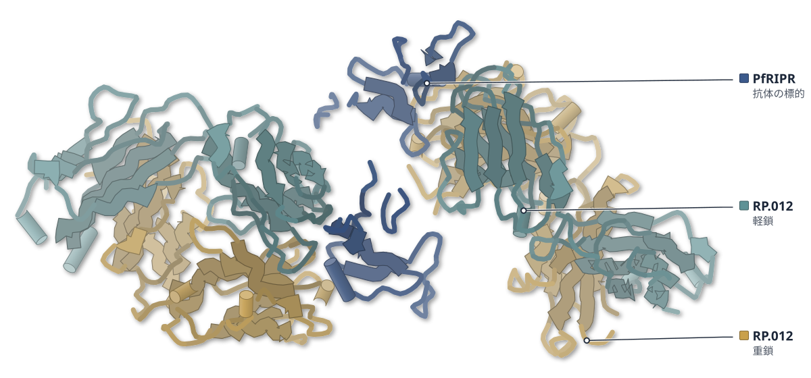
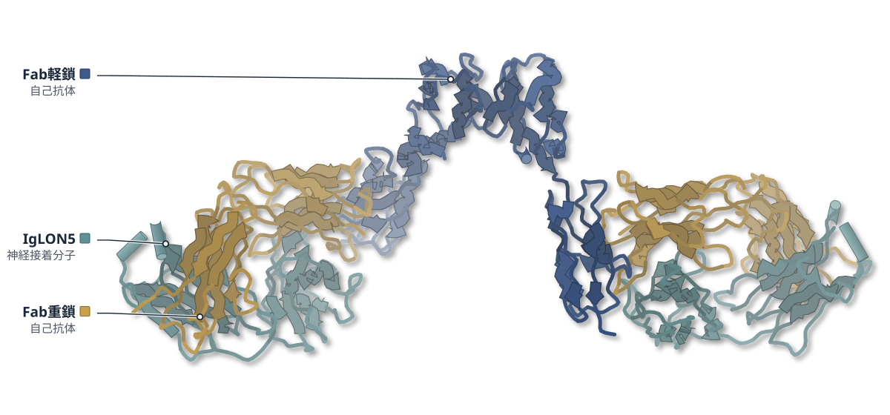

# 2026-10-15 号

**今日の新しい構造：11 本**　PMC に 2026-10-14 に登録されたオープンアクセス論文 54 本のうち、新しい構造を報告した論文は 11 本。うち 2 本を紹介する（残りは末尾に一覧）。

出典：この号の論文情報と全文は、米国国立医学図書館（NLM）の PMC オープンアクセスデータセット（AWS Open Data）から取得した。

**Structure Update 2 本**（New Structure：構造が初めて解かれたタンパク質。Structure Update：既知のタンパク質の新しい構造。Structure-Based Study：既存の構造を使った注目の研究）

| # | 標的 | 手法・分解能 | 見出し |
|---|---|---|---|
| 1 | PfRIPR（熱帯熱マラリア原虫） | Cryo-EM / X-ray・2.20–3.40 Å（5 構造） | 増殖を抑える抗体は、マラリア原虫PfRIPRの尾部を折り曲げる |
| 2 | IgLON5とFab2513（ヒト） | Cryo-EM・3.50–3.70 Å（2 構造） | IgLON5抗体は二量体を壊さず、受容体の集合を促しうる |

> この号は AI が論文本文から作成した**レビュー用の下書き**です。数値・ID・リガンドは PDB / UniProt から取得し、AI の記述には本文からの引用を付けています。

---

# Structure Update

## 1｜PfRIPR（熱帯熱マラリア原虫）

### Dynamic hinge-motion of PfRIPR revealed by malaria invasion inhibitory antibodies

*Nature Communications*（2026-08-24） · [論文](https://doi.org/10.1038/s41467-026-77069-z) · ライセンス: cc by

色（順に）：PfRIPR（抗体の標的） / RP.012（重鎖） / RP.012（軽鎖）

**増殖を抑える抗体は、マラリア原虫PfRIPRの尾部を折り曲げる**

抗体4種との複合体を解析し、折れ曲がりを起こさない抗体は増殖を抑えなかった

- **疑問・課題**：赤血球への侵入に必須な複合体の中心因子PfRIPRに、抗体がどう結合して侵入を防ぐのかは、構造がなく不明だった。
- **アプローチ**：ヒト由来3種とマウス由来1種の抗体とPfRIPR断片の複合体を、X線結晶構造とクライオ電顕で解析した。
- **結果**：増殖阻害抗体RP.012は、EGF6とEGF7の間で尾部を曲げていた。非阻害のMAD8-739では曲がらなかった。
- **わかったこと**：PfRIPRの尾部が侵入の際に形を変える必要があり、RP.012はその動きを妨げる可能性がある。
- **残された課題**：抗体を組み合わせたときに相乗効果が生じる仕組みは、まだ明らかでない。

この紹介文の根拠（論文本文）

> Few monoclonal antibodies (mAbs) have been identified and, with no structures of mAbs bound to PfRIPR, we do not understand how they block invasion, limiting our ability to rationally design the most effective vaccine immunogen based on PfRIPR.  
> — 疑問・課題／Introduction

> PfRIPR is the largest and one of the least understood components of PfPCRCR.  
> — 疑問・課題／Introduction

> We structurally characterised four PfRIPR tail-binding antibodies in complex with PfRIPR fragments.  
> — アプローチ／Abstract

> we obtained crystal structures of PfRIPR EGF6-7 bound to the Fab fragment of RP.012 at 2.20 Å resolution (Fig. 2a, Supplementary Fig. 4 and Supplementary Table 2), and of PfRIPR EGF5-6 and the single chain variable fragment (scFv) of MAD8-739 at 2.80 Å resolution (Fig. 2b and Supplementary Table 2).  
> — アプローチ／Results

> We show that growth-inhibitory antibody RP.012 induces a kink in the PfRIPR tail while non-inhibitory antibodies do not.  
> — 結果／Abstract

> In contrast, the MAD8-739-bound structure of EGF5-6 is similar to the AlphaFold model (Fig. 2c), suggesting that MAD8-739 does not bend PfRIPR.  
> — 結果／Results

> These studies have implications for the design of PfRIPR-based vaccine immunogens and indicate that the tail of PfRIPR undergoes essential conformational changes during erythrocyte invasion.  
> — わかったこと／Abstract

> This is consistent with a model in which flexibility in a hinge between EGF6 and 7 is likely required for PfRIPR function (Fig. 4c).  
> — わかったこと／Discussion

> The mechanism by which synergy occurs is currently not clear.  
> — 残された課題／Discussion

分類：免疫（抗体・MHC・TCR・自然免疫）・感染・ウイルス・防御系

#### 読みどころ

RP.012との結晶構造（2.20 Å）では、EGF6とEGF7の向きが78°ずれていた。AlphaFoldの直線的な予測と比べると、EGF7が74°回転した曲がりがある。以前から尾部の柔らかさが指摘された位置にあたる。

根拠（論文本文）

> RP.012 binds at the interface between EGF-like domains 6 and 7, such that lines through the two domains lie at 78° to one another  
> — Results

> Structural alignment of this prediction with our RP.012-bound structure reveals a bend between EGF6 and 7 that rotates EGF7 by 74°  
> — Results

EGF5-8を蛍光タンパク質で挟んだFRETプローブでは、RP.012だけがFRET効率を上げた。EGF6-7をジスルフィド結合で伸びた形に固定すると、RP.012は結合できなくなった。

根拠（論文本文）

> RP.012 increased FRET efficiency of the probe significantly (Fig. 2f), while MAD8-2 and MAD8-739 decreased FRET efficiency (Fig. 2f).  
> — Results

> unlike MAD8-2, RP.012 could not bind PfRIPR67L, indicating that its epitope is no longer accessible in this conformationally-restrained version of PfRIPR  
> — Results

MAD8-2はRP.012の阻害を打ち消し（約16%、RP.012単独は46%）、C末端ドメインに結合するMAD8-66との併用では約93%に上がった。ワクチン抗原にはEGF5-8以外も要る可能性がある。

根拠（論文本文）

> The observed GIA of RP.012 plus MAD8-2 was only ~16% compared to 46% for RP.012 alone (Fig. 1d), indicating that MAD8-2 can indeed compete with and antagonise RP.012.  
> — Results

> MAD8-66 and RP.012 had a combined GIA of ~93%, substantially improving the neutralising capacity of RP.012.  
> — Results

> the best immunogen may require discontinuous regions of PfRIPR, from both EGF5-8 and the CTD.  
> — Discussion

#### 構造データ

| PDB | 手法 | 分解能 | 公開 | 生物種 | リガンド |
|---|---|---|---|---|---|
| [9TUW](https://www.rcsb.org/structure/9TUW) | X-ray | 2.20 Å | 2026-07-08 | Homo sapiens, Mus musculus, Plasmodium falciparum 3D7 | — |
| [9TUX](https://www.rcsb.org/structure/9TUX) | X-ray | 2.25 Å | 2026-07-08 | Homo sapiens, Plasmodium falciparum 3D7 | — |
| [9TUY](https://www.rcsb.org/structure/9TUY) | X-ray | 2.80 Å | 2026-07-08 | Homo sapiens, Plasmodium falciparum 3D7 | — |
| [9TUZ](https://www.rcsb.org/structure/9TUZ) | Cryo-EM | 3.40 Å | 2026-07-08 | Homo sapiens, Plasmodium falciparum 3D7 | — |
| [9TV0](https://www.rcsb.org/structure/9TV0) | Cryo-EM | 2.80 Å | 2026-07-22 | Plasmodium falciparum 3D7 | — |

- [O97302](https://www.uniprot.org/uniprotkb/O97302) RIPR Rh5-interacting protein — *Plasmodium falciparum (isolate 3D7)* （既存の PDB 構造 5 件）
- [P0DOX5](https://www.uniprot.org/uniprotkb/P0DOX5)  Immunoglobulin gamma-1 heavy chain — *Homo sapiens* （既存の PDB 構造 108 件）
- [Q8IFM8](https://www.uniprot.org/uniprotkb/Q8IFM8) CyRPA Cysteine-rich protective antigen — *Plasmodium falciparum (isolate 3D7)* （既存の PDB 構造 12 件）

#### 実験メモ

- **発現系**：PfRIPR 断片や抗体は Expi293F 細胞で発現。抗体の Fab・scFv も同じ細胞。
- **コンストラクト**：RP.012 はマウス抗体を、ヒト IgG1 定常領域のキメラとして発現。scFv は VH-(GGGGS)3-VL。
- **精製**：Protein G、ニッケル樹脂などでアフィニティー精製し、S200・S75 でゲル濾過。
- **結晶化／グリッド作製**：結晶は18 °C のシッティングドロップ蒸気拡散（RP.012 複合体は 14.7 mg/mL）。クライオ電顕は C-flat 1.2/1.3、Vitrobot Mark IV。
- **データ収集・解析**：結晶は Diamond Light Source（I04、I24）。クライオ電顕は Titan Krios＋K3、28,491 ムービー。

根拠（論文本文）

> PfRIPR EGF5-8 (D717-D900) with an N-terminal monoFc tag and TEV protease cleavage site and a C-terminal C-tag was recombinantly expressed in Expi293F™ cells (Gibco) as recommended.  
> — Methods

> The murine antibody RP.012 was recombinantly expressed as a chimeric human antibody composed of the mouse variable domain and human IgG1 constant domains.  
> — Methods

> These were constructed by joining the variable heavy (VH) and variable light (VL) domains of each antibody with a (GGGGS)3 linker in the format VH-(GGGGS)3-VL.  
> — Methods

> Crystals were obtained using sitting drop vapour diffusion by mixing 100 nL reservoir solution with 100 nL protein complex at 14.7 mg/mL in Morpheus G12 (0.1 M Buffer Sytem 3 pH 8.5, 0.1 M Carboxylic acids, 37.5% v/v Precipitant Mix 4) at 18 °C after 2 months.  
> — Methods

> Crystals were cryo-cooled in liquid nitrogen, then diffraction data collected at Diamond Light Source on beamline I04 (wavelength 0.9537 Å) which auto-processed with xia2-dials50 to 2.20 Å.  
> — Methods

> Grids were prepared with a FEI Vitrobot Mark IV (Thermo Fisher) by applying 3 µL of complex at 0.25 mg/mL to C-Flat 1.2/1.3 grids (Electron Microscopy Sciences) which had been glow-discharged for 60 s at 15 mA.  
> — Methods

> A total of 28,491 movies were collected.  
> — Methods

> 📝 編集者への確認事項：PfRIPR は PDB に既存の構造（PfRCR の 8CDD など、prior_pdb_count 5）があり、初構造ではない。新規性は抗体との複合体で、尾部の EGF5-7 などの構造が増えた点。MAD8-2 の複合体（9TUZ）は低分解能で、論文自身が残基レベルの相互作用は決められないとしている。9TV0 の PfRIPR-PfCyRPA は MAD8-2 の Fab が結合したクライオ電顕構造。「折れ曲がりを起こさない抗体は増殖を抑えなかった」は、MAD8-739 と MAD8-2 についての記述（MAD8-66 は C 末端ドメインに結合し、曲がりは調べていない）。本文は欠けていない。

---

## 2｜IgLON5とFab2513（ヒト）

### Structural basis of IgLON5 autoantibody recognition in autoimmune encephalitis

*Nature Communications*（2026-09-11） · [論文](https://doi.org/10.1038/s41467-026-77812-6) · ライセンス: cc by

色（順に）：Fab軽鎖（自己抗体） / Fab重鎖（自己抗体） / IgLON5（神経接着分子）

**IgLON5抗体は二量体を壊さず、受容体の集合を促しうる**

患者の抗体Fabとの複合体を3.7 Åで解析し、第2Igドメインへの結合を示した

- **疑問・課題**：神経の接着分子IgLON5への自己抗体がどう結合し病気に関わるかは、よく分かっていなかった。
- **アプローチ**：患者の記憶B細胞から高親和性のIgG4抗体を単離し、そのFabとIgLON5の複合体をクライオ電顕で解析した。
- **結果**：Fabは第2Igドメインに結合し、二量体の反対側の面に1つずつ付く。二量体の構造は保たれた。
- **わかったこと**：抗体は二量体を壊さず、隣り合う二量体を橋渡しして受容体を集めると考えられる。
- **残された課題**：単一の患者の1抗体に基づくため、他の患者でも同じ結合様式かは今後の課題だ。

この紹介文の根拠（論文本文）

> Despite its severe clinical manifestations, the molecular basis of antibody recognition and its contribution to disease pathogenesis is poorly understood.  
> — 疑問・課題／Abstract

> We isolate a human monoclonal IgG4 antibody that binds IgLON5 with high affinity and determine the structure of its Fab in complex with IgLON5 using cryo–electron microscopy.  
> — アプローチ／Abstract

> Interestingly, each Fab engages IgLON5 in an opposite orientation, with the epitopes positioned on opposing faces of the dimer (Fig. 3a, b).  
> — 結果／Results

> showed that the Fab-bound IgLON5 dimer closely matches the previously published crystal structure of the IgLON5 dimer, with an RMSD of 1.4 Å  
> — 結果／Results

> Instead, the two Fab arms could engage epitopes on adjacent dimers, thereby promoting receptor clustering.  
> — わかったこと／Results

> Biochemical and structural analyses show that antibody binding preserves IgLON5 adhesive interfaces while remaining compatible with clustering of IgLON5 on the cell surface.  
> — わかったこと／Abstract

> Our study has some limitations, the structural and functional analyses are based on a mAb derived from a single patient, and it remains to be determined whether similar epitopes and binding modes are shared across individuals.  
> — 残された課題／Discussion

分類：免疫（抗体・MHC・TCR・自然免疫）

#### 読みどころ

二量体の両側のFabは反対向きに付くため、1つの抗体が1つの二量体に二価で結合することはできず、隣の二量体を橋渡しすると考えられる。IgG1にした抗体は細胞表面でのIgLON5の会合を増やし、Fab単独では増えなかった。

根拠（論文本文）

> This spatial arrangement demonstrates that the antibody cannot bind bivalently to a single IgLON5 dimer.  
> — Results

> In contrast, no fluorescence increased was observed in the presence of an irrelevant human mAb (palivizumab), nor in the presence of Fab2513.  
> — Results

Fabは残基163–205にわたる第2Igドメインの面をはさみ込むように結合し、埋もれる面積は680 Ų。IgLONファミリーで最も違いの大きいβ12–β12′ループが結合の中心で、他のメンバーとは反応しない理由と考えられる。

根拠（論文本文）

> This interaction is mediated by a compact and highly complementary interface spanning residues 163–205 of IgLON5, burying a total surface area of 680 Ų (Fig. 4c).  
> — Results

> We observed that antibody binding is centered on the highly variable (β12–β12′) loop, which represents the most divergent region among IgLON family members (Supplementary Fig. 9).  
> — Results

抗体の前駆体（生殖細胞系列に戻した配列）でもIgLON5に結合し、KDは成熟抗体の1.5 pMに対し2.8 nM。体細胞変異は認識に必須ではなく、解離を遅くして複合体を安定にしていた。

根拠（論文本文）

> We detected an interaction between UCA2513 as Fab and IgLON5, with a calculated KD value of 2.8 ± 0.03 × 10−9 M (Fig. 4f).  
> — Results

> We detected a high affinity interaction between Fab2513 and IgLON5, with a calculated KD value of 1.5 ± 0.08 × 10−12 M  
> — Results

> This indicates that somatic mutations are not strictly required for IgLON5 recognition but instead contribute to stabilizing the antibody–antigen complex.  
> — Results

#### 構造データ

| PDB | 手法 | 分解能 | 公開 | 生物種 | リガンド |
|---|---|---|---|---|---|
| [29CP](https://www.rcsb.org/structure/29CP) | Cryo-EM | 3.70 Å | 2026-09-02 | Homo sapiens | — |
| [29IN](https://www.rcsb.org/structure/29IN) | Cryo-EM | 3.50 Å | 2026-09-02 | Homo sapiens | — |

- [A6NGN9](https://www.uniprot.org/uniprotkb/A6NGN9) IGLON5 IgLON family member 5 — *Homo sapiens* （既存の PDB 構造 2 件）

#### 実験メモ

- **発現系**：IgLON5（細胞外領域、残基1–316、Fc融合）とFab、抗体をExpi293細胞に一過性に導入して発現。
- **コンストラクト**：IgLON5はGPIアンカーを避けるため316で切り、パパインでFcを除去。Fabは重鎖のヒンジにGSリンカーとHis6タグ。
- **精製**：IgLON5はProtein AまたはIMAC後にパパインでFcを除き、Superdex 200 Increaseで精製。FabはIMACとサイズ排除。
- **結晶化／グリッド作製**：IgLON5（2 mg/ml）にFabを3倍モル過剰で混合。0.005%のFos-Choline 8を加え、Quantifoil 1.2/1.3 Cu 300メッシュに塗布してVitrobot Mark IVで凍結。
- **データ収集・解析**：Titan Krios G4＋Falcon IV（カウンティング）で17,169枚、0.83 Å/pixel。cryoSPARC 4.4で702,836粒子から3.7 Å、局所精密化で3.5 Å。

根拠（論文本文）

> The protein was produced by transient transfection of Expi293 cells, purified by Protein A resin, and subsequently papain cleaved to remove the Fc tag.  
> — Results

> we first generated a construct encoding the extracellular domain of human IgLON5 truncated at the ω-site (residue 316) to prevent glycosylphosphatidylinositol anchoring.  
> — Results

> For Fab production, the heavy chain was engineered at the hinge region to include a two–amino acid glycine–serine linker, followed by a C-terminal six-histidine tag and a stop codon.  
> — Methods

> The cleaved IgLON were further purified by size-exclusion chromatography on a 200 Increase 10/300 GL column (Cytiva, Cat No#28990944).  
> — Methods

> IgLON5/Fab complexes were prepared using a stock solution at 2 mg/ml by incubating IgLON5 protein with a tree-fold molar excess of Fab2315.  
> — Methods

> the sample was incubated with 0.005% (w/v) fluorinated Fos-Choline 8 (FC8)  
> — Methods

> Next, sample was applied to plasma cleaned Quantifoil 1.2/1.3 300 -mesh Cu holey carbon grids (Electron Microscopy Sciences).  
> — Methods

> In total, 17,169 micrographs in EER format were collected.  
> — Methods

> After hetero-refinement, 702’836 particles contributed to an initial 3D reconstruction of 3.7 Å resolution (FSC 0.143) with C1 symmetry.  
> — Methods

> 📝 編集者への確認事項：新しい構造は29CP（全体、3.7 Å）と29IN（Fabと第2Igドメインの局所精密化、3.5 Å）。IgLON5二量体の結晶構造（6DLE）は既報で、新しいのは抗体との複合体。first_structure は false で『初』とは書いていない（論文自身は『first sequence and high-resolution structure of a human monoclonal antibody binding IgLON5』と書く）。第3Igドメインは見えていない。論文のMethodsではFabを『Fab 2315』と書く箇所があり本文の2513と食い違うが、引用は逐語のまま。Results末尾の『(Fig. 4f)』は図の記号の誤記の可能性（UCAはFig. 4j）。

---

## 注目の構造の採点（43 本を確認し、5 本を採点）

基準は `pipeline/impact.py`（10 点満点、6 点以上から最大 3 本）。

| 選定 | 論文 | 種類 | novelty | reach | structure | support | 計 | 理由 |
|---|---|---|---|---|---|---|---|---|
|  | PMC13660981 Forward genetics reveals a conserved CNBHD-CNBHD interface t | 既存構造で機構を解明 | 2 | 2 | 1 | 2 | 7 | 境界例。既存のクライオ電顕構造（5K7L・5VA1）は変異位置を界面に位置づけるのに使われただけで、構造そのものによる検証が弱いため、記事にしなかった。 |
|  | PMC13661046 Allosteric disulfide control of ligand binding and endocytos | 既存構造で機構を解明 | 2 | 1 | 1 | 2 | 6 | 既存の結晶構造 3WYR の Cys10-Cys28 結合を手がかりに、アロステリックなジスルフィド切り替えを変異体・質量分析・結合測定で示した良い研究だが、対象は KIR2DL4 に限られ合計 6 点で基準に届かない。 |
|  | PMC13659490 Molecular basis for a Ca2+ binding hierarchy in the EF-hand  | 既存構造で機構を解明 | 2 | 1 | 1 | 2 | 6 | CaBP2 の EF ハンドごとの Ca2+ 結合を ITC と NMR で測り電気生理で機能を確かめたが、構造決定や既存の実験構造は使わず、NMR は安定性の評価にとどまる。合計 6 点。 |
|  | PMC13659818 Beyond the catalytic serine: selective protease engagement w | 新しい手法・ソフト | 2 | 2 | 0 | 2 | 6 | 非触媒残基を狙う大環状の共有結合プローブという新しい設計で、MS と選択性で検証された。ただし結論は標識・質量分析で示され、実験構造（uPA の 4JK6）は uPA 側の置換位置の選択に使われただけで、結論の根拠にならない。structure=0 のため選ばない。 |
|  | PMC13660641 A pseudo-labeling approach for automated assignment of unlab | 新しい手法・ソフト | 2 | 1 | 1 | 1 | 5 | 非標識タンパク質の NMR シグナル帰属を AI 予測の化学シフトで自動化する実験手法。実際のスペクトルで HEWL など 3 種を測ったが、帰属であって構造の決定ではなく、BMRB との一致は 71〜85%。合計 5 点。 |

novelty：何が初めてか / reach：誰に効くか / structure：実験で決めた構造（X 線・クライオ電顕・NMR / support：裏付けの強さ（2＝独立した実験で検証：変異体・機能測定・既存手法との比較など／1＝一部の検証のみ／0＝計算のみで実験的検証なし）

## 記事にしていない新しい構造

- [Design and Exploration of a Tricyclic Series of CNS-Penetrant CD38 Small Molecule Inhibitors](https://doi.org/10.1021/acsmedchemlett.6c00301) — *ACS Med Chem Lett*（新しい構造：10OT, 10LP）
- [A cavity-reduced prefusion RSV F bivalent vaccine elicits durable and protective immunity](https://doi.org/10.1038/s44321-026-00511-8) — *EMBO Mol Med*（新しい構造：28DJ, 27RI, 25XQ, 25XR）
- [Assessing CD8+ T cell cross‐reactivity to influenza A, B and C virus‐derived peptides presented by HLA‐B*18:01](https://doi.org/10.1002/cti2.70123) — *Clin Transl Immunology*（新しい構造：9ZZ7, 9ZZ8, 9ZZN, 9NN7）
- [Discovery of an antagonist nanobody targeting the oxytocin receptor with tocolytic effect in mice](https://doi.org/10.1038/s41467-026-77680-0) — *Nat Commun*（新しい構造：9UOT, 9UTO, 9UTP, 9UVQ）
- [Development of GuaB Inhibitors to Treat Mycobacterium tuberculosis Infection](https://doi.org/10.1021/acsinfecdis.6c00350) — *ACS Infect Dis*（新しい構造：12LG）
- [PXL: a nucleic acid-binding module of the promyelocytic leukemia protein](https://doi.org/10.1093/nar/gkag966) — *Nucleic Acids Res*（新しい構造：10TH）
- [Structural organization of TAM receptor ectodomains](https://doi.org/10.1042/bcj20260584) — *Biochem J*（新しい構造：37NT）
- [A novel multifunctional starch debranching enzyme from Myxococcus sp. V11](https://doi.org/10.1007/s00253-026-13961-4) — *Appl Microbiol Biotechnol*（新しい構造（PDB ID が本文にない））
- [Bioinformatic prediction, qCLASH, and AlphaFold3 reveal non-overlapping layers of the miR-214-3p–mRNA interactome](https://doi.org/10.3389/fgene.2026.1924314) — *Front Genet*（新しい構造（PDB ID が本文にない））
