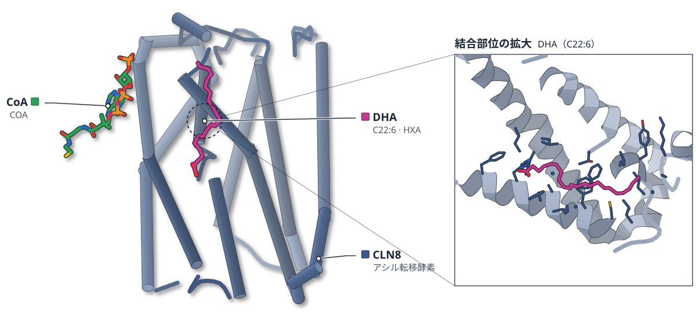
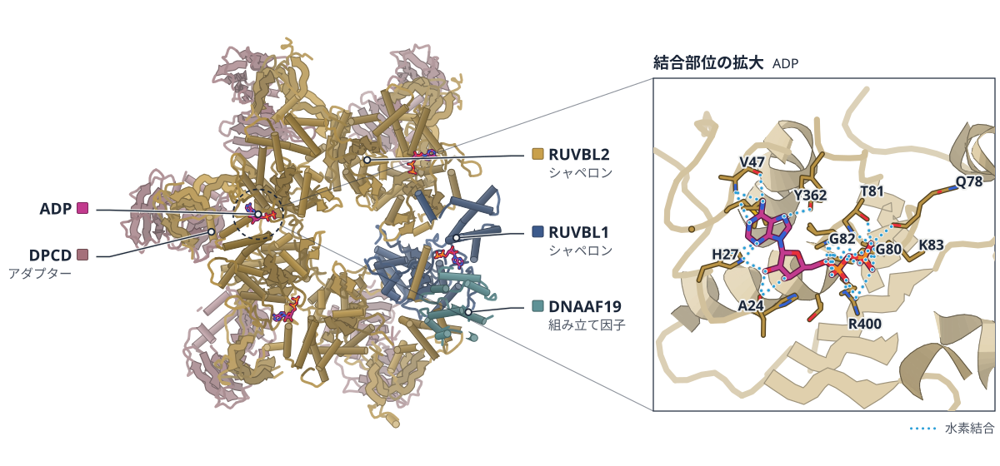
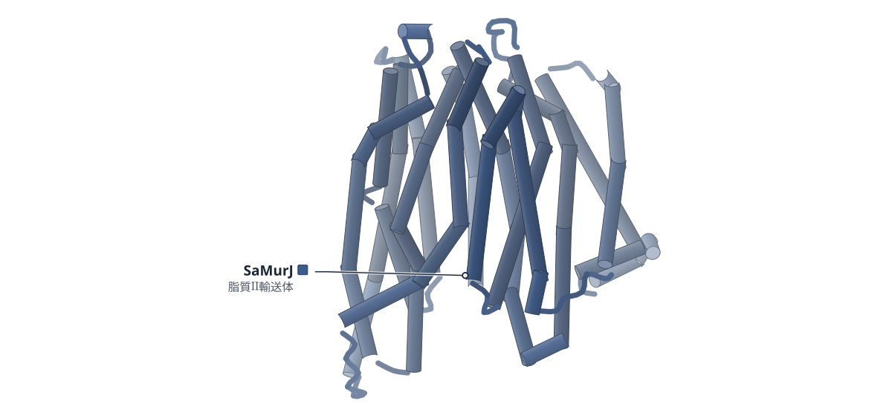
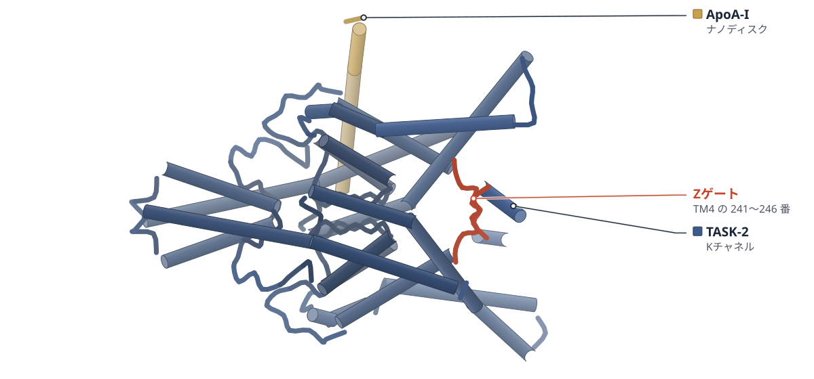
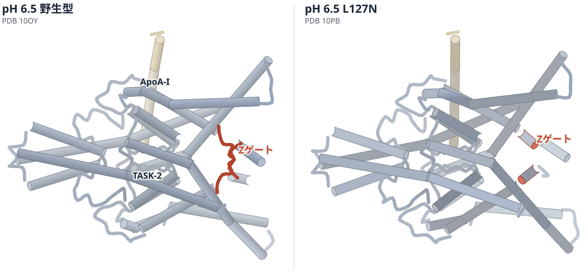
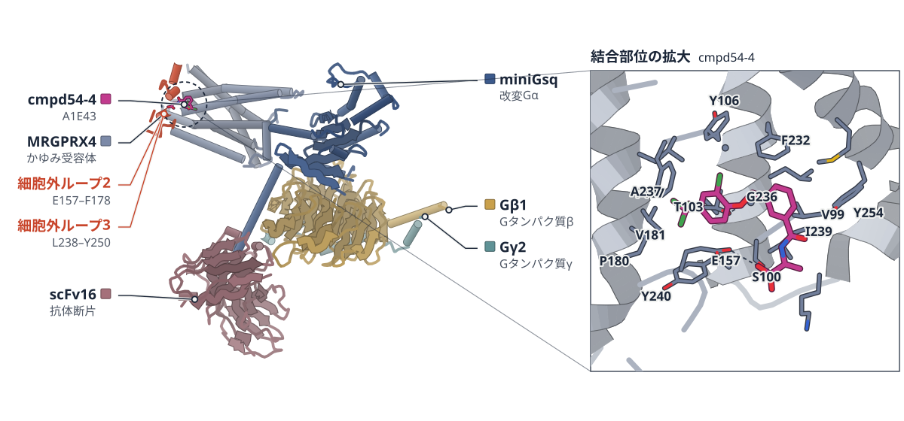
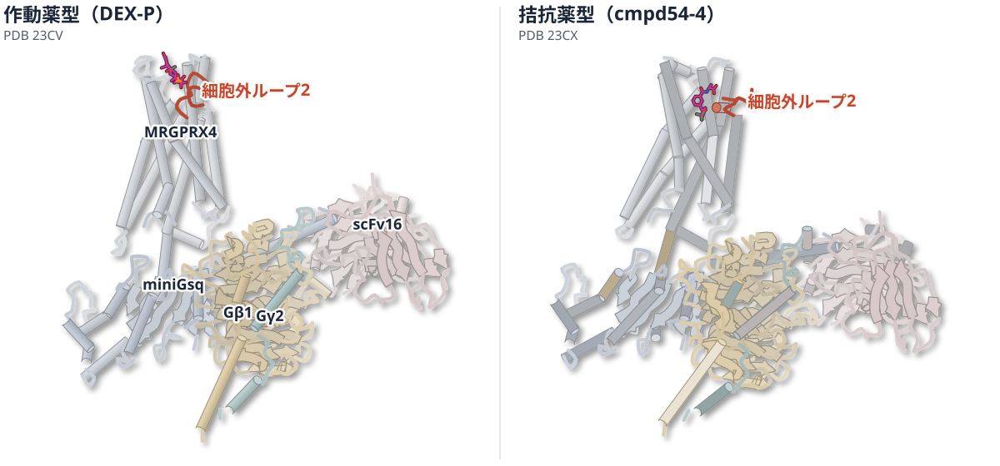
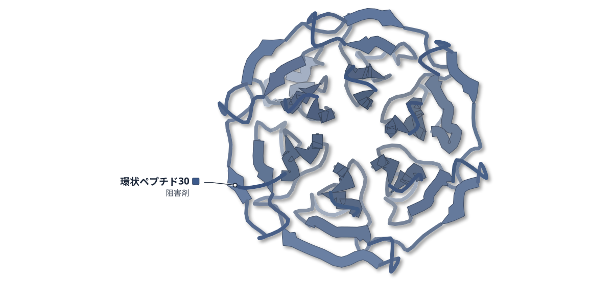

# 2026-10-16 号

**今日の新しい構造：17 本**　PMC に 2026-10-15 に登録されたオープンアクセス論文 129 本のうち、新しい構造を報告した論文は 17 本。うち 6 本を紹介する（残りは末尾に一覧）。

出典：この号の論文情報と全文は、米国国立医学図書館（NLM）の PMC オープンアクセスデータセット（AWS Open Data）から取得した。

**New Structure 3 本** · **Structure Update 3 本**（New Structure：構造が初めて解かれたタンパク質。Structure Update：既知のタンパク質の新しい構造。Structure-Based Study：既存の構造を使った注目の研究）

## Today's Structure（今日の一本）

**1｜CLN8は、BMPの材料LPGを立体を選んでつくる酵素だ**（ヒトCLN8（Batten病タンパク質））

選んだ理由（構造生物学・生命科学）：Batten病の原因タンパク質CLN8の働きを、活性測定とクライオ電顕の活性部位で示し、病変異が活性を弱めることも確かめた。

> Cryo-electron microscopy structures define the CLN8 active site and support a ping-pong acyl transfer mechanism.  
> — Abstract

> Together, our stable-isotope tracing and enzymatic assays identify CLN8 as a stereospecific GPG acyltransferase that converts S,S-GPG and acyl-CoAs into S,S-2-acyl-LPG.  
> — Results

- 迷った論文：DNAAF19–RUVBL1/2（ヒト） — RUVBL1/2 に結合して働く共シャペロンとしての役割は提案の段階で、酵素活性と病変異を結んだ CLN8 を上にした。
- 迷った論文：TASK-2（マウス） — TASK-2 の pH ゲートの 2 段階の機構を構造で示すが、活性測定と病変異まで生物学の問いに答えた CLN8 を上にした。

| # | 標的 | 手法・分解能 | 見出し |
|---|---|---|---|
| 1 | ヒトCLN8（Batten病タンパク質） | Cryo-EM・2.70–3.60 Å（3 構造） | CLN8は、BMPの材料LPGを立体を選んでつくる酵素だ |
| 2 | DNAAF19–RUVBL1/2（ヒト） | Cryo-EM・3.37–3.47 Å（2 構造） | DNAAF19は、シャペロンRUVBL1/2に結合して働くらしい |
| 3 | SaMurJ（黄色ブドウ球菌） | Cryo-EM・3.50–3.90 Å（4 構造） | 黄色ブドウ球菌のMurJの構造が、初めて明らかになった |
| 4 | TASK-2（マウス） | Cryo-EM・2.62–3.22 Å（5 構造） | TASK-2は細胞内が酸性になると、ジッパー状の門と脂質で閉じる |
| 5 | MRGPRX4（ヒト、かゆみ受容体） | Cryo-EM・2.84–2.98 Å（6 構造） | 拮抗薬は別の場所に結合し、MRGPRX4の作動薬の結合を妨げる |
| 6 | Keap1 Kelchドメイン（ヒト） | X-ray・1.70–2.35 Å（4 構造） | ランダムな環状ペプチドから、細胞内で働くKeap1阻害剤を得た |

> この号は AI が論文本文から作成した**レビュー用の下書き**です。数値・ID・リガンドは PDB / UniProt から取得し、AI の記述には本文からの引用を付けています。

---

# Picked up Today's Structure

## 1｜ヒトCLN8（Batten病タンパク質）

### The Batten disease protein CLN8 is a stereospecific acyltransferase in bis(monoacylglycero)phosphate biosynthesis

*Nature Cell Biology*（2026-09-15） · [論文](https://doi.org/10.1038/s41556-026-02061-0) · ライセンス: cc by

筆頭著者：Pradeep K. Sheokand（University of Cambridge, UK）　責任著者：Kasparas Petkevicius（University of Cambridge, UK）

色（順に）：CLN8（アシル転移酵素）　スティック：DHA（C22:6）（HXA）、CoA（COA）

**CLN8は、BMPの材料LPGを立体を選んでつくる酵素だ**

クライオ電顕で活性部位を示し、Batten病の変異は酵素活性を弱めた

- **疑問・課題**：Batten病の原因タンパク質CLN8が、リソソームの脂質BMPの合成で何をするかは不明だった。
- **アプローチ**：精製CLN8の酵素反応と、アポ型およびアシルCoA存在下のクライオ電顕構造を調べた。
- **結果**：CLN8はS,S型のGPGに最もよくアシル基を移し、構造ではH138の隣にアシル鎖が見えた。
- **わかったこと**：S,S型GPGからリゾホスファチジルグリセロール（LPG）をつくる立体特異的な酵素で、LPGはBMPの材料になる。
- **残された課題**：CLN8がつくったLPGが、リソソームの内腔へどう移るかは未解決だ。

この紹介文の根拠（論文本文）

> However, the role of CLN8 in this pathway has remained unclear.  
> — 疑問・課題／Abstract

> Cryo-electron microscopy structures define the CLN8 active site and support a ping-pong acyl transfer mechanism.  
> — アプローチ／Abstract

> CLN8 acylated S,S-GPG most efficiently, with substantially lower activity for R,S-GPG and only trace activity with R,R-GPG  
> — 結果／Results

> In both complexes, the acyl chain was positioned with a carboxy group adjacent to H138 within the central cavity and the tail oriented towards the ER lumen  
> — 結果／Results

> Together, our stable-isotope tracing and enzymatic assays identify CLN8 as a stereospecific GPG acyltransferase that converts S,S-GPG and acyl-CoAs into S,S-2-acyl-LPG.  
> — わかったこと／Results

> How this intermediate reaches the lysosomal lumen remains unresolved but may involve membrane contact sites  
> — 残された課題／Discussion

分類：酵素（その他）

#### 読みどころ

活性部位はE117・H138・H139・E167・R204からなる。H138にアシル基が一時的に結合する中間体を経るピンポン機構が考えられる。ただし共有結合の密度は見えておらず、著者は水に露出した活性部位のため中間体が不安定なのだろうと説明する。

根拠（論文本文）

> we identified a putative active site comprising E117, H138, H139, E167 and R204  
> — Results

> continuous covalent density between H138 and the acyl chain was not resolved  
> — Results

二量体の界面近くの膜内ポケットに、予想外にCoAが結合していた。見えたのはCoA部分だけで、アシルCoAだった可能性がある。

根拠（論文本文）

> Unexpectedly, we observed two CoA molecules bound in pockets located within the transmembrane region of each monomer, positioned at the dimer interface  
> — Results

> Although only the CoA moiety is resolved in the cryo-EM density, this species may represent acyl-CoA  
> — Results

CLN8の産物であるS,S-LPGを補うと、CLN8欠損細胞とマウス肝臓でBMPが戻り、ゼブラフィッシュの神経症状も改善した。ただし成体マウスの脳では回復がごくわずかだった。

根拠（論文本文）

> Exogenous S,S-lysophosphatidylglycerol, but not the R,S stereoisomer, restores BMP synthesis in CLN8-deficient cells and mice and improves neurological phenotypes in cln8 mutant zebrafish.  
> — Abstract

> recovery of 18:1–18:1 BMP in the brains of S,S-LPG-treated Cln8mnd/mnd mice was substantially poorer  
> — Results

#### 構造データ

| PDB | 手法 | 分解能 | 公開 | 生物種 | リガンド |
|---|---|---|---|---|---|
| [9THK](https://www.rcsb.org/structure/9THK) | Cryo-EM | 3.60 Å | 2026-07-29 | Homo sapiens | COA |
| [9TKA](https://www.rcsb.org/structure/9TKA) | Cryo-EM | 2.70 Å | 2026-07-29 | Homo sapiens | COA |
| [9TK9](https://www.rcsb.org/structure/9TK9) | Cryo-EM | 2.73 Å | 2026-07-29 | Homo sapiens | HXA, COA |

- [Q9UBY8](https://www.uniprot.org/uniprotkb/Q9UBY8) CLN8 Protein CLN8 — *Homo sapiens* （PDB で初めての構造）

#### 実験メモ

- **発現系**：構造解析用のヒトCLN8は酵母 W303.1B で発現（ガラクトース誘導）。
- **コンストラクト**：コドン最適化したC末端Hisタグ付きのヒトCLN8。Factor Xaでタグを切断。
- **精製**：LMNGで膜を可溶化し、Ni-Sepharose、続いてサイズ排除クロマトグラフィー。
- **結晶化／グリッド作製**：基質結合型はCLN8を100 µMのC18:1-CoAまたはC22:6-CoAと室温で1時間。Vitrobot Mark IV、4℃・湿度95%、ブロット3.0秒。
- **データ収集・解析**：Titan Krios＋Falcon 4i＋Selectris Xフィルター。cryoSPARC v3.3.2で処理し、最終 2.69–3.65 Å。

根拠（論文本文）

> Saccharomyces cerevisiae strain W303.1B (MATα leu2-3,112 trp1-1 can1-100 ura3-1 ade2-1 his3-11,15) (ATCC: 201238) was used for protein expression and purification.  
> — Methods

> W303 yeast strain expressing codon-optimized C-His-tagged human CLN8  
> — Methods

> For purification, yeast membranes were solubilized in 21 ml buffer containing 1.5% LMNG, 20 mM Hepes (pH 7.0), 150 mM NaCl, 30 mM imidazole and protease inhibitors and incubated for 1.5 h at 4 °C.  
> — Methods

> For the substrate-bound conditions, CLN8 (2 mg ml−1) was incubated in SEC buffer containing  
> — Methods

> vitrified in a Vitrobot Mark IV (Thermo Fisher Scientific) operated at 4 °C and 95% relative humidity (blot time, 3.0 s; blot force, −10)  
> — Methods

> Datasets were collected from a single grid per condition on a Titan Krios (Thermo Fisher Scientific) operating at 300 kV and nominal magnification ×165,000, equipped with a Falcon 4i detector and a Selectris X energy filter in counting mode.  
> — Methods

> Processing was performed in cryoSPARC v3.3.2.  
> — Methods

> 📝 編集者への確認事項：UniProt Q9UBY8 に既存PDBがなく first_structure は true だが、論文は「初の構造」とは書いていないので本文・見出しでは「初」と言わない。PDB は3件（9THK アポ 3.6 Å、9TKA C18:1-CoA 2.7 Å、9TK9 C22:6-CoA 2.73 Å）。PDB 上のリガンドは CoA と DHA のみで、論文の「アシル鎖」は C22:6 側が HXA として登録されている。共有結合中間体の密度は見えていない点は highlights に明記。本文は最後まで読めた（切れなし）。

---

# New Structure

## 2｜DNAAF19–RUVBL1/2（ヒト）

### DNAAF19–RUVBL1/2 complex recruits multiple adaptors to promote dynein arm assembly

*Proceedings of the National Academy of Sciences of the United States of America*（2026-10-06） · [論文](https://doi.org/10.1073/pnas.2612755123) · ライセンス: cc by

筆頭著者：Mafalda de Almeida Gomes（University College London, United Kingdom）　責任著者：Hannah M. Mitchison（University College London, United Kingdom）、Takashi Ochi（University of Leeds, United Kingdom）

色（順に）：RUVBL1（シャペロン） / RUVBL2（シャペロン） / DNAAF19（組み立て因子） / DPCD（アダプター）　スティック：ADP

**DNAAF19は、シャペロンRUVBL1/2に結合して働くらしい**

クライオ電顕でRUVBL1/2の環にDNAAF19とDPCDが結合する様子を示した

- **疑問・課題**：繊毛を動かすダイニンアームの組み立てでDNAAF19がどう働くかは、不明だった。
- **アプローチ**：マウス組織でDNAAF19の相互作用相手を調べ、タンパク質の組み立てを助けるRUVBL1/2との複合体をクライオ電顕で解析した。
- **結果**：DNAAF19はRUVBL1/2の環のRUVBL2に結合し、DPCDも同じ環のRUVBL2に5コピー結合していた。
- **わかったこと**：DNAAF19はRUVBL1/2やDPCDとともに共シャペロン複合体として働き、ダイニンアームの組み立てを助けると提案された。
- **残された課題**：DNAAF19とDPCDがRUVBL2のヌクレオチド交換を共同で促すかは、結論できていない。

この紹介文の根拠（論文本文）

> However, recent cryoelectron microscopy (cryo-EM) structures of ciliary axonemes have not revealed the presence of DNAAF19, leaving its role in dynein arm assembly unclear  
> — 疑問・課題／Introduction

> we characterized the protein–protein interaction network of mouse Dnaaf19 using SF-TAP affinity purification followed by mass spectrometry  
> — アプローチ／Results

> We therefore copurified these three human proteins coexpressed in bacterial cells and determined the cryo-EM structure of the complex at an overall 3.5-Å resolution  
> — アプローチ／Results

> Focused 3D classification showed that hDNAAF19 is absent from hRUVBL1 but present in all five hRUVBL2 subunits with variable occupancy  
> — 結果／Results

> The EM map clearly showed five copies of hDPCD bound to hRUVBL2, and the density was absent in hRUVBL1  
> — 結果／Results

> We propose that DNAAF19 functions as part of a cochaperone complex with RUVBL1/2 and other partners, including DPCD, to facilitate dynein arm assembly.  
> — わかったこと／Abstract

> At this moment, we cannot conclude that DNAAF19 and DPCD work in concert to facilitate the nucleotide exchange of RUVBL2.  
> — 残された課題／Discussion

分類：リボソーム・翻訳・フォールディング・感染・ウイルス・防御系

#### 読みどころ

DNAAF19はRPAP3-Cドメインのα6ヘリックスでRUVBL2に結合する。R175がD435・Y430と塩橋をつくり、L178とL182が疎水ポケットに入る。接触面は約700 Å2で、RPAP3やSPAG1の場合より小さい。

根拠（論文本文）

> The interaction between hDNAAF19 and hRUVBL1/2 is primarily mediated by the α6 helix of RPAP3-C, where residue R175 forms salt bridges with D435 and Y430  
> — Results

> These contacts create an interaction interface of ~700 Å2 between hDNAAF19 and hRUVBL1/2, approximately 250 and 400 Å2 smaller than that of hRPAP3-RUVBL1/2 and hSPAG1-RUVBL1/2.  
> — Results

DPCDが結合したRUVBL2のサブユニットでは、ADPが減るか見えなくなる。著者はDPCDがヌクレオチド結合部位の「ゲート」を開けやすくすると考えるが、DPCDだけでは足りないとも述べている。

根拠（論文本文）

> These results imply that hDPCD promotes an open conformation of the N terminus in hRUVBL2 subunits that exhibit incomplete ADP occupancy.  
> — Results

> Our results suggest that DPCD is not sufficient to release ADP from the nucleotide-binding pocket of RUVBL2 by inducing a conformational change in its N terminus.  
> — Discussion

原発性線毛運動異常症（PCD）で最も多い変異H154Pは、H154がP117と作る相互作用を失ってRPAP3-Cドメインを不安定にする。ただしRUVBL2との結合は弱いながら残り、部分的に機能を保つらしい。

根拠（論文本文）

> These results suggest that the H154P variant of hDNAAF19 is a hypomorphic variant that destabilizes the RPAP3-C domain but still retains the interaction with hRUVBL2.  
> — Results

> The H154P variant destabilizes the RPAP3-C domain by losing the interaction  
> — Results

#### 構造データ

| PDB | 手法 | 分解能 | 公開 | 生物種 | リガンド |
|---|---|---|---|---|---|
| [29JR](https://www.rcsb.org/structure/29JR) | Cryo-EM | 3.47 Å | 2026-09-23 | Homo sapiens | ADP |
| [29KN](https://www.rcsb.org/structure/29KN) | Cryo-EM | 3.37 Å | 2026-09-30 | Homo sapiens | ADP |

- [Q8IW40](https://www.uniprot.org/uniprotkb/Q8IW40) DNAAF19 Dynein axonemal assembly factor 19 — *Homo sapiens* （既存の PDB 構造 1 件）
- [Q9BVM2](https://www.uniprot.org/uniprotkb/Q9BVM2) DPCD Protein DPCD — *Homo sapiens* （PDB で初めての構造）
- [Q9Y230](https://www.uniprot.org/uniprotkb/Q9Y230) RUVBL2 RuvB-like 2 — *Homo sapiens* （既存の PDB 構造 50 件）
- [Q9Y265](https://www.uniprot.org/uniprotkb/Q9Y265) RUVBL1 RuvB-like 1 — *Homo sapiens* （既存の PDB 構造 48 件）

#### 実験メモ

- **発現系**：ヒトDNAAF19、RUVBL1、RUVBL2を大腸菌で共発現。
- **精製**：Ni親和性精製のあと、サイズ排除クロマトグラフィー。
- **データ収集・解析**：データはリーズ大学のAstbury Biostructure Laboratoryで収集。モデルはAlphaFold3、ChimeraX、PHENIX、Cootで構築。

根拠（論文本文）

> hRUVBL1, RUVBL2, and hDNAAF19 coexpressed in bacterial cells were purified using Ni affinity purification followed by size-exclusion chromatography.  
> — Methods

> The cryo-EM data of hDNAAF19–RUVBL1/2 and its complex with DPCD were collected at the Astbury Biostructure Laboratory, University of Leeds.  
> — Methods

> The models of hDNAAF19–RUVBL1/2 and its complex with hDPCD were built using AlphaFold3 (28), Chimera X (50), PHENIX (51), and Coot (52).  
> — Methods

> 📝 編集者への確認事項：DNAAF19 には既存PDB 1件、RUVBL1/2 には多数あり、複合体としては新規だが論文は「初」とは書いていない（DPCD は first_structure=true だが論文は明言せず）。見出しは「らしい」で推測の度合いを合わせた。クライオ電顕のコンストラクトや凍結条件は SI Appendix にあり、本文（Materials and Methods）は要約のみのため lab_notes は一部 null。RUVBL1:RUVBL2 が 1:5 になる点は、著者も実験条件による可能性を残している。PDB は 29JR（DNAAF19–RUVBL1/2）と 29KN（DPCD 付き複合体）。

---

## 3｜SaMurJ（黄色ブドウ球菌）

### Structures of the lipid II flippase from the monoderm pathogen Staphylococcus aureus

*The Journal of Biological Chemistry*（2026-09-06） · [論文](https://doi.org/10.1016/j.jbc.2026.113516) · ライセンス: cc by

筆頭著者：Yancheng E. Li（California Institute of Technology, USA）　責任著者：William M. Clemons（California Institute of Technology, USA）

色（順に）：SaMurJ（脂質II輸送体）

**黄色ブドウ球菌のMurJの構造が、初めて明らかになった**

外向きと内向きの2状態をクライオ電顕で解析し、大腸菌のMurJと同じ型の動きを示した

- **疑問・課題**：外膜をもたない単膜細菌のMurJ（脂質IIの輸送体）は、配列の違いが大きく、構造が未解析だった。
- **アプローチ**：黄色ブドウ球菌のMurJ（SaMurJ）を、ナノボディやBRIL融合を使ってクライオ電顕で解析し、大腸菌MurJと比べた。
- **結果**：SaMurJの外向き型（3.6 Å）と内向き型（3.5 Å）が決まり、全体の折れ畳みは大腸菌MurJと同じ型だった。
- **わかったこと**：SaMurJも2つの状態を行き来する交互アクセス機構で脂質IIを運ぶと考えられる。
- **残された課題**：SaMurJは大腸菌での機能補完ができず、脂質IIの認識の違いが関わる可能性がある。

この紹介文の根拠（論文本文）

> While MurJ from diderm bacteria has been structurally resolved in multiple conformational states, its monoderm homolog remains uncharacterized.  
> — 疑問・課題／Abstract

> Monoderm MurJ homologs exhibit substantial sequence divergence yet retain the same lipid II flipping function and are promising antibiotic targets.  
> — 疑問・課題／Abstract

> As an alternative, we used the ALFA-tag system (26), appending the ALFA peptide to the C-terminus of SaMurJ (SaMurJALFA) (Fig. S2A) and forming a complex with an anti-ALFA-tag nanobody (26) (Fig. S2B).  
> — アプローチ／Results

> we deleted the first seven N-terminal residues of SaMurJ (SaMurJ8-553BRIL), which resulted in a more rigid attachment of BRIL to TM1 of SaMurJ8-553 and enabled a high-resolution reconstruction to 3.5 Å  
> — アプローチ／Results

> Here we report structures of Staphylococcus aureus MurJ (SaMurJ) captured in both outward- and inward-facing conformations.  
> — 結果／Abstract

> A structural alignment of the OFS SaMurJ and EcMurJ reveals they have similar overall architecture (Figs. 1, G and H, S5B) (RMSD for equivalent residues of 1.3 Å).  
> — 結果／Results

> These structures show that SaMurJ adopts the conserved MOP family fold and undergoes conformational transitions consistent with an alternating-access mechanism.  
> — わかったこと／Abstract

> This lack of complementation may reflect differences in lipid II substrate recognition, as S. aureus lipid II contains an additional pentaglycine modification (29, 30).  
> — 残された課題／Results

分類：トランスポーター・感染・ウイルス・防御系

#### 読みどころ

SaMurJは大腸菌のMurJと配列が17%しか同じでないが、コアの12本の膜貫通ヘリックスと追加の2本（TM13-14）を持つ。著者は単膜細菌の脂質II輸送体の初めての構造だとしている。

根拠（論文本文）

> Despite low sequence conservation between diderm and monoderm MurJ (17% identity between Sa and Ec), the structure showed that SaMurJ has a canonical MOP transporter core consisting of 12 TMs in two lobes  
> — Results

> providing the first structural view of a monoderm lipid II flippase.  
> — Discussion

脂質IIのリン酸基を結ぶとされる正電荷の3つ組（K22-R176-K302）のR176をAlaに変えると、SaMurJは内向き型で止まった。この3つ組が基質の認識と構造変化を結びつけるという見方を支える。

根拠（論文本文）

> The SaMurJALFA R176A adopts an inward-facing conformation that is similar to the inward-facing structure captured using the BRIL fusion (Fig. 2F).  
> — Results

> Consistent with this model, we show that mutation of R176 traps MurJ in an inward-facing conformation, supporting that the cationic triad plays a key role in coupling substrate engagement to conformational transitions during the transport cycle  
> — Discussion

大腸菌MurJでヘリックスを折る保存配列G/A-E-G-AがSaMurJにはなく、G62とP64が蝶番になるとみられる。単膜と二膜の違いは、選択的な阻害剤を狙う手がかりになりうる。

根拠（論文本文）

> This is likely achieved by the conserved residues G62 and P64 in TM2 (ConSurf conservation grade 9 for both), which are positioned to function as a hinge that accommodates TM2 bending during conformational transitions.  
> — Discussion

> In contrast, structural features unique to monoderm or diderm MurJ may provide opportunities for selective inhibition.  
> — Discussion

#### 構造データ

| PDB | 手法 | 分解能 | 公開 | 生物種 | リガンド |
|---|---|---|---|---|---|
| [11XX](https://www.rcsb.org/structure/11XX) | Cryo-EM | 3.60 Å | 2026-09-16 | Staphylococcus aureus (strain NCTC 8325 / PS 47) | — |
| [11XZ](https://www.rcsb.org/structure/11XZ) | Cryo-EM | 3.50 Å | 2026-09-16 | Staphylococcus aureus (strain NCTC 8325 / PS 47) | — |
| [11YA](https://www.rcsb.org/structure/11YA) | Cryo-EM | 3.60 Å | 2026-09-16 | Staphylococcus aureus (strain NCTC 8325 / PS 47) | — |
| [11XY](https://www.rcsb.org/structure/11XY) | Cryo-EM | 3.90 Å | 2026-09-16 | Escherichia coli | — |

- [P0AF16](https://www.uniprot.org/uniprotkb/P0AF16) murJ Lipid II flippase MurJ — *Escherichia coli (strain K12)* （既存の PDB 構造 7 件）
- [Q2FXH6](https://www.uniprot.org/uniprotkb/Q2FXH6)  Polysaccharide biosynthesis protein, putative — *Staphylococcus aureus (strain NCTC 8325 / PS 47)* （PDB で初めての構造）

#### 実験メモ

- **発現系**：pETDuet ベクターで大腸菌 NiCo21 (DE3) に発現。IPTG 400 μM、18 °C で一晩。
- **コンストラクト**：SaMurJ1-553 の C 末端に ALFA-10xHis。内向き型は N 末端の 7 残基を欠く 8-553 に BRIL を融合。
- **精製**：LMNG で可溶化し、Ni-NTA → Superdex 200 ゲル濾過。野生型と BRIL 融合体には CHS を添加。
- **結晶化／グリッド作製**：抗 ALFA ナノボディ、または BAG2 Fab と抗 Fab ナノボディと複合体化。FOM を加え、Vitrobot Mark IV で凍結。
- **データ収集・解析**：Titan Krios＋K3（300 kV）、cryoSPARC v4.6.1 で処理。Coot・Phenix でモデル構築。

根拠（論文本文）

> pETDuet vector containing S. aureus MurJ1-553 (WT or R176A mutant) with a C-terminal ALFA-10xHis tag (SaMurJALFA), S. aureus MurJ8-553 with an N-terminal BRIL fusion domain and a C-terminal 10xHis tag (SaMurJBRIL)  
> — Experimental procedures

> Protein expression was induced by adding 400 μM Isopropyl β-D-1-thiogalactopyranoside (IPTG) and the culture was grown overnight (approximately 16 h).  
> — Experimental procedures

> Eluted protein was concentrated to approximately 500 μl using a 30 kDa MWCO Centrifugal filter (Amicon) and subjected to a Superdex 200 Increase 10/300 Gl size exclusion chromatography column (Cytiva)  
> — Experimental procedures

> Purified SaMurJBRIL sample was incubated with 1.2-fold and 1.4-fold molar excess of BAG2 Fab and elbow Nb at 4 °C for 1 h.  
> — Experimental procedures

> 0.05% Fluorinated Octyl Maltoside (FOM, Anatrace) was added prior to vitrification.  
> — Experimental procedures

> Cryo-EM data were acquired at the Caltech cryo-EM Facility on an FEI Titan Krios operated at an acceleration voltage of 300 kV and equipped with an energy filter and a K3 direct electron detector (Gatan) in correlated double sampling mode.  
> — Experimental procedures

> All cryo-EM data processing was performed in cryoSPARC (36) (v4.6.1).  
> — Experimental procedures

> 📝 編集者への確認事項：Q2FXH6 は PDB で初めての構造（prior_pdb_count 0）で、論文も「first structural view of a monoderm lipid II flippase」と書くため初構造タグを付けた。大腸菌 MurJ の外向き型（11XY）も同時に報告している。脂質II結合モデルは Chai-1 の予測で実験構造ではないので、記事では扱わなかった。本文は欠けていない。

---

# Structure Update

## 4｜TASK-2（マウス）

### Mechanisms of intracellular pH gating and local anesthetic inhibition of the two-pore domain K+ channel TASK-2

*Proceedings of the National Academy of Sciences of the United States of America*（2026-10-08） · [論文](https://doi.org/10.1073/pnas.2604873123) · ライセンス: cc by

筆頭著者：Trevor Docter（University of California Berkeley）　責任著者：Stephen G. Brohawn（University of California Berkeley）

色（順に）：TASK-2（Kチャネル） / ApoA-I（ナノディスク）

この比較図の根拠（論文本文）

> At pH 6.5, the helical segment between residues 241 to 246 is broken and redirected laterally across the cytoplasmic channel entrance, forming a short intersubunit beta sheet  
> — Results

> In contrast, the intracellular side of the channel adopts an open conformation similar to TASK-2WT at high pH: Lipid density is absent from the channel cavity, K245 residues project up from the top of TM4 away from the cytosol and parallel to the ion conduction axis, and the Z-gate is open  
> — Results

**TASK-2は細胞内が酸性になると、ジッパー状の門と脂質で閉じる**

5つのクライオ電顕構造で解析。麻酔薬ブピバカインは脂質と同じ部位に入る

- **疑問・課題**：細胞内のpHで開閉するカリウムチャネルTASK-2が、細胞内側でどう閉じ、麻酔薬にどう阻害されるかは不明だった。
- **アプローチ**：マウスTASK-2の野生型、変異体、ブピバカイン存在下の構造をクライオ電顕で解析し、電気生理で確かめた。
- **結果**：酸性ではTM4がZゲートを作り、空洞に脂質が入る。ブピバカインは高pHで、脂質と重なる位置に結合した。
- **わかったこと**：細胞内側のpH感知はZゲートと脂質ブロックの2段で働き、ブピバカインも同じ空洞を塞ぐと考えられる。
- **残された課題**：空洞の脂質の有無とチャネル活性の関係は相関にとどまり、別の機構は排除できない。

この紹介文の根拠（論文本文）

> Despite its importance, the molecular mechanisms controlling its intracellular gating and inhibition have remained unclear.  
> — 疑問・課題／Abstract

> However, the contribution of lipids to gating TASK-2 and the precise intracellular gating mechanism are unclear  
> — 疑問・課題／Introduction

> We use cryoelectron microscopy and electrophysiology to address these questions.  
> — アプローチ／Abstract

> The interaction between residues 241 to 246 from each subunit seals the cavity from the cytoplasm like a zipper.  
> — 結果／Results

> Bupivacaine binding is only observed at high pHint, consistent with state-dependent block that requires an open intracellular gate.  
> — 結果／Discussion

> We found TASK-2 employs a unique mechanism to gate closed in response to low intracellular pH that involves protein and lipid components.  
> — わかったこと／Abstract

> We found that bupivacaine inhibits TASK-2 by binding in the channel cavity at a site that overlaps with that of cavity lipids at low pHint.  
> — わかったこと／Discussion

> Still, the link between cavity lipid occupancy in structures and channel activity is correlative, and we cannot exclude alternative mechanisms to explain TASK-2L127N gain-of-function.  
> — 残された課題／Discussion

分類：イオンチャネル

#### 読みどころ

pH 6.5では、各サブユニットのTM4の241〜246番付近がほどけて横向きに伸び、2本がβシートをつくって細胞質側の入り口をジッパーのように塞ぐ。著者はこれをZゲートと呼ぶ。

根拠（論文本文）

> At pH 6.5, the helical segment between residues 241 to 246 is broken and redirected laterally across the cytoplasmic channel entrance, forming a short intersubunit beta sheet  
> — Results

> We refer to this as a “Z” (for zipper) gate.  
> — Results

空洞に入った脂質のアシル鎖が、イオンの通り道を直接塞ぐ。L127N変異体は脂質が消えて開口確率が約40倍になり、K245Aでは開いたZゲートでも脂質が塞ぐ。二重変異で内側のpH感知が消えた。

根拠（論文本文）

> The presence of these acyl chains in the cavity directly occludes the conduction pathway (Fig. 1F).  
> — Results

> TASK-2L127N has a ~40x higher PO than TASK-2WT at neutral pH  
> — Results

> That pHint gating is lost in TASK-2L127N/K245A, but not in TASK-2L127N or TASK-2K245A alone, suggests Z-gate formation and lipid block are both pH-dependent processes (Fig. 2).  
> — Results

ブピバカイン（IC50 7.6 μM）は開いたチャネルの空洞に結合し、密度は4通りの向きに合う。pH 6.5では脂質が先に入るため結合が見られず、L127N変異体はほとんど阻害されない。

根拠（論文本文）

> Racemic bupivacaine inhibited mouse TASK-2 with an IC50 = 7.6 ± 0.91 µM (n = 4 patches)  
> — Results

> An additional strong, nonprotein, density feature in the channel cavity underneath the selectivity filter is consistent with bupivacaine bound in four possible configurations, each with 0.25 occupancy  
> — Results

> Consistently, we found TASK-2L127N is nearly insensitive to bupivacaine block  
> — Results

#### 構造データ

| PDB | 手法 | 分解能 | 公開 | 生物種 | リガンド |
|---|---|---|---|---|---|
| [10OY](https://www.rcsb.org/structure/10OY) | Cryo-EM | 2.62 Å | 2026-10-07 | Homo sapiens, Mus musculus | — |
| [10PB](https://www.rcsb.org/structure/10PB) | Cryo-EM | 2.75 Å | 2026-10-07 | Homo sapiens, Mus musculus | — |
| [10PF](https://www.rcsb.org/structure/10PF) | Cryo-EM | 3.06 Å | 2026-10-07 | Homo sapiens, Mus musculus | A1C7A, OJ0 |
| [10PC](https://www.rcsb.org/structure/10PC) | Cryo-EM | 2.96 Å | 2026-10-07 | Homo sapiens, Mus musculus | — |
| [10PD](https://www.rcsb.org/structure/10PD) | Cryo-EM | 3.22 Å | 2026-10-07 | Mus musculus | — |

- [P02647](https://www.uniprot.org/uniprotkb/P02647) APOA1 Apolipoprotein A-I — *Homo sapiens* （既存の PDB 構造 31 件）
- [Q9JK62](https://www.uniprot.org/uniprotkb/Q9JK62) Kcnk5 Potassium channel TASK2 — *Mus musculus* （既存の PDB 構造 2 件）

#### 実験メモ

- **発現系**：マウスTASK-2（1〜335番）をPichia pastorisで発現。電気生理はアフリカツメガエル卵母細胞。
- **コンストラクト**：野生型とL127N、K245A、L127N/K245Aなどの変異体。
- **精製**：DDM/CHSで抽出し、抗GFPナノボディのアフィニティークロマトグラフィーとゲル濾過で精製。
- **結晶化／グリッド作製**：MSP1D1ナノディスク（DOPE:POPS:POPC＝2:1:1）に再構成。pH 8.5またはpH 6.5、ブピバカイン300 µMの有無。
- **データ収集・解析**：Titan KriosまたはTalos Arctica。RELIONとcryoSPARCで処理（TOPAZ、ベイズ研磨、不均一でない精密化）。

根拠（論文本文）

> Mus musculus TASK-2 (amino acids 1 to 335, with or without mutations) was expressed in Pichia pastoris, extracted in DDM/CHS, purified by anti-GFP nanobody affinity chromatography and size-exclusion chromatography, and reconstituted into MSP1D1 nanodiscs with a 2:1:1 DOPE:POPS:POPC lipid mixture for structural studies at pH 8.5 or pH 6.5, with or without 300 µM bupivacaine.  
> — Methods Summary

> Cryo-EM data were collected on a Titan Krios or Talos Arctica and processed in RELION and cryoSPARC with iterative TOPAZ particle picking, 2D/3D classification, Bayesian polishing, and nonuniform refinement to yield final reconstructions at 2.6 to 3.2 Å resolution (47–50).  
> — Methods Summary

> Electrophysiological characterization was performed on M. musculus TASK-2 expressed in Xenopus laevis oocytes using inside-out patch-clamp (single-channel and macroscopic) or two-electrode voltage-clamp recordings (55).  
> — Methods Summary

> 📝 編集者への確認事項：TASK-2 には既存の PDB 構造（6WLV、6WM0、prior_pdb_count 2）があり、初構造ではない。新規性は約1 Å 高分解能の pH 6.5 構造、変異体、ブピバカイン結合構造。ブピバカインの密度は4通りのポーズ（占有率0.25）を仮定したモデルで、リガンドは A1C7A と OJ0（R・S 体）。図は閉じた野生型（10OY）を使った。本文は欠けていない。

---

## 5｜MRGPRX4（ヒト、かゆみ受容体）

### Structural insights into the ligand modulation of MRGPRX4 conformational plasticity

*Cell Discovery*（2026-10-13） · [論文](https://doi.org/10.1038/s41421-026-00929-x) · ライセンス: cc by

筆頭著者：Mengna Zhang（University of Science and Technology of China）　責任著者：Minghu Song, Chunyu Wang（Hefei Comprehensive National Science Center, China）、He Chen（Tianjin Medical University, China） ほか 1 名

色（順に）：miniGsq（改変Gα） / Gβ1（Gタンパク質β） / Gγ2（Gタンパク質γ） / scFv16（抗体断片） / MRGPRX4（かゆみ受容体）　スティック：cmpd54-4（A1E43）

この比較図の根拠（論文本文）

> Red arrows indicate the conformational transition of ECL2 and ECL3 from the DEX-P-bound state to the cmpd54-4-bound state. The regions L238–Y250 and E157–F178 are highlighted as nontransparent cartoons.  
> — Figure legends

> In addition to ECL2, ECL3 in the cmpd54-4-bound MRGPRX4 structure also underwent substantial conformational rearrangement to shift toward the agonist-binding pocket (Fig. 4b).  
> — Results

**拮抗薬は別の場所に結合し、MRGPRX4の作動薬の結合を妨げる**

クライオ電顕の3状態で、拮抗薬の結合に伴いE247が作動薬のリン酸の結合部位へ入り込んでいた

- **疑問・課題**：胆汁酸によるかゆみを伝えるMRGPRX4が阻害される仕組みは分かっておらず、拮抗薬結合型の構造も未報告だった。
- **アプローチ**：作動薬DEX-P・拮抗薬cmpd54-4を結合した状態とリガンドなし（apo）の3状態をクライオ電顕で解析した。
- **結果**：拮抗薬は作動薬と別の部位に結合し、細胞外ループ2のW158が外へ回って窪みができた。細胞外ループ3のE247は作動薬の結合部位へ入っていた。
- **わかったこと**：拮抗薬は作動薬と結合部位を奪い合うのではなく、細胞外側の構造を変えて作動薬の結合を立体的に妨げると考えられる。
- **残された課題**：拮抗薬結合型は完全な不活性型ではなくGタンパク質と結合した中間状態で、不活性化の細かな段階は調べられていない。

この紹介文の根拠（論文本文）

> Although Mas-related G protein-coupled receptor X4 (MRGPRX4) has recently been identified as a key mediator of bile acid-induced pruritus, the structural mechanisms underlying its inhibition remain poorly understood, hindering the development of therapeutic antagonists.  
> — 疑問・課題／Abstract

> Most importantly, an antagonist-bound structure has yet to be reported, posing a key obstacle to the development of MRGPRX4-targeted antipruritic drugs.  
> — 疑問・課題／Introduction

> Here, we report the cryo-electron microscopy structures of MRGPRX4 in three distinct states: agonist-bound state, antagonist-bound state, and apo state.  
> — アプローチ／Abstract

> In contrast, in the cmpd54-4-bound structure, W1584.61 rotated outward toward the membrane, thereby creating a previously uncharacterized antagonist-specific subpocket that accommodated cmpd54-4  
> — 結果／Results

> In addition to ECL2, ECL3 in the cmpd54-4-bound MRGPRX4 structure also underwent substantial conformational rearrangement to shift toward the agonist-binding pocket  
> — 結果／Results

> Collectively, these structural observations indicated that binding of the antagonist cmpd54-4 induced substantial conformational rearrangements in the extracellular pocket of MRGPRX4 to sterically prevent agonist binding rather than simply competing for the canonical agonist-binding site.  
> — わかったこと／Results

> Furthermore, as we were unable to isolate a conformation representing a fully inactive state, the cmpd54-4-bound MRGPRX4–miniGsq complex represents only an intermediate conformation along the activation pathway.  
> — 残された課題／Discussion

分類：GPCR・受容体

#### 読みどころ

拮抗薬cmpd54-4は作動薬と別の亜ポケットに結合する。作動薬型ではW158が窪みをふさぐが、拮抗薬型ではW158が外向きになり専用の窪みができる。apo構造のW158も外向きだった。

根拠（論文本文）

> Notably, this antagonist-binding pocket was inaccessible in the DEX-P-bound MRGPRX4 structure (Fig. 4c), where the ECL2 residue W1584.61 projected into the pocket and occluded antagonist binding (Fig. 4d–f).  
> — Results

> Notably, from a top-down extracellular view, the position of W1584.61 in the apo state resembled that in the antagonist-bound structure, whereas the position of E2477.28 more closely matched that in the agonist-bound conformation (Fig. 5a–c).  
> — Results

拮抗薬型ではE247が陽性の窪み（R82・R86・R95）に入って塩橋を作り、作動薬のリン酸の結合部位をふさぐ。著者は、これほど大きな拮抗薬誘導の構造変化はクラスA GPCRでは珍しいと述べている。

根拠（論文本文）

> This movement enables E2477.28 to form salt bridge interactions with R822.60, R862.64, and R953.25 within a positively charged subpocket, effectively occluding the phosphate-binding site for DEX-P and further preventing agonist binding  
> — Discussion

> Such extensive antagonist-induced conformational changes are uncommon among class A GPCRs.  
> — Discussion

拮抗薬の結合部位は多型のある83位から離れ、IC50は2つの変異型で同程度だった。著者は、このポケットを狙う拮抗薬は多型による効き方の差を避けられる可能性があると考えている。

根拠（論文本文）

> DEX-P was more potent against the S832.61 variant, whereas cmpd54-4 exhibited similar IC50 values against both.  
> — Discussion

> Therefore, antagonists targeting the cmpd54-4 pocket are likely to be effective regardless of the residue at position 83, suggesting that drug design focused on this binding site may circumvent polymorphism-dependent differences in efficacy.  
> — Discussion

#### 構造データ

| PDB | 手法 | 分解能 | 公開 | 生物種 | リガンド |
|---|---|---|---|---|---|
| [23CV](https://www.rcsb.org/structure/23CV) | Cryo-EM | 2.97 Å | 2026-10-14 | Escherichia coli, Homo sapiens, Mus musculus | 3T5 |
| [23CW](https://www.rcsb.org/structure/23CW) | Cryo-EM | 2.88 Å | 2026-10-14 | Escherichia coli, Homo sapiens | 3T5 |
| [23CX](https://www.rcsb.org/structure/23CX) | Cryo-EM | 2.98 Å | 2026-10-14 | Escherichia coli, Homo sapiens, Mus musculus | A1E43 |
| [23CY](https://www.rcsb.org/structure/23CY) | Cryo-EM | 2.84 Å | 2026-10-14 | Escherichia coli, Homo sapiens | A1E43 |
| [23CS](https://www.rcsb.org/structure/23CS) | Cryo-EM | 2.89 Å | 2026-10-14 | Escherichia coli, Homo sapiens, Mus musculus | — |
| [23CU](https://www.rcsb.org/structure/23CU) | Cryo-EM | 2.93 Å | 2026-10-14 | Escherichia coli, Homo sapiens | — |

- [P0ABE7](https://www.uniprot.org/uniprotkb/P0ABE7) cybC Soluble cytochrome b562 — *Escherichia coli* （既存の PDB 構造 654 件）
- [P59768](https://www.uniprot.org/uniprotkb/P59768) GNG2 Guanine nucleotide-binding protein G(I)/G(S)/G(O) subunit gamma-2 — *Homo sapiens* （既存の PDB 構造 1323 件）
- [P62873](https://www.uniprot.org/uniprotkb/P62873) GNB1 Guanine nucleotide-binding protein G(I)/G(S)/G(T) subunit beta-1 — *Homo sapiens* （既存の PDB 構造 1333 件）
- [Q96LA9](https://www.uniprot.org/uniprotkb/Q96LA9) MRGPRX4 Mas-related G protein-coupled receptor member X4 — *Homo sapiens* （既存の PDB 構造 7 件）

#### 実験メモ

- **発現系**：Sf9細胞に、MRGPRX4・miniGsqβ1γ2・scFv16のバキュロウイルスを2:1:1で共感染させて発現。
- **コンストラクト**：S83型ヒトMRGPRX4のN末端にHAシグナル・Flag・10×His・TEV部位・BRILを付加。miniGsqはminiGsにGαqのα5ヘリックスの鍵残基を移したキメラ。
- **精製**：LMNG/CHSで可溶化 → TALON → Superdex 200。ピーク画分にDEX-P 300 μMまたはcmpd54-4 200 μMを加え、約3 mg/mLに濃縮。
- **結晶化／グリッド作製**：Quantifoil R1.2/1.3（300メッシュ）、Vitrobot、4℃・湿度100%、ブロット3.5秒。
- **データ収集・解析**：Titan Krios（300 kV）＋K3、カウンティングモード、0.82 Å/pixel、総線量50 e-/Å2。cryoSPARC v4.4.1で処理。

根拠（論文本文）

> For protein co-infection, Sf9 cells at a density of 2 × 106 cells/mL were co-infected with baculoviruses encoding MRGPRX4, miniGsqβ1γ2, and scFv16 at a multiplicity of infection of 2:1:1.  
> — Methods

> Several key residues of the α5 helix were replaced with the corresponding sequence from Gαq to confer Gq coupling specificity47, while the N-terminal region was substituted with that of Gαi1 to facilitate scFv16 binding.  
> — Methods

> The peak fraction was divided and incubated separately with 300 µM DEX-P (Aladdin, 2392-39-4) or 200 µM cmpd54-4 and then concentrated to ~3 mg/mL  
> — Methods

> The grids were blotted for 3.5 s with a blot force of 0 at 4 °C and 100% humidity, followed by rapid vitrification in liquid ethane using a Vitrobot (FEI).  
> — Methods

> All MRGPRX4–G protein complex datasets were collected on a Titan Krios electron microscope (Thermo Fisher Scientific) operating at 300 kV and equipped with a K3 Summit direct electron detector (Gatan).  
> — Methods

> Micrographs were obtained in counting mode at a pixel size of 0.82 Å and a defocus range of −0.8 μm to −1.6 μm. Each video comprised 40 frames with a total dose of 50 e−/Å2.  
> — Methods

> 📝 編集者への確認事項：本文は完結（切れなし）。作動薬結合型の MRGPRX4 構造（7S8P, 8YRG, 8KEX）は既報で、初構造ではない（first_structure は false）。論文が新しいとするのは拮抗薬結合型（逆作動薬 cmpd54-4）と apo の構造で、『拮抗薬結合型は未報告だった』は Introduction の記述。拮抗薬型は Gq（miniGsq）と結合した中間状態で完全な不活性型ではない、と著者自身が限界に挙げている。特異な部分はMD（W158 の動き）に一部依拠。

---

## 6｜Keap1 Kelchドメイン（ヒト）

### Generation of membrane-permeable cyclic peptides inhibiting protein–protein interaction

*Nature Chemical Biology*（2026-06-01） · [論文](https://doi.org/10.1038/s41589-026-02237-7) · ライセンス: cc by

筆頭著者：Xinjian Ji（École Polytechnique Fédérale de Lausanne (EPFL), Switzerland）　責任著者：Christian Heinis（École Polytechnique Fédérale de Lausanne (EPFL), Switzerland）

色（順に）：環状ペプチド30（阻害剤）

**ランダムな環状ペプチドから、細胞内で働くKeap1阻害剤を得た**

15,360種から選んで改良し、Keap1との結晶構造で結合の仕方を確かめた

- **疑問・課題**：事前にリガンドの情報がない標的に、細胞膜を通る環状ペプチドをゼロから作るのは難しかった。
- **アプローチ**：Keap1とNrf2の結合を妨げる分子を15,360種のランダムな環状ペプチドから探し、3回の改良を重ねた。
- **結果**：最良のペプチド30はKi 53 nMでKeap1に結合し、細胞のレポーターアッセイで用量依存的に働いた。
- **わかったこと**：電荷を持たない小さなペプチドが、Nrf2とは別の接触でKeap1に結合し、細胞内で結合を阻害できた。
- **残された課題**：細胞での活性は試験管内より弱く、排出ポンプが原因の可能性があると著者は述べる。

この紹介文の根拠（論文本文）

> However, developing such compounds de novo without prior information about lead structures such as natural ligands or fragments remains a notable challenge.  
> — 疑問・課題／Abstract

> By screening 15,360 fully random cyclic peptides, we were able to identify an inhibitor of the E3 ligase adaptor Keap1 and its substrate Nrf2.  
> — アプローチ／Abstract

> could be improved in three iterative rounds into a membrane-permeable cyclic peptide that blocked this PPI in live cells  
> — アプローチ／Main

> Excitingly, peptide 30, which displayed the best combination of activity (Ki = 53 ± 5 nM) and polar surface (only two H-bond donors) exhibited a robust, dose-dependent activity in the cellular model with an IC50 of around 50 μM  
> — 結果／Results

> which engage Keap1 through entirely distinct sets of molecular contacts  
> — わかったこと／Results

> This makes peptide 30 a fully de novo developed cyclic peptide that successfully inhibits a PPI inside living cells.  
> — わかったこと／Results

> This indicated removal of 30 by efflux pumps (efflux ratio > 90), which could explain the lower activity found in the cellular assay compared to in vitro inhibition.  
> — 残された課題／Results

分類：転写調節・シグナル伝達

#### 読みどころ

ナノモル規模で合成した約1.5万種のライブラリーを混合物のまま選別した。最初のヒットの活性には、二量体・三量体の副産物とシステイン（C434）とのジスルフィド交換が寄与した可能性があると著者は書く。

根拠（論文本文）

> Interestingly, our identification of the two initial Keap1–Nrf2 inhibitors 1 and 2 from library 1 benefited from some unexpected allies: dimeric and trimeric peptide byproducts that showed enhanced activity, as well as potential covalent interactions through disulfide exchange with a target protein cysteine residue.  
> — Discussion

Keap1に結合した直鎖ペプチド6のX線構造（1.70 Å）は、Nrf2が結合する場所を占めながら、まったく違う接触をしていた。電荷による相互作用に頼らず、水素結合の受容基が主役だった。環状体の結晶は還元剤DTTのため得られていない。

根拠（論文本文）

> The linear peptide 6 occupied the same space as the region of Nrf2 that interacts with Keap1 but formed completely different molecular contacts.  
> — Results

> Unlike Nrf2, peptide 6 did not rely on charged interactions and used mostly H-bond acceptor groups for H-bonding interactions  
> — Results

> Because of the presence of reducing agent DTT in conditions that yielded diffraction-quality crystals, we obtained a structure of the bound linear analog (6) rather than the cyclic peptide  
> — Results

ペプチド30はNrf2由来のペプチドと分子量・親和性が近いが、電荷がなく、水素結合の供与基は2個（Nrf2は9個）、極性表面積は203 Ų（433 Ų）と極性がずっと低い。この低さが膜透過と細胞内での阻害に重要だったと著者は述べる。

根拠（論文本文）

> Notably, while the two peptides are similar in molecular weight (890.6 Da for 30 versus 1,052.1 Da for Nrf2) and binding affinity (53 nM versus 23 nM), peptide 30 is far less polar, having no charges (versus four negative charges in the Nrf2 sequence), featuring only two H-bond donors (versus nine) and a substantially lower topological polar surface area (TPSA of 203 Å2 versus 433 Å2).  
> — Results

#### 構造データ

| PDB | 手法 | 分解能 | 公開 | 生物種 | リガンド |
|---|---|---|---|---|---|
| [9IH9](https://www.rcsb.org/structure/9IH9) | X-ray | 1.70 Å | 2026-03-04 | Homo sapiens, synthetic construct | DHL |
| [9QDU](https://www.rcsb.org/structure/9QDU) | X-ray | 2.35 Å | 2026-03-18 | Homo sapiens, synthetic construct | — |
| [9QBS](https://www.rcsb.org/structure/9QBS) | X-ray | 1.95 Å | 2026-03-18 | Homo sapiens, synthetic construct | — |
| [9QBT](https://www.rcsb.org/structure/9QBT) | X-ray | 2.33 Å | 2026-03-18 | Homo sapiens, synthetic construct | — |

- [Q14145](https://www.uniprot.org/uniprotkb/Q14145) KEAP1 Kelch-like ECH-associated protein 1 — *Homo sapiens* （既存の PDB 構造 117 件）

#### 実験メモ

- **発現系**：ヒトKeap1 Kelchドメイン（321–609）を大腸菌BL21(DE3)で発現（IPTG 0.5 mM、20℃で一晩）。
- **コンストラクト**：N末端にHis6タグとTEV切断部位。結晶化にはE540A/E542Aの2置換体を使い、TEVでタグを除去。
- **精製**：Ni-NTAアフィニティ、続いてSuperdex 75のサイズ排除クロマトグラフィー。
- **結晶化／グリッド作製**：Keap1にペプチド6・30・33・34を8倍モル過剰で混ぜ、18℃のシッティングドロップ蒸気拡散で共結晶化。25%グリセロールで凍結保護。
- **データ収集・解析**：ESRFのMASSIF-1/-3（ペプチド6・30）とSLSのPX-I（33・34）で回折データを収集。XDS、PHENIXの分子置換（1U6D）、Cootで構築。

根拠（論文本文）

> Protein expression was induced by adding a final concentration of 0.5 mM IPTG and the culture was incubated at 20 °C while being shaken overnight (200 rpm).  
> — Methods

> Recombinant human Kelch domain of Keap1 (321–609) with an N-terminal addition of His6 tag and tobacco etch virus (TEV) cleavage site for tag removal was cloned into the vector pET29b(+) (Novagen) for bacterial expression.  
> — Methods

> The Keap1 Kelch domain with the two substitutions (E540A and E542A)37 was used for X-ray crystallization.  
> — Methods

> The desired protein was purified from the culture supernatant by Ni-NTA affinity chromatography.  
> — Methods

> Cocrystallization was performed by mixing Keap1 at 12 mg ml−1 with an eightfold molar excess of peptide 6, 30, 33 and 34.  
> — Methods

> The recombinant Keap1 Kelch domain bound to the peptide was crystallized at 18 °C using the sitting-drop vapor diffusion approach.  
> — Methods

> Suitable crystals were collected, cryoprotected using the mother liquor supplemented with 25% glycerol and rapidly frozen in liquid nitrogen.  
> — Methods

> were collected at the MASSIF-1 and MASSIF-3 beamlines of the European Synchrotron Radiation Facility (ESRF).  
> — Methods

> The structure was solved by molecular replacement using PHENIX (version 1.20.1)50 with the atomic coordinates of Keap1 (PDB 1U6D) as a search model.  
> — Methods

> 📝 編集者への確認事項：新しい複合体構造（9IH9、9QDU、9QBS、9QBT）だが、Keap1自体の構造は既に117件あるため first_structure は false で、『初』とは書いていない。9IH9はDTT下で環状ペプチド4が還元された直鎖ペプチド6との複合体で、論文も環状体の結晶は得られなかったと明記している。9QDU（環状ペプチド30）を構造図に使った。分類は適切なものがなく regulation（E3リガーゼのアダプター）とした。

---

## 注目の構造の採点（112 本を確認し、3 本を採点）

基準は `pipeline/impact.py`（10 点満点、6 点以上から最大 3 本）。

| 選定 | 論文 | 種類 | novelty | reach | structure | support | 計 | 理由 |
|---|---|---|---|---|---|---|---|---|
|  | PMC13663732 Tyrosine phosphorylation unfolds nucleophosmin and disrupts  | 既存構造で機構を解明 | 2 | 1 | 1 | 2 | 6 | NPM1 の Tyr17・Tyr67 のリン酸化模倣で五量体が壊れることを NMR・DSC・AUC・ITC で示したが、構造の根拠は既存構造 4N8M を使った MD が中心で、NMR は折れたたみの有無の確認にとどまる。合計 6 点。 |
|  | PMC13662901 Site and mechanism of BK channel inhibition and cerebral art | 既存構造で機構を解明 | 2 | 1 | 1 | 2 | 6 | 既存のクライオ電顕構造 6V38 へのドッキングで見つけたプレグネノロン結合部位 Tyr450 を、変異体・結合測定・ノックインマウスで確かめた。ただし構造側の根拠はドッキングで、対象も BK チャネルに限られ合計 6 点。 |
|  | PMC13661599 Leveraging high-throughput proteomics and AI-based protein f | 構造に基づく創薬 | 2 | 2 | 0 | 2 | 6 | VAV1 分解誘導剤と RT-ループ degron は変異体で検証されたが、三者複合体は AlphaFold・ドッキング・Boltz-2 のモデルで、既存の 4CI3・5FQD はテンプレートに使われただけ。実験構造による裏付けがなく structure=0 のため選ばない。 |

novelty：何が初めてか / reach：誰に効くか / structure：実験で決めた構造（X 線・クライオ電顕・NMR / support：裏付けの強さ（2＝独立した実験で検証：変異体・機能測定・既存手法との比較など／1＝一部の検証のみ／0＝計算のみで実験的検証なし）

## 記事にしていない新しい構造

- [Reprogramming the Rossmann fold signature motif creates orthogonal redox biocatalysts](https://doi.org/10.1038/s41467-026-77633-7) — *Nat Commun*（新しい構造：9IIL）
- [R1-32-like public antibodies acquire tolerance to SARS-CoV-2 antigenic drift through somatic hypermutation](https://doi.org/10.1371/journal.pbio.3003996) — *PLoS Biol*（新しい構造：9XHY, 9XHZ, 9XI0, 9XI1）
- [Structural basis for membrane-dependent positive feedback regulation of DOCK11 by activated Cdc42](https://doi.org/10.1073/pnas.2607665123) — *Proc Natl Acad Sci U S A*（新しい構造：22VD, 22VE, 22VF, 22VG）
- [Molecular Architecture of the H2AX-Containing Nucleosome from Arabidopsis](https://doi.org/10.3390/cells15191795) — *Cells*（新しい構造：38BL, 38BO, 37ZO）
- [Structural basis of assembly-dependent activation of the MAD3–MAD4 nuclease in the Pseudomonas aeruginosa MADS defense system](https://doi.org/10.1093/nar/gkag1001) — *Nucleic Acids Res*（新しい構造：26YZ, 43VY, 26WA）
- [Structural basis of the gating mechanism of the large-conductance mechanosensitive channel from Escherichia coli](https://doi.org/10.1038/s41467-026-76193-0) — *Nat Commun*（新しい構造：28OA, 28OB, 28OC）
- [A single amino acid mutation alters substrate specificity towards l-glucose in a bacterial l-galactose dehydrogenase](https://doi.org/10.1016/j.bbrep.2026.102819) — *Biochem Biophys Rep*（新しい構造：26WE）
- [Small molecule inhibition of voltage dependent anion channel 1 reroutes mitochondrial metabolite flux](https://doi.org/10.1016/j.mocell.2026.100369) — *Mol Cells*（新しい構造：9PFZ）
- [Reply to Cantwell Chater and Shahsavar: Clarifying PDB deposition records and local model interpretation in GlyT2 structures](https://doi.org/10.1073/pnas.2621667123) — *Proc Natl Acad Sci U S A*（新しい構造（PDB ID が本文にない））
- [Structural insights into the exosite-mediated activation of factor IX by factor XIa using cryogenic electron microscopy](https://doi.org/10.1016/j.jtha.2026.08.015) — *J Thromb Haemost*（新しい構造（PDB ID が本文にない））
- [Reversible Dimerization of Cytochrome Oxidase in Detergent Solution as Detected by Dynamic Light Scattering](https://doi.org/10.3390/ijms27198744) — *Int J Mol Sci*（新しいマップ（EMDB））
