

# 2026-10-16 号

**今日の新しい構造：43 本**　PMC に 2026-10-11〜2026-10-15 に登録されたオープンアクセス論文 263 本のうち、新しい構造を報告した論文は 43 本。うち 17 本を紹介する（残りは末尾に一覧）。

出典：この号の論文情報と全文は、米国国立医学図書館（NLM）の PMC オープンアクセスデータセット（AWS Open Data）から取得した。

**注目の構造：2 本**（新しい構造ではないが、実験で決めた構造で確かめた注目の研究）

## Today's Structure（今日の一本）

**1｜CLN8は、BMPの材料LPGを立体を選んでつくる酵素だ**（ヒトCLN8（Batten病タンパク質））

選んだ理由（構造生物学・生命科学）：Batten病の原因タンパク質CLN8の働きを、活性測定とクライオ電顕の活性部位で示し、病変異が活性を弱めることも確かめた。

> Cryo-electron microscopy structures define the CLN8 active site and support a ping-pong acyl transfer mechanism.  
> — Abstract

> Together, our stable-isotope tracing and enzymatic assays identify CLN8 as a stereospecific GPG acyltransferase that converts S,S-GPG and acyl-CoAs into S,S-2-acyl-LPG.  
> — Results

- 迷った論文：PfRIPR（熱帯熱マラリア原虫） — 抗体が PfRIPR の曲がりを妨げることを複数の構造で示すが、曲がりを調べたのは一部の抗体で、生物学的な問いへの答えの広がりで CLN8 を上にした。
- 迷った論文：ヒトグルタミン合成酵素（GS） — 産物による繊維化とアロステリックな調節を示すが、ヒト GS には既存構造があり、新規性が状態の違いに限られるため選ばなかった。

| # | 標的 | 手法・分解能 | 見出し |
|---|---|---|---|
| 1 | ヒトCLN8（Batten病タンパク質） | クライオ電顕・2.70–3.60 Å（3 構造） | CLN8は、BMPの材料LPGを立体を選んでつくる酵素だ |
| 2 | DNAAF19–RUVBL1/2（ヒト） | クライオ電顕・3.37–3.47 Å（2 構造） | DNAAF19は、シャペロンRUVBL1/2に結合して働くらしい |
| 3 | ヒト繊毛の移行帯（ECT2L・DZANK1） | クライオ電顕・7.30–9.60 Å（2 構造） | ECT2LとDZANK1は、繊毛の根もとで微小管をつなぐ |
| 4 | Pit2（トウモロコシ黒穂病菌） | X線結晶構造解析・2.35 Å | Pit2から切り出されたペプチドが、カビのGPCRを活性化する |
| 5 | SaMurJ（黄色ブドウ球菌） | クライオ電顕・3.50–3.90 Å（4 構造） | 黄色ブドウ球菌のMurJの構造が、初めて明らかになった |
| 6 | ヒトグルタミン合成酵素（GS） | クライオ電顕・1.95–2.27 Å（5 構造） | ヒトのグルタミン合成酵素は、産物で繊維になり働きを弱める |
| 7 | PfRIPR（熱帯熱マラリア原虫） | X線結晶構造解析 / クライオ電顕・2.20–3.40 Å（5 構造） | 増殖を抑える抗体は、マラリア原虫PfRIPRの尾部を折り曲げる |
| 8 | TASK-2（マウス） | クライオ電顕・2.62–3.22 Å（5 構造） | TASK-2は細胞内が酸性になると、ジッパー状の門と脂質で閉じる |
| 9 | MRGPRX4（ヒト、かゆみ受容体） | クライオ電顕・2.84–2.98 Å（6 構造） | 拮抗薬は別の場所に結合し、MRGPRX4の作動薬の結合を妨げる |
| 10 | BepA-BAM複合体（大腸菌） | クライオ電顕・3.23–6.40 Å（2 構造） | BepAはフタ状の部分を外膜に差し込み、BAMで活性化する |
| 11 | ヒトPI3Kδ（p110δ） | X線結晶構造解析・2.75–2.97 Å（2 構造） | ロギノリシブは、PI3Kδ末端のヘリックスを安定化して阻害する |
| 12 | ClpC NTD（黄色ブドウ球菌） | X線結晶構造解析・1.78–1.90 Å（2 構造） | 黄色ブドウ球菌ClpCを活性化する低分子が8種類見つかった |
| 13 | Keap1 Kelchドメイン（ヒト） | X線結晶構造解析・1.70–2.35 Å（4 構造） | ランダムな環状ペプチドから、細胞内で働くKeap1阻害剤を得た |
| 14 | IgLON5とFab2513（ヒト） | クライオ電顕・3.50–3.70 Å（2 構造） | IgLON5抗体は二量体を壊さず、受容体の集合を促しうる |
| 15 | Mfa1線毛（P. gingivalis） | クライオ電顕・2.99 Å | 歯周病菌のMfa線毛は、プロテアーゼによる鎖の交換でつながる |
| 16 | CBPのNCBD（マウス） | 19F NMR・NOE構造計算・ITC | フルオロプロリンの立体が、NCBDの結合力を左右する |
| 17 | PD-L1・アベルマブ（ヒト） | HDX-MS・固体NMR（既存の5GRJと比較） | アベルマブの結合面は、HDX-MSと固体NMRでも結晶構造と一致した |

> この号は AI が論文本文から作成した**レビュー用の下書き**です。数値・ID・リガンドは PDB / UniProt から取得し、AI の記述には本文からの引用を付けています。

---

# 新しい構造

## 1｜ヒトCLN8（Batten病タンパク質）

### The Batten disease protein CLN8 is a stereospecific acyltransferase in bis(monoacylglycero)phosphate biosynthesis

*Nature Cell Biology*（2026-09-15） · [論文](https://doi.org/10.1038/s41556-026-02061-0) · ライセンス: cc by

色（順に）：CLN8（アシル転移酵素）　スティック：DHA（C22:6）（HXA）、CoA（COA）

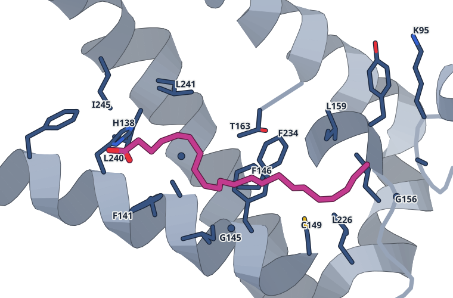

DHA（C22:6）の結合部位。4 Å 以内の残基：K95, A96, F134, H138, F141, A142, G145, F146, C149, G156, Y158, L159, T163, L222, L226, L233, F234, G237, L240, L241, I245

**CLN8は、BMPの材料LPGを立体を選んでつくる酵素だ**

クライオ電顕で活性部位を示し、Batten病の変異は酵素活性を弱めた

- **これまでの疑問・課題**：Batten病の原因タンパク質CLN8が、リソソームの脂質BMPの合成で何をするかは不明だった。
- **アプローチ**：精製CLN8の酵素反応と、アポ型およびアシルCoA存在下のクライオ電顕構造を調べた。
- **結果**：CLN8はS,S型のGPGに最もよくアシル基を移し、構造ではH138の隣にアシル鎖が見えた。
- **わかったこと**：S,S型GPGからリゾホスファチジルグリセロール（LPG）をつくる立体特異的な酵素で、LPGはBMPの材料になる。
- **残された課題**：CLN8がつくったLPGが、リソソームの内腔へどう移るかは未解決だ。

この紹介文の根拠（論文本文）

> However, the role of CLN8 in this pathway has remained unclear.  
> — これまでの疑問・課題／Abstract

> Cryo-electron microscopy structures define the CLN8 active site and support a ping-pong acyl transfer mechanism.  
> — アプローチ／Abstract

> CLN8 acylated S,S-GPG most efficiently, with substantially lower activity for R,S-GPG and only trace activity with R,R-GPG  
> — 結果／Results

> In both complexes, the acyl chain was positioned with a carboxy group adjacent to H138 within the central cavity and the tail oriented towards the ER lumen  
> — 結果／Results

> Together, our stable-isotope tracing and enzymatic assays identify CLN8 as a stereospecific GPG acyltransferase that converts S,S-GPG and acyl-CoAs into S,S-2-acyl-LPG.  
> — わかったこと／Results

> How this intermediate reaches the lysosomal lumen remains unresolved but may involve membrane contact sites  
> — 残された課題／Discussion

分類：酵素（その他）

#### 読みどころ

活性部位はE117・H138・H139・E167・R204からなる。H138にアシル基が一時的に結合する中間体を経るピンポン機構が考えられる。ただし共有結合の密度は見えておらず、著者は水に露出した活性部位のため中間体が不安定なのだろうと説明する。

根拠（論文本文）

> we identified a putative active site comprising E117, H138, H139, E167 and R204  
> — Results

> continuous covalent density between H138 and the acyl chain was not resolved  
> — Results

二量体の界面近くの膜内ポケットに、予想外にCoAが結合していた。見えたのはCoA部分だけで、アシルCoAだった可能性がある。

根拠（論文本文）

> Unexpectedly, we observed two CoA molecules bound in pockets located within the transmembrane region of each monomer, positioned at the dimer interface  
> — Results

> Although only the CoA moiety is resolved in the cryo-EM density, this species may represent acyl-CoA  
> — Results

CLN8の産物であるS,S-LPGを補うと、CLN8欠損細胞とマウス肝臓でBMPが戻り、ゼブラフィッシュの神経症状も改善した。ただし成体マウスの脳では回復がごくわずかだった。

根拠（論文本文）

> Exogenous S,S-lysophosphatidylglycerol, but not the R,S stereoisomer, restores BMP synthesis in CLN8-deficient cells and mice and improves neurological phenotypes in cln8 mutant zebrafish.  
> — Abstract

> recovery of 18:1–18:1 BMP in the brains of S,S-LPG-treated Cln8mnd/mnd mice was substantially poorer  
> — Results

#### 構造データ

| PDB | 手法 | 分解能 | 公開 | 生物種 | リガンド |
|---|---|---|---|---|---|
| [9THK](https://www.rcsb.org/structure/9THK) | クライオ電顕 | 3.60 Å | 2026-07-29 | Homo sapiens | COA |
| [9TKA](https://www.rcsb.org/structure/9TKA) | クライオ電顕 | 2.70 Å | 2026-07-29 | Homo sapiens | COA |
| [9TK9](https://www.rcsb.org/structure/9TK9) | クライオ電顕 | 2.73 Å | 2026-07-29 | Homo sapiens | HXA, COA |

- [Q9UBY8](https://www.uniprot.org/uniprotkb/Q9UBY8) CLN8 Protein CLN8 — *Homo sapiens* （PDB で初めての構造）

#### 実験メモ

- **発現系**：構造解析用のヒトCLN8は酵母 W303.1B で発現（ガラクトース誘導）。
- **コンストラクト**：コドン最適化したC末端Hisタグ付きのヒトCLN8。Factor Xaでタグを切断。
- **精製**：LMNGで膜を可溶化し、Ni-Sepharose、続いてサイズ排除クロマトグラフィー。
- **結晶化／グリッド作製**：基質結合型はCLN8を100 µMのC18:1-CoAまたはC22:6-CoAと室温で1時間。Vitrobot Mark IV、4℃・湿度95%、ブロット3.0秒。
- **データ収集・解析**：Titan Krios＋Falcon 4i＋Selectris Xフィルター。cryoSPARC v3.3.2で処理し、最終 2.69–3.65 Å。

根拠（論文本文）

> Saccharomyces cerevisiae strain W303.1B (MATα leu2-3,112 trp1-1 can1-100 ura3-1 ade2-1 his3-11,15) (ATCC: 201238) was used for protein expression and purification.  
> — Methods

> W303 yeast strain expressing codon-optimized C-His-tagged human CLN8  
> — Methods

> For purification, yeast membranes were solubilized in 21 ml buffer containing 1.5% LMNG, 20 mM Hepes (pH 7.0), 150 mM NaCl, 30 mM imidazole and protease inhibitors and incubated for 1.5 h at 4 °C.  
> — Methods

> For the substrate-bound conditions, CLN8 (2 mg ml−1) was incubated in SEC buffer containing  
> — Methods

> vitrified in a Vitrobot Mark IV (Thermo Fisher Scientific) operated at 4 °C and 95% relative humidity (blot time, 3.0 s; blot force, −10)  
> — Methods

> Datasets were collected from a single grid per condition on a Titan Krios (Thermo Fisher Scientific) operating at 300 kV and nominal magnification ×165,000, equipped with a Falcon 4i detector and a Selectris X energy filter in counting mode.  
> — Methods

> Processing was performed in cryoSPARC v3.3.2.  
> — Methods

> 📝 編集者への確認事項：UniProt Q9UBY8 に既存PDBがなく first_structure は true だが、論文は「初の構造」とは書いていないので本文・見出しでは「初」と言わない。PDB は3件（9THK アポ 3.6 Å、9TKA C18:1-CoA 2.7 Å、9TK9 C22:6-CoA 2.73 Å）。PDB 上のリガンドは CoA と DHA のみで、論文の「アシル鎖」は C22:6 側が HXA として登録されている。共有結合中間体の密度は見えていない点は highlights に明記。本文は最後まで読めた（切れなし）。

---

## 2｜DNAAF19–RUVBL1/2（ヒト）

### DNAAF19–RUVBL1/2 complex recruits multiple adaptors to promote dynein arm assembly

*Proceedings of the National Academy of Sciences of the United States of America*（2026-10-06） · [論文](https://doi.org/10.1073/pnas.2612755123) · ライセンス: cc by

色（順に）：RUVBL1（シャペロン） / RUVBL2（シャペロン） / DNAAF19（組み立て因子） / DPCD（アダプター）　スティック：ADP

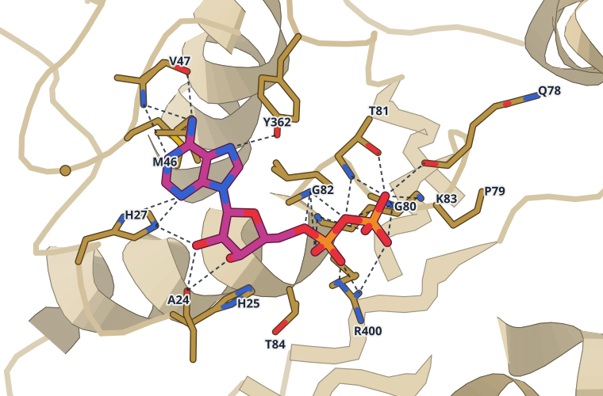

ADPの結合部位。4 Å 以内の残基：A24, H25, H27, G45, M46, V47, Q78, P79, G80, T81, G82, K83, T84, Y362, I370, L399, R400。点線は 3.3 Å 以内の N・O の組（25 組）

**DNAAF19は、シャペロンRUVBL1/2に結合して働くらしい**

クライオ電顕でRUVBL1/2の環にDNAAF19とDPCDが結合する様子を示した

- **これまでの疑問・課題**：繊毛を動かすダイニンアームの組み立てでDNAAF19がどう働くかは、不明だった。
- **アプローチ**：マウス組織でDNAAF19の相互作用相手を調べ、タンパク質の組み立てを助けるRUVBL1/2との複合体をクライオ電顕で解析した。
- **結果**：DNAAF19はRUVBL1/2の環のRUVBL2に結合し、DPCDも同じ環のRUVBL2に5コピー結合していた。
- **わかったこと**：DNAAF19はRUVBL1/2やDPCDとともに共シャペロン複合体として働き、ダイニンアームの組み立てを助けると提案された。
- **残された課題**：DNAAF19とDPCDがRUVBL2のヌクレオチド交換を共同で促すかは、結論できていない。

この紹介文の根拠（論文本文）

> However, recent cryoelectron microscopy (cryo-EM) structures of ciliary axonemes have not revealed the presence of DNAAF19, leaving its role in dynein arm assembly unclear  
> — これまでの疑問・課題／Introduction

> we characterized the protein–protein interaction network of mouse Dnaaf19 using SF-TAP affinity purification followed by mass spectrometry  
> — アプローチ／Results

> We therefore copurified these three human proteins coexpressed in bacterial cells and determined the cryo-EM structure of the complex at an overall 3.5-Å resolution  
> — アプローチ／Results

> Focused 3D classification showed that hDNAAF19 is absent from hRUVBL1 but present in all five hRUVBL2 subunits with variable occupancy  
> — 結果／Results

> The EM map clearly showed five copies of hDPCD bound to hRUVBL2, and the density was absent in hRUVBL1  
> — 結果／Results

> We propose that DNAAF19 functions as part of a cochaperone complex with RUVBL1/2 and other partners, including DPCD, to facilitate dynein arm assembly.  
> — わかったこと／Abstract

> At this moment, we cannot conclude that DNAAF19 and DPCD work in concert to facilitate the nucleotide exchange of RUVBL2.  
> — 残された課題／Discussion

分類：リボソーム・翻訳・フォールディング・感染・ウイルス・防御系

#### 読みどころ

DNAAF19はRPAP3-Cドメインのα6ヘリックスでRUVBL2に結合する。R175がD435・Y430と塩橋をつくり、L178とL182が疎水ポケットに入る。接触面は約700 Å2で、RPAP3やSPAG1の場合より小さい。

根拠（論文本文）

> The interaction between hDNAAF19 and hRUVBL1/2 is primarily mediated by the α6 helix of RPAP3-C, where residue R175 forms salt bridges with D435 and Y430  
> — Results

> These contacts create an interaction interface of ~700 Å2 between hDNAAF19 and hRUVBL1/2, approximately 250 and 400 Å2 smaller than that of hRPAP3-RUVBL1/2 and hSPAG1-RUVBL1/2.  
> — Results

DPCDが結合したRUVBL2のサブユニットでは、ADPが減るか見えなくなる。著者はDPCDがヌクレオチド結合部位の「ゲート」を開けやすくすると考えるが、DPCDだけでは足りないとも述べている。

根拠（論文本文）

> These results imply that hDPCD promotes an open conformation of the N terminus in hRUVBL2 subunits that exhibit incomplete ADP occupancy.  
> — Results

> Our results suggest that DPCD is not sufficient to release ADP from the nucleotide-binding pocket of RUVBL2 by inducing a conformational change in its N terminus.  
> — Discussion

原発性線毛運動異常症（PCD）で最も多い変異H154Pは、H154がP117と作る相互作用を失ってRPAP3-Cドメインを不安定にする。ただしRUVBL2との結合は弱いながら残り、部分的に機能を保つらしい。

根拠（論文本文）

> These results suggest that the H154P variant of hDNAAF19 is a hypomorphic variant that destabilizes the RPAP3-C domain but still retains the interaction with hRUVBL2.  
> — Results

> The H154P variant destabilizes the RPAP3-C domain by losing the interaction  
> — Results

#### 構造データ

| PDB | 手法 | 分解能 | 公開 | 生物種 | リガンド |
|---|---|---|---|---|---|
| [29JR](https://www.rcsb.org/structure/29JR) | クライオ電顕 | 3.47 Å | 2026-09-23 | Homo sapiens | ADP |
| [29KN](https://www.rcsb.org/structure/29KN) | クライオ電顕 | 3.37 Å | 2026-09-30 | Homo sapiens | ADP |

- [Q8IW40](https://www.uniprot.org/uniprotkb/Q8IW40) DNAAF19 Dynein axonemal assembly factor 19 — *Homo sapiens* （既存の PDB 構造 1 件）
- [Q9BVM2](https://www.uniprot.org/uniprotkb/Q9BVM2) DPCD Protein DPCD — *Homo sapiens* （PDB で初めての構造）
- [Q9Y230](https://www.uniprot.org/uniprotkb/Q9Y230) RUVBL2 RuvB-like 2 — *Homo sapiens* （既存の PDB 構造 50 件）
- [Q9Y265](https://www.uniprot.org/uniprotkb/Q9Y265) RUVBL1 RuvB-like 1 — *Homo sapiens* （既存の PDB 構造 48 件）

#### 実験メモ

- **発現系**：ヒトDNAAF19、RUVBL1、RUVBL2を大腸菌で共発現。
- **精製**：Ni親和性精製のあと、サイズ排除クロマトグラフィー。
- **データ収集・解析**：データはリーズ大学のAstbury Biostructure Laboratoryで収集。モデルはAlphaFold3、ChimeraX、PHENIX、Cootで構築。

根拠（論文本文）

> hRUVBL1, RUVBL2, and hDNAAF19 coexpressed in bacterial cells were purified using Ni affinity purification followed by size-exclusion chromatography.  
> — Methods

> The cryo-EM data of hDNAAF19–RUVBL1/2 and its complex with DPCD were collected at the Astbury Biostructure Laboratory, University of Leeds.  
> — Methods

> The models of hDNAAF19–RUVBL1/2 and its complex with hDPCD were built using AlphaFold3 (28), Chimera X (50), PHENIX (51), and Coot (52).  
> — Methods

> 📝 編集者への確認事項：DNAAF19 には既存PDB 1件、RUVBL1/2 には多数あり、複合体としては新規だが論文は「初」とは書いていない（DPCD は first_structure=true だが論文は明言せず）。見出しは「らしい」で推測の度合いを合わせた。クライオ電顕のコンストラクトや凍結条件は SI Appendix にあり、本文（Materials and Methods）は要約のみのため lab_notes は一部 null。RUVBL1:RUVBL2 が 1:5 になる点は、著者も実験条件による可能性を残している。PDB は 29JR（DNAAF19–RUVBL1/2）と 29KN（DPCD 付き複合体）。

---

## 3｜ヒト繊毛の移行帯（ECT2L・DZANK1）

### In situ structure of the human ciliary transition zone links linker defects to primary ciliary dyskinesia

*Science (New York, N.Y.)*（2026-09-10） · [論文](https://doi.org/10.1126/science.aei5957) · ライセンス: tdm

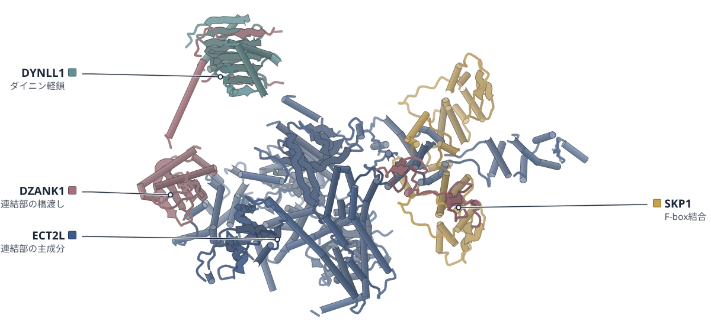

色（順に）：ECT2L（連結部の主成分） / SKP1（F-box結合） / DYNLL1（ダイニン軽鎖） / DZANK1（連結部の橋渡し）

**ECT2LとDZANK1は、繊毛の根もとで微小管をつなぐ**

気道細胞の中で構造を直接解析し、2遺伝子の変異は原発性線毛運動異常症の原因になる

- **これまでの疑問・課題**：繊毛の根もとの関門である移行帯の分子構成と、運動性繊毛の病気との関係は、よく分かっていなかった。
- **アプローチ**：ヒトの気道細胞を凍結して薄く削り、その場のクライオ電子線トモグラフィーとサブトモグラム平均で調べた。
- **結果**：移行帯の二連微小管を6.9–7.3 Åで解き、9つのタンパク質を同定した。連結部の主役はECT2LとDZANK1だった。
- **わかったこと**：ECT2LかDZANK1の機能喪失変異が原発性線毛運動異常症を起こし、移行帯の欠陥と運動性繊毛の病気が直接結びついた。
- **残された課題**：DZANK1のIg様ドメインとアンキリン反復の位置は、まだ定まっていない。

この紹介文の根拠（論文本文）

> The ciliary transition zone (TZ) regulates ciliary proteome composition, yet its molecular architecture, protein content, and contribution to motile ciliopathies remain poorly defined.  
> — これまでの疑問・課題／Abstract

> We applied in situ cryo-electron tomography and subtomogram averaging to human multiciliated epithelial cells.  
> — アプローチ／Abstract

> composite map at 6.9–7.3 Å resolution  
> — 結果／Results

> This approach resolved TZ-specific doublet microtubules at subnanometer resolution and identified nine constituent proteins. We found that ECT2L and DZANK1 form the major linker complexes between adjacent TZ doublet microtubules.  
> — 結果／Abstract

> Biallelic loss-of-function variants in either gene cause primary ciliary dyskinesia.  
> — わかったこと／Abstract

> These findings establish a direct genetic link between TZ defects and human motile ciliopathies  
> — わかったこと／Abstract

> The positions of N-terminal immunoglobulin-like and C-terminal ankyrin repeat domains of DZANK1 remain uncertain but may correspond to weak inward-projecting density from the TZ linker  
> — 残された課題／Results

分類：その他

#### 読みどころ

培養したヒト気道細胞をFIB（集束イオンビーム）で厚さ約200 nmのラメラに削り、細胞の中でそのまま移行帯を撮影した。精製せずに、細胞の中の状態のまま構造を解いている。

根拠（論文本文）

> Focused ion beam (FIB) milling was performed on the periphery of the frozen ciliated cells, generating thin lamellae suitable for cryo-ET  
> — Results

> FIB milling was performed in AutoTEM Cryo using stepwise decreasing currents as the lamellae were thinned (1.0 nA–30 pA; final thickness, ~200 nm).  
> — Methods

隣り合う微小管の連結部は、ECT2LとSKP1が2対2で組んだ複合体が並んだものと解釈された。DZANK1がその複合体どうしを橋渡しし、DYNLL1/2とともに隣のA管に取り付く。ただしDZANK1の小さなZn結合ドメインは、弱い密度のため明確には置けていない。

根拠（論文本文）

> We therefore conclude that a major component of the TZ linker is an ECT2L–SKP1 heterotetramer with 2:2 stoichiometry.  
> — Results

> These observations together indicate that TZ linkers are linear arrays of ECT2L–SKP1–DZANK1–DYNLL1/2 complexes  
> — Results

> Although these small domains could not be modeled unambiguously in the relatively weak density, the subtomogram map was consistent with their presence  
> — Results

ECT2LかDZANK1の機能喪失変異をもつ患者4人の細胞では、移行帯の連結部が失われ、繊毛の先がこぶ状に膨らんだ。ECT2Lを壊したiPS細胞由来の細胞でも同じこぶ状の先端が見られた。

根拠（論文本文）

> identified four unrelated individuals with predicted loss-of-function variants: three with distinct biallelic ECT2L variants  
> — Results

> DMTs were irregularly spaced and often lacked discernible TZ linkers  
> — Results

> Electron microscopy of ECT2L-KO cultures revealed widespread bulbous ciliary tips  
> — Results

#### 構造データ

| PDB | 手法 | 分解能 | 公開 | 生物種 | リガンド |
|---|---|---|---|---|---|
| [11YJ](https://www.rcsb.org/structure/11YJ) | クライオ電顕 | 7.30 Å | 2026-09-09 | Homo sapiens | GTP, GDP |
| [11XU](https://www.rcsb.org/structure/11XU) | クライオ電顕 | 9.60 Å | 2026-09-09 | Homo sapiens | — |

- [P63167](https://www.uniprot.org/uniprotkb/P63167) DYNLL1 Dynein light chain 1, cytoplasmic — *Homo sapiens* （既存の PDB 構造 21 件）
- [P63208](https://www.uniprot.org/uniprotkb/P63208) SKP1 S-phase kinase-associated protein 1 — *Homo sapiens* （既存の PDB 構造 72 件）
- [P68371](https://www.uniprot.org/uniprotkb/P68371) TUBB4B Tubulin beta-4B chain — *Homo sapiens* （既存の PDB 構造 4 件）
- [Q008S8](https://www.uniprot.org/uniprotkb/Q008S8) ECT2L Epithelial cell-transforming sequence 2 oncogene-like — *Homo sapiens* （PDB で初めての構造）
- [Q49MG5](https://www.uniprot.org/uniprotkb/Q49MG5) MAP9 Microtubule-associated protein 9 — *Homo sapiens* （PDB で初めての構造）
- [Q71U36](https://www.uniprot.org/uniprotkb/Q71U36) TUBA1A Tubulin alpha-1A chain — *Homo sapiens* （既存の PDB 構造 15 件）
- [Q8WWF8](https://www.uniprot.org/uniprotkb/Q8WWF8) CAPSL Calcyphosin-like protein — *Homo sapiens* （PDB で初めての構造）
- [Q9BYV8](https://www.uniprot.org/uniprotkb/Q9BYV8) CEP41 Centrosomal protein of 41 kDa — *Homo sapiens* （PDB で初めての構造）
- [Q9H0I2](https://www.uniprot.org/uniprotkb/Q9H0I2) ENKD1 Enkurin domain-containing protein 1 — *Homo sapiens* （PDB で初めての構造）
- [Q9NVP4](https://www.uniprot.org/uniprotkb/Q9NVP4) DZANK1 Double zinc ribbon and ankyrin repeat-containing protein 1 — *Homo sapiens* （PDB で初めての構造）
- [Q9Y6A4](https://www.uniprot.org/uniprotkb/Q9Y6A4) CFAP20 Cilia- and flagella-associated protein 20 — *Homo sapiens* （既存の PDB 構造 2 件）

#### 実験メモ

- **発現系**：ヒト鼻上皮の初代培養細胞を気液界面（ALI）で分化させ、繊毛を形成させた（3〜4週間）。
- **結晶化／グリッド作製**：細胞を単離して金グリッド（Quantifoil R3.5/1）に載せ、Vitrobot Mark IVで背面ブロット8秒・湿度100%で凍結。Aquilos 2のcryo-FIB/SEMでラメラを作製。
- **データ収集・解析**：Titan Krios＋Selectris＋Falcon 4i、64,000倍、ピクセル2 Å。Warpでトモグラムを再構成し、RELION5でサブトモグラム平均。

根拠（論文本文）

> Ciliation was observed 3–4 weeks after transition to ALI.  
> — Methods

> Grids were blotted from the back for 8 s with a blot force of 10 and 100% humidity before being plunged into liquid ethane cooled by liquid nitrogen.  
> — Methods

> Lamella preparation was performed on an Aquilos 2 cryo-FIB/SEM (Thermo Fisher Scientific).  
> — Methods

> Tilt series were collected on a 300-kV Titan Krios transmission electron microscope equipped with a Selectris energy filter and a Falcon4i detector (Thermo Fisher Scientific).  
> — Methods

> The subtomograms were exported and aligned in RELION5 (53).  
> — Methods

> 📝 編集者への確認事項：in situ のサブトモグラム平均で、PDB は 11YJ（二連微小管、7.3 Å）と 11XU（連結部、PDB 登録値 9.6 Å。本文は約8 Å と書く）。原子モデルの多くは AlphaFold/Boltz-2 のモデルを密度に当てはめたもので、タンパク質の同定は DomainSeeker による当てはめ探索と免疫染色などによる。論文は「初」とは書いていない（ECT2L・DZANK1 などは first_structure=true）ので見出しでも言わない。ライセンスは tdm（本文は読めた、切れなし）。見出しの「つなぐ」は論文の linker complexes という記述に合わせた。遺伝学の部分（患者4人）も読みどころに入れたが、構造の論文としての中心は in situ 構造と連結部の同定。

---

## 4｜Pit2（トウモロコシ黒穂病菌）

### A co-evolved peptide-GPCR system senses host entry to drive fungal infection

*Nature Communications*（2026-10-09） · [論文](https://doi.org/10.1038/s41467-026-78428-6) · ライセンス: cc by

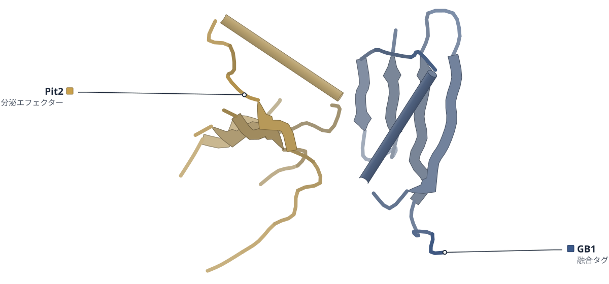

色（順に）：GB1（融合タグ） / Pit2（分泌エフェクター）

**Pit2から切り出されたペプチドが、カビのGPCRを活性化する**

Pit2の結晶構造で、リガンドのペプチドは二量体の芯に隠れていた

- **これまでの疑問・課題**：菌類のGPCR（細胞外の信号を受け取る7回膜貫通型の受容体）は、リガンドも活性化の仕組みもよく分かっていない。
- **アプローチ**：黒穂病菌のGpe1を酵母に発現させて活性化を測り、Pit2の結晶構造とAlphaFold3のモデルで結合を調べた。
- **結果**：Pit2由来のWWFGFTGSLでGpe1が活性化した（EC50は80 nM）。このペプチドはPit2二量体の界面に埋まっていた。
- **わかったこと**：Pit2はペプチドを二量体の中に隠し、宿主のプロテアーゼが切ると放出されてGpe1を活性化すると考えられる。
- **残された課題**：Pit2から生じる2種類のペプチドが、感染でそれぞれどう寄与するかは今後の課題だ。

この紹介文の根拠（論文本文）

> although the repertoire of ligands and activation mechanisms remains poorly understood  
> — これまでの疑問・課題／Introduction

> We elucidate the crystal structure of Pit2 and model the complex formed by Gpe1 and the Pit2-derived peptide.  
> — アプローチ／Abstract

> Dose-response analysis revealed an EC50 of 80 nM for wildtype Gpe1  
> — 結果／Results

> The dimer interface buries the conserved hydrophobic WWFGFTGSL motif forming β1  
> — 結果／Results

> Our results indicate that Pit2 acts as a structural chassis containing the activating peptide in the homodimer interface, thereby preventing premature activation of Gpe1 prior to host-mediated proteolytic release of Pit2-derived peptides.  
> — わかったこと／Results

> Future work has to investigate the individual contribution of these two peptide versions during U. maydis infection.  
> — 残された課題／Results

分類：GPCR・受容体・感染・ウイルス・防御系

#### 読みどころ

Pit2は5本のβストランドと1本のαヘリックスからなる、絡み合った二量体だった。活性化ペプチドWWFGFTGSLは二量体の界面に埋まり、宿主のプロテアーゼで切られるまでGpe1を活性化できないと考えられる。

根拠（論文本文）

> Pit2 is composed of five β-strands and one α-helix, forming a tightly intertwined homodimer.  
> — Results

> thereby preventing premature activation of Gpe1 prior to host-mediated proteolytic release of Pit2-derived peptides  
> — Results

Gpe1とペプチドの複合体は実験構造ではなく、AlphaFold3のモデルだ。N末端のトリプトファンがTM1とECL2の空洞に入ると予測され、W37AとC178Aは受容体をほぼ無応答にし、菌の毒性も強く下げた。

根拠（論文本文）

> In the predicted structure, the N-terminal tryptophan residues of the Pit2 peptide are buried top-down in a cavity formed by TM1 and ECL2 of Gpe1, with the C-terminus oriented extracellularly  
> — Results

> variation of C178A and W37A strongly decreased EC50 and rendered Gpe1 almost non-responsive  
> — Results

> strains containing C178A and W37A a strong attenuation in virulence  
> — Results

Gpe1に似た担子菌の受容体群で、TM3のR133とTM6のN246・N247が保存されていた。これらはロドプシン型GPCRのイオンロックを思わせ、R133Aなどの変異で活性が消えた。ただし受容体の安定性の低下による可能性も著者は残している。

根拠（論文本文）

> Overall, this residue network is reminiscent of the ionic lock described in rhodopsin/class A GPCRs  
> — Results

> More disruptive substitutions, N246L + N247L and R133A, abolished detectable receptor activation.  
> — Results

> reduced activity of individual variants may also reflect effects on receptor stability or intracellular trafficking competence  
> — Results

#### 構造データ

| PDB | 手法 | 分解能 | 公開 | 生物種 | リガンド |
|---|---|---|---|---|---|
| [9RXK](https://www.rcsb.org/structure/9RXK) | X線結晶構造解析 | 2.35 Å | 2026-07-22 | Mycosarcoma maydis, Streptococcus | — |

- [A0A0D1EAR7](https://www.uniprot.org/uniprotkb/A0A0D1EAR7) PIT2 Secreted effector PIT2 — *Mycosarcoma maydis* （PDB で初めての構造）
- [P19909](https://www.uniprot.org/uniprotkb/P19909) spg Immunoglobulin G-binding protein G — *Streptococcus sp. group G* （既存の PDB 構造 91 件）

#### 実験メモ

- **発現系**：大腸菌で発現（本文はSHuffle (DE3) とBL21 (DE3) の両方を記載）。
- **コンストラクト**：シグナルペプチドを除いたPit2を、GB1タグ・6×His・TEV切断部位をもつpEM-GB1ベクターに組み込んだ。
- **精製**：Ni-NTAのあとTEVで切断し、逆アフィニティとSuperdex S200 Increase 16/600のサイズ排除クロマトグラフィー。
- **結晶化／グリッド作製**：ハンギングドロップ法、室温。20 mg/mLのGB1-Pit2を0.1 M Bicine pH 9、1.6 M硫酸アンモニウムで約2週間かけて結晶化。
- **データ収集・解析**：ESRFで低温データを収集。XDS/XSCALEで処理し、既存の構造を探索モデルに分子置換（Phaser-MR）、Coot・Phenixで精密化。

根拠（論文本文）

> The E. coli strain SHuffle® (DE3) (Novagen) was used to express all produced proteins in this study.  
> — Methods

> For cloning of protein expression constructs, the pEM-GB1 vector was used for, encoding the solubility tag GB1, a hexahistidine (6His) tag and a Tobacco etch virus protease (TEV) recognition site.  
> — Methods

> The cleaved protein was subjected to a reverse affinity chromatography to remove the hexahistidine tag fused with GB1 and the uncleaved protein.  
> — Methods

> Hexahistidine tag fused with GB1-UmPit2 crystallized at 20 mg/mL within 2 weeks in in 0.1 M Bicine and 1.6 M Ammonium sulfate at pH 9.  
> — Methods

> Data were collected under cryogenic conditions at the European Synchrotron Radiation Facility (ESRF)  
> — Methods

> The structure of Pit2 was determined by molecular replacement using Phenix version 1.20.1-448745 integrated Phaser-MR and 5BMH as the search model.  
> — Methods

> 📝 編集者への確認事項：実験構造は Pit2 の結晶構造（9RXK、PDB 2.35 Å、本文は 2.3 Å）だけで、Gpe1–ペプチド複合体は AlphaFold3 のモデル（著者自身が結合様式は不確かで変異の設計にだけ使うと明記）。見出し「活性化する」は酵母レポーター系と植物感染の結果に基づく。PDB には GB1 タグ（Immunoglobulin G-binding protein G）が2つ目の鎖として載っている。本文は GB1-Pit2 が結晶化したと書く一方、精製ではタグを TEV で切ると書き、発現株も SHuffle(DE3) と BL21(DE3) の両方があって矛盾している（lab_notes は両方を記載）。論文は初の構造とは書いていない（PIT2 は first_structure=true）ので見出しで言わない。本文は最後まで読めた。

---

## 5｜SaMurJ（黄色ブドウ球菌）

### Structures of the lipid II flippase from the monoderm pathogen Staphylococcus aureus

*The Journal of Biological Chemistry*（2026-09-06） · [論文](https://doi.org/10.1016/j.jbc.2026.113516) · ライセンス: cc by

色（順に）：SaMurJ（脂質II輸送体）

**黄色ブドウ球菌のMurJの構造が、初めて明らかになった**

外向きと内向きの2状態をクライオ電顕で解析し、大腸菌のMurJと同じ型の動きを示した

- **これまでの疑問・課題**：外膜をもたない単膜細菌のMurJ（脂質IIの輸送体）は、配列の違いが大きく、構造が未解析だった。
- **アプローチ**：黄色ブドウ球菌のMurJ（SaMurJ）を、ナノボディやBRIL融合を使ってクライオ電顕で解析し、大腸菌MurJと比べた。
- **結果**：SaMurJの外向き型（3.6 Å）と内向き型（3.5 Å）が決まり、全体の折れ畳みは大腸菌MurJと同じ型だった。
- **わかったこと**：SaMurJも2つの状態を行き来する交互アクセス機構で脂質IIを運ぶと考えられる。
- **残された課題**：SaMurJは大腸菌での機能補完ができず、脂質IIの認識の違いが関わる可能性がある。

この紹介文の根拠（論文本文）

> While MurJ from diderm bacteria has been structurally resolved in multiple conformational states, its monoderm homolog remains uncharacterized.  
> — これまでの疑問・課題／Abstract

> Monoderm MurJ homologs exhibit substantial sequence divergence yet retain the same lipid II flipping function and are promising antibiotic targets.  
> — これまでの疑問・課題／Abstract

> As an alternative, we used the ALFA-tag system (26), appending the ALFA peptide to the C-terminus of SaMurJ (SaMurJALFA) (Fig. S2A) and forming a complex with an anti-ALFA-tag nanobody (26) (Fig. S2B).  
> — アプローチ／Results

> we deleted the first seven N-terminal residues of SaMurJ (SaMurJ8-553BRIL), which resulted in a more rigid attachment of BRIL to TM1 of SaMurJ8-553 and enabled a high-resolution reconstruction to 3.5 Å  
> — アプローチ／Results

> Here we report structures of Staphylococcus aureus MurJ (SaMurJ) captured in both outward- and inward-facing conformations.  
> — 結果／Abstract

> A structural alignment of the OFS SaMurJ and EcMurJ reveals they have similar overall architecture (Figs. 1, G and H, S5B) (RMSD for equivalent residues of 1.3 Å).  
> — 結果／Results

> These structures show that SaMurJ adopts the conserved MOP family fold and undergoes conformational transitions consistent with an alternating-access mechanism.  
> — わかったこと／Abstract

> This lack of complementation may reflect differences in lipid II substrate recognition, as S. aureus lipid II contains an additional pentaglycine modification (29, 30).  
> — 残された課題／Results

分類：トランスポーター・感染・ウイルス・防御系

#### 読みどころ

SaMurJは大腸菌のMurJと配列が17%しか同じでないが、コアの12本の膜貫通ヘリックスと追加の2本（TM13-14）を持つ。著者は単膜細菌の脂質II輸送体の初めての構造だとしている。

根拠（論文本文）

> Despite low sequence conservation between diderm and monoderm MurJ (17% identity between Sa and Ec), the structure showed that SaMurJ has a canonical MOP transporter core consisting of 12 TMs in two lobes  
> — Results

> providing the first structural view of a monoderm lipid II flippase.  
> — Discussion

脂質IIのリン酸基を結ぶとされる正電荷の3つ組（K22-R176-K302）のR176をAlaに変えると、SaMurJは内向き型で止まった。この3つ組が基質の認識と構造変化を結びつけるという見方を支える。

根拠（論文本文）

> The SaMurJALFA R176A adopts an inward-facing conformation that is similar to the inward-facing structure captured using the BRIL fusion (Fig. 2F).  
> — Results

> Consistent with this model, we show that mutation of R176 traps MurJ in an inward-facing conformation, supporting that the cationic triad plays a key role in coupling substrate engagement to conformational transitions during the transport cycle  
> — Discussion

大腸菌MurJでヘリックスを折る保存配列G/A-E-G-AがSaMurJにはなく、G62とP64が蝶番になるとみられる。単膜と二膜の違いは、選択的な阻害剤を狙う手がかりになりうる。

根拠（論文本文）

> This is likely achieved by the conserved residues G62 and P64 in TM2 (ConSurf conservation grade 9 for both), which are positioned to function as a hinge that accommodates TM2 bending during conformational transitions.  
> — Discussion

> In contrast, structural features unique to monoderm or diderm MurJ may provide opportunities for selective inhibition.  
> — Discussion

#### 構造データ

| PDB | 手法 | 分解能 | 公開 | 生物種 | リガンド |
|---|---|---|---|---|---|
| [11XX](https://www.rcsb.org/structure/11XX) | クライオ電顕 | 3.60 Å | 2026-09-16 | Staphylococcus aureus (strain NCTC 8325 / PS 47) | — |
| [11XZ](https://www.rcsb.org/structure/11XZ) | クライオ電顕 | 3.50 Å | 2026-09-16 | Staphylococcus aureus (strain NCTC 8325 / PS 47) | — |
| [11YA](https://www.rcsb.org/structure/11YA) | クライオ電顕 | 3.60 Å | 2026-09-16 | Staphylococcus aureus (strain NCTC 8325 / PS 47) | — |
| [11XY](https://www.rcsb.org/structure/11XY) | クライオ電顕 | 3.90 Å | 2026-09-16 | Escherichia coli | — |

- [P0AF16](https://www.uniprot.org/uniprotkb/P0AF16) murJ Lipid II flippase MurJ — *Escherichia coli (strain K12)* （既存の PDB 構造 7 件）
- [Q2FXH6](https://www.uniprot.org/uniprotkb/Q2FXH6)  Polysaccharide biosynthesis protein, putative — *Staphylococcus aureus (strain NCTC 8325 / PS 47)* （PDB で初めての構造）

#### 実験メモ

- **発現系**：pETDuet ベクターで大腸菌 NiCo21 (DE3) に発現。IPTG 400 μM、18 °C で一晩。
- **コンストラクト**：SaMurJ1-553 の C 末端に ALFA-10xHis。内向き型は N 末端の 7 残基を欠く 8-553 に BRIL を融合。
- **精製**：LMNG で可溶化し、Ni-NTA → Superdex 200 ゲル濾過。野生型と BRIL 融合体には CHS を添加。
- **結晶化／グリッド作製**：抗 ALFA ナノボディ、または BAG2 Fab と抗 Fab ナノボディと複合体化。FOM を加え、Vitrobot Mark IV で凍結。
- **データ収集・解析**：Titan Krios＋K3（300 kV）、cryoSPARC v4.6.1 で処理。Coot・Phenix でモデル構築。

根拠（論文本文）

> pETDuet vector containing S. aureus MurJ1-553 (WT or R176A mutant) with a C-terminal ALFA-10xHis tag (SaMurJALFA), S. aureus MurJ8-553 with an N-terminal BRIL fusion domain and a C-terminal 10xHis tag (SaMurJBRIL)  
> — Experimental procedures

> Protein expression was induced by adding 400 μM Isopropyl β-D-1-thiogalactopyranoside (IPTG) and the culture was grown overnight (approximately 16 h).  
> — Experimental procedures

> Eluted protein was concentrated to approximately 500 μl using a 30 kDa MWCO Centrifugal filter (Amicon) and subjected to a Superdex 200 Increase 10/300 Gl size exclusion chromatography column (Cytiva)  
> — Experimental procedures

> Purified SaMurJBRIL sample was incubated with 1.2-fold and 1.4-fold molar excess of BAG2 Fab and elbow Nb at 4 °C for 1 h.  
> — Experimental procedures

> 0.05% Fluorinated Octyl Maltoside (FOM, Anatrace) was added prior to vitrification.  
> — Experimental procedures

> Cryo-EM data were acquired at the Caltech cryo-EM Facility on an FEI Titan Krios operated at an acceleration voltage of 300 kV and equipped with an energy filter and a K3 direct electron detector (Gatan) in correlated double sampling mode.  
> — Experimental procedures

> All cryo-EM data processing was performed in cryoSPARC (36) (v4.6.1).  
> — Experimental procedures

> 📝 編集者への確認事項：Q2FXH6 は PDB で初めての構造（prior_pdb_count 0）で、論文も「first structural view of a monoderm lipid II flippase」と書くため初構造タグを付けた。大腸菌 MurJ の外向き型（11XY）も同時に報告している。脂質II結合モデルは Chai-1 の予測で実験構造ではないので、記事では扱わなかった。本文は欠けていない。

---

## 6｜ヒトグルタミン合成酵素（GS）

### Product-stabilized filamentation by human glutamine synthetase allosterically tunes metabolic activity

*eLife*（2026-10-12） · [論文](https://doi.org/10.7554/elife.108336) · ライセンス: cc by

色（順に）：GS（グルタミン合成）　スティック：ATP、グルタミン（GLN）

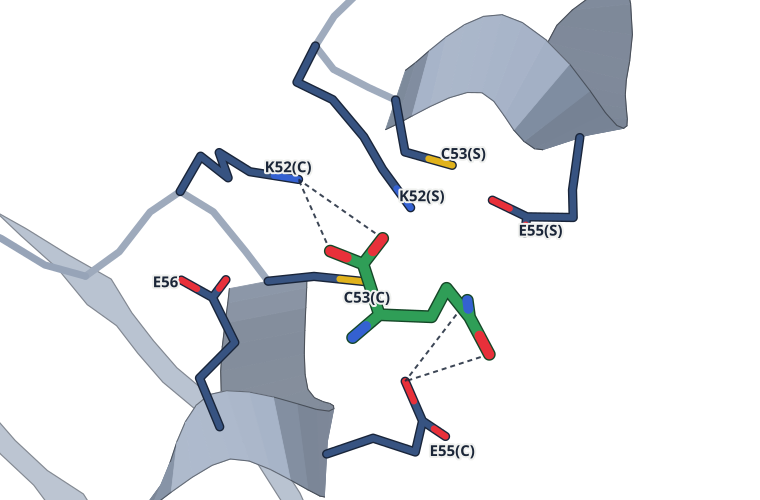

グルタミンの結合部位。4 Å 以内の残基：K52(C), C53(C), E55(C), E56, K52(S), C53(S), E55(S)。点線は 3.3 Å 以内の N・O の組（4 組）

**ヒトのグルタミン合成酵素は、産物で繊維になり働きを弱める**

時間分解クライオ電顕で、繊維の接合面にグルタミンが入ることを確認した

- **これまでの疑問・課題**：ヒトのグルタミン合成酵素（GS）は、数時間かかる転写や分解より速く、どう調節されるのか。
- **アプローチ**：GSをクライオ電顕で解析し、時間分解実験、酵素反応速度、変異体、細胞の増殖試験で調べた。
- **結果**：グルタミンが2つの10量体の接合面に結合して繊維を安定化し、アンモニアのKMは約3倍に上がった。
- **わかったこと**：繊維化で活性部位のE305ループが乱れ、産物が増えるほど酵素が弱まる負のフィードバックになると考えられる。
- **残された課題**：グルタミンがなくても繊維ができる酵素濃度は、細胞内よりずっと高い。

この紹介文の根拠（論文本文）

> However, regulation via these processes would require hours to achieve appreciable changes in intracellular GS concentrations.  
> — これまでの疑問・課題／Introduction

> These observations led us to ask how human GS activity could be regulated on the timescales required to adapt to dynamic changes in nutrient availability.  
> — これまでの疑問・課題／Introduction

> Here, we used a combination of cryo-electron microscopy (cryo-EM), enzymology, and cell proliferation assays, to discover a regulatory mechanism that incorporates both feedback inhibition and filamentation.  
> — アプローチ／Introduction

> The presence of glutamine increased KM, ammonia threefold for WT, but had smaller effects for the mutations at the interface that directly interact with the ligand (Figure 2F).  
> — 結果／Results

> Inspection of the ‘filament assembly’ interface between the two decamers revealed a discrete density that was absent from the apo-filament reconstruction (Figure 2D).  
> — 結果／Results

> We propose that GS filament formation constitutes a negative-feedback mechanism, directly linking product concentration to the structural and functional remodeling of the enzyme.  
> — わかったこと／Abstract

> This observation implicates the E305-loop conformational distribution as a potential factor contributing to the observed impaired kinetics of GS filaments.  
> — わかったこと／Results

> While the enzyme concentrations to achieve robust filamentation in the absence of glutamine are much higher than observed in cells  
> — 残された課題／Discussion

分類：酵素（その他）

#### 読みどころ

反応が進んで産物が増えるほど、繊維の粒子の割合が直線的に増えた。接合面の密度（約2.2 Å）に、水素結合でつながる形でグルタミンをモデルした。

根拠（論文本文）

> The positive linear correlation between fraction of particles in a filament-like assembly and reaction time suggests that a product of the forward reaction of GS acts to stabilize the filament assembly.  
> — Results

> Given the association with product formation, we modeled glutamine into this density in a conformation consistent with forming hydrogen bonds that link the filament interface residues and the bound product  
> — Results

活性部位のふたになるE305ループは、反応中の繊維ではほぼ密度が消えた。MDを併用した精密化では揺らぎが10 Åを超え、R299が活性部位に入り込む。繊維が基質を取り込みにくい理由とみられる。

根拠（論文本文）

> By contrast, the filament map collected during turnover displayed almost no density in the region, which is indicative of a greater degree of disorder.  
> — Results

> The E305-loop (residues 299–311) sampled a more diverse ensemble (with root mean square fluctuation values of greater than 10 Å) in the turnover filament state  
> — Results

> The conformation of Arg299 could potentially sterically hinder substrate access to the active site and thus contribute synergistically with loop mobility to the observed KM, ammonia defect.  
> — Results

ループの安定化を壊すR298A、L300Aは、グルタミンのない培地でGS欠損HEK293細胞の増殖を支えられなかった。R298Aは10量体でもループの密度がなかった。

根拠（論文本文）

> However, the two loop mutants, R298A and L300A, could not support growth under glutamine-depleted conditions displaying the same phenotype as P242stop.  
> — Results

> Importantly, this map, despite being the highest global resolution map reconstructed, did not display any appreciable E305-loop density (Figure 5), similar to the turnover filament (Figure 3B).  
> — Results

#### 構造データ

| PDB | 手法 | 分解能 | 公開 | 生物種 | リガンド |
|---|---|---|---|---|---|
| [9OTQ](https://www.rcsb.org/structure/9OTQ) | クライオ電顕 | 2.27 Å | 2025-07-02 | Homo sapiens | — |
| [9OTM](https://www.rcsb.org/structure/9OTM) | クライオ電顕 | 2.19 Å | 2025-07-02 | Homo sapiens | ATP, GLN |
| [9OTO](https://www.rcsb.org/structure/9OTO) | クライオ電顕 | 2.03 Å | 2025-07-02 | Homo sapiens | ADP |
| [9OTN](https://www.rcsb.org/structure/9OTN) | クライオ電顕 | 2.11 Å | 2025-07-02 | Homo sapiens | ATP |
| [9OTP](https://www.rcsb.org/structure/9OTP) | クライオ電顕 | 1.95 Å | 2025-07-02 | Homo sapiens | ADP |

- [P15104](https://www.uniprot.org/uniprotkb/P15104) GLUL Glutamine synthetase — *Homo sapiens* （既存の PDB 構造 7 件）

#### 実験メモ

- **発現系**：大腸菌 BL21(DE3) で発現。タグなし GS は N 末端 His6-SUMO（Ulp1 で切断）または C 末端 intein-CBD-His6 で作製。
- **コンストラクト**：N 末端 His6 タグ付きは構造と活性が変わったため、タグなしの GS を使用。
- **精製**：HisTrap → タグの切断 → 逆向き Ni-NTA → Superose 6 でデカマーの画分を回収。
- **結晶化／グリッド作製**：Quantifoil 1.2/1.3 Cu300（＋2 nm カーボン）、Vitrobot Mark IV。反応中の試料は ATP・NH4Cl・グルタミン酸を加え 53–600 秒で凍結。
- **データ収集・解析**：Titan Krios＋Gatan K3。cryoSPARC で処理（繊維は D5 対称）。ループは EMMIVox でアンサンブル精密化。

根拠（論文本文）

> Human glutamine synthetase was codon-optimized for E. coli (ATUM Biosciences) and subcloned into a pET29a vector bearing an inframe 5′ His6-SUMO tag and transformed into BL21(DE3).  
> — Methods

> These data demonstrate a significant structural and functional impact of N-terminal His6 tags on GS in addition to the presence of supramolecular architectures.  
> — Results

> Cleaved GS was separated from His6-tagged His-SUMO through an ortho NiNTA where sample was applied to a HisTrap High Performance 5 mL column (Cytiva) and where scarless GS could elute with application of base buffer with 25 mM imidazole.  
> — Methods

> Unless otherwise stated, the decameric peak corresponding to a 16 mL retention volume was collected and stored at 4 °C throughout the duration of experimentation.  
> — Methods

> For turnover conditions, all data were collected on Quantifoil 1.2/1.3 Cu 300+2 nm C grids where reactions were initiated at room temperature immediately before being applied to grid in a Vitrobot Mark IV (Thermo) pre-equilibrated to 18 °C with 100% humidity  
> — Methods

> Turnover conditions were induced by adding saturating concentrations of substrates immediately prior to vitrification, with reaction times totalling between 49 and 59 s initiated by manual mixing prior to blotting.  
> — Results

> Refined single-structure models and structural ensembles of the GS in the apo-filament, turnover filament, and turnover decamer forms were generated using EMMIVox (Hoff et al., 2024).  
> — Methods

> 📝 編集者への確認事項：ヒトGSには既存のPDB構造（結晶構造 2QC8・2OJW など、prior_pdb_count 7）があるため初構造ではない。新規性は繊維状態のクライオ電顕構造と反応中の状態。PDB は2025年7月にプレプリント引用で公開済みで、本誌版が出たため新着として扱った。E305ループの揺らぎは MD 併用のアンサンブル精密化に基づくので、読みどころでも MD 併用と明記した。2.0〜2.3 Å台の5構造を報告している。本文は欠けていない。

---

## 7｜PfRIPR（熱帯熱マラリア原虫）

### Dynamic hinge-motion of PfRIPR revealed by malaria invasion inhibitory antibodies

*Nature Communications*（2026-08-24） · [論文](https://doi.org/10.1038/s41467-026-77069-z) · ライセンス: cc by

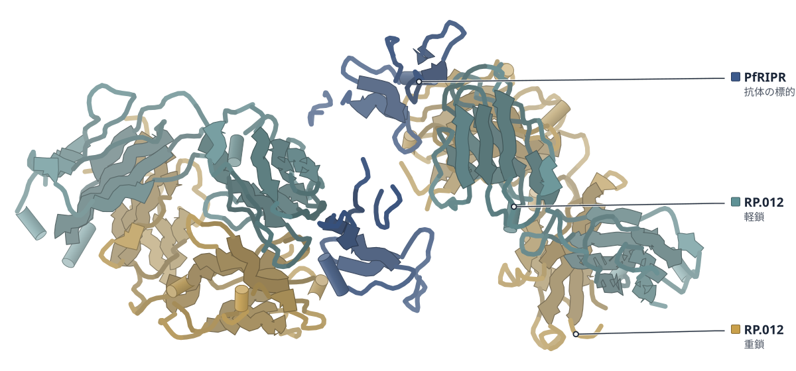

色（順に）：PfRIPR（抗体の標的） / RP.012（重鎖） / RP.012（軽鎖）

**増殖を抑える抗体は、マラリア原虫PfRIPRの尾部を折り曲げる**

抗体4種との複合体を解析し、折れ曲がりを起こさない抗体は増殖を抑えなかった

- **これまでの疑問・課題**：赤血球への侵入に必須な複合体の中心因子PfRIPRに、抗体がどう結合して侵入を防ぐのかは、構造がなく不明だった。
- **アプローチ**：ヒト由来3種とマウス由来1種の抗体とPfRIPR断片の複合体を、X線結晶構造とクライオ電顕で解析した。
- **結果**：増殖阻害抗体RP.012は、EGF6とEGF7の間で尾部を曲げていた。非阻害のMAD8-739では曲がらなかった。
- **わかったこと**：PfRIPRの尾部が侵入の際に形を変える必要があり、RP.012はその動きを妨げる可能性がある。
- **残された課題**：抗体を組み合わせたときに相乗効果が生じる仕組みは、まだ明らかでない。

この紹介文の根拠（論文本文）

> Few monoclonal antibodies (mAbs) have been identified and, with no structures of mAbs bound to PfRIPR, we do not understand how they block invasion, limiting our ability to rationally design the most effective vaccine immunogen based on PfRIPR.  
> — これまでの疑問・課題／Introduction

> PfRIPR is the largest and one of the least understood components of PfPCRCR.  
> — これまでの疑問・課題／Introduction

> We structurally characterised four PfRIPR tail-binding antibodies in complex with PfRIPR fragments.  
> — アプローチ／Abstract

> we obtained crystal structures of PfRIPR EGF6-7 bound to the Fab fragment of RP.012 at 2.20 Å resolution (Fig. 2a, Supplementary Fig. 4 and Supplementary Table 2), and of PfRIPR EGF5-6 and the single chain variable fragment (scFv) of MAD8-739 at 2.80 Å resolution (Fig. 2b and Supplementary Table 2).  
> — アプローチ／Results

> We show that growth-inhibitory antibody RP.012 induces a kink in the PfRIPR tail while non-inhibitory antibodies do not.  
> — 結果／Abstract

> In contrast, the MAD8-739-bound structure of EGF5-6 is similar to the AlphaFold model (Fig. 2c), suggesting that MAD8-739 does not bend PfRIPR.  
> — 結果／Results

> These studies have implications for the design of PfRIPR-based vaccine immunogens and indicate that the tail of PfRIPR undergoes essential conformational changes during erythrocyte invasion.  
> — わかったこと／Abstract

> This is consistent with a model in which flexibility in a hinge between EGF6 and 7 is likely required for PfRIPR function (Fig. 4c).  
> — わかったこと／Discussion

> The mechanism by which synergy occurs is currently not clear.  
> — 残された課題／Discussion

分類：免疫（抗体・MHC・TCR・自然免疫）・感染・ウイルス・防御系

#### 読みどころ

RP.012との結晶構造（2.20 Å）では、EGF6とEGF7の向きが78°ずれていた。AlphaFoldの直線的な予測と比べると、EGF7が74°回転した曲がりがある。以前から尾部の柔らかさが指摘された位置にあたる。

根拠（論文本文）

> RP.012 binds at the interface between EGF-like domains 6 and 7, such that lines through the two domains lie at 78° to one another  
> — Results

> Structural alignment of this prediction with our RP.012-bound structure reveals a bend between EGF6 and 7 that rotates EGF7 by 74°  
> — Results

EGF5-8を蛍光タンパク質で挟んだFRETプローブでは、RP.012だけがFRET効率を上げた。EGF6-7をジスルフィド結合で伸びた形に固定すると、RP.012は結合できなくなった。

根拠（論文本文）

> RP.012 increased FRET efficiency of the probe significantly (Fig. 2f), while MAD8-2 and MAD8-739 decreased FRET efficiency (Fig. 2f).  
> — Results

> unlike MAD8-2, RP.012 could not bind PfRIPR67L, indicating that its epitope is no longer accessible in this conformationally-restrained version of PfRIPR  
> — Results

MAD8-2はRP.012の阻害を打ち消し（約16%、RP.012単独は46%）、C末端ドメインに結合するMAD8-66との併用では約93%に上がった。ワクチン抗原にはEGF5-8以外も要る可能性がある。

根拠（論文本文）

> The observed GIA of RP.012 plus MAD8-2 was only ~16% compared to 46% for RP.012 alone (Fig. 1d), indicating that MAD8-2 can indeed compete with and antagonise RP.012.  
> — Results

> MAD8-66 and RP.012 had a combined GIA of ~93%, substantially improving the neutralising capacity of RP.012.  
> — Results

> the best immunogen may require discontinuous regions of PfRIPR, from both EGF5-8 and the CTD.  
> — Discussion

#### 構造データ

| PDB | 手法 | 分解能 | 公開 | 生物種 | リガンド |
|---|---|---|---|---|---|
| [9TUW](https://www.rcsb.org/structure/9TUW) | X線結晶構造解析 | 2.20 Å | 2026-07-08 | Homo sapiens, Mus musculus, Plasmodium falciparum 3D7 | — |
| [9TUX](https://www.rcsb.org/structure/9TUX) | X線結晶構造解析 | 2.25 Å | 2026-07-08 | Homo sapiens, Plasmodium falciparum 3D7 | — |
| [9TUY](https://www.rcsb.org/structure/9TUY) | X線結晶構造解析 | 2.80 Å | 2026-07-08 | Homo sapiens, Plasmodium falciparum 3D7 | — |
| [9TUZ](https://www.rcsb.org/structure/9TUZ) | クライオ電顕 | 3.40 Å | 2026-07-08 | Homo sapiens, Plasmodium falciparum 3D7 | — |
| [9TV0](https://www.rcsb.org/structure/9TV0) | クライオ電顕 | 2.80 Å | 2026-07-22 | Plasmodium falciparum 3D7 | — |

- [O97302](https://www.uniprot.org/uniprotkb/O97302) RIPR Rh5-interacting protein — *Plasmodium falciparum (isolate 3D7)* （既存の PDB 構造 5 件）
- [P0DOX5](https://www.uniprot.org/uniprotkb/P0DOX5)  Immunoglobulin gamma-1 heavy chain — *Homo sapiens* （既存の PDB 構造 108 件）
- [Q8IFM8](https://www.uniprot.org/uniprotkb/Q8IFM8) CyRPA Cysteine-rich protective antigen — *Plasmodium falciparum (isolate 3D7)* （既存の PDB 構造 12 件）

#### 実験メモ

- **発現系**：PfRIPR 断片や抗体は Expi293F 細胞で発現。抗体の Fab・scFv も同じ細胞。
- **コンストラクト**：RP.012 はマウス抗体を、ヒト IgG1 定常領域のキメラとして発現。scFv は VH-(GGGGS)3-VL。
- **精製**：Protein G、ニッケル樹脂などでアフィニティー精製し、S200・S75 でゲル濾過。
- **結晶化／グリッド作製**：結晶は18 °C のシッティングドロップ蒸気拡散（RP.012 複合体は 14.7 mg/mL）。クライオ電顕は C-flat 1.2/1.3、Vitrobot Mark IV。
- **データ収集・解析**：結晶は Diamond Light Source（I04、I24）。クライオ電顕は Titan Krios＋K3、28,491 ムービー。

根拠（論文本文）

> PfRIPR EGF5-8 (D717-D900) with an N-terminal monoFc tag and TEV protease cleavage site and a C-terminal C-tag was recombinantly expressed in Expi293F™ cells (Gibco) as recommended.  
> — Methods

> The murine antibody RP.012 was recombinantly expressed as a chimeric human antibody composed of the mouse variable domain and human IgG1 constant domains.  
> — Methods

> These were constructed by joining the variable heavy (VH) and variable light (VL) domains of each antibody with a (GGGGS)3 linker in the format VH-(GGGGS)3-VL.  
> — Methods

> Crystals were obtained using sitting drop vapour diffusion by mixing 100 nL reservoir solution with 100 nL protein complex at 14.7 mg/mL in Morpheus G12 (0.1 M Buffer Sytem 3 pH 8.5, 0.1 M Carboxylic acids, 37.5% v/v Precipitant Mix 4) at 18 °C after 2 months.  
> — Methods

> Crystals were cryo-cooled in liquid nitrogen, then diffraction data collected at Diamond Light Source on beamline I04 (wavelength 0.9537 Å) which auto-processed with xia2-dials50 to 2.20 Å.  
> — Methods

> Grids were prepared with a FEI Vitrobot Mark IV (Thermo Fisher) by applying 3 µL of complex at 0.25 mg/mL to C-Flat 1.2/1.3 grids (Electron Microscopy Sciences) which had been glow-discharged for 60 s at 15 mA.  
> — Methods

> A total of 28,491 movies were collected.  
> — Methods

> 📝 編集者への確認事項：PfRIPR は PDB に既存の構造（PfRCR の 8CDD など、prior_pdb_count 5）があり、初構造ではない。新規性は抗体との複合体で、尾部の EGF5-7 などの構造が増えた点。MAD8-2 の複合体（9TUZ）は低分解能で、論文自身が残基レベルの相互作用は決められないとしている。9TV0 の PfRIPR-PfCyRPA は MAD8-2 の Fab が結合したクライオ電顕構造。「折れ曲がりを起こさない抗体は増殖を抑えなかった」は、MAD8-739 と MAD8-2 についての記述（MAD8-66 は C 末端ドメインに結合し、曲がりは調べていない）。本文は欠けていない。

---

## 8｜TASK-2（マウス）

### Mechanisms of intracellular pH gating and local anesthetic inhibition of the two-pore domain K+ channel TASK-2

*Proceedings of the National Academy of Sciences of the United States of America*（2026-10-08） · [論文](https://doi.org/10.1073/pnas.2604873123) · ライセンス: cc by

色（順に）：TASK-2（Kチャネル） / ApoA-I（ナノディスク）

この比較図の根拠（論文本文）

> At pH 6.5, the helical segment between residues 241 to 246 is broken and redirected laterally across the cytoplasmic channel entrance, forming a short intersubunit beta sheet  
> — Results

> In contrast, the intracellular side of the channel adopts an open conformation similar to TASK-2WT at high pH: Lipid density is absent from the channel cavity, K245 residues project up from the top of TM4 away from the cytosol and parallel to the ion conduction axis, and the Z-gate is open  
> — Results

**TASK-2は細胞内が酸性になると、ジッパー状の門と脂質で閉じる**

5つのクライオ電顕構造で解析。麻酔薬ブピバカインは脂質と同じ部位に入る

- **これまでの疑問・課題**：細胞内のpHで開閉するカリウムチャネルTASK-2が、細胞内側でどう閉じ、麻酔薬にどう阻害されるかは不明だった。
- **アプローチ**：マウスTASK-2の野生型、変異体、ブピバカイン存在下の構造をクライオ電顕で解析し、電気生理で確かめた。
- **結果**：酸性ではTM4がZゲートを作り、空洞に脂質が入る。ブピバカインは高pHで、脂質と重なる位置に結合した。
- **わかったこと**：細胞内側のpH感知はZゲートと脂質ブロックの2段で働き、ブピバカインも同じ空洞を塞ぐと考えられる。
- **残された課題**：空洞の脂質の有無とチャネル活性の関係は相関にとどまり、別の機構は排除できない。

この紹介文の根拠（論文本文）

> Despite its importance, the molecular mechanisms controlling its intracellular gating and inhibition have remained unclear.  
> — これまでの疑問・課題／Abstract

> However, the contribution of lipids to gating TASK-2 and the precise intracellular gating mechanism are unclear  
> — これまでの疑問・課題／Introduction

> We use cryoelectron microscopy and electrophysiology to address these questions.  
> — アプローチ／Abstract

> The interaction between residues 241 to 246 from each subunit seals the cavity from the cytoplasm like a zipper.  
> — 結果／Results

> Bupivacaine binding is only observed at high pHint, consistent with state-dependent block that requires an open intracellular gate.  
> — 結果／Discussion

> We found TASK-2 employs a unique mechanism to gate closed in response to low intracellular pH that involves protein and lipid components.  
> — わかったこと／Abstract

> We found that bupivacaine inhibits TASK-2 by binding in the channel cavity at a site that overlaps with that of cavity lipids at low pHint.  
> — わかったこと／Discussion

> Still, the link between cavity lipid occupancy in structures and channel activity is correlative, and we cannot exclude alternative mechanisms to explain TASK-2L127N gain-of-function.  
> — 残された課題／Discussion

分類：イオンチャネル

#### 読みどころ

pH 6.5では、各サブユニットのTM4の241〜246番付近がほどけて横向きに伸び、2本がβシートをつくって細胞質側の入り口をジッパーのように塞ぐ。著者はこれをZゲートと呼ぶ。

根拠（論文本文）

> At pH 6.5, the helical segment between residues 241 to 246 is broken and redirected laterally across the cytoplasmic channel entrance, forming a short intersubunit beta sheet  
> — Results

> We refer to this as a “Z” (for zipper) gate.  
> — Results

空洞に入った脂質のアシル鎖が、イオンの通り道を直接塞ぐ。L127N変異体は脂質が消えて開口確率が約40倍になり、K245Aでは開いたZゲートでも脂質が塞ぐ。二重変異で内側のpH感知が消えた。

根拠（論文本文）

> The presence of these acyl chains in the cavity directly occludes the conduction pathway (Fig. 1F).  
> — Results

> TASK-2L127N has a ~40x higher PO than TASK-2WT at neutral pH  
> — Results

> That pHint gating is lost in TASK-2L127N/K245A, but not in TASK-2L127N or TASK-2K245A alone, suggests Z-gate formation and lipid block are both pH-dependent processes (Fig. 2).  
> — Results

ブピバカイン（IC50 7.6 μM）は開いたチャネルの空洞に結合し、密度は4通りの向きに合う。pH 6.5では脂質が先に入るため結合が見られず、L127N変異体はほとんど阻害されない。

根拠（論文本文）

> Racemic bupivacaine inhibited mouse TASK-2 with an IC50 = 7.6 ± 0.91 µM (n = 4 patches)  
> — Results

> An additional strong, nonprotein, density feature in the channel cavity underneath the selectivity filter is consistent with bupivacaine bound in four possible configurations, each with 0.25 occupancy  
> — Results

> Consistently, we found TASK-2L127N is nearly insensitive to bupivacaine block  
> — Results

#### 構造データ

| PDB | 手法 | 分解能 | 公開 | 生物種 | リガンド |
|---|---|---|---|---|---|
| [10OY](https://www.rcsb.org/structure/10OY) | クライオ電顕 | 2.62 Å | 2026-10-07 | Homo sapiens, Mus musculus | — |
| [10PB](https://www.rcsb.org/structure/10PB) | クライオ電顕 | 2.75 Å | 2026-10-07 | Homo sapiens, Mus musculus | — |
| [10PF](https://www.rcsb.org/structure/10PF) | クライオ電顕 | 3.06 Å | 2026-10-07 | Homo sapiens, Mus musculus | A1C7A, OJ0 |
| [10PC](https://www.rcsb.org/structure/10PC) | クライオ電顕 | 2.96 Å | 2026-10-07 | Homo sapiens, Mus musculus | — |
| [10PD](https://www.rcsb.org/structure/10PD) | クライオ電顕 | 3.22 Å | 2026-10-07 | Mus musculus | — |

- [P02647](https://www.uniprot.org/uniprotkb/P02647) APOA1 Apolipoprotein A-I — *Homo sapiens* （既存の PDB 構造 31 件）
- [Q9JK62](https://www.uniprot.org/uniprotkb/Q9JK62) Kcnk5 Potassium channel TASK2 — *Mus musculus* （既存の PDB 構造 2 件）

#### 実験メモ

- **発現系**：マウスTASK-2（1〜335番）をPichia pastorisで発現。電気生理はアフリカツメガエル卵母細胞。
- **コンストラクト**：野生型とL127N、K245A、L127N/K245Aなどの変異体。
- **精製**：DDM/CHSで抽出し、抗GFPナノボディのアフィニティークロマトグラフィーとゲル濾過で精製。
- **結晶化／グリッド作製**：MSP1D1ナノディスク（DOPE:POPS:POPC＝2:1:1）に再構成。pH 8.5またはpH 6.5、ブピバカイン300 µMの有無。
- **データ収集・解析**：Titan KriosまたはTalos Arctica。RELIONとcryoSPARCで処理（TOPAZ、ベイズ研磨、不均一でない精密化）。

根拠（論文本文）

> Mus musculus TASK-2 (amino acids 1 to 335, with or without mutations) was expressed in Pichia pastoris, extracted in DDM/CHS, purified by anti-GFP nanobody affinity chromatography and size-exclusion chromatography, and reconstituted into MSP1D1 nanodiscs with a 2:1:1 DOPE:POPS:POPC lipid mixture for structural studies at pH 8.5 or pH 6.5, with or without 300 µM bupivacaine.  
> — Methods Summary

> Cryo-EM data were collected on a Titan Krios or Talos Arctica and processed in RELION and cryoSPARC with iterative TOPAZ particle picking, 2D/3D classification, Bayesian polishing, and nonuniform refinement to yield final reconstructions at 2.6 to 3.2 Å resolution (47–50).  
> — Methods Summary

> Electrophysiological characterization was performed on M. musculus TASK-2 expressed in Xenopus laevis oocytes using inside-out patch-clamp (single-channel and macroscopic) or two-electrode voltage-clamp recordings (55).  
> — Methods Summary

> 📝 編集者への確認事項：TASK-2 には既存の PDB 構造（6WLV、6WM0、prior_pdb_count 2）があり、初構造ではない。新規性は約1 Å 高分解能の pH 6.5 構造、変異体、ブピバカイン結合構造。ブピバカインの密度は4通りのポーズ（占有率0.25）を仮定したモデルで、リガンドは A1C7A と OJ0（R・S 体）。図は閉じた野生型（10OY）を使った。本文は欠けていない。

---

## 9｜MRGPRX4（ヒト、かゆみ受容体）

### Structural insights into the ligand modulation of MRGPRX4 conformational plasticity

*Cell Discovery*（2026-10-13） · [論文](https://doi.org/10.1038/s41421-026-00929-x) · ライセンス: cc by

色（順に）：miniGsq（改変Gα） / Gβ1（Gタンパク質β） / Gγ2（Gタンパク質γ） / scFv16（抗体断片） / MRGPRX4（かゆみ受容体）　スティック：cmpd54-4（A1E43）

この比較図の根拠（論文本文）

> Red arrows indicate the conformational transition of ECL2 and ECL3 from the DEX-P-bound state to the cmpd54-4-bound state. The regions L238–Y250 and E157–F178 are highlighted as nontransparent cartoons.  
> — Figure legends

> In addition to ECL2, ECL3 in the cmpd54-4-bound MRGPRX4 structure also underwent substantial conformational rearrangement to shift toward the agonist-binding pocket (Fig. 4b).  
> — Results

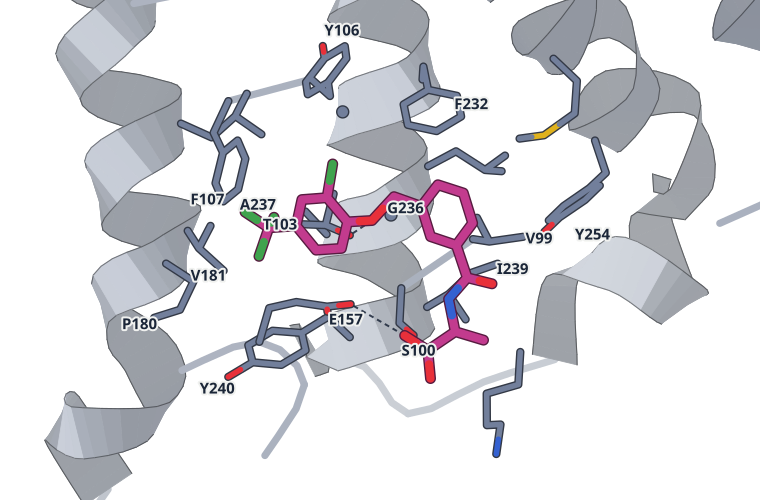

cmpd54-4の結合部位。4 Å 以内の残基：K96, V99, S100, T103, Y106, F107, E157, P180, V181, L184, F232, G233, L235, G236, A237, I239, Y240, Y254, M258。点線は 3.3 Å 以内の N・O の組（2 組）

**拮抗薬は別の場所に結合し、MRGPRX4の作動薬の結合を妨げる**

クライオ電顕の3状態で、拮抗薬の結合に伴いE247が作動薬のリン酸の結合部位へ入り込んでいた

- **これまでの疑問・課題**：胆汁酸によるかゆみを伝えるMRGPRX4が阻害される仕組みは分かっておらず、拮抗薬結合型の構造も未報告だった。
- **アプローチ**：作動薬DEX-P・拮抗薬cmpd54-4を結合した状態とリガンドなし（apo）の3状態をクライオ電顕で解析した。
- **結果**：拮抗薬は作動薬と別の部位に結合し、細胞外ループ2のW158が外へ回って窪みができた。細胞外ループ3のE247は作動薬の結合部位へ入っていた。
- **わかったこと**：拮抗薬は作動薬と結合部位を奪い合うのではなく、細胞外側の構造を変えて作動薬の結合を立体的に妨げると考えられる。
- **残された課題**：拮抗薬結合型は完全な不活性型ではなくGタンパク質と結合した中間状態で、不活性化の細かな段階は調べられていない。

この紹介文の根拠（論文本文）

> Although Mas-related G protein-coupled receptor X4 (MRGPRX4) has recently been identified as a key mediator of bile acid-induced pruritus, the structural mechanisms underlying its inhibition remain poorly understood, hindering the development of therapeutic antagonists.  
> — これまでの疑問・課題／Abstract

> Most importantly, an antagonist-bound structure has yet to be reported, posing a key obstacle to the development of MRGPRX4-targeted antipruritic drugs.  
> — これまでの疑問・課題／Introduction

> Here, we report the cryo-electron microscopy structures of MRGPRX4 in three distinct states: agonist-bound state, antagonist-bound state, and apo state.  
> — アプローチ／Abstract

> In contrast, in the cmpd54-4-bound structure, W1584.61 rotated outward toward the membrane, thereby creating a previously uncharacterized antagonist-specific subpocket that accommodated cmpd54-4  
> — 結果／Results

> In addition to ECL2, ECL3 in the cmpd54-4-bound MRGPRX4 structure also underwent substantial conformational rearrangement to shift toward the agonist-binding pocket  
> — 結果／Results

> Collectively, these structural observations indicated that binding of the antagonist cmpd54-4 induced substantial conformational rearrangements in the extracellular pocket of MRGPRX4 to sterically prevent agonist binding rather than simply competing for the canonical agonist-binding site.  
> — わかったこと／Results

> Furthermore, as we were unable to isolate a conformation representing a fully inactive state, the cmpd54-4-bound MRGPRX4–miniGsq complex represents only an intermediate conformation along the activation pathway.  
> — 残された課題／Discussion

分類：GPCR・受容体

#### 読みどころ

拮抗薬cmpd54-4は作動薬と別の亜ポケットに結合する。作動薬型ではW158が窪みをふさぐが、拮抗薬型ではW158が外向きになり専用の窪みができる。apo構造のW158も外向きだった。

根拠（論文本文）

> Notably, this antagonist-binding pocket was inaccessible in the DEX-P-bound MRGPRX4 structure (Fig. 4c), where the ECL2 residue W1584.61 projected into the pocket and occluded antagonist binding (Fig. 4d–f).  
> — Results

> Notably, from a top-down extracellular view, the position of W1584.61 in the apo state resembled that in the antagonist-bound structure, whereas the position of E2477.28 more closely matched that in the agonist-bound conformation (Fig. 5a–c).  
> — Results

拮抗薬型ではE247が陽性の窪み（R82・R86・R95）に入って塩橋を作り、作動薬のリン酸の結合部位をふさぐ。著者は、これほど大きな拮抗薬誘導の構造変化はクラスA GPCRでは珍しいと述べている。

根拠（論文本文）

> This movement enables E2477.28 to form salt bridge interactions with R822.60, R862.64, and R953.25 within a positively charged subpocket, effectively occluding the phosphate-binding site for DEX-P and further preventing agonist binding  
> — Discussion

> Such extensive antagonist-induced conformational changes are uncommon among class A GPCRs.  
> — Discussion

拮抗薬の結合部位は多型のある83位から離れ、IC50は2つの変異型で同程度だった。著者は、このポケットを狙う拮抗薬は多型による効き方の差を避けられる可能性があると考えている。

根拠（論文本文）

> DEX-P was more potent against the S832.61 variant, whereas cmpd54-4 exhibited similar IC50 values against both.  
> — Discussion

> Therefore, antagonists targeting the cmpd54-4 pocket are likely to be effective regardless of the residue at position 83, suggesting that drug design focused on this binding site may circumvent polymorphism-dependent differences in efficacy.  
> — Discussion

#### 構造データ

| PDB | 手法 | 分解能 | 公開 | 生物種 | リガンド |
|---|---|---|---|---|---|
| [23CV](https://www.rcsb.org/structure/23CV) | クライオ電顕 | 2.97 Å | 2026-10-14 | Escherichia coli, Homo sapiens, Mus musculus | 3T5 |
| [23CW](https://www.rcsb.org/structure/23CW) | クライオ電顕 | 2.88 Å | 2026-10-14 | Escherichia coli, Homo sapiens | 3T5 |
| [23CX](https://www.rcsb.org/structure/23CX) | クライオ電顕 | 2.98 Å | 2026-10-14 | Escherichia coli, Homo sapiens, Mus musculus | A1E43 |
| [23CY](https://www.rcsb.org/structure/23CY) | クライオ電顕 | 2.84 Å | 2026-10-14 | Escherichia coli, Homo sapiens | A1E43 |
| [23CS](https://www.rcsb.org/structure/23CS) | クライオ電顕 | 2.89 Å | 2026-10-14 | Escherichia coli, Homo sapiens, Mus musculus | — |
| [23CU](https://www.rcsb.org/structure/23CU) | クライオ電顕 | 2.93 Å | 2026-10-14 | Escherichia coli, Homo sapiens | — |

- [P0ABE7](https://www.uniprot.org/uniprotkb/P0ABE7) cybC Soluble cytochrome b562 — *Escherichia coli* （既存の PDB 構造 654 件）
- [P59768](https://www.uniprot.org/uniprotkb/P59768) GNG2 Guanine nucleotide-binding protein G(I)/G(S)/G(O) subunit gamma-2 — *Homo sapiens* （既存の PDB 構造 1323 件）
- [P62873](https://www.uniprot.org/uniprotkb/P62873) GNB1 Guanine nucleotide-binding protein G(I)/G(S)/G(T) subunit beta-1 — *Homo sapiens* （既存の PDB 構造 1333 件）
- [Q96LA9](https://www.uniprot.org/uniprotkb/Q96LA9) MRGPRX4 Mas-related G protein-coupled receptor member X4 — *Homo sapiens* （既存の PDB 構造 7 件）

#### 実験メモ

- **発現系**：Sf9細胞に、MRGPRX4・miniGsqβ1γ2・scFv16のバキュロウイルスを2:1:1で共感染させて発現。
- **コンストラクト**：S83型ヒトMRGPRX4のN末端にHAシグナル・Flag・10×His・TEV部位・BRILを付加。miniGsqはminiGsにGαqのα5ヘリックスの鍵残基を移したキメラ。
- **精製**：LMNG/CHSで可溶化 → TALON → Superdex 200。ピーク画分にDEX-P 300 μMまたはcmpd54-4 200 μMを加え、約3 mg/mLに濃縮。
- **結晶化／グリッド作製**：Quantifoil R1.2/1.3（300メッシュ）、Vitrobot、4℃・湿度100%、ブロット3.5秒。
- **データ収集・解析**：Titan Krios（300 kV）＋K3、カウンティングモード、0.82 Å/pixel、総線量50 e-/Å2。cryoSPARC v4.4.1で処理。

根拠（論文本文）

> For protein co-infection, Sf9 cells at a density of 2 × 106 cells/mL were co-infected with baculoviruses encoding MRGPRX4, miniGsqβ1γ2, and scFv16 at a multiplicity of infection of 2:1:1.  
> — Methods

> Several key residues of the α5 helix were replaced with the corresponding sequence from Gαq to confer Gq coupling specificity47, while the N-terminal region was substituted with that of Gαi1 to facilitate scFv16 binding.  
> — Methods

> The peak fraction was divided and incubated separately with 300 µM DEX-P (Aladdin, 2392-39-4) or 200 µM cmpd54-4 and then concentrated to ~3 mg/mL  
> — Methods

> The grids were blotted for 3.5 s with a blot force of 0 at 4 °C and 100% humidity, followed by rapid vitrification in liquid ethane using a Vitrobot (FEI).  
> — Methods

> All MRGPRX4–G protein complex datasets were collected on a Titan Krios electron microscope (Thermo Fisher Scientific) operating at 300 kV and equipped with a K3 Summit direct electron detector (Gatan).  
> — Methods

> Micrographs were obtained in counting mode at a pixel size of 0.82 Å and a defocus range of −0.8 μm to −1.6 μm. Each video comprised 40 frames with a total dose of 50 e−/Å2.  
> — Methods

> 📝 編集者への確認事項：本文は完結（切れなし）。作動薬結合型の MRGPRX4 構造（7S8P, 8YRG, 8KEX）は既報で、初構造ではない（first_structure は false）。論文が新しいとするのは拮抗薬結合型（逆作動薬 cmpd54-4）と apo の構造で、『拮抗薬結合型は未報告だった』は Introduction の記述。拮抗薬型は Gq（miniGsq）と結合した中間状態で完全な不活性型ではない、と著者自身が限界に挙げている。特異な部分はMD（W158 の動き）に一部依拠。

---

## 10｜BepA-BAM複合体（大腸菌）

### Stress-induced membrane insertion at the β-barrel assembly machinery complex regulates BepA metalloprotease activity

*Nature Communications*（2026-09-09） · [論文](https://doi.org/10.1038/s41467-026-77559-0) · ライセンス: cc by-nc-nd

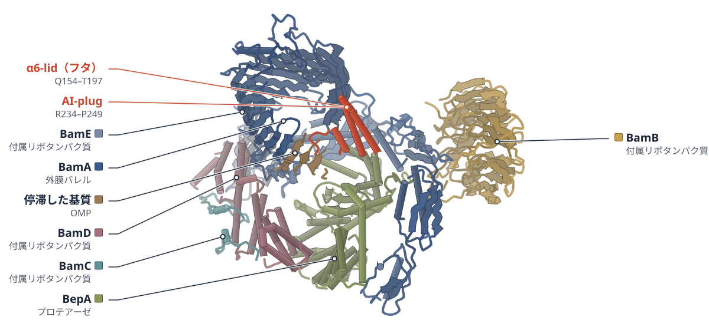

色（順に）：BamA（外膜バレル） / BamB（付属リポタンパク質） / BamC（付属リポタンパク質） / BamD（付属リポタンパク質） / BamE（付属リポタンパク質） / BepA（プロテアーゼ） / 停滞した基質（OMP）

**BepAはフタ状の部分を外膜に差し込み、BAMで活性化する**

BAM複合体と結合したBepAのクライオ電顕構造で、α6-lidが外膜に入り、AI-plugが外れていた

- **これまでの疑問・課題**：亜鉛を使う分解酵素M48ファミリーは自己阻害プラグで不活性に保たれるが、プラグが外れる仕組みは不明だった。
- **アプローチ**：変異体のスクリーニングと生化学で調べ、基質が停滞したBAMに結合したBepAをクライオ電顕で解析した。
- **結果**：BepAのα6-lidのループは長いヘリックスになって外膜に差し込まれ、AI-plugは活性部位の亜鉛から外れていた。
- **わかったこと**：α6-lidが外膜に刺さってBepAをBAMに固定し、AI-plugを外すことで、必要な場所とときだけ酵素が働くと考えられる。
- **残された課題**：BepAが基質の停滞をどう感知してα6-lidを差し込むのかは、まだ分かっていない。

この紹介文の根拠（論文本文）

> Members of the widespread M48 metalloprotease family are kept inactive by an autoinhibitory plug that blocks catalytic water activation, but how this plug is released remained elusive.  
> — これまでの疑問・課題／Abstract

> Here, using genetic, biochemical and cryo-EM approaches, we discover the activation mechanism of BepA, a quality-control protease that preserves outer membrane integrity by surveilling the β-barrel assembly machinery (BAM) in Gram-negative bacteria. Our cryo-EM analysis of BepA engaged with a stalled BAM-substrate assembly complex  
> — アプローチ／Abstract

> In turn, the otherwise disordered loop (residues P175 to T197) connecting α6 to α7 folds back and extends α7 by ~30 Å, forming a helical hairpin with α6 that projects into the lipid bilayer and packs against F785, F802 and F804 of BamA β15-β16  
> — 結果／Results

> This conformational cascade results in the disengagement of H246 as the fourth ligand to the catalytic Zn2+  
> — 結果／Results

> This membrane anchoring promotes displacement of the autoinhibitory plug and unlocks protease activity precisely where and when it is needed.  
> — わかったこと／Abstract

> Thus, a dual enzyme activation mechanism is coupled to membrane association under stress, ensuring that BepA remains inactive until properly localized.  
> — わかったこと／Abstract

> How substrate stalling is initially sensed by BepA remains unresolved.  
> — 残された課題／Discussion

分類：プロテアーゼ・感染・ウイルス・防御系

#### 読みどころ

α6-lidを欠くBepAは、BamAやLptDと相互作用できない。SurAを欠いて外膜タンパク質の折りたたみがつまる条件では、野生型BepAは膜に結合するが、α6-lidを欠く変異体はペリプラズムに残った。

根拠（論文本文）

> Moreover, deletion of the α6-lid led to a marked accumulation of LptDC even in the presence of R252H (Fig. 3g) and abrogated interactions between BepAE137Q and both BamA and LptD (Fig. 3h).  
> — Results

> Remarkably, in the absence of SurA, BepA became exclusively membrane-associated, whereas BepA∆α6-lid remained in the periplasm (Fig. 5a).  
> — Results

BamAのバレルが閉じたNb32複合体ではBepAはBAMに結合するがプラグは亜鉛に配位したままで、基質が加わって開いたNb5複合体でだけ活性型だった。著者は、基質の停滞でバレルが長く開くことが活性化に要ると推測している。

根拠（論文本文）

> The EM density for the AI-plug region is poorly defined, indicating increased flexibility in the α8-α9-α10 loops, yet the α9 AI-plug remains coordinated to the catalytic Zn2+, maintaining the enzyme in a locked state.  
> — Results

> We speculate that only stalled OMPs result in sufficiently long opening of BamA barrel and exposure of β15–β16 strands and β12–β13 loop region for BepA activation, a conformation that may be too transient during constructive OMP folding.  
> — Discussion

bepAのランダム変異ライブラリーを、外膜が漏れるとピンク色になる色素CPRGで選別した。AI-plugを支えるD205とR252、フタのG166など、活性の調節に関わる残基が見つかった。

根拠（論文本文）

> Transformants with increased outer membrane permeability allow CPRG to enter the cell, where it is hydrolyzed, producing a detectable pink color31 (Fig. 1b).  
> — Results

> Thus, D205 and R252, which are interconnected by hydrogen bonds, appear to function in tandem to stabilize the AI-plug that blocks the catalytic site  
> — Results

#### 構造データ

| PDB | 手法 | 分解能 | 公開 | 生物種 | リガンド |
|---|---|---|---|---|---|
| [9SOW](https://www.rcsb.org/structure/9SOW) | クライオ電顕 | 3.23 Å | 2026-09-30 | Escherichia coli BW25113 | — |
| [9SOX](https://www.rcsb.org/structure/9SOX) | クライオ電顕 | 6.40 Å | 2026-09-30 | Escherichia coli BW25113 | — |

- [C3TPJ2](https://www.uniprot.org/uniprotkb/C3TPJ2) bamA Outer membrane protein assembly factor BamA — *Escherichia coli* （既存の PDB 構造 1 件）
- [P0A903](https://www.uniprot.org/uniprotkb/P0A903) bamC Outer membrane protein assembly factor BamC — *Escherichia coli (strain K12)* （既存の PDB 構造 105 件）
- [P0A937](https://www.uniprot.org/uniprotkb/P0A937) bamE Outer membrane protein assembly factor BamE — *Escherichia coli (strain K12)* （既存の PDB 構造 96 件）
- [P0AC02](https://www.uniprot.org/uniprotkb/P0AC02) bamD Outer membrane protein assembly factor BamD — *Escherichia coli (strain K12)* （既存の PDB 構造 96 件）
- [P66948](https://www.uniprot.org/uniprotkb/P66948) bepA Beta-barrel assembly-enhancing protease — *Escherichia coli (strain K12)* （既存の PDB 構造 7 件）
- [P77774](https://www.uniprot.org/uniprotkb/P77774) bamB Outer membrane protein assembly factor BamB — *Escherichia coli (strain K12)* （既存の PDB 構造 102 件）

#### 実験メモ

- **発現系**：E. coli BW25113に、strepタグ付きBepA #127/E137Q変異体（pBAD42）を導入し、0.2% L-アラビノースで37℃・3時間誘導。
- **コンストラクト**：BepA #127変異体（A149G・L169S・Q176H・G184C）に触媒欠損E137Qを加えた。BamAに対するナノボディNb5またはNb32を加えて複合体を安定化。
- **精製**：1.5% DDMで全細胞を溶かし、Strep-Tactin XTで精製。ナノボディのHisタグでNi-NTAによる2回目の精製を行い、LMNG中に溶出。
- **結晶化／グリッド作製**：酸化グラフェンをのせたQuantifoil R2/1（銅300メッシュ）に約0.1 mg/mLを3 μL塗布。CP3プランジャーで背面から4秒ブロット。
- **データ収集・解析**：JEOL CRYO ARM 300（300 kV）＋K3、カウンティング、60フレーム・総線量60 e-/Å2。RELION 5.0.1とcryoSPARC 4.7.1で処理し、EMReady2で鮮明化。

根拠（論文本文）

> BepA#127/E137Q-strep was purified using Strep-Tactin®XT 4Flow® high-capacity resin (IBA)  
> — Methods

> To separate BAM-engaged BepA from the pool of free periplasmic BepA, the BepA#127/E137Q-strep elution was mixed with BamA-binding nanobodies Nb32 or Nb5, and subjected to a second affinity purification using the Nb C-terminal hexa-histidine tag. To do so, the mixture was then loaded onto an equilibrated 0.2 ml HisPur™ Ni-NTA Spin Columns (Thermo-Fisher).  
> — Methods

> BepA overexpression was induced by adding 0.2% L-arabinose at 37 °C for 3 h.  
> — Methods

> For a sample application, 3 µl purified BepA-BAM-Nb complexes (~ 0.1 mg/mL) were applied onto GO grids, subjected to 4 s backside blotted to remove excess liquid, and flash-frozen in liquid ethane using a CP3 plunger (Gatan).  
> — Methods

> Image stacks were recorded in counting mode with a cumulative electron dose of 60 electrons per Å2 spread over 60 frames  
> — Methods

> Final maps were then sharpened using EMReady251 and used for model building and refinement.  
> — Methods

> 📝 編集者への確認事項：本文は完結。BepA-BAM の構造は初出だが、論文は『初』とは言っていない（first_structure は false、BamA の既存構造は多数）ので「初」は使わない。9SOW(Nb5, 3.23 Å, 基質結合・BamA バレル開) と 9SOX(Nb32, 6.4 Å, 閉) の2構造。基質は同定できない未同定のβストランド（LptD かもしれないが断定不可）、ナノボディが状態の分布に影響した可能性を著者も注記。BAM-BepA の『活性型』は触媒欠損E137Q変異体で捕えたもの。

---

## 11｜ヒトPI3Kδ（p110δ）

### PI3Kδ is selectively inhibited by roginolisib by stabilizing the C-terminal helix kα12

*Nature Communications*（2026-10-09） · [論文](https://doi.org/10.1038/s41467-026-77424-0) · ライセンス: cc by

色（順に）：p110δ（触媒サブユニット） / p85α（調節サブユニット）　スティック：ロギノリシブ（QGU）

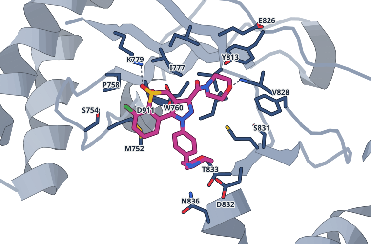

ロギノリシブの結合部位。4 Å 以内の残基：M752, S754, P758, W760, I777, K779, Y813, I825, E826, V827, V828, S831, D832, T833, N836, M900, F908, I910, D911。点線は 3.3 Å 以内の N・O の組（2 組）

**ロギノリシブは、PI3Kδ末端のヘリックスを安定化して阻害する**

結晶構造ではkα12は見えず、MDとHDX-MSでイデラリシブとの違いが現れた

- **これまでの疑問・課題**：PI3Kのアイソフォームは触媒部位が似ていて選択的に阻害しにくく、ロギノリシブの結合様式がイデラリシブと違うかが課題だった。
- **アプローチ**：ロギノリシブとの結晶構造（2.75 Å）に、分子動力学（MD）と水素重水素交換質量分析（HDX-MS）を組み合わせた。
- **結果**：結晶ではkα12の電子密度が得られなかった。HDX-MSでkα12が交換から守られたのは、ロギノリシブ結合時だけだった。
- **わかったこと**：ロギノリシブはkα12の塩基性残基との相互作用で不活性型を安定化し、δ型への選択性にも関わると著者は考えている。
- **残された課題**：結晶構造ではkα12の電子密度が得られず、その姿はAlphaFoldモデルに基づくMDとHDX-MSから推定している。

この紹介文の根拠（論文本文）

> Achieving high selectivity among PI3K isoforms remains challenging due to the conserved catalytic site.  
> — これまでの疑問・課題／Introduction

> We therefore hypothesized that the binding mode of roginolisib to PI3Kδ might be unique, potentially accounting for its distinct safety profile observed in the clinic.  
> — これまでの疑問・課題／Introduction

> Using a combination of X-ray crystallography, molecular dynamics simulations, and hydrogen-deuterium exchange mass spectrometry, we describe the mechanism driving roginolisib’s potent and isoform-selective inhibition of PI3Kδ.  
> — アプローチ／Abstract

> As a major limitation of the roginolisib crystal structure, only the catalytic p110δ subunit and the p85α iSH2 domain were crystallized and no electron density was obtained for the C-terminal kα12 helix.  
> — 結果／Results

> Uniquely, binding of roginolisib protected the C-terminal helix kα12 from H/D exchange (region 1022–1044), indicating either direct interaction with this region, and/or stabilisation of the secondary structure (Fig. 4a,c).  
> — 結果／Results

> Our work shows that roginolisib, binding in the ATP pocket but not interacting with the specificity pocket, inhibits the enzyme by stabilizing an inactive conformation through interactions with basic residues at the C-terminal end of kα12.  
> — わかったこと／Discussion

> The residues Lys1040 and Arg1043 are unique to the δ and β isoforms and therefore also explain the selectivity of roginolisib for p110δ, and to a lesser extent for the β isoform.  
> — わかったこと／Discussion

> As a major limitation of the roginolisib crystal structure, only the catalytic p110δ subunit and the p85α iSH2 domain were crystallized and no electron density was obtained for the C-terminal kα12 helix.  
> — 残された課題／Results

分類：キナーゼ・酵素（その他）

#### 読みどころ

ロギノリシブは、ヒンジのVal828と水素結合し、Trp760とπ-π相互作用する。イデラリシブが使う特異性ポケットには入らず、DFGモチーフのAsp911は約90°違う向きになる。

根拠（論文本文）

> The solved crystal structure revealed complete electron density for roginolisib within the ATP-binding pocket and indicates an H-bond contact between the morpholine O-atom and the backbone NH of Val828, which belongs to the hinge region.  
> — Results

> The binding of roginolisib pushes Asp911 into a DFG-in-like configuration. By contrast, idelalisib leaves the residue in a rotated (by 90°) orientation resembling the DFG-out aspartate conformation.  
> — Results

MDでは、ロギノリシブ結合時だけkα12が活性部位側へ倒れ、HDX-MSでもkα12が交換から守られた。p85αのcSH2による阻害を外したY685A変異体では守られず、不活性な酵素を選んで結合するとみられる。

根拠（論文本文）

> In multiple simulation replicates (2–5 μs in length) of the roginolisib-bound protein, kα12 further levered towards the kinase active site.  
> — Results

> The situation differs for roginolisib, where protection of the kα12 helix (1022–1044) was only seen for the WT enzyme (Figs. 4a, 5d).  
> — Results

CLL患者の細胞をex vivoで処理すると、ロギノリシブは高用量・2時間でイデラリシブよりPIP3を下げた。ただし解析した患者数は3〜5人と少ない。

根拠（論文本文）

> The analysis revealed that roginolisib was more effective than idelalisib in decreasing PIP3 levels at the 2 h time point and at high dose (Fig. 9c,d).  
> — Results

> Data are shown as individual patient values, with each symbol representing a single patient (a, b: n = 5; c, d: n = 4; e, f: n = 3).  
> — Figure legends

#### 構造データ

| PDB | 手法 | 分解能 | 公開 | 生物種 | リガンド |
|---|---|---|---|---|---|
| [9T07](https://www.rcsb.org/structure/9T07) | X線結晶構造解析 | 2.75 Å | 2026-07-08 | Bos taurus, Homo sapiens | QGU |
| [9T1P](https://www.rcsb.org/structure/9T1P) | X線結晶構造解析 | 2.97 Å | 2026-07-08 | Bos taurus, Homo sapiens | A1JS2 |

- [O00329](https://www.uniprot.org/uniprotkb/O00329) PIK3CD Phosphatidylinositol 4,5-bisphosphate 3-kinase catalytic subunit delta isoform — *Homo sapiens* （既存の PDB 構造 18 件）
- [P23727](https://www.uniprot.org/uniprotkb/P23727) PIK3R1 Phosphatidylinositol 3-kinase regulatory subunit alpha — *Bos taurus* （既存の PDB 構造 28 件）

#### 実験メモ

- **発現系**：ヒトp110δ（1–1044）とウシp85（431–600）を、別々のウイルスでSf9細胞に共発現（26℃、感染48時間後に回収）。
- **コンストラクト**：p110δはN末端に切断可能なHisタグ付き、p85はタグなし。
- **精製**：Ni Sepharose HPで捕捉 → TEVプロテアーゼでHisタグを除去 → Superdex 200 26/60（Tris/NaCl/DTT）。
- **結晶化／グリッド作製**：5 mg/mLのタンパク質に化合物（10 mM DMSO）を加え、12–14% PEG 6000・MES/NaOH pH 5.75のハンギングドロップ蒸気拡散（20℃）。2〜3日で結晶化。
- **データ収集・解析**：Swiss Light Source、100 K。autoPROC/AIMLESSで処理し、PDB 6PYRを探索モデルに分子置換、BUSTERで精密化。

根拠（論文本文）

> The complex of human p110δ (amino acids 1-1044 preceded by an N-terminal cleavable HIS-tag) and bovine p85 (amino acids 431-600, no tag) was co-expressed in Sf9 cells at 26 °C from two separate viruses.  
> — Methods

> The HIS-tag was removed by overnight incubation with TEV-protease and protein was passed over the Ni-column used for the initial capture step.  
> — Methods

> protein at 5 mg/mL concentration was incubated with either roginolisib or idelalisib dissolved at 10 mM in DMSO and crystallized by vapor diffusion in hanging drops.  
> — Methods

> Equal volumes (1 µL:1 µL) of protein and reservoir solution (12-14% PEG 6000, 100 mM MES/NaOH at pH=5.75) were mixed  
> — Methods

> The structures were solved by molecular replacement using Phaser55 and a published human PI3Kdelta crystal structure (PDB ID: 6PYR).  
> — Methods

> 📝 編集者への確認事項：本文は完結。PI3Kδ の結晶構造は既報多数（first_structure は false、『初』は使わない）。新規はロギノリシブ(9T07, 2.75 Å)と類縁体 IOA-288 (9T1P, 2.97 Å)の複合体。kα12 の電子密度は結晶では得られておらず、中心的な主張（kα12 の安定化・不活性型への固定）は AlphaFold モデルに基づく MD と HDX-MS による。そのため見出し・補足は『結晶では見えず MD と HDX-MS で』と限定した。患者試料は n=3〜5。

---

## 12｜ClpC NTD（黄色ブドウ球菌）

### Small-molecule activators of the Staphylococcus aureus ClpC/ClpP AAA+ protease

*iScience*（2026-09-22） · [論文](https://doi.org/10.1016/j.isci.2026.117738) · ライセンス: cc by

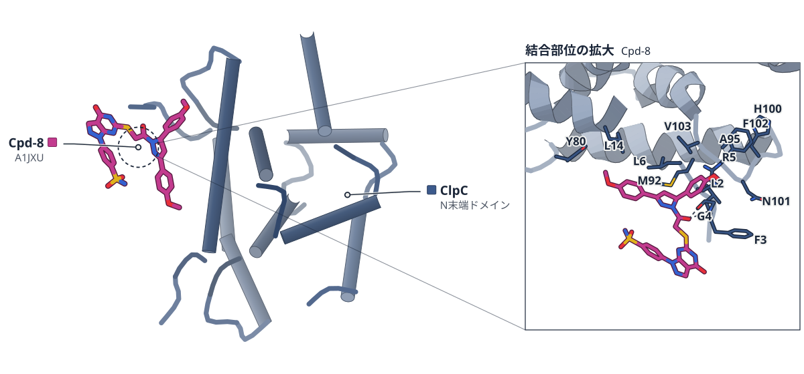

色（順に）：ClpC（N末端ドメイン）　スティック：Cpd-8（A1JXU）

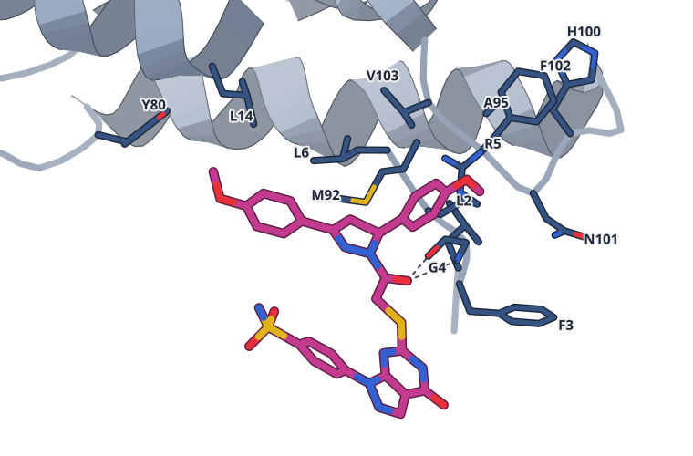

Cpd-8の結合部位。4 Å 以内の残基：L2, F3, G4, R5, L6, L14, Y80, M92, A95, H100, N101, F102, V103。点線は 3.3 Å 以内の N・O の組（2 組）

**黄色ブドウ球菌ClpCを活性化する低分子が8種類見つかった**

結晶構造でCpd-8が疎水性の溝に入ることを確認し、他の化合物の結合部位は計算と変異で絞り込んだ

- **これまでの疑問・課題**：細菌のタンパク質分解装置を動かすClpCについて、黄色ブドウ球菌のClpCを調節する低分子は報告されていなかった。
- **アプローチ**：約11万の低分子ライブラリーをスクリーニングし、結晶構造・ドッキング・変異体で結合部位を調べた。
- **結果**：8化合物がClpCのATP分解を2.2〜4.9倍に高めた。作用部位はN末端ドメイン（NTD）とみられ、Cpd-8は疎水性の溝に結合した（1.90 Å）。
- **わかったこと**：疎水性の溝とpArg1ポケット（リン酸化アルギニンの結合部位）は低分子で狙える調節部位だが、細胞での毒性はClpC/ClpPに依存しなかった。
- **残された課題**：ほとんどの化合物のNTDへの直接結合はまだ確かめられておらず、最適化が必要である。

この紹介文の根拠（論文本文）

> However, no chemical modulators of S. aureus ClpC have been described.  
> — これまでの疑問・課題／Abstract

> To identify compounds that activate the S. aureus ClpC/ClpP protease, we conducted a high-throughput screen using a chemically diverse library of approximately 110,000 small molecules (Figure S1).  
> — アプローチ／Results

> Structural, computational, and mutational analyses define two ligandable regulatory sites within the ClpC N-terminal domain (NTD) as compound targets  
> — アプローチ／Abstract

> All compounds significantly stimulated ClpC ATPase activity (2.2- to 4.9-fold), but to a lesser extent than MecA-mediated activation (12.9-fold) (Figure 1E).  
> — 結果／Results

> We infer that all eight tested compounds deregulate ClpC by binding to its NTD.  
> — 結果／Results

> We could obtain crystal structures of ClpC-NTD with bound Cpd-8 at 1.90 Å and in the apo state at 1.78 Å resolution (Table S1).  
> — 結果／Results

> Cpd-8 binds to a part of the hydrophobic groove, and the entire ligand shows clear electron density  
> — 結果／Results

> Structural, computational, and mutational analyses define two ligandable regulatory sites within the ClpC N-terminal domain (NTD) as compound targets: a conserved hydrophobic groove and an allosteric pArg1 pocket, both engaged in substrate recognition.  
> — わかったこと／Abstract

> This demonstrates that the toxicity observed across all compounds does not depend on ClpC/ClpP, but rather likely results from effects of unknown origin, which become enhanced in the absence of ClpC/ClpP (Figure 7C).  
> — わかったこと／Results

> Direct binding of most compounds to the ClpC NTD remains to be determined.  
> — 残された課題／Limitations

分類：感染・ウイルス・防御系・酵素（その他）

#### 読みどころ

約11万化合物のスクリーニングから、FITC-カゼインの分解を高める8化合物を選んだ。EC50は低〜中μMで、ClpPだけではどの化合物でも分解は起きなかったため、標的はClpCとみられる。

根拠（論文本文）

> The compounds' potencies were in the low-to moderate micromolar range, with compounds 8, 10, and 41 showing the lowest EC50 values (Cpd-8: 12 μM; Cpd-10: 4.4 μM; Cpd-41: 8 μM)  
> — Results

> None of the tested compounds enabled ClpP to degrade FITC-casein, suggesting that they target ClpC.  
> — Results

Cpd-8は疎水性の溝の一部に結合し、水素結合はGly4との1本で、他は疎水性の接触だった。静止状態のClpCに重ねるとAAA1ドメインと衝突するため、これが活性化の原因だと著者は推測している。

根拠（論文本文）

> Notably, protein and ligand form only one hydrogen bond, namely between Gly4 and the carbonyl group of Cpd-8a, whereas all other protein-ligand interactions involve hydrophobic contacts  
> — Results

> We speculate that re-orientation of the ClpC N-terminus could clash with the resting state and destabilize it, leading to ClpC activation.  
> — Results

Cpd-10とCpd-41はMecA-mEOSの分解を妨げ、pArg1部位の変異体T7Dでは効かなかった。小分子でpArg1ポケットを狙える可能性を示すが、結合の根拠は変異体とドッキングによる間接的なものである。

根拠（論文本文）

> Indeed, Cpd-10 and Cpd-41 effectively abolished MecA-mEOS degradation, indicating they bind to at least one of the pArg-binding sites (Figure 4E).  
> — Results

> Intriguingly, most compounds still enhanced ClpC-T7D activity, whereas Cpd-10 and Cpd-41 no longer did so (Figure 4G).  
> — Results

#### 構造データ

| PDB | 手法 | 分解能 | 公開 | 生物種 | リガンド |
|---|---|---|---|---|---|
| [9TXC](https://www.rcsb.org/structure/9TXC) | X線結晶構造解析 | 1.78 Å | 2026-09-16 | Staphylococcus aureus subsp. aureus NCTC 8325 | — |
| [9TXD](https://www.rcsb.org/structure/9TXD) | X線結晶構造解析 | 1.90 Å | 2026-09-16 | Staphylococcus aureus subsp. aureus NCTC 8325 | A1JXU |

- [Q2G0P5](https://www.uniprot.org/uniprotkb/Q2G0P5) clpC ATP-dependent Clp protease ATP-binding subunit ClpC — *Staphylococcus aureus (strain NCTC 8325 / PS 47)* （既存の PDB 構造 8 件）

#### 実験メモ

- **発現系**：ClpC・ClpP・MecAなどを、pDS56系ベクターで大腸菌ΔclpB株に過剰発現（2x YT、30℃）。
- **コンストラクト**：ClpC（野生型・変異体）、単離NTD、NTDを欠くΔN-ClpC。いずれもC末端His6タグ付き。
- **精製**：Ni-IDAで精製 → Superdex 200ゲルろ過（Tris-HCl pH 7.5、KCl、MgCl2、グリセロール、DTT）。
- **結晶化／グリッド作製**：シッティングドロップ蒸気拡散、18℃（291.15 K）。タンパク質7.5 mg/mL 500 nL＋リザーバー100 nL（硫酸アンモニウム約1.9〜2.1 M）。14〜21日で結晶化。
- **データ収集・解析**：ESRF ID30A-1で測定、XDS・AIMLESSで処理。AlphaFold2モデルを探索モデルにPHASERで分子置換し、phenix.refineで精密化。

根拠（論文本文）

> Staphylococcus aureus (Sa) ClpC (WT and derivatives), ClpP, and MecA were purified from E. coli ΔclpB::kan cells overexpressing them using pDS56-derived expression vectors.  
> — Methods

> ClpC, ClpP, MecA, FtsZ, MecA-mEOS3.2, and isolated ClpC-NTD harbor a C-terminal His6-tag and were purified using Ni-IDA  
> — Methods

> Crystals were grown at 291.15 K using sitting drop vapor diffusion.  
> — Methods

> Crystallization drops contained 100 nL reservoir solution and 500 nL protein at a concentration of 7.5 mg/mL.  
> — Methods

> Data were collected at ESRF beamline ID30A-1 at cryogenic conditions, integrated using XDS,65 and scaled using AIMLESS66  
> — Methods

> Phases were obtained by molecular replacement with PHASER68 implemented in the Phenix package69 using an AlphaFold270 prediction as search model.  
> — Methods

> 📝 編集者への確認事項：本文は完結（STAR Methods まで）。新規構造は S. aureus ClpC の N 末端ドメイン(NTD)の apo (9TXC, 1.78 Å) と Cpd-8 複合体 (9TXD, 1.90 Å)。ClpC の既存構造は多数ありfirst_structure は false（『初』は使わない）。8化合物のうち結晶構造があるのは Cpd-8 のみで、Cpd-10 などはドッキング・変異体・SAR による間接的な推定（著者も限界に記載）。Cpd-8 のリガンドの片方(Cpd-8b)は結晶中で隣接分子と接触しており、タンパク質との接触は Cpd-8a 部分のみ。細胞での増殖抑制は ClpC/ClpP 非依存。

---

## 13｜Keap1 Kelchドメイン（ヒト）

### Generation of membrane-permeable cyclic peptides inhibiting protein–protein interaction

*Nature Chemical Biology*（2026-06-01） · [論文](https://doi.org/10.1038/s41589-026-02237-7) · ライセンス: cc by

色（順に）：環状ペプチド30（阻害剤）

**ランダムな環状ペプチドから、細胞内で働くKeap1阻害剤を得た**

15,360種から選んで改良し、Keap1との結晶構造で結合の仕方を確かめた

- **これまでの疑問・課題**：事前にリガンドの情報がない標的に、細胞膜を通る環状ペプチドをゼロから作るのは難しかった。
- **アプローチ**：Keap1とNrf2の結合を妨げる分子を15,360種のランダムな環状ペプチドから探し、3回の改良を重ねた。
- **結果**：最良のペプチド30はKi 53 nMでKeap1に結合し、細胞のレポーターアッセイで用量依存的に働いた。
- **わかったこと**：電荷を持たない小さなペプチドが、Nrf2とは別の接触でKeap1に結合し、細胞内で結合を阻害できた。
- **残された課題**：細胞での活性は試験管内より弱く、排出ポンプが原因の可能性があると著者は述べる。

この紹介文の根拠（論文本文）

> However, developing such compounds de novo without prior information about lead structures such as natural ligands or fragments remains a notable challenge.  
> — これまでの疑問・課題／Abstract

> By screening 15,360 fully random cyclic peptides, we were able to identify an inhibitor of the E3 ligase adaptor Keap1 and its substrate Nrf2.  
> — アプローチ／Abstract

> could be improved in three iterative rounds into a membrane-permeable cyclic peptide that blocked this PPI in live cells  
> — アプローチ／Main

> Excitingly, peptide 30, which displayed the best combination of activity (Ki = 53 ± 5 nM) and polar surface (only two H-bond donors) exhibited a robust, dose-dependent activity in the cellular model with an IC50 of around 50 μM  
> — 結果／Results

> which engage Keap1 through entirely distinct sets of molecular contacts  
> — わかったこと／Results

> This makes peptide 30 a fully de novo developed cyclic peptide that successfully inhibits a PPI inside living cells.  
> — わかったこと／Results

> This indicated removal of 30 by efflux pumps (efflux ratio > 90), which could explain the lower activity found in the cellular assay compared to in vitro inhibition.  
> — 残された課題／Results

分類：転写調節・シグナル伝達

#### 読みどころ

ナノモル規模で合成した約1.5万種のライブラリーを混合物のまま選別した。最初のヒットの活性には、二量体・三量体の副産物とシステイン（C434）とのジスルフィド交換が寄与した可能性があると著者は書く。

根拠（論文本文）

> Interestingly, our identification of the two initial Keap1–Nrf2 inhibitors 1 and 2 from library 1 benefited from some unexpected allies: dimeric and trimeric peptide byproducts that showed enhanced activity, as well as potential covalent interactions through disulfide exchange with a target protein cysteine residue.  
> — Discussion

Keap1に結合した直鎖ペプチド6のX線構造（1.70 Å）は、Nrf2が結合する場所を占めながら、まったく違う接触をしていた。電荷による相互作用に頼らず、水素結合の受容基が主役だった。環状体の結晶は還元剤DTTのため得られていない。

根拠（論文本文）

> The linear peptide 6 occupied the same space as the region of Nrf2 that interacts with Keap1 but formed completely different molecular contacts.  
> — Results

> Unlike Nrf2, peptide 6 did not rely on charged interactions and used mostly H-bond acceptor groups for H-bonding interactions  
> — Results

> Because of the presence of reducing agent DTT in conditions that yielded diffraction-quality crystals, we obtained a structure of the bound linear analog (6) rather than the cyclic peptide  
> — Results

ペプチド30はNrf2由来のペプチドと分子量・親和性が近いが、電荷がなく、水素結合の供与基は2個（Nrf2は9個）、極性表面積は203 Ų（433 Ų）と極性がずっと低い。この低さが膜透過と細胞内での阻害に重要だったと著者は述べる。

根拠（論文本文）

> Notably, while the two peptides are similar in molecular weight (890.6 Da for 30 versus 1,052.1 Da for Nrf2) and binding affinity (53 nM versus 23 nM), peptide 30 is far less polar, having no charges (versus four negative charges in the Nrf2 sequence), featuring only two H-bond donors (versus nine) and a substantially lower topological polar surface area (TPSA of 203 Å2 versus 433 Å2).  
> — Results

#### 構造データ

| PDB | 手法 | 分解能 | 公開 | 生物種 | リガンド |
|---|---|---|---|---|---|
| [9IH9](https://www.rcsb.org/structure/9IH9) | X線結晶構造解析 | 1.70 Å | 2026-03-04 | Homo sapiens, synthetic construct | DHL |
| [9QDU](https://www.rcsb.org/structure/9QDU) | X線結晶構造解析 | 2.35 Å | 2026-03-18 | Homo sapiens, synthetic construct | — |
| [9QBS](https://www.rcsb.org/structure/9QBS) | X線結晶構造解析 | 1.95 Å | 2026-03-18 | Homo sapiens, synthetic construct | — |
| [9QBT](https://www.rcsb.org/structure/9QBT) | X線結晶構造解析 | 2.33 Å | 2026-03-18 | Homo sapiens, synthetic construct | — |

- [Q14145](https://www.uniprot.org/uniprotkb/Q14145) KEAP1 Kelch-like ECH-associated protein 1 — *Homo sapiens* （既存の PDB 構造 117 件）

#### 実験メモ

- **発現系**：ヒトKeap1 Kelchドメイン（321–609）を大腸菌BL21(DE3)で発現（IPTG 0.5 mM、20℃で一晩）。
- **コンストラクト**：N末端にHis6タグとTEV切断部位。結晶化にはE540A/E542Aの2置換体を使い、TEVでタグを除去。
- **精製**：Ni-NTAアフィニティ、続いてSuperdex 75のサイズ排除クロマトグラフィー。
- **結晶化／グリッド作製**：Keap1にペプチド6・30・33・34を8倍モル過剰で混ぜ、18℃のシッティングドロップ蒸気拡散で共結晶化。25%グリセロールで凍結保護。
- **データ収集・解析**：ESRFのMASSIF-1/-3（ペプチド6・30）とSLSのPX-I（33・34）で回折データを収集。XDS、PHENIXの分子置換（1U6D）、Cootで構築。

根拠（論文本文）

> Protein expression was induced by adding a final concentration of 0.5 mM IPTG and the culture was incubated at 20 °C while being shaken overnight (200 rpm).  
> — Methods

> Recombinant human Kelch domain of Keap1 (321–609) with an N-terminal addition of His6 tag and tobacco etch virus (TEV) cleavage site for tag removal was cloned into the vector pET29b(+) (Novagen) for bacterial expression.  
> — Methods

> The Keap1 Kelch domain with the two substitutions (E540A and E542A)37 was used for X-ray crystallization.  
> — Methods

> The desired protein was purified from the culture supernatant by Ni-NTA affinity chromatography.  
> — Methods

> Cocrystallization was performed by mixing Keap1 at 12 mg ml−1 with an eightfold molar excess of peptide 6, 30, 33 and 34.  
> — Methods

> The recombinant Keap1 Kelch domain bound to the peptide was crystallized at 18 °C using the sitting-drop vapor diffusion approach.  
> — Methods

> Suitable crystals were collected, cryoprotected using the mother liquor supplemented with 25% glycerol and rapidly frozen in liquid nitrogen.  
> — Methods

> were collected at the MASSIF-1 and MASSIF-3 beamlines of the European Synchrotron Radiation Facility (ESRF).  
> — Methods

> The structure was solved by molecular replacement using PHENIX (version 1.20.1)50 with the atomic coordinates of Keap1 (PDB 1U6D) as a search model.  
> — Methods

> 📝 編集者への確認事項：新しい複合体構造（9IH9、9QDU、9QBS、9QBT）だが、Keap1自体の構造は既に117件あるため first_structure は false で、『初』とは書いていない。9IH9はDTT下で環状ペプチド4が還元された直鎖ペプチド6との複合体で、論文も環状体の結晶は得られなかったと明記している。9QDU（環状ペプチド30）を構造図に使った。分類は適切なものがなく regulation（E3リガーゼのアダプター）とした。

---

## 14｜IgLON5とFab2513（ヒト）

### Structural basis of IgLON5 autoantibody recognition in autoimmune encephalitis

*Nature Communications*（2026-09-11） · [論文](https://doi.org/10.1038/s41467-026-77812-6) · ライセンス: cc by

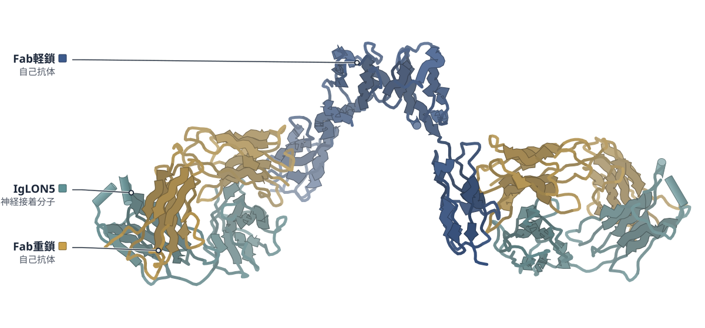

色（順に）：Fab軽鎖（自己抗体） / Fab重鎖（自己抗体） / IgLON5（神経接着分子）

**IgLON5抗体は二量体を壊さず、受容体の集合を促しうる**

患者の抗体Fabとの複合体を3.7 Åで解析し、第2Igドメインへの結合を示した

- **これまでの疑問・課題**：神経の接着分子IgLON5への自己抗体がどう結合し病気に関わるかは、よく分かっていなかった。
- **アプローチ**：患者の記憶B細胞から高親和性のIgG4抗体を単離し、そのFabとIgLON5の複合体をクライオ電顕で解析した。
- **結果**：Fabは第2Igドメインに結合し、二量体の反対側の面に1つずつ付く。二量体の構造は保たれた。
- **わかったこと**：抗体は二量体を壊さず、隣り合う二量体を橋渡しして受容体を集めると考えられる。
- **残された課題**：単一の患者の1抗体に基づくため、他の患者でも同じ結合様式かは今後の課題だ。

この紹介文の根拠（論文本文）

> Despite its severe clinical manifestations, the molecular basis of antibody recognition and its contribution to disease pathogenesis is poorly understood.  
> — これまでの疑問・課題／Abstract

> We isolate a human monoclonal IgG4 antibody that binds IgLON5 with high affinity and determine the structure of its Fab in complex with IgLON5 using cryo–electron microscopy.  
> — アプローチ／Abstract

> Interestingly, each Fab engages IgLON5 in an opposite orientation, with the epitopes positioned on opposing faces of the dimer (Fig. 3a, b).  
> — 結果／Results

> showed that the Fab-bound IgLON5 dimer closely matches the previously published crystal structure of the IgLON5 dimer, with an RMSD of 1.4 Å  
> — 結果／Results

> Instead, the two Fab arms could engage epitopes on adjacent dimers, thereby promoting receptor clustering.  
> — わかったこと／Results

> Biochemical and structural analyses show that antibody binding preserves IgLON5 adhesive interfaces while remaining compatible with clustering of IgLON5 on the cell surface.  
> — わかったこと／Abstract

> Our study has some limitations, the structural and functional analyses are based on a mAb derived from a single patient, and it remains to be determined whether similar epitopes and binding modes are shared across individuals.  
> — 残された課題／Discussion

分類：免疫（抗体・MHC・TCR・自然免疫）

#### 読みどころ

二量体の両側のFabは反対向きに付くため、1つの抗体が1つの二量体に二価で結合することはできず、隣の二量体を橋渡しすると考えられる。IgG1にした抗体は細胞表面でのIgLON5の会合を増やし、Fab単独では増えなかった。

根拠（論文本文）

> This spatial arrangement demonstrates that the antibody cannot bind bivalently to a single IgLON5 dimer.  
> — Results

> In contrast, no fluorescence increased was observed in the presence of an irrelevant human mAb (palivizumab), nor in the presence of Fab2513.  
> — Results

Fabは残基163–205にわたる第2Igドメインの面をはさみ込むように結合し、埋もれる面積は680 Ų。IgLONファミリーで最も違いの大きいβ12–β12′ループが結合の中心で、他のメンバーとは反応しない理由と考えられる。

根拠（論文本文）

> This interaction is mediated by a compact and highly complementary interface spanning residues 163–205 of IgLON5, burying a total surface area of 680 Ų (Fig. 4c).  
> — Results

> We observed that antibody binding is centered on the highly variable (β12–β12′) loop, which represents the most divergent region among IgLON family members (Supplementary Fig. 9).  
> — Results

抗体の前駆体（生殖細胞系列に戻した配列）でもIgLON5に結合し、KDは成熟抗体の1.5 pMに対し2.8 nM。体細胞変異は認識に必須ではなく、解離を遅くして複合体を安定にしていた。

根拠（論文本文）

> We detected an interaction between UCA2513 as Fab and IgLON5, with a calculated KD value of 2.8 ± 0.03 × 10−9 M (Fig. 4f).  
> — Results

> We detected a high affinity interaction between Fab2513 and IgLON5, with a calculated KD value of 1.5 ± 0.08 × 10−12 M  
> — Results

> This indicates that somatic mutations are not strictly required for IgLON5 recognition but instead contribute to stabilizing the antibody–antigen complex.  
> — Results

#### 構造データ

| PDB | 手法 | 分解能 | 公開 | 生物種 | リガンド |
|---|---|---|---|---|---|
| [29CP](https://www.rcsb.org/structure/29CP) | クライオ電顕 | 3.70 Å | 2026-09-02 | Homo sapiens | — |
| [29IN](https://www.rcsb.org/structure/29IN) | クライオ電顕 | 3.50 Å | 2026-09-02 | Homo sapiens | — |

- [A6NGN9](https://www.uniprot.org/uniprotkb/A6NGN9) IGLON5 IgLON family member 5 — *Homo sapiens* （既存の PDB 構造 2 件）

#### 実験メモ

- **発現系**：IgLON5（細胞外領域、残基1–316、Fc融合）とFab、抗体をExpi293細胞に一過性に導入して発現。
- **コンストラクト**：IgLON5はGPIアンカーを避けるため316で切り、パパインでFcを除去。Fabは重鎖のヒンジにGSリンカーとHis6タグ。
- **精製**：IgLON5はProtein AまたはIMAC後にパパインでFcを除き、Superdex 200 Increaseで精製。FabはIMACとサイズ排除。
- **結晶化／グリッド作製**：IgLON5（2 mg/ml）にFabを3倍モル過剰で混合。0.005%のFos-Choline 8を加え、Quantifoil 1.2/1.3 Cu 300メッシュに塗布してVitrobot Mark IVで凍結。
- **データ収集・解析**：Titan Krios G4＋Falcon IV（カウンティング）で17,169枚、0.83 Å/pixel。cryoSPARC 4.4で702,836粒子から3.7 Å、局所精密化で3.5 Å。

根拠（論文本文）

> The protein was produced by transient transfection of Expi293 cells, purified by Protein A resin, and subsequently papain cleaved to remove the Fc tag.  
> — Results

> we first generated a construct encoding the extracellular domain of human IgLON5 truncated at the ω-site (residue 316) to prevent glycosylphosphatidylinositol anchoring.  
> — Results

> For Fab production, the heavy chain was engineered at the hinge region to include a two–amino acid glycine–serine linker, followed by a C-terminal six-histidine tag and a stop codon.  
> — Methods

> The cleaved IgLON were further purified by size-exclusion chromatography on a 200 Increase 10/300 GL column (Cytiva, Cat No#28990944).  
> — Methods

> IgLON5/Fab complexes were prepared using a stock solution at 2 mg/ml by incubating IgLON5 protein with a tree-fold molar excess of Fab2315.  
> — Methods

> the sample was incubated with 0.005% (w/v) fluorinated Fos-Choline 8 (FC8)  
> — Methods

> Next, sample was applied to plasma cleaned Quantifoil 1.2/1.3 300 -mesh Cu holey carbon grids (Electron Microscopy Sciences).  
> — Methods

> In total, 17,169 micrographs in EER format were collected.  
> — Methods

> After hetero-refinement, 702’836 particles contributed to an initial 3D reconstruction of 3.7 Å resolution (FSC 0.143) with C1 symmetry.  
> — Methods

> 📝 編集者への確認事項：新しい構造は29CP（全体、3.7 Å）と29IN（Fabと第2Igドメインの局所精密化、3.5 Å）。IgLON5二量体の結晶構造（6DLE）は既報で、新しいのは抗体との複合体。first_structure は false で『初』とは書いていない（論文自身は『first sequence and high-resolution structure of a human monoclonal antibody binding IgLON5』と書く）。第3Igドメインは見えていない。論文のMethodsではFabを『Fab 2315』と書く箇所があり本文の2513と食い違うが、引用は逐語のまま。Results末尾の『(Fig. 4f)』は図の記号の誤記の可能性（UCAはFig. 4j）。

---

## 15｜Mfa1線毛（P. gingivalis）

### Cryo-EM structure of the native assembled Mfa type V pilus from the periodontal pathogen Porphyromonas gingivalis

*Communications Biology*（2026-06-24） · [論文](https://doi.org/10.1038/s42003-026-10515-2) · ライセンス: cc by-nc-nd

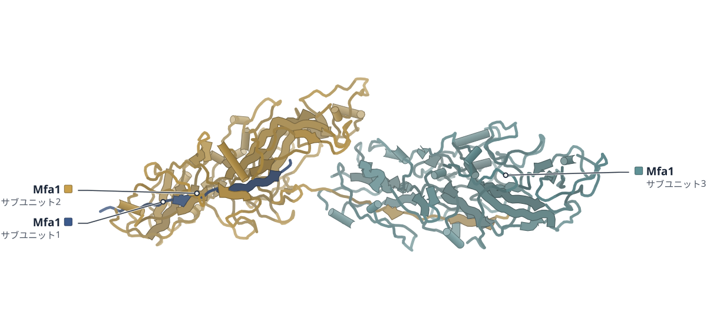

色（順に）：Mfa1（サブユニット1） / Mfa1（サブユニット2） / Mfa1（サブユニット3）

**歯周病菌のMfa線毛は、プロテアーゼによる鎖の交換でつながる**

重合したMfa1の線維を3.0 Åのクライオ電顕で解析し、Ca2+の結合も確かめた

- **これまでの疑問・課題**：歯周病菌の短い線毛であるMfa線毛の構造と、組み立ての仕組みは不明だった。
- **アプローチ**：組換えMfa1を酵素RgpBで試験管内で重合させ、できた線維をクライオ電顕で解析した。
- **結果**：切断で解放された鎖が隣のサブユニットの溝に入り、元の鎖と入れ替わっていた。Ca2+も結合部位に残っていた。
- **わかったこと**：Mfa線毛もFim線毛と同じく、プロテアーゼによる鎖の交換で組み上がることが確かめられた。
- **残された課題**：重合が先端側のピリンから始まるとされるが、順に重合する正確な仕組みは不明だ。

この紹介文の根拠（論文本文）

> The functional polymerized structure of the Fim pilus is known, whereas the structure and assembly mechanism of the Mfa pilus remain unclear.  
> — これまでの疑問・課題／Abstract

> Here, we show the structure of the polymerized recombinant Mfa1 stalk pilin determined by cryo-electron microscopy at 3.0 Å resolution.  
> — アプローチ／Abstract

> rMfa1 monomers at 1.5 mg/mL concentration were mixed with 1 mg/mL RgpB and incubated at 37 °C for 4 h.  
> — アプローチ／Methods

> In the polymeric state, the overall topology is preserved, but the anchor strand β1 and the donor strand β14 are replaced by the donor strands β14 and βC of the posterior donor subunit, respectively (Fig. 1H).  
> — 結果／Results and discussion

> The atomic model of the Mfa1 filament reveals that Mfa1 pilins polymerize by protease-mediated strand exchange and retain a Ca2+ ion in the metal-binding pocket  
> — 結果／Abstract

> This observation confirms that protease-mediated strand exchange is a common polymerization mechanism for Fim and Mfa pili in P. gingivalis.  
> — わかったこと／Results and discussion

> Pilus polymerization is presumed to be initiated from tip pilins or adaptor pilins, although the precise mechanism of sequential polymerization remains unclear.  
> — 残された課題／Results and discussion

分類：感染・ウイルス・防御系

#### 読みどころ

Mfa1のC末端の2残基、または1残基を欠くと、細胞は線毛を作れなかった。C末端のドナー鎖が隣のサブユニットに入り込んで鎖の交換を始めるのに、末端が必要だと著者は考えている。

根拠（論文本文）

> A ladder pattern was detected by Western blot only in samples from cells expressing full-length Mfa1 (Fig. 2B).  
> — Results and discussion

> These results suggest that the C-terminus of the Mfa1 donor strand is essential for strand exchange in the type V pilus assembly mechanism.  
> — Results and discussion

Ca2+の結合部位を壊した変異体（DDNE/A）でも重合し、EDTA処理にも安定だった。一方、この変異体の線維はヒトの血管内皮細胞のIL-6産生を強く促し、Ca2+が免疫による認識を和らげている可能性がある（著者の推測）。

根拠（論文本文）

> These results suggest that the metal ion is not required for polymerization nor for the stability of Mfa1.  
> — Results and discussion

> In contrast, incubation of HUVECs with DDNE/A rMfa1 filaments stimulated IL-6 production more strongly than the wild-type Mfa1 filament (Fig. 3D).  
> — Results and discussion

> The Mfa1 structure containing Ca2+ ion presumably reduces immune recognition in the host.  
> — Results and discussion

連鎖球菌のSspBが結合するとされる領域を重合体の構造に写すと、αヘリックス（343–362）が単量体とは違う位置にあった。SspBとのドッキングは直接の接触を支持せず、結合の確定には至っていない。

根拠（論文本文）

> A structural comparison of the putative SspB binding cleft of the monomeric state of Mfa1 with its polymeric state shows that the α-helix 343–362 has moved to a different position (Fig. 4B).  
> — Results and discussion

> Mapping of the SspB interaction region of Mfa1 onto the atomic model of polymerized three Mfa1 subunits shows its 3D location on the Mfa pilus (Fig. 4A).  
> — Results and discussion

#### 構造データ

| PDB | 手法 | 分解能 | 公開 | 生物種 | リガンド |
|---|---|---|---|---|---|
| [21CO](https://www.rcsb.org/structure/21CO) | クライオ電顕 | 2.99 Å | 2026-07-08 | Porphyromonas gingivalis ATCC 33277 | — |

- [B2RHG1](https://www.uniprot.org/uniprotkb/B2RHG1) mfa1 Minor fimbrium subunit Mfa1 — *Porphyromonas gingivalis (strain ATCC 33277 / DSM 20709 / CIP 103683 / JCM 12257 / NCTC 11834 / 2561)* （既存の PDB 構造 2 件）

#### 実験メモ

- **発現系**：N末端Hisタグ付きMfa1（残基21–563）を大腸菌BL21(DE3)で発現（IPTG 1 mM、20℃・18時間）。
- **コンストラクト**：野生型rMfa1と、金属結合部位のD507A・D509A・N512A・E514A変異体（DDNE/A）。
- **精製**：Talonレジンでアフィニティ精製し、PBSに置換。RgpBもHisタグ付きで精製。
- **結晶化／グリッド作製**：rMfa1（1.5 mg/mL）をRgpB（1 mg/mL）と37℃・4時間反応させて重合し、PEG-6000で沈殿。Quantifoil 2/1 Cu 400メッシュ、ブロット3秒・4℃・湿度100%。
- **データ収集・解析**：Titan Krios（300 kV）＋Falcon 3（カウンティング）、2,503ムービー、1.08 Å/pixel。CryoSPARCで267,383断片から2.99 Å（対称性は課さない）。

根拠（論文本文）

> Recombinant proteins in E. coli were expressed in LB medium containing 1 mM IPTG at 20 °C for 18 h.  
> — Methods

> We cloned and overexpressed the N-terminal His-tagged recombinant Mfa1 (rMfa1) containing residues 21–563 in Escherichia coli and then purified the subunit in monomeric form.  
> — Results and discussion

> Recombinant Mfa1 with an N-terminal His-tag was purified by affinity chromatography using Talon resin (Takara Bio, Shiga, Japan).  
> — Methods

> rMfa1 monomers at 1.5 mg/mL concentration were mixed with 1 mg/mL RgpB and incubated at 37 °C for 4 h.  
> — Methods

> Polymerized rMfa1 filaments were precipitated with 4% (w/vol) polyethylene glycol (PEG-6000), 0.2 M NaCl at 4 °C  
> — Methods

> Three µL of sample solution were applied to holey carbon grids (Quantifoil 2/1 Cu 400-mesh)  
> — Methods

> Grids were blotted for 3 s at 4 °C and 100% relative humidity, then immediately plunge-frozen in liquid ethane with a Vitrobot Mark IV  
> — Methods

> on a Falcon-3 direct electron detector (TFS) in counting mode at a calibrated magnification of 77,142x (corresponding to a pixel size of 1.08 Å/pixel at the specimen level)  
> — Methods

> Dose fractions from 2503 movies were aligned using motioncor254, dose-weighted, and summed.  
> — Methods

> 3D classification provided a more homogeneous class with 267,383 particle fragments that were refined to 2.99 Å resolution.  
> — Methods

> 📝 編集者への確認事項：21COは重合したMfa1（3サブユニット）の新しい構造。ただしMfa1の単量体結晶構造（5NF2、5NF3）は既報なので first_structure は false で『初』とは書かず、重合体の構造として扱った。題の『native assembled』に反し、試料は大腸菌で作った組換えMfa1をRgpBで試験管内重合したもの（細胞から取った線毛ではない）。らせんパラメータは本文（ねじれ68.8°、上昇74.2 Å）と Table 2（91.5°、73.4 Å）が食い違うため、記事には書いていない。Ca2+はICP-AESで同定（PDBのリガンド欄には出ていない）。SspBとの結合はドッキング予測にとどまる。

---

# 注目の構造（新しい構造以外。実験で決めた構造で確かめた研究）

## 16｜CBPのNCBD（マウス）

### Distinct Molten‐Globule Conformations in an Interacting Protein Domain Resolved by 19F NMR of Fluoroproline Residues

*Angewandte Chemie (International Ed. in English)*（2026-08-22） · [論文](https://doi.org/10.1002/anie.4052471) · ライセンス: cc by-nc-nd

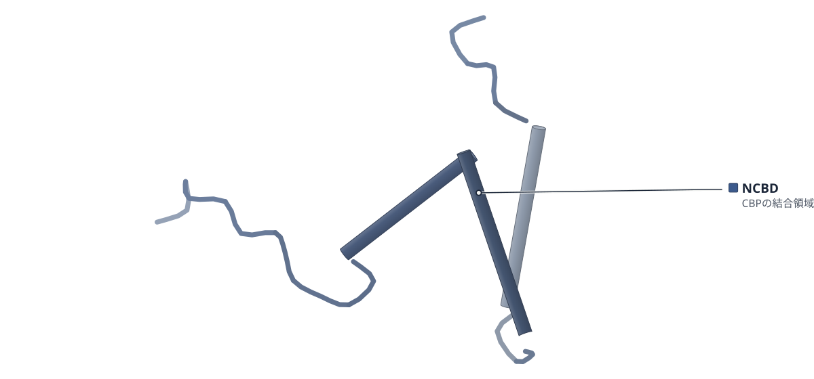

PDB 2KKJ（論文が使った既存の構造）

色（順に）：NCBD（CBPの結合領域）

**フルオロプロリンの立体が、NCBDの結合力を左右する**

既存のNMR構造2KKJなどと比べ、19F NMRでヘリックスの向きを調べた

- **これまでの疑問・課題**：モルテングロビュール（折りたたみが緩く揺らぐ状態）のNCBDは、構造の詳細を調べにくい。
- **アプローチ**：ループの2か所のプロリンを、立体が逆の4-フルオロプロリン（4R・4S）に置き換え、19F NMRなどで調べた。
- **結果**：NOEによる構造計算で3本のヘリックスの向きが変種ごとに異なり、AD-ACTRとの結合力も変わった。
- **わかったこと**：炭素4位の立体の反転だけで、ヘリックスの向きと結合力が変わった。プロリンは離れた部位の動きの連動を調節しうる。
- **残された課題**：構造計算は単一の立体配座を仮定しており、各変種が取る構造の広がりを定量的には表せない。

この紹介文の根拠（論文本文）

> However, due to multiple conformations existing in dynamic equilibrium on a wide range of timescales, the detailed structural characterization of molten‐globules remains challenging.  
> — これまでの疑問・課題／Introduction

> To assess the specific role of prolines in the conformational dynamics of the NCBD, we used a chemical biology approach combining NMR with the site‐specific incorporation of stereoisomeric 4‐(R)‐ and 4‐(S)‐fluoroprolines within both loops of NCBD (Figure 1A).  
> — アプローチ／Introduction

> The resulting sets of structures display different orientations of the three helices depending on the fluorination site and fluoroproline stereochemistry (Figures 3 and S22).  
> — 結果／Results

> Among the four fluorinated variants of NCBD, P13(4R) and P30(4R) variants are slightly better binders than WT NCBD  
> — 結果／Results

> Seemingly subtle inversion of chirality at carbon‐4 atom was sufficient to modify the relative orientation of α‐helices and to modulate the binding affinity of the resulting NCBD variants to AD‐ACTR.  
> — わかったこと／Conclusion

> Our results explicitly show how prolines can modulate dynamics and long‐range couplings between protein structural elements  
> — わかったこと／Conclusion

> While the modelling procedure used in this work does not provide a quantitative model of the conformational space sampled by each variants due to the presence of minor conformational states and their effect on NOE values  
> — 残された課題／Discussion

> It should be stressed that the use of a single conformer during the modelling is biasing the set of representative conformations.  
> — 残された課題／Results

分類：転写調節・シグナル伝達

#### 読みどころ

立体が逆のフルオロプロリンで、3本のヘリックスの向きが変わった。4R体のP13だけが、既存の2KKJ（単独）と1KBH（AD-ACTRとの複合体）に近い向きで、他の3変種は別の角度の組み合わせをとった。

根拠（論文本文）

> Out of the four fluorinated NCBDs, only P13(4R) displayed relative helices orientation comparable to a previously reported solution structure of free NCBD [17] (PDB ID: 2KKJ) and in complex with AD‐ACTR (PDB: ID 1KBH) [28].  
> — Discussion

> The three other variants sample helical orientations resulting from different combinations of previously observed α1/α2 and α2/α3 interhelical angles.  
> — Discussion

ITCでは、P13の4R体の方が4S体より強く結合した（KDは277 nMと402 nM）。フッ素は結合界面になくても、19F NMRの信号は結合の有無を反映した。著者はこれを、複合体に近い形に偏った状態が選ばれる機構と考える。

根拠（論文本文）

> Our results are consistent with these data with KD of 277 nM for P13(4R) NCBD and 402 nM for P13(4S) NCBD variants at 25 °C, respectively.  
> — Discussion

> Remarkably, all four fluorine spectra reported on the binding event, despite the fact that the corresponding prolines are not directly located at the protein–protein interface.  
> — Results

> suggesting a conformational selection mechanism involving an allosteric coupling between the loop L1 and the remaining parts of the protein  
> — Discussion

P30の4R体だけが、中性のpHでアミロイドを作った。この変種のモデルでは第1ヘリックスの向きが他と180°違い、著者は、凝集しやすい部位が溶媒に出る可能性を挙げている。

根拠（論文本文）

> Strikingly, for only one variant with 4‐(R)‐Pro at position 30 we observed the self‐assembly into amyloids at neutral pH  
> — Conclusion

> The representative conformations of NCBD P30(4R) variant obtained with the help of ARIA software indicate a particular orientation of the first helix that is rotated by 180° compared to other fluorinated NCBDs.  
> — Discussion

> This local effect may lead to a transient reorientation of NCBD helices exposing ‘aggregation hotspots’ localized in helices α2 and α3  
> — Discussion

#### 構造データ

| PDB | 手法 | 分解能 | 公開 | 生物種 | リガンド |
|---|---|---|---|---|---|
| [2KKJ](https://www.rcsb.org/structure/2KKJ) | 溶液NMR | — | 2010-06-30 | Mus musculus | — |
| [1KBH](https://www.rcsb.org/structure/1KBH) | 溶液NMR | — | 2002-02-06 | Homo sapiens, Mus musculus | — |

- [P45481](https://www.uniprot.org/uniprotkb/P45481) Crebbp Histone lysine acetyltransferase CREBBP — *Mus musculus* （既存の PDB 構造 0 件）
- [Q9Y6Q9](https://www.uniprot.org/uniprotkb/Q9Y6Q9) NCOA3 Nuclear receptor coactivator 3 — *Homo sapiens* （既存の PDB 構造 0 件）

#### 実験メモ

- **発現系**：発現ではなく、固相ペプチド合成で作成した。
- **コンストラクト**：CBPの2066〜2112（47残基）。2077位（P13）か2094位（P30）をフルオロプロリンに置換。
- **精製**：HPLCで精製し、20 mMリン酸緩衝液 pH 7.2に溶かした。
- **データ収集・解析**：1H-1H NOESYを304 K、700・900 MHzで測定し、ARIAで構造計算。19F NMRは565 MHz。

根拠（論文本文）

> Four 47‐residues NCBD variants (encompassing residues 2066 to 2112 of CBP) were synthesized using solid‐phase peptide synthesis by inserting either a 4‐(R)‐FPro or a 4‐(S)‐FPro at positions 2077 or 2094  
> — Results and Discussion

> The resulting proteins were purified using HPLC (Figures S1–S4) and dissolved in a 20 mM phosphate buffer at pH 7.2.  
> — Results and Discussion

> The 3D structures of the four modified NCBDs were investigated using 1H‐1H NOESY spectra recorded at 304 K and at proton frequencies of 700 and 900 MHz.  
> — Results and Discussion

> 565 MHz 19F NMR spectra of the four modified NCBD variants dissolved in H2O/D2O  
> — Figure legends

> 📝 編集者への確認事項：新しい構造ではない（impact: mechanism）。既存のNMR構造2KKJ・1KBHは、変種のモデルとの比較に使われている。変種のNOE構造モデルは本文ではPDBへの登録に触れておらず、データはZenodoで公開とだけ書かれている。著者自身が単一の立体配座を仮定したモデルは偏るとしている。本文にMethods節はなく（補足資料）、lab_notesは本文中の記述のみ。構造図は2KKJ（遊離型NCBD）。1KBHはAD-ACTRとの複合体。

---

## 17｜PD-L1・アベルマブ（ヒト）

### Characterization of Full‐Length Antibody Complexes Through HDX‐Mass Spectrometry Coupled With NMR Spectroscopy: New Insight Into Avelumab/PD‐L1 Interaction

*Angewandte Chemie (International Ed. in English)*（2026-08-22） · [論文](https://doi.org/10.1002/anie.1540355) · ライセンス: cc by

PDB 5GRJ（論文が使った既存の構造）

色（順に）：PD-L1（標的の免疫チェックポイント） / アベルマブ軽鎖（抗体） / アベルマブ重鎖（抗体）

**アベルマブの結合面は、HDX-MSと固体NMRでも結晶構造と一致した**

既存の5GRJと比べて確かめ、PD-L1のC末端の保護も見えた

- **これまでの疑問・課題**：抗体は大きく柔らかいため、標的との複合体の高分解能の構造は得にくい。
- **アプローチ**：全長のアベルマブとPD-L1の複合体を、HDX-MS（重水素の取り込みの測定）と固体NMRで調べ、既存の5GRJと比べた。
- **結果**：HDX-MSと固体NMRは、5GRJの結合面と一致した。HDX-MSでは、PD-L1のC末端にも強い保護が見られた。
- **わかったこと**：アベルマブと融合タンパク質は同じ結合面でPD-L1に結合する。C末端の保護は、一過性の効果か構築物に特有の挙動かもしれない。
- **残された課題**：PD-L1のC末端と軽鎖の相互作用は、存在も意義も仮説にとどまる。

この紹介文の根拠（論文本文）

> In particular, antibodies are large but very flexible macromolecules, and these features prevent the acquisition of high‐resolution structures of their complexes with target proteins.  
> — これまでの疑問・課題／Introduction

> In this study, we introduce an integration of solid‐state nuclear magnetic resonance (SSNMR) and hydrogen–deuterium exchange mass spectrometry (HDX‐MS) to explore the interaction between Avelumab and the programmed cell death‐ligand 1 (PD‐L1).  
> — アプローチ／Abstract

> To better understand the results, we compared the HDX data with findings from Liu et al. [8], which analyzed the complex between PD‐L1 and the single‐chain variable fragment (scFV) of Avelumab using x‐ray crystallography (PDB code: 5GRJ).  
> — アプローチ／Results and Discussion

> Our HDX results are consistent with the previously reported x‐ray data (Figure 4A,B), which identified the C, C′, F, and G strands and the CC′ loop of PD‐L1 as part of the binding epitope  
> — 結果／Results and Discussion

> Specifically, residues K124‐Y134, located at the C‐terminus, of the PD‐L1 construct display strong protection from deuterium exchange (Figures 3 and 4A).  
> — 結果／Results and Discussion

> The strong agreement between SSNMR, HDX‐MS, and previously reported x‐ray data supports the reliability of the interaction model and confirms that Avelumab and the related fusion protein engage PD‐L1 through the same binding interface.  
> — わかったこと／Conclusion

> the additional protection observed at the C‐terminus of the isolated PD‐L1 construct highlights the sensitivity of HDX‐MS to transient or long‐range effects that may not be captured by other structural techniques and may also reflect construct‐specific behavior  
> — わかったこと／Conclusion

> In summary, while the existence and relevance of this interaction remain hypothetical  
> — 残された課題／Results and Discussion

分類：免疫（抗体・MHC・TCR・自然免疫）

#### 読みどころ

既存の5GRJはscFv（抗体の断片）との複合体だった。この研究は全長のアベルマブを使い、HDX-MSで抗体側の結合部位（パラトープ）を、HDX-MSと固体NMRでPD-L1側の結合部位（エピトープ）を調べた。

根拠（論文本文）

> Therefore, these studies typically rely upon fragments of the selected antibodies (such as single‐chain variable fragments, or scFvs) in complex with their targets [23, 24].  
> — Introduction

> With this approach, we were able to obtain epitope (by both NMR and HDX) and paratope mapping (by HDX), together with a detailed characterization of the structural rearrangements arising upon binding.  
> — Abstract

結合面のCDR3（重鎖）では重水素の取り込みが48〜51%減った。一方、定常領域のCH1ループでは取り込みが増えた。著者はCH1ループの再配置と考え、この付近の改変には慎重さが要ると述べる。

根拠（論文本文）

> The strongest effects were observed in segments located in the binding region of the Fab domain, which showed a marked decrease (48%–51%) in deuterium uptake upon binding (residues G102‐T106, CDR3‐VH).  
> — Results and Discussion

> The increased deuterium uptake in segments E206‐S216 of the light chain and Y201‐K213 of the heavy chain (Figures 2B and S5) seems to support these findings.  
> — Results and Discussion

> indicate that any modifications in this region should be approached with caution, given the potential impact on complex formation  
> — Results and Discussion

PD-L1のC末端（K124〜Y134）の強い保護は、HDX-MSだけが示した。5GRJでは見えず、固体NMRでも裏づけられない。ドッキングモデルは軽鎖との相互作用を示すが、著者は一過性か、単離ドメイン由来の見かけとみる。

根拠（論文本文）

> This protection may be due to a potential interaction of the C‐terminus with residues of the Avelumab light chain, which was not observed in the x‐ray structure (5GRJ) [8].  
> — Results and Discussion

> However, the interaction suggested by HDX‐MS between the C‐terminus of the N‐terminal domain of PD‐L1 and the light chain of Avelumab is not supported by either the x‐ray or solid‐state NMR data.  
> — Results and Discussion

> It may merely be an artifact related to the use of the isolated V‐set domain, which has a very flexible C‐terminus.  
> — Results and Discussion

#### 構造データ

| PDB | 手法 | 分解能 | 公開 | 生物種 | リガンド |
|---|---|---|---|---|---|
| [5GRJ](https://www.rcsb.org/structure/5GRJ) | X線結晶構造解析 | 3.21 Å | 2016-11-02 | Homo sapiens | — |

- [Q9NZQ7](https://www.uniprot.org/uniprotkb/Q9NZQ7) CD274 Programmed cell death 1 ligand 1 — *Homo sapiens* （既存の PDB 構造 0 件）

#### 実験メモ

- **発現系**：PD-L1は[U-2H,13C,15N]標識。アベルマブは天然存在比の抗体。
- **コンストラクト**：PD-L1はN末端ドメイン（V-setドメイン）。
- **データ収集・解析**：固体NMRは再水和した凍結乾燥試料を800 MHz、MAS 60 kHz、約290 Kで測定。HDX-MSはPD-L1と複合体（1:2）を比較。

根拠（論文本文）

> Since therapeutic antibodies are available only at natural isotopic abundance and isotopic enrichment remains technically challenging  
> — Introduction

> 2D 15N 1H (H)NH CP of [U‐2H, 13C, 15N] PD‐L1 in complex with Avelumab.  
> — Figure legends

> The spectrum was acquired on rehydrated freeze‐dried material, using a spectrometer operating at 800 MHz (1H Larmor frequency) with a MAS of 60 kHz and a temperature of ∼290 K.  
> — Figure legends

> HDX experiments were performed on free PD‐L1 and on its complex with Avelumab at a 1:2 molar ratio  
> — Results and Discussion

> Avelumab is a mAb directed against PD‐L1  
> — Introduction

> the N‐terminal domain of the programmed cell death‐ligand 1 (PD‐L1)  
> — Introduction

> 📝 編集者への確認事項：新しい構造ではない（impact: method）。構造図は既存の5GRJ（アベルマブのscFvとPD-L1の結晶構造、3.2 Å）で、本論文の実験構造ではない。HDX-MSと固体NMRで調べた対象は全長のアベルマブとPD-L1のN末端ドメインで、5GRJはscFvと全長エクトドメインの複合体なので構築物が異なる。C末端の相互作用はHADDOCKのドッキングモデルによる推定で、著者自身が仮説・見かけの可能性と書いている。本文にMethods節はなく（補足資料）、lab_notesは本文と図の説明のみ。

---

## 注目の構造の採点（220 本を確認し、10 本を採点）

基準は `pipeline/impact.py`（10 点満点、7 点以上から最大 5 本）。

| 選定 | 論文 | 種類 | novelty | reach | structure | support | 計 | 理由 |
|---|---|---|---|---|---|---|---|---|
| ◯ | PMC13653584 Distinct Molten‐Globule Conformations in an Interacting Prot | 既存構造で機構を解明 | 2 | 2 | 2 | 2 | 8 | フルオロプロリンの立体を変えるとモルテングロビュールの三本のヘリックスの向きと結合親和性が変わることを、NOE による構造計算（既存の NMR 構造 2KKJ・1KBH と比較）と ITC・アミロイド解析で示した。 |
| ◯ | PMC13653614 Characterization of Full‐Length Antibody Complexes Through H | 新しい手法・ソフト | 2 | 2 | 1 | 2 | 7 | SSNMR と HDX-MS を組み合わせた抗体-抗原のエピトープ・パラトープ解析で、既存の X 線構造 5GRJ と同じ結合面を再現し、5GRJ にない PD-L1 C 末端の保護も見いだした。 |
|  | PMC13660981 Forward genetics reveals a conserved CNBHD-CNBHD interface t | 既存構造で機構を解明 | 2 | 2 | 1 | 2 | 7 | 境界例。既存のクライオ電顕構造（5K7L・5VA1）は変異位置を界面に位置づけるのに使われただけで、構造そのものによる検証が弱いため、記事にしなかった。 |
|  | PMC13661046 Allosteric disulfide control of ligand binding and endocytos | 既存構造で機構を解明 | 2 | 1 | 1 | 2 | 6 | 既存の結晶構造 3WYR の Cys10-Cys28 結合を手がかりに、アロステリックなジスルフィド切り替えを変異体・質量分析・結合測定で示した良い研究だが、対象は KIR2DL4 に限られ合計 6 点で基準に届かない。 |
|  | PMC13663732 Tyrosine phosphorylation unfolds nucleophosmin and disrupts  | 既存構造で機構を解明 | 2 | 1 | 1 | 2 | 6 | NPM1 の Tyr17・Tyr67 のリン酸化模倣で五量体が壊れることを NMR・DSC・AUC・ITC で示したが、構造の根拠は既存構造 4N8M を使った MD が中心で、NMR は折れたたみの有無の確認にとどまる。合計 6 点。 |
|  | PMC13659490 Molecular basis for a Ca2+ binding hierarchy in the EF-hand  | 既存構造で機構を解明 | 2 | 1 | 1 | 2 | 6 | CaBP2 の EF ハンドごとの Ca2+ 結合を ITC と NMR で測り電気生理で機能を確かめたが、構造決定や既存の実験構造は使わず、NMR は安定性の評価にとどまる。合計 6 点。 |
|  | PMC13662901 Site and mechanism of BK channel inhibition and cerebral art | 既存構造で機構を解明 | 2 | 1 | 1 | 2 | 6 | 既存のクライオ電顕構造 6V38 へのドッキングで見つけたプレグネノロン結合部位 Tyr450 を、変異体・結合測定・ノックインマウスで確かめた。ただし構造側の根拠はドッキングで、対象も BK チャネルに限られ合計 6 点。 |
|  | PMC13661599 Leveraging high-throughput proteomics and AI-based protein f | 構造に基づく創薬 | 2 | 2 | 0 | 2 | 6 | VAV1 分解誘導剤と RT-ループ degron は変異体で検証されたが、三者複合体は AlphaFold・ドッキング・Boltz-2 のモデルで、既存の 4CI3・5FQD はテンプレートに使われただけ。実験構造による裏付けがなく structure=0 のため選ばない。 |
|  | PMC13659818 Beyond the catalytic serine: selective protease engagement w | 新しい手法・ソフト | 2 | 2 | 0 | 2 | 6 | 非触媒残基を狙う大環状の共有結合プローブという新しい設計で、MS と選択性で検証された。ただし結論は標識・質量分析で示され、実験構造（uPA の 4JK6）は uPA 側の置換位置の選択に使われただけで、結論の根拠にならない。structure=0 のため選ばない。 |
|  | PMC13660641 A pseudo-labeling approach for automated assignment of unlab | 新しい手法・ソフト | 2 | 1 | 1 | 1 | 5 | 非標識タンパク質の NMR シグナル帰属を AI 予測の化学シフトで自動化する実験手法。実際のスペクトルで HEWL など 3 種を測ったが、帰属であって構造の決定ではなく、BMRB との一致は 71〜85%。合計 5 点。 |

novelty：何が初めてか / reach：誰に効くか / structure：実験で決めた構造（X 線・クライオ電顕・NMR / support：裏付けの強さ（2＝独立した実験で検証：変異体・機能測定・既存手法との比較など／1＝一部の検証のみ／0＝計算のみで実験的検証なし）

## 記事にしていない新しい構造

- [Design and Exploration of a Tricyclic Series of CNS-Penetrant CD38 Small Molecule Inhibitors](https://doi.org/10.1021/acsmedchemlett.6c00301) — *ACS Med Chem Lett*（新しい構造：10OT, 10LP）
- [Reprogramming the Rossmann fold signature motif creates orthogonal redox biocatalysts](https://doi.org/10.1038/s41467-026-77633-7) — *Nat Commun*（新しい構造：9IIL）
- [Integrated computation-guided thermostabilization of the fungal sweet protein Honey Truffle Sweetener](https://doi.org/10.1016/j.crfs.2026.101584) — *Curr Res Food Sci*（新しい構造：21WR）
- [Structural and dynamic insights into the allosteric activation of p38α MAP kinase via specific docking interactions](https://doi.org/10.1038/s42003-026-10502-7) — *Commun Biol*（新しい構造：8YP8）
- [R1-32-like public antibodies acquire tolerance to SARS-CoV-2 antigenic drift through somatic hypermutation](https://doi.org/10.1371/journal.pbio.3003996) — *PLoS Biol*（新しい構造：9XHY, 9XHZ, 9XI0, 9XI1）
- [A cavity-reduced prefusion RSV F bivalent vaccine elicits durable and protective immunity](https://doi.org/10.1038/s44321-026-00511-8) — *EMBO Mol Med*（新しい構造：28DJ, 27RI, 25XQ, 25XR）
- [Assessing CD8+ T cell cross‐reactivity to influenza A, B and C virus‐derived peptides presented by HLA‐B*18:01](https://doi.org/10.1002/cti2.70123) — *Clin Transl Immunology*（新しい構造：9ZZ7, 9ZZ8, 9ZZN, 9NN7）
- [Discovery of an antagonist nanobody targeting the oxytocin receptor with tocolytic effect in mice](https://doi.org/10.1038/s41467-026-77680-0) — *Nat Commun*（新しい構造：9UOT, 9UTO, 9UTP, 9UVQ）
- [Large-scale prospective evaluation of co-folding across hundreds of Mac1–ligand complexes and three virtual screens](https://doi.org/10.7554/elife.110475) — *Elife*（新しい構造：15JC, 15CH, 15DE, 15DX）
- [Structural basis for membrane-dependent positive feedback regulation of DOCK11 by activated Cdc42](https://doi.org/10.1073/pnas.2607665123) — *Proc Natl Acad Sci U S A*（新しい構造：22VD, 22VE, 22VF, 22VG）
- [Structural insights into assembly and environmental adaptation of photosystem I from a lichen green alga](https://doi.org/10.1038/s41467-026-77656-0) — *Nat Commun*（新しい構造：9X4O, 9X4P, 27GG, 9X4R）
- [Molecular Architecture of the H2AX-Containing Nucleosome from Arabidopsis](https://doi.org/10.3390/cells15191795) — *Cells*（新しい構造：38BL, 38BO, 37ZO）
- [Structural basis of assembly-dependent activation of the MAD3–MAD4 nuclease in the Pseudomonas aeruginosa MADS defense system](https://doi.org/10.1093/nar/gkag1001) — *Nucleic Acids Res*（新しい構造：26YZ, 43VY, 26WA）
- [Structural basis of the gating mechanism of the large-conductance mechanosensitive channel from Escherichia coli](https://doi.org/10.1038/s41467-026-76193-0) — *Nat Commun*（新しい構造：28OA, 28OB, 28OC）
- [Molecular Basis for Activation to Inhibition Switching in Kv7.2 Channel Modulators](https://doi.org/10.1002/anie.7948330) — *Angew Chem Int Ed Engl*（新しい構造：22SA, 22SB）
- [Structural characterization of HCoV-229E and H163A main protease (Mpro) interactions with the inhibitor narlaprevir](https://doi.org/10.1016/j.bbrep.2026.102821) — *Biochem Biophys Rep*（新しい構造：9XXJ, 24DE）
- [A DltE–DltD–DltX interaction network regulates lipoteichoic acid D-alanylation and Lactiplantibacillus plantarum-mediated growth promotion in Drosophila](https://doi.org/10.1016/j.jbc.2026.113522) — *J Biol Chem*（新しい構造：29GH）
- [A single amino acid mutation alters substrate specificity towards l-glucose in a bacterial l-galactose dehydrogenase](https://doi.org/10.1016/j.bbrep.2026.102819) — *Biochem Biophys Rep*（新しい構造：26WE）
- [Ancient nuclear genome duplication events in vertebrates facilitated the functional diversification of ohnologous cytochrome c: insights from Buergeria frogs](https://doi.org/10.1093/molbev/msag243) — *Mol Biol Evol*（新しい構造：24OQ）
- [Development of GuaB Inhibitors to Treat Mycobacterium tuberculosis Infection](https://doi.org/10.1021/acsinfecdis.6c00350) — *ACS Infect Dis*（新しい構造：12LG）
- [PXL: a nucleic acid-binding module of the promyelocytic leukemia protein](https://doi.org/10.1093/nar/gkag966) — *Nucleic Acids Res*（新しい構造：10TH）
- [Small molecule inhibition of voltage dependent anion channel 1 reroutes mitochondrial metabolite flux](https://doi.org/10.1016/j.mocell.2026.100369) — *Mol Cells*（新しい構造：9PFZ）
- [Structural organization of TAM receptor ectodomains](https://doi.org/10.1042/bcj20260584) — *Biochem J*（新しい構造：37NT）
- [A novel multifunctional starch debranching enzyme from Myxococcus sp. V11](https://doi.org/10.1007/s00253-026-13961-4) — *Appl Microbiol Biotechnol*（新しい構造（ID は補足資料））
- [Bioinformatic prediction, qCLASH, and AlphaFold3 reveal non-overlapping layers of the miR-214-3p–mRNA interactome](https://doi.org/10.3389/fgene.2026.1924314) — *Front Genet*（新しい構造（ID は補足資料））
- [Reply to Cantwell Chater and Shahsavar: Clarifying PDB deposition records and local model interpretation in GlyT2 structures](https://doi.org/10.1073/pnas.2621667123) — *Proc Natl Acad Sci U S A*（新しい構造（ID は補足資料））
- [Structural insights into the exosite-mediated activation of factor IX by factor XIa using cryogenic electron microscopy](https://doi.org/10.1016/j.jtha.2026.08.015) — *J Thromb Haemost*（新しい構造（ID は補足資料））
- [Reversible Dimerization of Cytochrome Oxidase in Detergent Solution as Detected by Dynamic Light Scattering](https://doi.org/10.3390/ijms27198744) — *Int J Mol Sci*（新しいマップ（EMDB））
