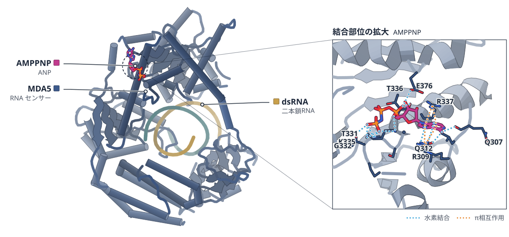
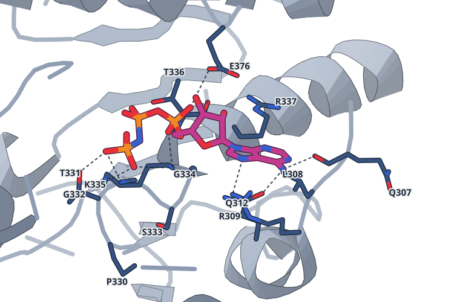

# 2026-10-17 号

**今日の新しい構造：3 本**　Europe PMC に 2026-10-16 に登録されたオープンアクセス論文 25 本のうち、新しい構造を報告した論文は 3 本。うち 3 本を紹介する（残りは末尾に一覧）。

**注目の構造：1 本**（新しい構造ではないが、実験で決めた構造で確かめた注目の研究）

## Today's Structure（今日の一本）

**1｜MDA5のT331I変異は、ATPを分解できず自己免疫につながる**（MDA5（ヒト））

選んだ理由（構造生物学・生命科学）：自己免疫疾患に結びつくMDA5変異T331Iが、ATPの触媒を妨げて持続的なインターフェロン応答を生む仕組みを、クライオ電顕で示した。

> the gain-of-function T331I disease-linked mutation within the ATP-binding pocket disrupts this balance, resulting in constitutive interferon signaling  
> — Abstract

- 迷った論文：ホタルルシフェラーゼ（FLuc） — 翻訳中の折りたたみを力プロファイル解析で追った研究で面白いが、クライオ電顕は補助的で構造の主張が弱い。
- 迷った論文：ZBP1のZαドメイン（ヒト） — ZBP1のZ型RNA結合を示したが、決定した構造がなくNMR・ITCによる間接的な根拠にとどまる。

| # | 標的 | 手法・分解能 | 見出し |
|---|---|---|---|
| 1 | MDA5（ヒト） | クライオ電顕・2.81–3.21 Å（4 構造） | MDA5のT331I変異は、ATPを分解できず自己免疫につながる |
| 2 | ホタルルシフェラーゼ（FLuc） | 力プロファイル解析・クライオ電顕（リボソーム複合体、平均 2.3 Å） | ホタルルシフェラーゼは、翻訳中に少しずつ縮んで折りたたまれる |
| 3 | ZBP1のZαドメイン（ヒト） | NMR・CD・ITC | ZBP1は、できあがったZ型RNAにだけ結合する |

> この号は AI が論文本文から作成した**レビュー用の下書き**です。数値・ID・リガンドは PDB / UniProt から取得し、AI の記述には本文からの引用を付けています。

---

# 新しい構造

## 1｜MDA5（ヒト）

### Establishing the molecular basis for MDA5 mutation-linked autoimmunity

*Nucleic Acids Research*（2026-09-01） · [論文](https://doi.org/10.1093/nar/gkag941) · ライセンス: cc by

色（順に）：MDA5（RNA センサー） / dsRNA（二本鎖RNA） / RNA 13mer　スティック：AMPPNP（ANP）

AMPPNPの結合部位。4 Å 以内の残基：Q307, L308, R309, Q312, P330, T331, G332, S333, G334, K335, T336, R337, E376。点線は 3.3 Å 以内の N・O の組（11 組）

**MDA5のT331I変異は、ATPを分解できず自己免疫につながる**

短いdsRNAにもフィラメントが残り、インターフェロン応答が続く

- **これまでの疑問・課題**：疾患に関わるMDA5のT331I変異が、なぜ常にインターフェロンのシグナルを出すのかは不明だった。
- **アプローチ**：細胞のレポーター実験、ATPase測定、短い112 bp dsRNAとの複合体のクライオ電顕で野生型と比べた。
- **結果**：T331I変異体はATPase活性が検出されず、ATPを加えても短いdsRNA上のフィラメントが壊れなかった。
- **わかったこと**：ATP加水分解が止まるとフィラメントが外れず、自己のdsRNAでも免疫が過剰に活性化すると考えられる。

この紹介文の根拠（論文本文）

> While these results are notable, the actual molecular mechanism underlying constitutive MDA5 T331I signaling remains unclear.  
> — これまでの疑問・課題／Introduction

> Through a combination of cryo-electron microscopy (cryoEM), biochemical assays, and cellular analyses, we reveal the extensive network of interactions that precisely position ATP for catalysis in the wild-type MDA5 ATP-binding pocket  
> — アプローチ／Abstract

> However, the T331I mutant displayed no detectable ATPase activity in the presence of poly (I:C)  
> — 結果／Results

> Based on these results, we conclude that the T331I mutation eliminates the ATPase activity of MDA5, which in turn blocks the disassembly of filaments formed by the T331I mutant even on short dsRNA.  
> — わかったこと／Results

分類：免疫（抗体・MHC・TCR・自然免疫）・DNA・RNA に関わるもの

#### 読みどころ

T331I変異体は、30 bpほどの短いdsRNAでもインターフェロン応答を引き起こした。野生型は短いdsRNAにはほとんど応答しない。この変異体は、長さを見分ける能力を失っている。

根拠（論文本文）

> By contrast, the T331I mutant exhibited robust signaling upon stimulation by almost every RNA tested, including dsRNAs as short as 30 bp (SLR30) in length (Fig. 1C).  
> — Results

ATPを加えると、野生型のフィラメントは短いdsRNA上でほぼ壊れて遊離RNAが増えたが、T331Iのフィラメントは壊れずに残った。ATP分解がフィラメントの解体に必要であることを直接示している。

根拠（論文本文）

> In contrast, the short filaments formed by T331I on dsRNA112 were stable even in the presence of ATP, and no evidence of filament disassembly was observed (Fig. 2C, bottom panel, and Supplementary Fig. S4B).  
> — Results

野生型の複合体では、ATP結合ポケットでATPを触媒の位置に置く相互作用の網目が見えた。野生型はATPの非加水分解アナログ（AMPPNP）で、T331IはATPで複合体を作って構造を決めた。

根拠（論文本文）

> we reveal the extensive network of interactions that precisely position ATP for catalysis in the wild-type MDA5 ATP-binding pocket  
> — Abstract

#### 構造データ

| PDB | 手法 | 分解能 | 公開 | 生物種 | リガンド |
|---|---|---|---|---|---|
| [9Y4J](https://www.rcsb.org/structure/9Y4J) | クライオ電顕 | 2.81 Å | 2026-09-09 | Homo sapiens, in vitro transcription vector pT7-Fluc(deltai) | ANP |
| [9Y4L](https://www.rcsb.org/structure/9Y4L) | クライオ電顕 | 2.96 Å | 2026-09-09 | Homo sapiens, in vitro transcription vector pT7-Fluc(deltai) | ANP |
| [9Q60](https://www.rcsb.org/structure/9Q60) | クライオ電顕 | 3.12 Å | 2026-09-16 | Homo sapiens, synthetic construct | ATP |
| [9Q5W](https://www.rcsb.org/structure/9Q5W) | クライオ電顕 | 3.21 Å | 2026-09-16 | Homo sapiens, synthetic construct | ATP |

- [Q9BYX4](https://www.uniprot.org/uniprotkb/Q9BYX4) IFIH1 Interferon-induced helicase C domain-containing protein 1 — *Homo sapiens* （既存の PDB 構造 9 件）

#### 実験メモ

- **発現系**：ヒトMDA5（CARD を除いた構築体）を大腸菌 Rosetta (DE3) で発現。
- **コンストラクト**：N 末端の 297 残基（CARD）を除いた。
- **精製**：ニッケルカラム、SUMO プロテアーゼ、ヘパリン、Superdex 200 で精製。
- **結晶化／グリッド作製**：5 µM のタンパク質と 0.2 µM の 112 bp dsRNA を AMPPNP または ATP 存在下で一晩インキュベートし、UltrAuFoil グリッドに載せた。
- **データ収集・解析**：Titan Krios と K3 で収集し、cryoSPARC v4.0 で処理した。

根拠（論文本文）

> The N-terminal 297 residues were removed from both protein constructs to reconstitute wild-type MDA5/dsRNA112 or T331I/dsRNA112 complexes.  
> — Methods

> The protein–dsRNA complexes were first assembled by the incubation of 5 µM proteins and 0.2 µM dsRNAs at 4°C overnight  
> — Methods

> Recorded movie frames were processed using cryoSPARC v4.0.  
> — Methods

> 📝 編集者への確認事項：PDB 9Y4J/9Y4L は野生型 + AMPPNP、9Q60/9Q5W の対応は未確認（ligand は ATP、T331I と考えられる）。凡例の順序は render 後に確認すること。

---

## 2｜ホタルルシフェラーゼ（FLuc）

### Quasi-continuous cotranslational compaction and folding of a multidomain protein

*Nature Communications*（2026-10-05） · [論文](https://doi.org/10.1038/s41467-026-78090-y) · ライセンス: cc by

**ホタルルシフェラーゼは、翻訳中に少しずつ縮んで折りたたまれる**

力プロファイル解析で550残基の折りたたみを5残基刻みで追い、TFの影響も調べた

- **これまでの疑問・課題**：小さな単一ドメインのタンパク質が中心で、大きな多ドメインの翻訳中の折りたたみは調べられていなかった。
- **アプローチ**：550残基のFLucについて、力プロファイル解析で新生鎖が引く力を5残基刻みで測り、シャペロンTFの影響も調べた。
- **結果**：中くらいの力の増減が連続し、RF-2ドメインの折りたたみで高い力のピークが出た。TFは新生鎖と広く相互作用した。
- **わかったこと**：翻訳中の折りたたみは、少数の協同的な段階の連続ではなく、準連続的な縮みと折りたたみの積み重ねだと考えられる。
- **残された課題**：残基レベルの理解には、1残基刻みの解析に変異解析と計算モデリングを組み合わせる必要がある。

この紹介文の根拠（論文本文）

> So far, studies of cotranslational folding have focused mainly on small, single-domain proteins.  
> — これまでの疑問・課題／Abstract

> Here, we have used Force Profile Analysis to study the cotranslational folding of Firefly Luciferase, a complex 550-residue protein  
> — アプローチ／Abstract

> The folding process is characterized by a quasi-continuous series of compaction/folding steps that generate intermediate-size pulling forces on the nascent chain, punctuated by a prominent high-force event that represents the folding of the RF-2 domain  
> — 結果／Abstract

> Trigger Factor interacts extensively with the nascent chain when the central part of RF-2 and the early parts of the CTD are synthesized.  
> — 結果／Abstract

> Our analysis uncovers a cotranslational compaction/folding process that is rich in detail and not just a simple succession of a few distinct, cooperative folding transitions.  
> — わかったこと／Abstract

> Single-residue resolution FPA studies, together with mutational analysis and computational modeling, may eventually make it possible to gain a detailed, residue-level understanding  
> — 残された課題／Discussion

分類：リボソーム・翻訳・フォールディング

#### 読みどころ

N≈300残基の主なピークは、残基80〜260付近の協同的な折りたたみに当たる。RF-2ドメインと、RF-1との境にあるヘリックス1本が含まれる。

根拠（論文本文）

> the main peak at N ≈ 300 residues signals a cooperative folding event involving FLuc residues ~80–260, precisely matching the RF-2 domain plus an additional helix located at the border between the RF-2 domain and the second half of the RF-1 domain  
> — Discussion

初期のピーク（N＝110、130、190残基）をクライオ電顕で調べた。リボソームの出口トンネル内に折りたたまれたドメインはなく、トンネルの外で縮んでいると考えられる。

根拠（論文本文）

> The absence of more extensive folded domains in the ET shows that these early FP peaks are not generated by the formation of stable substructures within the ET, but rather represent compaction of the NC outside the ribosome.  
> — Results

TFを加えると、N＝165〜205残基付近でfFLが平均0.25ほど下がった。この領域の新生鎖が縮んだ状態でTFに結合されると考えられる。

根拠（論文本文）

> The most dramatic difference is for the ~40-residue long region N = 165–205 residues, where the fFL values are markedly reduced (by about 0.25, on average) in the presence of TF  
> — Results

#### 構造データ

原子モデルのない cryo-EM マップ（EMDB）：[EMD-56368](https://www.ebi.ac.uk/emdb/EMD-56368), [EMD-56453](https://www.ebi.ac.uk/emdb/EMD-56453), [EMD-56462](https://www.ebi.ac.uk/emdb/EMD-56462)

#### 実験メモ

- **発現系**：大腸菌由来の無細胞系（PURExpress）で転写・翻訳し、[35S]-Met で標識した。
- **コンストラクト**：クライオ電顕用には、強い停止配列 SecM(3 W) と N 末端の 6xHis タグを付けた。
- **精製**：リボソーム–新生鎖複合体を、大腸菌 BL21(DE3) から精製した。
- **結晶化／グリッド作製**：Vitrobot でグリッドを作製した（ブロット 3 秒）。
- **データ収集・解析**：Krios G3i と K3 で 300 kV、0.825 Å/pixel で収集し、cryoSPARC 4.3.0 で処理した。

根拠（論文本文）

> PCR products were purified and subjected to in vitro transcription and translation according to the PURExpressTM protocol from New England Biolabs.  
> — Methods

> a 6xHis tag was added to the N-terminus of FLuc to facilitate purification of RNCs  
> — Methods

> Purified RNCs were added to grids using a Vitrobot  
> — Methods

> Data were collected on a Krios G3i microscope  
> — Methods

> Processing was performed using CryoSPARC 4.3.0.  
> — Methods

> 📝 編集者への確認事項：PDB エントリはなく、EMDB のマップ（EMD-56368・56453・56462）のみ。クライオ電顕は新生鎖の短い構築体（110・130・190 残基）の確認用で、主役は力プロファイル解析。構造図なし。

---

# 注目の構造（新しい構造以外。実験で決めた構造で確かめた研究）

## 3｜ZBP1のZαドメイン（ヒト）

### ZBP1 specifically binds pre-formed Z-RNA, limiting its potential pool of nucleic acid ligands compared to ADAR1

*Nucleic Acids Research*（2026-10-13） · [論文](https://doi.org/10.1093/nar/gkag972) · ライセンス: cc by

**ZBP1は、できあがったZ型RNAにだけ結合する**

NMR・CD・ITCで調べると、無修飾のRNAをZ型に変換できなかった

- **これまでの疑問・課題**：ZBP1はADAR1と同様にA型RNAをZ型に変換できると考えられてきたが、実験での確認はなかった。
- **アプローチ**：ZBP1のZα1・Zα2ドメインと核酸の結合を、NMR・CD・ITCなどで調べた。
- **結果**：二本鎖DNAはZ型にできたが、無修飾の(CpG)n RNAはZ型に変換できなかった。
- **わかったこと**：ZBP1が感知するZ型RNAは、すでにZ型になりやすいものに限られる可能性がある。
- **残された課題**：ADAR1がZBP1を抑えるという競合モデルは、さらに検証が必要だ。

この紹介文の根拠（論文本文）

> ZBP1 has been previously shown to bind and convert B-DNA to the Z-conformation and was assumed to be able to convert A-RNA as well, despite the lack of experimental validation.  
> — これまでの疑問・課題／Abstract

> Here, we use NMR and other biophysical and biochemical experiments to characterize the Z-DNA and Z-RNA binding properties of ZBP1’s Zα1 and Zα2 domains.  
> — アプローチ／Abstract

> While ZBP1’s Zα domains are able to convert and stabilize unmodified dsDNA in the Z-conformation, they are incapable of flipping unmodified (CpG)n repeat dsRNA.  
> — 結果／Abstract

> This functional difference likely restricts ZBP1 sensing to pre-Z-forming nucleic acids, preventing aberrant immune activation and reflecting mechanistic differences from ADAR1.  
> — わかったこと／Introduction

> This model is consistent with previously published genetic studies [2, 37, 102]; however, more research is needed to validate the competitive binding model.  
> — 残された課題／Discussion

分類：DNA・RNA に関わるもの・免疫（抗体・MHC・TCR・自然免疫）

#### 読みどころ

ZBP1は無修飾のRNAをZ型に変換できず、A型に近い形で結合した。ADAR1のZαドメインとは性質が異なる。

根拠（論文本文）

> but cannot convert A-RNA, instead binding it in an A-form-like mode.  
> — Introduction

> These results contrast with ADAR1’s Zα domain, which can bind and flip both dsDNA and dsRNA into the Z-conformation  
> — Abstract

8-メチルグアニンで安定化したZ型RNAにはZBP1が結合した。酸化で生じる8-オキソグアニンはさらに強くZ型を安定化し、生理的な標的候補になりうる。

根拠（論文本文）

> To our surprise, 8-oxoguanine seems to be a greater natural Z-RNA stabilizer than the 8-methylguanine modification (Fig. 5A).  
> — Results

> 8-Oxoguanine is the most prevalent oxidative product upon exposure to ROS  
> — Results

#### 構造データ

論文が使った PDB 構造はない。

#### 実験メモ

- **発現系**：大腸菌LOBSTR-BL21(DE3)で発現。15N標識はM9培地
- **データ収集・解析**：Bruker 600 MHzで15N-HSQC滴定

根拠（論文本文）

> Briefly, the plasmids were transformed and expressed in LOBSTR-BL21(DE3) Escherichia coli.  
> — Methods

> All experiments were carried out on a Bruker 600 MHz spectrometer  
> — Methods

> 📝 編集者への確認事項：結晶・クライオ電顕の構造決定はなく、NMR（化学シフト摂動）・CD・ITC で結合様式と立体配座を調べた研究。structure は 1 点とした。

---

## 注目の構造の採点（22 本を確認し、1 本を採点）

基準は `pipeline/impact.py`（10 点満点、7 点以上から最大 5 本）。

| 選定 | 論文 | 種類 | novelty | reach | structure | support | 計 | 理由 |
|---|---|---|---|---|---|---|---|---|
| ◯ | PMC13659236 ZBP1 specifically binds pre-formed Z-RNA, limiting its poten | 既存構造で機構を解明 | 2 | 2 | 1 | 2 | 7 | NMR・CD・ITCで、ZBP1がZ型RNAへの変換能を持たないことを示した。結晶構造は決めていないが、NMRで結合様式を実験的に確かめた。 |

novelty：何が初めてか / reach：誰に効くか / structure：実験で決めた構造（X 線・クライオ電顕・NMR / support：裏付けの強さ（2＝独立した実験で検証：変異体・機能測定・既存手法との比較など／1＝一部の検証のみ／0＝計算のみで実験的検証なし）

## 記事にしていない新しい構造

- [Symmetry-breaking antibody binding reveals extensive capsid malleability in pandemic human norovirus](https://doi.org/10.21203/rs.3.rs-9488000/v1) — *Res Sq*（新しい構造：12QZ, 13KF, 13KG, 12TF）
