

# 2026-10-18 号

**今日の新しい構造：16 本**　PMC に 2026-10-17 に登録されたオープンアクセス論文 59 本のうち、新しい構造を報告した論文は 16 本。うち 15 本を紹介する（残りは末尾に一覧）。

出典：この号の論文情報と全文は、米国国立医学図書館（NLM）の PMC オープンアクセスデータセット（AWS Open Data）から取得した。

**New Structure 4 本** · **Structure Update 10 本** · **Structure-Based Study 1 本**（New Structure：構造が初めて解かれたタンパク質。Structure Update：既知のタンパク質の新しい構造。Structure-Based Study：既存の構造を使った注目の研究）

## Today's Structure（今日の一本）

**1｜部分作動薬が、AMPA受容体の開く前の中間状態をとらえた**（GluA2–γ2（AMPA受容体））

選んだ理由（構造生物学・生命科学）：AMPA受容体が開く前の中間状態を、部分作動薬と時分割クライオ電顕で複数の状態として捉え、ゲーティング経路を構造で示した。

> While the terminal apo, open and desensitized states have been structurally characterized, the intermediate pre-active state has remained an enigma.  
> — Abstract

- 迷った論文：β2AR（ヒト）二量体 — 分子糊としてβ2ARを二量体化する創薬上の新規性は大きいが、構造生物学・生命科学の軸ではAMPA受容体の方が突出した。
- 迷った論文：ヒトOCTN1（SLC22A4） — OCTN1の初の構造だが、阻害薬の結合様式が構造ではなくモデルのため見送った。

| # | 標的 | 手法・分解能 | 見出し |
|---|---|---|---|
| 1 | GluA2–γ2（AMPA受容体） | Cryo-EM・2.93–4.36 Å（10 構造） | 部分作動薬が、AMPA受容体の開く前の中間状態をとらえた |
| 2 | ヒトOCTN1（SLC22A4） | Cryo-EM・3.11–3.37 Å（2 構造） | OCTN1の外向き・内向きの構造から、阻害薬メベンダゾールを見いだした |
| 3 | ヒトNHA1（SLC9B1） | Cryo-EM・3.64 Å | ヒトNHA1の内向き構造は、エレベーター型の輸送を裏づける |
| 4 | ワクシニアウイルスD13（足場） | Cryo-EM・2.56–3.70 Å（8 構造） | A17の末端ペプチドが、D13の棒状集合体を足場の格子に組み替える |
| 5 | ヒトcPRC1（PRC1.4） | Cryo-EM・2.74 Å | PRC1は4つのサブユニットを密に組み、E2酵素をヌクレオソーム上に置く |
| 6 | ヒトNLRP6（炎症の感知因子） | Cryo-EM・3.69–3.79 Å（2 構造） | ATPがNLRP6の各ドメインを束ねて、活性化を抑える |
| 7 | タウ線維（AD・VT患者脳） | Cryo-EM・2.92–3.61 Å（8 構造） | ポリユビキチンの位置が動くと、タウ線維の原線維間の接合面がずれる |
| 8 | β2AR（ヒト）二量体 | Cryo-EM・2.50 Å | AP-7-168は分子糊としてβ2ARを二量体にし、アレスチンを遮る |
| 9 | ヒトノロウイルスGII.4 Sydney VP1 | PDB 公開待ち | ノロウイルスの殻は、抗体が結合すると形を変えて受け止める |
| 10 | AsCas12a（ΨDNAガイド） | PDB 公開待ち | DNAガイドのCas12aは、DNAのヘアピンでPAM認識を真似る |
| 11 | SARS-CoV-2 NSP3 マクロドメイン（Mac1） | PDB 公開待ち | 共折りたたみAIは、Mac1に結合する薬の形を半数以上当てる |
| 12 | 光化学系I単量体（T. vestitus） | Cryo-EM・1.74 Å | 光合成の光化学系Iの単量体を、温度と界面活性剤で作る |
| 13 | β-ガラクトシダーゼ・GroEL（大腸菌） | Cryo-EM・1.90–3.70 Å（2 構造） | 乾いたタンパク質は、レーザーで氷を溶かすと水を取り戻して元に近づく |
| 14 | hPin1-WWドメイン＋AIEペプチドF11 | PDB 公開待ち | AIE蛍光色素は、タンパク質に結びつくと環の回転が止まって光る |
| 15 | μOR–Gi 複合体（マウス・ヒト） | 一分子FRET・GTP代謝回転（既存のGi・μOR構造を使用） | オピオイドの効力は、Gαドメインの開きやすさに表れる |

> この号は AI が論文本文から作成した**レビュー用の下書き**です。数値・ID・リガンドは PDB / UniProt から取得し、AI の記述には本文からの引用を付けています。

---

# Picked up Today's Structure

## 1｜GluA2–γ2（AMPA受容体）

### Pre-activation and gating pathway of AMPA receptors revealed by full and partial agonists

*Nature Structural & Molecular Biology*（2026-09-09） · [論文](https://doi.org/10.1038/s41594-026-01882-9) · ライセンス: cc by-nc-nd

筆頭著者：Thomas P Newton（Columbia University, USA）　責任著者：Alexander I Sobolevsky（Columbia University, USA）

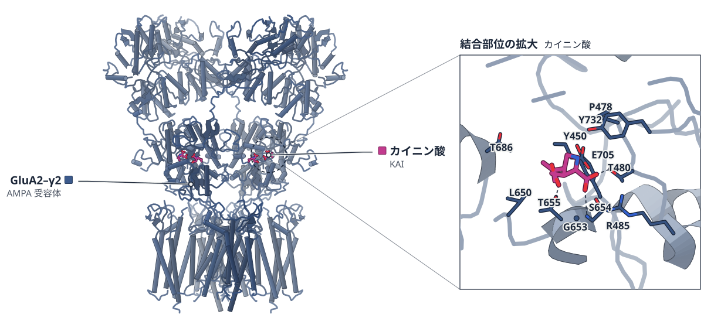

色（順に）：GluA2–γ2（AMPA 受容体）　スティック：カイニン酸（KAI）

**部分作動薬が、AMPA受容体の開く前の中間状態をとらえた**

時間分解クライオ電顕でGluA2–γ2の4つの状態を解析し、ドメインの閉じ角約17°が分かれ道だと示した。

- **疑問・課題**：AMPA受容体が開く前の中間体である前活性状態は、構造がよく分かっていなかった。
- **アプローチ**：部分作動薬またはGluを加えて素早く凍結する時間分解クライオ電顕で、GluA2–γ2の状態の集まりを調べた。
- **結果**：リガンド結合ドメイン（LBD）の閉じが約17°を超えると開状態か脱感作状態に進み、それより小さいと前活性状態にとどまった。
- **わかったこと**：前活性状態のゲートは閉と開の中間の形をとるが、孔は閉じたままで、イオンと水は通さない。
- **残された課題**：この方法では4つのサブコンダクタンス状態すべての構造は得られず、より速い時間分解クライオ電顕などが助けになるとされる。

この紹介文の根拠（論文本文）

> While the terminal apo, open and desensitized states have been structurally characterized, the intermediate pre-active state has remained an enigma.  
> — 疑問・課題／Abstract

> Here we use different partial agonists and time-resolved cryo-electron microscopy (cryo-EM) to capture a structural ensemble of GluA2–γ2 AMPAR complexes in the closed apo, pre-active, open and desensitized states.  
> — アプローチ／Abstract

> Binding of partial agonists to the ligand-binding domain (LBD) results in different extents of LBD clamshell closure, with closures exceeding a threshold of ~17° resulting in the open and desensitized states and smaller closures stabilizing the pre-active state.  
> — 結果／Abstract

> The pre-active state has a distinct gate conformation intermediate between the other two discrete states, completely open and closed.  
> — わかったこと／Abstract

> Despite these changes during pre-activation, the gate region remains narrow, keeping the pore sealed for conductance of water and ions.  
> — わかったこと／Results

> One limitation of our cryo-EM approach is that it does not reveal structures of all four subconductance states bound to full or partial agonists.  
> — 残された課題／Discussion

> Faster time-resolved cryo-EM, experimentation with different agonist concentrations and larger structural datasets will likely help to describe iGluR gating in more detail.  
> — 残された課題／Discussion

分類：イオンチャネル・GPCR・受容体

#### 読みどころ

前活性状態ではLBDの上側（D1）の二量体界面が保たれたまま下側（D2）だけが離れる（S635間で24 Å、apoは17 Å）。前活性状態は、開状態と脱感作状態に分かれる分岐点にあたる。

根拠（論文本文）

> Because of the intact D1–D1 interfaces, pre-activation results in separation of the D2 lobes in each LBD dimer, measured as a distance between S635 Cα atoms (24 Å in GluA2–γ2KA-PreActive compared to 17 Å in GluA2–γ2Apo).  
> — Results

> Pre-activation, therefore, represents an intermediate bifurcation point in the AMPAR gating pathway  
> — Results

室温で作動薬を加えてから2.5秒以内に凍結した。KAは前活性状態だけ、IWは開状態だけ、NOWは3つの状態を示し、作動薬ごとに状態の分布が違った。

根拠（論文本文）

> with the time between the agonist application and plunging shorter than 2.5 s  
> — Results

> IW favored only the open state and KA only the pre-active state. NOW revealed all three states  
> — Results

単一チャネル記録では、どの部分作動薬でもGluと同様に4段階のコンダクタンスが見られた。MDでは前活性状態で水が通らず、開状態では孔に水が行き来した。

根拠（論文本文）

> Despite widely different probabilities of O1–O4, the measurable values of conductance for each of these states were strikingly similar between Glu and all partial agonists  
> — Results

> Notably, the gate region remained largely dehydrated and no water conductance was observed during simulations of GluA2–γ2KA-PreActive and GluA2–γ2NOW-PreActive  
> — Results

> In contrast, for all open-state structures, the pore remained continuously hydrated throughout the entire simulation trajectories  
> — Results

#### 構造データ

| PDB | 手法 | 分解能 | 公開 | 生物種 | リガンド |
|---|---|---|---|---|---|
| [11VV](https://www.rcsb.org/structure/11VV) | Cryo-EM | 2.93 Å | 2026-09-23 | Mus musculus, Rattus norvegicus | — |
| [11VZ](https://www.rcsb.org/structure/11VZ) | Cryo-EM | 3.98 Å | 2026-09-23 | Mus musculus, Rattus norvegicus | KAI |
| [11WB](https://www.rcsb.org/structure/11WB) | Cryo-EM | 3.55 Å | 2026-09-23 | Mus musculus, Rattus norvegicus | NWD, SPD |
| [11WC](https://www.rcsb.org/structure/11WC) | Cryo-EM | 4.02 Å | 2026-09-23 | Mus musculus, Rattus norvegicus | NWD |
| [11WA](https://www.rcsb.org/structure/11WA) | Cryo-EM | 4.36 Å | 2026-09-23 | Mus musculus, Rattus norvegicus | NWD |
| [11VX](https://www.rcsb.org/structure/11VX) | Cryo-EM | 3.37 Å | 2026-09-23 | Mus musculus, Rattus norvegicus | FWD, SPD |
| [11VW](https://www.rcsb.org/structure/11VW) | Cryo-EM | 3.84 Å | 2026-09-23 | Mus musculus, Rattus norvegicus | FWD, SPD |
| [11VY](https://www.rcsb.org/structure/11VY) | Cryo-EM | 3.47 Å | 2026-09-23 | Mus musculus, Rattus norvegicus | IWD, SPD |
| [11WE](https://www.rcsb.org/structure/11WE) | Cryo-EM | 3.58 Å | 2026-09-23 | Mus musculus, Rattus norvegicus | GLU |
| [11WD](https://www.rcsb.org/structure/11WD) | Cryo-EM | 3.69 Å | 2026-09-23 | Mus musculus, Rattus norvegicus | GLU |

- [O88602](https://www.uniprot.org/uniprotkb/O88602) Cacng2 Voltage-dependent calcium channel gamma-2 subunit — *Mus musculus* （既存の PDB 構造 41 件）
- [P19491](https://www.uniprot.org/uniprotkb/P19491) Gria2 Glutamate receptor 2 — *Rattus norvegicus* （既存の PDB 構造 342 件）

#### 実験メモ

- **発現系**：BacMam 系で HEK 293 GnTI− 細胞に発現。
- **コンストラクト**：ラット GluA2flip（Q586）とマウス γ2（L207 で切断）の融合体。C 末端にトロンビン切断部位、eGFP、Strep-II。
- **精製**：1% ジギトニンで可溶化し、ストレプトアビジン樹脂 → トロンビンでタグ除去 → Superose 6 Increase でサイズ排除。
- **結晶化／グリッド作製**：UltrAuFoil R1.2/1.3 の 300 メッシュ金グリッド。部分作動薬 250 μM（Glu は 1 mM）を加えて 2.5 秒以内に自作の装置で凍結。
- **データ収集・解析**：Titan Krios（300 kV）、Gatan K3。cryoSPARC v4.4 で処理。

根拠（論文本文）

> The fusion construct GluA2–γ2 was prepared by introducing a GT linker between a modified rat GluA2flip subunit (UniProt P19491) with Q at the Q/R-site (Q586), which was previously called GluA2*20 and mouse γ2 C-terminally truncated after L207 (ref. 30).  
> — Methods

> The P1 and P2 virus were produced in Sf9 cells (Gibco, 12659017) and added to HEK 293 GnTI− cells (American Type Culture Collection, CRL-3022) at 37 °C and 7% CO2.  
> — Methods

> solubilized for 3 h in 150 mM NaCl, 20 mM Tris-HCl pH 8.0 and 1% digitonin  
> — Methods

> injection onto a Superose 6 Increase 10/300 GL size-exclusion chromatography column (Cytiva)  
> — Methods

> UltrAuFoil R 1.2/1.3, 300-mesh gold grids (EM Sciences) were used for sample preparation.  
> — Methods

> Immediately after agonist application, the sample was blotted for 1.5 s and plunge-frozen into liquid ethane within 2.5 s of partial agonist application.  
> — Methods

> Grids were imaged on a Titan Krios transmission EM instrument (Thermo Fisher Scientific) at 300 kV equipped with a Gatan K3 (Gatan) direct electron detection camera.  
> — Methods

> Data were processed using cryoSPARC v.4.4.  
> — Methods

> 📝 編集者への確認事項：本論文は 10 個の構造（apo、KA、NOW、FW、IW、Glu 結合の各状態）を報告。記事の中心は KA の前活性状態（11VZ）で、ga_pdb_id に指定。著者自身が、ミセル中の TMD や気液界面の影響、人工膜での単一チャネル記録の限界を述べている。MD は定性的な補強と著者が書いている。

---

# New Structure

## 2｜ヒトOCTN1（SLC22A4）

### Structural and mechanistic insights into OCTN1-mediated transport and cancer cell proliferation

*Nature Communications*（2026-09-14） · [論文](https://doi.org/10.1038/s41467-026-77727-2) · ライセンス: cc by-nc-nd

筆頭著者：Binghong Xu（Tianjin University, China）　責任著者：Binghong Xu, Sai Shi, Cheng Zhu（Tianjin University, China） ほか 3 名

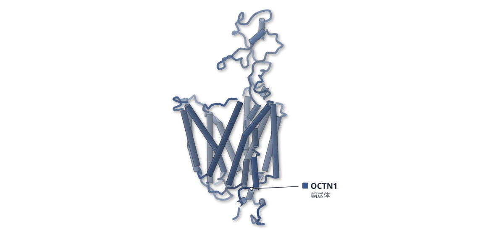

色（順に）：OCTN1（輸送体）

**OCTN1の外向き・内向きの構造から、阻害薬メベンダゾールを見いだした**

ヒトOCTN1のapo型とエルゴチオネン結合型をクライオ電顕で解き、構造に基づく仮想スクリーニングで阻害剤を探した

- **疑問・課題**：OCTN1が基質を認識して運ぶ仕組みは、構造の面からはよく分かっていなかった。
- **アプローチ**：ヒトOCTN1のapo型とエルゴチオネン（ET）結合型をクライオ電顕で解析し、構造をもとに阻害剤を探した。
- **結果**：apo型は外向き（3.11 Å）、ET結合型は内向き（3.37 Å）だった。メベンダゾール（MBZ）はKD 2.48 nMで結合し、ET輸送を約60%抑えた。
- **わかったこと**：OCTN1はNa⁺と共役して輸送する。MBZは、がん細胞の増殖を、OCTN1を介して抑えるとみられる。
- **残された課題**：MBZを結合させたOCTN1のクライオ電顕構造は、最適化を重ねても決められなかった。

この紹介文の根拠（論文本文）

> Despite its physiological and clinical relevance, the structural mechanisms underlying substrate recognition and transport by OCTN1 have remained poorly understood.  
> — 疑問・課題／Abstract

> Here, we present cryo-EM structures of human OCTN1 in both apo and ET-bound states, revealing the binding site of ET and elucidating conformational changes essential for sodium-dependent substrate transport.  
> — アプローチ／Abstract

> Furthermore, structure-based screening identifies mebendazole (MBZ) as a small-molecule inhibitor that targets OCTN1 to suppress tumor cell proliferation, with an affinity in the nanomolar range.  
> — アプローチ／Introduction

> We obtained a 3D reconstruction of OCTN1 (apo-state) at 3.11 Å resolution and completed the model  
> — 結果／Results

> subsequently determined the structure of OCTN1 in ET-bound state at 3.37 Å resolution  
> — 結果／Results

> Mebendazole (MBZ) was identified as the top candidate, exhibiting a KD of 2.48 ± 0.31 nM  
> — 結果／Results

> At a concentration of 20 nM, it suppressed ET uptake by ~60% (Fig. 5E).  
> — 結果／Results

> These results suggest that OCTN1 adopts a Na⁺-coupled transport mechanism analogous to OCTN2, even in the absence of resolvable Na⁺ density in our cryo-EM structures.  
> — わかったこと／Results

> Taken together, these results indicate that MBZ regulates the proliferation and migration in HeLa and A549 cells by targeting OCTN1  
> — わかったこと／Results

> Despite extensive optimization of sample preparation, detergent screening and nanodiscs reconstitution, we failed to resolve the cryo-EM structure of the MBZ-bound OCTN1 complex.  
> — 残された課題／Discussion

分類：トランスポーター

#### 読みどころ

ETの結合ポケットは芳香族残基（Y211、F239、F441）が囲み、R469がETのカルボキシ基と水素結合を作る。R469をAlaに替えると取り込みが85%以上失われた。OCT1ではこの位置がAspで、OCTN1ではE381とR469の電荷の組み合わせが、双性イオンのETを受け入れるのに役立つと論文は述べている。

根拠（論文本文）

> One polar interaction enhances binding specificity and affinity: R469 (TM11) donates a hydrogen bond to the carboxylate oxygen of ET.  
> — Results

> The R469A substitution was most detrimental, abrogating over 85% of uptake activity  
> — Results

> This configuration enables OCTN1 to accommodate not only cations but also zwitterionic substrates like ET.  
> — Results

ET結合型の構造を使った承認薬の仮想スクリーニングで、駆虫薬メベンダゾール（MBZ）が最上位の候補になった。HeLaとA549細胞の増殖を抑え、OCTN1をノックダウンするとこの効果はほぼ消えた。マウス異種移植でも腫瘍が約3分の1になった。MBZの結合の様子は、AF3予測とMDによるモデルである。

根拠（論文本文）

> We performed a virtual screen of FDA-approved drugs based on their computationally predicted binding affinity (docking score in kcal/mol) to the substrate-binding pocket of OCTN1-ET  
> — Results

> indicating that the anti-proliferative effect of MBZ was largely abolished upon OCTN1 depletion  
> — Results

> with final tumor volumes and weights reduced to approximately one-third of those in the control group  
> — Results

> To characterize the binding mode of MBZ, we combined AF3 structural prediction and molecular dynamics (MD) simulations  
> — Results

外向きのapo型と内向きのET結合型を比べると、C末端側のドメインがN末端側のドメインに対して剛体として動いていた。TM7とTM10の細胞外側が内側に傾き、細胞質側が開く。TM8だけは約40°傾き、その仕組みは未解明である。

根拠（論文本文）

> Comparative analysis of the NTD and CTD confirmed that the alternating-access transport of OCTN1 is dominated by rigid-body domain rotation, fully consistent with the canonical MFS rocker-switch mechanism  
> — Results

> undergoing a ~ 40° helical tilt during the outward-to-inward conformational transition  
> — Results

> The molecular mechanism underlying this torsional motion of TM8 remains to be further clarified.  
> — Results

#### 構造データ

| PDB | 手法 | 分解能 | 公開 | 生物種 | リガンド |
|---|---|---|---|---|---|
| [9WTY](https://www.rcsb.org/structure/9WTY) | Cryo-EM | 3.11 Å | 2026-09-23 | Homo sapiens | — |
| [9WTX](https://www.rcsb.org/structure/9WTX) | Cryo-EM | 3.37 Å | 2026-09-23 | Homo sapiens | LW8 |

- [Q9H015](https://www.uniprot.org/uniprotkb/Q9H015) SLC22A4 Solute carrier family 22 member 4 — *Homo sapiens* （PDB で初めての構造）

#### 実験メモ

- **発現系**：HEK293F細胞にBacMam法で発現（バキュロウイルスをSf9で作り、MOI 20で感染、酪酸ナトリウム添加）。
- **コンストラクト**：全長ヒトOCTN1、C末端にtwin-Strepタグ（pEG-BacMam）。
- **精製**：LMNG/CHSで可溶化し、Strep-Tactinアフィニティ → Superose 6によるサイズ排除クロマトグラフィー。ET結合型は2 mM ETと氷上で一晩インキュベート。
- **結晶化／グリッド作製**：Quantifoil Au R1.2/1.3（300メッシュ）、Vitrobot Mark IV、8°C・湿度100%。
- **データ収集・解析**：Titan Krios。apoはK3（9,779ムービー）、ET結合型はFalcon 4（9,385ムービー）。cryoSPARCで処理。

根拠（論文本文）

> baculovirus was first generated in Sf9 cells and used to infect HEK293F cells at an MOI of 20, with 10 mM sodium butyrate added post-infection to enhance expression.  
> — Methods

> The synthesized gene, encoding human OCTN1 with a C-terminal twin-Strep tag, was cloned into the pEG-BacMam vector (Invitrogen) for heterologous expression.  
> — Methods

> Final purification involved size-exclusion chromatography on a Superose 6 10/300 GL column (Cytiva) equilibrated with buffer B  
> — Methods

> the purified apo human OCTN1 sample was incubated on ice overnight with a final concentration of 2 mM ergothioneine  
> — Methods

> blotted under 100% humidity at 8 °C and plunged into liquid ethane using a Mark IV Vitrobot (Thermo Fisher Scientific, USA)  
> — Methods

> a total of 9,779 movies were automatically recorded using EPU.  
> — Methods

> 📝 編集者への確認事項：PDB 9WTX の LW8 はエルゴチオネン（ET）のこと（本文 Fig. 1）と思われる。候補リストの「初構造」はそのまま採用せず、「初めて」とは書いていない（論文は OCTN1 の高分解能構造が「lacking」と書く）。MBZ の結合モードは構造ではなく AF3＋MD のモデル。ga_pdb_id は 9WTX（ET 結合型）が合うと思われる。

---

## 3｜ヒトNHA1（SLC9B1）

### Cryo-EM structure of human Na+/H+ exchanger NHA1 in an inward-open conformation

*Nature Communications*（2026-09-15） · [論文](https://doi.org/10.1038/s41467-026-77811-7) · ライセンス: cc by-nc-nd

筆頭著者：Bingjie Tang（The Hong Kong University of Science and Technology, China）　責任著者：Shangyu Dang（The Hong Kong University of Science and Technology, China）

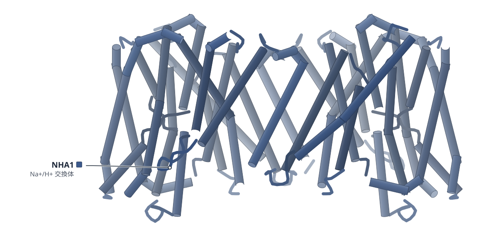

色（順に）：NHA1（Na+/H+ 交換体）

**ヒトNHA1の内向き構造は、エレベーター型の輸送を裏づける**

精子の運動に関わるNa⁺/H⁺交換体を3.6 Åで解析し、モデルした外向き状態との比較でコア領域の動きを調べた

- **疑問・課題**：精子の運動と男性の生殖能力に関わるNHA1の、構造と輸送の仕組みは分かっていなかった。
- **アプローチ**：ヒトNHA1の全長をクライオ電顕で解析し、モデルした外向き状態と比べて、変異体のNa⁺輸送も測った。
- **結果**：3.6 Åの内向き構造が得られた。外向きと比べ、コア領域がダイマー領域に対して細胞質側へ大きく動いていた。
- **わかったこと**：この動きはエレベーター型の輸送機構を支持する。D258・D259・E453などの残基が、状態の切り替えと輸送に関わるらしい。
- **残された課題**：ダイマー界面に見える脂質とみられる密度の正体と役割は、さらに調べる必要がある。

この紹介文の根拠（論文本文）

> Despite its physiological importance, the structural and mechanistic basis of NHA1 function has remained elusive.  
> — 疑問・課題／Abstract

> Structural comparison with the modeled NHA1 in an outward-open state reveals dramatic conformational changes in the core domain  
> — アプローチ／Introduction

> Their contribution to substrate transport is further supported by mutagenesis and sodium transport assays  
> — アプローチ／Abstract

> Here, we present the cryo-EM structure of human NHA1 at 3.6 Å resolution, captured in an inward-open conformation.  
> — 結果／Abstract

> Consequently, the core domain in the inward-open state is lowered toward the intracellular side, while the dimeric domain remains largely unchanged, in accordance with the elevator transport mechanism  
> — 結果／Results

> Structural comparisons with modeled outward-open states reveal substantial conformational changes in the core domain, supporting an elevator-like transport mechanism.  
> — わかったこと／Abstract

> Additionally, several key residues are identified that modify their interaction patterns, likely aiding in the conformational switches necessary for substrate transport.  
> — わかったこと／Abstract

> Further exploration is needed to clarify the exact identity and functional roles of these lipid molecules in NHA1.  
> — 残された課題／Discussion

分類：トランスポーター

#### 読みどころ

NHA1は2つの鎖がTM0とTM8で組み合わさったダイマーで、各鎖は14本の膜貫通ヘリックスを持つ。内向きの構造では、イオン結合部位のD259に細胞質側から届く通路が見える。D258とD259のどちらか一方を替えても輸送はわずかに下がるだけで、両方を替えると大きく下がった。

根拠（論文本文）

> Each NHA1 protomer contains 14 transmembrane helices (TMs), TM0 to TM13  
> — Results

> our NHA1 structure is captured in an inward-open conformation, as demonstrated by an obvious accessible path from the cytoplasmic side to D259  
> — Results

> These results indicate that the two aspartates may have cooperative and partially compensatory roles in substrate binding and transport.  
> — Results

内向き状態ではE453がR157と塩橋を作る。モデルした外向き状態では、R157はE387と組むと予測された。E453をAlaに替えると輸送が大きく下がった。著者はこれを構造から導いた仮説と位置づけ、R157が切り替えの支点になりうると述べている。

根拠（論文本文）

> In the inward-open state, E453 from TM12b forms a salt bridge with R157 from TM3, and a hydrogen bond with S153 from TM3  
> — Results

> While our MD simulations support the physical plausibility of the modeled outward-open structure, these specific interactions should be interpreted as structure-guided hypotheses.  
> — Results

> Among these mutants, E453A exhibited significantly reduced transport activity  
> — Results

構造では見えない C 末端のS503を、リン酸化の有無を模した変異で調べた。リン酸化を模したS503Dは野生型の約2倍の輸送活性を示し、精子の受精能獲得で活性を調節している可能性が示唆された。

根拠（論文本文）

> the S503D variant, which mimics, although imperfect, the phosphorylated state, demonstrated approximately twofold higher transport activity than wild-type NHA1  
> — Results

> These observations suggest a potential role for S503 phosphorylation in regulating NHA1 transport activity  
> — Results

#### 構造データ

| PDB | 手法 | 分解能 | 公開 | 生物種 | リガンド |
|---|---|---|---|---|---|
| [21MW](https://www.rcsb.org/structure/21MW) | Cryo-EM | 3.64 Å | 2026-09-30 | Homo sapiens | — |

- [Q4ZJI4](https://www.uniprot.org/uniprotkb/Q4ZJI4) SLC9B1 Sodium/hydrogen exchanger 9B1 — *Homo sapiens* （PDB で初めての構造）

#### 実験メモ

- **発現系**：HEK293S GnTI−細胞にBacMam法で発現（Sf9で作ったバキュロウイルスを感染、酪酸ナトリウム添加、30°Cで48時間）。
- **コンストラクト**：全長ヒトNHA1、C末端にFLAG-TEV切断部位-eGFP（pEG BacMam）。
- **精製**：DDM/CHSで可溶化し、GFPナノボディ樹脂で精製。TEVでタグを切り、Superose 6でLMNGに置換しながらサイズ排除クロマトグラフィー。
- **結晶化／グリッド作製**：1.2 mg/mL、Quantifoil R1.2/1.3 金300メッシュ、Vitrobot Mark IV、4°C・湿度100%、ブロット4.5秒。
- **データ収集・解析**：Titan Krios G3＋K3＋BioQuantum、ピクセルサイズ1.06 Å、総線量約50 e−/Ų。cryoSPARCで処理し、最終は270,161粒子。

根拠（論文本文）

> Protein expression was induced 8–12 h post-infection by adding 10 mM sodium butyrate, followed by temperature shift to 30 °C and incubated for an additional 48 h.  
> — Methods

> subcloned into the pEG BacMam vector containing a C-terminal fusion tag (FLAG-TEV protease cleavage site (ENLYFQG)-eGFP) for structural studies  
> — Methods

> TEV protease was added to cleave the C-terminal GFP tag and release the target protein from the resin.  
> — Methods

> Vitrification was performed using a Vitrobot Mark IV (Thermo Fisher Scientific) under the following condition: 4 °C chamber temperature, 100% humidity, blot force 0 with Whatman 597 filter paper, and a blot time of 4.5 s.  
> — Methods

> Data acquisition was performed on a 300 kV Titan Krios G3 cryo-electron microscope (Thermo Fisher Scientific) equipped with a Gatan K3 direct electron detector and a BioQuantum energy filter  
> — Methods

> Final processing utilized 270,161 particles for ab initio model generation, non-uniform refinement and local refinement (detergent micelle exclusion) to generate the final map.  
> — Methods

> 📝 編集者への確認事項：外向き状態は SWISS-MODEL（bison NHA2 を鋳型）のホモロジーモデルで、実測の構造ではない（本文にも明記）。「初構造」とは書いていない。S503 の highlight は構造に見えない領域の機能アッセイ。ga_pdb_id は 21MW のみ。

---

## 4｜ワクシニアウイルスD13（足場）

### Structural transition of the immature poxvirus scaffold from preassembly to the scaffold lattice

*Nature Communications*（2026-09-15） · [論文](https://doi.org/10.1038/s41467-026-77815-3) · ライセンス: cc by-nc-nd

筆頭著者：Yeontae Jang（Sungkyunkwan University, Republic of Korea）　責任著者：Jaekyung Hyun（Sungkyunkwan University, Republic of Korea）

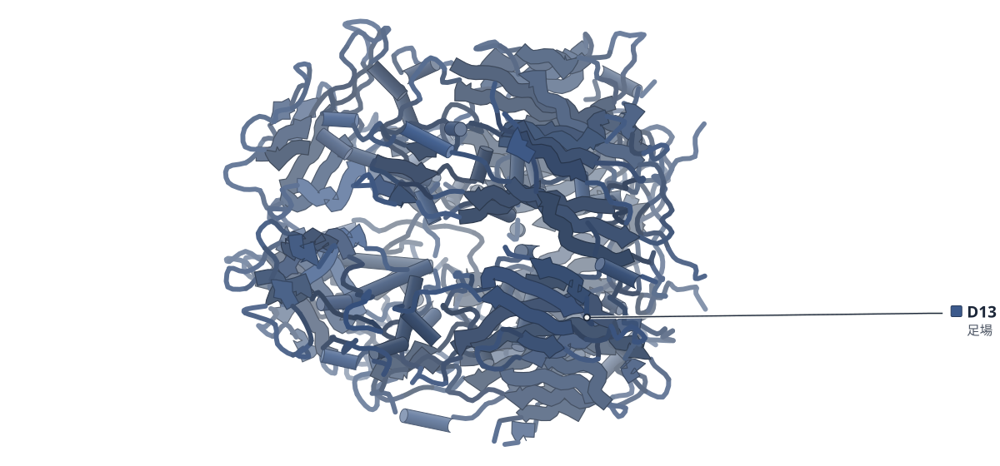

色（順に）：D13（足場）

**A17の末端ペプチドが、D13の棒状集合体を足場の格子に組み替える**

足場タンパク質D13の2種類の集合体をクライオ電顕で解析し、棒状から格子への移行を示した。

- **疑問・課題**：未成熟ウイルス粒子の足場がどう組み上がるかは、粒子の形が不規則で、よく分かっていなかった。
- **アプローチ**：試験管内で作らせたD13（足場タンパク質）の2種類の集合体を、クライオ電顕とトモグラフィーで解析した。
- **結果**：足場様粒子（SLP）は2.9 Å、棒状のtwisterは3.9 Åで解析。A17のN末端ペプチドを加えるとtwisterがSLPに変わった。
- **わかったこと**：A17の末端がD13の底の空洞に入ると、棒状の事前集合体が不安定になり、足場の形成が始まると著者は提案している。
- **残された課題**：膜に埋め込んだ全長A17を使って、この組み替えを試験管内で再現することが次の課題とされる。

この紹介文の根拠（論文本文）

> the molecular mechanisms underlying scaffold assembly remain poorly understood due to the transient and pleomorphic nature of IVs  
> — 疑問・課題／Introduction

> Here, we present single-particle cryo-electron microscopy and cryo-electron tomography structures of two distinct in vitro assemblies of the vaccinia virus scaffold protein D13 that recapitulate oligomeric states previously observed in situ.  
> — アプローチ／Abstract

> We analyzed the images of lattice patches of the SLP, yielding a 3D reconstruction at 2.9 Å resolution  
> — 結果／Results

> Images of the dodecameric rings of D13 trimers that form the twister were used to reconstruct a single-particle cryo-EM map at 3.9 Å resolution  
> — 結果／Results

> Consistent with our hypothesis, this led to a structural transformation into SLPs  
> — 結果／Results

> We propose that this interaction destabilizes the pre-assembly conformation and initiates scaffold formation upon viral membrane recruitment  
> — わかったこと／Abstract

> reconstituting this assembly process in vitro using full-length A17 embedded in lipid bilayers or liposomes will be a crucial next step  
> — 残された課題／Results

分類：感染・ウイルス・防御系

#### 読みどころ

twisterは、D13三量体6個の環が2枚向かい合い、約12 Åの隙間を挟んで約19.3°ねじれた構造だった。底の空洞の芳香族残基（F環）をアラニンに替えた変異体はtwisterを作らなかった。

根拠（論文本文）

> These rings are vertically connected, separated by an approximately 12 Å gap between their membrane-binding base surfaces.  
> — Results

> the rings are slightly rotated relative to each other by approximately 19.3°, precluding axial alignment  
> — Results

> All mutant proteins failed to form twister-like structures and instead produced laterally extended net-like aggregates  
> — Results

A17が結合する底の空洞は、リファンピシンの結合部位でもある。著者は、足場タンパク質を標的にする抗ウイルス薬の設計の土台になると述べ、結合面の保存から広い抗ウイルス薬の可能性にも触れている。

根拠（論文本文）

> Our study provides a foundation for the design of next-generation antiviral agents analogous to capsid-targeting drugs such as lenacapavir for HIV-1  
> — Discussion

> the conservation of intertrimeric interfaces across poxvirus genera suggests the potential for developing broad-spectrum antiviral agents  
> — Discussion

形が不規則に見える粒子でも、繰り返し単位を通常の単粒子解析で解けた。eGFPを付けたD13も同じ足場様粒子を作り、N末端が底の空洞に入ることは形成の必須条件ではないと分かった。

根拠（論文本文）

> repeating structural components of seemingly irregular particles can be analyzed using conventional single-particle analysis  
> — Results

> its translocation into the base cavity is not a prerequisite  
> — Results

#### 構造データ

| PDB | 手法 | 分解能 | 公開 | 生物種 | リガンド |
|---|---|---|---|---|---|
| [9USX](https://www.rcsb.org/structure/9USX) | Cryo-EM | 2.88 Å | 2026-08-05 | Orthopoxvirus vaccinia | — |
| [9USY](https://www.rcsb.org/structure/9USY) | Cryo-EM | 3.70 Å | 2026-08-05 | Orthopoxvirus vaccinia | — |
| [9USU](https://www.rcsb.org/structure/9USU) | Cryo-EM | 2.90 Å | 2026-08-05 | Orthopoxvirus vaccinia | — |
| [9USV](https://www.rcsb.org/structure/9USV) | Cryo-EM | 3.20 Å | 2026-08-05 | Orthopoxvirus vaccinia | — |
| [9USW](https://www.rcsb.org/structure/9USW) | Cryo-EM | 3.10 Å | 2026-08-05 | Orthopoxvirus vaccinia | — |
| [9USZ](https://www.rcsb.org/structure/9USZ) | Cryo-EM | 2.56 Å | 2026-08-05 | Orthopoxvirus vaccinia | — |
| [9UT0](https://www.rcsb.org/structure/9UT0) | Cryo-EM | 3.63 Å | 2026-08-05 | Orthopoxvirus vaccinia | — |
| [26FE](https://www.rcsb.org/structure/26FE) | Cryo-EM | 3.04 Å | 2026-08-05 | Orthopoxvirus vaccinia | — |

- [P68440](https://www.uniprot.org/uniprotkb/P68440) OPG125 Scaffold protein OPG125 — *Vaccinia virus (strain Western Reserve)* （既存の PDB 構造 20 件）
- [Q76ZR4](https://www.uniprot.org/uniprotkb/Q76ZR4) OPG125 Scaffold protein OPG125 — *Vaccinia virus (strain Ankara)* （PDB で初めての構造）

#### 実験メモ

- **発現系**：大腸菌 BL21 (DE3) で発現（eGFP-D13 は Rosetta (DE3)）。
- **コンストラクト**：pPROEX-HTa に全長 D13（1–551）、N 末端欠失（18–551）、F 環・N 末端の変異体、eGFP-D13 融合体。
- **精製**：Ni-NTA による IMAC。TEV プロテアーゼで His6 タグを除去（His6-D13 を除く）し、サイズ排除クロマトグラフィー。
- **結晶化／グリッド作製**：精製タンパク質（26 μM）を 150 mM NaCl に透析して集合体を作製。グリッドは Quantifoil R1.2/1.3 Cu 300 メッシュ、Vitrobot Mark IV。
- **データ収集・解析**：Krios G4（K3 または Falcon 4i）。単粒子解析は cryoSPARC v4.5.3。

根拠（論文本文）

> The genes encoding both the wild type and mutant D13 in the pPROEX-HTa vector were expressed in Escherichia coli BL21 (DE3) cells, whereas eGFP-D13 was expressed in Rosetta (DE3) cells.  
> — Methods

> Gene products were purified by immobilized metal affinity chromatography (IMAC) using a gravity column filled with nickel-nitrilotriacetic acid (Ni-NTA) agarose (QIAGEN).  
> — Methods

> A 100 μL aliquot of purified proteins (i.e., His6-D13 and untagged D13 for SLP and twister, respectively) at 26 μM was dialyzed in a buffer containing 10 mM Tris-HCl (pH 8.0), 150 mM NaCl, and 2 mM β-mercaptoethanol at 4 °C for at least 12 h.  
> — Methods

> Krios G4 TEM (TFS) equipped with a K3 BioContinuum direct electron detector (Gatan)  
> — Methods

> Single-particle cryo-EM data of His6-D13 trimer SLPs were processed using CryoSPARC v4.5.3  
> — Methods

> 📝 編集者への確認事項：D13 の既存構造（7VFD など）は既報で、本論文の新しさは棒状（twister）と格子（SLP）の 2 種類の集合体の構造と A17 N 末端ペプチドによる移行。A17 ペプチドや D13 N 末端の底の空洞の密度は不均一で原子モデルは作られていない（論文が明記）。構造は in vitro の集合体で、実際のウイルス粒子ではない。

---

## 5｜ヒトcPRC1（PRC1.4）

### Cryo-EM structure, enzymatic activity and genome targeting of canonical PRC1

*Nature Structural & Molecular Biology*（2026-09-14） · [論文](https://doi.org/10.1038/s41594-026-01885-6) · ライセンス: cc by

筆頭著者：Maria Ciapponi（Max-Planck Institute of Biochemistry, Germany）　責任著者：Jacques Bonnet, Jürg Müller（Max-Planck Institute of Biochemistry, Germany）

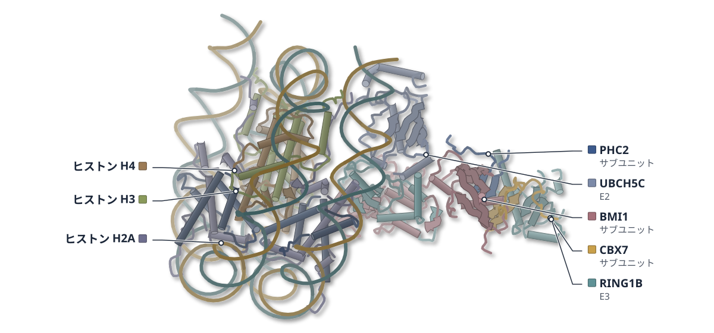

色（順に）：PHC2（サブユニット） / CBX7（サブユニット） / RING1B（E3） / BMI1（サブユニット） / UBCH5C（E2） / ヒストン H3 / ヒストン H4 / ヒストン H2A / ヒストン H2B / DNA（一方の鎖） / DNA（相補鎖）

**PRC1は4つのサブユニットを密に組み、E2酵素をヌクレオソーム上に置く**

ヌクレオソーム結合型のヒトPRC1をクライオ電顕で解析し、PHC2を含む界面の働きを調べた

- **疑問・課題**：PRC1全体の構造は未解明で、サブユニットの配置や触媒の連携は分かっていなかった。
- **アプローチ**：RING1B・BMI1・PHC2・CBX7とUBCH5Cを、H3K27me3ヌクレオソームに結合させてクライオ電顕で解析した。
- **結果**：2.7 Åの構造で、4つのサブユニットがβシートでつながる密な構造をとり、UBCH5Cの位置を決めていた。
- **わかったこと**：PHC2は複合体の組み立てと酵素活性をつなぎ、ショウジョウバエのPhのSAMドメインは標的遺伝子への集合に必要だった。
- **残された課題**：PHC2とUBCH5Cの相互作用が生体内でH2A修飾に寄与するかは、今後の変異体解析で調べる必要がある。

この紹介文の根拠（論文本文）

> However, how cPRC1 subunits are arranged within an intact complex, how the holocomplex engages nucleosomes and how catalytic activity is coordinated in this context have remained unresolved, as a structure of a PRC1 holocomplex has so far been lacking.  
> — 疑問・課題／Main

> Here, we used single-particle cryo-electron microscopy (cryo-EM) to determine the structure of human cPRC1, comprising RING1B, BMI1, PHC2 and CBX7, bound to a mononucleosome in complex with the ubiquitin-conjugating enzyme UBCH5C.  
> — アプローチ／Main

> The final reconstruction reached a global resolution of 2.7 Å, enabling unambiguous fitting of the nucleosome core, previously determined structures of individual PRC1 domains and UBCH5C  
> — 結果／Results

> An extended intermolecular β‑sheet network stabilizes interactions between the four PRC1 subunits, forming the architectural core of the complex  
> — 結果／Results

> PHC2 in humans and Ph in Drosophila, thus, act as a central link of complex assembly, enzymatic activity and genomic targeting of PRC1.  
> — わかったこと／Main

> Whether the PHC2/Ph–UBCH5C interaction contributes to PRC1-mediated H2A monoubiquitination in vivo remains to be determined by analyzing separation-of-function mutants that selectively disrupt this interaction.  
> — 残された課題／Discussion

分類：クロマチン・ヒストン・酵素（その他）

#### 読みどころ

BMI1のRAWULドメインがUBCH5Cの背面に位置し、RING1Bとの複合面でUBCH5C R15を挟む。従来はUBCH5CがRING1Bのみと結合するとされていた。さらにPHC2もUBCH5Cに近接し、PHC2のLLVGモチーフをアラニンに置換すると活性が2倍超低下した。

根拠（論文本文）

> In contrast, our structure reveals that BMI1 also directly contributes to UBCH5C engagement and further suggests a potential interface between PHC2 and UBCH5C (Fig. 3a).  
> — Results

> the PRC1(PHC24A) mutant complex exhibited more than a twofold reduction in E3 ligase activity toward H2A monoubiquitination compared to wild-type (WT) PRC1  
> — Results

4サブユニット版のPRC1は10分でH2AK119のモノユビキチン化がほぼ完了し、RING1B–BMI1二量体より活性が高かった。ショウジョウバエのPh（PHC2の相同分子）のSAMドメインは、複合体の形成には不要だが、標的遺伝子での局在とH2Aのユビキチン化に必要だった。

根拠（論文本文）

> In time-course assays, PRC1 catalyzed near-complete H2AK119 monoubiquitination within 10 min, followed by the appearance of diubiquitinated H2A at later time points  
> — Results

> Thus, although V5–PhΔSAM retains the capacity to assemble into PRC1 (Fig. 4h), it fails to recruit the complex to PREs.  
> — Results

ビオチン化ヌクレオソームをストレプトアビジン単層のグリッドに結合させて撮影した。UBCH5Cがないと複合体の上部が大きく揺らぎ、UBCH5Cの存在で安定化した。CBX7のクロモドメインは分解能が足りず、モデルに含められなかった。

根拠（論文本文）

> The sample was applied to streptavidin‑coated grids (Extended Data Fig. 2a) and analyzed by single‑particle cryo‑EM.  
> — Results

> Lastly, we note that the conformation of the upper lobe of PRC1 is stabilized in the presence of UBCH5C.  
> — Results

#### 構造データ

| PDB | 手法 | 分解能 | 公開 | 生物種 | リガンド |
|---|---|---|---|---|---|
| [28OE](https://www.rcsb.org/structure/28OE) | Cryo-EM | 2.74 Å | 2026-09-16 | Homo sapiens, Xenopus | — |

- [A0A1B8Y854](https://www.uniprot.org/uniprotkb/A0A1B8Y854)  Histone H2B — *Xenopus tropicalis* （既存の PDB 構造 2 件）
- [A0A310TTQ1](https://www.uniprot.org/uniprotkb/A0A310TTQ1) LOC121398065 Histone H3 — *Xenopus laevis* （既存の PDB 構造 69 件）
- [B0QYP2](https://www.uniprot.org/uniprotkb/B0QYP2) CBX7 Chromobox 7 — *Homo sapiens* （PDB で初めての構造）
- [P35226](https://www.uniprot.org/uniprotkb/P35226) BMI1 Polycomb complex protein BMI-1 — *Homo sapiens* （既存の PDB 構造 24 件）
- [P62798](https://www.uniprot.org/uniprotkb/P62798)  Histone H4 — *Xenopus borealis* （既存の PDB 構造 4 件）
- [Q4R5N4](https://www.uniprot.org/uniprotkb/Q4R5N4) UBE2D3 Ubiquitin-conjugating enzyme E2 D3 — *Macaca fascicularis* （PDB で初めての構造）
- [Q6AZJ8](https://www.uniprot.org/uniprotkb/Q6AZJ8) LOC494591 Histone H2A — *Xenopus laevis* （既存の PDB 構造 96 件）
- [Q8IXK0](https://www.uniprot.org/uniprotkb/Q8IXK0) PHC2 Polyhomeotic-like protein 2 — *Homo sapiens* （PDB で初めての構造）
- [Q99496](https://www.uniprot.org/uniprotkb/Q99496) RNF2 E3 ubiquitin-protein ligase RING2 — *Homo sapiens* （既存の PDB 構造 27 件）

#### 実験メモ

- **発現系**：RING1B・BMI1・CBX7・PHC2をTrichoplusia ni HighFive昆虫細胞で共発現。
- **コンストラクト**：ヒトの全長配列。PHC2のSAMドメインにL307E;L311E置換を入れてオリゴマー化を防いだ。
- **精製**：Ni-NTA、Strep-Tactin、タグ除去後に陽イオン交換とサイズ排除クロマトグラフィー。
- **結晶化／グリッド作製**：5′ビオチン化ヌクレオソーム（H3Kc27me3）を、ストレプトアビジン単層で覆ったQuantifoil R2/2金グリッドに結合させ、Vitrobot Mark IV（4℃、湿度96%）で凍結。
- **データ収集・解析**：Titan Krios（300 kV）とGatan K3、SerialEMで収集。cryoSPARC 4.7.0で解析し、2.7 Å（FSC 0.143）。

根拠（論文本文）

> PRC1 subunits (RING1B, BMI1, PHC2 and CBX7) were coexpressed in Trichoplusia ni HighFive insect cells  
> — Methods

> The PHC2 SAM domain was mutated to contain L307E;L311E substitutions to disrupt SAM-domain-mediated oligomerization.  
> — Methods

> Quantifoil R2/2 gold grids coated with a streptavidin monolayer were prepared as previously described57,58.  
> — Methods

> Data were acquired on a Titan Krios transmission EM instrument (FEI) operated at 300 kV and equipped with a Gatan K3 direct electron detector in counting mode.  
> — Methods

> 📝 編集者への確認事項：カテゴリは chromatin と enzyme。論文は PHC2・CBX7・UBCH5C について初構造とは明言していない（見出しに「初」は使っていない）。パケットは Methods 途中まで読めており、Extended Data は未確認。

---

# Structure Update

## 6｜ヒトNLRP6（炎症の感知因子）

### Structural mechanisms for ATP-mediated inhibition of human NLRP6 inflammasome

*Nature Structural & Molecular Biology*（2026-09-08） · [論文](https://doi.org/10.1038/s41594-026-01878-5) · ライセンス: cc by-nc-nd

筆頭著者：Zhen Cui（Washington University School of Medicine, USA）　責任著者：Chen Shen（Washington University School of Medicine, USA）

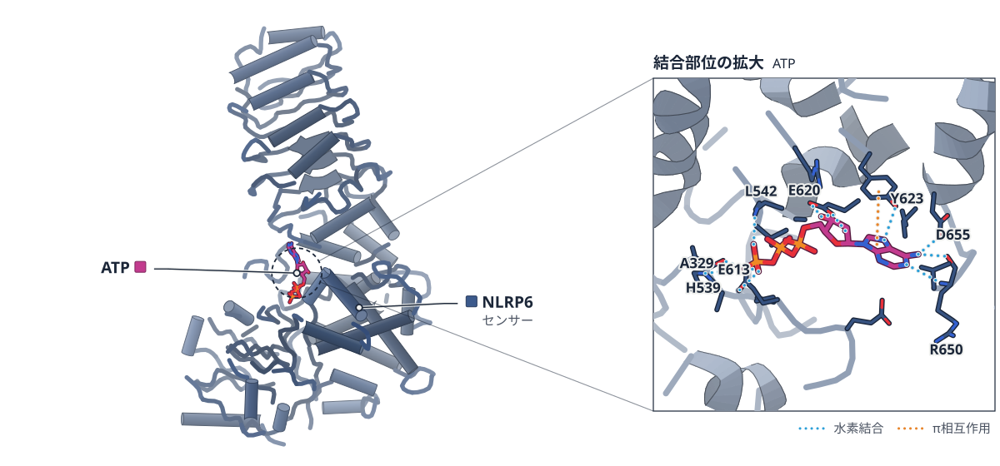

色（順に）：NLRP6（センサー）　スティック：ATP

**ATPがNLRP6の各ドメインを束ねて、活性化を抑える**

ヒトNLRP6単量体の2つの構造から、別のポケットに入るATPと酸性ループが阻害状態を支えると示した。

- **疑問・課題**：NLRP6が、どのような構造で抑えられた状態に保たれているかは分かっていなかった。
- **アプローチ**：ヒトNLRP6単量体を、ATP結合型と非結合型の2状態でクライオ電顕により解析し、変異体を細胞で調べた。
- **結果**：ATPは通常のATP結合部位とは別のポケットに入り、NACHTの各ドメインとLRRをつないで縮めていた。
- **わかったこと**：ATPの結合やNBDの相互作用を壊すと活性化が進み、NLRP6はATPなどの協同で自己抑制されている。
- **残された課題**：細胞実験はNLRP6を本来発現しない細胞での過剰発現系で、生理的な意義は今後の検証課題とされる。

この紹介文の根拠（論文本文）

> However, how NLRP6 is maintained in an inhibited structure is unknown.  
> — 疑問・課題／Abstract

> Here we report two cryogenic-electron microscopy structures of human NLRP6 monomer in the adenosine-5′-triphosphate (ATP)/NBD-bound (twisted conformation) and unbound (extended conformation) states.  
> — アプローチ／Abstract

> Disruption of ATP binding and NBD interactions unleashes the NLRP6 inflammasome activation in the cellular study.  
> — アプローチ／Abstract

> Instead, we detected that ATP molecule binds to a distinct site and coordinates almost all domains of NLRP6  
> — 結果／Results

> The ATP-binding event connects and compacts the NACHT subdomains and the LRR domain, thus maintaining NLRP6 in an inhibitory conformation.  
> — 結果／Abstract

> Together, our data reveal the ATP-mediated cooperative inhibition mechanism of NLRP6  
> — わかったこと／Abstract

> Disruption of ATP binding and NBD interactions unleashes the NLRP6 inflammasome activation in the cellular study.  
> — わかったこと／Abstract

> We acknowledge that our overexpression system in reconstituted HEK-293T cells has its caveats and limitations  
> — 残された課題／Discussion

> In future study, to further explore the physiological relevance of our findings, we will use physiological cell lines such as primary intestinal epithelial cells  
> — 残された課題／Discussion

分類：免疫（抗体・MHC・TCR・自然免疫）

#### 読みどころ

NLRP3などでADPが入る正規の触媒ポケットは空で、ATPはHD1・HD2・NBD・WHD・LRRと酸性ループが集まる別のポケットに入っていた。γリン酸にはE609、E613、H539などが水素結合していた。

根拠（論文本文）

> Unlike other solved NLR structures that have ADP or ATP-γS occupying the classical enzyme catalytic pocket, the twisted conformation of NLRP6 uses a noncanonical pocket for ATP binding and mediates subsequent inhibition  
> — Discussion

> The γ-phosphate group establishes a strong hydrogen-bonding network with E609 and E613 in the acidic loop, H539 in the HD2 domain, backbone of A330 in the NBD domain and E504 in the WHD domain  
> — Results

ATP結合部位の変異（H539L、Y623A）はATP加水分解を2.0倍と3.8倍に高め、細胞でもカスパーゼ-1の切断を増やした。酸性ループは、ねじれ型ではATPを覆って固定していた。

根拠（論文本文）

> H539L and Y623A mutations boosted ATP hydrolysis activity substantially compared to the WT protein, with an enhancement of 2.0-fold and 3.8-fold, respectively.  
> — Results

> H539L, E620A, Y623A, R545A in the HD2 domain, E611A and E613A in the acidic loop and A383G in the HD1 domain promoted caspase-1 cleavage substantially  
> — Results

> the short acidic loop (E609–N616) at the C-terminal of HD2 domain acts as a shield to stabilize the ATP molecule in the inhibitory pocket  
> — Results

NLRP3の阻害剤MCC950は、NLRP3で似た位置に結合するが、この再構成系ではNLRP6を抑えなかった。著者は、NLRP6に選択的な阻害薬・活性化薬を探す道が開けると述べている。

根拠（論文本文）

> Although MCC950 is a potent NLRP3 inhibitor, NLRP6 inflammasome activity was not inhibited by MCC950 in our reconstituted system  
> — Discussion

> The small-molecule selectivity of the binding pockets opens an exciting pharmacological avenue to discover NLRP6-specific inhibitors/activators in the future direction.  
> — Discussion

#### 構造データ

| PDB | 手法 | 分解能 | 公開 | 生物種 | リガンド |
|---|---|---|---|---|---|
| [9OK7](https://www.rcsb.org/structure/9OK7) | Cryo-EM | 3.79 Å | 2026-08-12 | Homo sapiens | — |
| [9OK8](https://www.rcsb.org/structure/9OK8) | Cryo-EM | 3.69 Å | 2026-08-12 | Homo sapiens | ATP |

- [P59044](https://www.uniprot.org/uniprotkb/P59044) NLRP6 NACHT, LRR and PYD domains-containing protein 6 — *Homo sapiens* （既存の PDB 構造 2 件）

#### 実験メモ

- **発現系**：Sf9 昆虫細胞にバキュロウイルス（Bac-to-Bac）で発現。
- **コンストラクト**：N 末端側を欠いた NLRP6（14–892）に N 末端 His6-MBP タグ（切断しないリンカー）。
- **精製**：Ni-NTA → サイズ排除クロマトグラフィー（Superdex 200 Increase）を、塩濃度を下げて 2 回。
- **結晶化／グリッド作製**：Quantifoil R1.2/1.3 Cu 300 メッシュ、Vitrobot、ブロット 4 秒、湿度 100%。
- **データ収集・解析**：Titan Krios（300 kV）＋Falcon4EC、Leginon で収集。cryoSPARC v4.4.0 で処理。

根拠（論文本文）

> NLRP6 (14–892) was expressed in SF9 cells (Thermo Fisher, cat. no. 11496015).  
> — Methods

> Human NLRP6 with an N-terminal flexible region deleted (amino acids 14–892) was cloned into pFastBac-HTB vector engineered with an N-terminal 6×His-MBP tag.  
> — Methods

> further purified by SEC (Superdex 200 increase 10/300 GL column, Cytiva)  
> — Methods

> blotted for 4 s under 100% relative humidity with an applied force of 1, and then plunged rapidly into liquid ethane using a Vitrobot (Thermo Fisher Scientific)  
> — Methods

> Cryo-EM data for human NLRP6 were collected at 300 kV on a TFS Titan Krios microscope equipped with a Falcon4EC direct detector (NCCAT/NYSBC).  
> — Methods

> A total of 14,261 micrographs of human NLRP6 were collected and processed using CryoSPARC v4.4.0  
> — Methods

> 📝 編集者への確認事項：9OK8 がねじれ型（ATP 結合）、9OK7 が伸びた型（ATP・NBD なし）。分解能は 3.7 Å 前後で、MBP タグと PYD は見えていない。NLRP6 の既存構造は UniProt 上に 2 件ある（初構造ではない）。細胞実験は HEK-293T での再構成系（著者が限界を明記）。ATP 結合ポケットが ATP 加水分解を担うかは未確定と論文は述べている。

---

## 7｜タウ線維（AD・VT患者脳）

### Repositioning of polyubiquitin alters the pathologic tau filament structure

*Nature Structural & Molecular Biology*（2026-08-31） · [論文](https://doi.org/10.1038/s41594-026-01879-4) · ライセンス: cc by-nc-nd

筆頭著者：Ryohei Watanabe（Perelman School of Medicine at the University of Pennsylvania, USA）　責任著者：Edward B. Lee（Perelman School of Medicine at the University of Pennsylvania, USA）

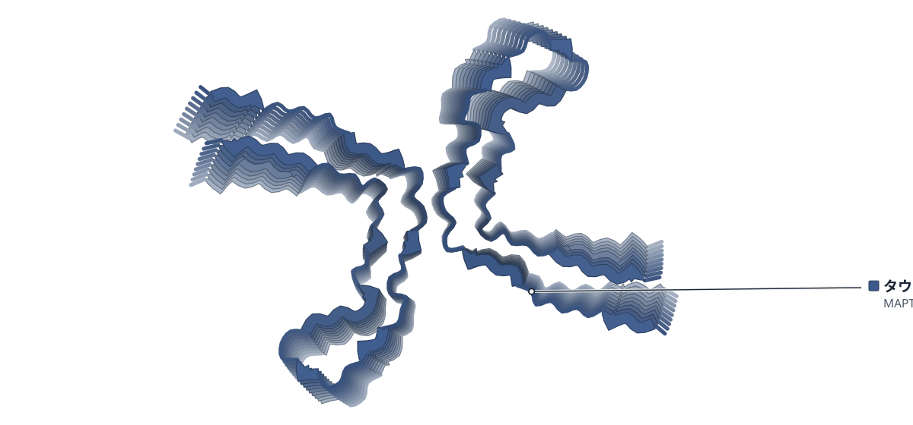

色（順に）：タウ（MAPT）

**ポリユビキチンの位置が動くと、タウ線維の原線維間の接合面がずれる**

ADとVTの患者脳のタウ線維をクライオ電顕で解析し、ユビスタチンBの処理でVT Ia型の接合面が変わった

- **疑問・課題**：タウ線維の核（コア）の外側にある密度が線維の安定性に与える影響は、よく分かっていなかった。
- **アプローチ**：AD・VT患者脳のタウ線維を解析し、ユビスタチンBでポリユビキチンの極性を変えてクライオ電顕で比べた。
- **結果**：処理したVTでは未処理で見えない6種の線維が現れ、VT Ia型は減少した。弱い密度は正電荷の残基の側へ移った。
- **わかったこと**：コアの外側の要素（翻訳後修飾など）が、タウ線維の構造と安定性に影響しうることが示唆された。
- **残された課題**：他のタウオパチーの線維でも同様の修飾依存の変化が起きるかは、今後ユビスタチンBで調べる必要がある。

この紹介文の根拠（論文本文）

> The effect of these extra densities on the stability of tau filaments is not well understood.  
> — 疑問・課題／Main

> Chemical modulation of the polarity of polyubiquitin adjacent to the tau core with the small molecule ubistatin B resulted in the repositioning of poorly structured densities toward positively charged residues on the highly structured core filament  
> — アプローチ／Abstract

> In contrast, the reconstruction of ubiB-treated VT tau filaments yielded six filament types that were not detected in the untreated VT filament preparations (Figs. 4e,f and 5).  
> — 結果／Results

> In general, upon ubiB treatment, some of the poorly structured additional densities adjacent to the structured core filament shifted toward electrostatically positively charged tau amino acid residues (colored blue in Fig. 6).  
> — 結果／Results

> These results suggest that structural elements outside of the highly ordered tau filament core, including PTMs, may influence filament structure and stability.  
> — わかったこと／Discussion

> Testing fibrils from additional tauopathies with ubiB would help to clarify whether similar PTM-dependent modulation of the core generalizes beyond AD and VT tau.  
> — 残された課題／Discussion

分類：その他

#### 読みどころ

VT（液胞性タウオパチー）の脳には5種類のタウ線維がある。ADの線維はVTの3例では見つからなかった。VT Ia・II・IIIは既知の構造と対応し、VT IVとVでは新しい原線維の接合面が見られた。マウスへの接種でも、AD由来とVT由来のタウは異なる広がりを示した。

根拠（論文本文）

> Tau filament reconstructions of the three VT cases resulted in five different cross-β-sheet filaments, each consisting of the same pair of protofilaments but with differences in protofilament–protofilament interface interactions (Fig. 2c).  
> — Results

> In contrast, VT tau-injected mice showed more cortical and contralateral tau pathology, mimicking the preferential neocortical involvement seen in VT (Fig. 1c).  
> — Results

ユビスタチンB処理でVT Ia型が減り、新しいVT Ib〜If型が現れた。K321とK331の間の距離はVT Iaの17.4 Åから、VT Ibの19.4 ÅからVT Ifの26.0 Åへ広がった。著者は、ポリユビキチンが接合面に集まって原線維を外側へ押したと解釈している。

根拠（論文本文）

> the interprotofilament distance between K321 and K331 was greater for VT Ib (19.4 Å), VT Ic (21.5 Å), VT Id (20.8 Å), VT Ie (24.0 Å) and VT If (26.0 Å) than for VT Ia (17.4 Å) (Extended Data Fig. 8)  
> — Results

> the accumulation of polyubiquitin around the positively charged lysine residues at the protofilament interface appeared to have pushed VT Ia protofilaments outward  
> — Results

K48結合型の二ユビキチンに結合する小分子ユビスタチンBで、コア外の弱い密度がポリユビキチンかを探った。ADのPHFとSFは処理後も同じ型のままで、変わったのはVT Iaの接合面だけだった。著者は、人為的な処理であり、脳から抽出した線維を使った点も限界として述べている。

根拠（論文本文）

> Consistent with this interpretation, only the VT Ia interface changed after ubiB treatment, whereas VT IV and VT V, which also have relatively sparse interface-stabilizing features (Supplementary Table 5), did not.  
> — Discussion

> Thus, their native distributional and interatomic features were not available.  
> — Discussion

#### 構造データ

| PDB | 手法 | 分解能 | 公開 | 生物種 | リガンド |
|---|---|---|---|---|---|
| [10LN](https://www.rcsb.org/structure/10LN) | Cryo-EM | 2.92 Å | 2026-09-02 | Homo sapiens | — |
| [10NO](https://www.rcsb.org/structure/10NO) | Cryo-EM | 2.96 Å | 2026-09-02 | Homo sapiens | — |
| [10NP](https://www.rcsb.org/structure/10NP) | Cryo-EM | 3.51 Å | 2026-09-02 | Homo sapiens | — |
| [10NQ](https://www.rcsb.org/structure/10NQ) | Cryo-EM | 3.61 Å | 2026-09-02 | Homo sapiens | — |
| [10MR](https://www.rcsb.org/structure/10MR) | Cryo-EM | 3.14 Å | 2026-09-02 | Homo sapiens | — |
| [10NR](https://www.rcsb.org/structure/10NR) | Cryo-EM | 3.37 Å | 2026-09-02 | Homo sapiens | — |
| [10MS](https://www.rcsb.org/structure/10MS) | Cryo-EM | 3.24 Å | 2026-09-02 | Homo sapiens | — |
| [10NT](https://www.rcsb.org/structure/10NT) | Cryo-EM | 3.05 Å | 2026-09-02 | Homo sapiens | — |

- [P10636](https://www.uniprot.org/uniprotkb/P10636) MAPT Microtubule-associated protein tau — *Homo sapiens* （既存の PDB 構造 299 件）

#### 実験メモ

- **精製**：凍結したヒト前頭葉新皮質（灰白質）からサルコシル不溶性のタウ線維を段階的に抽出。
- **結晶化／グリッド作製**：穴あきカーボングリッド（QuantiFoil R1.2/1.3、200メッシュ）に3 μLを滴下し、Leica EM GP2で液体エタンに凍結。ユビスタチンB処理は1 mM、約2.5 μMタウ、室温4時間。
- **データ収集・解析**：Titan Krios G3i（300 kV）、Gatan K3、エネルギーフィルター20 eV。RELIONでらせん再構成。

根拠（論文本文）

> AD and VT tau filaments were sequentially extracted from frozen, human frontal neocortex as previously described8 with minor modifications.  
> — Methods

> Next, 3 μl of the supernatant was applied to glow-discharged holey carbon grids (QuantiFoil Cu R1.2/1.3, 200-mesh) and plunge-frozen in liquid ethane using a Leica EM GP2 automatic plunge freezer.  
> — Methods

> the supernatant was diluted in ubiB solution to achieve a mixture of 1 mM ubiB and ~2.5 μM tau protein in PBS.  
> — Methods

> Images were acquired using EPU 3.10 software on a Gatan K3 Summit detector in counted super-resolution mode using a Thermo Fisher Titan Krios G3i at 300 kV.  
> — Methods

> 📝 編集者への確認事項：kind は new_structure（10LN など複数の患者脳由来タウ線維）。タンパク質の種類に合う分類が無いので other とした。見出しの「位置が動く」は、著者が『ポリユビキチンかもしれない（may represent）』と述べている弱い密度の移動に基づく。全体を通して著者の解釈は推測の語調で書いた。

---

## 8｜β2AR（ヒト）二量体

### A biased allosteric modulator is a molecular glue for β2AR dimerization

*Nature*（2026-08-19） · [論文](https://doi.org/10.1038/s41586-026-10892-y) · ライセンス: cc by-nc-nd

筆頭著者：Jiemin Shen（Stanford University School of Medicine, USA）　責任著者：Jun Xu, Brian K. Kobilka（Stanford University School of Medicine, USA）

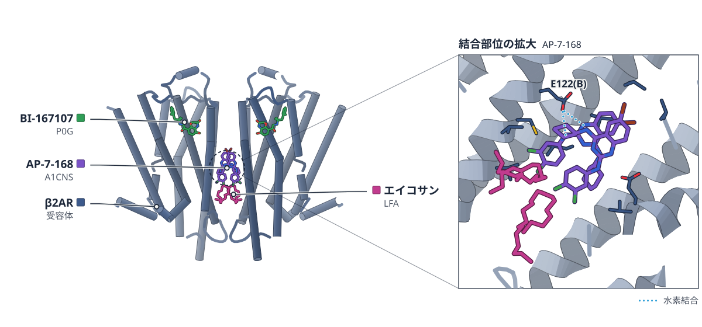

色（順に）：β2AR（受容体）　スティック：エイコサン（LFA）、BI-167107（P0G）、AP-7-168（A1CNS）

**AP-7-168は分子糊としてβ2ARを二量体にし、アレスチンを遮る**

2分子のAP-7-168がTM3・4・5の間に収まって2つの受容体を結びつける様子を、クライオ電顕で捉えた

- **疑問・課題**：β2ARを偏って阻害する化合物AP-7-168が、どのような分子機構で働くのかは分かっていなかった。
- **アプローチ**：AP-7-168を結合させたβ2ARをクライオ電顕で解析し、生化学・生物物理の実験と細胞での二量体化の測定を組み合わせた。
- **結果**：2分子のAP-7-168がTM3・4・5が作る空間に収まり、受容体2つをつないでいた（2.5 Å）。細胞でも二量体化が起きた。
- **わかったこと**：二量体は隣の受容体との立体障害でGRKやβアレスチンの結合を妨げる一方、Gタンパク質は受け入れうると考えられる。

この紹介文の根拠（論文本文）

> Despite these promising findings, the molecular mechanism by which AP modulates β2AR function remains unclear, posing a considerable obstacle to the further development and optimization of AP as a therapeutic agent.  
> — 疑問・課題／Main

> Here, using cryo-EM combined with various biochemical and biophysical approaches, we demonstrate that AP functions as a molecular glue by stabilizing a β2AR homodimer, which in turn alters the downstream signalling behaviours.  
> — アプローチ／Main

> The two AP molecules are packed against each other through π–π and van der Waals interactions and fit in an allosteric pocket formed by TM3, TM4 and TM5 of two β2AR protomers (Figs. 1e and 2a–c).  
> — 結果／Structural basis of AP binding

> Together, these results demonstrate that AP robustly stabilizes β2AR dimerization in native cellular environments.  
> — 結果／β2AR dimerization in liposomes and cells

> Structural analysis indicates that steric hindrance imposed by the adjacent protomer prevents GRK and β-arrestin from adopting their canonical binding modes.  
> — わかったこと／Discussion

> By contrast, docked Gs appeared to be accommodated (clashscore, 6.55), and the outward movements of TM5 and TM6 required for G-protein binding are not restricted by the dimer contacts.  
> — わかったこと／Biased signalling of AP-mediated dimer

分類：GPCR・受容体

#### 読みどころ

AP-7-168は、2分子が互いに積み重なる形でTM3・4・5が作る空間に収まる。2-アミノ基がGlu122とつくる水素結合など、これまでの構造活性相関と変異の結果を説明できる。非偏りのNAM AS408と結合部位は重なるが、キナゾリン環は180°反転していた。

根拠（論文本文）

> Moreover, the 2-amino group in AP forms hydrogen bond interactions with Glu1223.41 in TM3 (Fig. 2a).  
> — Structural basis of AP binding

> The quinazoline rings of AP and AS408 are nearly parallel, but they are flipped 180° relative to each other (Fig. 2e).  
> — Structural basis of AP binding

二量体のβ2ARは、AP存在下でGRK5によるリン酸化がほぼ完全に阻害され、βアレスチンによるアゴニスト親和性の上昇も消えた。一方で単量体では影響が小さい。Gsとは二量体でも結合した。リガンドが二量体を安定化して偏りを生む戦略の可能性を示している。

根拠（論文本文）

> AP-bound β2AR dimers exhibited near-complete inhibition of GRK5 phosphorylation in both detergent and nanodiscs (Fig. 4h and Supplementary Fig. 8a)  
> — Biased signalling of AP-mediated dimer

> Despite adopting an inactive conformation in the structural models, the β2AR dimer retains the ability to engage Gs  
> — Biased signalling of AP-mediated dimer

精製した単量体にAPを加えても二量体はできにくかったが、細胞膜をAPで処理してから界面活性剤で可溶化すると、ほぼ完全に二量体化した。連続した流動性のある膜が、膜貫通部の接触を助けることを示唆している。

根拠（論文本文）

> Although incubation of AP with purified monomeric β2AR in detergent did not result in efficient dimerization as assessed by SEC (Fig. 1c), we achieved almost complete β2AR dimerization by pretreating resuspended cell membrane with AP for around 30 min at room temperature before detergent extraction (Fig. 1c and Methods).  
> — Structure determination of AP-bound β2AR

#### 構造データ

| PDB | 手法 | 分解能 | 公開 | 生物種 | リガンド |
|---|---|---|---|---|---|
| [9Q3L](https://www.rcsb.org/structure/9Q3L) | Cryo-EM | 2.50 Å | 2026-08-19 | Homo sapiens | A1CNS, P0G, LFA |

- [P07550](https://www.uniprot.org/uniprotkb/P07550) ADRB2 Beta-2 adrenergic receptor — *Homo sapiens* （既存の PDB 構造 148 件）

#### 実験メモ

- **発現系**：β2AR（PN1コンストラクト）をSf9細胞で発現。二量体は、細胞を10 μM APとともに30分処理してから可溶化。
- **精製**：LMNGで可溶化し、M1抗Flag親和精製とSuperdex 200によるゲルろ過。10 μM APを精製中ずっと維持。
- **結晶化／グリッド作製**：二量体はPOPC:POPS:コレステロール（7:2:1）のナノディスク（MSP1E3D1）に再構成し、アゴニストBI-167107を加えた。Quantifoil R1.2/1.3 Auグリッド、Vitrobot Mark IV。
- **データ収集・解析**：Titan Krios G3i（300 kV）。ナノディスク試料は17,997枚を収集し、cryoSPARCで解析（二量体にC2対称を適用）。

根拠（論文本文）

> The β2AR construct PN1 was expressed and purified as previously described39,42. In brief, Sf9 cells were infected with a PN1-containing baculovirus produced using the BestBac method.  
> — Methods

> Lipids were prepared by mixing 1-palmitoyl-2-oleoyl-glycero-3-phosphocholine (POPC, Avanti), 1-palmitoyl-2-oleoyl-sn-glycero-3-phospho-L-serine (POPS, Avanti) and cholesterol (Sigma-Aldrich) at a molar ratio of 7:2:1  
> — Methods

> Quantifoil R1.2/1.3 Au grids were glow-discharged with air for 90 s at 10 mA using Plasma Cleaner (PELCO EasiGlow).  
> — Methods

> C2 symmetry was imposed for the final NU refinement of dimer species.  
> — Methods

> 📝 編集者への確認事項：初構造とは書いていない（9Q3L が最初の AP 結合構造かは本文に明言なし）。ligand_label は未設定（AP-7-168 と DFPQ の PDB 上の ID は描画後に確認してほしい）。open 行は論文に明確な限界・今後の課題の記述がないため省いた。

---

## 9｜ヒトノロウイルスGII.4 Sydney VP1

### Symmetry-breaking antibody binding reveals extensive capsid malleability in pandemic human norovirus

*Research Square*（2026-09-21） · [論文](https://doi.org/10.21203/rs.3.rs-9488000/v1) · ライセンス: cc by

筆頭著者：Carmen V Apostol（Baylor College of Medicine, USA）　責任著者：B V Venkataram Prasad（Baylor College of Medicine, USA）

**ノロウイルスの殻は、抗体が結合すると形を変えて受け止める**

流行株GII.4 Sydneyの殻をクライオ電顕で解析。抗体結合で殻タンパク質は11の構造をとる

- **疑問・課題**：ヒトノロウイルスの殻が、抗体の圧力にどう応えるかは原子レベルで分かっていなかった。
- **アプローチ**：流行株GII.4 SydneyのVLPと、抗体M6・Fab NORO-320の複合体をクライオ電顕と焦点を絞った精密化で解析した。
- **結果**：結合部位の違いで、殻タンパク質VP1は11通りの構造をとった。壊れた粒子は小さな粒子に組み直された。
- **わかったこと**：VP1は抗体の非対称な結合に合わせて形を変える。この柔軟さは、ワクチン設計に関わると著者は述べている。

この紹介文の根拠（論文本文）

> Yet, how the icosahedral HuNoV capsid responds to antibody pressure at the atomic level is still unclear.  
> — 疑問・課題／Abstract

> Using asymmetric reconstructions and focused refinement procedures, we reveal the remarkable structural malleability of the capsids in response to binding of a human-derived neutralizing Fab, NORO-320, and a non-neutralizing llama-derived single domain nanobody (VHH) M6.  
> — アプローチ／Introduction

> VP1 adopts 11 distinct conformational modalities to accommodate asymmetric antibody binding, and antibody-disrupted VLPs reassemble into smaller particles with five additional VP1 states.  
> — 結果／Abstract

> This previously unrecognized extent of conformational adaptability provides key insights for designing next-generation VLP- or mRNA-based vaccines targeting HuNoV infections.  
> — わかったこと／Abstract

分類：感染・ウイルス・防御系・免疫（抗体・MHC・TCR・自然免疫）

#### 読みどころ

ウイルス様粒子（VLP、ウイルスの殻だけを人工的に作った粒子）のT=3粒子では、非中和ナノボディM6が結合するとP領域（殻から突き出た部分）が持ち上がり、A-B二量体で3通り、C-C二量体で3通りの結合様式が見えた。隣り合う二量体どうしの立体障害で、結合様式の組み合わせは限られる。

根拠（論文本文）

> Across all structures, the P-domains are raised above the shell to reveal the M6 epitope.  
> — Results

> We did not detect classes with both A-B dimers bound via A chains (from the 5-fold side), with both A-B dimers in double form, or with more than one double-bound dimer.  
> — Results

M6を加えるとT=4粒子は壊れ、約30 nmの小さなT=1粒子に組み直された。T=4の殻は曲がりが大きく、M6が殻と衝突するためと著者は考えている。中和抗体のFab NORO-320では、T=3粒子が消えてT=1粒子が現れた。

根拠（論文本文）

> While the untreated sample contained an equal mix of T=3 and T=4 particles, addition of M6 completely destabilized the T=4 VLPs, giving rise to smaller, ~30 nm T=1 particles in a 2:1 ratio over the T=3 VLPs  
> — Results

> Thus, it is possible that the wider T=4 shell creates steric clashes upon M6 binding, leading to T=4 particle disassembly (Fig. 4C).  
> — Results

流行株GII.4 SydneyのT=3粒子（2.84 Å）は、2002年株で見つかっていた金属イオンの結合密度を欠く。イオンを配位する残基のうち2つ（L459Q、H460Y）が置き換わっており、pHや金属イオン、EDTAを変えても粒子径は変わらなかった。

根拠（論文本文）

> However, a closer inspection of the region corresponding to the metal binding pocket in GII.4 HOV showed no significant density attributable to ion binding (Fig. 1C).  
> — Results

> Sequence comparison between the Sydney and HOV strains revealed mutation of two of the four ion-coordinating residues, L459Q and H460Y  
> — Results

#### 構造データ

| PDB | 手法 | 分解能 | 公開 | 生物種 | リガンド |
|---|---|---|---|---|---|
| 12QZ | — | — | 公開待ち | — | — |
| 13KF | — | — | 公開待ち | — | — |
| 13KG | — | — | 公開待ち | — | — |
| 12TF | — | — | 公開待ち | — | — |
| 12TW | — | — | 公開待ち | — | — |
| 12TX | — | — | 公開待ち | — | — |
| 12TY | — | — | 公開待ち | — | — |
| 12TZ | — | — | 公開待ち | — | — |
| 12UA | — | — | 公開待ち | — | — |
| 12UB | — | — | 公開待ち | — | — |
| 12UC | — | — | 公開待ち | — | — |
| 12UD | — | — | 公開待ち | — | — |
| 12TV | — | — | 公開待ち | — | — |
| 12TU | — | — | 公開待ち | — | — |
| 12TP | — | — | 公開待ち | — | — |
| 12TQ | — | — | 公開待ち | — | — |
| 12TR | — | — | 公開待ち | — | — |
| 12TS | — | — | 公開待ち | — | — |
| 12TT | — | — | 公開待ち | — | — |
| 12PG | — | — | 公開待ち | — | — |
| 12UE | — | — | 公開待ち | — | — |

#### 実験メモ

- **発現系**：VLPはSf9昆虫細胞でバキュロウイルス発現。M6はBL21(DE3)の周辺質から回収。
- **コンストラクト**：GII.4 SydneyはVP1とVP2を共発現。結晶構造にはGII.3のP領域とM6を使った（GII.4 Sydneyでは良い回折が得られなかった）。
- **精製**：VLPはショ糖クッションとCsCl密度勾配で精製。
- **結晶化／グリッド作製**：酸化グラフェン付きQuantifoil R1.2/1.3グリッド、Vitrobotで2.5秒ブロット。抗体はVLPに4倍のモル比で混合。
- **データ収集・解析**：Titan Krios G3＋K2 Summit。cryoSPARCで解析し、対称性を展開して二量体ごとに粒子を差し引いて3D分類。

根拠（論文本文）

> VLPs were produced in a baculovirus expression system using open reading frame 2 (ORF2) + ORF3+ untranslated region (UTR) sequences for different HuNoV strains.  
> — Materials and methods

> Only crystals containing M6 bound to GII.3 P-domain, but not GII.4 Sydney, produced good diffraction data used for structural determination.  
> — Results

> Aliquots (4 μl) were applied to graphene oxide-coated 1.2/1.3 holey carbon-coated copper grids (Quantifoil R1.2/1.3, 200 mesh, Cu) and incubated for 10 s.  
> — Materials and methods

> Cryo-EM imaging was performed on a Titan Krios G3 TEM (Thermo Fisher Scientific) operating at 300 keV equipped with a post-column BioQuantum Energy Filter.  
> — Materials and methods

> 📝 編集者への確認事項：Research Square のプレプリント形式の記録（査読前の可能性）。PDB は未公開（12QZ ほか多数）。著者は GII.4 Sydney の初の原子構造と明言しているが、見出しには使っていない。

---

## 10｜AsCas12a（ΨDNAガイド）

### Architecture of a DNA-guided Cas12a

*Nature Structural & Molecular Biology*（2026-09-09） · [論文](https://doi.org/10.1038/s41594-026-01894-5) · ライセンス: cc by-nc-nd

筆頭著者：Rodrigo Fregoso Ocampo（University of Texas at Austin, USA）　責任著者：Piyush K Jain（University of Florida, USA）、David W Taylor（University of Texas at Austin, USA）

**DNAガイドのCas12aは、DNAのヘアピンでPAM認識を真似る**

ΨDNAガイドとRNA標的に結合したAsCas12aを、クライオ電顕で解析した

- **疑問・課題**：Cas12aがDNAのガイドを受け入れながらRNAを認識する仕組みは、構造として分かっていなかった。
- **アプローチ**：AsCas12aをΨDNAガイドと40ヌクレオチドの標的RNAに結合させ、クライオ電顕で構造を決めた。
- **結果**：ΨDNAのヘアピンは、PAM近傍の二本鎖がつく位置でPIDとWEDドメインに結合し、スペーサーはRNAとの二重鎖を作っていた。
- **わかったこと**：ΨDNAの構造が、通常のガイドが作る空間の手がかりを再現するため、Cas12aはDNAガイドでRNAを認識できる。

この紹介文の根拠（論文本文）

> However, how Cas12a structurally accommodates a DNA guide while recognizing an RNA substrate remained unknown.  
> — 疑問・課題／Main

> Here, we determined the cryo-electron microscopy (cryo-EM) structure of Acidaminococcus sp. Cas12a (AsCas12a) bound to a ΨDNA guide and RNA target at 3.18-Å resolution  
> — アプローチ／Main

> Surprisingly, the ΨDNA hairpin bridges the two lobes and binds the PID and WED domains in the same position that the PAM-proximal dsDNA helix would be recognized in RNA-guided systems12 (Fig. 1a).  
> — 結果／Structure of DNA-guided AsCas12a

> Together, this indicates that the ΨDNA architecture uniquely recreates the spatial cues required for duplex recognition by an RNA-guided Cas12a.  
> — わかったこと／Structure of DNA-guided AsCas12a

分類：DNA・RNA に関わるもの・酵素（その他）

#### 読みどころ

ΨDNAは3'側のヘアピンと5'側のスペーサーからなる。ヘアピンは通常のDNA標的二本鎖と同じ向きで結合し、スペーサーは標的鎖と同じ向きに置かれる。5'側にヘアピンをもつガイドの活性が低いことも、この配置で説明できる。

根拠（論文本文）

> The design of the ΨDNA, which contains a 3′-hairpin or handle and 5′-spacer, enables AsCas12a to bind the hairpin in the same directionality that it would bind a canonical dsDNA target duplex.  
> — Structure of DNA-guided AsCas12a

> This structure explains our recent findings that show that a 5′ handle is much less active than a 3′ handle  
> — Structure of DNA-guided AsCas12a

PAM類似部位の配列を変えても活性は残る。プリンに富むAGATに置き換えると活性は約3分の1に下がるが、なお切断活性を示した。TTTAなどの本来のPAMに似た配列では切断の速度が上がる。配列の設計で活性を調節できる可能性がある。

根拠（論文本文）

> This ΨDNA design still showed significant trans-cleavage activity, despite a ~3-fold reduction, indicating that ΨDNA can still accommodate a handle that is very different from the canonical PAM (Fig. 2c).  
> — A canonical PAM-containing ΨDNA enhances target recognition

> performing a time-course assay revealed that Cas12a achieves significantly faster rates of trans-cleavage when a TTTA PAM-analogous hairpin is used, followed by TTTG and TTTC.  
> — A canonical PAM-containing ΨDNA enhances target recognition

標的鎖に相当するDNAの全長（NTS）がないため、RuvC lidとNucローブは構造として見えなかった。これらの安定化には、追い出されたNTSとの相互作用が必要らしい。活性部位は露出していたが、lidは切断に必要なαヘリックスの形をとっていなかった。

根拠（論文本文）

> However, our structure reveals that, without an NTS, both the RuvC lid and the Nuc lobes are unresolved (Fig. 2f).  
> — A canonical PAM-containing ΨDNA enhances target recognition

> This observation indicates that stabilization of these domains depends on interactions with the displaced NTS.  
> — A canonical PAM-containing ΨDNA enhances target recognition

#### 構造データ

| PDB | 手法 | 分解能 | 公開 | 生物種 | リガンド |
|---|---|---|---|---|---|
| 12YR | — | — | 公開待ち | — | — |

#### 実験メモ

- **発現系**：大腸菌用にコドン最適化したAsCas12aをBL21 DE3で発現（18°C、16時間）。
- **コンストラクト**：N末端に6×His-TEVタグ（pET28）。
- **精製**：HisTrapのNiカラム、TEVによるタグ切断、Superose 6のゲルろ過。
- **結晶化／グリッド作製**：10 μMのAsCas12aをΨDNAと1:1で37°C・30分、続いて標的RNAを加えて30分。Quantifoil 1.2/1.3 ultrathin 400メッシュのカーボングリッドにVitrobotで作製。
- **データ収集・解析**：Titan Krios＋K3。cryoSPARCで解析し、初期モデルに8SFOを使用。

根拠（論文本文）

> A random subset of 100,000 picked particles was selected for ab initio reconstruction (three classes).  
> — Methods

> In brief, the cloned AsCas12a pET28 expression plasmid was transformed into BL21 DE3 chemically competent cells (New England Biolabs) and plated under kanamycin selection.  
> — Methods

> After a 30-min incubation, a 40-nt target RNA containing a region complementary to the miR-21-targeting spacer was added at a final concentration of 10 μM and further incubated for 30 min at 37 °C.  
> — Methods

> As the structure resembled a fully formed 20-bp R-loop conformation, the initial backbone for the model was built using a previously solved structure (PDB 8SFO) and aligning it to the map.  
> — Methods

> 📝 編集者への確認事項：PDB 12YR は未公開。ヌクレアーゼ(Nuc)ローブとRuvC lidは密度がなく、モデルに含まれない。

---

## 11｜SARS-CoV-2 NSP3 マクロドメイン（Mac1）

### Large-scale prospective evaluation of co-folding across hundreds of Mac1–ligand complexes and three virtual screens

*eLife*（2026-10-12） · [論文](https://doi.org/10.7554/elife.110475) · ライセンス: cc by

筆頭著者：Jongbin Kim（University of California, San Francisco, United States）　責任著者：Brian K Shoichet, James S Fraser（University of California, San Francisco, United States）

**共折りたたみAIは、Mac1に結合する薬の形を半数以上当てる**

未公開のMac1–リガンド結晶構造551個で、AF3・Boltz-2・Chai-1を評価した

- **疑問・課題**：共折りたたみ法の評価は、訓練データとの独立性が確かめにくく、テスト用の構造数も足りなかった。
- **アプローチ**：訓練の締め切り日より後にX線で決めた551個のMac1–リガンド構造を使い、3つの共折りたたみ法とDOCK3.7を比べた。
- **結果**：3つの共折りたたみ法はいずれも半数超のリガンドを2 Å未満の誤差で再現した。ペプチドの反転や大きなループの開きは再現できなかった。
- **わかったこと**：共折りたたみは既知リガンドの配置と序列付けに強い。ドッキングの候補選別では、ドッキングより優れるとは言えなかった。

この紹介文の根拠（論文本文）

> While deep-learning co-folding methods can help address these challenges, their evaluation has been hampered by the difficulties in assessing independence from training data and insufficiently large test sets.  
> — 疑問・課題／Abstract

> Here, we test the ability of co-folding methods to predict the structures of 551 ligands, 489 of which are of sufficient quality for evaluation, bound to the SARS-CoV-2 NSP3 macrodomain (Mac1) that were determined after the training cutoff dates.  
> — アプローチ／Abstract

> AlphaFold3 (AF3), Boltz-2, and Chai-1 each reproduced >50% of the Mac1 ligand poses to better than 2 Å root-mean-square deviation of experiment.  
> — 結果／Abstract

> we did not find that common conformational rearrangements, including peptide flip and a large loop opening, were recapitulated by the co-folding prediction.  
> — 結果／Abstract

> Conversely, when the more homogeneous benchmark of true ligands was replaced by a diverse set of docked molecules, composed of what would turn out to be hundreds of true ligands and thousands of false positives, the co-folding methods did no better than docking and often did worse.  
> — わかったこと／Discussion

分類：酵素（その他）・感染・ウイルス・防御系

#### 読みどころ

論文は、約1 Åの分解能でX線構造を決めたMac1–リガンド複合体のうち、未公開だった551個を評価用に用意した。AF3とChai-1は約70%、Boltz-2は53%、DOCK3.7は40%のリガンドを2 Å未満の誤差で再現した。

根拠（論文本文）

> From our internal dataset, we identified 551 ligands where we determined X-ray structures that have not been disclosed previously (Figure 1a, Supplementary file 1).  
> — Results

> Using the field standard, 2 Å cutoff for correct predictions, AF3 and Chai-1 predicted roughly 70% of the ligands correctly.  
> — Results

実験で見られたペプチド主鎖の反転（twisted）の19例のうちAF3が当てたのは4例、約8 Åのループの開き（open）の20例では0例だった。それでもリガンドの位置は低いRMSDで当たっており、AIは詳細な物理ではなく結合の型を学んでいるらしい。

根拠（論文本文）

> We observed that only 4/19 twisted states and 0/20 open states were correctly predicted by AF3.  
> — Results

> This result suggests that co-folding reliably recapitulates dominant ligand-binding interactions even in the absence of accurate protein conformational modeling  
> — Results

AmpC、σ2受容体、ドーパミンD4受容体の大規模ドッキングで実験的に調べた候補のうち、偽陽性から真のリガンドを選ぶ力は、AF3ではドッキングに及ばなかった。Boltz-2の親和性予測はドッキングと同程度だった。ただし候補はもともとドッキングで選ばれており、著者はこれがドッキングに有利に働いたと述べている。

根拠（論文本文）

> AF3 ligand pose confidence values did not separate true ligands from high-scoring false positives as effectively as docking scores or Boltz-2 affinity predictions did.  
> — Abstract

> An important caveat is that the hit lists were composed of molecules prioritized by docking in the first place, giving it an advantage on these particular sets.  
> — Results

#### 構造データ

| PDB | 手法 | 分解能 | 公開 | 生物種 | リガンド |
|---|---|---|---|---|---|
| 15JC | — | — | 公開待ち | — | — |
| 15CH | — | — | 公開待ち | — | — |
| 15DE | — | — | 公開待ち | — | — |
| 15DX | — | — | 公開待ち | — | — |

#### 実験メモ

- **結晶化／グリッド作製**：P43結晶形のMac1結晶にリガンドを2.5〜20 mMでソーキング。
- **データ収集・解析**：PanDDAのevent mapにリガンドをCootで構築し、phenix.refineで精密化。

根拠（論文本文）

> Ligands were soaked into SARS-CoV-2 Mac1 crystals at nominal conentrations ranging from 2.5-20 mM using the P43 crystal form Schuller et al., 2021.  
> — Methods

> We modeled ligands into PanDDA event maps (Pearce et al., 2017) using ligand coordinates and restraints generated with phenix.elbow (Moriarty et al., 2009).  
> — Methods

> 📝 編集者への確認事項：新しい構造は、Mac1とリガンド551個のX線構造（約1 Å）。本文に挙がる新規PDBはAVI-5083(15JC)・AVI-3363(15CH)・AVI-4129(15DE)・AVI-4225(15DX)で、いずれも未公開。551個の全IDは補足ファイルにあり、本文では確認できない。Mac1の初構造ではない（既存の構造が多数ある）。

---

## 12｜光化学系I単量体（T. vestitus）

### High-resolution structure of monomeric photosystem I from Thermosynechococcus vestitus

*Photosynthesis Research*（2026-10-15） · [論文](https://doi.org/10.1007/s11120-026-01237-x) · ライセンス: cc by

筆頭著者：Jelena Boyka（Humboldt-Universität zu Berlin, Germany）　責任著者：Frank Müh（Johannes Kepler University Linz, Austria）、Athina Zouni（Humboldt-Universität zu Berlin, Germany）、Cecilia Blikstad（Uppsala University, Sweden）

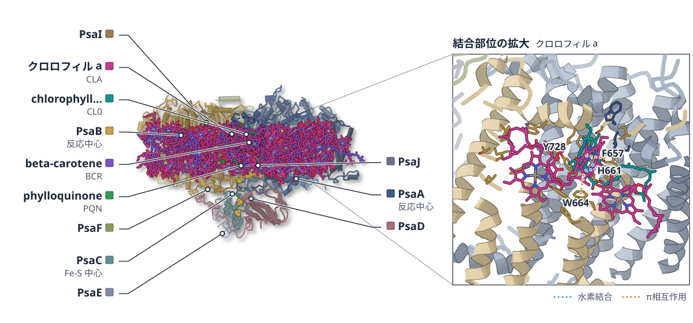

色（順に）：PsaA（反応中心） / PsaB（反応中心） / PsaC（Fe-S 中心） / PsaD / PsaE / PsaF / PsaI / PsaJ / PsaK / PsaM / 4.8K タンパク質　スティック：クロロフィル a（CLA）、phylloquinone（PQN）、beta-carotene（BCR）、[4Fe-4S]（SF4）、chlorophyll a isomer（CL0）

**光合成の光化学系Iの単量体を、温度と界面活性剤で作る**

単量体の光化学系Iをクライオ電顕で高分解能に解析し、脂質や界面活性剤の配置を示した

- **疑問・課題**：光化学系Iの単量体を、活性を保ったまま大量に得る方法と、高分解能の構造が必要だった。
- **アプローチ**：三量体を界面活性剤C12E8と高温で単量体にし、クライオ電顕で構造を決め、分光法と小角中性子散乱で調べた。
- **結果**：PsaL以外のサブユニットが見えた。SQD分子1個と、リング状に並ぶ16個のβDMが見つかった。
- **わかったこと**：この単量体の構造は溶液中でも保たれていた。三量体との比較から、失われた赤色クロロフィルの割り当てを著者は示唆している。

この紹介文の根拠（論文本文）

> Here, we present a novel protocol for producing large quantities of nearly intact and active T. vestitus mPSI from purified, active tPSI.  
> — 疑問・課題／Introduction

> Here, we have developed a novel protocol to obtain large amounts of intact, active mPSI from Thermosynechococcus vestitus (Tv) by dissociating highly purified tPSI using the detergent octaethylene glycol monododecyl ether (C12E8) at elevated temperatures.  
> — アプローチ／Abstract

> This structure retains all subunits except PsaL and we identified a sulfoquinovosyl diacylglycerol (SQD) molecule and 16 n-dodecyl ß-maltoside (βDM) molecules arranged in a ring around the complex.  
> — 結果／Abstract

> The mPSI structure was verified in solution at physiological temperature by applying small angle neutron scattering.  
> — わかったこと／Abstract

> Comparing the cofactor inventory of mPSI to that of tPSI, we suggest the assignment of a red-shifted chlorophyll pigment  
> — わかったこと／Abstract

分類：光合成・電子伝達

#### 読みどころ

BDMで精製した三量体を、1%のC12E8と60°Cで30分処理すると、ほぼ単量体になった。PsaLは失われるが、酸素の消費活性は三量体と同程度に高い。温度と界面活性剤だけでよい点が工夫である。

根拠（論文本文）

> Incubating ßDM tPSI for 30 min with the addition of 1% C12E8 at 60 °C yielded almost solely mPSI.  
> — Results

> The functional integrity of our mPSI is demonstrated by the O2 activity rates, which are similarly high for mPSI and tPSI (SI, Table S1).  
> — Results

膜の周りに16個のβDMが二重層のように並ぶ構造と、PSIで新たに見つかったSQD分子が見えた。PsaLが外れた単量体では、三量体にあった2つ目のCa2+結合部位に、Mg2+が入っていた。

根拠（論文本文）

> arranged in a bilayer structure around the peripheral hydrophobic transmembrane region of mPSI  
> — Results

> Our mPSI cryo-EM structure revealed an intact second binding site, now occupied by a Mg²⁺ ion, unlike the tPSI structures  
> — Results

単量体ではカロテノイド6個（三量体の24%）とクロロフィルa 5個が失われていた。スペクトルの解析から、失われた赤色クロロフィルは708〜710 nm付近の吸収に寄与するものらしい。チトクロムc6を加えると、P700の近くに追加の密度が見えたが、モデルは作れなかった。

根拠（論文本文）

> This loss corresponds to 24% of the 25 identified ß-Cars in 7FIX.  
> — Results

> Therefore, it is suggested that the red Chl missing in our mPSI belongs to the pool of red Chls absorbing around 710 nm.  
> — Results

> This density did not allow model building and could not be improved by local refinement  
> — Results

#### 構造データ

| PDB | 手法 | 分解能 | 公開 | 生物種 | リガンド |
|---|---|---|---|---|---|
| [9QFP](https://www.rcsb.org/structure/9QFP) | Cryo-EM | 1.74 Å | 2026-09-30 | Thermosynechococcus vestitus BP-1 | PQN, CL0, SF4, BCR, CLA |

- [P0A401](https://www.uniprot.org/uniprotkb/P0A401) psaF Photosystem I reaction center subunit III — *Thermosynechococcus vestitus (strain NIES-2133 / IAM M-273 / BP-1)* （既存の PDB 構造 18 件）
- [P0A403](https://www.uniprot.org/uniprotkb/P0A403) psaM Photosystem I reaction center subunit XII — *Thermosynechococcus vestitus (strain NIES-2133 / IAM M-273 / BP-1)* （既存の PDB 構造 18 件）
- [P0A405](https://www.uniprot.org/uniprotkb/P0A405) psaA Photosystem I P700 chlorophyll a apoprotein A1 — *Thermosynechococcus vestitus (strain NIES-2133 / IAM M-273 / BP-1)* （既存の PDB 構造 18 件）
- [P0A407](https://www.uniprot.org/uniprotkb/P0A407) psaB Photosystem I P700 chlorophyll a apoprotein A2 — *Thermosynechococcus vestitus (strain NIES-2133 / IAM M-273 / BP-1)* （既存の PDB 構造 18 件）
- [P0A415](https://www.uniprot.org/uniprotkb/P0A415) psaC Photosystem I iron-sulfur center — *Thermosynechococcus vestitus (strain NIES-2133 / IAM M-273 / BP-1)* （既存の PDB 構造 18 件）
- [P0A420](https://www.uniprot.org/uniprotkb/P0A420) psaD Photosystem I reaction center subunit II — *Thermosynechococcus vestitus (strain NIES-2133 / IAM M-273 / BP-1)* （既存の PDB 構造 18 件）
- [P0A423](https://www.uniprot.org/uniprotkb/P0A423) psaE Photosystem I reaction center subunit IV — *Thermosynechococcus vestitus (strain NIES-2133 / IAM M-273 / BP-1)* （既存の PDB 構造 18 件）
- [P0A425](https://www.uniprot.org/uniprotkb/P0A425) psaK Photosystem I reaction center subunit PsaK — *Thermosynechococcus vestitus (strain NIES-2133 / IAM M-273 / BP-1)* （既存の PDB 構造 17 件）
- [P0A427](https://www.uniprot.org/uniprotkb/P0A427) psaI Photosystem I reaction center subunit VIII — *Thermosynechococcus vestitus (strain NIES-2133 / IAM M-273 / BP-1)* （既存の PDB 構造 18 件）
- [P0A429](https://www.uniprot.org/uniprotkb/P0A429) psaJ Photosystem I reaction center subunit IX — *Thermosynechococcus vestitus (strain NIES-2133 / IAM M-273 / BP-1)* （既存の PDB 構造 18 件）
- [Q8DKP6](https://www.uniprot.org/uniprotkb/Q8DKP6)  Photosystem I 4.8K protein — *Thermosynechococcus vestitus (strain NIES-2133 / IAM M-273 / BP-1)* （既存の PDB 構造 16 件）

#### 実験メモ

- **発現系**：天然のT. vestitus BP1から三量体PSIを単離。Cyt c6は大腸菌で発現（C末端6×Hisタグ）。
- **精製**：βDM三量体を1% C12E8・60°C・30分で単量体化し、10〜35%ショ糖密度勾配で分離。
- **結晶化／グリッド作製**：Quantifoil R 1.2/1.3 Cuグリッド、Vitrobot Mark IV（4°C、湿度100%、30秒インキュベート、2秒ブロット）。
- **データ収集・解析**：Titan Krios G3＋K3で22,001ムービー。cryoSPARC 4.5で解析、ModelAngeloで初期モデルを作成。

根拠（論文本文）

> After the monomerisation procedure described above, the PSI solution was loaded onto a sucrose gradient with 10–35% (w/v) sucrose in sucrose buffer  
> — Experimental procedures

> The plunge-freezing was performed with a Vitrobot Mark IV device, with the chamber at 4 °C and 100% relative humidity, 30 s of incubation time between application and blotting, 2 s of blotting (at blot force 0) before vitrification in liquid ethane.  
> — Experimental procedures

> A total of 22 001 movies were collected on a Titan Krios G3 operated at 300 kV and equipped with a Gatan K3 BioQuantum detector.  
> — Experimental procedures

> An atomic model was automatically built into the 3D reconstruction using ModelAngelo version 1.0.12  
> — Experimental procedures

> 📝 編集者への確認事項：PDB 9QFP は 1.74 Å（本文は 1.8 Å）。Tv の単量体 PSI は既報（6LU1, 3.2 Å）があり初構造ではない。著者は PSI でSQDの同定は初と書くが、見出しでは使っていない。Cyt c6 の結合は低分解能の密度のみ。

---

## 13｜β-ガラクトシダーゼ・GroEL（大腸菌）

### Cryo-EM sample preparation with soft-landing and laser flash melting

*Nature Communications*（2026-09-15） · [論文](https://doi.org/10.1038/s41467-026-77723-6) · ライセンス: cc by

筆頭著者：Sarah V Barrass（Ecole Polytechnique Fédérale de Lausanne (EPFL), Switzerland）　責任著者：Ulrich J Lorenz（Ecole Polytechnique Fédérale de Lausanne (EPFL), Switzerland）

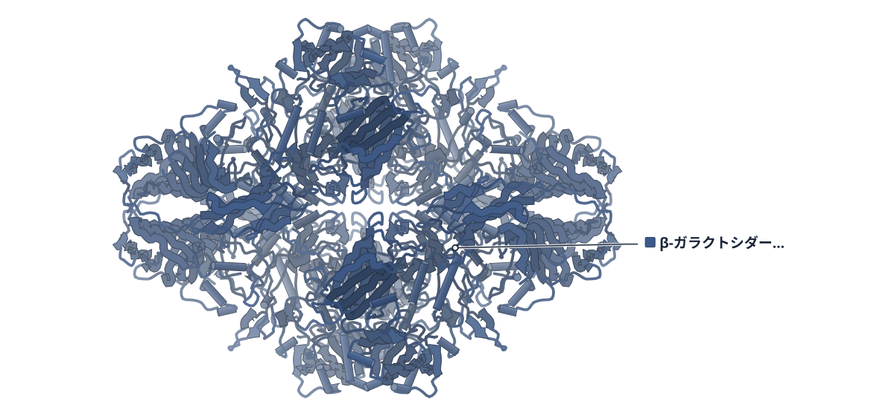

色（順に）：β-ガラクトシダーゼ

**乾いたタンパク質は、レーザーで氷を溶かすと水を取り戻して元に近づく**

ソフトランディングしたβ-ガラクトシダーゼを、30 µsのレーザー融解で再水和して解析した

- **疑問・課題**：ソフトランディングでは試料が乾燥し、タンパク質が縮んだ形でしか観察できなかった。
- **アプローチ**：着地させたタンパク質に非晶質の氷を重ね、30 µsのレーザーパルスで氷を一瞬溶かして再水和し、GroELとβ-ガラクトシダーゼを調べた。
- **結果**：再水和した粒子は幅広い形の集団になった。一部の粒子は、天然に近い形に戻った。
- **わかったこと**：著者は、融解の時間を延ばすなどの方法で全粒子を再水和できるとみており、ソフトランディングによる日常的な試料調製が近づくと述べている。

この紹介文の根拠（論文本文）

> However, only compacted configurations are observed after soft-landing since the proteins are dehydrated in the process.  
> — 疑問・課題／Abstract

> Here, we deposit a layer of amorphous ice onto the sample and briefly flash melt it to rehydrate the soft-landed proteins.  
> — アプローチ／Abstract

> Melting with a 30 µs laser pulse creates a broad ensemble of partially rehydrated structures. However, a subset of particles returns to a configuration close to the native state.  
> — 結果／Abstract

> This allows us to propose strategies to fully rehydrate the entire ensemble and brings routine sample preparation by soft-landing mass spectrometry within reach.  
> — わかったこと／Abstract

分類：酵素（その他）・リボソーム・翻訳・フォールディング

#### 読みどころ

ソフトランディングで着地させた粒子の上に、その場で非晶質の氷を50 nm重ね、532 nmのレーザーを30 µs当てて溶かすと、粒子が再水和して膨らむ。レーザーを切ると数マイクロ秒で再びガラス化するため、新しい形が凍結される。

根拠（論文本文）

> The sample is then flash melted with a 30 µs laser pulse (Fig. 1E, 532 nm wavelength), allowing the proteins to rehydrate (Fig. 1F).  
> — Results

> Once the heating laser is switched off, the sample rapidly cools and revitrifies within microseconds27, trapping the proteins in their new configurations (Fig. 1G).  
> — Results

GroELは着地すると高さが約24%、直径が約7%縮んだが、レーザー融解後はサブユニット間の水で満たされた空間が戻った。β-ガラクトシダーゼでは、天然状態に最も近い粒子だけを選ぶと3.7 Åの再構成が得られ、分子モデルの差は0.7 Åだった。

根拠（論文本文）

> A comparison with the native structure (Figs. 2D, 1.9 Å) reveals that dehydration has significantly compacted the soft-landed particles, reducing their height and diameter by about 24% and 7%, respectively.  
> — Results

> This is also reflected in the similarity of the molecular models that we have built for both structures (Supplementary Information E and Supplementary Fig. 14, root-mean-square deviation of 0.7 Å)  
> — Results

界面への吸着が再水和を遅らせ、粒子を非対称にする可能性がある。天然に近い粒子ほど配向の偏りが小さかった。ソフトランディングでは、通常の試料に混じる二量体が見えず、四量体だけが見つかった。

根拠（論文本文）

> Our results suggest that adsorption to an interface hinders many particles from fully returning to the native state during the short time window provided by the melting laser pulses.  
> — Results

> While a conventional sample of β‑galactosidase contains some fraction of dimers (Supplementary Fig. 5C), only tetramers are found after soft-landing  
> — Results

#### 構造データ

| PDB | 手法 | 分解能 | 公開 | 生物種 | リガンド |
|---|---|---|---|---|---|
| [9HKI](https://www.rcsb.org/structure/9HKI) | Cryo-EM | 1.90 Å | 2025-12-17 | Escherichia coli | — |
| [9HLM](https://www.rcsb.org/structure/9HLM) | Cryo-EM | 3.70 Å | 2025-12-17 | Escherichia coli | — |

- [P00722](https://www.uniprot.org/uniprotkb/P00722) lacZ Beta-galactosidase — *Escherichia coli (strain K12)* （既存の PDB 構造 85 件）

#### 実験メモ

- **発現系**：GroELとβ-ガラクトシダーゼはSigma-Aldrichの市販品。
- **結晶化／グリッド作製**：酢酸アンモニウム中でネイティブ質量分析。UltrAuFoil＋2 nm非晶質炭素膜のグリッドに、110 K・2 eV/電荷で着地。
- **データ収集・解析**：改造したJEOL 2010Fでレーザー融解（30 µs、532 nm）。

根拠（論文本文）

> Samples of GroEL and β-galactosidase were purchased from Sigma-Aldrich (G3153-5MG and C7688-1MG).  
> — Methods

> Protein ions were deposited with an energy of 2 eV per charge, as measured with a retarding-grid energy detector, with a typical ion current of 50 pA and 20 min deposition time.  
> — Methods

> Laser melting and revitrification experiments were performed with a modified JEOL 2010F transmission electron microscope37,38.  
> — Methods

> 📝 編集者への確認事項：新しい構造は、プレート凍結（9HKI）と再水和した粒子（9HLM）の2つのβ-ガラクトシダーゼで、タンパク質自体の初構造ではない。手法論文。

---

## 14｜hPin1-WWドメイン＋AIEペプチドF11

### Solution structure of a peptide-conjugated aggregation-induced-emission (AIE) fluorophore bound to a protein

*RSC Chemical Biology*（2026-10-15） · [論文](https://doi.org/10.1039/d6cb00109b) · ライセンス: cc by

筆頭著者：Daniel Seifert（University of Duisburg-Essen）　責任著者：Jens Voskuhl, Christine Beuck（University of Duisburg-Essen）

**AIE蛍光色素は、タンパク質に結びつくと環の回転が止まって光る**

ペプチドをつないだAIE分子とhPin1-WWドメインの複合体を、NMRの溶液構造で解析した

- **疑問・課題**：AIE（凝集誘起発光）リガンドがタンパク質に結合した複合体の構造は、これまで報告されていなかった。
- **アプローチ**：hPin1-WWの結合配列をつないだAIEペプチドを作り、蛍光滴定で結合を調べ、遊離状態と複合体の溶液NMR構造を決めた。
- **結果**：遊離のF11はペプチドが芳香環の上に巻き付く。結合すると伸びて、hPin1-WWのF25などが芳香環に接触した。
- **わかったこと**：芳香環がタンパク質表面に固定されて動きが制限されるため、結合すると蛍光が強くなる。

この紹介文の根拠（論文本文）

> However, so far, the structure of an AIE-ligand:protein complex has not been published.  
> — 疑問・課題／Introduction

> While an AIE fluorophore with two conjugated peptides shows an enhanced fluorescence increase upon protein binding, a one-armed derivative enabled us to solve the structures of the free AIE-peptide and its complex.  
> — アプローチ／Abstract

> In the absence of a protein, the AIE-peptide conjugate shows a curled-up conformation that still allows rotation of the aromatic rings of the AIE-core, thus resulting in low auto-fluorescence.  
> — 結果／Abstract

> Residue F25 of hPin1-WW rotates into the centre of the C-shape, forming face-to-edge π–π interactions with the central and distal aromatic rings of the AIE-core (Fig. 4b).  
> — 結果／NMR solution structure of F11 bound to hPin1-WW

> The aromatic rings of the AIE-core form additional contacts with the protein surface, which restricts their motions and thus results in the observed fluorescence increase.  
> — わかったこと／Abstract

分類：酵素（その他）・その他

#### 読みどころ

遊離のF11では、ペプチドがらせん状にAIEコアの上に巻き付き、プロリン環が芳香環とCH–π相互作用をつくる。近位の環は回転できるため、単独では蛍光が弱い。結合したF11は伸びた形になるが、最初のペプチド結合はcis型のままである。

根拠（論文本文）

> The peptide arm is curled up in a helical fashion above the aromatic core, such that the hydrophobic proline ring interacts with the proximal (closest to the peptide) and central aromatic rings.  
> — Solution structure of AIE-peptide F11 with one peptide arm

> The AIE-peptide F11 is draped over the saddle-shaped top of the central hPin1-WW β-sheet and no longer in a curled-up conformation; however, the first peptide bond remains in cis conformation.  
> — NMR solution structure of F11 bound to hPin1-WW

AIEコアはC字形のままβシートの上に載り、F25が中央に入り込んでコアと接触する。R14はカチオン–π相互作用でコアを支え、M15の側鎖は既知のhPin1-WW構造にない上向きの形で、トリアゾール環の方を向く。

根拠（論文本文）

> Residue R14 is also involved in stabilizing the aromatic AIE-core of F11 by cation–π interactions.  
> — NMR solution structure of F11 bound to hPin1-WW

> Residue M15 displays a conformation that is unique among all known hPin1-WW structures (apo and peptide-bound).  
> — NMR solution structure of F11 bound to hPin1-WW

クリック反応でペプチドをAIEコアにつなぐと、さまざまなペプチド結合タンパク質向けの直接読み出しプローブにできる。2本腕のF21–F24は蛍光の増加がF11より5〜9倍大きく、リンカーは短いほうが凝集しにくい。著者は、F11のKDが対照ペプチドより小さくならなかった点も注意している。

根拠（論文本文）

> Coupling of peptides to the AIE-core via click chemistry offers a convenient system to pair the AIE properties with a multitude of peptides to target a variety of peptide-binding proteins.  
> — Conclusions

> The fluorescence amplitude of F11 (with one peptide) upon protein binding was 5–9-fold lower compared to that of the two-armed fluorophores.  
> — Aggregation-induced emission enhancement (AIEE) for the quantitative characterisation of protein binding via direct read-out

> Interestingly, the binding affinity does not improve but rather the KD slightly increases for the AIE-peptides compared to the native control peptide P0  
> — Conclusions

#### 構造データ

| PDB | 手法 | 分解能 | 公開 | 生物種 | リガンド |
|---|---|---|---|---|---|
| 29KP | — | — | 公開待ち | — | — |
| 29KQ | — | — | 公開待ち | — | — |

#### 実験メモ

- **コンストラクト**：AIEコアに1本（F11）または2本（F21–F26）のペプチドをつなぐ。ペプチドはhPin1-WWの認識配列pThr-Proを含み、N末端にアジドホモアラニンをもつ。
- **精製**：ペプチドは標準的な固相合成（FMOC法）で作り、HPLCで精製。TFAは塩化物イオンに置換。
- **結晶化／グリッド作製**：AIEペプチドと、Cu(I)触媒のクリック反応でカップリング。
- **データ収集・解析**：15N標識hPin1-WWにAIEペプチドを加えたNMR滴定と、蛍光滴定でKDを求めた。

根拠（論文本文）

> Peptides P1–P6 with an N-terminal azido-homoalanine (Aha) residue were synthesized via standard solid phase peptide synthesis using FMOC chemistry, deprotected and purified by HPLC.  
> — Synthesis

> The TFA ions were exchanged with chloride to avoid possible interference of protein binding by trifluoroacetate (TFA) ions present after HPLC purification.  
> — Synthesis

> Recognition of the pThr-Pro motif in F11 and F21–F24 by the hPin1-WW domain was confirmed by NMR, titrating peptide-conjugated AIE fluorophores to 15N-labelled hPin1-WW  
> — Aggregation-induced emission enhancement (AIEE) for the quantitative characterisation of protein binding via direct read-out

> 📝 編集者への確認事項：PDB 29KP（遊離F11）・29KQ（hPin1-WW複合体）は未公開。実験条件の詳細（NMR測定など）は補足資料にあり、本文パケットには含まれない。論文は「AIEリガンドとタンパク質の初の溶液NMR構造」と明言しているが、見出しには使っていない。

---

# Structure-Based Study

## 15｜μOR–Gi 複合体（マウス・ヒト）

### Ligand-dependent G protein dynamics underlying opioid efficacy

*Nature Structural & Molecular Biology*（2026-10-13） · [論文](https://doi.org/10.1038/s41594-026-01893-6) · ライセンス: cc by-nc-nd

筆頭著者：Jonathan C. Deutsch（University of Illinois Urbana-Champaign, USA）　責任著者：Brian K. Kobilka, Rabindra V. Shivnaraine（Stanford University, USA）

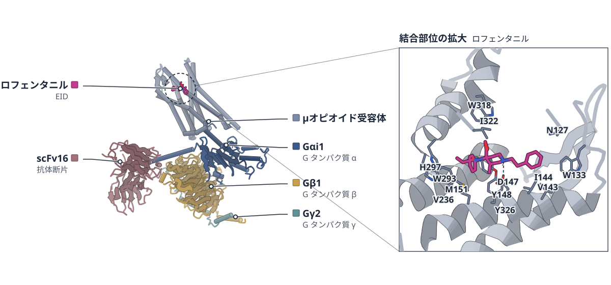

PDB 7T2H（論文が使った既存の構造）

色（順に）：Gαi1（G タンパク質 α） / Gβ1（G タンパク質 β） / Gγ2（G タンパク質 γ） / scFv16（抗体断片） / μオピオイド受容体　スティック：ロフェンタニル（EID）

**オピオイドの効力は、Gαドメインの開きやすさに表れる**

既存の構造を使い、一分子FRETでμOR–Gi複合体のAHDの動きを測った。強い作動薬ほど開きが速い

- **疑問・課題**：オピオイド受容体に結合した作動薬の効果が、結びついた G タンパク質にどう伝わるかは分かっていなかった。
- **アプローチ**：既存の構造を使い、Gαi の 2 か所を蛍光標識して、一分子 FRET で α ヘリックスドメイン（AHD）の開閉を測った。
- **結果**：効力の高い作動薬ほど AHD が開いた状態（低 FRET）にいる割合が高く、GTP 代謝回転と R2 = 0.97 で相関した。
- **わかったこと**：受容体のリガンドは 70 Å 以上離れた結合部位から G タンパク質の形を調節し、効力を決める一因になると示唆される。
- **残された課題**：絶対的な速度は、界面活性剤ミセルやシステイン置換、温度などの実験条件の影響を受けうると論文は述べている。

この紹介文の根拠（論文本文）

> Although orthosteric ligands are known to modulate GPCR conformation, how these effects propagate to the bound G protein remains unclear.  
> — 疑問・課題／Abstract

> Using single-molecule Förster resonance energy transfer imaging, we monitored AHD motions in Gi proteins coupled to the μ-opioid receptor across different ligand- and nucleotide-bound states.  
> — アプローチ／Abstract

> This ligand-induced low-FRET occupancy was strongly correlated with in vitro GTP turnover activity (a direct measure of efficacy) (R2 = 0.97; Fig. 2b)  
> — 結果／Results

> We find that receptor ligands differentially modulate these dynamics from a binding site over 70 Å away, with higher-efficacy agonists accelerating transitions to an open, low-nucleotide-affinity conformation.  
> — わかったこと／Abstract

> These data also capture transient AHD intermediates during nucleotide exchange and suggest that allosteric control over the G protein conformational states provides an additional mechanism for encoding opioid efficacy and signaling outcomes.  
> — わかったこと／Abstract

> The absolute values of these rates may nevertheless be influenced by experimental conditions, such as the detergent micelle, cysteine substitutions, temperature and/or limitations in imaging speed and fluorescent probes.  
> — 残された課題／Results

分類：GPCR・受容体

#### 読みどころ

作動薬の効力が高いほど、AHD が開いた状態（低 FRET）に留まる割合が増えた。その割合は GTP 代謝回転活性と強く相関した（R2 = 0.97）。

根拠（論文本文）

> At μOR bound to full agonists, occupancy of the low-FRET (0.27) state increased relative to partial agonists, whereas that of the high-FRET (0.62) state decreased (Fig. 2a).  
> — Results

強い作動薬（LFT）の複合体では、AHD が開く見かけの速さが apo の約 2.25 倍（約 0.9 s−1 と約 0.4 s−1）だった。開いた状態に留まる時間はどの作動薬でも約 1.4 秒で近かった。

根拠（論文本文）

> with the apparent rate of AHD opening being approximately 2.25-fold faster for LFT-occupied compared to apo-occupied complexes (~0.9 s−1 and ~0.4 s−1, respectively)  
> — Results

> Conversely, dwell times in the low-FRET state were similar (~1.4 s on average) across all ligands tested  
> — Results

GTP に似せた GMP・PPi を加えると、AHD は短命な中間の FRET 状態を経て閉じた。論文は、ヌクレオチドとの接触が一度にではなく段階的に切れる、または形成される機構を示唆している。

根拠（論文本文）

> Together, these findings suggest a mechanism where nucleotide contacts are broken or formed progressively rather than all at once, providing a free-energy-efficient pathway for nucleotide exchange through a transient intermediate step  
> — Results

#### 構造データ

| PDB | 手法 | 分解能 | 公開 | 生物種 | リガンド |
|---|---|---|---|---|---|
| [1GP2](https://www.rcsb.org/structure/1GP2) | X-ray | 2.30 Å | 1997-02-12 | Bos taurus, Rattus norvegicus | GDP |
| [7L0Q](https://www.rcsb.org/structure/7L0Q) | Cryo-EM | 4.30 Å | 2021-01-06 | Homo sapiens, Rattus norvegicus | — |
| [7T2H](https://www.rcsb.org/structure/7T2H) | Cryo-EM | 3.20 Å | 2022-12-07 | Homo sapiens, Mus musculus | EID |

- [P10824](https://www.uniprot.org/uniprotkb/P10824) Gnai1 Guanine nucleotide-binding protein G(i) subunit alpha-1 — *Rattus norvegicus* （既存の PDB 構造 0 件）
- [P20068](https://www.uniprot.org/uniprotkb/P20068) Nts Neurotensin/neuromedin N — *Rattus norvegicus* （既存の PDB 構造 0 件）
- [P20789](https://www.uniprot.org/uniprotkb/P20789) Ntsr1 Neurotensin receptor type 1 — *Rattus norvegicus* （既存の PDB 構造 0 件）
- [P42866](https://www.uniprot.org/uniprotkb/P42866) Oprm1 Mu-type opioid receptor — *Mus musculus* （既存の PDB 構造 0 件）
- [P59768](https://www.uniprot.org/uniprotkb/P59768) GNG2 Guanine nucleotide-binding protein G(I)/G(S)/G(O) subunit gamma-2 — *Homo sapiens* （既存の PDB 構造 1323 件）
- [P62871](https://www.uniprot.org/uniprotkb/P62871) GNB1 Guanine nucleotide-binding protein G(I)/G(S)/G(T) subunit beta-1 — *Bos taurus* （既存の PDB 構造 0 件）
- [P62873](https://www.uniprot.org/uniprotkb/P62873) GNB1 Guanine nucleotide-binding protein G(I)/G(S)/G(T) subunit beta-1 — *Homo sapiens* （既存の PDB 構造 1333 件）
- [P63096](https://www.uniprot.org/uniprotkb/P63096) GNAI1 Guanine nucleotide-binding protein G(i) subunit alpha-1 — *Homo sapiens* （既存の PDB 構造 0 件）
- [P63211](https://www.uniprot.org/uniprotkb/P63211) GNGT1 Guanine nucleotide-binding protein G(T) subunit gamma-T1 — *Homo sapiens* （既存の PDB 構造 0 件）
- [P63212](https://www.uniprot.org/uniprotkb/P63212) GNG2 Guanine nucleotide-binding protein G(I)/G(S)/G(O) subunit gamma-2 — *Bos taurus* （既存の PDB 構造 0 件）

#### 実験メモ

- **発現系**：Gαi1 は大腸菌 BL21(DE3)、μOR は Sf9 昆虫細胞のバキュロウイルス系で発現した。
- **コンストラクト**：Gαi1 に R90C と E238C を導入した最小システイン変異体を標識に使った。
- **精製**：μOR–Gi 複合体は M1 抗 Flag カラムで精製し、さらに Superdex 200 のゲルろ過にかけた。
- **結晶化／グリッド作製**：LD555 と JFX673 で Gαi を標識し、複合体を M1 Fab で石英スライドに固定した。
- **データ収集・解析**：自作のプリズム型 TIRF 顕微鏡で 19 °C、50 ms の時間分解能で撮像した。

根拠（論文本文）

> The R90C and E238C substitutions were introduced into a previously published minimal cysteine background (C3S;C66A;C214S;C350S;C325A;C351I) of human Gαi1  
> — Methods

> was expressed in BL21(DE3) cells (Sigma-Aldrich, CMC0014) using pET28a and purified as previously described  
> — Methods

> Mouse μOR was expressed in Sf9 insect cells (Expression Systems, 940-001S) using the baculovirus method  
> — Methods

> The eluate was further purified using a room temperature Superdex 200 10/300 SEC column in complex buffer containing 0.1–1 μM ligand.  
> — Methods

> Maleimide-conjugated LD555 (Lumidyne Technologies) and JFX673-peg4 (Janelia Fluor) were added simultaneously, each at a twofold molar excess, and incubated at room temperature for 0.5 h.  
> — Methods

> loaded onto the microscope slide at 200 pM by pulling down the N-terminal Flag tag on the receptor  
> — Methods

> All imaging was performed at 19 °C and videos were recorded with Andor Solis (i) software (Andor) at a 50-ms time resolution (20 fps).  
> — Methods

> 📝 編集者への確認事項：既存の PDB 構造（1GP2、7L0Q、7T2H）は標識部位の設計と状態の解釈に使われるだけで、新しい構造は報告していない。structure は 1 点。構造図は μOR–Gi の 7T2H を使うが、論文の図 1b は 1GP2 と 7L0Q。legend_labels は render 前のため未記入。

---

## 注目の構造の採点（43 本を確認し、10 本を採点）

基準は `pipeline/impact.py`（10 点満点、6 点以上から最大 3 本）。

| 選定 | 論文 | 種類 | novelty | reach | structure | support | 計 | 理由 |
|---|---|---|---|---|---|---|---|---|
|  | PMC13676074 Type IV-C CRISPR-Cas effector complexes recognize double-str | 既存構造で機構を解明 | 2 | 2 | 2 | 2 | 8 | 点数は高いが、自前のクライオ電顕構造（3.4 Å と 3.2 Å）を報告する論文で、PDB 番号が候補に載っていないだけで新しい構造の記事側で扱うべきもの。注目の構造（新しい構造以外）には入れない。 |
| ◯ | PMC13672048 Ligand-dependent G protein dynamics underlying opioid effica | 既存構造で機構を解明 | 2 | 2 | 1 | 2 | 7 | 既存の Gi・μOR 構造を基準にした smFRET で、リガンドの効力が G タンパク質の AHD 開閉に伝わることを示した。GTP 代謝回転との相関や NTSR1 でも確かめている。実験構造は標識部位の設計と状態の解釈に使われ、結論の直接の根拠は smFRET なので structure は 1。 |
|  | PMC13646495 Ribosome remodeling drives translation adaptation during vir | 既存構造で機構を解明 | 2 | 2 | 0 | 2 | 6 | リボソームの rpL40 が感染や飢餓で追加される現象を変異体などで示した。ただし追加 rpL40 の位置は XL-MS と Chai-1 予測が根拠で、実験構造（X 線・クライオ電顕・NMR）による確認がなく structure は 0。 |
|  | PMC13669341 Molecular dynamics guided all-atom reconstruction of cryo-ET | 既存構造で機構を解明 | 2 | 2 | 1 | 1 | 6 | 既発表のクライオ ET マップに MD 由来の 3 連ヌクレオソームを当てはめる手法。結論の中心は MD で、実験構造は照合に使うだけのため structure 1、support 1 で 6 点。 |
|  | PMC13670896 Native Mass Spectrometry Reveals Ligand-Specific Conformatio | 新しい手法・ソフト | 2 | 1 | 1 | 2 | 6 | ネイティブ質量分析とナノボディで β1AR のリガンド依存の状態差を見る手法。構造は既存 PDB との比較に使うだけで、対象も β1AR に限られるため 6 点。 |
|  | PMC13672106 A single-amino-acid cleavage controls global mitochondrial c | 既存構造で機構を解明 | 2 | 2 | 0 | 2 | 6 | ICP55 による 1 アミノ酸の切断が複合体の安定性を保つことをプロテオミクスと BN-PAGE で示した。実験構造は図の説明に使われるだけで structure は 0。 |
|  | PMC13670219 Redox-state-dependent CO binding in MoFe nitrogenase: insigh | 既存構造で機構を解明 | 2 | 1 | 1 | 2 | 6 | IR・EPR・QM/MM で CO が E1 状態に結合することを示した。既存の結晶構造は QM/MM の基準と照合に使うのみで、対象はニトロゲナーゼに限られ 6 点。 |
|  | PMC13674862 A histidine-mediated supramolecular mechanism links temperat | 構造予測・AI・デザイン | 2 | 1 | 0 | 1 | 4 | CatSper の温度・pH 感受性の機構を AlphaFold3 モデルで提案した。実験構造による確認がなく structure は 0。電気生理は N 末端除去の影響を見ただけ。 |
|  | PMC13669383 Small viruses reveal bidirectional evolution between HK97-fo | 構造予測・AI・デザイン | 2 | 2 | 0 | 0 | 4 | メタゲノムと言語モデル・構造予測による進化の解析で、実験で決めた構造による裏付けも実験的検証もない。 |
|  | PMC13673040 Seryl phosphorylation modulates chaperonin function of Mycob | 既存構造で機構を解明 | 1 | 1 | 0 | 1 | 3 | 擬似リン酸化変異体の機能相補試験が中心で、構造はホモロジーモデルのみ。新規性・波及とも限られる。 |

novelty：何が初めてか / reach：誰に効くか / structure：実験で決めた構造（X 線・クライオ電顕・NMR / support：裏付けの強さ（2＝独立した実験で検証：変異体・機能測定・既存手法との比較など／1＝一部の検証のみ／0＝計算のみで実験的検証なし）

## 記事にしていない新しい構造

- [Site-selective Au(III)-mediated metalloenzyme conjugations](https://doi.org/10.1016/j.chempr.2026.103241) — *Chem*（新しい構造（PDB ID が本文にない））
- [The MODNAP benchmark set for modeling ribose-based modified nucleic acid and nucleic acid–protein complexes: a case study with AlphaFold 3](https://doi.org/10.1093/nar/gkag999) — *Nucleic Acids Res*（新しい構造（PDB ID が本文にない））
