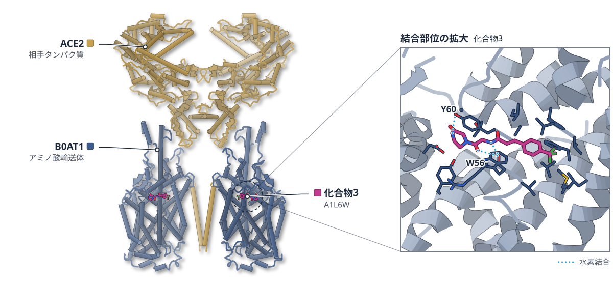
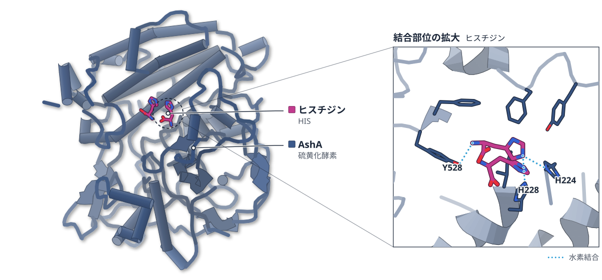
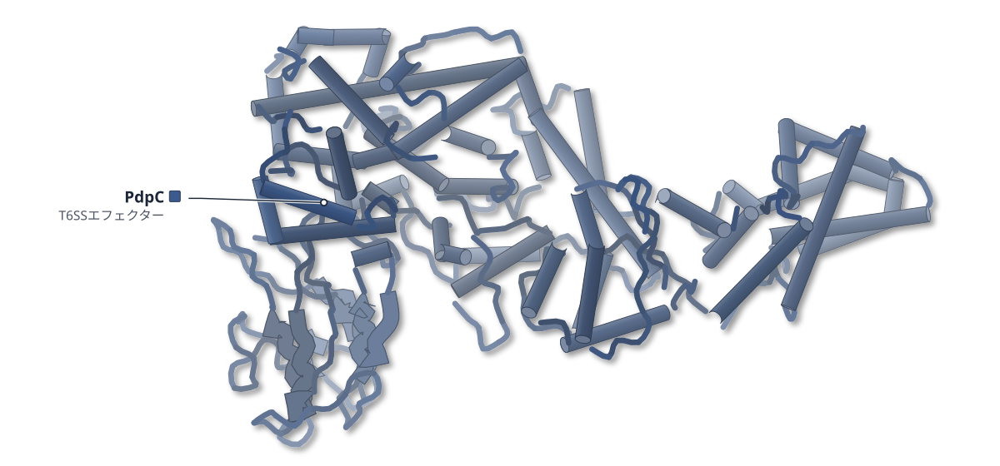
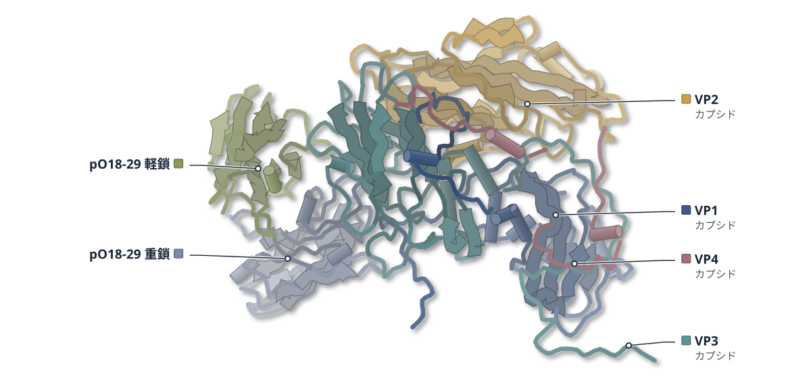
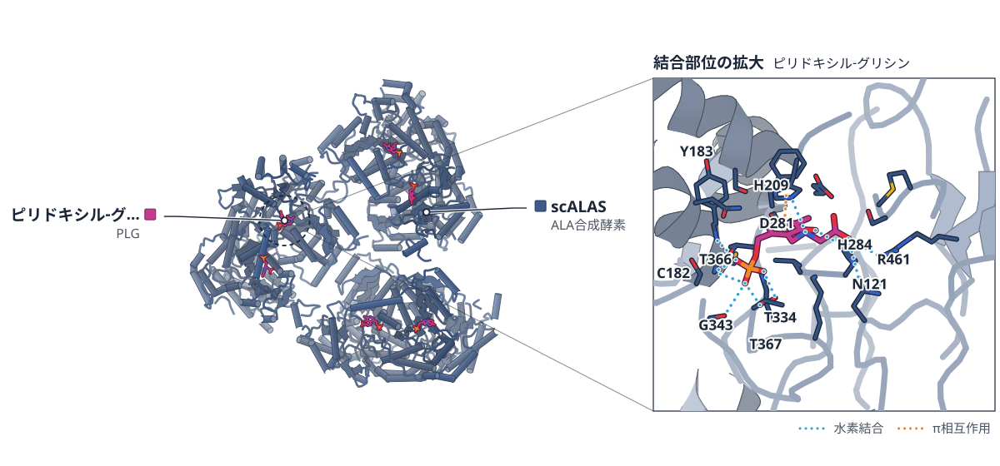
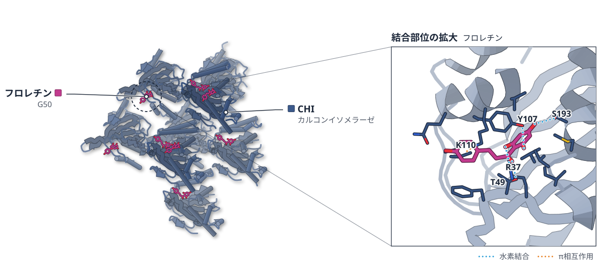
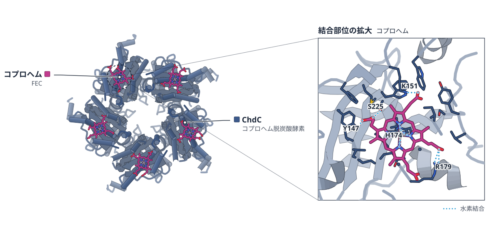
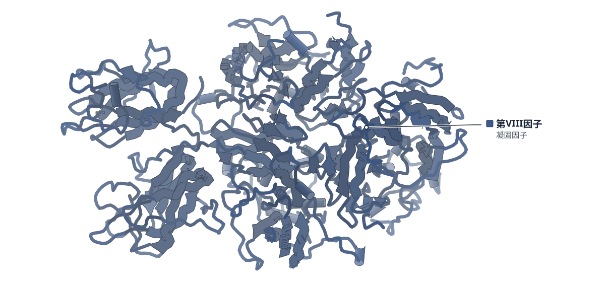
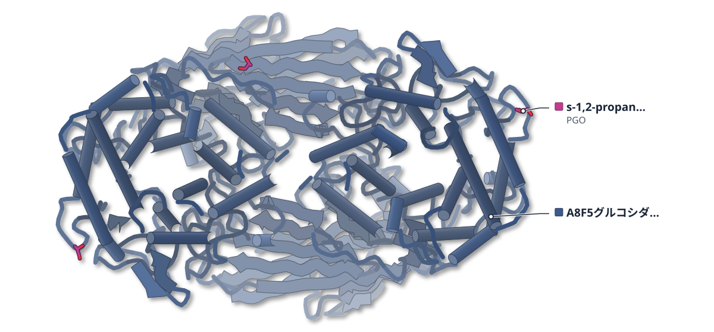
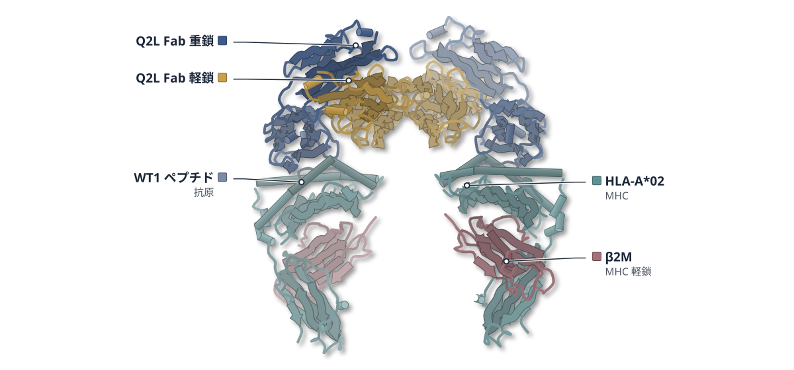

# 2026-10-19 号

**今日の新しい構造：16 本**　PMC に 2026-10-18 に登録されたオープンアクセス論文 96 本のうち、新しい構造を報告した論文は 16 本。うち 15 本を紹介する（残りは末尾に一覧）。

出典：この号の論文情報と全文は、米国国立医学図書館（NLM）の PMC オープンアクセスデータセット（AWS Open Data）から取得した。

**New Structure 3 本** · **Structure Update 11 本** · **Structure-Based Study 1 本**（New Structure：構造が初めて解かれたタンパク質。Structure Update：既知のタンパク質の新しい構造。Structure-Based Study：既存の構造を使った注目の研究）

## Today's Structure（今日の一本）

**1｜B0AT1阻害剤は、輸送体を外向きの閉じた状態に固定する**（ヒトB0AT1（SLC6A19））

選んだ理由（構造生物学・創薬）：阻害剤が外向き開口型にだけ現れるポケットに結合して輸送体を固定する様式を、クライオ電顕で示し、その構造から化合物を改良してPKUモデルマウスで効果を確かめた。

> Structure-guided inhibitor design targeting this pocket produced a potent B0AT1 inhibitor that locks the transporter in an outward-occluded state and blocks transport.  
> — Abstract

- 迷った論文：ALAS（出芽酵母） — 酵母ALASの基質結合に伴う動きは明快だが、創薬への直結が弱く、B0AT1を優先した。
- 迷った論文：EMC:Spf1 複合体（出芽酵母） — EMC:Spf1複合体は構造が未公開で図を出せない。

| # | 標的 | 手法・分解能 | 見出し |
|---|---|---|---|
| 1 | ヒトB0AT1（SLC6A19） | Cryo-EM・2.66–3.11 Å（10 構造） | B0AT1阻害剤は、輸送体を外向きの閉じた状態に固定する |
| 2 | AshA（放線菌） | X-ray・1.11 Å | 放線菌の酵素AshAは、ヒスチジンを2位で硫黄化する |
| 3 | PdpC（野兎病菌） | Cryo-EM・3.40 Å | 野兎病菌のPdpCは、タツノオトシゴ形の新しい折りたたみをもつ |
| 4 | 口蹄疫ウイルス O/Cathay型 | Cryo-EM・2.24–2.34 Å（2 構造） | 口蹄疫ウイルスは、VP3の2残基の変異で抗体を逃れる |
| 5 | ALAS（出芽酵母） | X-ray・2.49–2.69 Å（2 構造） | 酵母ALASは、基質を受けて下半分ごと動く |
| 6 | AbF1-ATPase（A. baumannii） | Cryo-EM・2.88〜3.13 Å | ε サブユニットが形を変えながら、ATP 合成酵素の中から抜け出す |
| 7 | EMC:Spf1 複合体（出芽酵母） | Cryo-EM・EMC 3.8 Å／Spf1 4.2 Å | 膜に入れる装置と抜き出す装置が、小胞体で向かい合って複合体を作る |
| 8 | MtCHI-I（タルウマゴヤシ） | X-ray・2.00 Å | カルコンイソメラーゼは、基質アナログの向きを少しずつ変える |
| 9 | ChdC H117A（リステリア） | X-ray・2.19 Å | 活性部位のふたが緩むと、ChdCは酸化に弱くなる |
| 10 | 第VIII因子（ヒト） | Cryo-EM・3.46–3.56 Å（2 構造） | 第VIII因子は、膜に斜めに刺さって固定される |
| 11 | A8F5グルコシダーゼ（GH176） | X-ray・1.79–1.90 Å（5 構造） | 土壌細菌のGH176酵素は、コウジビオースのα-1,2結合を切る |
| 12 | WT1 ペプチド/HLA-A*02（ヒト） | X-ray・3.03 Å | Fab の VH だけで WT1 ペプチド提示を見分ける抗体を設計した |
| 13 | 多型毒素 PT9–PIM9（細菌） | X-ray・1.5 Å | 毒素は、免疫タンパク質と融合すると作れる |
| 14 | FAP（線維芽細胞活性化タンパク質） | Cryo-EM | 結合した場で薬を切り離す、取り込み不要の運搬法 |
| 15 | STV-C8（AI設計の集合体） | Cryo-ET・細胞/マウス/ブタでの機能評価（AI設計の集合体） | AIが設計したタンパク質で、RNA運搬体を作った |

> この号は AI が論文本文から作成した**レビュー用の下書き**です。数値・ID・リガンドは PDB / UniProt から取得し、AI の記述には本文からの引用を付けています。

---

# Picked up Today's Structure

## 1｜ヒトB0AT1（SLC6A19）

### Structure-guided development of a potent human B0AT1 inhibitor effective in a mouse model of phenylketonuria

*Communications Biology*（2026-06-25） · [論文](https://doi.org/10.1038/s42003-026-10535-y) · ライセンス: cc by

筆頭著者：Takuya Imazu（Mitsubishi Tanabe Pharma Co, Ltd, Japan）　責任著者：Takuya Imazu, Ikuko Miyaguchi（Mitsubishi Tanabe Pharma Co, Ltd, Japan）、Osamu Nureki（The University of Tokyo, Japan）

色（順に）：B0AT1（アミノ酸輸送体） / ACE2（相手タンパク質）　スティック：化合物3（A1L6W）

**B0AT1阻害剤は、輸送体を外向きの閉じた状態に固定する**

クライオ電顕で設計した阻害剤が、PKUモデルマウスの血中Pheを下げた

- **疑問・課題**：フェニルケトン尿症（PKU）では血中のPheが高くなる。B0AT1の阻害で下げられるが、アロステリック阻害剤の効き方と最適化の構造的な根拠は不十分だった。
- **アプローチ**：B0AT1の外向き・内向きのクライオ電顕構造と、阻害剤3種との複合体を解き、構造をもとに化合物を改良した。最適化した化合物はPKUモデルマウスに経口投与した。
- **結果**：化合物3は、ヒトB0AT1に対してIC50 513 nM、マウスに対して295 nMだった。投与4時間後、尿中のPhe排泄が増え、血漿のPheが下がった。
- **わかったこと**：阻害剤は外向き開口型にだけ現れる、基質部位から約17 Å離れたポケットに結合し、輸送体を外向き閉塞型に固定して輸送を止めると考えられる。
- **残された課題**：マウスでPheが下がったのが腸での吸収と腎での再吸収のどちらによるのかは、この実験では区別できない。

この紹介文の根拠（論文本文）

> However, in vivo efficacy of B0AT1 allosteric inhibitors has been reported, although the structural basis for their activity and optimization remains incompletely understood.  
> — 疑問・課題／Introduction

> Inhibiting B0AT1 enhances Phe excretion, offering a therapeutic strategy for phenylketonuria (PKU).  
> — 疑問・課題／Abstract

> Using cryo-EM, we determined human B0AT1 structures in outward- and inward-open states, revealing an allosteric pocket ~17 Å from the substrate site  
> — アプローチ／Abstract

> Structure-guided inhibitor design targeting this pocket produced a potent B0AT1 inhibitor that locks the transporter in an outward-occluded state and blocks transport.  
> — アプローチ／Abstract

> The resulting compound 3 exhibited improved potency against both human and mouse B0AT1, with minimal species difference (IC50: 513 nM for hB0AT1, 295 nM for mB0AT1; Fig. 2e).  
> — 結果／Results

> In 12-week-old male Pahenu2 mice, compound 3 treatment significantly increased urinary Phe excretion and concomitantly reduced plasma Phe concentrations 4 h after dosing (Fig. 4b, c).  
> — 結果／Results

> Inhibitors bind to the outward-open conformation and stabilize an outward-occluded-like state, thereby preventing the transition to the inward-open conformation and blocking the transport cycle.  
> — わかったこと／Results

> However, the present experiments do not allow discrimination between these potentially independent processes.  
> — 残された課題／Results

分類：トランスポーター

#### 読みどころ

シンロミド（化合物1）はヒトB0AT1を阻害したがマウスにはほとんど効かず、動物試験ができなかった。ベンゼン環にCF₃基を加えるなどした化合物2を経て、ピペラジノン基を足した化合物3は、ヒトとマウスの両方にサブマイクロモルで効いた。

根拠（論文本文）

> Because of the low inhibitory activity of compound 1 against mouse B0AT1, in vivo efficacy testing in mice is not feasible.  
> — Results

> To this end, we replaced the dimethylamino group of compound 2 with a piperazinone moiety.  
> — Results

阻害剤は細胞外側のアロステリック部位に結合する。化合物1はLeu52を基質部位側に倒し、水分子を介した相互作用を作った。化合物2と3はTrp56の主鎖と水素結合し、Leu52はapoに近い向きに戻った。

根拠（論文本文）

> In the compound 1-bound structure, Leu52 flipped toward the canonical substrate-binding site, effectively occluding the cavity.  
> — Results

> As a result, the Leu52 side chain reverted to its apo-like conformation, occluding the canonical substrate-binding site  
> — Results

化合物3はPheの取り込みに対して競合阻害を示したが、結合部位は基質部位とは別の場所にある。Na⁺が多い条件で結合量が増え、Na⁺が外向き構造を安定化して阻害剤を結合しやすくしていると著者は考えている。

根拠（論文本文）

> Compound 3 increased the Km for d5-Phe without affecting Vmax, indicating competitive inhibition  
> — Results

> Together, these findings indicate that Na⁺ is not essential for inhibitor binding but promotes the outward-open conformation, thereby facilitating inhibitor access to the allosteric pocket.  
> — Results

#### 構造データ

| PDB | 手法 | 分解能 | 公開 | 生物種 | リガンド |
|---|---|---|---|---|---|
| [9KXY](https://www.rcsb.org/structure/9KXY) | Cryo-EM | 2.82 Å | 2025-12-10 | Homo sapiens | A1L6U |
| [9KXT](https://www.rcsb.org/structure/9KXT) | Cryo-EM | 2.70 Å | 2025-12-10 | Homo sapiens | A1L6U |
| [9KXZ](https://www.rcsb.org/structure/9KXZ) | Cryo-EM | 2.80 Å | 2025-12-10 | Homo sapiens | A1L6V |
| [9KXU](https://www.rcsb.org/structure/9KXU) | Cryo-EM | 2.87 Å | 2025-12-10 | Homo sapiens | A1L6V |
| [9KY0](https://www.rcsb.org/structure/9KY0) | Cryo-EM | 2.68 Å | 2025-12-10 | Homo sapiens | A1L6W |
| [9KXV](https://www.rcsb.org/structure/9KXV) | Cryo-EM | 2.71 Å | 2025-12-10 | Homo sapiens | A1L6W |
| [9KY1](https://www.rcsb.org/structure/9KY1) | Cryo-EM | 2.80 Å | 2025-12-10 | Homo sapiens | — |
| [9KXW](https://www.rcsb.org/structure/9KXW) | Cryo-EM | 2.66 Å | 2025-12-10 | Homo sapiens | — |
| [9LSZ](https://www.rcsb.org/structure/9LSZ) | Cryo-EM | 3.11 Å | 2026-02-18 | Homo sapiens, Mus musculus | — |
| [9KXX](https://www.rcsb.org/structure/9KXX) | Cryo-EM | 2.77 Å | 2025-12-10 | Homo sapiens | — |

- [Q695T7](https://www.uniprot.org/uniprotkb/Q695T7) SLC6A19 Sodium-dependent neutral amino acid transporter B(0)AT1 — *Homo sapiens* （既存の PDB 構造 11 件）
- [Q9BYF1](https://www.uniprot.org/uniprotkb/Q9BYF1) ACE2 Angiotensin-converting enzyme 2 — *Homo sapiens* （既存の PDB 構造 351 件）

#### 実験メモ

- **発現系**：野生型は FreeStyle 293-F 細胞で B0AT1 と ACE2 を一過性に共発現した。
- **コンストラクト**：野生型は不安定なため ACE2 と共発現し、内向き構造用には安定化変異体（sB0AT1）と Fab#54 を使った。
- **精製**：FLAG と Strep のアフィニティー精製後、Superose 6 のゲルろ過で精製した。
- **結晶化／グリッド作製**：精製した B0AT1-ACE2 を化合物（0.5 mM）と氷上で1時間混ぜてグリッドを作った。
- **データ収集・解析**：Titan Krios G3i（300 kV、K3 検出器）で撮影し、対称性展開と局所分類で単量体の分解能を上げた。

根拠（論文本文）

> Mammalian FreeStyle 293-F cells (ThermoFisher Scientific, Waltham, USA) were grown and maintained in FreeStyle 293 Expression Medium  
> — Methods

> As wild-type B0AT1 is prone to aggregation, stabilized B0AT1 was designed.  
> — Methods

> The purified wild-type B0AT1-ACE2 protein was incubated with compounds 1, 2, and 3 (0.5 mM) and incubated for 1 h on ice.  
> — Methods

> The sample grids were loaded onto a Titan Krios G3i transmission electron microscope (Thermo Fisher Scientific) operating at 300 kV  
> — Methods

> 📝 編集者への確認事項：既存の B0AT1-ACE2 構造（6M17・6M18）と、同じ部位に結合するシンロミド類縁体の先行報告（JX98）がある。この論文の新しさは、化合物1〜3との複合体、内向きの apo 構造（Fab 複合体 9LSZ）、マウスでの in vivo 効果。化合物3は経口投与でPheが下がるが、膜透過性は低い（Caco-2 24.2×10⁻⁷ cm/s）と著者が書く。legend_labels の順は PDB の entity 順（ACE2→B0AT1）の想定で、描画後に確認が必要。

---

# New Structure

## 2｜AshA（放線菌）

### Widespread Biosynthesis of Thiohistidine Dipeptides in Bacteria

*Journal of the American Chemical Society*（2026-10-01） · [論文](https://doi.org/10.1021/jacs.6c03714) · ライセンス: cc by

筆頭著者：Marissa L. Abbott（Princeton University, United States）　責任著者：Mohammad R. Seyedsayamdost（Princeton University, United States）

色（順に）：AshA（硫黄化酵素）　スティック：ヒスチジン（HIS）

**放線菌の酵素AshAは、ヒスチジンを2位で硫黄化する**

1.11 Åの結晶構造で、ヒスチジンの向きが反応位置を決めると示した

- **疑問・課題**：チオヒスチジン類の化学的な広がりや、他の生合成酵素との組み合わせは、ほとんど分かっていなかった。
- **アプローチ**：NHISS酵素の周辺遺伝子を探索し、ATP-grasp酵素との組を再構成した。AshAはX線結晶構造解析も行った。
- **結果**：2-チオヒスチジンを含む2種類のジペプチドを見つけた。AshAはヒスチジンをイミダゾール2位で硫黄化した。
- **わかったこと**：AshAの活性部位はヒスチジンの向きを変え、2位の炭素を触媒Tyrに向ける。2-チオヒスチジンは遺伝子にコードされた部品として使われる。

この紹介文の根拠（論文本文）

> These TSIs, which include ergothioneine, are ubiquitous, but little is known about the broader TSI chemical space or co-occurrence with other biosynthetic enzymes.  
> — 疑問・課題／Abstract

> Here, we use NHISSs as a bioinformatic hook to identify a widespread family of biosynthetic gene clusters that encode a combination of NHISS and ATP-grasp enzymes.  
> — アプローチ／Abstract

> sought to define the structural basis of AshA’s unexpected reactivity by solving its X-ray crystal structure in complex with histidine, which we refined at 1.11 Å resolution  
> — アプローチ／X-ray Crystal Structure of AshA

> This search strategy enabled the discovery of two 2-thiohistidine-containing dipeptide natural products, one of which we isolated from the original microbial host.  
> — 結果／Abstract

> indicating that the cysteine sulfoxide is installed at the 2-carbon of the imidazole ring  
> — 結果／Actinothioneine, a Novel Thiohistidine Dipeptide

> the active site of AshA reorients histidine such that the imidazole 2-carbon is positioned toward the catalytic Tyr residue  
> — わかったこと／X-ray Crystal Structure of AshA

> The main finding from this work is that 2-thiohistidine is a genetically encoded building block that can be incorporated into dipeptides.  
> — わかったこと／Conclusion

分類：酵素（その他）

#### 読みどころ

AshAの活性部位では、ヒスチジンの骨格が回った向きで結合し、イミダゾールの2位の炭素が触媒Tyr（Y493）の側に来る。この向きは水素結合のネットワークで保たれ、OvoAの5位での反応と異なる位置選択性を説明する。

根拠（論文本文）

> In contrast to the NHISS enzymes OvoA and OvsA, which catalyze C–S/Se bond formation at the 5-carbon of histidine, the active site of AshA reorients histidine such that the imidazole 2-carbon is positioned toward the catalytic Tyr residue  
> — X-ray Crystal Structure of AshA

カルボキシ基に結合するR120とT231が2位での反応に役立つらしいが、OvoAにも同じ残基があるため、これだけでは十分でない。他の構造要素も位置選択性に関わると考えられる。

根拠（論文本文）

> these comparisons suggest that while these carboxylate-binding contacts may be necessary to enable the reaction at the 2-carbon, they are not sufficient on their own  
> — X-ray Crystal Structure of AshA

ATP-grasp酵素AshBは、2-チオヒスチジンをC末端側に持つジペプチド（Phe–2-チオヒスチジン、actinothioneine）を作る。近縁のTgiBはGluを選び、thioglutineを作る。thioglutineは放線菌の培養から単離された。

根拠（論文本文）

> thus establishing thioglutine as a novel Glu–2-thiohistidine dipeptide natural product and the first modified TSI isolated from the original microbial host.  
> — Thioglutine, a Thiohistidine Natural Product Isolated from a Streptomycete

#### 構造データ

| PDB | 手法 | 分解能 | 公開 | 生物種 | リガンド |
|---|---|---|---|---|---|
| [9PHY](https://www.rcsb.org/structure/9PHY) | X-ray | 1.11 Å | 2026-10-14 | Amycolatopsis keratiniphila | HIS |

- [A0A1W2LU54](https://www.uniprot.org/uniprotkb/A0A1W2LU54)  5-histidylcysteine sulfoxide synthase — *Amycolatopsis keratiniphila subsp. keratiniphila* （PDB で初めての構造）

#### 実験メモ

- **発現系**：組換え酵素を精製して試験管内で再構成した。AshABを大腸菌で過剰発現するとactinothioneineができた。
- **コンストラクト**：C末端のメチルトランスフェラーゼ領域は電子密度がなく、短くなった酵素が結晶化したと考えられる。
- **精製**：NHISSの一部はN末端Hisタグ付きで発現し、IMACで精製した。
- **結晶化／グリッド作製**：チオール産物はモノブロモビマン（mBBr）で誘導体化してHR-MSで検出した。

根拠（論文本文）

> Notably, no electron density was observed for this domain, and it could not be accommodated within the crystal lattice, suggesting that a truncated version of the enzyme was crystallized.  
> — X-ray Crystal Structure of AshA

> The products were derivatized with monobromobimane (mBBr), a thiol- and selenol-selective reagent that adds a hydrophobic chromophore for enhanced detection and chromatography of the otherwise highly polar product.  
> — Actinothioneine, a Novel Thiohistidine Dipeptide

> overexpression of ashAB in E. coli resulted in formation of actinothioneine, demonstrating the products of these enzymes in vivo  
> — Actinothioneine, a Novel Thiohistidine Dipeptide

> 📝 編集者への確認事項：構造は9PHY（ヒスチジン複合体）のみ。C末端のメチルトランスフェラーゼ領域は見えていない。構造に関する記述はAshAだけで、ATP-graspの構造はない。本文は途中で切れているため後半（thioglutine以降の一部）は未確認。

---

## 3｜PdpC（野兎病菌）

### Structure and potential role of T6SS effector PdpC in Francisella tularensis intracellular lifestyle

*Communications Biology*（2026-06-25） · [論文](https://doi.org/10.1038/s42003-026-10543-y) · ライセンス: cc by

筆頭著者：Xiaoyu Liu（Central China Normal University）　責任著者：Marcus A. Horwitz, Z. Hong Zhou（University of California, Los Angeles (UCLA), USA）

色（順に）：PdpC（T6SSエフェクター）

**野兎病菌のPdpCは、タツノオトシゴ形の新しい折りたたみをもつ**

3.4 Åのクライオ電顕構造で5つのドメインを示し、PI(3)Pへの結合を調べた

- **疑問・課題**：野兎病菌のT6SSエフェクターが、細胞内での増殖をどう助けるのかは、よく分かっていなかった。
- **アプローチ**：PdpCをクライオ電顕で解析した。宿主のリン脂質への結合と、別のFPIタンパク質PdpEとの相互作用も調べた。
- **結果**：3.4 Åの構造は、5つのドメインからなるタツノオトシゴ形だった。PdpCはPI(3)Pなど一部のリン脂質に選択的に結合した。
- **わかったこと**：中央の本体ドメイン（CBD）だけでPI(3)PとPdpEの両方に結合できる。PdpCが初期ファゴソームの膜に運ばれる仕組みの手がかりになると著者は考えている。
- **残された課題**：N末端ドメインは凝集しやすく調べられず、構造の約200残基の「口」ドメインも見えていない。

この紹介文の根拠（論文本文）

> Although PdpC has been implicated in phagosomal escape and virulence, its molecular architecture and mechanistic role remain poorly understood.  
> — 疑問・課題／Introduction

> By cryogenic electron microscopy (cryoEM), we determined the atomic structure of recombinantly produced Francisella PdpC at 3.4 Å resolution, revealing a seahorse-like monomeric architecture composed of five domains.  
> — アプローチ／Introduction

> These results demonstrate that PdpC binds selectively to a subset of phospholipids, including PI(3)P, a hallmark lipid of early endosomal and phagosomal membranes.  
> — 結果／PdpC selectively binds phospholipids

> Strikingly, the CBD alone is sufficient for the two key biochemical activities we identified: selective binding to host phospholipids—most prominently PI(3)P—and direct interaction with PdpE.  
> — わかったこと／Discussion

> a central ~200-residue region corresponding to the mouth domain lacked interpretable density, likely due to conformational flexibility, and could not be modeled.  
> — 残された課題／Domain organization and inter-domain interactions of PdpC

分類：感染・ウイルス・防御系

#### 読みどころ

PdpCは長さ約120 Å、幅約80 Åの単量体で、N末端のIg様β サンドイッチ、α ヘリックスだけでできた中央の本体ドメイン、「口」ドメイン、くさびドメイン、C末端の尾部からなる。DALIで相同な構造は見つからず、AlphaFoldの予測も実測と大きく違っていた。

根拠（論文本文）

> The 3.4 Å cryoEM structure reveals a highly elongated, seahorse-shaped monomer with a completely novel fold—no structural homologs were identified by DALI, and AlphaFold predictions failed to anticipate the observed architecture.  
> — Discussion

PdpCはPI(3)P、PI(3,5)P2、スルファチド、カルジオリピンに強く結合した。PI(3)Pは初期ファゴソームの細胞質側にある脂質で、PdpCをファゴソームの膜につなぎ留めるのに役立つ可能性がある。

根拠（論文本文）

> the selective binding of PdpC to PI(3)P may serve to anchor PdpC to the Francisella phagosome, thereby exerting its (still unknown) enzymatic or disruptive actions locally rather than diffusely throughout the cell  
> — Discussion

大腸菌ではなく野兎病菌（F. novicida）で作ったPdpCは、金属結合タンパク質FPM13が混ざり、ドーナツ形の粒子しか見えなかった。FPM13を欠く株で発現し、グラフェンオキシド膜のグリッドを使うと撮影できた。

根拠（論文本文）

> Ultimately, graphene oxide (GO)-coated grids enabled cryoEM imaging and reconstruction of PdpC reported in this study.  
> — CryoEM reveals a seahorse-shaped architecture of PdpC from F. novicida

#### 構造データ

| PDB | 手法 | 分解能 | 公開 | 生物種 | リガンド |
|---|---|---|---|---|---|
| [9YNB](https://www.rcsb.org/structure/9YNB) | Cryo-EM | 3.40 Å | 2026-06-10 | Francisella tularensis subsp. novicida (strain U112) | — |

- [A0Q7I0](https://www.uniprot.org/uniprotkb/A0Q7I0) pdpC Uncharacterized protein — *Francisella tularensis subsp. novicida (strain ATCC 15482 / CCUG 33449 / U112)* （PDB で初めての構造）

#### 実験メモ

- **発現系**：His6-FLAGタグ付きPdpCをΔFPM13株のF. novicidaで発現し、T6SSを誘導するため5% KClを加えた。
- **コンストラクト**：全長PdpC（1325残基）。部分構築物のCBD-ALFAは可溶だったが、N末端ドメインは凝集した。
- **精製**：ニッケル樹脂とサイズ排除クロマトグラフィーで精製した（約150 kDa）。
- **結晶化／グリッド作製**：通常のグリッドでは粒子が見えず、グラフェンオキシド膜のグリッドを使った。
- **データ収集・解析**：粒子の配向の偏りとS/N比の低さのため、spIsoNetで3D再構成を改善した。

根拠（論文本文）

> To obtain homogeneous PdpC for structural characterization, we produced the tagged protein in a ΔFPM13 background with supplementation of 5% KCl10 to induce T6SS formation.  
> — CryoEM reveals a seahorse-shaped architecture of PdpC from F. novicida

> Due to the low signal-to-noise ratio and severe preferred orientation of the particles, we employed spIsoNet28 during data processing to improve 3D reconstruction quality.  
> — CryoEM reveals a seahorse-shaped architecture of PdpC from F. novicida

> The NTD was highly prone to aggregation, preventing reliable biochemical analysis.  
> — CBD of PdpC interacts with phospholipids and PdpE

> 📝 編集者への確認事項：PDB 9YNB（3.4 Å）。論文はタグ付きタンパク質を使ったことを限界として挙げている。PdpEとの相互作用はプルダウンで調べたもので、複合体の構造はない。「ファゴソーム破壊」などの機構はモデル（Fig. 5）で、論文はPdpCの酵素活性を示していない。

---

## 4｜口蹄疫ウイルス O/Cathay型

### Structural basis of antigenic drift in FMDV O/Cathay topotype variants revealed by porcine-derived single B-cell neutralizing antibodies

*PLOS Pathogens*（2026-10-15） · [論文](https://doi.org/10.1371/journal.ppat.1014650) · ライセンス: cc by

筆頭著者：Fengjuan Li（Lanzhou University, China）　責任著者：Pinghua Li, Zengjun Lu, Dongsheng Lei（Lanzhou University, China） ほか 1 名

色（順に）：VP1（カプシド） / VP2（カプシド） / VP3（カプシド） / VP4（カプシド） / pO18-29 重鎖 / pO18-29 軽鎖

**口蹄疫ウイルスは、VP3の2残基の変異で抗体を逃れる**

ブタ抗体pO18-29との複合体をクライオ電顕で解析し、結合の差を示した

- **疑問・課題**：O/Cathay型の口蹄疫ウイルスが抗体を逃れて変わっていく構造的な理由は、よく分かっていなかった。
- **アプローチ**：ブタ由来の中和抗体7種で抗原領域を調べ、pO18-29のscFvと古い株・新しい変異株のカプシドの複合体をクライオ電顕で解析した。
- **結果**：2.24 Åと2.34 Åの再構成で、抗体の結合面は似ていた。VP3の73番と134番の残基の相互作用が、新しい株で弱まっていた。
- **わかったこと**：V73KとK134Tの置換が、疎水性の接触と水素結合・塩橋の網を乱し、中和からの逃避を起こすと論文は結論している。

この紹介文の根拠（論文本文）

> However, the structural basis underlying this divergence remains poorly defined.  
> — 疑問・課題／Abstract

> using a panel of seven porcine-derived neutralizing monoclonal antibodies (pnAbs), we mapped two antigenic regions with crucial determinants responsible for neutralization escape in recent O/Cathay variants.  
> — アプローチ／Abstract

> We resolved cryo-EM structures of the pO18-29 single-chain variable fragment (scFv) in complex with capsids from the ancient strain O/HN/CHA/93 (FMDV-OHN–pO18-29) and the recent variant O/18074 (FMDV-O18–pO18-29), respectively.  
> — アプローチ／Cryo-EM complex structures of virus-antibody revealed novel antigenic regions on VP3

> The final reconstructions reached resolutions of 2.24 Å for FMDV-OHN–pO18-29 and 2.34 Å for FMDV-O18–pO18-29, as estimated by the 0.143 FSC criterion  
> — 結果／Cryo-EM complex structures of virus-antibody revealed novel antigenic regions on VP3

> In contrast, these interactions were substantially weakened in the O/18074 complex due to the V73K and K134T substitutions  
> — 結果／Synergistic mutations at positions 73 (V → K) and 134 (K → T) on VP3

> mutations at positions 73 (V → K) and 134 (K → T) on VP3 mediated neutralization escape in O/Cathay variants via disruption of hydrophobic interaction as well as the hydrogen bonds and salt bridge networks.  
> — わかったこと／Abstract

分類：免疫（抗体・MHC・TCR・自然免疫）・感染・ウイルス・防御系

#### 読みどころ

古い株（O/HN/CHA/93）では、VP3のV73が抗体のHCDR3ループと深い疎水性の接触を作り、K134は水素結合と塩橋を作る。新しい変異株（O/18074）ではV73KでV73の接触が消え、K134Tで塩橋が作れなくなる。

根拠（論文本文）

> This hydrophobic contact was abolished in O/18074 due to the V73K substitution (Fig 5F), resulting in destabilization of the antibody-capsid interface.  
> — Cryo-EM complex structures of virus-antibody revealed novel antigenic regions on VP3

> VP3 residue K134 in O/HN/CHA/93 formed both hydrogen bonds and salt bridges with pO18-29  
> — Cryo-EM complex structures of virus-antibody revealed novel antigenic regions on VP3

抗体が結合するウイルス表面の領域（フットプリント）は、2つの株でほぼ同じだった。逃避は結合面の大きな変化ではなく、疎水性と静電的な相互作用の細かな組み替えで起こる。

根拠（論文本文）

> neutralization escape in the O/18074 variant is driven by subtle remodeling of hydrophobic and electrostatic interactions, leading to reduced interfacial stability without altering the overall antigenic footprint.  
> — Cryo-EM complex structures of virus-antibody revealed novel antigenic regions on VP3

VP1のRGDモチーフの2つ後ろの残基（149番、Q→H）の変化は、3種の抗体とワクチン接種血清による中和に影響した。このVP1の149番とVP3の73・134番は、ワクチン株の更新を考えるときの監視の目印になると著者は述べている。

根拠（論文本文）

> the identification of VP1 residue 149 (RGD + 2) and VP3 residues 73 and 134 as critical determinants of neutralization escape provides clear targets for monitoring antigenic drift in the field  
> — Discussion

#### 構造データ

| PDB | 手法 | 分解能 | 公開 | 生物種 | リガンド |
|---|---|---|---|---|---|
| [23IT](https://www.rcsb.org/structure/23IT) | Cryo-EM | 2.24 Å | 2026-09-09 | Foot-and-mouth disease virus O, Sus scrofa | — |
| [23IU](https://www.rcsb.org/structure/23IU) | Cryo-EM | 2.34 Å | 2026-09-09 | Foot-and-mouth disease virus O, Sus scrofa | — |

- [A0A1C6ZW38](https://www.uniprot.org/uniprotkb/A0A1C6ZW38)  Genome polyprotein — *Foot-and-mouth disease virus serotype O* （PDB で初めての構造）
- [A0A1C6ZW66](https://www.uniprot.org/uniprotkb/A0A1C6ZW66)  Genome polyprotein — *Foot-and-mouth disease virus serotype O* （既存の PDB 構造 2 件）
- [A0A1P8DYS7](https://www.uniprot.org/uniprotkb/A0A1P8DYS7)  Genome polyprotein — *Foot-and-mouth disease virus serotype O* （既存の PDB 構造 2 件）
- [J9PGT1](https://www.uniprot.org/uniprotkb/J9PGT1)  Genome polyprotein — *Foot-and-mouth disease virus serotype O* （既存の PDB 構造 2 件）
- [Q00574](https://www.uniprot.org/uniprotkb/Q00574)  Genome polyprotein — *Foot-and-mouth disease virus serotype O* （PDB で初めての構造）

#### 実験メモ

- **発現系**：抗体の重鎖・軽鎖遺伝子を合成し、CHO-S細胞に共導入して発現した。
- **コンストラクト**：pO18-29はscFvとして使った。
- **精製**：精製したウイルス粒子を使った。
- **結晶化／グリッド作製**：ウイルス粒子とscFvをモル比1:240で混ぜ、Quantifoilグリッドに塗布してVitrobot Mark IVで凍結した。
- **データ収集・解析**：Titan Krios G3i（300 kV）とK3検出器で撮影し、cryoSPARCで再構成した。

根拠（論文本文）

> Purified FMDV O/HN/CHA/93 146S and O/18074 146S particles were individually incubated with scFv at a molar ratio of 1:240 in a volume of 10 μl for 10–60 mins at 4˚C.  
> — Cryo-EM sample preparation, data collection and three-dimensional reconstruction

> Cryo-EM data were collected on a Titan Krios G3i transmission electron microscope (Thermo Fisher Scientific) operated at 300 kV  
> — Cryo-EM sample preparation, data collection and three-dimensional reconstruction

> 📝 編集者への確認事項：PDBは23IT（古い株O/HN/CHA/93）と23IU（変異株O/18074）。タンパク質のUniProt対応がエントリ間でずれている。ブタ抗体のVL/VH（鎖1・2）は未対応。VP1の149番の影響は変異ウイルスの中和試験で示され、構造は解いていない。V73/K134の役割の検証は組換えウイルスで行われている。legend_labelsの順序は未確認（render後に見直す）。

---

# Structure Update

## 5｜ALAS（出芽酵母）

### Substrate-bound structures of yeast ALA synthase reveal protein dynamics initiating heme biosynthesis

*Science Advances*（2026-10-16） · [論文](https://doi.org/10.1126/sciadv.aef7768) · ライセンス: cc by-nc

筆頭著者：Jenny U. Tran（Vanderbilt University School of Medicine, USA）　責任著者：Breann L. Brown（Vanderbilt University School of Medicine, USA）

色（順に）：scALAS（ALA合成酵素）　スティック：ピリドキシル-グリシン（PLG）

**酵母ALASは、基質を受けて下半分ごと動く**

グリシン結合型とスクシニルCoA結合型のX線構造で、ヘム合成の最初の酵素の動きを捉えた

- **疑問・課題**：ヘム合成の最初の酵素ALASは、真核生物に特有の領域を持つが、基質と結合した状態の構造は細菌のものしか分かっていなかった。
- **アプローチ**：酵母ALASをグリシンまたはスクシニルCoAと共結晶化してX線構造を決め、MD、変異体の酵素測定、酵母株の代謝測定を組み合わせた。
- **結果**：グリシン結合型では下半分が上半分に対して剛体のように動き、スクシニルCoA結合型では蝶番の部分が秩序化した。
- **わかったこと**：蝶番を介した下半分の動きが触媒の開始に関わり、活性の調節に使われている。活性の入口にあるGateの配列を替えると、酵素の活性が増減した。
- **残された課題**：酵母のヘム合成で、ALAを増やしてもプロトポルフィリンIXが比例して増えない理由には、さらなる検討が要る。

この紹介文の根拠（論文本文）

> Currently, the only published structures of an ALAS enzyme bound to substrate are from Rhodobacter capsulatus ALAS (rcALAS), which lacks these important eukaryote-specific domains (36).  
> — 疑問・課題／INTRODUCTION

> Here, we used x-ray crystallography and molecular dynamics simulations to elucidate the structure and dynamics of Saccharomyces cerevisiae ALAS (scALAS) upon substrate binding.  
> — アプローチ／Abstract

> Last, we engineered multiple scALAS variant strains, establishing the connection between in vitro mechanisms and cellular heme metabolism.  
> — アプローチ／INTRODUCTION

> Overlaying the six scALAS-Gly protomers using the upper lobe (residues 124 to 387) shows that the lower lobe moves as a rigid body toward the active site to varying degrees (Fig. 3A).  
> — 結果／RESULTS

> Five of six scALAS-sCoA protomers contain an ordered Ct-ext Hinge;  
> — 結果／RESULTS

> Thus, glycine binding triggers a concerted movement of the scALAS lower lobe to modulate active site accessibility for catalysis.  
> — わかったこと／RESULTS

> Our comprehensive biophysical, biochemical, and computational data establish that the Gate is a motif that can be exploited to disrupt scALAS conformational behavior and thus enzyme function.  
> — わかったこと／RESULTS

> This conclusion raises intriguing questions about the fate of excess metabolic intermediates, providing compelling avenues for future investigation.  
> — 残された課題／DISCUSSION

分類：酵素（その他）

#### 読みどころ

グリシンが結合した酵素の6分子では、下半分が上半分に対して剛体のように動く度合いが分子ごとに違っていた。2つの半分をつなぐC末端側の蝶番（Ct-ext Hinge）が乱れていて、これが下半分の動きを可能にしている。スクシニルCoAが結合すると蝶番は秩序化し、動きが安定した。

根拠（論文本文）

> This conformational sampling is paired with flexibility and crystallographic disorder at the beginning of the Ct-ext, which effectively serves as a hinge connecting the two lobes (Fig. 3B).  
> — RESULTS

> This distinct disorder-to-order transition enables the Ct-ext to bridge the two ALAS lobes and act as a hinge controlling lower lobe movement.  
> — RESULTS

スクシニルCoAは細菌の酵素とは違う向きで活性部位に入り、Gate頂点の保存されたスレオニン（T452）ではなくP451の主鎖と水素結合していた。この違いのため、Gateと保存されたN末端のヘリックスとの相互作用が失われている。

根拠（論文本文）

> Instead, in the scALAS-sCoA structure, there is a hydrogen bond between the main chain of P451 and the sCoA pantetheine moiety.  
> — RESULTS

> For example, the sCoA orientation in scALAS ablates the interaction between the Gate and a conserved N-terminal α helix (Fig. 2D).  
> — RESULTS

Gateを細菌型にした変異体はALAの放出が約2倍になり、ヒト型にした変異体は活性が下がった。酵母に組み込むと、細胞内のALA産生も同じ傾向を示した。一方、ヘムの量は変わらず、フェロケラターゼが全体の律速段階だと著者は結論している。

根拠（論文本文）

> Specifically, scALASB demonstrates a twofold increase in the rate of ALA product release compared with WT scALAS, while the activity of scALASH correspondingly declines (Fig. 4C).  
> — RESULTS

> However, by strategically targeting the scALAS Gate, we found that ferrochelatase is the ultimate bottleneck in heme biosynthesis in yeast.  
> — DISCUSSION

#### 構造データ

| PDB | 手法 | 分解能 | 公開 | 生物種 | リガンド |
|---|---|---|---|---|---|
| [9DZ7](https://www.rcsb.org/structure/9DZ7) | X-ray | 2.49 Å | 2025-10-22 | Saccharomyces cerevisiae | PLG |
| [9DZO](https://www.rcsb.org/structure/9DZO) | X-ray | 2.69 Å | 2025-10-22 | Saccharomyces cerevisiae | PLP, SCA |

- [P09950](https://www.uniprot.org/uniprotkb/P09950) HEM1 5-aminolevulinate synthase, mitochondrial — *Saccharomyces cerevisiae (strain ATCC 204508 / S288c)* （既存の PDB 構造 3 件）

#### 実験メモ

- **コンストラクト**：残基58〜548（ミトコンドリア移行配列を除く）を結晶化に使った。
- **結晶化／グリッド作製**：酵素を基質（グリシン50 mMまたはスクシニルCoA 1 mM）と1時間混ぜてから、ハンギングドロップ蒸気拡散法で結晶化した。
- **データ収集・解析**：NSLS-II の AMX ビームラインで回折データを集め、5TXR を探索モデルに分子置換で解いた。

根拠（論文本文）

> The construct used for crystallization (residues 58 to 548) lacks the mitochondrial targeting sequence  
> — RESULTS

> The corresponding dilutions were incubated with 50 mM glycine or 1 mM sCoA at room temperature (∼25°C) for 1 hour.  
> — MATERIALS AND METHODS

> Molecular replacement was performed in PHASER using one subunit of Hem1 apoenzyme (Protein Data Bank 5TXR, chain B) as the search model  
> — MATERIALS AND METHODS

> 📝 編集者への確認事項：PDB 9DZ7・9DZO は未発表エントリ扱い（citation なし）だが、本文の寄託番号と一致。5TXR（apo）が既にあるため初構造とは書いていない（候補では first_structure=False）。スクシニルCoAの尾部は柔軟で、本文は『一部の分子のみ結合』と記す。MD は補助的。

---

## 6｜AbF1-ATPase（A. baumannii）

### Structural Snapshots of F1 ‐ATPase Catalysis in Drug Resistant Acinetobacter baumannii Reveal Novel Therapeutic Targets

*The FASEB Journal*（2026-10-17） · [論文](https://doi.org/10.1096/fj.202602735r) · ライセンス: cc by-nc-nd

筆頭著者：Khoa C M Le（Nanyang Technological University, Republic of Singapore）　責任著者：Gerhard Grüber（Nanyang Technological University, Republic of Singapore）

**ε サブユニットが形を変えながら、ATP 合成酵素の中から抜け出す**

アシネトバクターの F1-ATPase を6状態で捉え、ε の C 末端ドメインの動きを示した

- **疑問・課題**：ATP 合成と加水分解を切り替える ε サブユニットの C 末端が、どう動くのかは未解決だった。
- **アプローチ**：F1-ATPase に ADP とリン酸を加えてクライオ電顕で解析し、標的 MD シミュレーションで補った。
- **結果**：ε の C 末端ドメインの形が異なる 6 状態を 2.88〜3.13 Å で得た。
- **わかったこと**：α3β3 の触媒部位と中心軸の動きに合わせ、ε の C 末端が伸びた形から折りたたまれた形へ移ると考えられる。
- **残された課題**：ε が伸びた形に戻る条件については、議論が続いている。

この紹介文の根拠（論文本文）

> A previously unresolved question concerning the ATP hydrolysis inhibitory C‐terminus of subunit ε has been how the transition from an ε e to the ε c form occurs  
> — 疑問・課題／Results

> Here we report cryo‐electron microscopy (cryo‐EM) structures of an ATP synthesizing AbF1‐ATPase, supported by molecular dynamics (MD) simulations  
> — アプローチ／Introduction

> In total, six conformations of AbF1‐ATPase were resolved via cryo‐EM (Figure 1B)  
> — 結果／Results

> an extended εCTD (C1a and C1b at 3.13 and 3.04 Å resolution), a partially extended εCTD (C2a and C2b at 3.05 and 2.95 Å resolution) as well as the outer transition states 1 and 2 of εCTD, called C3a and C3b at 3.08 and 2.88 Å resolution  
> — 結果／Results

> The resolved intermediate states of the ε subunit reveal its role as a molecular gear, regulating ATP synthesis while simultaneously inhibiting ATP hydrolysis, essential for the pathogen to prevent wastage of ATP.  
> — わかったこと／Abstract

> Factors governing the transition from the ε c to the ε e state remain a matter of debate  
> — 残された課題／Discussion

分類：酵素（その他）・感染・ウイルス・防御系

#### 読みどころ

ε の C 末端ドメインは、長い 1 本のヘリックスから 3 本、さらに 2 本の短いヘリックスへと形を変え、触媒部位の外へ出ていく。この途中の状態が初めて野生型の酵素で見えた。

根拠（論文本文）

> Comparison of the AbF1‐ATPase states C1 and C2a reveals the transition from an extended α‐helix (ε91–125) into three smaller helices formed by residues ε91–98, ε102–108 and ε120–131  
> — Results

> While only an extended εCTD conformation could be observed in the WT AbF‐ATP synthase [4] and AbF1‐ATPase [9, 14], this is the first time that several conformations of stalk subunit ε could be observed in the entire WT AbF1‐ATPase.  
> — Results

ADP とリン酸を加えると、触媒部位の β サブユニットが 24° 外へ振れ、ε との相互作用が切れる。これが ε の動きの引き金になると考えられる。

根拠（論文本文）

> the C‐terminus of β DP of conformer C1b, including the critical 377DIIAILGMDE386‐loop (homologous to the E. coli DELSEED motif) that contributes to the angular velocity of rotary subunit γ [31, 32], swings outwards by 24°  
> — Results

ε の C 末端ヘリックスが γ から順に外れる段階があり、著者はここを分子糊で固定すれば ATP 合成を妨げられると提案している。A. baumannii の γ–ε の配列はヒトと大きく異なるという。

根拠（論文本文）

> By anchoring both εCTD helices to γ's Rossman‐fold via a molecular glue as observed in CELMoD, a class of molecular glues [49], the critical transition step for ATP synthesis would be blocked.  
> — Discussion

#### 構造データ

| PDB | 手法 | 分解能 | 公開 | 生物種 | リガンド |
|---|---|---|---|---|---|
| 24DH | — | — | 公開待ち | — | — |
| 24DJ | — | — | 公開待ち | — | — |
| 24DK | — | — | 公開待ち | — | — |
| 24DL | — | — | 公開待ち | — | — |
| 24DM | — | — | 公開待ち | — | — |
| 24DN | — | — | 公開待ち | — | — |

#### 実験メモ

- **発現系**：野生型 AbF1-ATPase を先行研究と同じ方法で精製。
- **結晶化／グリッド作製**：1.5 mg/mL の酵素を 12 μM ADP、24 μM MgCl2、24 μM KH2PO4 と混ぜ、Vitrobot Mark IV で急速凍結。
- **データ収集・解析**：300 kV Titan、K3 検出器で 5093 ムービーを取得し、cryoSPARC で処理。

根拠（論文本文）

> The purified enzyme was concentrated to 1.7 mg/mL and was then incubated with 12 μM ADP, 24 μM MgCl2, and 24 μM KH2PO4 to mimic the ATP synthesis assay [9, 11].  
> — Materials and Methods

> from which 5093 movies were collected in super‐resolution mode with 40 frames per movie.  
> — Materials and Methods

> 📝 編集者への確認事項：PDB 24DH〜24DN は公開待ち（構造図なし）。EMDB ID は本文にあるがマップ公開は未確認。MD は標的 MD（TMD）で、クライオ電顕の状態をつなぐ補助。基準は ATP 合成が起きたとする点（ADP＋Pi 添加）を著者が主張。「新しいパラダイム」などの強い言葉は使っていない。

---

## 7｜EMC:Spf1 複合体（出芽酵母）

### Structural basis of an endoplasmic reticulum EMC:Spf1 insertase–dislocase complex

*Nature Structural & Molecular Biology*（2026-10-13） · [論文](https://doi.org/10.1038/s41594-026-01883-8) · ライセンス: cc by

筆頭著者：Carolin J. Klose（Technical University of Munich, Germany）　責任著者：Carolin J. Klose, Brenda A. Schulman, Matthias J. Feige（Technical University of Munich, Germany）

**膜に入れる装置と抜き出す装置が、小胞体で向かい合って複合体を作る**

EMC と Spf1 のクライオ電顕構造で、基質の入口が膜の中で隣り合い、ATP の状態で動くことが分かった

- **疑問・課題**：膜タンパク質を膜へ入れる装置と、誤って入ったものを抜く装置が、小胞体でどう連携するかは分かっていなかった。
- **アプローチ**：酵母の EMC と Spf1 を昆虫細胞で作り、クライオ電顕で解析した。ATP 類似体を加えた状態や変異体も調べた。
- **結果**：EMC 3.8 Å、Spf1 4.2 Å の構造を得た。EMC の挿入口と Spf1 の溝は、膜内で向かい合っていた。
- **わかったこと**：2 つの装置は役割を保ったまま安定に会合し、Spf1 の ATP サイクルが両者の境界面と細胞質側の入口を変える。
- **残された課題**：どの基質をどの部位で扱うかをどう調節するかは、今後の課題とされている。

この紹介文の根拠（論文本文）

> How membrane protein insertion and quality control machineries are coordinated within the ER membrane remains poorly understood.  
> — 疑問・課題／Main

> we obtained large homogeneous amounts of the yeast complex by recombinant production in insect cells and a tandem affinity purification followed by SEC  
> — アプローチ／Results

> we determined cryo-EM structures of the complex in the presence of the ATP analog ATPγS to a global resolution of 3.8 Å  
> — アプローチ／Results

> This allowed us to determine the structure of the complex by cryo-EM to a global resolution of 3.8 Å for the EMC and 4.2 Å for Spf1  
> — 結果／Results

> In the EMC:Spf1 complex structure, these two experimentally validated sites for substrate engagement are positioned directly opposite of each other within the membrane  
> — 結果／Results

> It juxtaposes structurally distinct insertion and extraction machineries within a stable assembly while preserving their individual activities.  
> — わかったこと／Discussion

> reveal that the ATPase cycle of Spf1 remodels the interface between the two machineries and alters cytoplasmic accessibility of both substrate-binding cavities  
> — わかったこと／Abstract

> It will now be important to analyze how engagement of the different sites is regulated to ultimately govern the fate of diverse membrane protein clients in different organisms.  
> — 残された課題／Discussion

分類：トランスポーター・転写調節・シグナル伝達

#### 読みどころ

EMC の挿入口（Emc3・4・6 の親水性の溝）と Spf1 の基質結合の溝が、膜の中で互いに向き合い、漏斗状の空間を作っていた。幅は小胞体内腔側で 25 Å、細胞質側で 50 Å である。

根拠（論文本文）

> This arrangement creates a large intramembrane space between the two proteins that resembles a funnel spanning the whole transmembrane region, with a width of 25 Å at the ER lumenal and 50 Å at the cytoplasmic sides  
> — Results

2 つの装置は主に小胞体内腔側の「ルーメナルドック」（約 424 Å2）で接する。Emc7 と Emc10 の変異や Spf1 の E1087A で会合が弱まるが、Spf1 自身の働きは保たれた。

根拠（論文本文）

> This ‘lumenal dock’ buries around 424 Å2 of surface area (366 Å2 with Emc10, 58 Å2 with Emc7)  
> — Results

> Taken together, our mutational analysis indicates that disruption of the EMC:Spf1 interface weakens the association between the two machineries but leaves core functions of Spf1 intact.  
> — Results

ATPγS を加えた状態では、Spf1 のアーム領域が EMC の細胞質側の蓋につながり、2 つの空洞への入口をふさぐ。AlF4− の状態ではアームは見えず、Spf1 は EMC の側へ約 10 Å 寄る（AlF4− の構造は 6.8 Å と低分解能）。

根拠（論文本文）

> Comparison of the nucleotide states revealed substantial repositioning of Spf1 relative to the EMC, with the transmembrane core and cytoplasmic domains of Spf1 shifting by approximately 10 Å toward the EMC after ATP hydrolysis  
> — Results

#### 構造データ

| PDB | 手法 | 分解能 | 公開 | 生物種 | リガンド |
|---|---|---|---|---|---|
| 34BQ | — | — | 公開待ち | — | — |
| 34BR | — | — | 公開待ち | — | — |

#### 実験メモ

- **発現系**：Hi5 昆虫細胞にバキュロウイルスを共感染させ、3 日間発現。
- **コンストラクト**：Emc5 に TwinStrep II タグ、複合体の精製に FLAG タグを使用。
- **精製**：1.5% ジギトニンで可溶化し、StrepTactin と抗 FLAG のタンデム親和精製後、Superose 6 でサイズ排除。
- **結晶化／グリッド作製**：ATPγS 試料は 2 mM ATPγS と氷上 30 分。AlF4− 試料は ADP、NaF、AlF3 と氷上でインキュベート。Vitrobot Mark IV で凍結。
- **データ収集・解析**：アポ型は 300 kV・0.8222 Å/pixel で撮影。内在性 EMC は Glacios 200 kV。

根拠（論文本文）

> Membranes were solubilized by adding purified digitonin to a final concentration of 1.5% (w/v) and rotated for 3 h.  
> — Methods

> For the EMC:Spf1ATPγS sample, the purified protein was concentrated to 4.5 mg ml−1 and preincubated with 2 mM ATPγS (Jena Bioscience) for 30 min on ice.  
> — Methods

> 📝 編集者への確認事項：PDB 34BQ・34BR は公開待ち（構造図なし）。EMC・Spf1 は単独の構造が既にあり、新しいのは複合体。E1-P 状態（EMD-54635、6.8 Å）と内在性複合体（8.7 Å）は低分解能で、PDB はアポと E1-ATP の 2 つ。ヒト複合体は AlphaFold 3 のモデルで、実験構造ではない。ファイルの拡張子など本文に無い数値は未使用。

---

## 8｜MtCHI-I（タルウマゴヤシ）

### Snapshots From the Catalytic Landscape of Chalcone Isomerase

*Plant Direct*（2026-10-16） · [論文](https://doi.org/10.1002/pld3.70200) · ライセンス: cc by-nc-nd

筆頭著者：Jason R. Burke（California State University San Bernardino, USA）　責任著者：筆頭著者と同じ

色（順に）：CHI（カルコンイソメラーゼ）　スティック：フロレチン（G50）

**カルコンイソメラーゼは、基質アナログの向きを少しずつ変える**

フロレチン結合型の2.0 Å結晶構造で、8分子が異なる姿勢を示した

- **疑問・課題**：カルコンイソメラーゼ（CHI）が、環化に必要な基質の形の組み替えを酵素の動きで助けているのか、実験的な証拠が足りなかった。
- **アプローチ**：環化できない基質アナログのフロレチンをCHIの結晶に浸し、2.0 Åで構造を解いた。結合と阻害は熱シフト測定と酵素速度論で調べた。
- **結果**：非対称単位の8分子で活性部位の形が少しずつ違い、フロレチンも8通りの姿勢を取った。フロレチンは競合阻害剤として働いた。
- **わかったこと**：8つの姿勢は、基質が環化直前の形へ近づく過程を表すと著者は解釈している。CHIは動的な構造の集まりとして働くという考えを支持する。
- **残された課題**：先行モデルはタイプ2のCHIに基づくが、この研究が調べたのはタイプ1だけで、結果をそのままタイプ2に当てはめられない。

この紹介文の根拠（論文本文）

> A persistent question has been whether the enzyme uses protein dynamics to facilitate conformational rearrangements of substrates within the active site.  
> — 疑問・課題／Abstract

> CHI from Medicago truncatula was crystallized with phloretin, a flexible substrate analogue that cannot undergo cyclization, and solved to 2.0‐Å resolution.  
> — アプローチ／Abstract

> Differential scanning fluorimetry combined with mutational analysis and enzyme kinetics further confirms that phloretin binds to the enzyme active site, and that it acts as a competitive inhibitor of CHI.  
> — アプローチ／Abstract

> The crystal structure possesses eight protein molecules per asymmetric unit, revealing different active site conformations that accommodate different bound conformers of phloretin.  
> — 結果／Abstract

> Overall, this work supports a catalytic model in which the CHI enzyme operates as a dynamic ensemble of structures necessary to facilitate catalytic substrate rearrangements.  
> — わかったこと／Abstract

> The eight MtCHI‐I‐phloretin structures reveal a possible trajectory of the dynamic enzyme‐substrate complexes leading to substrate cyclization.  
> — わかったこと／Results

> One notable limitation of the present work is that previous models of CHI, such as the one used by Hur and colleagues, were based upon evidence from a Type‐2 CHI, whereas the present work examines only a Type‐1 CHI  
> — 残された課題／Discussion

分類：酵素（その他）

#### 読みどころ

環化する原子どうし（フロレチンの2′Oと C3）の距離は、最も伸びた姿勢で3.98 Å、環化に最も近い姿勢で3.09 Åだった。触媒に働くアルギニンR37が水素結合でフロレチンの位置を決め、距離が縮むのを助けているように見える。

根拠（論文本文）

> In the pose called “mol. D,” the phloretin (Ph)2′O‐(Ph)C3 interatomic distance is 3.98 Å, revealing a relatively extended conformation (Figure 4A).  
> — Results

> The phloretin conformation that best approximates the near attack, cyclization‐productive conformer occurs in mol. B, which measures the smallest interatomic distance between (Ph)2′O‐(Ph)C3, of 3.09 Å (Figure 4A).  
> — Results

結晶構造で見えた水素結合を、変異体の熱シフト測定で確かめた。T49A・R37K・S193Aでは結合が弱まり、Y107Fは野生型とほぼ同じだった。フロレチンの阻害定数Kiは32 μMで、熱シフトから求めたKdとよく合った。

根拠（論文本文）

> These results confirm that the H‐bonds between phloretin and the sidechain atoms of Ser193, Arg37, and Thr49, observed in the MtCHI‐I‐phloretin crystal structure, are also important for solution binding.  
> — Results

> From the enzyme inhibition experiments, the inhibitory constant, Ki value, averaged from the three inhibitor concentrations, is calculated to be 32 ± 4 μM.  
> — Results

#### 構造データ

| PDB | 手法 | 分解能 | 公開 | 生物種 | リガンド |
|---|---|---|---|---|---|
| [38KF](https://www.rcsb.org/structure/38KF) | X-ray | 2.00 Å | 2026-09-16 | Medicago truncatula | G50 |

- [B7FJK3](https://www.uniprot.org/uniprotkb/B7FJK3) 11445536 Chalcone-flavonone isomerase family protein — *Medicago truncatula* （既存の PDB 構造 1 件）

#### 実験メモ

- **発現系**：大腸菌 BL21 DE3-pRIL で発現し、20°C で一晩誘導した。
- **コンストラクト**：pET-21b にタルウマゴヤシの MtCHI-I（UniProt B7FJK3）を入れた。
- **精製**：Ni 親和性、陰イオン交換、ゲルろ過で精製した。
- **結晶化／グリッド作製**：アポ型の結晶を、20 mM フロレチンを含む溶液に1週間浸した。
- **データ収集・解析**：ALS のビームライン 8.2.1・8.2.2 で 100 K で回折データを集め、4DOI を探索モデルに分子置換で解いた。

根拠（論文本文）

> A pET‐21b protein expression plasmid containing the gene for M. truncatula , MtCHI‐I (UniProt: B7FJK3), was transformed into BL21 DE3‐pRIL cells (Agilent Technologies).  
> — Methods

> Finally, the MtCHI‐I crystals were soaked for 1 week in the reservoir solution also containing 20‐mM phloretin.  
> — Methods

> solved by molecular replacement in space group P32 using the program PHASER (McCoy et al. 2007), and using a search model derived from the structure of Arabidopsis thaliana CHI (PDB:4DOI)  
> — Methods

> 📝 編集者への確認事項：PDB は拡張 ID 形式（本文 38KF = pdb_000038KF）。生成物 naringenin 結合型（Burke 2019）が既にあり初構造ではない。Rfree 0.29 とやや高く、双晶・擬対称あり。8姿勢を『環化への軌跡』とするのは著者の解釈（本文 a possible trajectory）。最後の段落の 'first structural evidence' は著者の自己評価なので記事には使っていない。

---

## 9｜ChdC H117A（リステリア）

### Unraveling the active site cover of coproheme decarboxylase from Listeria monocytogenes

*The Febs Journal*（2026-05-06） · [論文](https://doi.org/10.1111/febs.70575) · ライセンス: cc by

筆頭著者：Nikolaus Falb（BOKU University, Austria）　責任著者：Stefan Hofbauer（BOKU University, Austria）

色（順に）：ChdC（コプロヘム脱炭酸酵素）　スティック：コプロヘム（FEC）

**活性部位のふたが緩むと、ChdCは酸化に弱くなる**

H117A変異体のX線構造とMD・速度論から、ふたのループが入口を守る役割を調べた

- **疑問・課題**：コプロヘム脱炭酸酵素（ChdC）の活性部位は柔軟なループでおおわれているが、その生理的な役割は十分に調べられていなかった。
- **アプローチ**：リステリア菌ChdCのループにあるH117をアラニンに替え、MD、CD、速度論、シアン化物の結合測定、X線結晶構造解析で調べた。
- **結果**：変異体ではループの揺らぎが増え、コプロヘムとシアン化物が速く結合した。一方、過酸化水素にはより傷つきやすく、色素の退色が目立った。
- **わかったこと**：H117は隣のS116との水素結合でループを安定させ、補基質の過酸化水素が酸化の標的に届くのを調節していると考えられる。

この紹介文の根拠（論文本文）

> Its importance has not been fully studied but given its position it is assumed to provide steric hinderance for substrates or potential inhibitors to pass.  
> — 疑問・課題／Abstract

> This study aims to investigate its physiological role by introducing a histidine‐to‐alanine mutation located on the loop of ChdC from Listeria monocytogenes.  
> — アプローチ／Abstract

> Using simulations and X‐ray crystallography, we show evidence that the loop is originally stabilized by a hydrogen bond between S116 and the mutated H117.  
> — アプローチ／Abstract

> Taken together, these results indicate that the H117A mutation leads to increased loop flexibility and a broader conformational ensemble relative to the WT simulation.  
> — 結果／Results

> The bleaching effect is more pronounced for H117A, as can be seen from the fact that the peak at 410 nm does not appear before spectral decline dominates (Fig. 7C).  
> — 結果／Results

> The higher accessibility also results in a higher susceptibility to damage from oxidative cosubstrates like H2O2, suggesting the loop in its wild‐type conformation plays a key biological role in regulating the transfer of cosubstrates towards the main substrate coproheme.  
> — わかったこと／Abstract

分類：酵素（その他）・感染・ウイルス・防御系

#### 読みどころ

野生型の結晶構造では、S116の水酸基がH117の側鎖に向いて極性接触を作っている。H117Aではこの相手がなくなり、S116の向きが変わっていた。MDでもこの水素結合が93%の頻度で見られた。

根拠（論文本文）

> In the WT structure, a polar contact is predicted between H117 and S116, with S116's hydroxyl group being oriented towards Nδ1 on H117's side chain.  
> — Results

> the same hydrogen bond occurs with a frequency of 93.31%  
> — Results

コプロヘムの結合は、野生型では中間状態を経る二段階だが、H117Aでは中間状態のない一段階になった。シアン化物の結合も変異体のほうが速く、単一の指数関数で表せた。ループが緩むと入口が広がることを示す。

根拠（論文本文）

> In contrast in the H117A variant, no spectral signatures indicative of an intermediate state are present.  
> — Results

> The variant with the smaller alanine residue on the flexible loop does not interfere with the incoming cyanide compared to the WT  
> — Results

ChdCはグラム陽性菌に固有の酵素で、将来の抗菌薬の標的になりうると著者は述べる。ふたのループが入口を守る仕組みは、阻害剤の設計でも考慮すべき点になりうる。

根拠（論文本文）

> ChdC is a valuable target for enzymatic research, as it is unique to Gram‐positive bacteria, a group containing a plethora of pathogenic organisms and might prove to be a suitable target for future antibiotics [6].  
> — Introduction

#### 構造データ

| PDB | 手法 | 分解能 | 公開 | 生物種 | リガンド |
|---|---|---|---|---|---|
| [9T54](https://www.rcsb.org/structure/9T54) | X-ray | 2.19 Å | 2026-05-13 | Listeria monocytogenes EGD-e | FEC |

- [Q8Y5F1](https://www.uniprot.org/uniprotkb/Q8Y5F1) chdC Coproheme decarboxylase — *Listeria monocytogenes serovar 1/2a (strain ATCC BAA-679 / EGD-e)* （既存の PDB 構造 4 件）

#### 実験メモ

- **発現系**：大腸菌 BL21 Gold で発現し、0.1 mM IPTG で 18°C 一晩誘導した。
- **コンストラクト**：LmChdC を His タグと HRV3C 切断部位つきの pETM11 に入れ、H117A は部位特異的変異で作った。
- **精製**：HisTrap で捕捉してプロテアーゼで切り、コプロヘムを加えてゲルろ過で精製した。
- **結晶化／グリッド作製**：シアン化物を 1 mM 加えた状態で、シッティングドロップ蒸気拡散法により結晶化した。
- **データ収集・解析**：ESRF の ID30A3（MASSIF-3）でデータを集め、AlphaFold の予測モデルを使って分子置換で解いた。

根拠（論文本文）

> Finally, the plasmids were transformed into Escherichia coli BL21 Gold for recombinant expression.  
> — Materials and methods

> The cleaved product was reconstituted by adding a molar surplus of coproheme (Fe‐coproporphyrin III from Frontier Scientific, Logan, Utah, USA), dissolved in 10 mm NaOH.  
> — Materials and methods

> Crystallographic screening was performed with coproheme reconstituted LmChdC H117A, (stored at 200 μm in 50 mm phosphate buffer, pH 7, 200 mm NaCl), preincubated with cyanide to prevent unwanted substrate conversion.  
> — Materials and methods

> Molecular replacement was done by Phaser 2.8.3 with an AlphaFold prediction as an input model [30].  
> — Materials and methods

> 📝 編集者への確認事項：変異体 H117A の構造（PDB 9T54, 2.19 Å）で、野生型 6FXJ など既存構造がある（初構造ではない）。ループが見えるのは5鎖中2鎖のみ。MD は 50 ns と短く、既存モデル 4WWS に基づく。結晶は双晶（fraction 0.14）で、解像度を 2.2 Å で打ち切っている。H117 が遠位塩基として働くかは、著者は『有意な役割は見られなかった』と書く。

---

## 10｜第VIII因子（ヒト）

### Structural determination of lipid-bound factor VIII

*Journal of thrombosis and haemostasis : JTH*（2026-05-26） · [論文](https://doi.org/10.1016/j.jtha.2026.05.021) · ライセンス: cc by

筆頭著者：Bassem M Mohammed（Saint Louis University School of Medicine, USA）　責任著者：筆頭著者と同じ

色（順に）：第VIII因子（凝固因子）

**第VIII因子は、膜に斜めに刺さって固定される**

分岐脂質のナノディスクとリポソームでクライオ電顕構造を解き、C2 ドメインが主なアンカーだと示した

- **疑問・課題**：凝固因子 FVIII が膜とどう結合するかは、構造の面で分かっていない部分だった。
- **アプローチ**：メチル化した分岐脂質でナノディスクとリポソームを作り、全長 FVIII をクライオ電顕で解析した。
- **結果**：膜上の FVIII を 3.46 Å（ナノディスク）と 3.56 Å（リポソーム）で得た。C ドメインが斜めに浅く挿入していた。
- **わかったこと**：C2 ドメインが主なアンカー、C1 が補助の係留として働く。この配置が C2 変異の重症度を説明するという。

この紹介文の根拠（論文本文）

> the structural basis of the procofactor–membrane interface remains poorly defined  
> — 疑問・課題／Abstract

> We used methylated branched lipids to compensate for membrane planarity and used cryoelectron microscopy to solve the structure of FVIII bound to lipids.  
> — アプローチ／Abstract

> We resolved the cryoelectron microscopy structure of procofactor FVIII on nanodiscs and liposomes lipid membranes at 3.46 and 3.56 Å, respectively.  
> — 結果／Abstract

> Structural analysis reveals a definitive tilted docking orientation where both C domains mediate shallow interfacial insertion, with the C2 domain acting as the primary anchor and the C1 domain serving as a secondary tether.  
> — わかったこと／Abstract

> This spatial arrangement structurally explains the high clinical severity of C2 interface mutations compared with more moderate C1 surface mutations.  
> — わかったこと／Abstract

分類：免疫（抗体・MHC・TCR・自然免疫）・その他

#### 読みどころ

分岐したメチル基をもつ脂質（DPhPC・DPhPS）は、脂質の詰まりを乱して疎水性の隙間を作る。曲がった膜に似た環境がナノディスク上にでき、FVIII の挿入を高分解能で捉えられた。

根拠（論文本文）

> The 4 methyl groups on the phytanoyl chains provide a permanent steric hindrance that disrupts regular lipid packing  
> — Results and Discussion

> Methylated branched lipids enable rapid, high-resolution characterization of membrane-associated clotting factors.  
> — Abstract

C2 の疎水性スパイク（Met2199/Phe2200 と Leu2251/Leu2252）が 3〜4 Å だけ膜に差し込まれ、C1 の Lys2092/Phe2093 が補助する。C2 スパイクの変異は重症に、C1 側の変異は中程度になりやすいと説明される。

根拠（論文本文）

> The structures reveal the FVIII-C2 domain as the primary membrane anchor with 2 prominent hydrophobic spikes: Met2199/Phe2200 and Leu2251/Leu2252, mediating a shallow interfacial insertion (3–4 Å) toward the hydrophobic core of the membrane.  
> — Results and Discussion

斜めの向きは、プロトロンビナーゼ複合体の FVa と重なる。著者は、この非対称な配置が FIXa や FX を迎える足場になると考えている。

根拠（論文本文）

> Alignment of our lipid-bound FVIII model with the membrane-binding C domains of FVa from the only reported membrane-bound prothrombinase complex (PDB 9CTH) [28] reveals a striking spatial overlap.  
> — Results and Discussion

#### 構造データ

| PDB | 手法 | 分解能 | 公開 | 生物種 | リガンド |
|---|---|---|---|---|---|
| [12JP](https://www.rcsb.org/structure/12JP) | Cryo-EM | 3.46 Å | 2026-06-10 | Homo sapiens | — |
| [12JV](https://www.rcsb.org/structure/12JV) | Cryo-EM | 3.56 Å | 2026-06-10 | Homo sapiens | — |

- [P00451](https://www.uniprot.org/uniprotkb/P00451) F8 Coagulation factor VIII — *Homo sapiens* （既存の PDB 構造 27 件）

#### 実験メモ

- **発現系**：市販の全長組換えヒト FVIII（Kogenate FS）を使用。
- **精製**：サイズ排除クロマトグラフィー（Superdex 200 increase）でバッファー交換。
- **結晶化／グリッド作製**：DPhPC:DPhPS = 80:20 のナノディスク（MSP1D1）に FVIII を混ぜ、Vitrobot Mark IV で凍結。
- **データ収集・解析**：Glacios 200 keV で撮影し、cryoSPARC v5.0.1 で解析。

根拠（論文本文）

> NDs were reconstituted using membrane scaffold protein 1D1 (Cat M6574; Millipore sigma), with a DPhPC:DPhPS molar ratio of 80:20  
> — Methods

> Data collection was performed on Glacios 200 keV cryo-TEM. Single-particle analysis was performed in cryoSPARC v5.0.1 [15].  
> — Methods

> 📝 編集者への確認事項：リポソーム側（12JV）は分解能が低く、主鎖トレースのみ。B ドメインはほぼ無秩序で地図に入っていない。FVIII は既に 27 件の PDB 構造があり初構造ではない（新しいのは膜結合状態）。著者は 'first high-resolution' などと書くが、記事では使っていない。

---

## 11｜A8F5グルコシダーゼ（GH176）

### Discovery and structural analysis of glycoside hydrolase family 176 α-1,2 glucosidase from Arthrobacter humicola A8F5

*The Journal of Biological Chemistry*（2026-09-08） · [論文](https://doi.org/10.1016/j.jbc.2026.113530) · ライセンス: cc by

筆頭著者：Ryota Yasukochi（The University of Tokyo, Japan）　責任著者：Hikaru Watanabe（Nagase Viita CO, LTD, Japan）、Shinya Fushinobu（The University of Tokyo, Japan）

色（順に）：A8F5グルコシダーゼ　スティック：s-1,2-propanediol（PGO）

**土壌細菌のGH176酵素は、コウジビオースのα-1,2結合を切る**

ループを短くして結晶化し、基質との複合体を1.79 Åで解いた

- **疑問・課題**：α-1,2結合のグルコシド結合を切る酵素は少なく、GH176ファミリーもほとんど調べられていなかった。
- **アプローチ**：土壌細菌から酵素を見つけ、柔軟なループが結晶化を妨げたため、ループを短くした変異体で複合体の結晶構造を解いた。
- **結果**：コウジビオース、コウジトリオース、セラギノースとの複合体を1.79〜1.83 Åで決めた。基質は−1と+1のサブサイトで認識されていた。
- **わかったこと**：GH176の酵素が、既知のコウジビオース加水分解酵素（GH65）とは別の構造の枠組みでα-1,2結合を切ることが分かった。
- **残された課題**：コウジビオースの認識は+1サブサイトで完全には安定せず、さらなる進化的な調整が必要かもしれない。

この紹介文の根拠（論文本文）

> While enzymes that process α-1,4- and α-1,6-linkages in starch or glycogen are well-characterized, those acting on less common bonds, such as α-1,2-glucosidic linkages, remain largely underexplored.  
> — 疑問・課題／Abstract

> To circumvent crystallization obstacles caused by high loop flexibility and translational non-crystallographic symmetry, we engineered a loop-truncated variant.  
> — アプローチ／Abstract

> Furthermore, we determined the complex structures in complex with kojitriose and selaginose at resolutions of 1.83 Å and 1.80 Å, respectively (Table S2).  
> — 結果／Substrate recognition and reaction mechanism

> The crystal structure of the Δloop1 D427N mutant in complex with kojibiose was determined at 1.79 Å resolution (Table S2).  
> — 結果／Substrate recognition and reaction mechanism

> These findings revealed that the GH176 enzyme recognizes and hydrolyses α-1,2-glucosidic bonds through a structural framework distinct from that of the previously known clan GH-L GH65 kojibiose hydrolase  
> — わかったこと／Abstract

> This suggests that further tuning through molecular evolution may be required for A8F5 glucosidase to more strictly recognize and hydrolyze kojibiose  
> — 残された課題／Conclusion

分類：酵素（その他）

#### 読みどころ

野生型の結晶は並進の非結晶学的対称（tNCS）が強く、複合体の結晶がうまく得られなかった。長い柔軟なループ1を短くした変異体（Δloop1）にするとtNCSが消え、基質複合体の高分解能構造が得られた。

根拠（論文本文）

> Notably, no significant tNCS was detected in the Δloop1 crystal (maximum Patterson peak height of ∼4.8%, p = 0.95), indicating that shortening the long flexible loop effectively reduced packing degeneracy and favored a more rigidly ordered crystal lattice.  
> — Loop deletion construct

(α/α)6バレル折りたたみをもつ酵素で、D427が触媒酸、E611が触媒塩基と推定された。D287は−1サブサイトのグルコースのC4・C6の水酸基を認識する。逆転型の加水分解機構が提案されている。

根拠（論文本文）

> D427 and E611 in A8F5 glucosidase were suggested to be the catalytic acid and base residues, respectively  
> — Overall structure

> The catalytic base residue (E611) activates a nucleophilic water molecule, which attacks the anomeric C1 carbon of the nonreducing-end glucoside at subsite −1.  
> — Substrate recognition and reaction mechanism

AlphaFold3の予測では、ループ3と4が活性部位に蓋をする。このため基質の入る穴が狭く、長いコウジペンタオースへの活性が低いことと合う。ループ3は結晶構造では見えていないため、この部分は予測に基づく。

根拠（論文本文）

> This narrow substrate-binding pocket environment aligns well with the experimental data showing that the activity of A8F5 glucosidase toward kojipentaose is significantly lower than its activity toward shorter substrates (Fig. 1B).  
> — Structural comparison with another GH176 enzyme

#### 構造データ

| PDB | 手法 | 分解能 | 公開 | 生物種 | リガンド |
|---|---|---|---|---|---|
| [24AI](https://www.rcsb.org/structure/24AI) | X-ray | 1.79 Å | 2026-09-23 | Arthrobacter humicola | PGO |
| [24AZ](https://www.rcsb.org/structure/24AZ) | X-ray | 1.83 Å | 2026-09-23 | Arthrobacter humicola | PGO |
| [24IL](https://www.rcsb.org/structure/24IL) | X-ray | 1.80 Å | 2026-09-23 | Arthrobacter humicola | — |
| [24IR](https://www.rcsb.org/structure/24IR) | X-ray | 1.88 Å | 2026-09-23 | Arthrobacter humicola | PGO |
| [24IS](https://www.rcsb.org/structure/24IS) | X-ray | 1.90 Å | 2026-09-23 | Arthrobacter humicola | BGC |

#### 実験メモ

- **発現系**：大腸菌でHisタグ付きタンパク質として発現した。結晶化用にはpET28aで N末端Hisタグにした。
- **コンストラクト**：ループ1を短くしたΔloop1変異体と、触媒酸を置換したD427N変異体を使った。
- **結晶化／グリッド作製**：シッティングドロップ蒸気拡散法で結晶化した（リザーバー：0.1 M酢酸ナトリウム pH 5.1、34% 1,2-プロパンジオール）。

根拠（論文本文）

> For preparation of a protein sample for crystallization with an N-terminal His6-tag, the expression vector was changed to pET28a (Novagen)  
> — Experimental procedures

> Crystallization was performed using the sitting-drop vapor-diffusion method by mixing equal volumes (0.5 μl each) of a protein solution (15 mg/ml WT A8F5 glucosidase or 10 mg/ml Δloop1)  
> — Experimental procedures

> 📝 編集者への確認事項：PDBは24AI（コウジビオース）・24AZ（コウジトリオース）・24IL（セラギノース）・24IR（Δloop1 apo）・24IS（グルコース）。基質（糖）はPDB上のリガンドIDとして出ないため、結合部位の拡大図は付けていない（site_ligandを空にした）。野生型の結晶構造は1.90 Å。TgAMY（7VMA）との比較で、既報の「α-1,6の枝切り酵素」という性格づけと食い違うと著者は述べている。

---

## 12｜WT1 ペプチド/HLA-A*02（ヒト）

### Computational Design of a TCR-like Human VH Domain Antibody That Specifically Recognizes a WT1-Derived Peptide Presented by Class I Major Histocompatibility Complex

*Computational and Structural Biotechnology Journal*（2026-10-15） · [論文](https://doi.org/10.34133/csbj.0236) · ライセンス: cc by

筆頭著者：Tae-Sung Oh（Therazyne, Inc, Republic of Korea）　責任著者：Bo-Seong Jeong, Byung-Ha Oh（Therazyne, Inc, Republic of Korea）

色（順に）：Q2L Fab 重鎖 / Q2L Fab 軽鎖 / HLA-A*02（MHC） / β2M（MHC 軽鎖） / WT1 ペプチド（抗原）

**Fab の VH だけで WT1 ペプチド提示を見分ける抗体を設計した**

Fab–pMHC の結晶構造から VH 単独の抗体を設計し、T 細胞エンゲージャーとして働くことを確かめた

- **疑問・課題**：pMHC を標的にする TCR 様抗体は、ペプチドが小さいため交差反応を避けるのが難しい。
- **アプローチ**：Q2L Fab–RMF/HLA-A*02 の結晶構造から、トラスツズマブ由来の VH 骨格に結合部位を移して設計した。
- **結果**：設計した VH は RMF/HLA-A*02 に 81 nM で結合し、対照の pMHC には結合しなかった。2 価型は 0.37 nM だった。
- **わかったこと**：VH 単独でもペプチドに焦点を当てた TCR 様抗体を作れ、2 価の T 細胞エンゲージャーにもできると著者は結論している。

この紹介文の根拠（論文本文）

> Developing TCR-like antibodies with negligible cross-reactivity is challenging.  
> — 疑問・課題／Introduction

> Starting from the crystal structure of a Fab antibody bound to RMF/HLA-A*02, we repurposed the soluble trastuzumab-derived VH scaffold to bind RMF/HLA-A*02.  
> — アプローチ／Abstract

> The monovalent construct bound selectively to RMF/HLA-A*02 with 81 nM affinity  
> — 結果／Abstract

> The bivalent construct exhibited a dramatically increased apparent binding affinity of 0.37 nM.  
> — 結果／Abstract

> These results demonstrate a viable strategy to develop high-specificity, peptide-focused TCR-like VH domain antibodies that can be readily extended into potent bivalent TCEs for pMHC-targeted therapeutics.  
> — わかったこと／Abstract

分類：免疫（抗体・MHC・TCR・自然免疫）

#### 読みどころ

Q2L Fab の結晶構造（3.03 Å）では VL が VH から離れ、VH がペプチドを広く、HLA とは 6 残基だけで触れていた。この VH だけで結合できるという着想の元になった。

根拠（論文本文）

> First, VH extensively contacts the bound RMF peptide while making limited contacts with only 6 HLA-A*02:01 residues (Fig. 1B, bottom).  
> — Results

HSA ドメインIII を融合すると溶液中で単量体になり、親和性は変わらなかった（76.4 → 81.4 nM）。2 価型の T 細胞エンゲージャーは、1 価型よりずっと効率よく標的細胞を殺した。

根拠（論文本文）

> the bivalent TCE induced antigen-dependent cytotoxicity much more effectively than the monovalent TCE  
> — Abstract

> comparable KD values for αRMF_VH and HSADIII-αRMF_VH (76.4 and 81.4 nM, respectively)  
> — Results

設計した VH と RMF/HLA-A*02 の複合体は結晶構造ではなく、Chai-1 の予測モデルで評価されている。設計の検証は結合測定と細胞実験が中心である。

根拠（論文本文）

> The predicted αRMF_VH/RMF/HLA-A*02 model closely matched the Q2L VH/RMF/HLA-A*02 crystal structure  
> — Results

#### 構造データ

| PDB | 手法 | 分解能 | 公開 | 生物種 | リガンド |
|---|---|---|---|---|---|
| [9VSO](https://www.rcsb.org/structure/9VSO) | X-ray | 3.03 Å | 2026-07-15 | Homo sapiens | — |

- [P19544](https://www.uniprot.org/uniprotkb/P19544) WT1 Wilms tumor protein — *Homo sapiens* （既存の PDB 構造 30 件）
- [P61769](https://www.uniprot.org/uniprotkb/P61769) B2M Beta-2-microglobulin — *Homo sapiens* （既存の PDB 構造 1408 件）
- [Q53Z42](https://www.uniprot.org/uniprotkb/Q53Z42) HLA-A HLA class I antigen — *Homo sapiens* （既存の PDB 構造 15 件）

#### 実験メモ

- **発現系**：VH とその融合体は大腸菌 BL21(DE3) RIPL、Q2L-Fab は CHO-S 細胞で発現。
- **精製**：Ni-NTA とサイズ排除クロマトグラフィー。pMHC は変性した HLA と β2M のリフォールディングで調製。
- **結晶化／グリッド作製**：Q2L-Fab/RMF/HLA-A*02（8 mg/mL）を PEG 5000 MME、Tacsimate、Hepes を含む溶液で蒸気拡散法により結晶化。
- **データ収集・解析**：Pohang Accelerator Laboratory のビームライン 5C で回折データを収集。

根拠（論文本文）

> Optimized crystallization conditions for Q2L-Fab/RMF/HLA-A*02 were established by hanging-drop vapor diffusion at 20 °C  
> — Materials and Methods

> X-ray diffraction data were collected at beamline 5C of Pohang Accelerator Laboratory (Korea) and processed with HKL2000 [29].  
> — Materials and Methods

> 📝 編集者への確認事項：自前の構造は Q2L Fab–RMF/HLA-A*02 の結晶構造（9VSO、3.03 Å）だけ。論文の中心は計算設計と機能評価で、設計した VH の複合体構造は未決定。Abstract の 81 nM と本文の 76 nM は単量体／融合体の違い。legend_labels は PDB の鎖の順（WT1 ペプチド・β2M・HLA・軽鎖・重鎖）を仮定したので render 後に要確認。

---

## 13｜多型毒素 PT9–PIM9（細菌）

### Modular Platform for Recombinant Production of Highly Toxic Bacterial Proteins

*Microbial Biotechnology*（2026-10-16） · [論文](https://doi.org/10.1111/1751-7915.70453) · ライセンス: cc by

筆頭著者：Rina Fraenkel（The Hebrew University of Jerusalem, Israel）　責任著者：Netanel Tzarum（The Hebrew University of Jerusalem, Israel）

**毒素は、免疫タンパク質と融合すると作れる**

毒性が強く作れなかった3種の毒素を作製し、PT9は1.5 Åの結晶構造で折りたたみを調べた

- **疑問・課題**：毒性が強い細菌の毒素は、大腸菌などで組換え発現できず、生化学的な解析が進まなかった。
- **アプローチ**：毒素を、自身の免疫タンパク質（毒素を中和する相手）と共有結合でつなぎ、発現中の毒性を抑えて精製した。
- **結果**：3つの毒素ファミリーを作製できた。精製・再折りたたみした PT9 は、免疫タンパク質との複合体を1.5 Åの結晶構造で決めた。
- **わかったこと**：PT9 の活性は不明だが、変性後も折りたたまれた構造に戻ることが構造で示された。PT7 と PT8 は核酸分解活性を保った。
- **残された課題**：精製した毒素を細胞の外から加えたときの抗菌活性は、まだ分かっていない。

この紹介文の根拠（論文本文）

> However, their intrinsic toxicity often prevents recombinant expression in microbial hosts, limiting biochemical and functional characterization.  
> — 疑問・課題／Abstract

> Here, we present a modular platform for the recombinant production of highly toxic bacterial proteins based on covalent fusion of polymorphic toxins (PTs) to their cognate immunity proteins (PIMs), enabling transient toxin neutralization during expression.  
> — アプローチ／Abstract

> This strategy enabled recombinant production and purification of three previously refractory toxin families, PT7, PT8 and PT9.  
> — 結果／Abstract

> The crystal structure of the PT9‐PIM9 complex was determined at 1.5 Å resolution (Figure 6C; Table S1).  
> — 結果／Results

> Thus, although the molecular activity of PT9 remains unknown, these structural data demonstrate the recovery of a folded PT9 conformation following denaturation and refolding.  
> — わかったこと／Results

> Purified PT7 and PT8 retained nuclease activity following denaturation and refolding  
> — わかったこと／Abstract

> whether the purified proteins can enter bacterial cells and exert antimicrobial activity when applied extracellularly remains unknown.  
> — 残された課題／Discussion

分類：感染・ウイルス・防御系・DNA・RNA に関わるもの

#### 読みどころ

毒素を免疫タンパク質と融合して発現し、後で切り離す。さらに細胞内でプロテアーゼに切らせ、精製を4工程から2工程に減らした。

根拠（論文本文）

> reducing purification from four steps to two and increasing the recovered yield of PT9 from approximately 1–2 mg/L to ~4 mg/L.  
> — Abstract

再折りたたみした PT9 は、AlphaFold の予測モデルとよく一致した（61個の Cα で RMSD 0.67 Å）。免疫タンパク質 PIM9 とも再び複合体を作った。

根拠（論文本文）

> Refolded PT9 adopted a well‐defined structure that closely matched the AlphaFold‐predicted model (RMSD 0.67 Å over 61 Cα atoms, Figure 6D).  
> — Results

#### 構造データ

| PDB | 手法 | 分解能 | 公開 | 生物種 | リガンド |
|---|---|---|---|---|---|
| 33ZJ | — | — | 公開待ち | — | — |

#### 実験メモ

- **精製**：固定化した毒素を、変性緩衝液を Tris 緩衝液に徐々に置き換えてカラム上で再折りたたみした。
- **結晶化／グリッド作製**：PT9–PIM9 複合体を 7 mg/ml で、シッティングドロップ蒸気拡散法により 20°C で結晶化した。
- **データ収集・解析**：ESRF の ID30A-3 ビームラインで 100 K の回折データを収集した。

根拠（論文本文）

> Refolding of immobilized PTs was achieved by gradually replacing the denaturing buffer with Tris buffer directly on the column.  
> — Methods

> Crystallization of the PT9‐PIM9 complex was performed by the vapour‐diffusion sitting‐drop method at 20°C using a purified complex concentrated to 7 mg ml−1 in 20 mM Tris–HCl, pH 7.5, 100 mM NaCl.  
> — Methods

> X‐ray diffraction data were collected at 100 K at beamline ID30A‐3 of the European Synchrotron Radiation Facility (ESRF), Grenoble, France.  
> — Methods

> 📝 編集者への確認事項：構造は PT9–PIM9 複合体の結晶構造（PDB は未公開、候補では 33ZJ とされる）。論文の主題は発現プラットフォームで、構造は折りたたみの確認という補助的な位置づけ。PT9 の活性は不明。

---

## 14｜FAP（線維芽細胞活性化タンパク質）

### A binding-to-release strategy for targeted anticancer drug delivery

*Nature*（2026-08-26） · [論文](https://doi.org/10.1038/s41586-026-10971-0) · ライセンス: cc by-nc-nd

筆頭著者：Zihao Wen（Peking University, China）　責任著者：Zhibo Liu（Peking University, China）

**結合した場で薬を切り離す、取り込み不要の運搬法**

リンカーをFAPのTyr745の近くに置いて放出させ、FAPI部分の結合をクライオ電顕で調べた

- **疑問・課題**：薬物複合体は細胞内への取り込みに頼って薬を放出するため、取り込まれにくい標的では効きにくかった。
- **アプローチ**：標的に結合した場で、結合ポケット内の求核残基がリンカーを切って薬を放出する BTR 戦略を、PhoPEx 化学で作った。
- **結果**：FAP を標的にした複合体は、取り込み依存型より腫瘍内の MMAE 曝露が5.9倍高く、複数の腫瘍モデルでほぼ完全に退縮した。
- **わかったこと**：FAP の Tyr745 が反応の鍵となる求核残基だった。結合だけで薬を放出する枠組みが、標的の範囲を広げる可能性がある。

この紹介文の根拠（論文本文）

> For poorly internalizing targets, drug conjugates dissociate and clear rapidly, limiting efficacy.  
> — 疑問・課題／Abstract

> we introduce a binding-to-release (BTR) strategy that decouples drug release from endocytosis by positioning an electrophile for direct cleavage by a proximal nucleophilic residue within the binding pocket.  
> — アプローチ／Abstract

> the FAP-BTR-SMDC achieved 5.9-fold higher monomethyl auristatin E exposure (AUC0–120 h) in tumours than internalization-dependent FAP-ITR-SMDC  
> — 結果／Abstract

> This biodistribution increased the maximum tolerated dose and led to near-complete tumour regression in various tumour models.  
> — 結果／Abstract

> we optimized the PhoPEx linker and identified Tyr745 as the key nucleophilic residue for the proximity-induced reaction.  
> — わかったこと／Discussion

> This work establishes a framework that overcomes the internalization barrier, broadening the target scope for therapeutic and diagnostic conjugates.  
> — わかったこと／Abstract

分類：プロテアーゼ・その他

#### 読みどころ

Tyr745 をフェニルアラニンに置き換えると、共有結合の効率が下がり、薬の放出速度は野生型 FAP より63%低くなった。

根拠（論文本文）

> Mutation of Tyr745 to phenylalanine (Phe) (Supplementary Fig. 4) reduced covalent binding efficiency  
> — Results

> the payload release rate decreased by 63% compared with that of wild-type FAP (Fig. 2j).  
> — Results

クライオ電顕の密度マップでは FAPI の標的結合部分だけが見え、DOTA と MMAE は柔軟で密度がなかった。分子動力学と合わせ、反応する P 原子は Tyr745 の近くにあるとされた。

根拠（論文本文）

> The cryo-EM density map showed electron density (blue mesh) for the FAPI targeting head bound to FAP, whereas the DOTA and MMAE moieties exhibited high flexibility and thus lacked well-defined density.  
> — Results

#### 構造データ

原子モデルのない cryo-EM マップ（EMDB）：[EMD-81933](https://www.ebi.ac.uk/emdb/EMD-81933)

#### 実験メモ

- **結晶化／グリッド作製**：FAP（0.4 mg/ml）を20倍モル過剰の FAPI-oMe-MMAE と4°Cで2時間反応させ、酸化グラフェン被覆グリッドで調製した。

根拠（論文本文）

> For single-particle cryo-EM analysis, FAP protein at a concentration of 0.4 mg ml−1 was incubated with a 20-fold molar excess of enantiomerically pure FAPI-oMe-MMAE for 2 h at 4 °C.  
> — Methods

> The resulting complex was then prepared for cryo-EM using graphene-oxide-coated grids.  
> — Methods

> 📝 編集者への確認事項：Nature 論文で、中心は化学と動物実験。クライオ電顕は FAPI の結合部分の密度確認に使われ（EMD-81933 が候補に出るが本文に分解能の記載なし）、補足情報にある。PDB ID は本文にない。本記事は構造が補助的なため、Structure Update の末尾に回すのが妥当。

---

# Structure-Based Study

## 15｜STV-C8（AI設計の集合体）

### Creating bottom-up RNA transfer vehicles from synthetic protein assemblies

*Nature*（2026-09-02） · [論文](https://doi.org/10.1038/s41586-026-10952-3) · ライセンス: cc by

筆頭著者：Maren Kirstin Schuhmacher（Helmholtz Munich, Germany）　責任著者：Christoph Gruber, Florian Giesert, Wolfgang Wurst（Helmholtz Munich, Germany）

**AIが設計したタンパク質で、RNA運搬体を作った**

設計集合体100種超を試し、STV-C8が運搬効率で既存の運搬体を上回った。構造はクライオETで大きさを確認

- **疑問・課題**：ウイルスのカプシドは似た形に収束しており、進化の枠に縛られない RNA 運搬体が作れるかが問われた。
- **アプローチ**：AI で設計した対称な集合体と天然ドメインを組み合わせ、100 種超の RNA 運搬体（STV）を作って運搬効率を調べた。
- **結果**：STV-C8 は RNA 運搬効率が広く使われる運搬体を桁違いに上回り、マウスで安全性を示し、ブタでも遺伝子編集に使えた。
- **わかったこと**：生成 AI が作ったタンパク質を、天然に縛られない RNA 輸送系の部品として使えることが示された。
- **残された課題**：現在の設計手法は動的なタンパク質や酵素活性の設計が苦手だと論文は述べている。

この紹介文の根拠（論文本文）

> Most viruses rely on large supramolecular protein capsids composed of thousands of subunits, which self-assemble mostly into icosahedral or helical symmetries to enclose and protect their genome1,2,9,10.  
> — 疑問・課題／Main

> By combining natural protein domains with synthetic protein assemblies, we create more than 100 bottom-up RNA transfer vehicles with unique sizes and shapes.  
> — アプローチ／Abstract

> These vehicles surpass the RNA transfer efficiency of widely used delivery vehicles by several orders of magnitude.  
> — 結果／Abstract

> We show the in vivo biodistribution of one of these vehicles in a mouse at near-single-cell resolution, confirm its safety, and use it to perform a gene-editing treatment strategy for Duchenne muscular dystrophy in patient-derived cells and a pig.  
> — 結果／Abstract

> Our work demonstrates how proteins created by generative artificial intelligence can be harnessed for the rational engineering of RNA transport systems with the desired properties by overcoming the limitations of natural protein diversity.  
> — わかったこと／Abstract

> The vehicles created here represent an ideal use case for current protein design methods, which are very effective in creating static, symmetric structures but limited in their ability to generate dynamic proteins or enzymatic activities3,5,38.  
> — 残された課題／Discussion

分類：その他・DNA・RNA に関わるもの

#### 読みどころ

天然ドメインと AI 設計の集合体を組み合わせ、100 種超の運搬体を同じ評価系で比べた。

根拠（論文本文）

> By combining natural protein domains with synthetic protein assemblies, we create more than 100 bottom-up RNA transfer vehicles with unique sizes and shapes.  
> — Abstract

運搬効率は広く使われる運搬体を桁違いに上回り、マウスでの分布と安全性、ブタでの遺伝子編集まで示された。

根拠（論文本文）

> These vehicles surpass the RNA transfer efficiency of widely used delivery vehicles by several orders of magnitude.  
> — Abstract

> We show the in vivo biodistribution of one of these vehicles in a mouse at near-single-cell resolution, confirm its safety, and use it to perform a gene-editing treatment strategy for Duchenne muscular dystrophy in patient-derived cells and a pig.  
> — Abstract

クライオ ET で小胞内に直径約 22 nm の集合体が見えた。原子レベルの構造は決められておらず、予測モデルと大きさが合うことを確かめた段階である。

根拠（論文本文）

> Cryo-ET analysis revealed dozens of protein structures within these vesicles, with a typical diameter of 22 ± 1.4 nm (Extended Data Fig. 6a,b); this was consistent with the expected STV-C8 assemblies, although the precise atomic organization of the assembly could not be resolved.  
> — Results

#### 構造データ

論文が使った PDB 構造はない。

- [P10688](https://www.uniprot.org/uniprotkb/P10688) Plcd1 1-phosphatidylinositol 4,5-bisphosphate phosphodiesterase delta-1 — *Rattus norvegicus* （既存の PDB 構造 0 件）

#### 実験メモ

- **発現系**：HEK293T 細胞にプラスミドを導入し、上清の小胞を回収
- **精製**：上清をショ糖クッションで超遠心して濃縮
- **結晶化／グリッド作製**：小胞を 10^9 粒子/µL に希釈し、Quantifoil グリッドに載せて急速凍結
- **データ収集・解析**：Titan Krios G4・ピクセルサイズ 1.63 Å・−60°〜60° のチルト系列

根拠（論文本文）

> Seeded producer cells were transfected with plasmids encoding STV-C8 and EGFP-PP7 in 10-cm dishes coated with poly-l-lysine (Sigma-Aldrich).  
> — Methods

> Filtered supernatant was added to a cushion of 20% (w/v) sucrose (Sigma-Aldrich) in PBS.  
> — Methods

> Tilt series were acquired at a magnification of ×81,000, corresponding to a pixel size of 1.63 Å, from −60° to 60°, at 2° tilt increments and using a dose-symmetric tilt scheme.  
> — Methods

> 📝 編集者への確認事項：実験構造は小胞内の集合体のクライオ ET（原子分解能なし）。原子モデルは AlphaFold3 予測との大きさの照合のみ。構造 1 点の境界例。PDB 図はなし。

---

## 注目の構造の採点（97 本を確認し、5 本を採点）

基準は `pipeline/impact.py`（10 点満点、6 点以上から最大 3 本）。

| 選定 | 論文 | 種類 | novelty | reach | structure | support | 計 | 理由 |
|---|---|---|---|---|---|---|---|---|
| ◯ | PMC13668671 Creating bottom-up RNA transfer vehicles from synthetic prot | 構造予測・AI・デザイン | 3 | 2 | 1 | 2 | 8 | AI 設計のタンパク質集合体を RNA 運搬体に仕立て、細胞・マウス・ブタで機能を示した。クライオ ET で集合体の大きさを実測したが原子レベルの構造は決めていない（structure 1）。 |
|  | PMC13669308 Compound Z247611722 Exhibits Antifungal Activity by Inhibiti | 構造に基づく創薬 | 2 | 2 | 0 | 2 | 6 | SPT 阻害薬の作用機序を遺伝学・代謝解析で示したが、結合部位は既存構造に基づくモデルのみで、実験構造による確認がない（structure 0）。 |
|  | PMC13672804 Response of the replisome to araA and araC suggests a mechan | 既存構造で機構を解明 | 2 | 2 | 0 | 2 | 6 | 再構成レプリソームの生化学研究で、構造データは使っていない（structure 0）。 |
|  | PMC13672366 Reconstituting human and SV40 replisomes with Okazaki fragme | 既存構造で機構を解明 | 2 | 2 | 0 | 2 | 6 | 再構成実験による生化学研究。既存のクライオ電顕構造は重ね合わせに使っただけで結論を支えていない（structure 0）。 |
|  | PMC13670019 A generalizable method for the purification and biophysical  | 新しい手法・ソフト | 1 | 1 | 1 | 1 | 4 | HasR 部分ドメインの精製法。自前の NMR・HDX はあるが新規性は低い。 |

novelty：何が初めてか / reach：誰に効くか / structure：実験で決めた構造（X 線・クライオ電顕・NMR / support：裏付けの強さ（2＝独立した実験で検証：変異体・機能測定・既存手法との比較など／1＝一部の検証のみ／0＝計算のみで実験的検証なし）

## 記事にしていない新しい構造

- [Computationally guided side chain optimization of nirmatrelvir for lead discovery against coronavirus main proteases](https://doi.org/10.1007/s44345-026-00079-3) — *Discov Mol*（新しい構造：9M8C）
- [Network pharmacology–driven identification of PTP1β and rational design of simufilam-based allosteric inhibitors for neuroprotection in Alzheimer’s disease](https://doi.org/10.1007/s13205-026-05086-2) — *3 Biotech*（新しい構造（PDB ID が本文にない））
