

# 2026-10-20 号

**今日の新しい構造：17 本**　Europe PMC に 2026-10-19 に登録されたオープンアクセス論文 79 本のうち、新しい構造を報告した論文は 17 本。うち 16 本を紹介する（残りは末尾に一覧）。

**New Structure 5 本** · **Structure Update 8 本** · **Structure-Based Study 3 本**（New Structure：構造が初めて解かれたタンパク質。Structure Update：既知のタンパク質の新しい構造。Structure-Based Study：既存の構造を使った注目の研究）

## Today's Structure（今日の一本）

**1｜Cdr1は、ATPの加水分解後にCヘリックスをピストン状に引き込む**（Cdr1（C. glabrata））

選んだ理由（構造生物学・創薬）：アゾール耐性に関わる排出ポンプCdr1の、ATP・薬剤結合状態の構造と、ATP加水分解に伴うCヘリックスの動きを示した。

> Azole resistance in Candida species is often caused by the overexpression of Cdr1.  
> — Abstract

> This causes the nearby transmembrane helix-1 (TMH-1) to open the drug-binding site via lateral displacement and unwinding of the inner-leaflet region of TMH-2.  
> — Abstract

- 迷った論文：NHA1（ヒト、SLC9B1） — ヒトNHA1の初の構造だが、外向き状態はホモロジーモデルで、動きの実験的な裏づけが弱い。
- 迷った論文：KKT23（トリパノソーマ） — KKT23の初構造と活性の両方を示したが、創薬への直結度でCdr1に譲った。

| # | 標的 | 手法・分解能 | 見出し |
|---|---|---|---|
| 1 | Cdr1（C. glabrata） | Cryo-EM・2.80–3.30 Å（5 構造） | Cdr1は、ATPの加水分解後にCヘリックスをピストン状に引き込む |
| 2 | KKT23（トリパノソーマ） | X-ray・1.75–2.70 Å（3 構造） | 動原体の酵素KKT23は、トリパノソーマのH2Aをアセチル化する |
| 3 | NHA1（ヒト、SLC9B1） | Cryo-EM・3.64 Å | 精子に働くNa+/H+交換体NHA1が、内向きに開いた姿で見えた |
| 4 | FMDV O/Cathay（口蹄疫ウイルス） | Cryo-EM・2.24–2.34 Å（2 構造） | Cathay型口蹄疫ウイルスは、VP3の変異で豚の抗体を逃れる |
| 5 | D13（ワクシニアウイルス） | Cryo-EM・2.56–3.70 Å（8 構造） | ワクシニアウイルスの足場D13は、A17ペプチドで棒状から格子へ移る |
| 6 | ALAS（出芽酵母） | X-ray・2.49–2.69 Å（2 構造） | 酵母のALA合成酵素は、基質に応じて下のローブを動かす |
| 7 | 単量体PSI（T. vestitus） | Cryo-EM・1.74 Å | T. vestitusの単量体PSIを、1.8 Åのクライオ電顕で解いた |
| 8 | TSK/TONSL（TPRドメイン） | X-ray | 植物のTSKは、H3.1の修飾を3か所で読み分ける |
| 9 | MtCHI-I（タルウマゴヤシ） | X-ray・2.00 Å | CHIの活性部位に、phloretinの8通りの姿勢が見えた |
| 10 | WT1ペプチド/HLA-A*02とVH抗体 | X-ray・3.03 Å | ペプチドを狙うVH抗体を、Fabの構造から設計した |
| 11 | PT9–PIM9（細菌の毒素と免疫） | X-ray・1.5 Å | 毒素を免疫タンパク質につなぐと、猛毒の毒素が作れる |
| 12 | β-ガラクトシダーゼ（大腸菌） | Cryo-EM・1.90–3.70 Å（2 構造） | 気相で脱水したタンパク質を、レーザー融解で元の形に近づける |
| 13 | hPin1-WW＋AIEペプチドF11 | NMR | AIE色素は、タンパク質の表面に密着して動きを止められると光る |
| 14 | β1アドレナリン受容体（シチメンチョウ） | Native MS・Fluorescence | ナノボディで見分ける、β1ARがリガンドごとに取る形 |
| 15 | AMPA受容体（脳切片） | Cryo-ET・Fab-AuNP | Fabに金粒子を固定し、脳切片のAMPA受容体を位置づける |
| 16 | GBA2（ヒト）／TxGH116（細菌） | X-ray・cABPP・マウス | GBA2だけを止める、脳に届く共有結合型阻害剤 |

> この号は AI が論文本文から作成した**レビュー用の下書き**です。数値・ID・リガンドは PDB / UniProt から取得し、AI の記述には本文からの引用を付けています。

---

# Picked up Today's Structure

## 1｜Cdr1（C. glabrata）

### ATP-driven dynamics and itraconazole binding of the drug efflux pump Cdr1 from Candida glabrata

*The EMBO Journal*（2026-10-19） · [論文](https://doi.org/10.1038/s44318-026-00920-y) · ライセンス: cc by

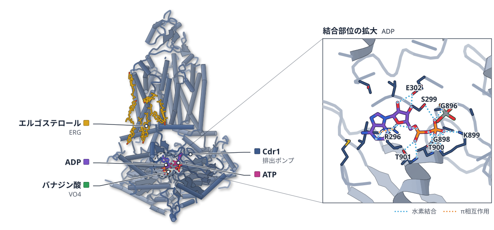

色（順に）：Cdr1（排出ポンプ）　スティック：ATP、バナジン酸（VO4）、ADP、エルゴステロール（ERG）

**Cdr1は、ATPの加水分解後にCヘリックスをピストン状に引き込む**

クライオ電顕と3D変動解析で、ポンプが開く動きとイトラコナゾールの収まり方を捉えた

- **疑問・課題**：カンジダのアゾール耐性に関わる排出ポンプCdr1が、ATPの力でどう働くのか、構造の面は分かっていなかった。
- **アプローチ**：C. glabrata Cdr1を、ATP-Mg²⁺・イトラコナゾール・バナジン酸の有無でクライオ電顕により解析し、3D変動解析も行った。
- **結果**：加水分解したATPのγ-リン酸からCヘリックスが約4 Å後退し、TMH-1の動きなどで薬剤結合部位が開いた。
- **わかったこと**：Cヘリックスの引き込みが、3D変動解析で最初に見える動きで、薬剤結合部位が開く動きにつながる。
- **残された課題**：このCヘリックスの機構がABCトランスポーター全体で共通かは、まだ推測の段階だ。

この紹介文の根拠（論文本文）

> Despite its clinical relevance, the structural basis for its ATP-driven efflux pump function remains elusive.  
> — 疑問・課題／Abstract

> We present four high-resolution cryo-EM structures of Candida glabrata Cdr1 obtained in the absence and presence of ATP-Mg²⁺, itraconazole, and vanadate, capturing distinct nucleotide- and substrate-occupancy states.  
> — アプローチ／Abstract

> Additional low-population cryo-EM conformers were unveiled by 3D variability analysis  
> — アプローチ／Abstract

> The motion shows a 4 Å piston-like retraction of the C-helix from the γ-phosphate/vanadate of the hydrolyzed ATP.  
> — 結果／Abstract

> This causes the nearby transmembrane helix-1 (TMH-1) to open the drug-binding site via lateral displacement and unwinding of the inner-leaflet region of TMH-2.  
> — 結果／Abstract

> the retraction of H-8 from the catalytic center represents the earliest structurally detectable conformational change of CgCdr1 in this deformation sampled  
> — わかったこと／Results

> This causes the nearby transmembrane helix-1 (TMH-1) to open the drug-binding site via lateral displacement and unwinding of the inner-leaflet region of TMH-2.  
> — わかったこと／Abstract

> it is tempting to speculate whether this mechanism is conserved amongst the whole family or a specificity of PDR-like transporters.  
> — 残された課題／Discussion

分類：トランスポーター・感染・ウイルス・防御系

#### 読みどころ

ADP-バナジン酸結合型から開いた型へ移る間に、NBD-1のCヘリックス（H-8）が約4 Å、ピストンのように後ろへ動く。このときほかの変化は小さく、その後にNBD全体が約10°回る。順序は実際の反応経路ではない。

根拠（論文本文）

> a rigid 3.8-Å retraction of the H-8 helix is observed, from the vanadate towards the back of the NBD in a piston-like motion  
> — Results

> Remarkably, this displacement occurs with minimal conformational changes elsewhere in the protein.  
> — Results

> While 3DVA analysis does not represent a true reaction coordinate  
> — Results

イトラコナゾール1分子が、n字型に折れ曲がって薬剤結合部位に収まる。TMH-2の2巻きがほどけて場所ができ、全体の構造は大きく変わらない（RMSD 0.5 Å）。ただしリガンドの密度は周りより不鮮明だった。

根拠（論文本文）

> ITC adopted an n-shaped conformation with the triazolone ring positioned near the bottom of the DBS.  
> — Results

> The ITC structures in the absence or presence of vanadate were almost identical to the [s0|ncATP | cADP-Mg] state with an overall RMSD of 0.5 Å  
> — Results

> Densities for ITC were not as clear as nearby amino-acid residues  
> — Results

触媒をしない側のヌクレオチド結合部位（ncNBS）には、開いた型にも閉じた型にもATPが結合していた。結合は強く（KD 0.3 µM）、輸送のサイクルを通じて結合し続けると考えられる。

根拠（論文本文）

> ATP bound the ncNBS with very high affinity (KD of 0.3 µM)  
> — Results

> The present data also revealed that ATP remains bound to the ncNBS throughout the entire transport cycle  
> — Discussion

#### 構造データ

| PDB | 手法 | 分解能 | 公開 | 生物種 | リガンド |
|---|---|---|---|---|---|
| [9S4T](https://www.rcsb.org/structure/9S4T) | Cryo-EM | 2.80 Å | 2026-08-12 | Nakaseomyces glabratus | ERG |
| [9S2H](https://www.rcsb.org/structure/9S2H) | Cryo-EM | 3.30 Å | 2026-07-29 | Nakaseomyces glabratus | ATP, ERG, ADP |
| [9S2C](https://www.rcsb.org/structure/9S2C) | Cryo-EM | 2.90 Å | 2026-07-29 | Nakaseomyces glabratus | ERG, ADP, VO4, ATP |
| [9S4U](https://www.rcsb.org/structure/9S4U) | Cryo-EM | 3.00 Å | 2026-08-12 | Nakaseomyces glabratus | LYS, ADP, 1YN, ERG, ATP |
| [9S4S](https://www.rcsb.org/structure/9S4S) | Cryo-EM | 3.30 Å | 2026-08-12 | Nakaseomyces glabratus | ADP, ERG, 1YN, ATP, LYS |

- [Q6FK23](https://www.uniprot.org/uniprotkb/Q6FK23) CDR1 Pleiotropic ABC efflux transporter of multiple drugs CDR1 — *Candida glabrata (strain ATCC 2001 / BCRC 20586 / JCM 3761 / NBRC 0622 / NRRL Y-65 / CBS 138)* （PDB で初めての構造）

#### 実験メモ

- **発現系**：出芽酵母の膜タンパク質発現系でC. glabrata Cdr1を過剰発現した。
- **コンストラクト**：C末端にHis6タグを付けたCgCdr1（UniProt Q6FK23）。
- **精製**：界面活性剤PCCとDCOD9bで抽出し、Ni-NTAカラムとSuperose 6のゲルろ過で精製した。
- **結晶化／グリッド作製**：5 mM ATP-Mg2+（イトラコナゾールは30 µM）を30分反応させ、1 mMオルトバナジン酸を加えてグリッドに載せた。
- **データ収集・解析**：ATP・バナジン酸の試料はTitan Krios（300 kV、K3）で撮影し、cryoSPARC v4で処理した。3D変動解析は4 Åに低域通過して行った。

根拠（論文本文）

> CgCdr1 was overexpressed in a S. cerevisiae membrane protein expression system  
> — Results

> was cloned with a C-terminal hexa-histidine tag integrated at the PDR5 locus  
> — Methods

> CgCDR1 encodes the protein sequence referenced as Q6FK23 in the Uniprot protein database  
> — Methods

> CgCdr1 was subsequently extracted and purified using a mixture of trans-PCC-α-M (PCC) (Hovers et al, 40) and dicarboxylate oside 9b (DCOD9b)  
> — Results

> then loaded on a Superose 6 Increase 10/300 GL column  
> — Methods

> pre-incubated with 5 mM ATP-Mg2+ and with or without 30 µM ITC for 30 min at 4 °C followed by addition of 1 mM orthovanadate for 30 min prior to applying it to the grid  
> — Methods

> prior to high-end data acquisition on a Thermo Scientific Titan Krios at 300 kV equipped with a Gatan K3 direct electron detector  
> — Methods

> were subjected to 3DVA after filtering at 4-Å resolution  
> — Methods

> 📝 編集者への確認事項：PDBは5件（9S4T apo、9S2H 開いた型、9S2C 閉じた型、9S4U・9S4S イトラコナゾール）で、いずれも原稿内の引用はなく寄託文に記載。要旨は4つの構造と書く。Pdr5やC. albicans Cdr1の構造は既にあり、C. glabrataのCdr1では初めてという位置づけ（first_claimは付けていない）。3D変動解析の順序は反応経路ではないと著者が明記しており、本文もそれに従った。アンブレラサンプリングMDは補助。Appendix・図・Tableはpacketにない。

---

# New Structure

## 2｜KKT23（トリパノソーマ）

### The kinetoplastid kinetochore protein KKT23 acetyltransferase is a structural homolog of GCN5 that acetylates the histone H2A C-terminal tail

*Structure (London, England : 1993)*（2024-11-22） · [論文](https://doi.org/10.1016/j.str.2024.10.031) · ライセンス: cc by

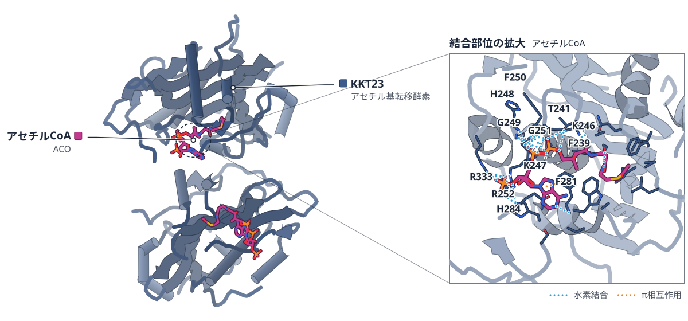

色（順に）：KKT23（アセチル基転移酵素）　スティック：アセチルCoA（ACO）

**動原体の酵素KKT23は、トリパノソーマのH2Aをアセチル化する**

酵素ドメインの結晶構造はGCN5に最も近く、KKT23を減らすとH2Aのアセチル化が下がった

- **疑問・課題**：動原体のタンパク質KKT23はアセチル基転移酵素ドメインを持つが、その機能も構造も分かっていなかった。
- **アプローチ**：酵素ドメインをX線結晶構造解析とNMRで調べ、ヒストンのアセチル化を試験管内とKKT23を減らした細胞で調べた。
- **結果**：酵素ドメインはヒトGCN5に近く（RMSD 1.2 Å）、H2A C末端の尾部のK119など5か所をアセチル化した。
- **わかったこと**：KKT23はGCN5に似た構造の酵素で、トリパノソーマのH2A C末端の尾部のアセチル化の一部はKKT23に依存する。
- **残された課題**：H2AのK115・K119・K120を修飾する酵素や、KKT23によるアセチル化の意義は今後の課題だ。

この紹介文の根拠（論文本文）

> KKT23 is a constitutively localized kinetochore protein containing a C-terminal acetyltransferase domain of unknown function.  
> — 疑問・課題／Abstract

> The function or structure of KKT23 remains unknown.  
> — 疑問・課題／Introduction

> Here, using X-ray crystallography and nuclear magnetic resonance (NMR) spectroscopy, we have determined the structure and dynamics of the KKT23 acetyl-transferase domain from Trypanosoma brucei  
> — アプローチ／Abstract

> We find that KKT23 can acetylate the C-terminal tail of histone H2A and that knockdown of KKT23 results in decreased H2A acetylation levels in T. brucei.  
> — アプローチ／Abstract

> The structural alignment between KKT23125−348 and human GCN5 revealed a remarkable similarity, with a root-mean-square deviation (RMSD) of 1.2 Å (114–114 Cα atoms)  
> — 結果／Results

> We found that lysine residues on the C-terminal tail of H2A were robustly acetylated (K119, K120, K122, K125, and K128)  
> — 結果／Results

> These results show that the hyperacetylation of the histone H2A C-terminal tail partly depends on KKT23 in vivo.  
> — わかったこと／Results

> Taken together, our structural characterization reveals that KKT23 has an acetyltransferase fold with the closest structural similarity to GCN5 histone acetyltransferases.  
> — わかったこと／Results

> It will be important to identify which acetyltransferase(s) are responsible for the H2A C-terminal acetylation in the future.  
> — 残された課題／Discussion

> It will also be important to reveal the functional significance of histone H2A acetylation by KKT23.  
> — 残された課題／Discussion

分類：酵素（その他）・クロマチン・ヒストン

#### 読みどころ

酵素ドメインに最も近い構造はヒトGCN5のヒストンアセチル基転移酵素ドメインだった。KKT23にはGNATの基本の折りたたみにない余分のα7とβ8があり、キネトプラスト間で保存されている。

根拠（論文本文）

> Notable differences between the two structures include the additional α-helix (α7) and β-strand (β8) in the crystal structure of KKT23125−348, which are highly conserved among kinetoplastids but are not part of the consensus GNAT domain fold (Figures 4A and S6)  
> — Results

KKT23はトリパノソーマのヌクレオソームのH2A C末端の尾部を強くアセチル化したが、ヒトのヌクレオソームでは信号が見えなかった。GCN5がH3・H4を主に修飾するのとは基質の好みが異なる。

根拠（論文本文）

> but not when H. sapiens nucleosomes were used, suggesting that KKT23 is specific toward T. brucei nucleosomes  
> — Results

> KKT23 therefore has different substrate specificity compared to GCN5 acetyltransferases in other eukaryotes that are known to preferentially acetylate histones H3 and H4 but not H2A.  
> — Results

N末端領域（残基2–70）の結晶構造は2.7 Åで、短いヘリックス3本からなる。DALI検索で明らかな類似構造は見つからなかった。この領域だけでKKT22との結合に十分らしい。

根拠（論文本文）

> The structure comprises three short helices between residues 22–33, 36–49, and 54–62.  
> — Results

> Based on the observation that the N-terminal region of KKT23 is sufficient to interact with KKT22 in this assay  
> — Results

#### 構造データ

| PDB | 手法 | 分解能 | 公開 | 生物種 | リガンド |
|---|---|---|---|---|---|
| [9EVQ](https://www.rcsb.org/structure/9EVQ) | X-ray | 1.75 Å | 2024-08-28 | Trypanosoma brucei brucei TREU927 | ACO |
| [9F5Q](https://www.rcsb.org/structure/9F5Q) | X-ray | 1.95 Å | 2024-08-28 | Trypanosoma brucei brucei TREU927 | ACO |
| [9EVR](https://www.rcsb.org/structure/9EVR) | X-ray | 2.70 Å | 2024-08-28 | Trypanosoma brucei brucei TREU927 | — |

- [Q38AU6](https://www.uniprot.org/uniprotkb/Q38AU6)  N-acetyltransferase domain-containing protein — *Trypanosoma brucei brucei (strain 927/4 GUTat10.1)* （PDB で初めての構造）

#### 実験メモ

- **発現系**：酵素ドメインとN末端領域は大腸菌BL21(DE3)で発現した。KKT22・KKT3との共発現はSf9昆虫細胞で行った。
- **コンストラクト**：全長では結晶が得られず、酵素ドメイン（125–348、アセチルCoA存在下）とN末端領域（2–70）を結晶化した。
- **精製**：TALONでHisタグ付きを精製し、TEVでタグを切った後、イオン交換とゲルろ過で精製した。
- **結晶化／グリッド作製**：酵素ドメインは4 °CでアセチルCoAを加えて結晶化した。N末端領域の結晶は18 °Cで40日後に現れた。
- **データ収集・解析**：Diamond Light SourceのI03・I04で回折データを集めた。NMRは750 MHzで測定した。

根拠（論文本文）

> Protein expression was induced with 0.2 mM IPTG and was continued for ~16 h at 20°C.  
> — Methods

> these proteins were co-expressed in insect cells (Sf9) and pulled down using FLAG-KKT23  
> — Results

> However, no crystal for the full-length protein was obtained.  
> — Results

> To cleave off the His-tag, samples were incubated with TEV protease in 1:50 w/w ratio overnight  
> — Methods

> The samples were then further purified using ion exchange and size exclusion chromatography.  
> — Methods

> Crystals appeared after 40 days.  
> — Methods

> Native crystals of Trypanosoma brucei KKT23125-348 (14.5 mg/mL) were grown at 4°C  
> — Methods

> X-ray diffraction data from selenomethionine crystals of Trypanosoma brucei KKT23125-348 were collected at the I03 beamline at the Diamond Light Source  
> — Methods

> All NMR spectra were acquired using a 750 MHz spectrometer  
> — Methods

> 📝 編集者への確認事項：新しい構造は9EVQ（天然、1.75 Å）・9F5Q（SeMet）・9EVR（N末端、2.7 Å）。結晶構造の全体にはリガンドとしてアセチルCoAが入る。AlphaFold2・AlphaFold-Multimerの予測は補助で、結論の根拠にはしていない。KKT22との相互作用は断片のプルダウンで示され、複合体の構造はない。Methodsの後半（MS・ChIP-seq）は読み飛ばした。

---

## 3｜NHA1（ヒト、SLC9B1）

### Cryo-EM structure of human Na+/H+ exchanger NHA1 in an inward-open conformation

*Nature Communications*（2026-01-01） · [論文](https://doi.org/10.1038/s41467-026-77811-7) · ライセンス: cc by-nc-nd

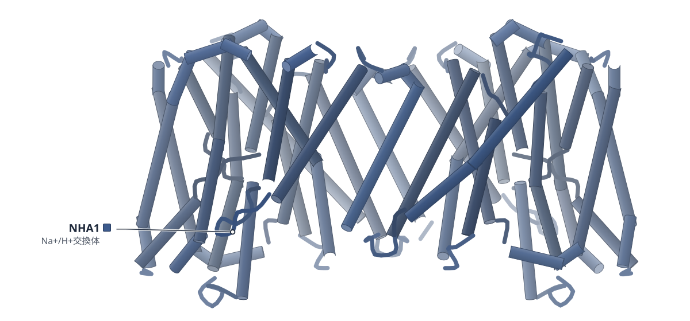

色（順に）：NHA1（Na+/H+交換体）

**精子に働くNa+/H+交換体NHA1が、内向きに開いた姿で見えた**

ヒトNHA1を3.6 Åで解き、外向き型のモデルとの比較でコア領域が動く機構を支持した

- **疑問・課題**：NHA1の働きを支える構造と輸送の仕組みは、精子の運動に重要なのに、よく分かっていなかった。
- **アプローチ**：ヒトNHA1のクライオ電顕構造を決め、モデルした外向き開口型と比べ、変異体の輸送試験で残基の働きを調べた。
- **結果**：3.6 Åで内向き開口型を捉えた。モデルの外向き開口型と比べると、コア領域に大きな構造変化があった。
- **わかったこと**：コア領域が二量体化領域に対して動くエレベーター型の輸送機構を支持する。E453が内向き開口型の安定化を助けるらしい。
- **残された課題**：二量体界面に見えた脂質らしい密度の正体と役割は、今後の解明が必要だとしている。

この紹介文の根拠（論文本文）

> However, the structural and mechanistic basis of NHA1 function remains poorly understood.  
> — 疑問・課題／Introduction

> Here, we present the cryo-EM structure of human NHA1 at 3.6 Å resolution, captured in an inward-open conformation.  
> — アプローチ／Abstract

> Their contribution to substrate transport is further supported by mutagenesis and sodium transport assays  
> — アプローチ／Abstract

> Structural comparisons with modeled outward-open states reveal substantial conformational changes in the core domain, supporting an elevator-like transport mechanism.  
> — 結果／Abstract

> The inward-open structure of NHA1 provides experimental support for the proposed elevator mechanism of substrate transport across the membrane in the SLC9B subfamily.  
> — わかったこと／Discussion

> These results suggest an important role for E453 in transport activity, probably due to its function in stabilizing the inward-open conformation  
> — わかったこと／NHA1 undergoes significant conformational switch in the core domain

> Further exploration is needed to clarify the exact identity and functional roles of these lipid molecules in NHA1.  
> — 残された課題／Discussion

分類：トランスポーター

#### 読みどころ

イオン結合部位のD259には細胞質側から通じる通路があり、内向き開口型だと分かる。D258とD259を両方アラニンにすると輸送活性が大きく下がった。片方だけなら下がり方は小さく、2つのアスパラギン酸は役割が重なり合うらしい。

根拠（論文本文）

> Intriguingly, our NHA1 structure is captured in an inward-open conformation, as demonstrated by an obvious accessible path from the cytoplasmic side to D259 (Fig. 3b).  
> — NHA1 presents an inward-open conformation

> These results indicate that the two aspartates may have cooperative and partially compensatory roles in substrate binding and transport.  
> — NHA1 presents an inward-open conformation

内向き開口型では、TM12bのE453がTM3のR157と塩橋、S153と水素結合を作る。モデルの外向き開口型ではこの相互作用が外れると予測される。外向き開口型はホモロジーモデルなので、著者はこの相互作用を構造に基づく仮説と位置づけている。

根拠（論文本文）

> In the inward-open state, E453 from TM12b forms a salt bridge with R157 from TM3, and a hydrogen bond with S153 from TM3 (Fig. 4c).  
> — NHA1 undergoes significant conformational switch in the core domain

> these specific interactions should be interpreted as structure-guided hypotheses  
> — NHA1 undergoes significant conformational switch in the core domain

二量体化は、一方のTM0ともう一方のTM8の相互作用が中心になる。この界面のD311A・Q312A・S329Aで輸送活性が下がり、二量体の維持が輸送に役立つらしい。

根拠（論文本文）

> The dimerization of NHA1 is mainly mediated by the interaction between two pairs of TM0 and TM8 from each protomer, involving hydrogen bonds and hydrophobic interactions.  
> — Dimerization of NHA1 is primarily mediated by TM0 and TM8

> suggesting their roles in maintaining the dimeric NHA1 for efficient substrate transport  
> — Dimerization of NHA1 is primarily mediated by TM0 and TM8

#### 構造データ

| PDB | 手法 | 分解能 | 公開 | 生物種 | リガンド |
|---|---|---|---|---|---|
| [21MW](https://www.rcsb.org/structure/21MW) | Cryo-EM | 3.64 Å | 2026-09-30 | Homo sapiens | — |

- [Q4ZJI4](https://www.uniprot.org/uniprotkb/Q4ZJI4) SLC9B1 Sodium/hydrogen exchanger 9B1 — *Homo sapiens* （PDB で初めての構造）

#### 実験メモ

- **発現系**：ヒトNHA1全長をHEK293S GnTI-細胞で過剰発現した（BacMam系）。
- **コンストラクト**：C末端にFLAG-TEV切断部位-eGFPを融合したpEG BacMamベクターを使った。
- **精製**：DDMで可溶化し、GFPナノボディによるアフィニティー精製の後、ゲルろ過の段階で界面活性剤をLMNGに替えた。
- **結晶化／グリッド作製**：1.2 mg/mLに濃縮し、Vitrobot Mark IVで凍結した（4 °C、湿度100%、ブロット4.5秒）。
- **データ収集・解析**：Titan Krios G3（300 kV）とK3検出器で撮影し、ピクセルサイズは1.06 Å。最終マップには270,161粒子を使った。

根拠（論文本文）

> The full-length human Na+/H+ (sodium/proton) antiporter 1 (hNHA1, hereafter referred to as NHA1) was overexpressed in HEK293S GnTI- cells.  
> — Overall structure of human NHA1

> subcloned into the pEG BacMam vector containing a C-terminal fusion tag (FLAG-TEV protease cleavage site (ENLYFQG)-eGFP) for structural studies  
> — Molecular cloning

> During size-exclusion chromatography, the detergent was changed to lauryl maltose neopentyl glycol (LMNG)  
> — Overall structure of human NHA1

> Vitrification was performed using a Vitrobot Mark IV (Thermo Fisher Scientific) under the following condition: 4 °C chamber temperature, 100% humidity, blot force 0 with Whatman 597 filter paper, and a blot time of 4.5 s.  
> — Cryo-EM sample preparation and data collection

> Data acquisition was performed on a 300 kV Titan Krios G3 cryo-electron microscope (Thermo Fisher Scientific) equipped with a Gatan K3 direct electron detector  
> — Cryo-EM sample preparation and data collection

> Final processing utilized 270,161 particles for ab initio model generation, non-uniform refinement and local refinement (detergent micelle exclusion) to generate the final map.  
> — Cryo-EM data processing

> 📝 編集者への確認事項：構造は21MW（3.64 Å、内向き開口型）のみ。UniProt Q4ZJI4で先行PDBなし（first_structure true）。外向き開口型はSWISS-MODELのホモロジーモデルで実験構造ではなく、著者もE453-R157の切り替えを仮説と書いている。MDは補助的。S503のリン酸化模倣変異の輸送試験やgnomAD/AlphaMissense解析は本文にあるが記事には入れていない。legend_labels は単一タンパク質のため下で設定。

---

## 4｜FMDV O/Cathay（口蹄疫ウイルス）

### Structural basis of antigenic drift in FMDV O/Cathay topotype variants revealed by porcine-derived single B-cell neutralizing antibodies

*PLOS Pathogens*（2026-10-01） · [論文](https://doi.org/10.1371/journal.ppat.1014650) · ライセンス: cc by

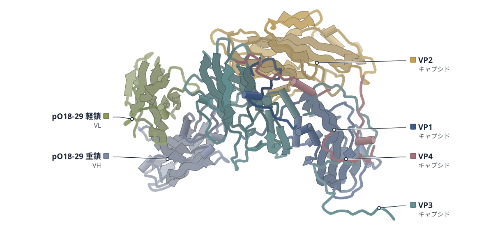

色（順に）：VP1（キャプシド） / VP2（キャプシド） / VP3（キャプシド） / VP4（キャプシド） / pO18-29 重鎖（VH） / pO18-29 軽鎖（VL）

**Cathay型口蹄疫ウイルスは、VP3の変異で豚の抗体を逃れる**

古い株と新しい株の抗体複合体をクライオ電顕で解き、VP3の73位と134位が結合を支えると示した

- **疑問・課題**：O/Cathay型口蹄疫ウイルスで抗原性が変わった構造的な理由は、よく分かっていなかった。
- **アプローチ**：豚由来の中和抗体pO18-29のscFvと、古い株・新しい株のウイルス粒子との複合体をクライオ電顕で解析した。
- **結果**：抗体の結合面は2株でほぼ同じだった。新しい株ではV73の疎水接触とK134の塩橋が失われていた。
- **わかったこと**：VP3の73位（V→K）と134位（K→T）の置換が疎水接触や水素結合・塩橋の網を壊し、中和からの逃避を起こす。
- **残された課題**：試験管内で選んだ逃避変異は、自然感染で起きる変異を完全には再現しない可能性がある。

この紹介文の根拠（論文本文）

> However, the structural basis underlying this divergence remains poorly defined.  
> — 疑問・課題／Abstract

> We resolved cryo-EM structures of the pO18-29 single-chain variable fragment (scFv) in complex with capsids from the ancient strain O/HN/CHA/93  
> — アプローチ／Cryo-EM complex structures of virus-antibody

> The two complexes exhibited highly similar overall antigenic footprints (Fig 4D-E).  
> — 結果／Cryo-EM complex structures of virus-antibody

> This hydrophobic contact was abolished in O/18074 due to the V73K substitution (Fig 5F), resulting in destabilization of the antibody-capsid interface.  
> — 結果／Cryo-EM complex structures of virus-antibody

> showed that mutations at positions 73 (V → K) and 134 (K → T) on VP3 mediated neutralization escape in O/Cathay variants via disruption of hydrophobic interaction as well as the hydrogen bonds and salt bridge networks  
> — わかったこと／Abstract

> Escape mutations selected in vitro may not fully recapitulate those arising during natural infection  
> — 残された課題／Discussion

分類：免疫（抗体・MHC・TCR・自然免疫）・感染・ウイルス・防御系

#### 読みどころ

古い株O/HN/CHA/93との複合体では水素結合17・塩橋5で結ばれていたが、新しい株O/18074では水素結合25・塩橋7へと結合の網が組み替わっていた。結合面は大きくは変わらず、相互作用の配置が再編されている。

根拠（論文本文）

> forming an extensive interaction network comprising 17 hydrogen bonds and 5 salt bridges  
> — Cryo-EM complex structures of virus-antibody

> although pO18-29 recognized a largely overlapping surface on the O/18074 capsid, the FMDV-O18–pO18-29 complex exhibited a reconfigured interaction network, characterized by 25 hydrogen bonds and 7 salt bridges at the interface  
> — Cryo-EM complex structures of virus-antibody

古い株ではVP3のV73が抗体のHCDR3ループと深い疎水接触を作り、結合の足場になる。新しい株ではV73K置換でこの接触が消える。K134は塩橋を作るが、新しい株のT134は正電荷の側鎖がなく塩橋を作れない。

根拠（論文本文）

> Second, VP3 residue V73 in O/HN/CHA/93 established a deep hydrophobic interaction with the HCDR3 loop of pO18-29 (Fig 5B), serving as a key anchoring point.  
> — Cryo-EM complex structures of virus-antibody

> whereas the corresponding residue in O/18074 (T134) lacked the positively charged side chain required for salt-bridge formation  
> — Cryo-EM complex structures of virus-antibody

受容体結合モチーフRGDの2残基後ろ（VP1の149位）がQ149Hになると、3つの抗体による中和が完全に消えた。新しい株でH149Qに戻すと中和が大きく回復した。この位置は構造解析ではなく変異ウイルスの中和試験で示された。

根拠（論文本文）

> In the O/HN/CHA/93 background, introduction of Q149H substitution completely abolished neutralization by pO18-34, pO18-40, and pO18-43 (Fig 3B).  
> — The charge change at RGD + 2 position

> the reciprocal H149Q substitution in O/18074 background markedly restored neutralization by all these pnAbs  
> — The charge change at RGD + 2 position

#### 構造データ

| PDB | 手法 | 分解能 | 公開 | 生物種 | リガンド |
|---|---|---|---|---|---|
| [23IT](https://www.rcsb.org/structure/23IT) | Cryo-EM | 2.24 Å | 2026-09-09 | Foot-and-mouth disease virus O, Sus scrofa | — |
| [23IU](https://www.rcsb.org/structure/23IU) | Cryo-EM | 2.34 Å | 2026-09-09 | Foot-and-mouth disease virus O, Sus scrofa | — |

- [A0A1C6ZW38](https://www.uniprot.org/uniprotkb/A0A1C6ZW38)  Genome polyprotein — *Foot-and-mouth disease virus serotype O* （PDB で初めての構造）
- [A0A1C6ZW66](https://www.uniprot.org/uniprotkb/A0A1C6ZW66)  Genome polyprotein — *Foot-and-mouth disease virus serotype O* （既存の PDB 構造 2 件）
- [A0A1P8DYS7](https://www.uniprot.org/uniprotkb/A0A1P8DYS7)  Genome polyprotein — *Foot-and-mouth disease virus serotype O* （既存の PDB 構造 2 件）
- [J9PGT1](https://www.uniprot.org/uniprotkb/J9PGT1)  Genome polyprotein — *Foot-and-mouth disease virus serotype O* （既存の PDB 構造 2 件）
- [Q00574](https://www.uniprot.org/uniprotkb/Q00574)  Genome polyprotein — *Foot-and-mouth disease virus serotype O* （PDB で初めての構造）

#### 実験メモ

- **発現系**：豚由来mAbのVH・VL遺伝子をコドン最適化して発現ベクターに入れ、CHO-S細胞に導入して発現した。
- **精製**：培養上清をNiキレートアフィニティークロマトグラフィーで精製した。
- **結晶化／グリッド作製**：ウイルス粒子とscFvをモル比1:240で混ぜ、Quantifoilグリッド（Au 1.2/1.3）に4 μLを載せ、3秒ブロットして液体エタンで急速凍結した。
- **データ収集・解析**：Titan Krios G3i（300 kV）とK3検出器で撮影し、ピクセルサイズは0.83 Å。cryoSPARCで再構成した。

根拠（論文本文）

> The antibody-expressing plasmids were co-transfected into suspension CHO-S cells  
> — Expression and purification of porcine-derived mAbs

> The supernatants were initially purified through Ni-chelating affinity chromatography.  
> — Expression and purification of porcine-derived mAbs

> Grids were blotted for 3 s at 100% relative humidity and plunge-frozen in liquid ethane using a Vitrobot Mark IV  
> — Cryo-EM sample preparation, data collection and three-dimensional reconstruction

> resulting in a pixel size of 0.83 Å  
> — Cryo-EM sample preparation, data collection and three-dimensional reconstruction

> 📝 編集者への確認事項：構造は23IT（O/HN/CHA/93＋pO18-29）と23IU（O/18074＋pO18-29）。新しい構造だが、VP1のRGD+2（149位）の結果は変異ウイルスの中和試験で示されたもので、構造にはない。ウイルスの2種類のゲノムポリタンパク質はUniProtで初構造だが論文は初と言っていない。legend_labels は未設定（render 前で凡例の順が未確認）。

---

## 5｜D13（ワクシニアウイルス）

### Structural transition of the immature poxvirus scaffold from preassembly to the scaffold lattice

*Nature Communications*（2026-01-01） · [論文](https://doi.org/10.1038/s41467-026-77815-3) · ライセンス: cc by-nc-nd

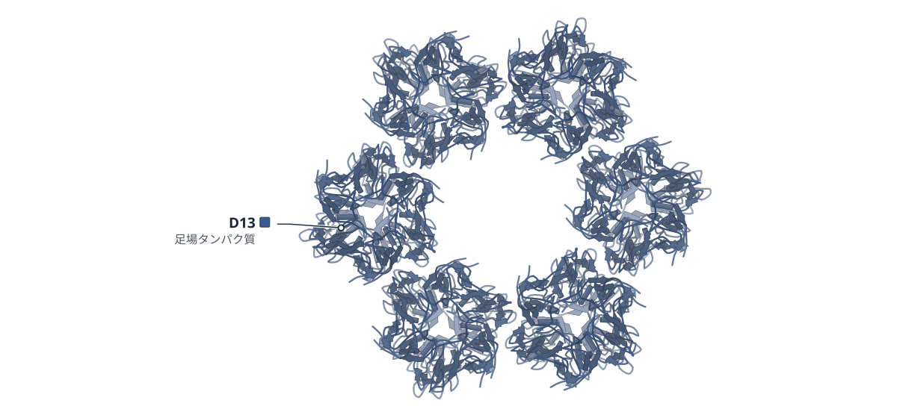

色（順に）：D13（足場タンパク質）

**ワクシニアウイルスの足場D13は、A17ペプチドで棒状から格子へ移る**

試験管内の2種類の集合体をクライオ電顕で解き、足場ができる前段階からの転換を示した

- **疑問・課題**：未成熟ウイルス粒子の足場がどう組み上がるかは、粒子が一過性で形も多様なため、よく分かっていなかった。
- **アプローチ**：ワクシニアウイルスの足場タンパク質D13を試験管内で2種類の集合体にし、クライオ電顕とクライオ電子線トモグラフィーで解析した。
- **結果**：足場様粒子の格子は2.9 Åで解けた。棒状のtwisterにA17のN末端ペプチドを加えると、足場様粒子に変わった。
- **わかったこと**：A17のN末端ペプチドがD13の底の空洞に入り込むと、前段階の構造が崩れて足場の形成が始まると、著者は提案している。
- **残された課題**：膜に埋め込んだ全長A17を使って組み立てを再現することが、次に必要な段階として挙げられている。

この紹介文の根拠（論文本文）

> However, the molecular mechanisms underlying scaffold assembly remain poorly understood due to the transient and pleomorphic nature of IVs  
> — 疑問・課題／Introduction

> Here, we present single-particle cryo-electron microscopy and cryo-electron tomography structures of two distinct in vitro assemblies of the vaccinia virus scaffold protein D13 that recapitulate oligomeric states previously observed in situ.  
> — アプローチ／Abstract

> We analyzed the images of lattice patches of the SLP, yielding a 3D reconstruction at 2.9 Å resolution  
> — 結果／Cryo-EM structure of scaffold-like particle

> this led to a structural transformation into SLPs, strongly supporting the role of A17 in reorganizing the D13 arrangement  
> — 結果／Molecular mechanism of transition from twister to scaffold

> We propose that this interaction destabilizes the pre-assembly conformation and initiates scaffold formation upon viral membrane recruitment  
> — わかったこと／Abstract

> triggered by the docking of the N-terminal peptide of the viral membrane protein A17 into the base cavity of D13  
> — わかったこと／Abstract

> reconstituting this assembly process in vitro using full-length A17 embedded in lipid bilayers or liposomes will be a crucial next step  
> — 残された課題／Molecular mechanism of transition from twister to scaffold

分類：感染・ウイルス・防御系

#### 読みどころ

足場の前段階にあたるtwisterは、D13三量体6個でできた六角形の環が2枚向かい合う構造だった。環どうしは約19.3°回って軸がそろわない。底の空洞にもN末端と考えられる密度があり、縦方向のつながりがN末端の入れ替わり（ドメイン交換）による可能性が示された。

根拠（論文本文）

> Interestingly, the rings are slightly rotated relative to each other by approximately 19.3°, precluding axial alignment  
> — Cryo-electron tomography of two in vitro D13 assembly products

> indicating potential vertical intertrimeric domain swapping of the N-terminus of D13  
> — Cryo-EM structure of the twister assembly

twisterにA17の先頭16残基のペプチドを加えると、足場様粒子に変わった。底の空洞のフェニルアラニンが並ぶ溝のそばにペプチド由来とみられる密度が見えたが、ペプチドの構造は追えず、原子モデルは作れなかった。

根拠（論文本文）

> Although the cryo-EM maps were insufficient to trace peptide structure, pronounced map density (marked by asterisks in Fig. 5) is symmetrically arranged adjacent to the groove formed by sequential phenylalanine residues (F486, F168, and F487) within the base cavity.  
> — Molecular mechanism of transition from twister to scaffold

N末端にeGFPを付けて、N末端が底の空洞に入れないようにしても、足場様粒子はできた。構造はHis6付きD13のものと区別できず、違いは底の空洞が空いている点だけだった。

根拠（論文本文）

> eGFP-D13 consistently formed SLPs, the structure of which remains indistinguishable from the SLPs produced from His6-tagged D13, except that the base cavity is unoccupied  
> — Cryo-EM structure of scaffold-like particle

#### 構造データ

| PDB | 手法 | 分解能 | 公開 | 生物種 | リガンド |
|---|---|---|---|---|---|
| [9USX](https://www.rcsb.org/structure/9USX) | Cryo-EM | 2.88 Å | 2026-08-05 | Orthopoxvirus vaccinia | — |
| [9USY](https://www.rcsb.org/structure/9USY) | Cryo-EM | 3.70 Å | 2026-08-05 | Orthopoxvirus vaccinia | — |
| [9USU](https://www.rcsb.org/structure/9USU) | Cryo-EM | 2.90 Å | 2026-08-05 | Orthopoxvirus vaccinia | — |
| [9USV](https://www.rcsb.org/structure/9USV) | Cryo-EM | 3.20 Å | 2026-08-05 | Orthopoxvirus vaccinia | — |
| [9USW](https://www.rcsb.org/structure/9USW) | Cryo-EM | 3.10 Å | 2026-08-05 | Orthopoxvirus vaccinia | — |
| [9USZ](https://www.rcsb.org/structure/9USZ) | Cryo-EM | 2.56 Å | 2026-08-05 | Orthopoxvirus vaccinia | — |
| [9UT0](https://www.rcsb.org/structure/9UT0) | Cryo-EM | 3.63 Å | 2026-08-05 | Orthopoxvirus vaccinia | — |
| [26FE](https://www.rcsb.org/structure/26FE) | Cryo-EM | 3.04 Å | 2026-08-05 | Orthopoxvirus vaccinia | — |

- [P68440](https://www.uniprot.org/uniprotkb/P68440) OPG125 Scaffold protein OPG125 — *Vaccinia virus (strain Western Reserve)* （既存の PDB 構造 20 件）
- [Q76ZR4](https://www.uniprot.org/uniprotkb/Q76ZR4) OPG125 Scaffold protein OPG125 — *Vaccinia virus (strain Ankara)* （PDB で初めての構造）

#### 実験メモ

- **発現系**：D13は大腸菌BL21(DE3)で発現した。eGFP-D13だけRosetta(DE3)で発現した。
- **コンストラクト**：全長D13（1-551）と、N末端17残基を欠くD13（18-551）をpPROEX-HTaに入れた。
- **精製**：Ni-NTAのIMACで精製した。His6付きD13以外はTEVプロテアーゼでタグを外し、ゲルろ過で仕上げた。
- **結晶化／グリッド作製**：高塩（500 mM NaCl）のD13三量体を150 mM NaClに透析して集合体を作った。
- **データ収集・解析**：足場様粒子はKrios G4（300 kV）とK3検出器で撮影し、cryoSPARCで処理した。

根拠（論文本文）

> The genes encoding both the wild type and mutant D13 in the pPROEX-HTa vector were expressed in Escherichia coli BL21 (DE3) cells, whereas eGFP-D13 was expressed in Rosetta (DE3) cells.  
> — Protein expression and purification

> The genes encoding full-length D13 (D131-551) and the N-terminal truncation mutant (D1318-551) of Western Reserve strain vaccinia virus were inserted into the pPROEX-HTa vector  
> — Cloning

> With the exception of the His6-tagged D13 construct, N-terminal His6 tags were removed by tobacco etch virus (TEV) protease digestion.  
> — Protein expression and purification

> Lowering the NaCl concentration to 150 mM yielded two distinct D13 assembly products.  
> — Cryo-electron tomography of two in vitro D13 assembly products

> Movie data were collected on a 300 kV Krios G4 TEM (TFS) equipped with a K3 BioContinuum direct electron detector (Gatan).  
> — Cryo-electron microscopy

> 📝 編集者への確認事項：8エントリ（9USX・9USY・9USU・9USV・9USW・9USZ・9UT0・26FE）。D13には既存の構造が多数あり（UniProt P68440は先行PDB 20件）、初構造ではなく新しい集合状態の構造。A17ペプチドはマップ上の密度のみで原子モデルがない（UniProt Q76ZR4が初構造扱いになるのはこのため）。ga_pdb_id は足場様粒子の9USX。本文は Methods の途中（Cryo-ET 処理以降）まで確認。

---

# Structure Update

## 6｜ALAS（出芽酵母）

### Substrate-bound structures of yeast ALA synthase reveal protein dynamics initiating heme biosynthesis

*Science Advances*（2026-10-16） · [論文](https://doi.org/10.1126/sciadv.aef7768) · ライセンス: cc by-nc

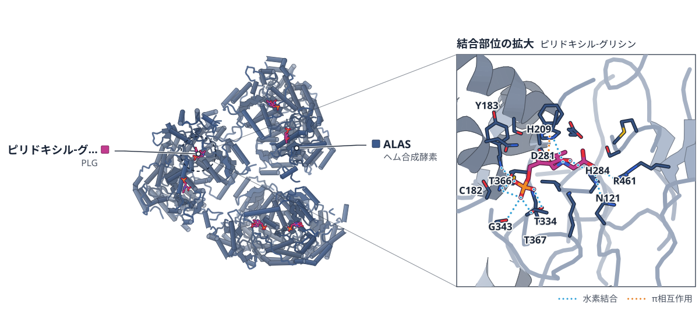

色（順に）：ALAS（ヘム合成酵素）　スティック：ピリドキシル-グリシン（PLG）

**酵母のALA合成酵素は、基質に応じて下のローブを動かす**

グリシン結合型とスクシニルCoA結合型の結晶構造で、Gateとヒンジの動きを示した

- **疑問・課題**：ALAS相同体は配列が約70%似るのに調節が異なる。その分子的な理由はよく分かっていなかった。
- **アプローチ**：酵母ALAS（scALAS）をグリシンまたはスクシニルCoA（sCoA）と共結晶化し、MDと変異体で調べた。
- **結果**：グリシン結合型（2.49 Å）では下のローブが剛体として動き、sCoA結合型（2.69 Å）ではGateとヒンジが固まった。
- **わかったこと**：触媒の開始で、下のローブが静的な上のローブに対して動く。Gateを置換すると活性が増減した。
- **残された課題**：ヒトALAS2のGate変異が貧血（XLSA）を起こす仕組みに、確かな説明はまだない。

この紹介文の根拠（論文本文）

> Despite sharing approximately 70% sequence similarity, ALAS homologs exhibit distinct expression and regulatory mechanisms.  
> — 疑問・課題／Abstract

> However, the molecular basis for their functional divergence remains poorly understood.  
> — 疑問・課題／Abstract

> we determined the cocrystal structure of scALAS in the presence of glycine to 2.49-Å resolution  
> — アプローチ／Glycine binding promotes protein dynamics to initiate catalysis in scALAS

> we also determined the 2.69-Å resolution cocrystal structure of scALAS in the presence of its second substrate, sCoA  
> — アプローチ／scALAS uniquely positions sCoA for catalysis

> shows that the lower lobe moves as a rigid body toward the active site to varying degrees  
> — 結果／scALAS uses a C-terminal hinge to access distinct enzyme conformations

> the scALAS-sCoA model also exhibits enhanced rigidity in the Gate and Ct-ext Hinge  
> — 結果／scALAS uses a C-terminal hinge to access distinct enzyme conformations

> Our scALAS co-crystal structures identify a mechanism where catalytic initiation triggers the enzyme’s lower lobe  
> — わかったこと／Discussion

> our work demonstrates that targeted Gate mutations can modulate ALAS activity in either direction  
> — わかったこと／Discussion

> To date, there is no definitive explanation for how these Gate mutations lead to XLSA.  
> — 残された課題／Discussion

分類：酵素（その他）

#### 読みどころ

グリシン結合型の6つのプロトマーを上のローブで重ねると、下のローブが活性部位側へ剛体として様々な程度に動く。Gateの頂点にあるT452は、PLGの方向に3 Å動く。

根拠（論文本文）

> shows that the lower lobe moves as a rigid body toward the active site to varying degrees  
> — scALAS uses a C-terminal hinge to access distinct enzyme conformations

> Specifically, T452 in the Gate translates 3 Å toward the PLG ligand.  
> — scALAS uses a C-terminal hinge to access distinct enzyme conformations

sCoAは細菌型ALASと違う向きで結合する。Gateの保存されたThrではなく、P451の主鎖がsCoAのパンテテイン部分と水素結合する。

根拠（論文本文）

> Instead, in the scALAS-sCoA structure, there is a hydrogen bond between the main chain of P451 and the sCoA pantetheine moiety.  
> — scALAS uniquely positions sCoA for catalysis

> Notably, scALAS uses a fundamentally different interaction mechanism that does not involve the conserved threonine  
> — scALAS uniquely positions sCoA for catalysis

Gateを細菌型（scALASB）やヒト型（scALASH）に置換した変異体は、活性が逆方向に変わる。scALASBは生成物ALAの放出速度が2倍になり、scALASHは活性が下がる。

根拠（論文本文）

> Specifically, scALASB demonstrates a twofold increase in the rate of ALA product release compared with WT scALAS, while the activity of scALASH correspondingly declines  
> — Gate dynamics couple substrate interaction and catalytic efficiency

#### 構造データ

| PDB | 手法 | 分解能 | 公開 | 生物種 | リガンド |
|---|---|---|---|---|---|
| [9DZ7](https://www.rcsb.org/structure/9DZ7) | X-ray | 2.49 Å | 2025-10-22 | Saccharomyces cerevisiae | PLG |
| [9DZO](https://www.rcsb.org/structure/9DZO) | X-ray | 2.69 Å | 2025-10-22 | Saccharomyces cerevisiae | PLP, SCA |

- [P09950](https://www.uniprot.org/uniprotkb/P09950) HEM1 5-aminolevulinate synthase, mitochondrial — *Saccharomyces cerevisiae (strain ATCC 204508 / S288c)* （既存の PDB 構造 3 件）

#### 実験メモ

- **コンストラクト**：結晶化には残基58〜548を使った。ミトコンドリアへの輸送配列は含まない。
- **結晶化／グリッド作製**：酵素を50 mMグリシンまたは1 mM sCoAと室温で1時間混ぜてから、吊り滴蒸気拡散法で共結晶化した。
- **データ収集・解析**：NSLS-IIの17-ID-1 AMXで回折データを集め、5TXRのapo酵素を探索モデルに分子置換した。

根拠（論文本文）

> The construct used for crystallization (residues 58 to 548) lacks the mitochondrial targeting sequence  
> — Glycine binding promotes protein dynamics to initiate catalysis in scALAS

> The corresponding dilutions were incubated with 50 mM glycine or 1 mM sCoA at room temperature (∼25°C) for 1 hour.  
> — scALAS and substrate co-crystallization

> Native diffraction datasets were collected at the 17-ID-1 AMX beamline at the National Synchrotron Light Source II  
> — Data collection, structure determination, and refinement

> Molecular replacement was performed in PHASER using one subunit of Hem1 apoenzyme (Protein Data Bank 5TXR, chain B) as the search model  
> — Data collection, structure determination, and refinement

> 📝 編集者への確認事項：構造は9DZ7（グリシン結合型、2.49 Å）と9DZO（sCoA結合型、2.69 Å）。UniProt P09950にはapo構造（5TXR など）が既にあり、初構造ではない。論文は「基質結合型で公表済みなのは細菌 R. capsulatus の ALAS だけ」と書いている。ga_pdb_id は既定（9DZ7）。図の凡例は render 前のため未確認。

---

## 7｜単量体PSI（T. vestitus）

### High-resolution structure of monomeric photosystem I from Thermosynechococcus vestitus

*Photosynthesis Research*（2026-01-01） · [論文](https://doi.org/10.1007/s11120-026-01237-x) · ライセンス: cc by

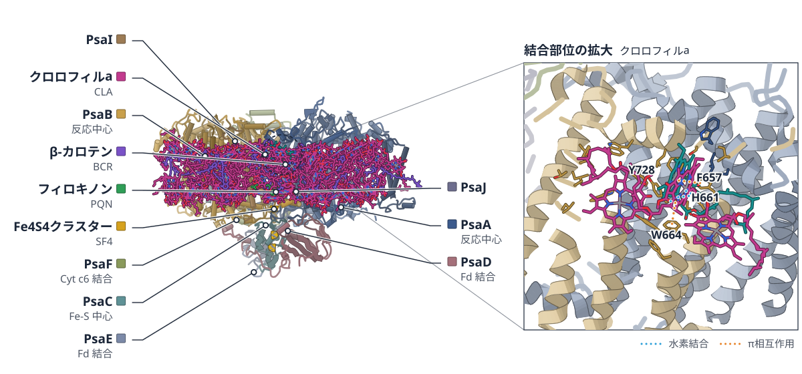

色（順に）：PsaA（反応中心） / PsaB（反応中心） / PsaC（Fe-S 中心） / PsaD（Fd 結合） / PsaE（Fd 結合） / PsaF（Cyt c6 結合） / PsaI / PsaJ / PsaK / PsaM / 4.8K タンパク質　スティック：クロロフィルa（CLA）、フィロキノン（PQN）、β-カロテン（BCR）、Fe4S4クラスター（SF4）、chlorophyll a isomer（CL0）

**T. vestitusの単量体PSIを、1.8 Åのクライオ電顕で解いた**

三量体をC12E8と加温で単量体にし、PsaL以外の11サブユニットと脂質、界面活性剤の層を確認した

- **疑問・課題**：天然のPSI周辺の脂質が、さまざまなオリゴマー状態をつくる際に果たす役割は、よく分かっていなかった。
- **アプローチ**：精製した三量体をC12E8と加温で単量体にして大量に調製し、クライオ電顕・分光・SANSで調べた。
- **結果**：PsaL以外の11サブユニット、91個のChl a、脂質7個、βDM 16個が見え、水分子も1183個を数えた。
- **わかったこと**：T. vestitusのPSIで初めてSQDを検出した。第2のCa2+部位のMg2+や、708 nm吸収に関わる赤色Chl B7も示した。
- **残された課題**：Cyt c6の結合は、密度がぼやけてモデルを作れず、構造としては解けていない。

この紹介文の根拠（論文本文）

> However, the role of endogenous and peripheral lipids in and around the native PSI complex in the formation of its various oligomeric forms under different environmental conditions remains largely unclear  
> — 疑問・課題／Introduction

> Here, we have developed a novel protocol to obtain large amounts of intact, active mPSI from Thermosynechococcus vestitus (Tv) by dissociating highly purified tPSI using the detergent octaethylene glycol monododecyl ether (C12E8) at elevated temperatures.  
> — アプローチ／Abstract

> A total of 11 protein subunits could be identified in the structure, whereby only the subunit important for trimerisation, PsaL, is not detected  
> — 結果／ßDM mPSI cryo-EM structure

> the cryo-EM map revealed 1183 water molecules, 19 β-carotenes (ß-Car), 91 chlorophyll a (Chl a) molecules, seven lipids  
> — 結果／ßDM mPSI cryo-EM structure

> In addition, we could detect SQD for the first time in Tv PSI as well as a Mg2+ at the second Ca2+ binding site and relate the red Chl B7 to the absorption peak at 708 nm.  
> — わかったこと／Conclusions and outlook

> This density did not allow model building and could not be improved by local refinement, likely due to the small size of Cyt c6 (10 kDa) and to its high mobility.  
> — 残された課題／Binding of Cyt c6 to mPSI

分類：光合成・電子伝達

#### 読みどころ

電子伝達鎖の2本の枝を比べると、三量体ではA枝のほうが柔らかいが、単量体では両方の枝が同程度に剛直だった。

根拠（論文本文）

> the A-branch is more flexible than the B-branch in tPSI, whereas both branches are equally rigid in mPSI  
> — Resolution, B-factor and ETC of our mPSI

膜内の疎水部の周りに、βDM 16分子が二重層状に並ぶ。PsaXの新しいSQDは、5つのアミノ酸残基とβDM 1分子に配位される。

根拠（論文本文）

> Surprisingly, we revealed a large number of detergent molecules with 16 ßDM arranged in a bilayer structure around the peripheral hydrophobic transmembrane region of mPSI  
> — Lipid and detergent molecules

> Moreover, we identified a new SQD molecule (SQD-101), which is coordinated by five amino acid residues  
> — Lipid and detergent molecules

単量体では第2のCa2+結合部位が緩衝液にさらされ、Ca2+を含まずMg2+を含む緩衝液のため、Mg2+が入っていた。

根拠（論文本文）

> In contrast to tPSI, the Ca2+ binding site in our mPSI is now accessible to the surrounding buffer solution, which contains no Ca2+, but Mg2+ instead.  
> — Ca2+/Mg2+ – binding sites within the mPSI structure

#### 構造データ

| PDB | 手法 | 分解能 | 公開 | 生物種 | リガンド |
|---|---|---|---|---|---|
| [9QFP](https://www.rcsb.org/structure/9QFP) | Cryo-EM | 1.74 Å | 2026-09-30 | Thermosynechococcus vestitus BP-1 | CLA, PQN, BCR, SF4, CL0 |

- [P0A401](https://www.uniprot.org/uniprotkb/P0A401) psaF Photosystem I reaction center subunit III — *Thermosynechococcus vestitus (strain NIES-2133 / IAM M-273 / BP-1)* （既存の PDB 構造 18 件）
- [P0A403](https://www.uniprot.org/uniprotkb/P0A403) psaM Photosystem I reaction center subunit XII — *Thermosynechococcus vestitus (strain NIES-2133 / IAM M-273 / BP-1)* （既存の PDB 構造 18 件）
- [P0A405](https://www.uniprot.org/uniprotkb/P0A405) psaA Photosystem I P700 chlorophyll a apoprotein A1 — *Thermosynechococcus vestitus (strain NIES-2133 / IAM M-273 / BP-1)* （既存の PDB 構造 18 件）
- [P0A407](https://www.uniprot.org/uniprotkb/P0A407) psaB Photosystem I P700 chlorophyll a apoprotein A2 — *Thermosynechococcus vestitus (strain NIES-2133 / IAM M-273 / BP-1)* （既存の PDB 構造 18 件）
- [P0A415](https://www.uniprot.org/uniprotkb/P0A415) psaC Photosystem I iron-sulfur center — *Thermosynechococcus vestitus (strain NIES-2133 / IAM M-273 / BP-1)* （既存の PDB 構造 18 件）
- [P0A420](https://www.uniprot.org/uniprotkb/P0A420) psaD Photosystem I reaction center subunit II — *Thermosynechococcus vestitus (strain NIES-2133 / IAM M-273 / BP-1)* （既存の PDB 構造 18 件）
- [P0A423](https://www.uniprot.org/uniprotkb/P0A423) psaE Photosystem I reaction center subunit IV — *Thermosynechococcus vestitus (strain NIES-2133 / IAM M-273 / BP-1)* （既存の PDB 構造 18 件）
- [P0A425](https://www.uniprot.org/uniprotkb/P0A425) psaK Photosystem I reaction center subunit PsaK — *Thermosynechococcus vestitus (strain NIES-2133 / IAM M-273 / BP-1)* （既存の PDB 構造 17 件）
- [P0A427](https://www.uniprot.org/uniprotkb/P0A427) psaI Photosystem I reaction center subunit VIII — *Thermosynechococcus vestitus (strain NIES-2133 / IAM M-273 / BP-1)* （既存の PDB 構造 18 件）
- [P0A429](https://www.uniprot.org/uniprotkb/P0A429) psaJ Photosystem I reaction center subunit IX — *Thermosynechococcus vestitus (strain NIES-2133 / IAM M-273 / BP-1)* （既存の PDB 構造 18 件）
- [Q8DKP6](https://www.uniprot.org/uniprotkb/Q8DKP6)  Photosystem I 4.8K protein — *Thermosynechococcus vestitus (strain NIES-2133 / IAM M-273 / BP-1)* （既存の PDB 構造 16 件）

#### 実験メモ

- **発現系**：Cyt c6は大腸菌で組換え発現した（C末端6×Hisタグ付き）。三量体PSIはT. vestitus BP1から精製した。
- **精製**：βDM精製の三量体を1% C12E8、60 °C、30分で処理すると、約90%が単量体になった。10〜35%のショ糖密度勾配で分けた。
- **結晶化／グリッド作製**：Quantifoil R 1.2/1.3 Cuグリッドに2.5 mM Chl aの試料4 µLをのせ、Vitrobot Mark IVで凍結した。
- **データ収集・解析**：Titan Krios G3（300 kV、K3）で22,001ムービーを撮影し、CryoSPARCで処理した。

根拠（論文本文）

> The used Cyt c6 contained a C-terminal 6xHis-tag and was expressed heterologously in Escherichia coli  
> — Cyt c6 purification

> With ßDM-purified tPSI, the highest yield of ~ 90% mPSI was achieved at 60 °C for 30 min, 1% of C12E8.  
> — Monomerisation of tPSI to mPSI

> the PSI solution was loaded onto a sucrose gradient with 10–35% (w/v) sucrose in sucrose buffer  
> — Monomerisation of tPSI to mPSI

> Quantifoil R 1.2/1.3 300 Cu grids were glow-discharged in a Pelco easiGlow (20 mA, 60 s, 0.4 mbar of residual ambient air, negative polarity) before application of 4 µL of mPSI at 2.5 mM Chl a on the carbon film side.  
> — Cryo-EM specimen preparation and screening

> A total of 22 001 movies were collected on a Titan Krios G3 operated at 300 kV and equipped with a Gatan K3 BioQuantum detector.  
> — Cryo-EM data collection of mPSI

> 📝 編集者への確認事項：構造は9QFP（PDB の分解能 1.74 Å、論文は 1.8 Å と記載）。T. vestitus PSI は既に多数の構造があり初構造ではない（論文は「単量体PSIでこれまでで最高分解能」と書く）。Cyt c6 を加えた別の再構成（EMD-57205）は PDB 未登録で、密度のみ。「初めて」は論文が「Tv PSI で SQD を初めて検出」と書くところだけ使用。legend_labels は render 前のため未設定（11 サブユニットあるので親側で render 後に必要なら追加）。

---

## 8｜TSK/TONSL（TPRドメイン）

### TONSL/TONSOKU binding to histone H3.1 is required for DNA repair

*Science Advances*（2026-10-16） · [論文](https://doi.org/10.1126/sciadv.aeh3827) · ライセンス: cc by-nc

**植物のTSKは、H3.1の修飾を3か所で読み分ける**

K27acとK4me1を収めたTPRドメインの結晶構造と、TONSL変異のDNA修復への影響を調べた

- **疑問・課題**：TONSLがヒストンH3.1に結合することが、DNA修復に必要かどうかは分かっていなかった。
- **アプローチ**：ミカンTSKのTPRドメインとH3.1ペプチドの結合を変異と修飾で調べ、修飾ペプチドとの結晶構造も解いた。
- **結果**：K27acはHis243とArg209との水素結合で収まり、K4me1は結合を強めた。変異Asp364Hisは修復を戻せなかった。
- **わかったこと**：TPRドメインは複数の修飾を読み分けてH3.1に結合し、この結合はTONSLのDNA修復機能に関わる。
- **残された課題**：K4me1を選ぶ性質は、植物のTSKに固有かもしれない。

この紹介文の根拠（論文本文）

> How TONSL distinguishes normal postreplicative chromatin from damaged chromatin and whether its interaction with H3.1 is needed for the DNA repair functions of TONSL remains unknown.  
> — 疑問・課題／Introduction

> we first mutated 19 CuTPRTSK residues near histone H3.1 binding sites and measured several mutants’ binding affinity  
> — アプローチ／Results

> we crystalized CuTPRTSK in complex with an H3.1K27ac peptide and solved its structure by molecular replacement  
> — アプローチ／Results

> the acetyl carbonyl group makes hydrogen bonds with the imidazole and guanidium groups of His243 and Arg209, respectively.  
> — 結果／Results

> While K4 di- and trimethylation negatively affect CuTPRTSK binding, mono-methylation enhances it  
> — 結果／Results

> the SD mutant Asp364His (corresponding to XlTPRTONSL Asp363His), which does not bind histone H3.1, fails to rescue the phenotype  
> — 結果／Results

> Overall, our findings reveal that interactions between histone H3.1 and the TPR domains of TSK/TONSL are regulated by multiple PTMs and are functionally relevant for their DNA repair functions.  
> — わかったこと／Abstract

> Owing to the different orientations between CuTPRTSK and Xl/HsTPRTONSL C-terminal lobes, this selectivity may be specific to the plant homologs.  
> — 残された課題／Results

分類：クロマチン・ヒストン・転写調節・シグナル伝達

#### 読みどころ

H3.1のK27は、メチル化されると結合できなくなるが、アセチル化では結合が変わらない。結晶構造では、アセチル基がHis243とArg209と水素結合し、この2つの側鎖が向きを変えて入口が開くことで収まると考えられる。

根拠（論文本文）

> While mono-, di-, and trimethylation of K27 prevent CuTPRTSK binding to histone H3.1 (Fig. 3C), acetylation (H3.1K27ac) and crotonylation (H3.1K27cr) have no impact (Fig. 3C).  
> — Results

> Reorientation of the His243 and Arg209 side chains enables the opening of that region of CuTPRTSK, which likely accommodates K27ac binding (Fig. 3E).  
> — Results

C末端ローブのポケットはK4を受け止め、モノメチル化で結合が強まり、ジ・トリメチル化で弱まる。K4me1の結晶構造では、ポケットに大きな再配置はなく、Tyr467やAsp179が少し動く。

根拠（論文本文）

> CuTPRTSK does not undergo major rearrangement in this pocket when occupied by K4me1 instead of K4  
> — Results

> While K4 di- and trimethylation negatively affect CuTPRTSK binding, mono-methylation enhances it  
> — Results

ヒトの病気（sponastrime dysplasia）にみられる変異のうちAsp364Hisは、H3.1に結合せず、DNA損傷の目印γH2A.Xの増加を抑えられない。結合するのに修復を戻せない変異もあり、TPRドメインにはまだ分かっていない働きがあると考えられる。

根拠（論文本文）

> Furthermore, mutations that bind to H3.1 but still fail to efficiently rescue the function of TONSL in response to DNA damage suggest that its TPR domain has additional yet undefined activities.  
> — Results

#### 構造データ

| PDB | 手法 | 分解能 | 公開 | 生物種 | リガンド |
|---|---|---|---|---|---|
| 38NQ | — | — | 公開待ち | — | — |
| 38NR | — | — | 公開待ち | — | — |

#### 実験メモ

- **発現系**：CuTPRTSK(1-530)は、TEVで切れるHisタグ付きで過剰発現した。
- **コンストラクト**：結晶化には、C末端を40残基欠いたCuTPRTSKΔを使った。
- **精製**：TEV切断後、Superdex 75でサイズ排除クロマトグラフィーを行った。
- **結晶化／グリッド作製**：CuTPRTSKΔ（20 mg/mL）にペプチドを1:5で加え、25%プロパンジオールなどの母液で蒸気拡散法により結晶化した。
- **データ収集・解析**：APSの21-ID-Dで2つのデータセットを集め、7T7Tを探索モデルに分子置換で解いた。

根拠（論文本文）

> CuTPRTSK(1-530) or a 40-residue C-terminal truncation of the construct (CuTPRTSKΔ) was overexpressed as a TEV-cleavable His-tagged protein  
> — Methods

> CuTPRTSK was concentrated and further purified by size exclusion chromatography (SEC) using a Superdex 75 (S75) column  
> — Methods

> CuTPRTSKΔ (20 mg/mL) was incubated with H3.1K27ac or H3.1K4me1K27ac peptides (corresponding to residues 1 to 45) at a 1:5 CuTPRTSKΔ:peptide molar ratio, and complexes were crystallized by vapor diffusion using a mother liquor composed of 25% 1,2-propanediol, 5% glycerol, and 0.1 M Na/K phosphate (pH 6.0).  
> — Crystallography

> Two full datasets were collected using the 21-ID-D beamline of the Life Science-Collaborative Access Team at the Advanced Photon Source Synchrotron.  
> — Crystallography

> determined by molecular replacement using CuTPRTSKΔ (PDB ID: 7T7T)  
> — Crystallography

> 📝 編集者への確認事項：PDB 38NQ・38NR（CuTPRTSKΔ/H3.1K27ac、/H3.1K4me1K27ac）は本文のData availabilityにあるが未公開（candidatesでunreleased）。分解能は表S7にあり本文にないため method_label は X-ray のみ。TSKのTPRはPDB 7T7Tですでに構造があり新規タンパク質ではない（Structure Update が妥当、first_claimなし）。ヒト・アフリカツメガエルTONSLはAlphaFold3モデルとHDX-MSで、結晶構造はミカンTSKのみ。K4me1の選択性は植物TSK固有の可能性があると著者が書いている。

---

## 9｜MtCHI-I（タルウマゴヤシ）

### Snapshots From the Catalytic Landscape of Chalcone Isomerase

*Plant Direct*（2026-10-01） · [論文](https://doi.org/10.1002/pld3.70200) · ライセンス: cc by-nc-nd

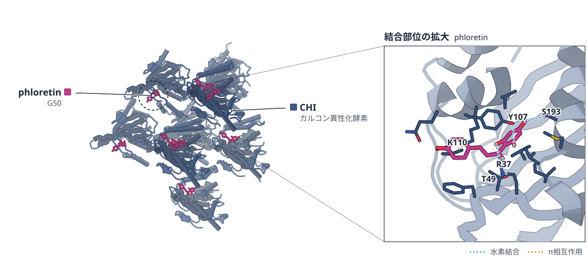

色（順に）：CHI（カルコン異性化酵素）　スティック：phloretin（G50）

**CHIの活性部位に、phloretinの8通りの姿勢が見えた**

非対称単位の8分子がphloretinの異なる姿勢を保ち、環化に向かう経路を示唆する

- **疑問・課題**：カルコン異性化酵素（CHI）は、基質の形の組み替えにタンパク質の動きを使うのかが、問われ続けていた。
- **アプローチ**：MtCHI-Iの結晶に基質アナログphloretinを浸漬して、2.0 Åの結晶構造を解き、変異体と速度論で確かめた。
- **結果**：非対称単位の8分子でphloretinの姿勢が異なり、環化に関わる(Ph)2′O–C3間の距離は3.98〜3.09 Åだった。
- **わかったこと**：CHIは動的な構造の集まりとして働き、基質の組み替えを助けると考えられる。phloretinは競合阻害剤でもある。
- **残された課題**：先行モデルは2型CHIによるが、本研究が調べたのは1型CHIだけという限界がある。

この紹介文の根拠（論文本文）

> A persistent question has been whether the enzyme uses protein dynamics to facilitate conformational rearrangements of substrates within the active site.  
> — 疑問・課題／Abstract

> Finally, the MtCHI‐I crystals were soaked for 1 week in the reservoir solution also containing 20‐mM phloretin.  
> — アプローチ／Protein Crystallography, Structure Determination, and Analysis

> CHI from Medicago truncatula was crystallized with phloretin, a flexible substrate analogue that cannot undergo cyclization, and solved to 2.0‐Å resolution.  
> — アプローチ／Abstract

> The crystal structure possesses eight protein molecules per asymmetric unit, revealing different active site conformations that accommodate different bound conformers of phloretin.  
> — 結果／Abstract

> In the pose called “mol. D,” the phloretin (Ph)2′O‐(Ph)C3 interatomic distance is 3.98 Å  
> — 結果／Crystallographic Insights Into the Catalytic Plasticity of CHI

> which measures the smallest interatomic distance between (Ph)2′O‐(Ph)C3, of 3.09 Å  
> — 結果／Crystallographic Insights Into the Catalytic Plasticity of CHI

> Overall, this work supports a catalytic model in which the CHI enzyme operates as a dynamic ensemble of structures necessary to facilitate catalytic substrate rearrangements.  
> — わかったこと／Abstract

> A double reciprocal Lineweaver–Burk plot confirms that phloretin inhibits MtCHI‐I through a competitive mechanism  
> — わかったこと／Phloretin Is a Competitive Enzyme Inhibitor of MtCHI-I

> One notable limitation of the present work is that previous models of CHI, such as the one used by Hur and colleagues, were based upon evidence from a Type‐2 CHI, whereas the present work examines only a Type‐1 CHI  
> — 残された課題／Discussion

分類：酵素（その他）

#### 読みどころ

環化から最も遠いmol. Dではphloretinの(Ph)2′O–C3間が3.98 Å、最も近いmol. Bでは3.09 Åになる。mol. Bでは、触媒Arg（R37）のグアニジノ基が3つの水素結合を作る。

根拠（論文本文）

> The phloretin conformation that best approximates the near attack, cyclization‐productive conformer occurs in mol. B, which measures the smallest interatomic distance between (Ph)2′O‐(Ph)C3, of 3.09 Å  
> — Crystallographic Insights Into the Catalytic Plasticity of CHI

> Here, three critical H‐bond interactions are provided by the guanidinium of R37 when they are at their closest to phloretin  
> — Crystallographic Insights Into the Catalytic Plasticity of CHI

R37のNη2とphloretinの2′Oの水素結合は、観察されたすべての姿勢で保たれる。phloretinのA環の位置は、T49・S193・Y107の側鎖がほぼ一定に保つ。

根拠（論文本文）

> The most critical of these may be the enzyme‐substrate H‐bond that occurs between (R37)Nƞ2 and (Ph)2′O, which is maintained through all observed poses.  
> — Crystallographic Insights Into the Catalytic Plasticity of CHI

> the active site position and orientation of the A ring of phloretin are very consistently maintained by three amino acid sidechains  
> — Crystallographic Insights Into the Catalytic Plasticity of CHI

phloretinはMtCHI-Iの競合阻害剤で、Kiは32 ± 4 μMだった。DSFで求めたKd（26 ± 1 μM）とほぼ合い、T49A・R37K・S193Aの変異体では結合が弱まった。

根拠（論文本文）

> From the enzyme inhibition experiments, the inhibitory constant, Ki value, averaged from the three inhibitor concentrations, is calculated to be 32 ± 4 μM.  
> — Phloretin Is a Competitive Enzyme Inhibitor of MtCHI-I

> These results confirm that the H‐bonds between phloretin and the sidechain atoms of Ser193, Arg37, and Thr49, observed in the MtCHI‐I‐phloretin crystal structure, are also important for solution binding.  
> — Solution Studies of Phloretin Binding Within the MtCHI-I Active Site

#### 構造データ

| PDB | 手法 | 分解能 | 公開 | 生物種 | リガンド |
|---|---|---|---|---|---|
| [38KF](https://www.rcsb.org/structure/38KF) | X-ray | 2.00 Å | 2026-09-16 | Medicago truncatula | G50 |

- [B7FJK3](https://www.uniprot.org/uniprotkb/B7FJK3) 11445536 Chalcone-flavonone isomerase family protein — *Medicago truncatula* （既存の PDB 構造 1 件）

#### 実験メモ

- **発現系**：pET-21bから大腸菌BL21 DE3-pRILで発現させ、20 °Cで一晩誘導した。
- **コンストラクト**：Hisタグ付きで精製し、トロンビンでタグを切った。
- **精製**：Ni-NTA、再度のNiカラム（素通り画分）に続き、結晶化用にResource Q陰イオン交換とSuperdex 200ゲルろ過で精製した。
- **結晶化／グリッド作製**：30 mg/mLで吊り滴蒸気拡散により結晶化し、20 mM phloretinを含む母液に1週間浸漬した。
- **データ収集・解析**：ALSのBL 8.2.1/8.2.2で100 Kで測定した。結晶は双晶と回転擬対称を示し、双晶演算子を使って精密化した。

根拠（論文本文）

> A pET‐21b protein expression plasmid containing the gene for M. truncatula , MtCHI‐I (UniProt: B7FJK3), was transformed into BL21 DE3‐pRIL cells (Agilent Technologies).  
> — Protein Expression and Purification

> Cells were grown in Terrific Broth (Thermo Fisher Scientific) and induced overnight at 20°C.  
> — Protein Expression and Purification

> The His tag was cleaved at 4°C by bovine thrombin (EMD Millipore Corp.)  
> — Protein Expression and Purification

> MtCHI‐I was first purified by Ni‐affinity chromatography as described above, then further purified by FPLC on a resource Q anion exchange column (Cytiva).  
> — Protein Crystallography, Structure Determination, and Analysis

> Finally, the MtCHI‐I crystals were soaked for 1 week in the reservoir solution also containing 20‐mM phloretin.  
> — Protein Crystallography, Structure Determination, and Analysis

> X‐ray diffraction data were collected at 100 K at the Advanced Light Source beamlines 8.2.1 and 8.2.2, Lawrence Berkeley National Laboratory.  
> — Protein Crystallography, Structure Determination, and Analysis

> which showed combined effects of merohedral twinning and rotational pseudosymmetry, were used by applying a twin operator  
> — Protein Crystallography, Structure Determination, and Analysis

> 📝 編集者への確認事項：構造は38KF（phloretin複合体、2.0 Å）。同じMtCHI-Iのnaringenin（産物）複合体は先行研究（Burke 2019）で既出で、UniProt B7FJK3 の既存PDB も1件あり初構造ではない。論文は結論で「first structural evidence of the dynamic process of chalcone ring closure」と書くが、基質アナログの結晶構造から経路を推定しているため、記事では「示唆」「考えられる」にとどめた。phloretinはアナログでアルケンがなく環化しない点に注意。legend_labels は render 前のため一旦1つだけ設定。

---

## 10｜WT1ペプチド/HLA-A*02とVH抗体

### Computational Design of a TCR-like Human VH Domain Antibody That Specifically Recognizes a WT1-Derived Peptide Presented by Class I Major Histocompatibility Complex

*Computational and Structural Biotechnology Journal*（2026-10-19） · [論文](https://doi.org/10.34133/csbj.0236) · ライセンス: cc by

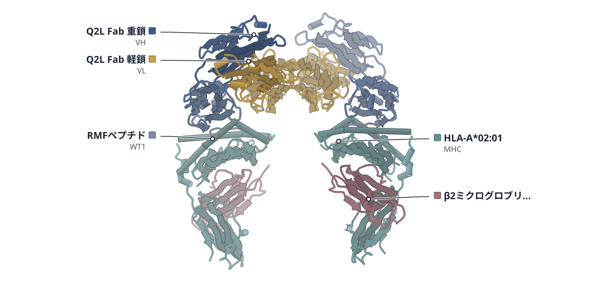

色（順に）：Q2L Fab 重鎖（VH） / Q2L Fab 軽鎖（VL） / HLA-A*02:01（MHC） / β2ミクログロブリン / RMFペプチド（WT1）

**ペプチドを狙うVH抗体を、Fabの構造から設計した**

Fabとpeptide–MHCの結晶構造をもとに、トラスツズマブ由来VHへ結合部位を移し81 nMで結合した

- **疑問・課題**：HLAにも当たるFabでは交差反応を抑えにくく、ペプチドを狙う単一ドメイン抗体が求められていた。
- **アプローチ**：Fab–RMF/HLA-A*02の結晶構造を解き、可溶なトラスツズマブ由来VHに結合部位を移して設計した。
- **結果**：結晶構造でVHはペプチドに広く接し、HLAとは6残基としか接しなかった。設計VHは81 nMで結合した。
- **わかったこと**：ペプチドを中心に認識するTCR様VH抗体を作る道筋が示され、二価のT細胞エンゲージャーにも展開できた。
- **残された課題**：単独のαRMF_VHは約30%が二量体になり、親水性の置換で改善できる可能性がある。

この紹介文の根拠（論文本文）

> Developing TCR-like antibodies with negligible cross-reactivity is challenging.  
> — 疑問・課題／Introduction

> the large antigen-binding surface of a Fab may also engage conserved HLA surfaces, potentially increasing cross-reactivity with nontarget pMHC complexes.  
> — 疑問・課題／Introduction

> We determined the crystal structure of the Q2L-Fab bound to RMF/HLA-A*02 at a 3.0-Å resolution (Table 1).  
> — アプローチ／Results

> Starting from the crystal structure of a Fab antibody bound to RMF/HLA-A*02, we repurposed the soluble trastuzumab-derived VH scaffold to bind RMF/HLA-A*02.  
> — アプローチ／Abstract

> VH extensively contacts the bound RMF peptide while making limited contacts with only 6 HLA-A*02:01 residues  
> — 結果／Results

> The monovalent construct bound selectively to RMF/HLA-A*02 with 81 nM affinity  
> — 結果／Abstract

> These results demonstrate a viable strategy to develop high-specificity, peptide-focused TCR-like VH domain antibodies that can be readily extended into potent bivalent TCEs for pMHC-targeted therapeutics.  
> — わかったこと／Abstract

> Further hydrophilic substitutions at exposed hydrophobic sites, such as those on the VL-facing surface in the Fab, may provide a rational strategy to improve the developability of αRMF_VH as an isolated sdAb.  
> — 残された課題／Discussion

分類：免疫（抗体・MHC・TCR・自然免疫）

#### 読みどころ

結晶構造ではVLがVHから離れ、VHがペプチドに広く接し、HLAとの接触は6残基にとどまる。VHのTrp47がHLAのα2ヘリックスの上に載り、ドッキングの足場になりうると著者は考える。

根拠（論文本文）

> First, VH extensively contacts the bound RMF peptide while making limited contacts with only 6 HLA-A*02:01 residues (Fig. 1B, bottom).  
> — Results

> Second, the indole ring of Trp47 is positioned atop one of the “wall-forming” α-helices (α2) of the HLA-A*02:01, suggesting a potential anchoring role for pMHC docking (Fig. 1C).  
> — Results

Q2L VHはCHO細胞で可溶性の凝集体になった。そこでCDR3Hと2残基を可溶なトラスツズマブVHに移し、Rosettaで緩和した。αRMF_VHは元の配列に対して7点の変異と4残基の欠失をもつ。結晶構造は予測モデルでなく、Q2L VHのもの。

根拠（論文本文）

> However, the VH domain (residues 1 to 115) was expressed in Chinese hamster ovary (CHO) cells as a soluble aggregate (Fig. S2).  
> — Results

> This design, referred to as αRMF_VH, contains a total of 7 point mutations and a 4-residue deletion relative to the original Tra VH sequence (Fig. 2B).  
> — Results

HSAドメインIIIの両端にαRMF_VHをつけた二価体は、見かけのKDが0.37 nMで、THP-1細胞を殺すEC50は単価体の6.76 pMに対して0.92 pMだった。HLA-A*02陰性のHL-60細胞は殺さなかった。

根拠（論文本文）

> Both monovalent and bivalent TCEs induced robust, concentration-dependent killing of THP-1 cells, with EC50 values of 6.76 and 0.92 pM, respectively, while showing no notable cytotoxicity against HL-60 cells  
> — Results

#### 構造データ

| PDB | 手法 | 分解能 | 公開 | 生物種 | リガンド |
|---|---|---|---|---|---|
| [9VSO](https://www.rcsb.org/structure/9VSO) | X-ray | 3.03 Å | 2026-07-15 | Homo sapiens | — |

- [P19544](https://www.uniprot.org/uniprotkb/P19544) WT1 Wilms tumor protein — *Homo sapiens* （既存の PDB 構造 30 件）
- [P61769](https://www.uniprot.org/uniprotkb/P61769) B2M Beta-2-microglobulin — *Homo sapiens* （既存の PDB 構造 1408 件）
- [Q53Z42](https://www.uniprot.org/uniprotkb/Q53Z42) HLA-A HLA class I antigen — *Homo sapiens* （既存の PDB 構造 15 件）

#### 実験メモ

- **発現系**：αRMF_VHは大腸菌BL21(DE3) RIPLでC末端8×Hisタグ付きで発現し、Q2L-FabはCHO-S細胞で発現した。
- **コンストラクト**：αRMF_VHとヒト血清アルブミンのドメインIII（残基384–585）の融合体を作った。
- **精製**：Ni-NTAアフィニティ後、Superdex 75でサイズ排除クロマトグラフィーを行った。
- **結晶化／グリッド作製**：Q2L-Fab/RMF/HLA-A*02（8 mg/ml）を、ハンギングドロップ蒸気拡散法（20℃）で、PEG 5000 MMEなどの溶液で結晶化した。
- **データ収集・解析**：ポハン加速器研究所の5Cでデータを集め、AlphaFold-Multimer予測モデルと3PHJを探索モデルに分子置換で解いた。

根拠（論文本文）

> The plasmid was transformed into Escherichia coli BL21 (DE3) RIPL cells (Novagen).  
> — Materials and Methods

> transfected into CHO-S cells (Gibco) at 6 × 106 cells/ml using ExpiFectamine CHO (Gibco)  
> — Materials and Methods

> Fusion constructs of αRMF_VH and human serum albumin domain III (residues 384 to 585; HSADIII) were similarly cloned.  
> — Materials and Methods

> followed by size-exclusion chromatography using a HiLoad 26/60 Superdex 75 column (Cytiva) equilibrated with PBS  
> — Materials and Methods

> Q2L-Fab/RMF/HLA-A*02 crystals were obtained using the protein sample (8 mg/ml) and a reservoir solution composed of 8% (w/v) PEG 5000 MME, 5% (v/v) Tacsimate (pH 7.0), and 100 mM Hepes (pH 7.0).  
> — Materials and Methods

> X-ray diffraction data were collected at beamline 5C of Pohang Accelerator Laboratory (Korea) and processed with HKL2000  
> — Materials and Methods

> Structures were determined by molecular replacement using an AlphaFold-Multimer-predicted model of Q2L-Fab and the crystal structure of RMF/HLA-A*02 (Protein Data Bank [PDB] entry: 3PHJ)  
> — Materials and Methods

> 📝 編集者への確認事項：新しい構造は9VSO（Q2L-Fab/RMF/HLA-A*02、3.03 Å、公開済み）。設計したαRMF_VH自体の結晶構造はなく、αRMF_VH/RMF/HLA-A*02はChai-1の予測モデル。論文の中心は設計と細胞・TCEでの評価。legend_labels は candidates の polymer 順（重鎖・軽鎖・HLA・β2M・ペプチド）で書いたので、render で legend の順と数を要確認。9VSOのHLA（Q53Z42）の既存構造は多数あり新規タンパク質ではない。

---

## 11｜PT9–PIM9（細菌の毒素と免疫）

### Modular Platform for Recombinant Production of Highly Toxic Bacterial Proteins

*Microbial Biotechnology*（2026-10-01） · [論文](https://doi.org/10.1111/1751-7915.70453) · ライセンス: cc by

**毒素を免疫タンパク質につなぐと、猛毒の毒素が作れる**

3つの細菌毒素を精製して巻き戻し、PT9–PIM9の1.5 Å結晶構造で折りたたみを確かめた

- **疑問・課題**：猛毒の細菌毒素は大腸菌で作れず、生化学や構造の解析が進まないことが障壁だった。
- **アプローチ**：毒素を免疫タンパク質と1本の鎖でつないで発現し、精製で切り離して、カラム上で巻き戻した。
- **結果**：PT7・PT8・PT9を精製でき、細胞内でのTEV切断でPT9の回収量は約4 mg/Lになった。PT9–PIM9は1.5 Åで解けた。
- **わかったこと**：巻き戻したPT9は、AlphaFoldモデルと近い構造をとり、免疫タンパク質と複合体を再形成した。
- **残された課題**：PT9の分子としての働きは、まだ分かっていない。

この紹介文の根拠（論文本文）

> As a result, recombinant production remains the principal bottleneck preventing systematic biochemical, structural and mechanistic investigation of these proteins.  
> — 疑問・課題／Introduction

> we developed a fusion‐based toxin neutralization strategy in which the PIM is covalently linked to the wild‐type (wt) PT within a single polypeptide chain.  
> — アプローチ／Results

> Gradual urea removal directly on the column enabled refolding of the immobilized PT prior to elution  
> — アプローチ／Results

> increasing the recovered yield of PT9 from approximately 1–2 mg/L to ~4 mg/L  
> — 結果／Abstract

> The crystal structure of the PT9‐PIM9 complex was determined at 1.5 Å resolution  
> — 結果／Results

> Refolded PT9 adopted a well‐defined structure that closely matched the AlphaFold‐predicted model (RMSD 0.67 Å over 61 Cα atoms, Figure 6D).  
> — わかったこと／Results

> these structural data demonstrate the recovery of a folded PT9 conformation following denaturation and refolding  
> — わかったこと／Results

> although the molecular activity of PT9 remains unknown  
> — 残された課題／Results

分類：感染・ウイルス・防御系・酵素（その他）

#### 読みどころ

免疫タンパク質を単独で同時発現しても、PT8とPT9は検出できなかった。N末端の免疫タンパク質とC末端の毒素を柔軟なリンカーでつなぐと、毒性が抑えられ、融合体として発現した。リンカーは予測構造で、元の配置を保つ最短のものを選んだ。

根拠（論文本文）

> These findings indicate that co‐expression of cognate immunity proteins alone was insufficient to overcome the production barrier  
> — Results

> The optimal fusion design was chosen as the shortest linker that preserved the relative orientation of the PT and PIM domains while minimizing structural distortion.  
> — Figure 2

大腸菌の中でTEVプロテアーゼを同時に発現させて融合体を切ると、精製はStrepタグ精製と試験管内の切断が不要になり、4段階から2段階に減った。

根拠（論文本文）

> This strategy reduced the workflow to two purification steps and eliminated the need for both Strep‐tag affinity purification and preparative TEV protease treatment (Figure 4A).  
> — Results

天然の免疫タンパク質との融合では発現しなかったPT37は、ProteinMPNNで免疫タンパク質とリンカーを再設計すると、発現して精製できた。結合親和性が上がったためとは確かめられていない。

根拠（論文本文）

> Although these findings are consistent with improved productive toxin neutralization, they do not establish that the improved phenotype results from increased PT37–PIM37 binding affinity  
> — Results

#### 構造データ

| PDB | 手法 | 分解能 | 公開 | 生物種 | リガンド |
|---|---|---|---|---|---|
| 33ZJ | — | — | 公開待ち | — | — |

#### 実験メモ

- **発現系**：pET28でBL21(DE3)に導入し、IPTGで誘導した。一晩の誘導が最も収量が高かった。
- **コンストラクト**：N末端Strepタグ付きの免疫タンパク質と、C末端Hisタグ付きの毒素を、GGGSリンカーとTEV切断部位でつないだ。
- **精製**：8 M尿素で解離させ、HisTrapに毒素を結合したまま尿素を徐々に除いて巻き戻し、サイズ排除クロマトグラフィーで精製した。
- **結晶化／グリッド作製**：PT9–PIM9複合体（7 mg/ml）を、シッティングドロップ蒸気拡散法（20℃）で、0.1 M Bicine（pH 9.0）と2.0 M塩化マグネシウムの溶液から結晶化した。
- **データ収集・解析**：ESRFのID30A-3で100 Kでデータを集め、PT9–PIM9の計算モデルを探索モデルに分子置換で解いた。

根拠（論文本文）

> Overnight induction produced substantially higher protein yields than shorter induction periods and was therefore used for all subsequent purification experiments  
> — Results

> an N‐terminal Strep‐tagged PIM is connected via a flexible linker to a C‐terminal His‐tagged PT (Figure 2A).  
> — Results

> Refolding of immobilized PTs was achieved by gradually replacing the denaturing buffer with Tris buffer directly on the column.  
> — Materials and Methods

> Crystals of the PT9‐PIM9 complex were obtained in reservoir solution containing 0.1 M Bicine pH 9.0 and 2.0 M Magnesium chloride.  
> — Materials and Methods

> X‐ray diffraction data were collected at 100 K at beamline ID30A‐3 of the European Synchrotron Radiation Facility (ESRF), Grenoble, France.  
> — Materials and Methods

> The structure was solved by molecular replacement in Phaser using a computational model of PT9‐PIM9 complex as the search model  
> — Materials and Methods

> 📝 編集者への確認事項：PDB 33ZJ（PT9–PIM9、1.5 Å）は本文のData availabilityにあるが未公開。論文の中心は毒素の組換え生産法で、構造は巻き戻したPT9の折りたたみの確認に使われている。本文は『PT–PIM複合体の実験構造はなかった』と書くが『初めての構造』とは明言していないため first_claim なし。構造に関する図（Figure 6C,D）の説明は本文にあるが、分解能以外の統計は表S1で本文になし。PT8のヌクレアーゼ活性は新しい所見として本文が述べる。

---

## 12｜β-ガラクトシダーゼ（大腸菌）

### Cryo-EM sample preparation with soft-landing and laser flash melting

*Nature Communications*（2026-01-01） · [論文](https://doi.org/10.1038/s41467-026-77723-6) · ライセンス: cc by

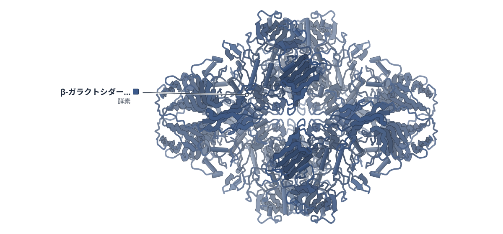

色（順に）：β-ガラクトシダーゼ（酵素）

**気相で脱水したタンパク質を、レーザー融解で元の形に近づける**

30 µsのレーザー融解で再水和した一部のβ-ガラクトシダーゼ粒子が、天然に近い3.7 Å構造に戻った

- **疑問・課題**：ソフトランディングで降ろしたタンパク質は脱水され、縮んだ形しか観察できなかった。
- **アプローチ**：降ろした試料に非晶質氷を重ね、30 µsのレーザーで瞬間的に融解して再水和させた。
- **結果**：再水和した粒子は部分的にしか戻らなかったが、約25,000粒子を選ぶと3.7 Åの再構成が得られた。
- **わかったこと**：30 µsの間に、一部の粒子は天然に近い構造へ戻る。全粒子を戻すには、より長い時間が要ると考えられる。
- **残された課題**：この方法が幅広いタンパク質に使えるかは、今後の実験で確かめる必要がある。

この紹介文の根拠（論文本文）

> However, only compacted configurations are observed after soft-landing since the proteins are dehydrated in the process.  
> — 疑問・課題／Abstract

> Here, we deposit a layer of amorphous ice onto the sample and briefly flash melt it to rehydrate the soft-landed proteins.  
> — アプローチ／Abstract

> Melting with a 30 µs laser pulse creates a broad ensemble of partially rehydrated structures.  
> — 結果／Abstract

> If we select the particles from this tail, which are most similar to the native state (about 25’000 particles, marked with a dashed box), we obtain the reconstruction in Fig. 3D (3.7 Å).  
> — 結果／Results

> Moreover, they show that for β‑galactosidase, a subset of particles does return to a configuration close to the native state.  
> — わかったこと／Results

> This suggests that it should ultimately be possible to fully rehydrate all particles simply by providing them with more time to do so.  
> — わかったこと／Results

> Future experiments will also have to show whether this approach can be generalized to a wide range of proteins.  
> — 残された課題／Results

分類：酵素（その他）・リボソーム・翻訳・フォールディング

#### 読みどころ

ソフトランディングしたGroELは、脱水で高さが約24%、直径が約7%縮んでいた。レーザー融解を行うとサブユニット間の水で満ちた隙間が戻り、寸法が天然の構造に近づいた。

根拠（論文本文）

> A comparison with the native structure (Figs. 2D, 1.9 Å) reveals that dehydration has significantly compacted the soft-landed particles, reducing their height and diameter by about 24% and 7%, respectively.  
> — Results

> The water-filled spaces between the subunits are restored, and a map yields dimensions close to that of the native structure.  
> — Results

粒子が界面に吸着していると再水和が遅れ、片側だけが広がる非対称な形になると考えられる。天然に近い粒子ほど配向の偏りが小さく、SCF*（偏りの指標、1が均一）は0.44から0.93へ上がった。

根拠（論文本文）

> Our results suggest that adsorption to an interface hinders many particles from fully returning to the native state during the short time window provided by the melting laser pulses.  
> — Results

> the sampling compensation factor (SCF*), a measure of the degree of preferred orientation, improving from 0.44 in subset 1 to 0.93 in subset 4.  
> — Results

ソフトランディングでは質量フィルターで目的の粒子だけを選べる。通常の試料に混じるβ-ガラクトシダーゼの二量体は、降ろした試料には見られず、四量体だけだった。

根拠（論文本文）

> While a conventional sample of β‑galactosidase contains some fraction of dimers (Supplementary Fig. 5C), only tetramers are found after soft-landing (Supplementary Figs. 6, 7), underlining the potential of this approach to reduce sample heterogeneity.  
> — Results

#### 構造データ

| PDB | 手法 | 分解能 | 公開 | 生物種 | リガンド |
|---|---|---|---|---|---|
| [9HKI](https://www.rcsb.org/structure/9HKI) | Cryo-EM | 1.90 Å | 2025-12-17 | Escherichia coli | — |
| [9HLM](https://www.rcsb.org/structure/9HLM) | Cryo-EM | 3.70 Å | 2025-12-17 | Escherichia coli | — |

- [P00722](https://www.uniprot.org/uniprotkb/P00722) lacZ Beta-galactosidase — *Escherichia coli (strain K12)* （既存の PDB 構造 85 件）

#### 実験メモ

- **発現系**：GroELとβ-ガラクトシダーゼは Sigma-Aldrich から購入した。
- **精製**：質量分析用に、GroELは脱塩カラムで200 mM酢酸アンモニウム（pH 6.9）へ緩衝液交換した。
- **結晶化／グリッド作製**：降ろした試料に、100 Kで50 nmの非晶質氷を蒸着し、30 µs・532 nmのレーザーで融解して再ガラス化した。

根拠（論文本文）

> Samples of GroEL and β-galactosidase were purchased from Sigma-Aldrich (G3153-5MG and C7688-1MG).  
> — Methods

> For native mass spectrometry, the GroEL solution was desalted by passing it through two P6 buffer exchange columns (7326222, Biorad) that had been equilibrated with 200 mM ammonium acetate (pH 6.9).  
> — Methods

> A 50 nm thick layer of amorphous ice is deposited in situ by leaking water vapor into the volume surrounding the sample, which is held at a temperature of 100 K (Fig. 1D).  
> — Results

> 📝 編集者への確認事項：試料調製法の論文。β-ガラクトシダーゼ（P00722）は既存構造が多数あり、新しいタンパク質の構造ではない。PDB は 9HKI（通常凍結、1.9 Å）と 9HLM（再水和・天然に近い粒子、3.7 Å）のみで、GroEL の地図は EMDB のみ。構造図は論文の主張に合わせ 9HLM を指定。ソフトランディングの装置の詳細・クライオ電顕の撮影条件は本文になく補足に委ねられているため data_collection は null。

---

## 13｜hPin1-WW＋AIEペプチドF11

### Solution structure of a peptide-conjugated aggregation-induced-emission (AIE) fluorophore bound to a protein

*RSC Chemical Biology*（2026-10-19） · [論文](https://doi.org/10.1039/d6cb00109b) · ライセンス: cc by

**AIE色素は、タンパク質の表面に密着して動きを止められると光る**

ペプチド付きAIE色素F11の遊離型とhPin1-WW複合体の溶液NMR構造から、蛍光が増える仕組みを示した

- **疑問・課題**：AIEリガンドとタンパク質の複合体の構造は、これまで報告されていなかった。
- **アプローチ**：ペプチド付きAIE色素F11の遊離型と、hPin1-WWドメインとの複合体の溶液NMR構造を解いた。
- **結果**：遊離のF11は丸まった形で、結合すると伸びて、芳香環のAIEコアがβシートの上に乗った。
- **わかったこと**：タンパク質表面との接触で芳香環の回転が制限され、これが結合時の蛍光増加を説明すると著者は考えている。
- **残された課題**：AIEコアが結合そのものに寄与する分は、切り分けて定量できていない。

この紹介文の根拠（論文本文）

> However, so far, the structure of an AIE-ligand:protein complex has not been published.  
> — 疑問・課題／Introduction

> Therefore, we solved the solution NMR structure of the main conformer of the one-armed AIE-peptide F11  
> — アプローチ／Results and discussion

> we solved the NMR solution structure of the hPin1-WW domain in complex with AIE-peptide F11, forming a 1 : 1 complex  
> — アプローチ／Results and discussion

> In the absence of a protein, the AIE-peptide conjugate shows a curled-up conformation that still allows rotation of the aromatic rings of the AIE-core, thus resulting in low auto-fluorescence.  
> — 結果／Abstract

> The AIE-core remains C-shaped but now lies on top of the β-sheet surface, forming contacts with the protein through its aromatic rings  
> — 結果／Results and discussion

> This tight fit limits the rotation of the AIE rings, which explains the increase in AIE fluorescence upon hPin1-WW binding.  
> — わかったこと／Results and discussion

> we cannot quantify the contribution of the AIE-core to the hPin1-WW binding in isolation.  
> — 残された課題／Conclusions

分類：その他

#### 読みどころ

遊離のF11は、ペプチドがAIEコアの上に螺旋状に丸まり、プロリン環が芳香環と接する。近位の芳香環は回転でき、そのためタンパク質がなければ蛍光は弱い。

根拠（論文本文）

> The peptide arm is curled up in a helical fashion above the aromatic core, such that the hydrophobic proline ring interacts with the proximal (closest to the peptide) and central aromatic rings.  
> — Results and discussion

> The free rotation of the proximal ring explains why the auto-fluorescence of these AIE-peptide conjugates in the absence of protein is still low.  
> — Results and discussion

結合型では、hPin1-WWのF25がAIEコアのC字形の中心に入り、中央と末端の芳香環とface-to-edgeのπ–π相互作用を作る。R14もコアの安定化に関わり、M15は三唑環に近づくが、この接点は相互作用の可能性にとどまる。

根拠（論文本文）

> Residue F25 of hPin1-WW rotates into the centre of the C-shape, forming face-to-edge π–π interactions with the central and distal aromatic rings of the AIE-core (Fig. 4b).  
> — Results and discussion

> The M15 sulphur is in close proximity to the triazole ring and proximal phenylene ring, potentially engaging in a similar interaction and thus adding an additional contact to the protein–fluorophore interface.  
> — Results and discussion

NMR滴定で求めたKDは20〜42 µMで、AIEを持たないペプチド（18.2 µM）と同程度だった。二本腕の色素は蛍光の増加が大きく、一本腕のF11は5〜9倍小さい。

根拠（論文本文）

> yield average KD values between 20 and 42 µM for F11 and F21–F24 (Table 1 and Table S2), which lie in the same range as those of the P0 control without an AIE-core (KD = 18.2 ± 0.2 µM)  
> — Results and discussion

> The fluorescence amplitude of F11 (with one peptide) upon protein binding was 5–9-fold lower compared to that of the two-armed fluorophores.  
> — Results and discussion

#### 構造データ

| PDB | 手法 | 分解能 | 公開 | 生物種 | リガンド |
|---|---|---|---|---|---|
| 29KP | — | — | 公開待ち | — | — |
| 29KQ | — | — | 公開待ち | — | — |

#### 実験メモ

- **精製**：ペプチドはFmoc固相合成の後にHPLCで精製し、クリック反応でAIEコアと連結した。
- **結晶化／グリッド作製**：15N標識hPin1-WWへ色素を滴定してNMRで観察した。蛍光滴定はHEPES中、色素10〜200 µMで行った。

根拠（論文本文）

> Peptides P1–P6 with an N-terminal azido-homoalanine (Aha) residue were synthesized via standard solid phase peptide synthesis using FMOC chemistry, deprotected and purified by HPLC.  
> — Synthesis

> Recognition of the pThr-Pro motif in F11 and F21–F24 by the hPin1-WW domain was confirmed by NMR, titrating peptide-conjugated AIE fluorophores to 15N-labelled hPin1-WW  
> — Results and discussion

> Therefore, fluorescence interaction studies with proteins were carried out with AIE-peptide concentrations between 10 and 200 µM in HEPES.  
> — Solubility and auto-fluorescence properties

> 📝 編集者への確認事項：PDB 29KP（遊離F11）と 29KQ（F11-hPin1-WW複合体）は公開待ちのため図なし。手法は溶液NMRで、分解能に当たる値は本文にない。hPin1-WWの構造は既報が多く、新しいタンパク質の構造ではない（AIEリガンドとの複合体が初という著者の主張）。Methods・NMR統計は補足資料にあり本文にないため data_collection は null。

---

# Structure-Based Study

## 14｜β1アドレナリン受容体（シチメンチョウ）

### Native Mass Spectrometry Reveals Ligand-Specific Conformational Heterogeneity of the β1‑Adrenergic Receptor Using Nanobody Probes

*Analytical Chemistry*（2026-10-19） · [論文](https://doi.org/10.1021/acs.analchem.6c04571) · ライセンス: cc by

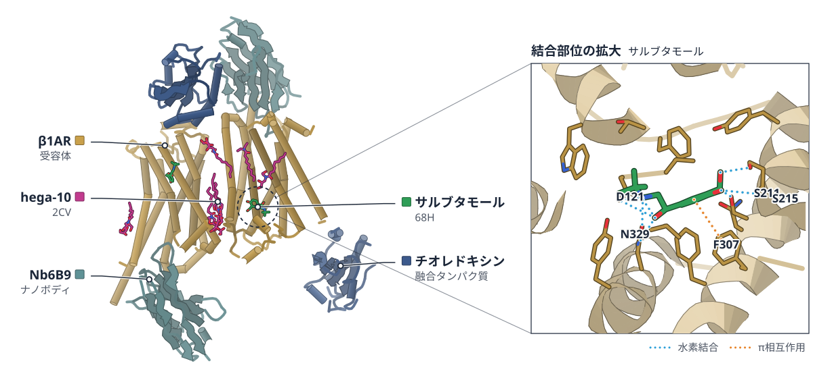

PDB 6H7M（論文が使った既存の構造）

色（順に）：チオレドキシン（融合タンパク質） / β1AR（受容体） / Nb6B9（ナノボディ）　スティック：hega-10（2CV）、サルブタモール（68H）

**ナノボディで見分ける、β1ARがリガンドごとに取る形**

既存のX線構造を手がかりに、ネイティブMSでリガンド特異的な状態を測った

- **疑問・課題**：リガンドごとの効き方の違いが、受容体の細胞内側の形とどう結びつくかは、静的な構造だけでは分からなかった。
- **アプローチ**：ネイティブMSでβ1ARと活性型ナノボディの複合体を定量し、CDRを入れ替えた変異体と蛍光測定も加えた。
- **結果**：複合体の量は cAMP 応答と相関し（r=0.88〜0.95）、Nb6B9 は弱い作動薬でも Nb80 より多く複合体を作った。
- **わかったこと**：Nb6B9 は完全作動薬が作る活性型とは異なる、リガンド特異的な形を認識する。CDR1 と CDR3 が鍵で、TM5・TM6 付近が関わるとみられる。
- **残された課題**：他の受容体、完全な三量体Gタンパク質、アレスチン、天然の脂質環境への拡張が今後の課題として挙げられている。

この紹介文の根拠（論文本文）

> High-resolution structural studies reveal discrete, ligand-stabilized states, but these static snapshots do not fully capture the dynamic processes underlying GPCR activation and ligand efficacy.  
> — 疑問・課題／Abstract

> we established a native mass spectrometry (nMS) platform to probe ligand-induced conformational heterogeneity at the GPCR intracellular interface.  
> — アプローチ／Abstract

> we utilized Nb6B9 chimeras with exchanged complementarity-determining regions (CDRs)  
> — アプローチ／Abstract

> Monobromobimane (mBBr) was used to covalently label Cys6.27 at the cytoplasmic end of TM6 in β1AR  
> — アプローチ／Results and Discussion

> significant positive correlations were observed across all active-state nanobodies  
> — 結果／Results and Discussion

> Compared with Nb80, its parental nanobody derived through directed evolution, Nb6B9 displayed substantially greater complex formation under selected weak-agonist and antagonist treatment  
> — 結果／Results and Discussion

> These interactions indicate that Nb6B9 recognizes ligand-specific conformations distinct from active states induced by full agonists.  
> — わかったこと／Abstract

> identified CDR1 and CDR3 as the primary drivers for ligand-specific recognition, implicating the involvement of receptor transmembrane motifs TM5 and TM6 in this conformational diversity  
> — わかったこと／Abstract

> Future applications could extend this platform to other receptor types, full heterotrimeric G proteins, arrestins, and native lipid environments  
> — 残された課題／Conclusion

分類：GPCR・受容体

#### 読みどころ

ネイティブMSで受容体とナノボディの複合体の量を直接数え、10種のリガンドでの量を既報の cAMP 応答と照らした。Nb80・Nb71・Nb6B9 のどれでも正の相関が出て、測定値がリガンドの効力を反映すると確かめられた。

根拠（論文本文）

> broadly correlated with previously reported cAMP responses, providing validation of the quantitative nMS readout  
> — Introduction

Nb6B9 の CDR を Nb80 の配列に戻すと、CDR1 または CDR3 では弱い作動薬での複合体が25%以上減り、CDR2 では約25%増えた。既存の複合体構造では、CDR3 のループが細胞内の空洞に深く入り TM5・TM6 と接する。

根拠（論文本文）

> reversion of CDR1 or CDR3 significantly reduced β1AR-nanobody complex formation by more than 25%  
> — Results and Discussion

> reversion of CDR2 markedly increased complex formation for cluster 2 ligands by approximately 25%  
> — Results and Discussion

> with the CDR3 loop inserting deeply into the transducer-binding cavity and forming extensive interactions with TM5 and TM6  
> — Results and Discussion

サルブタモールの二つの鏡像異性体は Nb6B9 との複合体の作りやすさが異なり、EC50 は (R) 体 9.1 μM、(S) 体 45.1 μM だった。既存の (R)-サルブタモール複合体では、β位のヒドロキシ基が TM3・TM7 の残基と2.6〜3.3 Å で接する。(S) 体ではこの距離が3.6〜5.3 Å に広がると見積もられている。

根拠（論文本文）

> (R)-salbutamol (EC50 9.1 μM, 95% CI: 6.6–13.3 μM) exhibited a significantly lower EC50 than (S)-salbutamol (EC50 45.1 μM, 95% CI: 33.0–72.8 μM)  
> — Results and Discussion

> forming contacts of approximately 2.6–3.3 Å  
> — Results and Discussion

> increasing the corresponding distances to approximately 3.6–5.3 Å  
> — Results and Discussion

#### 構造データ

| PDB | 手法 | 分解能 | 公開 | 生物種 | リガンド |
|---|---|---|---|---|---|
| [6H7M](https://www.rcsb.org/structure/6H7M) | X-ray | 2.76 Å | 2018-10-17 | Escherichia coli (strain K12), Lama glama, Meleagris gallopavo | 2CV, 68H |
| [4GPO](https://www.rcsb.org/structure/4GPO) | X-ray | 3.50 Å | 2013-02-27 | Meleagris gallopavo | — |
| [6H7L](https://www.rcsb.org/structure/6H7L) | X-ray | 2.70 Å | 2018-10-17 | Escherichia coli (strain K12), Lama glama, Meleagris gallopavo | 2CV, Y00 |
| [5JQH](https://www.rcsb.org/structure/5JQH) | X-ray | 3.20 Å | 2016-07-13 | Enterobacteria phage T4, Homo sapiens, Lama glama | CAU |
| [5G53](https://www.rcsb.org/structure/5G53) | X-ray | 3.40 Å | 2016-08-03 | HOMO SAPIENS | NEC, SOG, GDP |
| [6H7J](https://www.rcsb.org/structure/6H7J) | X-ray | 2.80 Å | 2018-10-17 | Escherichia coli (strain K12), Lama glama, Meleagris gallopavo | 5FW, 2CV |
| [6MXT](https://www.rcsb.org/structure/6MXT) | X-ray | 2.96 Å | 2018-11-14 | Enterobacteria phage T4, Homo sapiens, Lama glama | K5Y, HTO, P33 |

- [P00720](https://www.uniprot.org/uniprotkb/P00720) E Endolysin — *Enterobacteria phage T4* （既存の PDB 構造 0 件）
- [P07550](https://www.uniprot.org/uniprotkb/P07550) ADRB2 Beta-2 adrenergic receptor — *Homo sapiens* （既存の PDB 構造 0 件）
- [P07700](https://www.uniprot.org/uniprotkb/P07700) ADRB1 Beta-1 adrenergic receptor — *Meleagris gallopavo* （既存の PDB 構造 0 件）
- [P0AA25](https://www.uniprot.org/uniprotkb/P0AA25) trxA Thioredoxin 1 — *Escherichia coli (strain K12)* （既存の PDB 構造 0 件）
- [P29274](https://www.uniprot.org/uniprotkb/P29274) ADORA2A Adenosine receptor A2a — *Homo sapiens* （既存の PDB 構造 0 件）
- [P63092](https://www.uniprot.org/uniprotkb/P63092) GNAS Guanine nucleotide-binding protein G(s) subunit alpha isoforms short — *Homo sapiens* （既存の PDB 構造 0 件）

#### 実験メモ

- **発現系**：熱安定化したシチメンチョウβ1ARを Sf9 昆虫細胞で発現。
- **コンストラクト**：残基45–243と272–367。N・C末端と ICL3 の大部分を欠く。
- **精製**：DDM で可溶化し TALON で精製。ネイティブMS用に界面活性剤 G1 へ交換。
- **結晶化／グリッド作製**：受容体を100 μM のリガンドと氷上で30分処理してナノボディと混ぜた。
- **データ収集・解析**：Q-Exactive UHMR Orbitrap で測定。

根拠（論文本文）

> for expression in Sf9 insect cells (Invitrogen, Carlsbad, CA) cultured in Sf-900 III SFM medium  
> — Experimental Section

> The construct comprises residues 45–243 and 272–367, corresponding to N- and C-terminal truncations and deletion of most of ICL3.  
> — Experimental Section

> buffer-exchanged into 200 mM ammonium acetate containing 2× the critical micelle concentration of custom-synthesized detergent G1  
> — Experimental Section

> all ligand-treated samples were prepared by incubating purified β1AR with each ligand at a final concentration of 100 μM for 30 min on ice prior to complex assembly  
> — Experimental Section

> Receptor–nanobody complexes under ligand treatment were characterized by nMS using a Q-Exactive UHMR Orbitrap mass spectrometer  
> — Experimental Section

> 📝 編集者への確認事項：新しい構造ではない。構造は既存の 6H7M・6H7L・4GPO などを比較・解釈に使っただけ。図は 6H7M（Nb6B9・サルブタモール複合体）。測定は自前のnMSと蛍光で、structure 1 と評価。

---

## 15｜AMPA受容体（脳切片）

### Programmable gold nanoparticle conjugates enable precise AMPA receptor localization at brain synapses by cryo-ET

*bioRxiv*（2026-09-22） · [論文](https://doi.org/10.64898/2026.09.18.752772) · ライセンス: cc by

**Fabに金粒子を固定し、脳切片のAMPA受容体を位置づける**

クライオETで、金ナノ粒子付きFabを目印に脱感作時の形をサブナノメートルで調べた

- **疑問・課題**：金ナノ粒子は柔らかいリンカーで標的につなぐため、粒子の位置が標的の位置を直接は示さなかった。
- **アプローチ**：Fab 抗体断片の二次構造の定まった部位のシステインに金ナノ粒子を結合させ、脳切片のラメラのトモグラムで調べた。
- **結果**：金ナノ粒子は Fab に剛直に結合していた。この Fab-AuNP で AMPA 受容体の位置を決められた。
- **わかったこと**：小さく均一な金ナノ粒子を Fab に正確に結合させると、これまで同定できなかった分子の立体配座の状態をトモグラムで調べられる。

この紹介文の根拠（論文本文）

> As a result, the position of the AuNP does not directly define the location of the target.  
> — 疑問・課題／Abstract

> Here we attach AuNPs to Fab antibody fragments via cysteine residues on defined elements of secondary structure  
> — アプローチ／Abstract

> show that the AuNPs are rigidly bound to the Fab  
> — 結果／Abstract

> We use these Fab-AuNP conjugates to locate AMPA receptors and probe their conformation upon desensitization  
> — 結果／Abstract

> we have developed reagents that enable direct investigation of conformational states of previously unidentifiable biomolecules and complexes in tomograms  
> — わかったこと／Abstract

分類：イオンチャネル

#### 読みどころ

金ナノ粒子を、Fab の二次構造の定まった部位のシステインに結合させる。粒子が Fab に剛直に固定されるので、粒子の位置から標的の位置を直接読める。

根拠（論文本文）

> Here we attach AuNPs to Fab antibody fragments via cysteine residues on defined elements of secondary structure and show that the AuNPs are rigidly bound to the Fab.  
> — Abstract

脳スライスから作ったラメラのトモグラムで AMPA 受容体の位置を決め、脱感作したときの配座をサブナノメートルの分解能で調べた。

根拠（論文本文）

> We use these Fab-AuNP conjugates to locate AMPA receptors and probe their conformation upon desensitization with sub nanometer resolution in tomograms derived from brain slice lamella.  
> — Abstract

#### 構造データ

論文が使った PDB 構造はない。

> 📝 編集者への確認事項：bioRxiv のプレプリントで、packet は要旨のみ（全文は PDF で未公開）。要旨に基づいて書いたため、Methods・図の詳細は未確認。PDB・EMDB の ID は不明で図なし。

---

## 16｜GBA2（ヒト）／TxGH116（細菌）

### β‑d‑Arabinofuranose-configured Cyclitol Aziridines as Selective, Brain-penetrant Covalent GBA2 Inhibitors

*Journal of the American Chemical Society*（2026-10-19） · [論文](https://doi.org/10.1021/jacs.6c09754) · ライセンス: cc by

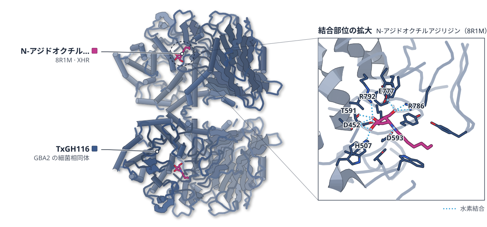

PDB 8R1M（論文が使った既存の構造）

色（順に）：TxGH116（GBA2 の細菌相同体）　スティック：N-アジドオクチルアジリジン（8R1M）（XHR）

**GBA2だけを止める、脳に届く共有結合型阻害剤**

N-アルキルアジリジン5はマウス脳のGBA2を阻害し、細菌相同体との結晶構造で共有結合を確かめた

- **疑問・課題**：GBA2 だけを選んで止める阻害剤がなく、GCS や GBA1 との働きの違いを分けて調べられなかった。
- **アプローチ**：環状アジリジンなどのライブラリーを合成し、酵素・培養細胞・マウスで調べた。細菌相同体との結晶構造も得た。
- **結果**：化合物5は GBA2 を選択的に阻害し、マウスの脳・肝・腎・脾で25 nmol でほぼ完全だった。GBA1 と GCS は阻害されなかった。
- **わかったこと**：脳に届き GBA2 だけを共有結合で止める最初の阻害剤になる。選択性は反応しやすい配置を取りやすいためと、MD と速度論から推定される。
- **残された課題**：GBA2 の活性と脂質の恒常性、神経炎症の関係を調べることが、今後の課題として挙げられている。

この紹介文の根拠（論文本文）

> yet the lack of highly selective chemical inhibitors has hindered efforts to disentangle its function from that of glucosylceramide synthase (GCS) and lysosomal glucosylceramidase (GBA1)  
> — 疑問・課題／Abstract

> we designed and synthesized a focused library of electrophile-bearing cyclitols, including epoxides, cyclic sulfates, and a diverse set of N-alkyl aziridines.  
> — アプローチ／Abstract

> a crystal structure of compound 5 in complex with TxGH116 was obtained  
> — アプローチ／Results

> Both methods revealed a clear dose-dependent inhibition of GBA2, with near-complete inhibition at 25 nmol in brain, liver, kidney and spleen.  
> — 結果／Results

> No significant inhibition of GBA1 or GCS was observed under any tested conditions  
> — 結果／Results

> Notably, octyl-alkyne aziridine 5 selectively inhibited GBA2 in mouse brain, representing the first covalent GBA2 inhibitor with demonstrated in vivo activity and brain permeability.  
> — わかったこと／Abstract

> These observations suggest that the GBA2 selectivity of 5 arises from its greater tendency to adopt a reaction-competent binding mode in GBA2 than in GBA1.  
> — わかったこと／Results

> Such approaches will help elucidate the relationship between GBA2 activity, lipid homeostasis and neuroinflammation.  
> — 残された課題／Conclusion

分類：酵素（その他）

#### 読みどころ

化合物5（オクチルアルキン鎖）の見かけの IC50 は GBA2 で319 nM、組換えヒト GBA1 で8470 nM と、20倍を超える選択性を示した。N-ブチル体4は高濃度でしか GBA1 を阻害しなかった。

根拠（論文本文）

> octyl-alkyne 5 showed excellent inhibition potency and over 20x selectivity for GBA2 over GBA1, with apparent IC50 values of 319 nm for GBA2 and 8470 nm for rhGBA1  
> — Results

細菌の相同体 TxGH116 との結晶構造で、5 は Glu441 と C1 位で共有結合を作った。既存の 8R1M（N-アジドオクチル体）と水素結合網は似るが、N-アルキル鎖は第4メチレンから先で逆向きに延びる。

根拠（論文本文）

> forming a covalent bond between Glu441 and the C1 atom of the β-d-Araf N-alkylaziridine 5  
> — Results

> The substituents on the cyclopentane ring 5 produce hydrogen bonding networks with the enzyme active site similar to those observed in the crystal structure of TxGH116 with N-azido-octyl aziridine 6 (PDB: 8R1M)  
> — Results

> beyond the fourth methylene, the chains diverge and point in opposite directions toward the protein surface  
> — Results

共有結合で不活性化する速さの指標 k_inact/K_i は、GBA1 が GBA2 より大幅に低かった。MD（計算）では、GBA2 の方が求核残基に向いた反応しやすい配置を取りやすかった。

根拠（論文本文）

> this ratio is markedly lower than that observed for GBA2  
> — Results

> the aziridine warhead frequently samples prereactive  
> — Results

#### 構造データ

| PDB | 手法 | 分解能 | 公開 | 生物種 | リガンド |
|---|---|---|---|---|---|
| [8R1M](https://www.rcsb.org/structure/8R1M) | X-ray | 1.90 Å | 2024-10-02 | Thermoanaerobacterium xylanolyticum LX-11 | XHR |

- [F6BL85](https://www.uniprot.org/uniprotkb/F6BL85)  Glucosylceramidase — *Thermoanaerobacterium xylanolyticum (strain ATCC 49914 / DSM 7097 / LX-11)* （既存の PDB 構造 0 件）

#### 実験メモ

- **発現系**：GBA2・GBA3 は GBA1/GBA2 ノックアウト HEK293T 細胞に過剰発現させたライセートで測定。
- **コンストラクト**：結晶構造は、ヒト GBA2 と活性部位が似る細菌相同体 TxGH116 で解いた。

根拠（論文本文）

> we tested GBA1 inhibition with recombinant human GBA1 (rhGBA1, imiglucerase) and GBA2 or GBA3 in lysates of GBA1/GBA2 knockout HEK293T cells in which we overexpressed GBA2 or GBA3  
> — Results

> TxGH116 is a bacterial homologue from Thermoanaerobacterium xylanolyticum that shares homology with human GBA2  
> — Results

> 📝 編集者への確認事項：著者が化合物5と TxGH116 の結晶構造を新たに得ているが、PDB ID が本文になく candidates の own_structures は空。図は既存の 8R1M（同じ酵素の N-アジドオクチル体）で描く。新しい構造（Structure Update）として扱うか親の判断に委ねる。選択性の説明は MD（計算）で、実験構造の裏付けは共有結合の確認まで。Methods・SI は本文にない。

---

## 注目の構造の採点（62 本を確認し、10 本を採点）

基準は `pipeline/impact.py`（10 点満点、6 点以上から最大 3 本）。

| 選定 | 論文 | 種類 | novelty | reach | structure | support | 計 | 理由 |
|---|---|---|---|---|---|---|---|---|
| ◯ | PMC13670896 Native Mass Spectrometry Reveals Ligand-Specific Conformatio | 新しい手法・ソフト | 2 | 2 | 1 | 2 | 7 | ネイティブ質量分析とナノボディで、リガンドごとのβ1ARの細胞内側の状態の違いを数値化し、弱いアゴニストの状態を Nb6B9 だけが捉えると示した。自前の質量分析・蛍光測定とキメラで確かめ、既存の結晶構造の上で CDR の役割を解釈している。 |
| ◯ | PMC13674592 Programmable gold nanoparticle conjugates enable precise AMP | 新しい手法・ソフト | 2 | 2 | 2 | 1 | 7 | Fab に金ナノ粒子を剛直に結合させ、脳スライスのクライオ ET で AMPA 受容体の位置と脱感作時の形を調べる手法。実験のクライオ ET が結論の中心。本文が未公開で要旨のみの評価（support 1）。 |
| ◯ | PMC13674267 β‑d‑Arabinofuranose-configured Cyclitol Aziridines as Select | 構造に基づく創薬 | 2 | 1 | 1 | 2 | 6 | 脳に入り GBA2 だけを共有結合で止める初の阻害剤を、細胞とマウスで示した。細菌の相同体 TxGH116 との結晶構造で共有結合を確かめた（structure 1、選択性の説明は MD）。GBA2 という一つの系の成果で reach は 1。 |
|  | PMC13670219 Redox-state-dependent CO binding in MoFe nitrogenase: insigh | 既存構造で機構を解明 | 2 | 1 | 1 | 2 | 6 | EPR・IR・光分解でニトロゲナーゼへの CO 結合を E1 状態と整理した。ただし根拠は分光とQM/MMで、X 線・クライオ電顕・NMR による構造の確認はなく（structure 1 は自前の分光データに対する最大限の評価）、同点の 6 点では GBA2 の論文を優先した。 |
|  | PMC13670894 Split Cas12a Protospacer Engineering Enables Ultraspecific R | 新しい手法・ソフト | 2 | 2 | 0 | 2 | 6 | 分割した Cas12a の活性化装置で一塩基多型を見分ける設計だが、実験は FRET・EMSA・切断アッセイで、構造は AlphaFold3 と既存の 8Y04 の引用のみ（structure 0）。 |
|  | PMC13669308 Compound Z247611722 Exhibits Antifungal Activity by Inhibiti | 構造に基づく創薬 | 2 | 1 | 0 | 2 | 5 | SPT を標的とする新しい抗真菌化合物を遺伝学・代謝解析・耐性変異で示したが、結合部位は既存の酵母 SPT 構造（8C80）に基づくホモロジーモデルのみで、実験構造の確認がない（structure 0）。 |
|  | PMC13669341 Molecular dynamics guided all-atom reconstruction of cryo-ET | 既存構造で機構を解明 | 2 | 2 | 0 | 1 | 5 | トリヌクレオソームの全原子 MD を既存のクライオ ET マップに当てはめる手法。MD が中心で、マップは先行研究のもの。自前の実験構造がない（structure 0）。 |
|  | PMC13669394 Angiotensin II exacerbates intracerebral hemorrhage in mice  | 既存構造で機構を解明 | 2 | 1 | 0 | 2 | 5 | Ang II がアンチトロンビンを活性化するという機構をマウスで示したが、結合様式は AlphaFold3 と MD で、既存の 1TB6 は図示のみ。実験構造がない（structure 0）。 |
|  | PMC7619568 Cav3.1 Is a Neuronal Leucine Sensor That Mediates Satiety an | 既存構造で機構を解明 | 2 | 1 | 0 | 2 | 5 | Cav3.1 がロイシンセンサーだと示したが、結合部位は既存のクライオ電顕構造（6KZO）へのドッキングと変異体で、ドッキングの出発点に使っただけ（structure 0）。 |
|  | PMC13674506 Chemogenetic ubiquitin E1 inhibitor TAK-243 CRISPR screen un | 既存構造で機構を解明 | 2 | 1 | 0 | 2 | 5 | HAPSTR1 が HUWE1 をクロマチンに呼ぶという経路を CRISPR スクリーンで示したが、結合面は AlphaFold3 のモデルのみ（structure 0）。 |

novelty：何が初めてか / reach：誰に効くか / structure：実験で決めた構造（X 線・クライオ電顕・NMR / support：裏付けの強さ（2＝独立した実験で検証：変異体・機能測定・既存手法との比較など／1＝一部の検証のみ／0＝計算のみで実験的検証なし）

## 記事にしていない新しい構造

- [Widespread Biosynthesis of Thiohistidine Dipeptides in Bacteria](https://doi.org/10.1021/jacs.6c03714) — *J Am Chem Soc*（新しい構造：9PHY）
- [Structural Snapshots of F1 ‐ATPase Catalysis in Drug Resistant Acinetobacter baumannii Reveal Novel Therapeutic Targets](https://doi.org/10.1096/fj.202602735r) — *FASEB J*（新しい構造：24DH, 24DJ, 24DK, 24DL）
- [Network pharmacology–driven identification of PTP1β and rational design of simufilam-based allosteric inhibitors for neuroprotection in Alzheimer’s disease](https://doi.org/10.1007/s13205-026-05086-2) — *3 Biotech*（新しい構造（PDB ID が本文にない））
- [The MODNAP benchmark set for modeling ribose-based modified nucleic acid and nucleic acid–protein complexes: a case study with AlphaFold 3](https://doi.org/10.1093/nar/gkag999) — *Nucleic Acids Res*（新しい構造（PDB ID が本文にない））
