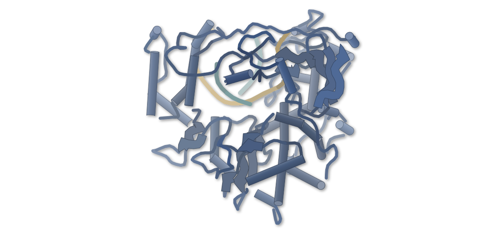
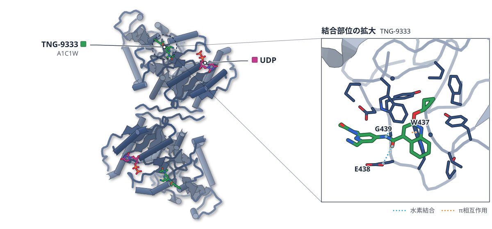
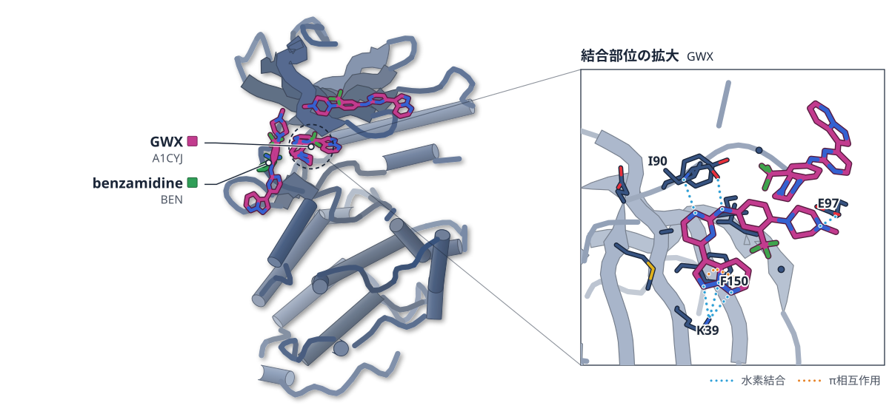
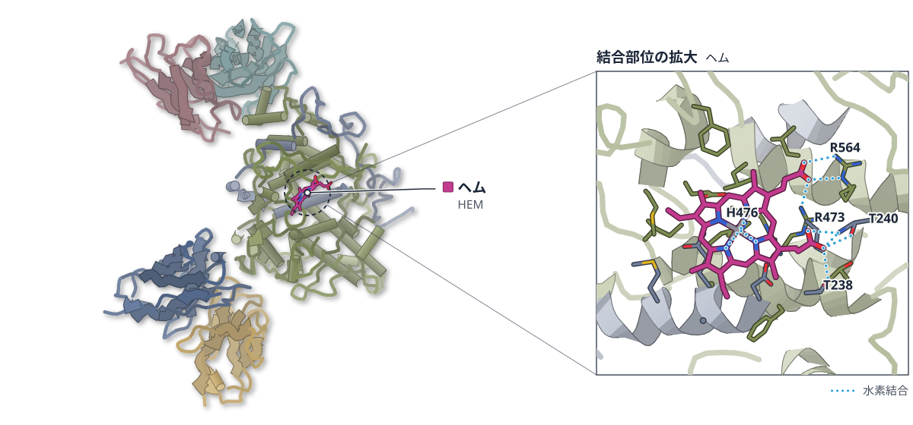
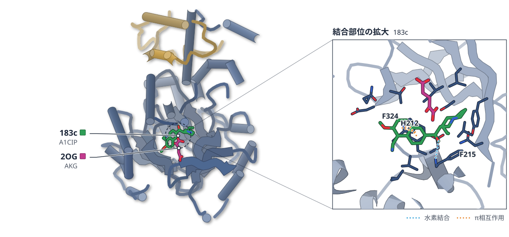
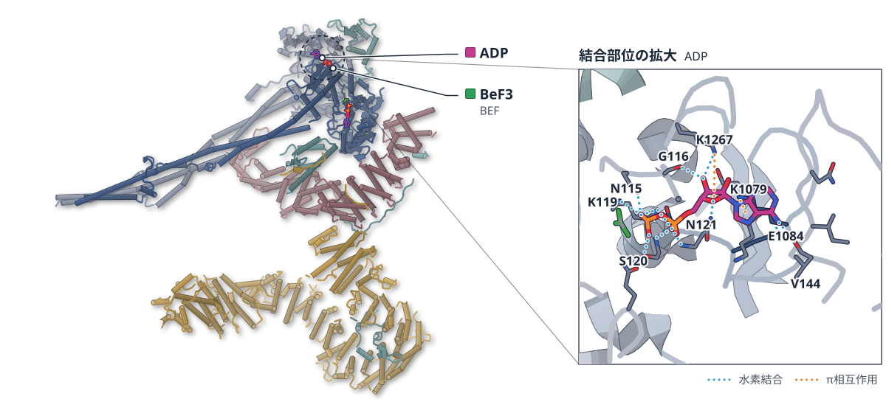
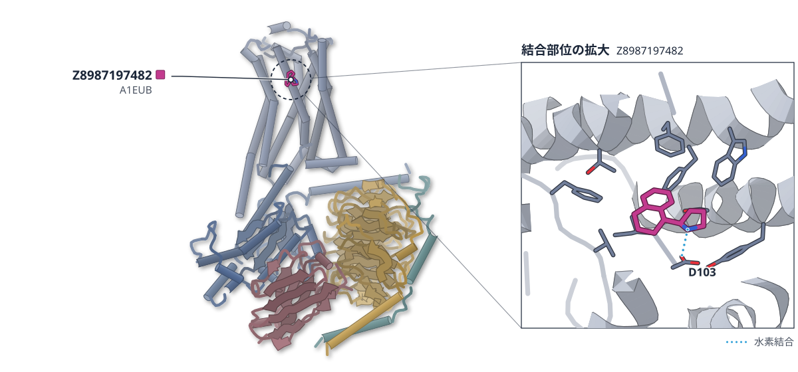
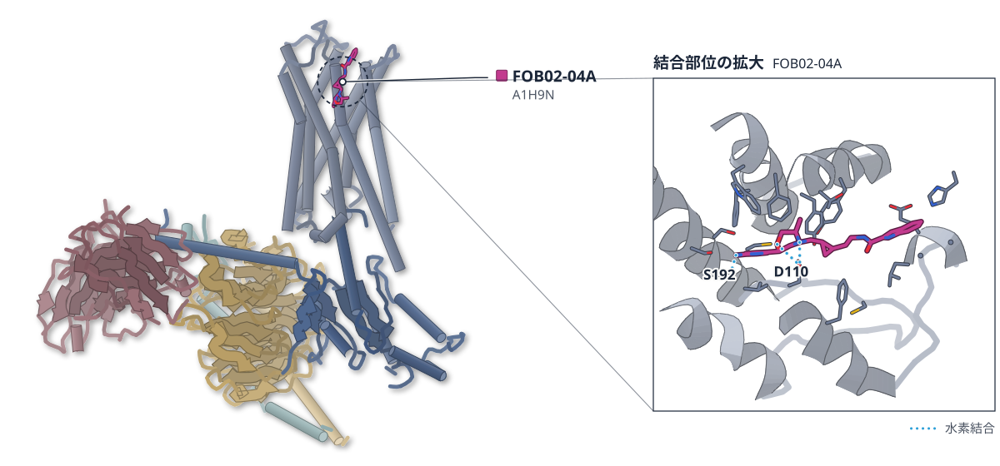
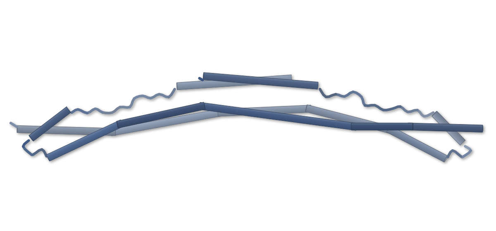

# 2026-10-21 号

**今日の新しい構造：11 本**　PMC に 2026-10-20 に登録されたオープンアクセス論文 62 本のうち、新しい構造を報告した論文は 11 本。うち 12 本を紹介する（残りは末尾に一覧）。

出典：この号の論文情報と全文は、米国国立医学図書館（NLM）の PMC オープンアクセスデータセット（AWS Open Data）から取得した。

**New Structure 4 本** · **Structure Update 6 本** · **Structure-Based Study 2 本**（New Structure：構造が初めて解かれたタンパク質。Structure Update：既知のタンパク質の新しい構造。Structure-Based Study：既存の構造を使った注目の研究）

## Today's Structure（今日の一本）

**1｜レムデシビルは、RdRPの移動と次の反応を100倍以上遅らせる**（EV71 RdRP（エンテロウイルス71））

選んだ理由（構造生物学・創薬）：レムデシビルが RdRP の移動を妨げる仕組みを、結晶構造と速度論で示した。核酸アナログ設計の新しい着眼点になる。

> Our work demonstrates translocation-related intervention as an effective and broadly applicable polymerase intervention strategy in NA rational design.  
> — Abstract

- 迷った論文：MGAT1（ヒト） — MGAT1 阻害剤の結晶構造。創薬の軸は強いが、がん免疫の部分は構造以外の解析が中心のため次点にした。

| # | 標的 | 手法・分解能 | 見出し |
|---|---|---|---|
| 1 | EV71 RdRP（エンテロウイルス71） | X-ray・1.90–2.70 Å（5 構造） | レムデシビルは、RdRPの移動と次の反応を100倍以上遅らせる |
| 2 | MGAT1（ヒト） | X-ray・1.55–2.01 Å（5 構造） | MGAT1の阻害剤は、活性部位とは別のポケットに入る |
| 3 | Stk1（黄色ブドウ球菌） | X-ray・2.07 Å | MRSAのβ-ラクタム耐性は、キナーゼStk1の阻害で弱まる |
| 4 | MPO–Fab複合体（マウス） | Cryo-EM・2.95 Å（2 構造） | 抗MPO抗体は、結合部位が違うほど好中球を強く動かす |
| 5 | KDM2A（ヒト） | X-ray・2.16 Å | KDM2A阻害剤は、基質ペプチドの形をまねて結合する |
| 6 | コンデンシンII（ヒト） | Cryo-EM・4.60–6.90 Å（3 構造） | M18BP1が、コンデンシンIIの自己抑制を外す |
| 7 | TAAR1（ヒト） | Cryo-EM・3.12–3.14 Å（2 構造） | ドッキングで探したTAAR1作動薬を、構造で確かめた |
| 8 | MsrA（マウス） | X-ray・1.6〜3.0 Å | 酸化したMsrAは、C末端で活性部位にふたをする |
| 9 | MmCadA（亜鉛輸送ATPase） | X-ray・3.6 Å | 亜鉛を運ぶATPaseは、N末端で輸送を抑えるらしい |
| 10 | R2ab（表皮ブドウ球菌） | NMR | R2abは細胞壁とポリスチレンの両方に結合する |
| 11 | ドパミンD3受容体（ヒト） | 既存のクライオ電顕構造・nanoBRET・変異体 | D3受容体はGαiと共役せず、Gαoを選ぶ |
| 12 | TRIM25 コイルドコイル | PELDOR/DEER（EPR）・既存の結晶構造 4LTB | PELDORで、17.3 nmの距離を測れた |

> この号は AI が論文本文から作成した**レビュー用の下書き**です。数値・ID・リガンドは PDB / UniProt から取得し、AI の記述には本文からの引用を付けています。

---

# Picked up Today's Structure

## 1｜EV71 RdRP（エンテロウイルス71）

### Highly effective viral RdRP translocation hindrance by the remdesivir nucleotide

*Nucleic Acids Research*（2026-10-19） · [論文](https://doi.org/10.1093/nar/gkag957) · ライセンス: cc by-nc

筆頭著者：Rui Li（Chinese Academy of Sciences, China）　責任著者：Yechun Xu, Peng Gong（Chinese Academy of Sciences, China）

色（順に）：Enterovirus 71 polymerase / RNA (34-MER) / RNA (5'-R(*UP*GP*UP*UP*CP*GP*AP*CP*GP*AP*G*(F86)P*G*(F86)P*GP*CP*CP*U)-3')

**レムデシビルは、RdRPの移動と次の反応を100倍以上遅らせる**

EV71 RdRPの結晶構造と速度論で、セリン417が通り道をふさぐ様子を示した

- **疑問・課題**：レムデシビル（RDV）は数ヌクレオチド後に反応を妨げるが、その正確な仕組みや効き方は不明だった。
- **アプローチ**：EV71 RdRP の S417G 変異体の結晶構造、急速停止法による速度論、分子動力学シミュレーションを組み合わせた。
- **結果**：RDV の移動と次の反応の合わせた速度はアデノシンの 100 分の 1 以下で、S417G 変異体ではこの差がほぼ消えた。
- **わかったこと**：RDV の 1′-シアノ基とセリン417 のぶつかりが移動を妨げる。移動の段階での阻害は、核酸類似体の設計に使える戦略と論文は提案する。

この紹介文の根拠（論文本文）

> However, how effective is RDV nucleotide at the delayed intervention site and what is the precise mechanism of its primary intervention both remain to be clarified.  
> — 疑問・課題／Introduction

> By combining X-ray crystallography, quench-flow kinetics, and molecular dynamics simulations, we show that the composite rate of RDV translocation from product strand position −3 to −4  
> — アプローチ／Abstract

> Strikingly, the r2 value is about 100-fold lower for the RDV-TP-derived WT EC14 (0.042 s−1 vs. 6.4 s−1), while the r1 value remains high (12.8 s−1).  
> — 結果／Results

> indicating that the S417G mutation almost eliminates the RDV-mediated site-specific translocation-related intervention.  
> — 結果／Results

> Modeling a serine at this site leads to a steric clash of its side chain and the cyano group  
> — わかったこと／Results

> Our work demonstrates translocation-related intervention as an effective and broadly applicable polymerase intervention strategy in NA rational design.  
> — わかったこと／Abstract

分類：DNA・RNA に関わるもの・感染・ウイルス・防御系・酵素（その他）

#### 読みどころ

S417G 変異体の複合体で、RDV 由来のヌクレオチドが産物鎖の −4 位に結晶中で捉えられた。−3 位の移動前の状態や、−4 と −5 の間にある行き過ぎた状態も見え、RDV が自由エネルギーの地形を変えると考えられる。

根拠（論文本文）

> The capture of both the C2S4 and C3S1o complexes suggests that the free-energy landscape is altered by the RDV nucleotide even when the side chain of the roadblock serine is replaced by a hydrogen of the engineered glycine.  
> — Results

活性部位での阻害や連鎖停止とは別に、ポリメラーゼ上を動く途中で妨げる戦略を示した。ポリメラーゼと立体的にぶつかる位置があれば、核酸類似体の設計に使える可能性がある。

根拠（論文本文）

> Any steric hindrance of an NA in the product strand by polymerase residues provides an opportunity of translocation-related intervention.  
> — Discussion

結晶にヌクレオチドを浸して反応を進め、同じ結晶型から複数の反応段階の構造を得た。急速停止法の速度論で、移動を含む段階の速度を取り出した。

根拠（論文本文）

> Crystal soaking trials were performed using the precipitant solution supplemented with 5 mM of each nucleotide [NTP(s) or RDV-TP] and 10 mM divalent metal ions (MgCl2 or MnCl2).  
> — Methods

#### 構造データ

| PDB | 手法 | 分解能 | 公開 | 生物種 | リガンド |
|---|---|---|---|---|---|
| [21TH](https://www.rcsb.org/structure/21TH) | X-ray | 2.23 Å | 2026-10-07 | Enterovirus A71, synthetic construct | — |
| [21TI](https://www.rcsb.org/structure/21TI) | X-ray | 2.22 Å | 2026-10-07 | Enterovirus A71, synthetic construct | POP |
| [21TJ](https://www.rcsb.org/structure/21TJ) | X-ray | 2.03 Å | 2026-10-07 | Enterovirus A71, synthetic construct | — |
| [21TK](https://www.rcsb.org/structure/21TK) | X-ray | 1.90 Å | 2026-10-07 | Enterovirus A71, synthetic construct | — |
| [21TL](https://www.rcsb.org/structure/21TL) | X-ray | 2.70 Å | 2026-10-07 | Enterovirus A71, synthetic construct | — |

- [E5RPG3](https://www.uniprot.org/uniprotkb/E5RPG3)  Genome polyprotein — *Human enterovirus 71* （既存の PDB 構造 6 件）
- [Q5DW46](https://www.uniprot.org/uniprotkb/Q5DW46)  Genome polyprotein — *Human enterovirus 71* （PDB で初めての構造）

#### 実験メモ

- **発現系**：大腸菌 BL21(DE3)pCG1 で発現、0.5 mM IPTG で誘導
- **コンストラクト**：EV71 RdRP の S417G 変異体と野生型
- **精製**：ニッケル親和・陰イオン交換・ゲルろ過
- **結晶化／グリッド作製**：シッティングドロップ蒸気拡散（12 または 16 °C）。結晶に各 5 mM のヌクレオチドと 10 mM の 2 価金属を浸した
- **データ収集・解析**：上海放射光施設 BL17U1・BL02U1 で 100 K、180° 以上を 0.2° 刻みで収集

根拠（論文本文）

> the protein was expressed in Escherichia coli strain BL21(DE3)pCG1, induced by 0.5 mM IPTG, purified by sequentially passage through nickel-affinity, anion exchange, and gel filtration columns.  
> — Methods

> crystals were grown by sitting-drop vapor diffusion at 12 °C or 16 °C using 10 mg/ml EC samples.  
> — Methods

> X-ray diffraction data were collected at Shanghai Synchrotron Radiation Facility beamlines BL17U1 and BL02U1 (wavelength 0.9792 Å) at 100 K.  
> — Methods

> 📝 編集者への確認事項：ga_pdb_id は 5 つの構造のうち 1.90 Å のもの。論文は S417G 変異体の結晶構造が中心（野生型は複合体が得られなかった）。MD の結果は本文では補助的に扱った。

---

# New Structure

## 2｜MGAT1（ヒト）

### Genetic and biochemical screens identify MGAT1 as a druggable glycosyltransferase target in STK11-mutant lung cancer

*The Journal of Biological Chemistry*（2026-09-12） · [論文](https://doi.org/10.1016/j.jbc.2026.113551) · ライセンス: cc by-nc-nd

筆頭著者：Kiera M. Vassallo（USA）　責任著者：Jannik N. Andersen（USA）

色（順に）：MGAT1　スティック：UDP、TNG-9333（A1C1W）

**MGAT1の阻害剤は、活性部位とは別のポケットに入る**

ヒトMGAT1の結晶構造から、肺がんの免疫回避に関わる酵素の新しい結合部位が見えた

- **疑問・課題**：STK11 変異の肺がんは抗 PD-1 療法が効きにくく、新しい治療標的が必要だった。
- **アプローチ**：CRISPR スクリーンで MGAT1 を見つけ、50 万化合物を探索して阻害剤を最適化し、結晶構造を解いた。
- **結果**：最初のヒット（IC50 197 μM）は TNG-2673（0.043 μM）まで 1000 倍以上強まり、阻害剤は活性部位と別の穴に結合した。
- **わかったこと**：MGAT1 の触媒活性が免疫回避に必要で、構造から創薬できる標的だと示された。阻害機構は活性部位との競合がない点から推定した段階である。
- **残された課題**：天然の基質を高濃度で使えず、阻害機構を完全には決められていない。

この紹介文の根拠（論文本文）

> Checkpoint inhibitors are standard-of-care therapies for non-small cell lung cancer (NSCLC), but their efficacy is limited in tumors with STK11 mutations, highlighting the need for new therapeutic strategies.  
> — 疑問・課題／Abstract

> Using purified human MGAT1 and a UDP-Glo glycosyltransferase assay, we established a tractable screening platform and performed a 500,000-compound biochemical high-throughput screen  
> — アプローチ／Abstract

> Subsequent medicinal chemistry optimization delivered progressively more potent analogs, including TNG-9333 (0.814 μM) and TNG-2673 (0.043 μM) and represented a >1000-fold improvement in biochemical potency from the starting hit.  
> — 結果／Abstract

> The structure of MGAT1 in complex with TNG-9333 revealed a novel binding site distinct from the active site (Fig. 5E).  
> — 結果／Results

> Collectively, our work implicates N-glycosylation as a key mediator of immune evasion and establishes MGAT1 as a ligandable, structurally tractable target for small-molecule drug discovery.  
> — わかったこと／Abstract

> As such, the proposed allosteric mechanism is inferred solely from the lack of identifiable evidence of active-site interaction.  
> — わかったこと／Results

> Development of improved substrate reagents or alternative assay formats will be required to further resolve the molecular mechanism of MGAT1 inhibition.  
> — 残された課題／Results

分類：酵素（その他）・免疫（抗体・MHC・TCR・自然免疫）

#### 読みどころ

阻害剤 TNG-9333 は、基質 UDP-GlcNAc が入る活性部位ではなく、β ターン・α ヘリックス・C 末端でできた別のポケットに入る。UDP と同時に結合した三者複合体の構造も解かれた。

根拠（論文本文）

> This pocket is formed by β-turn L407–R413, α-helix R391–L401, and the C-terminus of the protein.  
> — Results

> The ternary structure of MGAT1 in complex with TNG-9333 and UDP corroborated the SPR and DSF findings, demonstrating that the two molecules can simultaneously bind to distinct sites on MGAT1  
> — Results

ヒト MGAT1 の初の結晶構造（apo・UDP・UDP-GlcNAc 結合型）で、UDP が結合するとループ（R316–F331）が覆いかぶさるように一部秩序化した。触媒に重要な可能性があると著者は述べる。

根拠（論文本文）

> This loop folds over the ligand and is stabilized by direct interactions with UDP, suggesting a ligand-induced conformational change that may be important for catalysis.  
> — Results

触媒に必要な D211 と D289 の変異体は活性を失い、野生型だけが腫瘍の免疫回避を回復させた。酵素活性そのものが阻害の狙いになる。

根拠（論文本文）

> MGAT1 catalytic activity is thus critical for its function in protecting cancer cells from immune attack in vitro and in vivo, making it a suitable target for small-molecule drug development.  
> — Results

#### 構造データ

| PDB | 手法 | 分解能 | 公開 | 生物種 | リガンド |
|---|---|---|---|---|---|
| [9ZAZ](https://www.rcsb.org/structure/9ZAZ) | X-ray | 1.55 Å | 2026-09-23 | Homo sapiens | PG6, UDP |
| [9ZB1](https://www.rcsb.org/structure/9ZB1) | X-ray | 2.00 Å | 2026-09-23 | Homo sapiens | UD1 |
| [9ZB0](https://www.rcsb.org/structure/9ZB0) | X-ray | 1.65 Å | 2026-09-23 | Homo sapiens | — |
| [9ZB3](https://www.rcsb.org/structure/9ZB3) | X-ray | 2.00 Å | 2026-09-23 | Homo sapiens | A1C1W |
| [9ZB2](https://www.rcsb.org/structure/9ZB2) | X-ray | 2.01 Å | 2026-09-23 | Homo sapiens | A1C1W, UDP |

- [P26572](https://www.uniprot.org/uniprotkb/P26572) MGAT1 Alpha-1,3-mannosyl-glycoprotein 2-beta-N-acetylglucosaminyltransferase — *Homo sapiens* （PDB で初めての構造）

#### 実験メモ

- **発現系**：Hi-5 昆虫細胞にバキュロウイルスで発現（27 °C・48 時間）
- **コンストラクト**：結晶化用は A104–N445（膜貫通ヘリックスなし）、His タグ付き
- **結晶化／グリッド作製**：UDP 複合体は MnCl2 と UDP-glucose を加え、シッティングドロップ蒸気拡散（20 °C）。電子密度は UDP のみ
- **データ収集・解析**：UDP 複合体は上海放射光 BL17U で 1.6 Å。ウサギ MGAT1（2AM3）で分子置換

根拠（論文本文）

> His-TEV–MGAT1(T30–N445) was expressed in Hi-5 insect cells (Gibco #B85502) using baculovirus at 27 °C for 48 h.  
> — Methods

> The crystallographic construct comprised residues A104–N445 and lacked both the N-terminal transmembrane helix and an additional N-terminal helix.  
> — Methods

> Electron density supported UDP only, indicating hydrolysis of UDP-glucose during crystallization.  
> — Methods

> Diffraction data were collected to 1.6 Å resolution at the Shanghai Synchrotron Radiation Facility (beamline BL17U).  
> — Methods

> 📝 編集者への確認事項：阻害機構の「アロステリック」は著者自身が推定と書いている。9ZB2 は UDP と TNG-9333 の三者複合体。

---

## 3｜Stk1（黄色ブドウ球菌）

### Stk1 is required for BlaR1-mediated broad-spectrum β-lactam resistance in epidemic-causing strains of Staphylococcus aureus

*Nature Communications*（2026-09-16） · [論文](https://doi.org/10.1038/s41467-026-77668-w) · ライセンス: cc by-nc-nd

筆頭著者：Raymond Poon（University of Maryland, USA）　責任著者：Som S. Chatterjee（University of Maryland, USA）

色（順に）：Serine/Threonine Kinase　スティック：GWX（A1CYJ）、benzamidine（BEN）

**MRSAのβ-ラクタム耐性は、キナーゼStk1の阻害で弱まる**

Stk1と阻害剤GWXの結晶構造は、DFG-out型の不活性な状態を示した

- **疑問・課題**：MRSA の広域 β-ラクタム耐性は BlaR1 のリン酸化に左右されるが、その担い手とリン酸化の役割を確かめる必要があった。
- **アプローチ**：stk1 欠損株と阻害剤 GWX での耐性・mecA 誘導を調べ、Stk1 キナーゼドメインと GWX の複合体を結晶化した。
- **結果**：Δstk1 では mecA の誘導が弱まり、β-ラクタムの MIC は 4 倍以上低下した。GWX は DFG-out 型の不活性な構造で結合した。
- **わかったこと**：Stk1 を標的にすると、多くの MRSA を β-ラクタムに再び感受性にできる可能性がある。構造は阻害剤設計の手がかりになる。

この紹介文の根拠（論文本文）

> A prior study identified a key step in the activation of β-lactam resistance was the phosphorylation of the sensor-inducer protein BlaR1, following β-lactam detection27,28.  
> — 疑問・課題／Results

> To investigate the molecular basis of Stk1 inhibition by GWX in further detail, we co-crystallized the protein-ligand complex and determined its structure through X-ray diffraction methods to 2.1 Å resolution  
> — アプローチ／Results

> we deleted stk1 or stp1 from SF8300, a clinically isolated USA300 strain2 that contains an impaired MecR1-MecI regulatory pathway  
> — アプローチ／Results

> qRT-PCR analysis revealed that exposure to nafcillin (Fig. 3a) or oxacillin (Supplementary Fig. S2a) led to a significantly attenuated induction of mecA transcription in Δstk1  
> — 結果／Results

> In our structure of the kinase domain, Asp 151 of the DFG motif is pushed away from the active site cleft into the “DFG-out” conformation  
> — 結果／Results

> Our results demonstrate that targeting Stk1 can potentiate synthetic lethality to β-lactams in the majority of naturally isolated strains of MRSA.  
> — わかったこと／Abstract

> We additionally present the structural and kinetic basis for a Stk1-inhibitor complex that can enable rational design of Stk1-directed anti-MRSA therapeutics in the future.  
> — わかったこと／Abstract

分類：キナーゼ・感染・ウイルス・防御系

#### 読みどころ

既知のキナーゼ阻害剤 GWX は Stk1 に Kd 21.1 nM で結合し、ナフシリンと併用すると野生株の増殖が弱まった。Δstk1 では併用の上乗せがなく、効果は Stk1 の阻害によると読める。

根拠（論文本文）

> Δstk1 had similar growth patterns when treated with only nafcillin or with a combination of nafcillin and GWX, suggesting that the phenotype displayed above was specifically due to GWX-mediated inhibition of Stk1 function.  
> — Results

GWX は Stk1 の活性部位の裂け目を占め、DFG モチーフが外向き（DFG-out）になる。Phe150 がアデニン結合部位でピラゾロピリジンとπスタッキングする。結合様式は、これまでのコンピュータ予測とは異なっていた。

根拠（論文本文）

> Instead, the preceding Phe150 lies in the adenine pocket and forms a pi-stacking interaction with the pyrazolopyridine moiety of the GWX ligand.  
> — Results

> the GWX ligand binds in a fashion not predicted by prior in silico models35  
> — Results

解析した S. aureus ゲノム約 12.8 万件のうち、mecA 陽性の MRSA の多くは mecI を欠いて blaZ・blaI を持ち、mecA が BlaR1-BlaI 経路の制御下にあるとみられる。stk1 と stp1 はほぼ全株に保存されていた。

根拠（論文本文）

> Notably, we found stk1 and stp1, the two components of the eSTK1 pathway, to be conserved in 99.71% of our 127894 analyzed S. aureus entries (Fig. 1b).  
> — Results

#### 構造データ

| PDB | 手法 | 分解能 | 公開 | 生物種 | リガンド |
|---|---|---|---|---|---|
| [9YMT](https://www.rcsb.org/structure/9YMT) | X-ray | 2.07 Å | 2026-03-11 | Staphylococcus aureus subsp. aureus N315 | BEN, A1CYJ |

- [A0ABF7PGK0](https://www.uniprot.org/uniprotkb/A0ABF7PGK0)  Serine/threonine-protein — *Staphylococcus aureus (strain N315)* （PDB で初めての構造）

#### 実験メモ

- **発現系**：大腸菌 BL21(DE3) で 1 mM IPTG・23 °C・16 時間誘導（N 末端 10×His タグ）
- **コンストラクト**：Stk1 キナーゼドメイン（残基 1–291）
- **精製**：Ni-NTA、トロンビンでタグ切断、Superdex 200 ゲルろ過
- **結晶化／グリッド作製**：9 mg/mL のタンパク質と 2 mM GWX、シッティングドロップ（22 °C）。結晶は 4 °C で育成
- **データ収集・解析**：カナダ光源 CMCF-BM で 100 K。XDS・Aimless で処理し、既存の Stk1 構造で分子置換

根拠（論文本文）

> 1 mM isopropyl-β-d-thiogalactopyranoside (IPTG) was added to the media to induce protein expression, and the culture was incubated for 16 h at 23 °C and 180 rpm.  
> — Methods

> Fractions containing the thrombin-cleaved Stk1 KD were concentrated using a 10 kDa MWCO Amicon Ultra centrifugal filter (Millipore Sigma).  
> — Methods

> Data was collected at 100 K on the CMCF-BM (08B1) beam line with a Pilatus3 S 6 M X-ray detector (Dectris)  
> — Methods

> 📝 編集者への確認事項：BlaR1 のリン酸化が膜貫通状態を安定化するという要旨の主張は、本記事では扱っていない（構造と耐性の結果を中心にした）。構造は 1 エントリ（9YMT）。

---

## 4｜MPO–Fab複合体（マウス）

### Epitope-diverse autoantibodies induce neutrophil–epithelial niches driving kidney injury in ANCA-associated glomerulonephritis

*The Journal of Experimental Medicine*（2026-10-19） · [論文](https://doi.org/10.1084/jem.20260506) · ライセンス: cc by

筆頭著者：Masayuki Nishide（The University of Osaka, Japan）　責任著者：Masayuki Nishide, Atsushi Kumanogoh（The University of Osaka, Japan）

色（順に）：mAb-A46 Fab Heavy chain / mAb-A46 Fab Light chain / mAb-A24 Fab Heavy chain / mAb-A24 Fab Light chain / Mpo / Mpo　スティック：ヘム（HEM）

**抗MPO抗体は、結合部位が違うほど好中球を強く動かす**

MPOとFabのクライオ電顕で、抗体の結合部位を特定した

- **疑問・課題**：自己抗体が臓器の中で組織傷害を始める仕組みは、まだ十分に分かっていなかった。
- **アプローチ**：マウスの抗MPO抗体 3 種とMPOの複合体をクライオ電顕で解き、組み合わせてマウスに投与した。
- **結果**：抗体は MPO の別々の領域に結合した。2 種以上を組み合わせると ROS 産生が強まり、腎炎が起きた。
- **わかったこと**：異なる部位に結合する抗MPO抗体の組み合わせが好中球の活性化を高め、ヒトに近い糸球体腎炎を起こした。
- **残された課題**：どの抗体の結合配置が好中球の活性化を招くかは、さらに解析が必要だ。

この紹介文の根拠（論文本文）

> how pathogenic autoantibodies initiate local tissue injury within affected organs remains incompletely understood  
> — 疑問・課題／Introduction

> Cryo-electron microscopy (cryo-EM) epitope mapping showed that mAb-A24 bound to the Hc helix–loop–helix region (P583–E599)  
> — アプローチ／Results

> When administered in combination at equivalent total antibody concentrations, ROS production was markedly enhanced relative to single-antibody stimulation  
> — 結果／Results

> combinations of anti-MPO monoclonal antibodies recognizing distinct epitopes enhance neutrophil activation and induce glomerulonephritis with histopathological features that closely resemble those of human disease  
> — わかったこと／Results

> Further epitope-resolved analyses will be required to determine how the geometric arrangement of antibody-binding sites on MPO influences FcγR-dependent neutrophil activation.  
> — 残された課題／Discussion

分類：免疫（抗体・MHC・TCR・自然免疫）

#### 読みどころ

MPO に結合する 3 種の抗体を 2.95 Å のクライオ電顕構造で調べ、結合部位（エピトープ）を Hb ループや Hc 領域などに特定した。

根拠（論文本文）

> mAb-A46 bound to the Hb loop (N487–R498), and mAb-B88 recognized two regions within Hc (R210–E221 and R533–M693)  
> — Results

Fc の働きを抑えた片腕抗体は、抗原への結合を保ったまま好中球の ROS 産生を起こさず、マウスの腎傷害を軽くした。

根拠（論文本文）

> These results indicate that one-armed antibodies targeting pathogenic MPO epitopes can selectively inhibit FcγR-dependent neutrophil activation while preserving antigen specificity.  
> — Results

#### 構造データ

| PDB | 手法 | 分解能 | 公開 | 生物種 | リガンド |
|---|---|---|---|---|---|
| [21RN](https://www.rcsb.org/structure/21RN) | Cryo-EM | 2.95 Å | 2026-09-16 | Mus musculus | HEM |
| [21RT](https://www.rcsb.org/structure/21RT) | Cryo-EM | 2.95 Å | 2026-09-16 | Mus musculus | HEM |

- [P11247](https://www.uniprot.org/uniprotkb/P11247) Mpo Myeloperoxidase — *Mus musculus* （PDB で初めての構造）
- [Q6RFG4](https://www.uniprot.org/uniprotkb/Q6RFG4) Mpo Myeloperoxidase — *Mus musculus* （PDB で初めての構造）

#### 実験メモ

- **発現系**：組換えマウス MPO と、抗体を限定分解した Fab を使用
- **精製**：Protein A で Fc を除き、サイズ排除クロマトグラフィーで Fab を精製
- **結晶化／グリッド作製**：複合体を MS(PEG)8 で PEG 化して凝集を抑え、Vitrobot Mark IV で凍結
- **データ収集・解析**：Glacios（200 kV）・Falcon 4i で収集し、cryoSPARC・RELION で解析

根拠（論文本文）

> To suppress protein aggregation, the complex was PEGylated with MS(PEG)8  
> — Methods

> Data collection was performed on an in-house Glacios microscope (Thermo Fisher Scientific) equipped with a Selectris-X energy filter and Falcon 4i detector  
> — Methods

> 📝 編集者への確認事項：主題は空間トランスクリプトミクスで、構造はエピトープ特定の部分。

---

# Structure Update

## 5｜KDM2A（ヒト）

### Structure and mechanism of inhibition of lysine demethylase 2A (KDM2A) by compound 183c

*Communications Chemistry*（2026-06-27） · [論文](https://doi.org/10.1038/s42004-026-02100-9) · ライセンス: cc by-nc-nd

筆頭著者：Pavel Mader（Lunenfeld-Tanenbaum Research Institute, Canada）　責任著者：Jeff Wrana, Frank Sicheri（Lunenfeld-Tanenbaum Research Institute, Canada）、Michal Zimmermann（QC Canada）

色（順に）：KDM2A / KDM2A　スティック：2OG（AKG）、183c（A1CIP）

**KDM2A阻害剤は、基質ペプチドの形をまねて結合する**

2OGを必要とする阻害剤183cとの複合体を、2.2 Åの結晶構造で解いた

- **疑問・課題**：阻害剤 183c は特許に書かれていたが、KDM2A への結合のしかたは分かっていなかった。
- **アプローチ**：示差走査蛍光法で結合を調べ、183c と 2OG を加えて KDM2A の結晶構造を決めた。
- **結果**：183c は 2OG があるときだけ強く結合し、H3K36me2 基質が入るポケットを占めていた。
- **わかったこと**：183c は 2OG に依存して基質をまねる阻害剤であり、KDM2A 阻害剤を改良する足場になる。
- **残された課題**：細胞内の 2OG 濃度の変化が 183c への感受性に影響するかは、調べていない。

この紹介文の根拠（論文本文）

> While the compound’s inhibitory activity against KDM2B was reported, its binding mode remained undescribed.  
> — 疑問・課題／Introduction

> we revised our structure determination strategy to include both 2OG and 183c in KDM2A crystal soaking experiments  
> — アプローチ／Results

> demonstrating a strong dependency on 2OG for the binding of 183c to KDM2A  
> — 結果／Results

> 183c is best viewed as a 2OG-dependent substrate mimic that is mechanistically distinct from canonical cofactor-competitive JmjC inhibitors  
> — わかったこと／Discussion

> While our current study did not directly test how changes in intracellular 2OG influence cellular or in vivo sensitivity to 183c  
> — 残された課題／Discussion

分類：クロマチン・ヒストン・酵素（その他）

#### 読みどころ

183c のシクロブチルピペリジン部分は、基質ペプチドのジメチル化 Lys36 が入る小さなポケットに入っていた。

根拠（論文本文）

> the 1-cyclobutylpiperidine moiety of 183c is positioned within the same sub-pocket that accommodates the dimethylated lysine 36 side chain of the H3K36me2 peptide  
> — Results

183c は活性部位で 2OG の隣に位置し、2OG と弱い水素結合を作る。2OG が金属イオンとの不利な電荷の相互作用を和らげるらしい。

根拠（論文本文）

> the negatively charged 2OG molecule appears to shield an unfavorable charge interaction between the positively charged Ni2+ and the amino group of 183c  
> — Results

基質ペプチドが使う Ser145 などとの水素結合は 183c にはなく、論文は極性基を足して強める余地があると述べている。結晶は生理的な Fe2+ でなく Ni2+ を含む。

根拠（論文本文）

> Although the crystal structure was determined with Ni²⁺ rather than the physiological Fe²⁺, the overall ternary binding mode is expected to be preserved.  
> — Discussion

#### 構造データ

| PDB | 手法 | 分解能 | 公開 | 生物種 | リガンド |
|---|---|---|---|---|---|
| [9PHV](https://www.rcsb.org/structure/9PHV) | X-ray | 2.16 Å | 2026-07-01 | Homo sapiens | A1CIP, AKG |

- [Q9Y2K7](https://www.uniprot.org/uniprotkb/Q9Y2K7) KDM2A Lysine-specific demethylase 2A — *Homo sapiens* （既存の PDB 構造 6 件）

#### 実験メモ

- **発現系**：大腸菌で NTD と CTD の 2 本のポリペプチドとして発現
- **コンストラクト**：触媒ドメイン（NTD：残基 2–383、CTD：残基 450–517）
- **結晶化／グリッド作製**：結晶に 183c と 2OG を浸す（ソーキング）
- **データ収集・解析**：APS 23-ID-C で収集。KDM2A の既存構造（PDB 2YU2）を用いた分子置換で解いた

根拠（論文本文）

> The catalytic domain of KDM2A used for crystallization was expressed in E. coli as two polypeptides referred to as the N-terminal domain (NTD) and the C-terminal domain (CTD).  
> — Methods

> Single crystal X-ray diffraction data were collected at a wavelength of 1.4831 Å at beamline 23-ID-C at Advanced Photon Source, Argonne National Laboratory.  
> — Methods

> 📝 編集者への確認事項：ALT 陽性がん細胞での増殖・RNA-seq の記述は省いた。

---

## 6｜コンデンシンII（ヒト）

### Mechanism of M18BP1-mediated activation of condensin II for mitotic DNA compaction

*Nature Structural & Molecular Biology*（2026-10-20） · [論文](https://doi.org/10.1038/s41594-026-01902-8) · ライセンス: cc by-nc-nd

筆頭著者：Alessandro Borsellini（Human Technopole, Italy）　責任著者：Alessandro Borsellini, Alessandro Vannini（Human Technopole, Italy）

色（順に）：SMC2 / NCAPD3 / NCAPH2 / NCAPG2 / SMC4　スティック：ADP、BeF3（BEF）

**M18BP1が、コンデンシンIIの自己抑制を外す**

CAP-G2が約60 Å動くことで、DNAをはさむ構造に切り替わる

- **疑問・課題**：コンデンシンIIがDNAを凝縮する活性を得る分子の仕組みは、まだ調べられていなかった。
- **アプローチ**：クライオ電顕で複数の状態を解き、光ピンセットによる一分子観察と組み合わせた。
- **結果**：M18BP1 がない状態では CAP-G2 が SMC を橋渡しして閉じていた。M18BP1 の結合で約 60 Å 動いた。
- **わかったこと**：M18BP1 の結合が CAP-G2 の位置を変えて自己抑制を外し、DNA への安定な結合と凝縮を可能にする。
- **残された課題**：多量体を作る分子的な要因は、さらに調べる必要がある。

この紹介文の根拠（論文本文）

> However, the molecular mechanisms underlying condensin II activation in driving DNA compaction remain uncharacterized.  
> — 疑問・課題／Abstract

> combining cryo-electron microscopy with single-molecule imaging, we unravel the mechanism of condensin II activation by M18BP1  
> — アプローチ／Abstract

> the two HEAT-repeat-containing subunits act as a rigid body, undergoing a rototranslational movement spanning ~60 Å  
> — 結果／Results

> The specific interaction with phosphorylated M18BP1 induces conformational changes in the condensin II complex, relieving an autoinhibitory conformation and allowing stable DNA binding and DNA compaction.  
> — わかったこと／Abstract

> Further work will be required to define the molecular determinants of the multiprotein assemblies observed here  
> — 残された課題／Discussion

分類：クロマチン・ヒストン・DNA・RNA に関わるもの

#### 読みどころ

M18BP1 と DNA がない状態では、CAP-G2 が SMC2 と SMC4 の両方をつかみ、閉じた自己抑制の構造をとっていた（4.6 Å）。

根拠（論文本文）

> The CAP-G2 subunit hooks both SMC subunits by binding simultaneously to the SMC2 head and the SMC4 coiled-coil region.  
> — Results

DNA 結合型では CAP-D3 が DNA を上から押さえ、SMC の ATPase ヘッド上に DNA が載る。CAP-G2 はこの構造では密度が見えなかった（6.8 Å）。

根拠（論文本文）

> Despite being present during sample preparation, no EM density was obtained for the CAP-G2 subunit.  
> — Results

光ピンセットと蛍光顕微鏡で、M18BP1 があると結合の頻度と持続時間が増えることを一分子で示した。

根拠（論文本文）

> binding of condensin II to DNA in the presence of ATP is increased in both frequency and duration when M18BP1P is present  
> — Discussion

#### 構造データ

| PDB | 手法 | 分解能 | 公開 | 生物種 | リガンド |
|---|---|---|---|---|---|
| [9TSZ](https://www.rcsb.org/structure/9TSZ) | Cryo-EM | 4.60 Å | 2026-10-14 | Homo sapiens | BEF, ADP |
| [9TTP](https://www.rcsb.org/structure/9TTP) | Cryo-EM | 6.90 Å | 2026-10-14 | DNA molecule, Homo sapiens | BEF, ADP |
| [9TUU](https://www.rcsb.org/structure/9TUU) | Cryo-EM | 6.00 Å | 2026-10-14 | Homo sapiens | — |

- [O95347](https://www.uniprot.org/uniprotkb/O95347) SMC2 Structural maintenance of chromosomes protein 2 — *Homo sapiens* （既存の PDB 構造 2 件）
- [P42695](https://www.uniprot.org/uniprotkb/P42695) NCAPD3 Condensin-2 complex subunit D3 — *Homo sapiens* （既存の PDB 構造 1 件）
- [Q6IBW4](https://www.uniprot.org/uniprotkb/Q6IBW4) NCAPH2 Condensin-2 complex subunit H2 — *Homo sapiens* （既存の PDB 構造 1 件）
- [Q6P0N0](https://www.uniprot.org/uniprotkb/Q6P0N0) MIS18BP1 Mis18-binding protein 1 — *Homo sapiens* （既存の PDB 構造 4 件）
- [Q86XI2](https://www.uniprot.org/uniprotkb/Q86XI2) NCAPG2 Condensin-2 complex subunit G2 — *Homo sapiens* （既存の PDB 構造 1 件）
- [Q9NTJ3](https://www.uniprot.org/uniprotkb/Q9NTJ3) SMC4 Structural maintenance of chromosomes protein 4 — *Homo sapiens* （既存の PDB 構造 2 件）

#### 実験メモ

- **発現系**：ヒトコンデンシンIIを biGBac ベクターで組み立て、Sf9・High Five 昆虫細胞で発現
- **結晶化／グリッド作製**：コンデンシンII、M18BP1、235 bp DNA、ADP-BeF3 を混ぜ、sulfo-SDA で架橋
- **データ収集・解析**：Glacios（200 kV）・Falcon 4i・Selectris X で EER 動画を収集

根拠（論文本文）

> Recombinant bacmids were generated by Tn7 transposition in DH10EMBacY (Geneva Biotech) cells and transfected into Sf9 cells  
> — Methods

> Micrographs for the condensin II–DNA structure were acquired as EER movies on a Glacios (Thermo Scientific) transmission EM instrument operated at 200 kV  
> — Methods

> 📝 編集者への確認事項：分解能は 4.6〜6.9 Å と低め。M18BP1 は DNA 結合型の密度に見えない。9TUU（M18BP1 との複合体、局所 3.8 Å）の記述も本文にある。

---

## 7｜TAAR1（ヒト）

### Structure based discovery of antipsychotic-like TAAR1 agonists

*Nature Communications*（2026-09-17） · [論文](https://doi.org/10.1038/s41467-026-77484-2) · ライセンス: cc by

筆頭著者：Sijie Huang（University of California, San Francisco, USA）　責任著者：H. Eric Xu（Chinese Academy of Sciences, China）、William C. Wetsel（Duke University Medical Center, USA）、Brian K. Shoichet（University of California, San Francisco, USA）

色（順に）：Engineered miniG(s) subunit alpha isoforms short / GNB1 / GNG2 / Nanobody35 / TAAR1　スティック：Z8987197482（A1EUB）

**ドッキングで探したTAAR1作動薬を、構造で確かめた**

6,500万分子をドッキングし、2種の最適化化合物の複合体をクライオ電顕で決めた

- **疑問・課題**：統合失調症の既存薬は副作用が出やすく、効き方にも個人差がある。新しい標的としてTAAR1が注目されている。
- **アプローチ**：6,500万個の低分子をTAAR1の活性型構造にドッキングし、上位55個を実験で試して、有望な化合物を最適化した。
- **結果**：55個中14個がアゴニストだった。最適化で1.5〜72 nMに達し、クライオ電顕の結合様式はドッキングの予測とほぼ一致した。
- **わかったこと**：活性型構造へのドッキングはアゴニストの発見に偏った。3化合物はマウスの統合失調症モデルでPPIの障害を正常化した。
- **残された課題**：他の行動表現型や、他の副作用は調べられておらず、今後の課題として残っている。

この紹介文の根拠（論文本文）

> These drugs often cause side effects and vary in effectiveness across patients.  
> — 疑問・課題／Abstract

> has emerged as a promising alternative target.  
> — 疑問・課題／Abstract

> we computationally dock 65 million molecules against the active state of TAAR1 and experimentally test 55 of those highly ranked.  
> — アプローチ／Abstract

> Three of these are optimized for activity and for pharmacokinetics (PK), reaching TAAR1 potencies from 1.5 to 72 nM.  
> — 結果／Introduction

> Hit optimization yields nanomolar agonists whose docking-predicted poses are confirmed by cryo-EM.  
> — 結果／Abstract

> Targeting the active state of the receptor successfully biased toward agonist discovery.  
> — わかったこと／Discussion

> All three potently normalize amphetamine-induced pre-pulse inhibition in mice, a model for schizophrenia, without catalepsy, a common side effect of traditional antipsychotics.  
> — わかったこと／Abstract

> Their potential effects on other behavioral phenotypes, as well as other adverse drug reactions, remain unexplored.  
> — 残された課題／Discussion

分類：GPCR・受容体

#### 読みどころ

活性型の実験構造（8W8A）にドッキングして見つけたアゴニストは、既知のTAAR1リガンドと骨格が異なる。最適化で、低ナノモルの化合物まで強めた。

根拠（論文本文）

> Large library docking against TAAR1 followed by structure-based optimization revealed a series of low-nanomolar TAAR1 agonists with topologies unrelated to known ligands.  
> — Discussion

2つのアゴニスト複合体（3.12 Å・3.14 Å）では、芳香環が疎水性のポケットに収まり、アミンが D103 とイオン対を作る。この2点がドッキングの予測どおりに確かめられた。

根拠（論文本文）

> TAAR1 appears to recognize these agonists primarily through two ligand moieties: an aryl group that forms π-π and packing interactions with a sub-pocket formed by F2686.52, F186ECL2, I1043.33, and a cationic amine that ion-pairs with D1033.32.  
> — Results

AlphaFold2 モデルは結合ポケットが狭く、初期ヒット率は高かったが、最適化の余地が小さかった可能性がある。実験構造の広いポケットは、1.5 nM までの最適化を許した。

根拠（論文本文）

> the larger orthosteric site of the cryo-EM structure allowed us to optimize compounds into the 1.5 nM range  
> — Results

#### 構造データ

| PDB | 手法 | 分解能 | 公開 | 生物種 | リガンド |
|---|---|---|---|---|---|
| [9VZ3](https://www.rcsb.org/structure/9VZ3) | Cryo-EM | 3.14 Å | 2026-07-29 | Homo sapiens, Lama glama | A1EUA |
| [9VZ2](https://www.rcsb.org/structure/9VZ2) | Cryo-EM | 3.12 Å | 2026-07-29 | Homo sapiens, Lama glama | A1EUB |

- [P59768](https://www.uniprot.org/uniprotkb/P59768) GNG2 Guanine nucleotide-binding protein G(I)/G(S)/G(O) subunit gamma-2 — *Homo sapiens* （既存の PDB 構造 1321 件）
- [P62873](https://www.uniprot.org/uniprotkb/P62873) GNB1 Guanine nucleotide-binding protein G(I)/G(S)/G(T) subunit beta-1 — *Homo sapiens* （既存の PDB 構造 1339 件）
- [Q96RJ0](https://www.uniprot.org/uniprotkb/Q96RJ0) TAAR1 Trace amine-associated receptor 1 — *Homo sapiens* （既存の PDB 構造 17 件）

#### 実験メモ

- **発現系**：Hi5 昆虫細胞で TAAR1-miniGαs と Gβ1γ2 を発現
- **精製**：LMNG・CHS で可溶化し、TALON、Nb35 の添加、Superose 6 のゲルろ過で精製
- **結晶化／グリッド作製**：Quantifoil 300 mesh Au R1.2/1.3 のグリッドに塗布し、Vitrobot Mark IV で急速凍結
- **データ収集・解析**：Titan Krios（300 kV）と Falcon 4 で撮影し、cryoSPARC で解析

根拠（論文本文）

> The TAAR1 complexes with the discovered agonists were expressed in Hi5 insect cells (Invitrogen).  
> — Methods

> The mixture was then purified by SEC using a Superose 6 10/300 GL column  
> — Methods

> samples for Z1255382255 or Z8987197482 were applied individually to EM grids (Quantifoil, 300 mesh Au R1.2/1.3)  
> — Methods

> Cryo-EM imaging was collected on a Titan Krios equipped with a Falcon 4 direct electron detection device at 300 kV  
> — Methods

> 📝 編集者への確認事項：ドッキング・最適化・動物試験が中心の論文だが、クライオ電顕構造 2 本（9VZ3・9VZ2）を新たに決めているので新しい構造として扱った。legend_labels は render 後の凡例の順を見て決める。

---

## 8｜MsrA（マウス）

### Structural basis for cysteine-linked redox-state plasticity in mammalian methionine sulfoxide reductase A

*Redox Biology*（2026-10-10） · [論文](https://doi.org/10.1016/j.redox.2026.104436) · ライセンス: cc by-nc

筆頭著者：Byeongmin Shin（Korea University, Republic of Korea）　責任著者：Kathryn F. Tonissen（Griffith University, Australia）、Kwang Yeon Hwang（Korea University, Republic of Korea）

**酸化したMsrAは、C末端で活性部位にふたをする**

還元・中間体様・酸化の3状態を結晶構造で解き、Cys107とCys227のジスルフィド結合を見つけた

- **疑問・課題**：哺乳類のMsrAが酸化と還元のなかで構造をどう調節されているかは、はっきりしていなかった。
- **アプローチ**：マウスMsrAの還元型・中間体様・酸化型の結晶構造を決め、LC-MS/MS、MD、活性測定、Trxトラップ実験を組み合わせた。
- **結果**：酸化型では Cys72–Cys218 に加えて予想外の Cys107–Cys227 ジスルフィドがあり、C末端ループを活性部位の上に固定していた。
- **わかったこと**：著者らは、Cys72が触媒を担い、Cys107の組み替えとCys227へのTrxの侵入が基質の近づきやすさと再生を左右するというモデルを示す。
- **残された課題**：この二重ジスルフィド状態が細胞内でどれほど存在するかは、まだ確かめられていない。

この紹介文の根拠（論文本文）

> but how mammalian MsrA is structurally regulated during oxidation and reductive recycling has remained unclear.  
> — 疑問・課題／Abstract

> We report three crystal structures of mouse MsrA (mMsrA) that capture distinct redox states  
> — アプローチ／Abstract

> LC-MS/MS mapping, MD simulations, activity assays, and thioredoxin (Trx)-trapping experiments converge on a model  
> — アプローチ／Abstract

> The oxidized structure resolves the canonical Cys72–Cys218 disulfide together with an unexpected Cys107–Cys227 pairing that locks a C-terminal loop into a cap over the active site.  
> — 結果／Abstract

> Cys72 drives catalysis, while Cys107-mediated disulfide rearrangement and Cys227-directed Trx entry gate substrate access and enzymatic regeneration  
> — わかったこと／Abstract

> The cellular prevalence of the exact Cys72-Cys218/Cys107-Cys227 double-disulfide configuration remains to be established  
> — 残された課題／Discussion

分類：酵素（その他）

#### 読みどころ

1.6 Å の中間体様の構造では、触媒Cys72がβ-メルカプトエタノール（BME）と混合ジスルフィドを作り、隣のCys107がスルフェン酸になっていた。著者はX線の照射による酸化の寄与も考えている。

根拠（論文本文）

> The BTIL structure visualizes catalytic Cys72 as a mixed disulfide with β-mercaptoethanol (BME) alongside a sulfenic acid at Cys107, a configuration not previously observed.  
> — Abstract

> we consider the possibility that X-ray exposure contributed to the Cys107-SOH modification observed in the BTIL structure  
> — Discussion

酸化型では、C末端ループが活性部位の上に折り重なり、基質や小さなチオールが結合する場所にふたをする。還元型ではこのふたがなく、活性部位は溶媒に開いている。

根拠（論文本文）

> In our oxidized structure, the C-terminal loop folds over the active site pocket and forms a cap-like conformation at the site where methionine sulfoxide or small thiol molecules would bind.  
> — Results

Cys107をSerに変えても還元活性は保たれ、触媒には要らないと分かった。一方、Cys218とCys227を両方変えるとTrxによる再生活性は失われた。

根拠（論文本文）

> C107S showed DTT-dependent activity comparable to that of the wild-type protein and retained substantial Trx-dependent activity, indicating that Cys107 is dispensable for the catalytic reductase cycle.  
> — Results

#### 構造データ

| PDB | 手法 | 分解能 | 公開 | 生物種 | リガンド |
|---|---|---|---|---|---|
| 44ND | — | — | 公開待ち | — | — |
| 44NI | — | — | 公開待ち | — | — |
| 44NR | — | — | 公開待ち | — | — |

#### 実験メモ

- **発現系**：大腸菌 Rosetta で全長mMsrAを発現（pET21a、1.0 mM IPTG、37 °C、4時間）
- **精製**：Ni-NTA、イオン交換、Superdex 75 のゲルろ過で精製。酸化型は最後のゲルろ過で還元剤を除いた
- **結晶化／グリッド作製**：22 °C で蒸気拡散法。酸化型の結晶は3か月以上のインキュベーション後に得られた
- **データ収集・解析**：Pohang Accelerator Laboratory で収集し、HKL-2000 で処理。1FVA を探索モデルに分子置換

根拠（論文本文）

> Full-length mMsrA was cloned into pET21a (Novagen).  
> — Materials and methods

> Size exclusion chromatography was performed on a Superdex 75 column (GE Healthcare)  
> — Materials and methods

> diffraction-quality crystals of oxidized form appeared only after incubation for more than 3 months  
> — Materials and methods

> The mMsrA structures were solved by molecular replacement using MOLREP [23] and Phaser implemented in PHENIX [24], with bovine MsrA (PDB ID: 1FVA) as the search model.  
> — Materials and methods

> 📝 編集者への確認事項：PDB ID（44ND・44NI・44NR）は未公開。ウシMsrA（1FVA）などの哺乳類の構造が既にあるため、first_claim は付けていない（Structure Update になる見込み）。論文は酸化型を哺乳類MsrAの酸化型として初の構造例と書くが、新規のタンパク質ではない。BTIL の Cys107-SOH は X 線照射の影響の可能性を著者が述べている。

---

## 9｜MmCadA（亜鉛輸送ATPase）

### Structural and functional insights into a Zn2+-transporting P-type ATPase

*Nature Communications*（2026-09-16） · [論文](https://doi.org/10.1038/s41467-026-77558-1) · ライセンス: cc by

筆頭著者：Pin Lyu（University of Copenhagen, Denmark）　責任著者：Pontus Gourdon（University of Copenhagen, Denmark）

**亜鉛を運ぶATPaseは、N末端で輸送を抑えるらしい**

内向き型の結晶構造（3.6 Å）と変異体の活性測定から、取り込み経路とN末端の働きを探った

- **疑問・課題**：金属を運ぶPIB型ATPaseは亜鉛の恒常性に欠かせないが、分子レベルの仕組みはよく分かっていなかった。
- **アプローチ**：亜鉛などを運ぶMmCadAを結晶化して内向き型の構造を決め、N末端を削った変異体の活性とMDで調べた。
- **結果**：3.6 Å の構造では、CPC モチーフの C564 が、電気的に負に帯電した広い取り込み領域に直接さらされていた。
- **わかったこと**：N末端は輸送を抑えつつ、金属が増えると抑制が外れるセンサーとして働くとみられる。ヒスチジンに富む部分が金属を渡すと著者は提案する。
- **残された課題**：N末端は結晶構造で見えず、その働きは生化学実験とモデルから推定した。

この紹介文の根拠（論文本文）

> Transition metal transporting P-type (PIB-) ATPase proteins are critical for this balance but remain poorly understood at the molecular level.  
> — 疑問・課題／Abstract

> Here, we present the inward-open structure of a dimeric zinc-transporting PIB-type ATPase, resolved at 3.6 Å resolution.  
> — アプローチ／Abstract

> Moreover, the function of the N-terminus of MmCadA is studied using biochemical experiments  
> — アプローチ／Introduction

> the structure reveals an electronegatively charged uptake region that directly exposes a metal-binding cysteine of the invariant CPC-motif.  
> — 結果／Abstract

> the N-terminal tail, harboring two so-called metal binding domains (MBDs), auto-inhibits the ATPase core and serves as a metal-sensitive sensor, releasing inhibition when intracellular metal levels rise.  
> — わかったこと／Abstract

> We propose that a histidine-rich segment, positioned after the MBD closest to the core, donates ions to the CPC site.  
> — わかったこと／Abstract

> As the N-terminus was unresolved in our structure, we opted to investigate its role using biochemical analysis  
> — 残された課題／Results

分類：トランスポーター

#### 読みどころ

金属の取り込みの門とされてきた M357 と F380 は、この負電荷の領域から遠く、構造は従来の漏斗モデルと合わない。著者は C564 が金属を受け取る役を担うと考えている。

根拠（論文本文）

> However, the proposed gate between M357 and F380 is located far from the electronegative metal uptake region, and thus the MmCadA structure appears inconsistent with the funnel hypothesis (Fig. 3B).  
> — Results

N末端を段階的に削った変異体はどれも活性を保った。N末端全体は輸送に必須ではないが、活性を調節している。先端側のMBD−2とヒスチジン部分を除くと、活性は2〜5倍に上がった。

根拠（論文本文）

> Collectively, these results indicate that the N-terminus as a whole preceding the ATPase core is not essential for transport function, but it clearly modulates transport activity.  
> — Results

> increases the activity 2–5-fold relative to wild-type  
> — Results

近縁のPIB型ATPaseの構造では初期位相が得られなかったが、AlphaFoldのモデルを探索モデルにした分子置換で構造を決められた。クライオ電顕は試みたが実らなかった。

根拠（論文本文）

> the structure was determined using molecular replacement with a search model obtained using AlphaFold  
> — Results

> we initially applied this method, but these efforts were fruitless.  
> — Results

#### 構造データ

| PDB | 手法 | 分解能 | 公開 | 生物種 | リガンド |
|---|---|---|---|---|---|
| 9T44 | — | — | 公開待ち | — | — |

#### 実験メモ

- **発現系**：大腸菌 BL21-CodonPlus(DE3) で発現（Strep タグ付き、0.5 mM IPTG、16 °C、20時間）
- **精製**：C12E8 で可溶化し、StrepTactin XT と Superose 6 のゲルろ過で精製
- **結晶化／グリッド作製**：Pb酢酸・AMPPNP・MgCl2 を加え、18 °C で結晶化（30% Jeffamine、0.1 M クエン酸ナトリウム pH 5.2）
- **データ収集・解析**：Swiss Light Source の X06SA ビームラインで収集し、XDS で処理

根拠（論文本文）

> The constructs were transformed into E. coli BL21-CodonPlus(DE3) cells  
> — Methods

> For final purification and buffer exchange, 10 mg of concentrated protein was applied onto a Superose 6 size-exclusion column  
> — Methods

> The highest-quality crystals were obtained from reservoirs containing 30% (v/v) Jeffamine and 0.1 M sodium citrate, pH 5.2.  
> — Methods

> Final diffraction data were collected at the Swiss Light Source (Switzerland) on the X06SA beamline.  
> — Methods

> 📝 編集者への確認事項：PDB ID（9T44）は未公開。論文は E1 型の PIB-2 ATPase 構造としているが、このタンパク質の初の構造とは明言していないので first_claim は付けていない（Structure Update になる見込み）。結晶中で二量体を作るが、著者は界面が保存されず機能的な意味は小さいとみている。N末端の機構は MD と AlphaFold モデルを含む推定で、著者も His−1・His−2 の予測は低信頼と注記している。

---

## 10｜R2ab（表皮ブドウ球菌）

### The mechanism of R2ab-mediated attachment to polystyrene surfaces in Staphylococcus epidermidis

*The Journal of Biological Chemistry*（2026-09-08） · [論文](https://doi.org/10.1016/j.jbc.2026.113533) · ライセンス: cc by

筆頭著者：Rahul Yadav（University of Arkansas-Fort Smith, USA）　責任著者：Rahul Yadav（University of Arkansas-Fort Smith, USA）、Nicholas C. Fitzkee（Mississippi State University, USA）

**R2abは細胞壁とポリスチレンの両方に結合する**

溶液NMRで構造と動きを決め、結合面をPREと変異体で調べた

- **疑問・課題**：表皮ブドウ球菌の自己溶解酵素の R2ab 反復が、細胞壁やプラスチック表面にどう結合するかは未定義だった。
- **アプローチ**：溶液NMRで R2ab の構造と運動を決め、ITC・NMR滴定・ポリスチレン粒子のPREで結合面を調べた。
- **結果**：R2ab は R2b の C 末端側の面でポリスチレンに結合し、S776 と K779 が吸着に重要だった。
- **わかったこと**：R2ab は細胞壁成分と人工表面の両方に結合する橋渡し役を果たすというモデルが支持される。

この紹介文の根拠（論文本文）

> but the structural basis for how R2ab engages cell wall components and polystyrene surfaces, potentially simultaneously, remains undefined.  
> — 疑問・課題／Discussion

> Here, using nuclear magnetic resonance spectroscopy, we determined the solution structure and backbone dynamics of the R2ab domain.  
> — アプローチ／Abstract

> R2ab engages polystyrene surfaces via a defined C-terminal interface on R2b, as revealed by PRE mapping, isothermal titration calorimetry, and mutational analyses.  
> — 結果／Abstract

> Polar and charged residues (notably S776 and K779) play key roles in adsorption.  
> — 結果／Abstract

> These findings support a model in which R2ab acts as a molecular bridge, binding both cell wall components and abiotic surfaces.  
> — わかったこと／Abstract

分類：感染・ウイルス・防御系・その他

#### 読みどころ

R2ab の溶液構造は2つの半開きβバレルからなる。ループ（RT・n-Src）に動きが大きい部分があり、リガンド結合に関わる可能性がある。

根拠（論文本文）

> The solution structure ensemble of 20 structures (PDB ID 7KWI) is tightly clustered, with an RMSD of 1.0 and 1.5 Å for ordered backbone and heavy atoms, respectively  
> — Results

> Reduced hetNOE and generalized order parameter (S2) values reflect increased motions in the R2a RT and n-Src loops  
> — Results

ペプチドグリカン（PGN）は R2a と R2b にまたがる空洞に結合する。LTA とは同じ面を取り合わないため、両方を同時に認識できる可能性がある。

根拠（論文本文）

> PGN binds R2ab with micromolar affinity and is better fitted by a one-site model.  
> — Discussion

> These observations indicate that LTA and PGN do not compete for the same binding surface on R2ab, an arrangement that could allow simultaneous engagement of both cell wall components during autolysin localization.  
> — Discussion

スピンラベルしたポリスチレンナノ粒子を作り、PREで R2ab の吸着面を残基ごとに調べた。S776A・K779A 変異体は吸着が弱まり、バイオフィルムが増えた。

根拠（論文本文）

> we developed paramagnetically spin-labeled PSNPs (PSNP@TEMPO) to identify residue-level information about the orientation of R2ab as it binds to a polystyrene-like surface.  
> — Discussion

> In contrast, both S776A and K779A mutants showed significantly higher S. epidermidis biofilm in comparison to either WT R2ab or tyrosine-mutated R2ab.  
> — Results

#### 構造データ

寄託の記載はあるが、ID は補足資料にのみ記載されている。

#### 実験メモ

- **発現系**：大腸菌 BL21 Star (DE3) で発現。同位体標識は M9 最小培地。
- **コンストラクト**：R2ab 152 残基＋N 末端 6×His タグ（pET15b）。
- **結晶化／グリッド作製**：NMR 試料は 0.5 mM、550 μl。
- **データ収集・解析**：Bruker Avance III 600 MHz（クライオプローブ）ほかで測定。

根拠（論文本文）

> The R2ab containing pET15b plasmid was transformed into Escherichia coli BL21 Star (DE3) competent cells (Invitrogen) for expression.  
> — Methods

> In this construct, the R2ab protein is composed of 152 residues with an additional N-terminal 6X His tag for purification.  
> — Methods

> The final protein concentration was 0.5 mM in a total volume of 550 μl.  
> — Methods

> The experiments were collected on a Bruker Avance III 600 MHz NMR spectrometer equipped with a cryoprobe at Mississippi State University.  
> — Methods

> 📝 編集者への確認事項：本文に PDB 7KWI・BMRB 30821 と書かれているが、collect では PDB と照合できなかった（未公開の可能性）。図なし。解像度の概念がない NMR のため method_label は NMR のみ。

---

# Structure-Based Study

## 11｜ドパミンD3受容体（ヒト）

### Gαo/z-biased coupling profile of the dopamine D3 receptor

*Communications Biology*（2026-06-29） · [論文](https://doi.org/10.1038/s42003-026-10587-0) · ライセンス: cc by-nc-nd

筆頭著者：Lucrezia Zanetti（University of Rochester Medical Center, USA）　責任著者：Cesare Orlandi（University of Rochester Medical Center, USA）

PDB 9F33（論文が使った既存の構造）

色（順に）：GNAO1 / Gnb1 / GNG2 / Antibody scFv16 / DRD3　スティック：FOB02-04A（A1H9N）

**D3受容体はGαiと共役せず、Gαoを選ぶ**

キメラと変異体で、Gαのα5ヘリックスとICL2が選択性を決めると示した

- **疑問・課題**：D3受容体がどの Gα と共役するかは、報告ごとに結果が食い違っていた。
- **アプローチ**：野生型 G タンパク質を使う細胞アッセイと、Gα・受容体のキメラで調べた。
- **結果**：D3R は Gαi を活性化せず、Gαo・Gαz を活性化した。決め手は Gα の α5 ヘリックスと D3R の ICL2 だった。
- **わかったこと**：既存のクライオ電顕構造の解析では、立体障害と静電反発が Gαi との共役を妨げていると示唆された。

この紹介文の根拠（論文本文）

> In particular, the Gα protein coupling profile of D3R remains controversial  
> — 疑問・課題／Introduction

> Applying orthogonal cell-based assays with wild-type G proteins in parental and ΔGαi/o/z cells, we conclusively establish that D3R does not activate Gαi proteins.  
> — アプローチ／Abstract

> Further analysis of Gαi2:GαoA and D2R:D3R chimeras reveals that this selective inability is driven by molecular determinants located within the α5 helix of Gαi and ICL2 of D3R.  
> — 結果／Abstract

> Models of the receptor-G protein interaction, based on available cryo-EM structures30,33, suggest that steric clashes and electrostatic repulsion may be responsible for the inability of D3R to engage Gαi proteins.  
> — わかったこと／Discussion

分類：GPCR・受容体

#### 読みどころ

Gαi2 の末端を GαoA のものに替えたキメラと、D2R・D3R の細胞内ループを入れ替えたキメラで、選択性を決める領域を絞り込んだ。ICL3 は選択性に関わらなかった。

根拠（論文本文）

> We confirmed the importance of the interface between the C-terminal α5 helix of the Gα proteins and the ICL2 of D3R in defining the biased coupling of D3R toward Gαo, while we showed that the ICL3 does not contribute to this selectivity.  
> — Discussion

D3R–GαoA の構造（9F33）では、Gα 側の 350 番付近が D3R の負電荷の窪みに近い。Gαi では Asp になるため、静電反発が起きると考えられる。一つの残基だけでは説明できず、複数の残基の組み合わせが効く。

根拠（論文本文）

> An investigation of the recently published structure of D3R bound to the GαoA-subtype of G protein (PDB:9F33) revealed that G350 is positioned in close proximity to a negatively charged cavity on D3R  
> — Results

> it is not a single residue responsible for the coupling preference exhibited by D3R, but rather a combinatorial effect of the different residues  
> — Discussion

海馬の急性スライスで選択的アゴニストとアンタゴニストを処理すると、内在のアデニル酸シクラーゼと cAMP の調節に違いが出た。

根拠（論文本文）

> treating hippocampal neurons in acute slices with selective agonists and antagonists reveals marked differences in their regulation of endogenous adenylyl cyclase and cAMP  
> — Abstract

#### 構造データ

| PDB | 手法 | 分解能 | 公開 | 生物種 | リガンド |
|---|---|---|---|---|---|
| [7WVY](https://www.rcsb.org/structure/7WVY) | Cryo-EM | 3.00 Å | 2022-04-13 | Homo sapiens | — |
| [8TZQ](https://www.rcsb.org/structure/8TZQ) | Cryo-EM | 3.20 Å | 2024-08-21 | Escherichia coli, Homo sapiens | LDP |
| [9F33](https://www.rcsb.org/structure/9F33) | Cryo-EM | 3.05 Å | 2024-09-18 | Aequorea victoria, Homo sapiens, Mus musculus, Rattus norvegicus | A1H9N |
| [7JVR](https://www.rcsb.org/structure/7JVR) | Cryo-EM | 2.80 Å | 2021-02-24 | Escherichia coli, Homo sapiens, synthetic construct | 08Y |

- [P04899](https://www.uniprot.org/uniprotkb/P04899) GNAI2 Guanine nucleotide-binding protein G(i) subunit alpha-2 — *Homo sapiens* （既存の PDB 構造 0 件）
- [P05067](https://www.uniprot.org/uniprotkb/P05067) APP Amyloid-beta precursor protein — *Homo sapiens* （既存の PDB 構造 0 件）
- [P09471](https://www.uniprot.org/uniprotkb/P09471) GNAO1 Guanine nucleotide-binding protein G(o) subunit alpha — *Homo sapiens* （既存の PDB 構造 0 件）
- [P0ABE7](https://www.uniprot.org/uniprotkb/P0ABE7) cybC Soluble cytochrome b562 — *Escherichia coli* （既存の PDB 構造 0 件）
- [P14416](https://www.uniprot.org/uniprotkb/P14416) DRD2 Dopamine receptor D2 — *Homo sapiens* （既存の PDB 構造 0 件）
- [P25090](https://www.uniprot.org/uniprotkb/P25090) FPR2 N-formyl peptide receptor 2 — *Homo sapiens* （既存の PDB 構造 0 件）
- [P35462](https://www.uniprot.org/uniprotkb/P35462) DRD3 Dopamine receptor D3 — *Homo sapiens* （既存の PDB 構造 0 件）
- [P42212](https://www.uniprot.org/uniprotkb/P42212) GFP Green fluorescent protein — *Aequorea victoria* （既存の PDB 構造 0 件）
- [P54311](https://www.uniprot.org/uniprotkb/P54311) Gnb1 Guanine nucleotide-binding protein G(I)/G(S)/G(T) subunit beta-1 — *Rattus norvegicus* （既存の PDB 構造 0 件）
- [P59768](https://www.uniprot.org/uniprotkb/P59768) GNG2 Guanine nucleotide-binding protein G(I)/G(S)/G(O) subunit gamma-2 — *Homo sapiens* （既存の PDB 構造 1321 件）
- [P62873](https://www.uniprot.org/uniprotkb/P62873) GNB1 Guanine nucleotide-binding protein G(I)/G(S)/G(T) subunit beta-1 — *Homo sapiens* （既存の PDB 構造 1339 件）
- [P63096](https://www.uniprot.org/uniprotkb/P63096) GNAI1 Guanine nucleotide-binding protein G(i) subunit alpha-1 — *Homo sapiens* （既存の PDB 構造 0 件）

#### 実験メモ

- **発現系**：HEK293T/17 細胞と、Gαi/o/z 欠損 HEK293A 細胞（ΔGαi/o/z）

根拠（論文本文）

> HEK293T/17 cells were purchased from ATCC, while Gαi/o/z-deficient HEK293A cells (ΔGαi/o/z)  
> — Methods

> 📝 編集者への確認事項：既存の PDB 構造（9F33・8TZQ・7JVR）を使った解析。構造図は先頭の引用構造から描かれる。

---

## 12｜TRIM25 コイルドコイル

### Spins AfarLong-Range Pulse Dipolar EPR Spectroscopy Uncovers Curvature in TRIM25’s Coiled Coil

*The Journal of Physical Chemistry Letters*（2026-10-05） · [論文](https://doi.org/10.1021/acs.jpclett.6c02671) · ライセンス: cc by

筆頭著者：Yannik Limbach（University of St.Andrews, UK）　責任著者：Bela E. Bode（University of St.Andrews, UK）

PDB 4LTB（論文が使った既存の構造）

色（順に）：Tripartite motif-containing 25 variant

**PELDORで、17.3 nmの距離を測れた**

重水素化と測定条件の最適化で、TRIM25 の曲がりを溶液で捉えた

- **疑問・課題**：10 nm を超える距離の PELDOR 測定は、これまでほとんど報告がなかった。
- **アプローチ**：TRIM25 のコイルドコイルに複数のスピン標識を入れ、重水素化と条件の最適化で測った。
- **結果**：通常条件で 10.5 nm、重水素化したタンパク質で 17.3 nm までの距離を得た。
- **わかったこと**：TRIM25 は溶液中で、結晶構造や予測構造より強く曲がっていた。20 nm も測れそうだという。

この紹介文の根拠（論文本文）

> Consequently, measurements of distances exceeding 8 nm are sparse in literature.  
> — 疑問・課題／Introduction

> By protein perdeuteration accurate distance measurements up to 17.3 nm were enabled.  
> — アプローチ／Abstract

> We demonstrate distances up to 10.5 nm in TRIM25 reliably extracted from data obtained under standard sample conditions.  
> — 結果／Abstract

> Furthermore, TRIM25 featured a higher degree of curvature in solution than suggested by the crystal structure and structure prediction.  
> — わかったこと／Discussion

分類：酵素（その他）・その他

#### 読みどころ

タンパク質を重水素化すると位相記憶時間が 5〜8 倍延び、測れる時間窓が約 150 μs まで伸びた。

根拠（論文本文）

> This led to a ∼5–8 fold increase in T m which should translate into PDS traces with >100 μs length becoming accessible.  
> — Results

TRIM25 のコイルドコイルは、溶液中で結晶構造や予測構造より強く曲がっていた。

根拠（論文本文）

> TRIM25 featured a higher degree of curvature in solution than suggested by the crystal structure and structure prediction  
> — Discussion

#### 構造データ

| PDB | 手法 | 分解能 | 公開 | 生物種 | リガンド |
|---|---|---|---|---|---|
| [4LTB](https://www.rcsb.org/structure/4LTB) | X-ray | 2.59 Å | 2014-02-05 | Homo sapiens | — |

- [Q14258](https://www.uniprot.org/uniprotkb/Q14258) TRIM25 E3 ubiquitin/ISG15 ligase TRIM25 — *Homo sapiens* （既存の PDB 構造 0 件）

#### 実験メモ

- **コンストラクト**：TRIM25 の逆平行コイルドコイル（189–379 番）に切り詰め、もとのシステインを除いて、距離ごとに Cys 変異を入れた。
- **データ収集・解析**：100 μs の測定では 40 K・スピン濃度 40 μM が計算上の最適条件だった。

根拠（論文本文）

> The full length TRIM25 protein was truncated to cover only its antiparallel coiled coil domain within residues 189–379 and the native cysteine was removed  
> — Results

> for 100 μs, 40 K and 40 μM spin concentration, is the calculated optimum  
> — Results

> 📝 編集者への確認事項：自前の EPR 距離データで既存の結晶構造（4LTB）を確かめた研究。structure 1 点。

---

## 注目の構造の採点（47 本を確認し、7 本を採点）

基準は `pipeline/impact.py`（10 点満点、6 点以上から最大 3 本）。

| 選定 | 論文 | 種類 | novelty | reach | structure | support | 計 | 理由 |
|---|---|---|---|---|---|---|---|---|
| ◯ | PMC13677679 Gαo/z-biased coupling profile of the dopamine D3 receptor | 既存構造で機構を解明 | 2 | 2 | 1 | 2 | 7 | 既存のクライオ電顕構造をもとに、D3Rだけが Gαi と共役しない理由を変異体・キメラで確かめた。D2様受容体の選択性という広い問いに答える。 |
| ◯ | PMC13679085 Spins AfarLong-Range Pulse Dipolar EPR Spectroscopy Uncover | 新しい手法・ソフト | 2 | 2 | 1 | 1 | 6 | PELDOR で 17.3 nm の距離測定を示し、TRIM25 コイルドコイルの曲がりを溶液で測った。大型複合体の長距離拘束に使える手法の拡張。 |
|  | PMC13678254 Exploring the bistable equilibrium of methylated CpG DNA rec | 既存構造で機構を解明 | 1 | 1 | 1 | 2 | 5 | 二状態の主張は MD が根拠で、NMR は S189A の選択性が変わらないことを確かめただけ。novelty 1 で基準未満。 |
|  | PMC13678009 Overlapping RAD18-and DNA-binding interfaces in DNA polymera | 既存構造で機構を解明 | 2 | 1 | 0 | 2 | 5 | 構造に基づく解析がなく（変異体と結合実験のみ）、structure が 0。 |
|  | PMC13679038 How a Highly Acidic SH3 Domain Binds to Its Intrinsically Di | 既存構造で機構を解明 | 1 | 1 | 1 | 2 | 5 | ITC・NMR・MD で出会い複合体への塩の効果を調べた続報。1 つの系の話で novelty 1。 |
|  | PMC13677808 Evaluating Machine Learning Affinity Prediction Methods on N | 構造予測・AI・デザイン | 1 | 1 | 0 | 1 | 3 | 機械学習による親和性予測の評価で、実験構造での確かめは共結晶との姿勢比較にとどまり structure 0。 |
|  | PMC13679930 Decoding channel pore dynamics mechanism in Anopheles gambia | 構造予測・AI・デザイン | 1 | 1 | 0 | 0 | 2 | MD だけの研究で、実験による検証がない。 |

novelty：何が初めてか / reach：誰に効くか / structure：実験で決めた構造（X 線・クライオ電顕・NMR / support：裏付けの強さ（2＝独立した実験で検証：変異体・機能測定・既存手法との比較など／1＝一部の検証のみ／0＝計算のみで実験的検証なし）

## 記事にしていない新しい構造

- [Syntaxin11 deficiency inhibits CRAC channel priming to suppress cytotoxicity and gene expression in T lymphocytes independent of membrane trafficking](https://doi.org/10.7554/elife.111335) — *Elife*（新しい構造（PDB ID が本文にない））
