

# 2026-10-22 号

**今日の新しい構造：12 本**　Europe PMC に 2026-10-21 に登録されたオープンアクセス論文 41 本のうち、新しい構造を報告した論文は 12 本。すべて紹介する。

**New Structure 4 本** · **Structure Update 8 本** · **Structure-Based Study 1 本**（New Structure：構造が初めて解かれたタンパク質。Structure Update：既知のタンパク質の新しい構造。Structure-Based Study：既存の構造を使った注目の研究）

## Today's Structure（今日の一本）

**1｜ハンタウイルスは棘の中央の穴で受容体を捉える**（ANDV スパイク・PCDH1）

選んだ理由（構造生物学・生命科学・創薬）：ハンタウイルスのスパイクが受容体PCDH1を深い穴で捉える様子と、中和抗体4種の阻害の仕方を同じ構造から示した。

> PCDH1 asymmetrically engages a deep central pocket formed by four Gn protomers in the spike, explaining why only intact viral particles or soluble tetramers recognize it.  
> — Abstract

> Structural and functional analyses of four neutralizing antibodies revealed that they block receptor binding through two distinct mechanisms  
> — Abstract

- 迷った論文：VZV カプシド — VZVカプシドの3.1 Å構造は初構造で重要だが、創薬や生物学上の新しい機構の示し方では受容体認識と抗体の阻害を一度に示した論文に及ばなかった。
- 迷った論文：ジカウイルス NS1 — ZIKV NS1と抗体5種の複合体も有力だったが、受容体結合部位と阻害機構の両方を示す点でハンタウイルスの論文を選んだ。

| # | 標的 | 手法・分解能 | 見出し |
|---|---|---|---|
| 1 | ANDV スパイク・PCDH1 | Cryo-EM / X-ray・2.55–3.10 Å（2 構造） | ハンタウイルスは棘の中央の穴で受容体を捉える |
| 2 | VZV カプシド | Cryo-EM・3.10–4.80 Å（8 構造） | VZVのカプシドは、ジスルフィド結合で安定化している |
| 3 | ジカウイルス NS1 | Cryo-EM・2.63–2.83 Å（5 構造） | ジカウイルスNS1の外側の面を覆う抗体が見つかった |
| 4 | JMTV・ALSV の RdRp | X-ray・2.60–3.20 Å（2 構造） | 分節型フラビ様ウイルスのRdRpは亜鉛結合部位を欠く |
| 5 | コウモリ MHC-II（EF） | X-ray・2.30–2.50 Å（3 構造） | AlphaFoldでMHC-IIの結合ペプチドを種を超えて予測 |
| 6 | SFV・VLDLR（ヒト） | Cryo-EM・3.50 Å（3 構造） | セムリキ森林熱ウイルスは受容体のLA3で捉えられる |
| 7 | MCI2III2IV2（ブタ心臓） | Cryo-EM・全体 3.46 Å | ブタ心臓の呼吸鎖巨大複合体を5つの状態で捉えた |
| 8 | レプチン–LepR（ヒト） | Cryo-EM・3.58–3.88 Å（3 構造） | レプチン受容体は、非対称な2:2と3:3の複合体をつくる |
| 9 | CB6 抗体・SARS-CoV-2 RBD | Cryo-EM・2.49–3.02 Å（2 構造） | 効かなくなった抗体を、設計し直して復活させた |
| 10 | RSV Fタンパク質＋RV11 | X-ray・2.90 Å | RV11抗体は、RSVのFタンパク質の2つの抗原部位にまたがる |
| 11 | HSV-1 gB＋D48 Fab | Cryo-EM・3.04 Å | HSV-1 gBに結合する抗体D48は、ドメインIIの軽鎖側に触れる |
| 12 | HKU1 RBD・TMPRSS2 | X-ray・2.40 Å | HKU1のRBDは、未切断のTMPRSS2にも結合する |
| 13 | β1AR（七面鳥） | NMR・MD・機能測定 | 阻害薬AS408は、βアドレナリン受容体の細胞内側を切り離す |

> この号は AI が論文本文から作成した**レビュー用の下書き**です。数値・ID・リガンドは PDB / UniProt から取得し、AI の記述には本文からの引用を付けています。

---

# Picked up Today's Structure

## 1｜ANDV スパイク・PCDH1

### Structural basis for protocadherin-1 recognition by New World hantaviruses

*Nature*（2026-10-21） · [論文](https://doi.org/10.1038/s41586-026-11184-1) · ライセンス: cc by-nc-nd

筆頭著者：Leandro Battini（Université Paris Cité, France）　責任著者：Rohit K. Jangra（Louisiana State University Health Sciences Center-Shreveport, USA）、Kartik Chandran（Albert Einstein College of Medicine, USA）、Pablo Guardado-Calvo（Université Paris Cité, France）

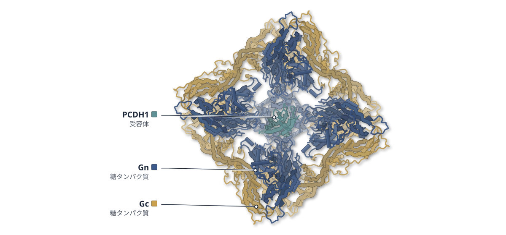

色（順に）：Gn（糖タンパク質） / Gc（糖タンパク質） / PCDH1（受容体）

**ハンタウイルスは棘の中央の穴で受容体を捉える**

アンデスウイルスのスパイクとPCDH1の複合体を2.6 Åのクライオ電顕で解いた

- **疑問・課題**：新世界ハンタウイルスは受容体 PCDH1 で細胞に入るが、その結合の構造的な仕組みは分かっていなかった。
- **アプローチ**：可溶性のスパイク四量体を PCDH1 と共発現して精製し、クライオ電顕で解いた。変異体と深部変異スキャンで結合部位を調べた。
- **結果**：PCDH1 の EC1 ドメインは、Gn 四分子がつくる中央の深い窪みに入り込んでいた。窪みは Fab が入るには狭かった。
- **わかったこと**：PCDH1 はウイルス粒子の上のスパイクだけを認識する。抗体は窪みをふさぐか、かさ高さで受容体の接近を妨げて中和する。

この紹介文の根拠（論文本文）

> New World hantaviruses, including Andes virus (ANDV), use the cell-surface receptor protocadherin-1 (PCDH1) to enter host cells1. However, the structural basis of this interaction remains unclear.  
> — 疑問・課題／Abstract

> we designed a soluble version of the ANDV spike tetramer by adding a hetero-octamerization domain at the C-terminal end of the Gn and Gc ectodomains  
> — アプローチ／PCDH1 stabilizes the (Gn–Gc)4 spike

> Next, we used a deep-mutational scanning (DMS) approach to more comprehensively survey the sequence landscape of the spike–PCDH1 interaction.  
> — アプローチ／PCDH1 binds to a central spike pocket

> The final model showed the EC1 domain deeply inserted into a pocket formed by four protomers of Gn  
> — 結果／PCDH1 binds to a central spike pocket

> are incompatible with those of a Fab fragment (5 × 4 × 7 nm).  
> — 結果／Mechanistic basis of ANDV neutralization

> PCDH1 asymmetrically engages a deep central pocket formed by four Gn protomers in the spike, explaining why only intact viral particles or soluble tetramers recognize it.  
> — わかったこと／Abstract

> they block receptor binding through two distinct mechanisms—occluding access to the PCDH1-binding site or sterically preventing receptor engagement.  
> — わかったこと／Abstract

分類：感染・ウイルス・防御系・免疫（抗体・MHC・TCR・自然免疫）・GPCR・受容体

#### 読みどころ

1個の受容体が4個のウイルス糖タンパク質と接する結合様式で、論文は、著者の知る限り他の外被ウイルスで見られていないとしている。EC1 は隣り合う2つの Gn と主に接触する。

根拠（論文本文）

> This mode of interaction, whereby one receptor molecule interacts with four viral glycoproteins, represents a binding mode that to our knowledge has not been observed in any enveloped virus  
> — PCDH1 binds to a central spike pocket

Gn の3つのループが結合部位をつくる。旧世界ハンタウイルス HTNV のスパイクにこの3ループを移すと、PCDH1 に弱く結合するようになった。

根拠（論文本文）

> Mutagenesis identified three Gn loops that shape the receptor-binding site and afford the transfer of PCDH1 binding from New World to Old World glycoproteins.  
> — Abstract

> a chimeric rVSV-HTNV bearing all three receptor-binding loops from ANDV Gn, but not the GnH CD loop alone, could now bind to PCDH1, albeit relatively weakly.  
> — Structural basis of receptor use

中和抗体4種のうち、ANDV-5 と MIB22 は窪みを直接ふさぐ。ADI-65534 と ANDV-34 は窪みに入らず、IgG の定常領域による立体障害で競合すると考えられる。MIB22 と GnH の複合体は X 線で 3.1 Å に解かれた。

根拠（論文本文）

> We observed that ADI-65534 and ANDV-34 do not occlude access to the central pocket, suggesting that they compete with PCDH1 through a steric hindrance mechanism mediated by the antibody constant regions  
> — Mechanistic basis of ANDV neutralization

> We therefore determined the crystal structure of an antibody fragment of MIB22 in a complex with ANDV GnH at a resolution of 3.1 Å  
> — Mechanistic basis of ANDV neutralization

#### 構造データ

| PDB | 手法 | 分解能 | 公開 | 生物種 | リガンド |
|---|---|---|---|---|---|
| [30XO](https://www.rcsb.org/structure/30XO) | X-ray | 3.10 Å | 2026-09-09 | Homo sapiens, Orthohantavirus andesense | — |
| [30XT](https://www.rcsb.org/structure/30XT) | Cryo-EM | 2.55 Å | 2026-09-16 | Homo sapiens, Orthohantavirus andesense | — |
| 5FX4 | — | — | 公開待ち | — | — |

- [Q08174](https://www.uniprot.org/uniprotkb/Q08174) PCDH1 Protocadherin-1 — *Homo sapiens* （既存の PDB 構造 4 件）
- [Q9E006](https://www.uniprot.org/uniprotkb/Q9E006) GP Envelopment polyprotein — *Andes orthohantavirus* （既存の PDB 構造 13 件）

#### 実験メモ

- **発現系**：ショウジョウバエ S2 細胞で安定発現し、CdCl2 で誘導。
- **コンストラクト**：Gn・Gc の細胞外領域に人工の四量体化ドメイン HALC4_136 を分割して融合。
- **精製**：Strep-Tactin 親和、TALON、Superose6 のゲル濾過の順。
- **結晶化／グリッド作製**：0.34 mg/ml を UltrAufoil グリッドに 3 μl のせ、Vitrobot Mark IV で凍結。
- **データ収集・解析**：Titan Krios と Falcon 4i、ピクセルサイズ 0.7455 Å。

根拠（論文本文）

> The octamerization sequence was derived from HALC4_136, a de novo tetramerization domain comprising three antiparallel helices per protomer20.  
> — PCDH1 stabilizes the (Gn–Gc)4 spike

> Cultures of 1–3 l were grown in spinner flasks in medium supplemented with 1% penicillin–streptomycin antibiotics to approximately 107 cells per ml, and protein expression was induced with 4 μM CdCl2.  
> — Protein purification

> Proteins were then purified by size-exclusion chromatography (SEC) on a 10/300 Superose6 Increase column (Cytiva) in 10 mM Tris pH 8.0, 100 mM NaCl.  
> — Protein purification

> Frozen grids were imaged on the Titan Krios POLARIS (Synchrotron Soleil) system equipped with a FALCON 4i detector (Thermo Fisher Scientific)  
> — Cryo-EM grid preparation and data collection

> 📝 編集者への確認事項：PDB の entity が Gn・Gc・PCDH1 の順かは render 後に figures/*.json の legend で要確認。窪みのサイズ（約 2.5 nm）や結合面積は本文にあるが、紹介文では使っていない。Fab が入らない根拠は本文の寸法比較。

---

# New Structure

## 2｜VZV カプシド

### Insights into varicella-zoster virus assembly from the B- and C-capsid at near-atomic resolution structures

*hLife*（2023-10-27） · [論文](https://doi.org/10.1016/j.hlife.2023.10.007) · ライセンス: cc by-nc-nd

筆頭著者：Lei Cao（Chinese Academy of Sciences, China）　責任著者：Hongrong Liu（Hunan Normal University, China）、Hai Hou（Northwestern Polytechnical University, China）、Xiangxi Wang（Chinese Academy of Sciences, China）

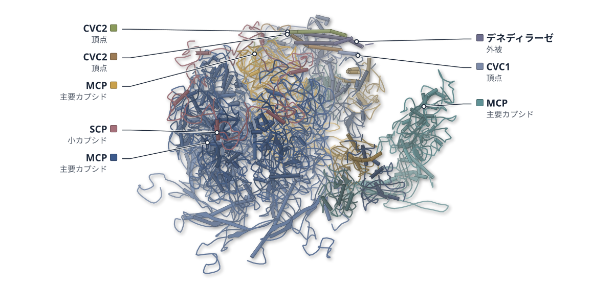

色（順に）：MCP（主要カプシド） / MCP（主要カプシド） / MCP（主要カプシド） / SCP（小カプシド） / CVC1（頂点） / CVC2（頂点） / CVC2（頂点） / デネディラーゼ（外被） / Tri2A（三量体） / Tri2A（三量体） / Tri1（三量体）

**VZVのカプシドは、ジスルフィド結合で安定化している**

B・Cカプシドをクライオ電顕で3.1 Åまで解き、ポータル頂点の違いも調べた

- **疑問・課題**：VZV カプシドはサブユニット間の結合が緩いのに熱に強く、その理由は分かっていなかった。
- **アプローチ**：穏やかな条件で精製した B・C カプシドをクライオ電顕で調べ、ブロック単位の再構成と分類でポータル頂点も解いた。
- **結果**：カプソメアは 3.1 Å、ポータル頂点は B で 4.8 Å・C で 4.5 Å。隣り合うヘキソン間に、ジスルフィド結合が見つかった。
- **わかったこと**：ペントン周辺の結合は弱いが、ヘキソン間のジスルフィド結合などが高い熱安定性の理由とみられる。
- **残された課題**：カプシドがポータルを核膜孔にどう結びつけるかは、まだ十分に分かっていない。

この紹介文の根拠（論文本文）

> there is no clear understanding of the reasons for the VZV capsid's high thermal stability despite having relatively loose inter-subunit interactions  
> — 疑問・課題／Introduction

> we have determined the more precise detailed structures of the varicella-zoster virus (VZV) B- and C-capsid in icosahedral symmetry using a combination of block-based reconstruction and symmetry relaxation strategies.  
> — アプローチ／Abstract

> Subsequent refinements with 5-fold symmetry yielded reconstructions with resolutions of 4.8 Å and 4.5 Å for B- and C-capsid portal vertexes, respectively  
> — 結果／Results

> form a disulfide bond to stabilize the assembly unit triangle reported in HSV2 assembly process  
> — 結果／Results

> A detailed analysis of our structures of VZV reveals the plausible reason underlying the stability of the capsid.  
> — わかったこと／Results

> how does the capsid recognize and dock its portal to NPC is not fully understood.  
> — 残された課題／Discussion

分類：感染・ウイルス・防御系

#### 読みどころ

ヘキソンの N-lasso の Cys と、隣のヘキソンの Cys がジスルフィド結合を作っていた。従来「非共有結合の鎖かたびら」とされていた部分である。

根拠（論文本文）

> However, the inter-hexon interaction is not a non-covalent chainmail as reported previously.  
> — Results

> form a disulfide bond to stabilize the assembly unit triangle reported in HSV2 assembly process  
> — Results

ペントン周辺では二量体化の部分が無秩序になり、結合が弱まる。一方で、カプシドの床下にある疎水性のくぼみ3か所が Tri1 の N-archer で埋められ、HSV2 より 675 Å2 広い面積が埋まっている。

根拠（論文本文）

> the disorder of dimerization from Pen-MCP and P6 in VZV capsid weakens the hexon–penton interaction  
> — Results

> three hydrophobic wounds under the capsid floor are found to be compensated with hydrophobic patches made of the N-archers of Tri1s  
> — Results

C-カプシドのポータル頂点では、テグメント複合体 PVAT が5つの成分でそろっていた。B-カプシドの PVAT は不完全だった。

根拠（論文本文）

> The PVAT of VZV C-capsid is composed of 5 components, including one copy of capsid vertex component 1 (CVC1)  
> — Results

> Interestingly, compared to C-capsid PVAT, PVAT of B-capsid shows an incomplete structure.  
> — Results

#### 構造データ

| PDB | 手法 | 分解能 | 公開 | 生物種 | リガンド |
|---|---|---|---|---|---|
| [8X9Z](https://www.rcsb.org/structure/8X9Z) | Cryo-EM | 3.10 Å | 2025-11-19 | Human alphaherpesvirus 3 | — |
| [8X9X](https://www.rcsb.org/structure/8X9X) | Cryo-EM | 3.10 Å | 2025-04-30 | Human alphaherpesvirus 3 | — |
| [8X9Y](https://www.rcsb.org/structure/8X9Y) | Cryo-EM | 3.70 Å | 2025-04-30 | Human alphaherpesvirus 3 | — |
| [8XA0](https://www.rcsb.org/structure/8XA0) | Cryo-EM | 4.00 Å | 2024-12-04 | Human alphaherpesvirus 3 | — |
| [8X9W](https://www.rcsb.org/structure/8X9W) | Cryo-EM | 4.50 Å | 2025-04-30 | Human alphaherpesvirus 3 | — |
| [8XA3](https://www.rcsb.org/structure/8XA3) | Cryo-EM | 3.70 Å | 2025-04-30 | Human alphaherpesvirus 3 | — |
| [8XA2](https://www.rcsb.org/structure/8XA2) | Cryo-EM | 4.00 Å | 2024-12-04 | Human alphaherpesvirus 3 | — |
| [8XA1](https://www.rcsb.org/structure/8XA1) | Cryo-EM | 4.80 Å | 2025-04-30 | Human alphaherpesvirus 3 | — |

- [P09245](https://www.uniprot.org/uniprotkb/P09245) MCP Major capsid protein — *Varicella-zoster virus (strain Dumas)* （PDB で初めての構造）
- [P09276](https://www.uniprot.org/uniprotkb/P09276) TRX1 Triplex capsid protein 1 — *Varicella-zoster virus (strain Dumas)* （PDB で初めての構造）
- [P09279](https://www.uniprot.org/uniprotkb/P09279) SCP Small capsomere-interacting protein — *Varicella-zoster virus (strain Dumas)* （PDB で初めての構造）
- [P09291](https://www.uniprot.org/uniprotkb/P09291) TRX2 Triplex capsid protein 2 — *Varicella-zoster virus (strain Dumas)* （PDB で初めての構造）
- [P10201](https://www.uniprot.org/uniprotkb/P10201) CVC1 Capsid vertex component 1 — *Human herpesvirus 1 (strain 17)* （PDB で初めての構造）
- [P10209](https://www.uniprot.org/uniprotkb/P10209) CVC2 Capsid vertex component 2 — *Human herpesvirus 1 (strain 17)* （既存の PDB 構造 1 件）
- [P10220](https://www.uniprot.org/uniprotkb/P10220)  Large tegument protein deneddylase — *Human herpesvirus 1 (strain 17)* （既存の PDB 構造 2 件）
- [Q6QCL5](https://www.uniprot.org/uniprotkb/Q6QCL5) ORF40 Major capsid protein — *Human herpesvirus 3* （既存の PDB 構造 3 件）
- [U5NQG6](https://www.uniprot.org/uniprotkb/U5NQG6) SCP Small capsomere-interacting protein — *Human herpesvirus 3* （PDB で初めての構造）

#### 実験メモ

- **発現系**：ヒト二倍体の SV-1 細胞に VZV を感染させて増殖。
- **精製**：0.05% NP-40 で処理し、スクロース密度勾配で精製。B・C カプシドは完全には分けられなかった。
- **結晶化／グリッド作製**：3 μL を C-flat CF-2/1–3C に載せ、Vitrobot で 6 秒ブロットして液体エタンで凍結。
- **データ収集・解析**：Titan Krios（300 kV）と K2 検出器。14,431 枚を記録し、RELION でブロック単位の再構成。

根拠（論文本文）

> SV-1 cells (human diploid cells) were infected with the VZV seed stock  
> — Methods

> A discontinuous 20% and 60% sucrose gradient (w/v in PBS) was used to further purify the capsids.  
> — Methods

> B- and C- capsids could not be completely separated under the mild conditions of the purification steps  
> — Results

> Grids were blotted for 6 s with no blot force in 100% relative humidity for plunge-freezing (Vitrobot; FEI) in liquid ethane.  
> — Methods

> Cryo-EM data sets were collected at 300 kV with a Titan Krios microscope (FEI).  
> — Methods

> A total of 14,431 micrographs were recorded.  
> — Methods

> 📝 編集者への確認事項：PDB は 8 件（カプソメアごとのブロック再構成）。図は既定の最高分解能 8X9Z。本文の Cys 番号は C46（本文）と C45（図の凡例）で食い違うため、残基番号は書いていない。本文は 'purified ... p-Oka' と 'vOka' が混在するため株名も書いていない。Discussion 末尾に VSV と読める誤記があるが採用していない。legend_labels は複合体のため render 後に確認してほしい。

---

## 3｜ジカウイルス NS1

### Structural insights into the distinct protective mechanisms of human antibodies targeting ZIKV NS1

*hLife*（2024-05-16） · [論文](https://doi.org/10.1016/j.hlife.2024.05.003) · ライセンス: cc by-nc-nd

筆頭著者：Qi Pan（The Chinese University of Hong Kong, China）　責任著者：Wei Zhao（Southern Medical University, China）、Lei Yu（Guangzhou Medical University, China）、Hongli Hu（The Chinese University of Hong Kong, China）

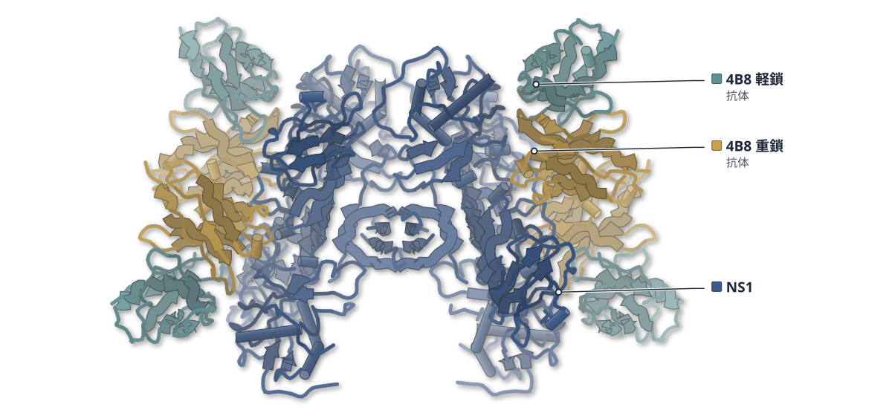

色（順に）：NS1 / 4B8 重鎖（抗体） / 4B8 軽鎖（抗体）

**ジカウイルスNS1の外側の面を覆う抗体が見つかった**

5種の抗体との複合体をクライオ電顕で解析し、結合様式を2群に分けた

- **疑問・課題**：ジカウイルス NS1 に対する抗体 3G2・4B8 は 別の抗体より強く感染を抑えるが、認識する場所は不明だった。
- **アプローチ**：ヒト抗体5種の Fab と NS1 の複合体をクライオ電顕で解き、細胞や内皮細胞を使う実験で効果も調べた。
- **結果**：3G2 と 4B8 は NS1 二量体の外側の面に結合した。残る3種はβラダー領域の末端に結合した。
- **わかったこと**：結合する場所と防御の強さには対応があった。外側の面を覆う 3G2・4B8 は IgG でも Fab でも内皮の透過性亢進を完全に抑えた。
- **残された課題**：分泌型 NS1 の四量体・六量体が病態に果たす役割は、今後の課題だ。

この紹介文の根拠（論文本文）

> Although monoclonal antibodies (MAbs) 3G2 and 4B8 are more potent than MAb 4F10 in suppressing ZIKV infection in neonatal mice models, the epitopes are unclear.  
> — 疑問・課題／Abstract

> Herein, we determined the Cryo-electron microscopy (Cryo-EM) structures of ZIKV NS1 in complex with five human antibodies at 2.6–2.9 Å resolution.  
> — アプローチ／Abstract

> Group I antibodies (3G2 and 4B8) recognize the previously unreported epitopes on the outer surface of the NS1 dimer.  
> — 結果／Abstract

> Group II antibodies (4F10, 2E11, and 14G5) recognize common epitopes in the distal end of the β-ladder domain  
> — 結果／Abstract

> These findings elucidate the correlation between epitope recognition and protective efficacy of anti-NS1 antibodies  
> — わかったこと／Abstract

> completely inhibited secreted form non-structural protein 1 (sNS1)-induced endothelial permeability via their immunoglobulin G (IgG) and Fab  
> — わかったこと／Abstract

> The role of multimeric forms of secreted NS1, such as tetrameric and hexameric NS1, in viral replication and disease pathogenesis also remains to be studied.  
> — 残された課題／Discussion

分類：免疫（抗体・MHC・TCR・自然免疫）・感染・ウイルス・防御系

#### 読みどころ

3G2 は NS1 二量体の外側で、ウイング領域・コネクタ・βラダーの4か所にまたがって結合し、界面は 1198 Å2 に及ぶ。4B8 もほぼ同じ姿勢で結合する。

根拠（論文本文）

> As 3G2 and 4B8 bind at the outer surface of the NS1 tetramer with nearly identical poses, we classified them into Group I MAbs  
> — Results

> According to calculations, the buried interface area between one 3G2 Fab and the dimeric NS1 is 1198 Å2.  
> — Results

βラダー末端に結合する3種のうち、ウイング領域にも接触する1種は複合体が安定だった。残る2種との複合体では NS1 四量体が崩れた。

根拠（論文本文）

> The structure of the tNS1-4F10 complex is more stable while the structures of the tNS1-2E11 and tNS1-14G5 complex are highly flexible in the Cryo-EM analysis.  
> — Results

> For Fab 2E11 and 14G5, the NS1 tetramer structures are disrupted upon complex formation with these antibodies.  
> — Discussion

3G2 と 4B8 は他のフラビウイルスの NS1 とは交差反応せず、診断への利用が考えられる。Kd は 3G2 が 0.12 nM、4B8 が 0.80 nM だった。

根拠（論文本文）

> ELISA) results confirmed that 3G2 and 4B8 have no cross-reactivity with other flavivirus family members  
> — Results

> dissociation constant [Kd] values of 3G2: 0.12±0.02 nM; the Kd values of 4B8: 0.80±0.33 nM  
> — Results

#### 構造データ

| PDB | 手法 | 分解能 | 公開 | 生物種 | リガンド |
|---|---|---|---|---|---|
| [8JKF](https://www.rcsb.org/structure/8JKF) | Cryo-EM | 2.83 Å | 2024-12-11 | Homo sapiens, Zika virus | — |
| [8JKH](https://www.rcsb.org/structure/8JKH) | Cryo-EM | 2.64 Å | 2024-12-04 | Homo sapiens, Zika virus | — |
| [8JQM](https://www.rcsb.org/structure/8JQM) | Cryo-EM | 2.80 Å | 2024-12-18 | Homo sapiens, Zika virus | — |
| [8JQN](https://www.rcsb.org/structure/8JQN) | Cryo-EM | 2.80 Å | 2024-12-11 | Homo sapiens, Zika virus | — |
| [8JQS](https://www.rcsb.org/structure/8JQS) | Cryo-EM | 2.63 Å | 2024-12-04 | Homo sapiens, Zika virus | — |

- [A0A1B3ZSF4](https://www.uniprot.org/uniprotkb/A0A1B3ZSF4)  RNA-directed RNA polymerase — *Zika virus* （PDB で初めての構造）

#### 実験メモ

- **発現系**：全長 NS1（残基 3–352、GZ02 株）を Sf9 細胞のバキュロウイルス系で発現。
- **コンストラクト**：N 末端に gp64 シグナルペプチドと 6×His タグ。
- **精製**：金属アフィニティー、続いて Superdex 200 Increase でゲルろ過。
- **結晶化／グリッド作製**：Fab を NS1 四量体に 5:1 のモル比で氷上 30 分混ぜ、ゲルろ過で複合体を精製。
- **データ収集・解析**：300 kV Titan Krios G3i と K3 検出器。RELION-3.1 で解析。

根拠（論文本文）

> NS1 proteins were produced by infecting suspension cultures of Sf9 cells for 60 h.  
> — Methods

> with an N-terminal gp64 signal peptide followed by a 6× His-tag was synthesized  
> — Methods

> Soluble NS1 was purified from cell supernatants by metal affinity chromatography  
> — Methods

> Purified 3G2/4B8/4F10/2E11/14G5 Fab was incubated with ZIKV NS1 tetramer at a 5:1 molar ratio on ice for 30 min.  
> — Methods

> datasets were collected on the 300 kV Titan Krios G3i (Thermo Fisher Scientific, Massachusetts, USA) equipped with a Gatan K3 Summit detector  
> — Methods

> Cryo-EM data processing was performed using RELION-3.1.  
> — Methods

> 📝 編集者への確認事項：5 つの PDB（8JKF・8JKH・8JQM・8JQN・8JQS）。構造図は 4B8 複合体（8JKH、2.64 Å）。legend_labels は未設定（render 後に凡例の順を見て書く）。本文に 4F10/4B10 の表記ゆれ、HPMEC/HBMEC の混在あり。

---

## 4｜JMTV・ALSV の RdRp

### Crystal structures of RNA-dependent RNA polymerases from Jingmen tick virus and Alongshan virus

*hLife*（2023-10-25） · [論文](https://doi.org/10.1016/j.hlife.2023.10.006) · ライセンス: cc by-nc-nd

筆頭著者：Zhenyang Liu（Chinese Academy of Sciences, China）　責任著者：Yi Shi（Chinese Academy of Sciences, China）

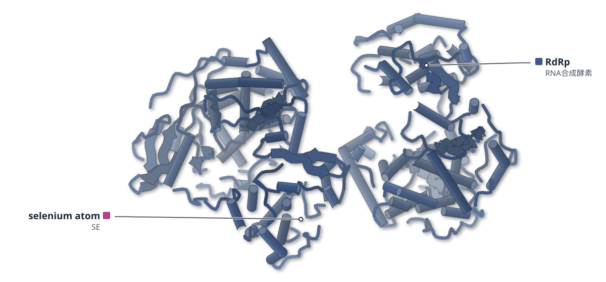

色（順に）：RdRp（RNA合成酵素）　スティック：selenium atom（SE）

**分節型フラビ様ウイルスのRdRpは亜鉛結合部位を欠く**

JMTVとALSVのRdRpの結晶構造は、典型的なフラビウイルスと似た形だった

- **疑問・課題**：分節ゲノムをもつジンメンウイルスの RdRp は、フラビウイルスの NS5 と配列が約25%しか一致せず、構造が分からなかった。
- **アプローチ**：JMTV と ALSV の RdRp ドメインを結晶構造解析し（2.6 Å・3.2 Å）、ゲノム 5′ 末端の RNA 配列の働きも調べた。
- **結果**：3つのサブドメインからなる構造で、触媒モチーフ A–G は保存されていたが、亜鉛結合部位はなかった。
- **わかったこと**：RdRp は典型的なフラビウイルスと似た仕組みで働くとみられる。5′ 末端の保存された8塩基は RdRp との結合と RNA 合成に必要だった。
- **残された課題**：亜鉛結合部位を欠くことの影響は、まだ分かっていない。

この紹介文の根拠（論文本文）

> shares limited amino acid sequence identity with that of flavivirus NS5 (about 25%)  
> — 疑問・課題／Introduction

> the structural and functional features of RdRp are yet elusive, which greatly hampers the molecular understanding of genome replication in the segmented flaviviruses.  
> — 疑問・課題／Introduction

> Here, we determined the crystal structures of RNA-dependent RNA polymerase (RdRp) domains of JMTV and ALSV at 2.6 Å and 3.2 Å resolutions, respectively.  
> — アプローチ／Abstract

> JMTV and ALSV RdRps can be divided into three subdomains and the catalytical Motif A-G are conserved like the typical flaviviruses, whereas the zinc-binding pockets are absent from the JMTV and ALSV RdRps.  
> — 結果／Abstract

> These results suggested that the RdRp of JMTV and ALSV would perform similar mechanism as flaviviruses RdRp to generate nascent RNA.  
> — わかったこと／Discussion

> These results demonstrated that the conserved 8-nucleotide element at 5′-end of genome plays a critical role in RdRp–RNA interaction and RNA synthesis.  
> — わかったこと／Results

> The consequence of lacking zinc-binding sites in JMTV and ALSV RdRps is still unclear, and further studies need to be performed.  
> — 残された課題／Results

分類：酵素（その他）・感染・ウイルス・防御系

#### 読みどころ

JMTV と ALSV の RdRp は、指・掌・親指の3つのサブドメインをもつ右手型だった。ALSV の RdRp は、デングウイルスやダニ媒介脳炎ウイルスの RdRp と RMSD 2.4 Å で重なった。

根拠（論文本文）

> The RdRp domain displays a canonical right-hand conformation containing the fingers, palm, and thumb subdomains.  
> — Results

> could be superimposed well with the RdRps of DENV and Tick-borne encephalitis virus (TBEV) from the Flavivirus genus, giving a RMSD of 2.4 Å  
> — Results

典型的なフラビウイルスの RdRp にある2つの亜鉛結合部位が、JMTV と ALSV にはない。デングウイルスで亜鉛を保持する残基は、ALSV では亜鉛を配位できない残基に置き換わっている。

根拠（論文本文）

> There are two conserved zinc ion binding sites in RdRps of typical flaviviruses, but JMTV and ALSV RdRps lack the binding pockets (Figure 5).  
> — Results

> Those residues in ALSV RdRp could not provide electrons to Zn2+ for coordination.  
> — Results

ゲノム 5′ 末端の stem loop A の先端にある8塩基を変異させると、ALSV の RdRp は RNA を合成できず、RNA にも結合しなかった。野生型の RNA への KD は 0.16 μM だった。

根拠（論文本文）

> The ALSV RdRp could utilize the wild-type mini-genome as template to generate product in a de novo manner but failed to synthesize RNA when the SLA was mutated.  
> — Results

> the ALSV RdRp could bind to the wild-type ALSV-5′-vRNA with a dissociation constant (KD) value of 0.16 μM but could not interact with the mutant ALSV-5′-vRNA  
> — Results

#### 構造データ

| PDB | 手法 | 分解能 | 公開 | 生物種 | リガンド |
|---|---|---|---|---|---|
| [8WU2](https://www.rcsb.org/structure/8WU2) | X-ray | 2.60 Å | 2024-02-07 | Amblyomma virus GXTV108v | SE |
| [8WU3](https://www.rcsb.org/structure/8WU3) | X-ray | 3.20 Å | 2024-02-07 | Alongshan virus | — |

- [A0A344X2I6](https://www.uniprot.org/uniprotkb/A0A344X2I6)  RNA-directed RNA polymerase — *Alongshan virus* （既存の PDB 構造 4 件）
- [A0A4P2RZ45](https://www.uniprot.org/uniprotkb/A0A4P2RZ45)  RNA-directed RNA polymerase — *Amblyomma virus GXTV108* （PDB で初めての構造）

#### 実験メモ

- **発現系**：大腸菌 BL21(DE3) で発現。Se 置換体は B834(DE3) で発現した。
- **コンストラクト**：ALSV RdRp は 294–914 残基。N 末端に His タグ。
- **精製**：HisTrap HP のあと、HiLoad 16/600 Superdex 200 で精製。
- **結晶化／グリッド作製**：シッティングドロップ蒸気拡散法。ALSV RdRp は 0.2 M クエン酸カリウム（pH 8.3）、20% PEG 3350。
- **データ収集・解析**：SSRF BL17U で測定。JMTV は Se-SAD 法、ALSV は JMTV を鋳型にした分子置換で解いた。

根拠（論文本文）

> then the recombinant vector was transformed into E. coli BL21(DE3) competent cells  
> — Methods

> JMTV NSP1 with L-Selenomethionine residues were expressed by E. coli B834 (DE3) competent cells.  
> — Methods

> The JMTV RdRp (residues 295–914) and ALSV RdRp (residues 294–914) were constructed, expressed, and purified in the same way as the JMTV NSP1  
> — Methods

> synthesized by Genewiz company (Genewiz, Suzhou, China) with a histidine tag at its N-terminus.  
> — Methods

> The concentrated proteins were further purified using HiLoad 16/600 Superdex 200 PG  
> — Methods

> crystals of ALSV RdRp were obtained in 0.2 M potassium citrate tribasic monohydrate (pH 8.3), 20% (w/v) PEG 3350  
> — Methods

> were collected at the Shanghai Synchrotron Radiation Facility (SSRF) BL17U  
> — Methods

> The JMTV RdRp structure was determined by the SAD method.  
> — Methods

> The ALSV NSP1-RdRp structure was solved by the molecular replacement method using the structure of the JMTV RdRp domain as the search model with Phaser  
> — Methods

> 📝 編集者への確認事項：PDB 上の唯一のリガンドは位相決定用のセレン原子（SE）なので、結合部位の拡大図は site_ligand を空にして出さない。8WU2（JMTV）は A0A4P2RZ45 の初構造。論文は 'first' と明言していないため、本文では「初めて」と書いていない。

---

## 5｜コウモリ MHC-II（EF）

### Pan-prediction of major histocompatibility complex class II–restricted epitopes across species via an AlphaFold-based quantification scheme

*hLife*（2026-01-09） · [論文](https://doi.org/10.1016/j.hlife.2025.10.005) · ライセンス: cc by-nc-nd

筆頭著者：Suqiu Wang（China Agricultural University）　責任著者：Sheng Wang（Shanghai Zelixir Biotech Company Ltd, China）、Shi Xu（Nanjing Chengshi Biomedical Technology (TheraRNA) Co, Ltd, China）、Hanchun Yang（China Agricultural University） ほか 1 名

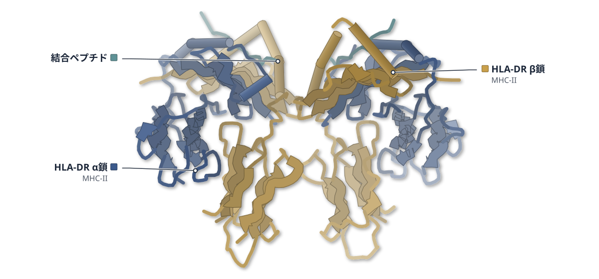

色（順に）：HLA-DR α鎖（MHC-II） / HLA-DR β鎖（MHC-II） / 結合ペプチド

**AlphaFoldでMHC-IIの結合ペプチドを種を超えて予測**

予測ツールAF-predをコウモリMHC-IIの結晶構造と結合実験で検証した

- **疑問・課題**：MHC-II は型が多様で、動物では結合ペプチドのデータも少なく、種をまたぐエピトープ予測は難しかった。
- **アプローチ**：AlphaFold の予測構造をペプチドの保存された結合様式と照合して点数化する AF-pred を作り、結合実験と結晶構造で検証した。
- **結果**：ウシ・ブタ・コウモリの41ペプチドでは、AUC は MixMHC2pred の 0.560 に対し AF2M-pred 0.744、AF3-pred 0.761 だった。
- **わかったこと**：構造にもとづく AF-pred は、結合データが乏しい動物の MHC-II でも配列ベースの手法より予測できると著者らは結論している。
- **残された課題**：AF-pred は、典型的でないペプチドの結合様式を正確に予測できない。

この紹介文の根拠（論文本文）

> The high polymorphism of histocompatibility complex class II (MHC-II) alleles and limited immunopeptidomic data hinder pan-species epitope prediction.  
> — 疑問・課題／Abstract

> we developed a new tool, AF-prediction (AF-pred), with explicit quantitative criteria for MHC-II–restricted epitope prediction.  
> — アプローチ／Abstract

> The ROC_area under the curve (ROC_AUC) values of the three tools are 0.560 for MixMHC2pred, 0.744 for AF2M-pred, and 0.761 for AF3-pred, respectively (Figure 4A).  
> — 結果／Results

> Compared with sequence-based tools, AF-pred demonstrates enhanced cross-species MHC-II binding prediction, with higher accuracy and interpretability  
> — わかったこと／Abstract

> First, AF-pred cannot accurately predict noncanonical peptide–MHC-II binding modes.  
> — 残された課題／Discussion

分類：免疫（抗体・MHC・TCR・自然免疫）

#### 読みどころ

コウモリ MHC-II に結合した P1008 ペプチドの結晶には2分子が含まれ、P8–P9 付近で異なる2つの配置（M1・M2）が見えた。AF-pred の予測は M2 に近かった。

根拠（論文本文）

> The unit cell of the pBat_EF-NDIL crystal structure contains two molecules (M1 and M2).  
> — Results

> The peptide conformations predicted by AF2M-pred and AF3-pred are consistent with that in M2, which represents the canonical MHC-II peptide binding conformation (Figure 5B).  
> — Results

予測にもとづいて改変したペプチドの結晶構造で、P9 の E が α76R・β57R の両方と塩橋を作る様子が予測どおりに見えた。二度目の変異では結合の強さが大きく増した。

根拠（論文本文）

> the crystal structure of pBat_EF-GASF illustrates that P9-E is capable of engaging in simultaneous salt bridge formations with both α76R and β57R within the EF domain, and this result is consistent with the prediction of AF-pred (Figure 7B).  
> — Results

> Thermodynamic stability measurements of the complexes revealed a significant increase in binding affinity following the second mutation  
> — Results

AF2M 版は同じペプチドの別の結合コア候補も示せたが、AF3 版は一つに収束した。6T3Y のような典型的でない結合様式は、どちらも外した。

根拠（論文本文）

> Notably, AF2M-pred can discover two different possible 9-aa-binding core regions in a peptide and rank them correctly (Figures 6 and 7B).  
> — Results

> These results suggested that AF-pred might be too loyal to canonical binding modes and not capable of predicting noncanonical binding modes.  
> — Results

#### 構造データ

| PDB | 手法 | 分解能 | 公開 | 生物種 | リガンド |
|---|---|---|---|---|---|
| [8JRK](https://www.rcsb.org/structure/8JRK) | X-ray | 2.30 Å | 2024-06-05 | Eptesicus fuscus, Human coronavirus 229E | — |
| [8JRJ](https://www.rcsb.org/structure/8JRJ) | X-ray | 2.50 Å | 2024-06-05 | Eptesicus fuscus, Gallus gallus | — |
| [8JR4](https://www.rcsb.org/structure/8JR4) | X-ray | 2.30 Å | 2024-06-05 | Eptesicus fuscus, Gallus gallus | — |

- [A0AAT8XUA5](https://www.uniprot.org/uniprotkb/A0AAT8XUA5)  HLA class II histocompatibility antigen, DR alpha chain — *Eptesicus fuscus* （PDB で初めての構造）
- [P67883](https://www.uniprot.org/uniprotkb/P67883) RPL30 Large ribosomal subunit protein eL30 — *Gallus gallus* （既存の PDB 構造 3 件）

#### 実験メモ

- **発現系**：大腸菌 BL21(DE3) で発現し、封入体をリフォールディングした。
- **コンストラクト**：MHC-II の α 鎖・β 鎖の細胞外領域。ペプチドをリンカーで β 鎖の 5′ 側につないだ。
- **精製**：ゲルろ過と陰イオン交換で精製。
- **結晶化／グリッド作製**：シッティングドロップ法。PGDS・GASF は 0.2 M 塩化カルシウム、20% PEG 3350、pH 5.1。
- **データ収集・解析**：上海放射光施設 BL18U1/BL19U で測定。

根拠（論文本文）

> The constructed plasmids were transformed into Escherichia coli strain BL21(DE3)  
> — Methods

> The ligand peptide was attached to the 5′ end of the β-chain via a linker (SGGGGSLVPRGSGGGGS)  
> — Methods

> The complexes were further purified by gel filtration chromatography and anion-exchange chromatography  
> — Methods

> pBat_EF-PGDS and pBat_EF-GASF crystals were grown as relatively thin slices in 0.2 M calcium chloride dihydrate, 20% w/v polyethylene glycol 3350, and a pH of 5.1.  
> — Methods

> Diffraction data were collected at Beamline BL18U1/BL19U of the Shanghai Synchrotron Radiation Facility  
> — Methods

> 📝 編集者への確認事項：AlphaFold 予測ツールの論文だが、コウモリ MHC-II とペプチドの結晶構造 3 件（8JR4・8JRJ・8JRK）を自前で決めているため新しい構造として書いた。UniProt の対応で A0AAT8XUA5 が初構造と判定された。構造のエンティティ順が不明なため legend_labels は未設定（render 後に確認してほしい）。

---

# Structure Update

## 6｜SFV・VLDLR（ヒト）

### Structural basis of Semliki Forest virus entry using the very-low-density lipoprotein receptor

*hLife*（2023-11-15） · [論文](https://doi.org/10.1016/j.hlife.2023.11.001) · ライセンス: cc by-nc-nd

筆頭著者：Ying Li（University of Chinese Academy of Sciences, China）　責任著者：Hao Song（Chinese Academy of Sciences, China）

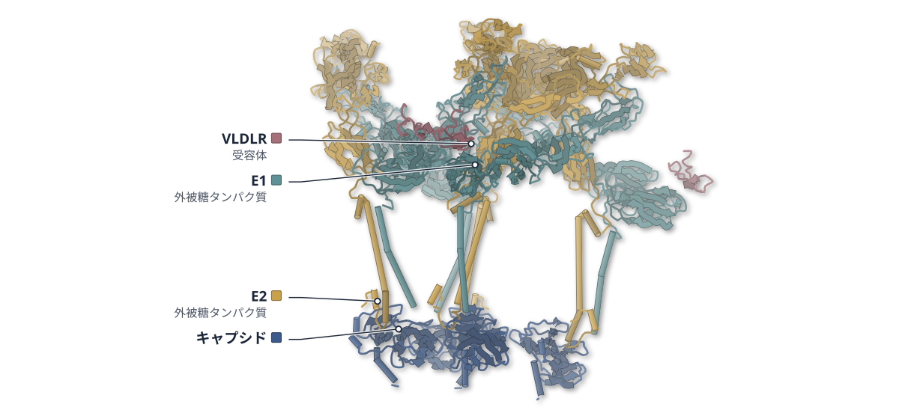

色（順に）：キャプシド / E2（外被糖タンパク質） / E1（外被糖タンパク質） / VLDLR（受容体）

**セムリキ森林熱ウイルスは受容体のLA3で捉えられる**

VLDLRのLA3がE1のDIIIに結合する様子を3.5 Åのクライオ電顕で示した

- **疑問・課題**：セムリキ森林熱ウイルス（SFV）と受容体 VLDLR の相互作用の詳しい仕組みは、ほとんど分かっていなかった。
- **アプローチ**：SFV の粒子（VLP）と VLDLR の LA 反復のクライオ電顕構造を解いた。結合は BLI、変異体、他の生物種の受容体でも調べた。
- **結果**：LA3 は E1 の DIII だけに結合し、HRV2 と VLDLR の結合様式に似ていた。LA を5つ連ねた LA33333 は解離が遅かった。
- **わかったこと**：SFV は VLDLR の複数の LA 反復を使って結合を強める。ウマとカの受容体でも、使う LA は種ごとに異なっていた。

この紹介文の根拠（論文本文）

> However, the detailed molecular mechanisms underlying the interaction between SFV and VLDLR remain largely unknown.  
> — 疑問・課題／Introduction

> Here, we report the cryo-electron microscopy (cryo-EM) structure of SFV in complex with human VLDLR (hVLDLR), which provides new insights into the molecular basis of SFV entry.  
> — アプローチ／Introduction

> To validate the key binding sites, mutagenesis experiments were conducted.  
> — アプローチ／Introduction

> The VLDLR-LA3 binds to SFV E1-DIII only, excluding E2, and exhibits no interaction with the glycan chain at Asn141 of E1.  
> — 結果／Results

> Notably, the significantly slower dissociation rate observed for LA33333  
> — 結果／Results

> These results confirmed that SFV can bind to both equine ApoER2 and mosquito VLDLR through multiple LA repeats, achieving synergistic binding.  
> — わかったこと／Results

> However, it is important to note that SFV utilizes distinct LAs for these bindings, thereby implying the involvement of different binding modes.  
> — わかったこと／Results

分類：感染・ウイルス・防御系・GPCR・受容体

#### 読みどころ

LA3 の W132、Q126 と Ca2+ を配位する酸性残基群が、E1-DIII の K345・K347・T348 などと結合する。E1-DIII に変異を入れると、結合は約30〜70倍弱まった。

根拠（論文本文）

> SFV interacts with LA3 residues Q126, W132, and the acidic cluster involved in Ca2+ coordination, which comprises D135, E137, and D139.  
> — Results

> The individual residue substitutions K324A, K345A, K347A, and T348A each resulted in a significant reduction in the binding affinity of LA3, with a striking ∼30–70 fold decrease  
> — Results

VLDLR は他のアルファウイルスの受容体のようにスパイクの谷（canyon）には入らず、E1-DIII だけに結合する。同じ VLDLR が風邪ウイルスの HRV2 を捉える様式とよく似ている。

根拠（論文本文）

> However, the interaction between VLDLR and SFV deviates from this pattern as it occurs outside the canyon region, with only E1-DIII involved in the binding.  
> — Discussion

> Surprisingly, the binding mode of VLDLR to SFV closely mirrors its interaction pattern with HRV2  
> — Results

LA1 は SFV に結合しないが、R44Q または T47P の1か所の置換で結合するようになった。LA3 の5連結体は、SFV と HRV の両方に使える阻害剤の候補になると論文は述べている。

根拠（論文本文）

> However, the R44Q or T47P substitution individually enabled LA1 to bind to E1-DIII.  
> — Results

> presents a compelling candidate as a potent and versatile inhibitor for both SFV and HRV.  
> — Discussion

#### 構造データ

| PDB | 手法 | 分解能 | 公開 | 生物種 | リガンド |
|---|---|---|---|---|---|
| [8X0L](https://www.rcsb.org/structure/8X0L) | Cryo-EM | 3.50 Å | 2024-11-27 | Homo sapiens, Semliki Forest virus | — |
| [8X0M](https://www.rcsb.org/structure/8X0M) | Cryo-EM | 3.50 Å | 2024-11-27 | Semliki Forest virus | — |
| [8X0K](https://www.rcsb.org/structure/8X0K) | Cryo-EM | 3.50 Å | 2024-11-27 | Homo sapiens, Semliki Forest virus | — |

- [P03315](https://www.uniprot.org/uniprotkb/P03315)  Structural polyprotein — *Semliki forest virus* （既存の PDB 構造 16 件）
- [P98155](https://www.uniprot.org/uniprotkb/P98155) VLDLR Very low-density lipoprotein receptor — *Homo sapiens* （既存の PDB 構造 24 件）

#### 実験メモ

- **発現系**：SFV VLP は Expi293F 細胞で発現。LA 反復は MBP 融合で大腸菌に発現。
- **コンストラクト**：ヒト VLDLR LA3（残基 111–151）を mFc タグ付きで使用。
- **精製**：VLP は蔗糖クッションと密度勾配で精製。
- **結晶化／グリッド作製**：Quantifoil R 2/1 グリッドに 3 μl をのせ、Vitrobot Mark IV で凍結。
- **データ収集・解析**：Titan Krios と K3、ブロック再構成で 2 回・5 回軸の領域を高分解能化。

根拠（論文本文）

> The Expi293F expression system was used to express the SFV VLP.  
> — SFV VLP Expression and Purification

> The coding sequence of LA3 (residues 111–151) fused to mFc tag was also cloned into the pCAGGS plasmid.  
> — Gene Cloning

> Initial purification was performed by ultracentrifugation through a 20% (w/v) sucrose cushion using a type 45Ti rotor at 110,000 g for 2.5 h at 4 °C.  
> — SFV VLP Expression and Purification

> an aliquot of 3 μl solution was applied to glow-discharged Quantifiol R 2/1 holey carbon grids and subsequently vitrified using a Vitrobot Mark IV  
> — Cryo-EM Sample Preparation and Data Collection

> To overcome the defocus gradient on the virions, two blocks for the viral icosahedral five-fold axis and two-fold axis were clipped out using block-based reconstruction  
> — Image Processing and 3D Reconstruction

> 📝 編集者への確認事項：PDB の entity の順が VLDLR・E1・E2・キャプシドかは render 後に要確認。LBD（LA1-8）複合体は密度が悪く、モデルは LA3 のみ（論文の記述）。PDB 8X0L・8X0M は 3 回・5 回軸のエントリ。

---

## 7｜MCI2III2IV2（ブタ心臓）

### Structural basis for the regulatory mechanism of mammalian mitochondrial respiratory chain megacomplex-I2III2IV2

*hLife*（2024-03-15） · [論文](https://doi.org/10.1016/j.hlife.2024.03.003) · ライセンス: cc by-nc-nd

筆頭著者：Laixing Zhang（Tsinghua University, China）　責任著者：Jinke Gu（Shenzhen University Medical School, China）、Maojun Yang（Tsinghua University, China）

**ブタ心臓の呼吸鎖巨大複合体を5つの状態で捉えた**

複合体Iの活性・不活性と複合体IVの位置の対応をクライオ電顕で調べた

- **疑問・課題**：CI の活性化・不活性化が CIII の構造や CIV の位置にどう影響するかは、ほとんど分かっていなかった。
- **アプローチ**：ブタ心臓から巨大複合体 MCI2III2IV2 を精製し、クライオ電顕で5つの立体配座を解いた。細胞では gSTED 顕微鏡で存在を確かめた。
- **結果**：5状態のうち最高は 3.46 Å。両方の CI が不活性型の State 2 では、CIV が CIII に約 29 Å 近づいて結合した。
- **わかったこと**：CI・CIII・CIV は互いの構造や位置に影響し合い、一つの酵素として働く可能性が強く示された。
- **残された課題**：MCI2III2IV2 が細胞の中で果たす生物学的な役割は、まだよく分かっていない。

この紹介文の根拠（論文本文）

> However, little is known about how CI activation or deactivation may influence the conformational changes in CIII or change the positions of CIV.  
> — 疑問・課題／Introduction

> To solve the structure of MCI2III2IV2, we optimized protein purification procedures from fresh porcine hearts to ensure that intact MCI2III2IV2 was sufficiently abundant for subsequent Cryo-EM analysis  
> — アプローチ／Results

> High-resolution Cryo-EM imaging, combined with super-resolution gated stimulated emission depletion microscopy (gSTED), strongly supports the formation of MCI2III2IV2 in live cells.  
> — アプローチ／Abstract

> Finally, we obtained five conformations of MCI2III2IV2, namely State 1, Mid 1, Mid 2, Mid 3, and State 2, with an overall resolution of 4.37, 3.46, 5.85, 4.51, and 3.58 Å, respectively  
> — 結果／Results

> with CIV moving ∼29 Å inward and rotating ∼26°, while the matrix arm of CI moves ∼45 Å toward the complex exterior.  
> — 結果／Results

> Our data strongly suggest that CI, CIII, and CIV could mutually affect each other's conformation or position in MCI2III2IV2 and work together as a whole enzyme.  
> — わかったこと／Discussion

> the biological role of MCI2III2IV2 remains largely unknown, and further study is needed  
> — 残された課題／Discussion

分類：光合成・電子伝達・トランスポーター

#### 読みどころ

2つの CI が活性型の State 1 から、不活性型の State 2 へ中間状態を経て移る経路が示された。State 2 では CIV が CIII に3か所で結合し、これまでの超複合体にない位置を取る。

根拠（論文本文）

> suggesting that MCI2III2IV2 shifts from the active state (State 1) to the deactive state (State 2) via the intermediates (Mid 1, Mid 2, and Mid 3)  
> — Results

> The position of CIV in State 2 is different from that in any previously reported structures.  
> — Discussion

CI の2か所（NDUFB7 と NDUFB10）が、CIII の Rieske ドメインやシトクロム c の結合部位に働きかける足場になる可能性がある。State 1 から State 2 で、Rieske ドメインは b 状態から c1 状態へ移ると推測された。

根拠（論文本文）

> Consequently, NDUFB7A123 and NDUFB10A176 of CI may function as two anchor points to induce conformational changes in the CIII Rieske domain and Cyt.c binding site  
> — Results

> It was thus reasonable to speculate that when MCI2III2IV2 shifts from State 1 to State 2, the Rieske domain of CIII changes from the “b” state to the “c1” state  
> — Results

固定した細胞を gSTED 超解像顕微鏡で観察し、CI と CIV を標識して巨大複合体の粒子を見つけた。精製で壊れやすい複合体が、細胞の中にあることを示す手がかりになる。

根拠（論文本文）

> Our gSTED images undoubtedly demonstrate plenty of in situ MCI2III2IV2 particles in rapidly fixed cells mimicking living conditions.  
> — Introduction

#### 構造データ

| PDB | 手法 | 分解能 | 公開 | 生物種 | リガンド |
|---|---|---|---|---|---|
| 8GOQ | — | — | 公開待ち | — | — |
| 8GOV | — | — | 公開待ち | — | — |
| 8GOW | — | — | 公開待ち | — | — |
| 8GOX | — | — | 公開待ち | — | — |
| 8GOR | — | — | 公開待ち | — | — |
| 8GP1 | — | — | 公開待ち | — | — |
| 8GOZ | — | — | 公開待ち | — | — |
| 8GP2 | — | — | 公開待ち | — | — |
| 8GP4 | — | — | 公開待ち | — | — |

> 📝 編集者への確認事項：本文の Methods が packet になく、lab_notes は空。PDB 8GOQ など9件は未公開（保留中）のため図なし。論文は ‘State 1 が活性、State 2 が不活性’ を断定せず（Discussion）、機構は推測として書いた。

---

## 8｜レプチン–LepR（ヒト）

### Structural plasticity of human leptin binding to its receptor LepR

*hLife*（2023-11-01） · [論文](https://doi.org/10.1016/j.hlife.2023.10.010) · ライセンス: cc by-nc-nd

筆頭著者：Yufeng Xie（Chinese Academy of Sciences, China）　責任著者：Defen Lu（Shanxi Agricultural University, China）、George Fu Gao（Chinese Academy of Sciences, China）

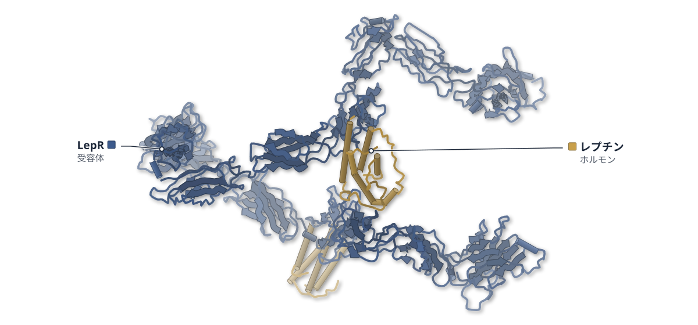

色（順に）：LepR（受容体） / レプチン（ホルモン）

**レプチン受容体は、非対称な2:2と3:3の複合体をつくる**

ヒトのレプチン–LepRをクライオ電顕で3状態解析し、いずれも開いた形だった

- **疑問・課題**：レプチンが細胞表面で LepR とどう会合するかは議論が続き、複合体の構造も分かっていなかった。
- **アプローチ**：ヒトのレプチンと LepR の細胞外領域を共発現して精製し、単粒子クライオ電顕で解析した。
- **結果**：2:2 と 3:3 の複合体が同程度の頻度で見つかり、どれも非対称で開いた形だった（分解能 3.58〜3.88 Å）。
- **わかったこと**：LepR は gp130 系の他の受容体と違う非対称な会合をとる。D3–D4 のねじれた硬い界面が原因と著者は推測する。
- **残された課題**：2:2 と 3:3 は強さの違うシグナルを出すかもしれないと著者は提案するにとどまる。

この紹介文の根拠（論文本文）

> The signaling assembly of leptin and LepR has long been debated.  
> — 疑問・課題／Introduction

> However, the development of drugs targeting LepR has been hindered because the structure of the leptin–LepR complex remains unknown.  
> — 疑問・課題／Introduction

> To obtain the human leptin–LepR complex, the ECD of human LepR and leptin were constructed and co-expressed in HEK-293F cells (Figure 1A).  
> — アプローチ／Results

> Both 2:2 and 3:3 stoichiometric assemblies were observed, and the complexes exhibited asymmetric open conformations.  
> — 結果／Abstract

> we determined the structures of three distinct conformations of human leptin–LepR using cryo-electron microscopy at resolutions of 3.88, 3.77, and 3.58 Å.  
> — 結果／Abstract

> The asymmetric geometry of LepR is substantially distinct from that of other gp130 cytokine homologs, and that may be due to the twisted and rigid interface between the D3 and D4 domains.  
> — わかったこと／Abstract

> Therefore, we propose that both the 2:2 and 3:3 stoichiometric complexes are functionally competent signaling assemblies but may exert different signaling intensities.  
> — 残された課題／Discussion

分類：GPCR・受容体・免疫（抗体・MHC・TCR・自然免疫）

#### 読みどころ

3:3 の複合体は、2:2 の二量体に 3 組目のレプチン–LepR が加わった「手をつなぐ」形で、輪は閉じずに隙間が残る。隙間の幅は50.2 Å と 73.2 Å の 2 通りだった。

根拠（論文本文）

> Two of the three leptins were bound to two LepRs simultaneously, and the third was bound to one LepR, forming a “hand-in-hand” architecture.  
> — Results

> The widths of the open gaps of the two distinct leptin–LepR trimer complexes were different (∼50.2 Å and ∼73.2 Å, respectively)  
> — Results

受容体に結合すると、遊離型のレプチンは AB ループなどが動く。αC' の A137 は最大 11 Å ずれ、低親和性の結合面の水素結合と連動していた。

根拠（論文本文）

> The position of residue A137 from αC’ in leptin was substantially shifted with a maximum distance of 11 Å after binding to the receptor.  
> — Results

LepR は IL-6 や LIF と似た向きでレプチンを受けるが、D3（IgD）と D4 の向きだけが他の受容体と大きく異なる。この界面の疎水性残基が硬い向きを保つ。

根拠（論文本文）

> Further comparative analysis revealed that the orientation of the LepR IgD (D3) to CRH2 (D4D5) was substantially distinct from that of gp130, LIFR, other gp130 family cytokine receptors, IL-23R, and GCSFR (Figure 4E)  
> — Results

> which shaped the rigid orientation between D3 and D4 of the LepR (Figure 4F, Table S3).  
> — Results

#### 構造データ

| PDB | 手法 | 分解能 | 公開 | 生物種 | リガンド |
|---|---|---|---|---|---|
| [8X80](https://www.rcsb.org/structure/8X80) | Cryo-EM | 3.88 Å | 2024-08-07 | Homo sapiens | — |
| [8X81](https://www.rcsb.org/structure/8X81) | Cryo-EM | 3.77 Å | 2024-08-07 | Homo sapiens | — |
| [8X85](https://www.rcsb.org/structure/8X85) | Cryo-EM | 3.58 Å | 2024-08-07 | Homo sapiens | — |

- [P41159](https://www.uniprot.org/uniprotkb/P41159) LEP Leptin — *Homo sapiens* （既存の PDB 構造 7 件）
- [P48357](https://www.uniprot.org/uniprotkb/P48357) LEPR Leptin receptor — *Homo sapiens* （既存の PDB 構造 6 件）

#### 実験メモ

- **発現系**：HEK293F 細胞で LepR 細胞外領域とレプチンを共発現。
- **コンストラクト**：LepR は 21〜839 残基で C 末端 His タグ付き。レプチンはタグなし。
- **精製**：His-Trap HP とゲルろ過（Superose 6 Increase）。
- **結晶化／グリッド作製**：約 0.5 mg/mL を Cu グリッドに載せ、Vitrobot Mark IV で急速凍結。
- **データ収集・解析**：Titan Krios と K3 で撮影し、cryoSPARC で解析。

根拠（論文本文）

> The extracellular domain of LepR (GenBank: AAB09673.1, residues 21–839) fused with a C-terminal His tag was codon-optimized and cloned into the pEZTsp vector (pEZTsp-hLepR).  
> — Methods

> hLepR and hleptin complex proteins were purified using His-Trap HP columns (GE Healthcare, Uppsala, Sweden) and a Superose 6 Increase 10/300 GL column  
> — Methods

> The proteins were concentrated to ∼0.5 mg/mL for cryo-EM assay.  
> — Methods

> The prepared cryogenic specimens were imaged using a Titan Krios transmission electron microscope equipped with a K3 direct electron detector  
> — Methods

> 📝 編集者への確認事項：LepR の NTD・CRH1・FnIII の一部は AlphaFold2 の予測を密度に当てはめたと本文にある。凡例の順序は render 後に確認。

---

## 9｜CB6 抗体・SARS-CoV-2 RBD

### Enabling the immune escaped etesevimab fully-armed against SARS-CoV-2 Omicron subvariants including KP.2

*hLife*（2025-01-25） · [論文](https://doi.org/10.1016/j.hlife.2024.12.006) · ライセンス: cc by-nc-nd

筆頭著者：Chao Su（City University of Hong Kong, China）　責任著者：Mengsu Yang, George Fu Gao（City University of Hong Kong, China）

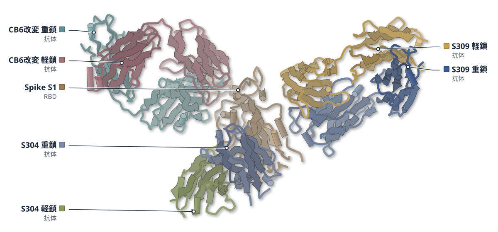

色（順に）：S309 重鎖（抗体） / S309 軽鎖（抗体） / CB6改変 重鎖（抗体） / CB6改変 軽鎖（抗体） / S304 重鎖（抗体） / S304 軽鎖（抗体） / Spike S1（RBD）

**効かなくなった抗体を、設計し直して復活させた**

etesevimab（CB6）を設計し直し、変異株のRBDとの複合体をクライオ電顕で確かめた

- **疑問・課題**：抗体 etesevimab（CB6）は、変異株の出現とともに効かなくなり、オミクロン株には効果を完全に失った。
- **アプローチ**：Rosetta で CB6 の CDR を骨格と配列の両面から設計し、変異を1つずつ SPR で確かめてから組み合わせた。
- **結果**：11 個の変異を入れた CB6-IV は KP.2 を含む試験したオミクロン株の RBD に結合し、擬似ウイルスも中和した。
- **わかったこと**：クライオ電顕構造で CB6-IV は元の CB6 と同じエピトープに結合し、設計した変異の多くが RBD との相互作用を強めていた。
- **残された課題**：BAADesign は結合エネルギーの予測に頼るため、全体に効く変異を見逃すことがある。

この紹介文の根拠（論文本文）

> However, the mAb escaped from the variant of concern (VOC) ever since the emergence of Beta VOC, with a complete loss of efficacy against the Omicron subvariants.  
> — 疑問・課題／Abstract

> Here, we developed a broad-spectrum and affinity-mature antibody design (BAADesign) procedure to design CB6  
> — アプローチ／Abstract

> we validated each mutation of CB6 step-by-step rather than combining them all at once  
> — アプローチ／Results

> As expected, CB6-IV exhibited substantially increased binding affinity to all tested RBDs compared to CB6-III, with KD values ranging from 0.36 to 19.07 nM.  
> — 結果／Results

> the CB6-IV exhibited broad and sensitive neutralizing activity against all tested PT and variant pseudoviruses  
> — 結果／Results

> suggesting that CB6-IV shares the same epitope with CB6  
> — わかったこと／Results

> Taken together, almost all tested mutations in CB6 increased the interaction with the XBB.1.5 RBD and some also contributed to enhanced interaction with the PT RBD.  
> — わかったこと／Results

> Its sequence design relies on predicting changes in binding energy, which may fail to identify beneficial mutations when the mutated residues influence overall binding rather than local interactions.  
> — 残された課題／Discussion

分類：免疫（抗体・MHC・TCR・自然免疫）・感染・ウイルス・防御系

#### 読みどころ

変異で生じる不利を、立体障害と相互作用の低下に分けた。立体障害には、CDR3 の H-Y102 や L-Y92 を欠失させて輪を作り直す骨格設計で対応した。

根拠（論文本文）

> Specifically, mutations at N460 (N460K), Q493 (Q493R), and Y505 (Y505H) caused steric hindrance with CB6 heavy chain (H) S56, Y102, and light chain (L) Y92, respectively.  
> — Results

> To address the negative effect of steric hindrance, we deleted the residue H-Y102 or L-Y92 in the CB6 CDR3 and remodeled the CDR3 loop using the kinematic closure (KIC) method [34].  
> — Results

PT 型と XBB.1.5 の RBD との複合体は 3.02 Å と 2.49 Å で、CB6-IV は CB6 と同じ面に結合した。H-Y104 は PT RBD の K417 とわずかに衝突し、CB6-III が PT・Delta に弱かった理由を説明する。

根拠（論文本文）

> The Cryo-EM structures of the CB6-IV-PT RBD-S309-S304 and CB6-IV-XBB.1.5 RBD-S309-S304 complexes were resolved to 3.0 and 2.5 Å, respectively  
> — Results

> Moreover, H-Y104 produces a slight steric clash with PT RBD K417, explaining why CB6-III displayed lower binding affinity to the PT and Delta RBDs than CB6  
> — Results

CB6-IV の CDR1・CDR2 の変異は、同じ結合様式をとる BD-604 や CC12.3 などにも移せた。CC12.3 は XBB・EG.5・BA.2.86 の RBD に結合するようになった。

根拠（論文本文）

> Importantly, these mutations enabled CC12.3 to bind to the XBB, EG.5, and BA.2.86 RBDs, and BD-604 to EG.5.  
> — Results

> These results suggest that mutations in CB6-IV CDR1 and CDR2 can be shared to help antibodies with the same binding mode increase neutralizing activity against Omicron subvariants.  
> — Results

#### 構造データ

| PDB | 手法 | 分解能 | 公開 | 生物種 | リガンド |
|---|---|---|---|---|---|
| [8WPY](https://www.rcsb.org/structure/8WPY) | Cryo-EM | 3.02 Å | 2024-10-16 | Homo sapiens, Severe acute respiratory syndrome coronavirus 2 | — |
| [8WPW](https://www.rcsb.org/structure/8WPW) | Cryo-EM | 2.49 Å | 2024-10-16 | Homo sapiens, Severe acute respiratory syndrome coronavirus 2 | — |
| 5RBD | — | — | 公開待ち | — | — |

- [P0DTC2](https://www.uniprot.org/uniprotkb/P0DTC2) S Spike glycoprotein — *Severe acute respiratory syndrome coronavirus 2* （既存の PDB 構造 2270 件）

#### 実験メモ

- **発現系**：Fab と RBD は Expi293F 細胞で一過性発現（SPR 用の抗体は HEK293T の上清）。
- **コンストラクト**：RBD は spike 残基 319–541。Fab と RBD の C 末端に His タグ。
- **精製**：HisTrap HP のあと、HiLoad 16/600 Superdex 200PG でゲルろ過。
- **結晶化／グリッド作製**：CB6-IV・S309・S304 の Fab と RBD を氷上で一晩混ぜ、ゲルろ過で精製。0.5 mg/mL を Quantifoil Au 1.2/1.3 に載せ 3 秒ブロット。
- **データ収集・解析**：300 kV Krios と Falcon 4、画素 0.85 Å。CryoSPARC で粒子を選び、最終 205,618 粒子（PT）・282,682 粒子（XBB.1.5）。

根拠（論文本文）

> The recombinant RBD and CB6-IV fab plasmids were transiently transfected into Expi293F cells for protein expression, and supernatants were collected 5 days posttransfection.  
> — Methods

> the SARS-CoV-2 PT RBD (spike residues 319–541, GISAID: EPI_ISL_402119) were cloned into the pCAGGS vector with a C-terminal hexa-histidine (His) tag.  
> — Methods

> underwent further purification by size-exclusion chromatography using a HiLoad 16/600 Superdex 200PG column  
> — Methods

> Purified PT RBD or XBB.1.5 RBD proteins were mixed with CB6-IV, S309, and S304 fabs and incubated on ice overnight.  
> — Methods

> blotted for 3 s at 4 °C and 100% humidity  
> — Methods

> the grids were transferred to a 300 kV Krios electron microscope equipped with a Falcon 4 using AutoEMation  
> — Methods

> a final selection of the most homogeneous 205,618 (282,682 for CB6-IV-XBB.1.5 RBD-S309-S304) particles were chosen for 3D auto-refinement  
> — Methods

> 📝 編集者への確認事項：PDB は 8WPY（PT RBD、3.02 Å）と 8WPW（XBB.1.5 RBD、2.49 Å）。複合体を大きくするため非競合の S309・S304 を加えた四者複合体。計算設計の論文だが、設計した抗体の実験構造（クライオ電顕）と SPR・中和試験が主題のため新しい構造として扱った。legend_labels は未設定（render 後に凡例の順を見て書く）。

---

## 10｜RSV Fタンパク質＋RV11

### A protective human antibody against respiratory syncytial virus by targeting a prefusion epitope across sites IV and V of the viral fusion glycoprotein

*hLife*（2023-09-28） · [論文](https://doi.org/10.1016/j.hlife.2023.09.003) · ライセンス: cc by-nc-nd

筆頭著者：Lianpan Dai（Chinese Academy of Sciences, China）　責任著者：Zhengde Xie（Capital Medical University, China）、Jim Zhen Wu（Shanghai Ark Biopharmaceutical Co, Ltd, China）、George Fu Gao（Chinese Academy of Sciences, China）

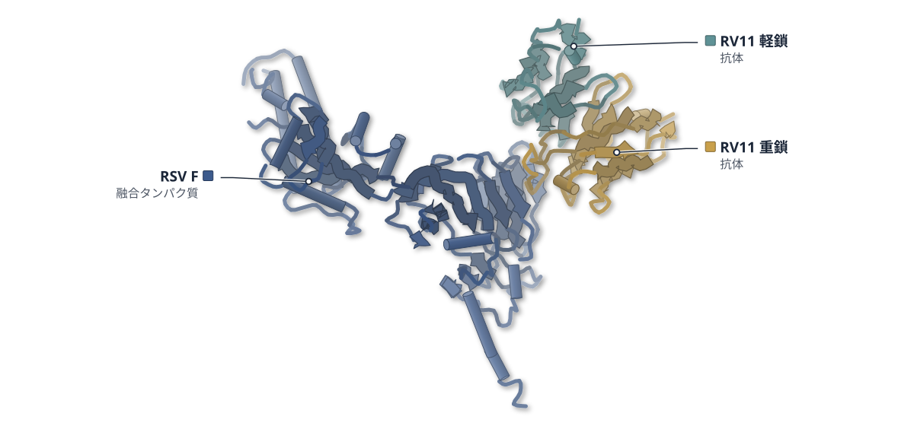

色（順に）：RSV F（融合タンパク質） / RV11 重鎖（抗体） / RV11 軽鎖（抗体）

**RV11抗体は、RSVのFタンパク質の2つの抗原部位にまたがる**

融合前のFと抗体scFvの結晶構造から、S443P耐性変異のしくみも説明できた

- **疑問・課題**：RSV の予防抗体はより強く効き、保存された部位を狙う新世代のものが求められている。
- **アプローチ**：回復した小児の記憶 B 細胞から抗体を単離し、融合前 F との複合体を X 線結晶構造解析した。
- **結果**：RV11 は融合前 F だけに結合し、3 分子の scFv が F 三量体の腰に付く。分解能は 2.9 Å だった。
- **わかったこと**：RV11 は部位 IV と V にまたがる保存されたエピトープを認識する。S443 の水素結合が失われると耐性になる。
- **残された課題**：マウスでの防御効果と耐性変異の探索は、RSV A 亜型でしか調べていない。

この紹介文の根拠（論文本文）

> A new generation of RSV mAbs with higher specificity to pre-F conformation with higher potency and extended half-life are sought.  
> — 疑問・課題／Discussion

> Here we report the isolation of two neutralizing mAbs against RSV from convalescent children by prefusion form of fusion (F) glycoprotein as bait.  
> — アプローチ／Abstract

> The crystal structure of RV11 bound to pre-F was determined at a resolution of 2.9 Å (Table S1).  
> — アプローチ／Results

> In contrast, RV11 bound exclusively to the pre-F with an affinity of 8.4 nM (Figure 1A).  
> — 結果／Results

> Overall, three RV11 scFv engage around the waist of an RSV pre-F trimer across two adjacent F protomers (Figure 4A).  
> — 結果／Results

> Crystal structure showed the RV11 bound to a conserved prefusion epitope across the antigenic sites IV and V of the F glycoprotein.  
> — わかったこと／Abstract

> A proline mutation at residue 443 is expected to lose these H-bonds, which explains why the resistant mutants with S443P in F protein evaded neutralization by RV11 as described above.  
> — わかったこと／Results

> First, the in vivo protection of RV11 was only tested for RSV A subtype.  
> — 残された課題／Discussion

> Secondly, identification of variants resisted to RV11 neutralization was not performed for RSV B subtype strain.  
> — 残された課題／Discussion

分類：免疫（抗体・MHC・TCR・自然免疫）・感染・ウイルス・防御系

#### 読みどころ

RV11 は A・B 両亜型を中和し、パリビズマブより臨床分離株で 7.1 倍（A）と 58.0 倍（B）強かった。マウスでも 6.3 倍の効力を示した。

根拠（論文本文）

> Compared to palivizumab, RV11 was 7.1- and 58.0-fold more potent in neutralizing these RSV A and B clinical strains (Figure 1D and 1E).  
> — Results

> The EC90 value of RV11 was 1.5 μg/mL (serum level of mAb), which is 6.3-fold more efficacious than palivizumab (9.5 μg/mL)  
> — Results

重鎖は一方の F 分子の部位 IV に、軽鎖は隣の F 分子の部位 V に触れる。隣り合う 2 分子を架橋して、融合前から融合後への構造変化を妨げるのではと著者は考える。

根拠（論文本文）

> RV11 recognizes epitope at the junction region of pre-F, with its VH contacting site IV residues from one protomer and its VL mainly contacting site V residues from the neighboring protomer  
> — Results

> The neutralization mechanism of RV11 may derive from its cross-linking of two protomers that inhibit conformational change required for virus-host membrane fusion during pre-to post–F transition.  
> — Discussion

逃避変異体はいずれも S443P を持つ。S443 は RV11 の CDR3 の D112・Y114 と水素結合を作る残基で、変異でこれが失われると説明される。S443 は報告された配列で 99.0% 以上保存されている。

根拠（論文本文）

> Notably, residue S443 from β19 of F glycoprotein forms two hydrogen bonds with residues D112 and Y114 from CDR3 of RV11 via its hydroxyl oxygen  
> — Results

> Of note, the RV11-escape S443P mutation is not found, and the residue S443 is highly conserved (>99.0%) until May 2023.  
> — Results

#### 構造データ

| PDB | 手法 | 分解能 | 公開 | 生物種 | リガンド |
|---|---|---|---|---|---|
| [8WSQ](https://www.rcsb.org/structure/8WSQ) | X-ray | 2.90 Å | 2023-11-15 | Homo sapiens, Respiratory syncytial virus | — |

- [P03420](https://www.uniprot.org/uniprotkb/P03420) F Fusion glycoprotein F0 — *Human respiratory syncytial virus A (strain A2)* （既存の PDB 構造 93 件）

#### 実験メモ

- **発現系**：融合前 F は HEK293T で一過性発現。RV11 scFv は大腸菌の封入体から巻き戻した。
- **コンストラクト**：sc9-10 DS-Cav1（融合ペプチドを GS リンカーに置換）と RV11 scFv（VL-(GGGGS)4-VH）。
- **精製**：ニッケル親和性とゲルろ過。複合体は 1:2 で混ぜてゲルろ過した。
- **結晶化／グリッド作製**：10 または 5 mg/mL を 18℃ のシッティングドロップで結晶化した。
- **データ収集・解析**：SSRF BL19U1 で測定。5K6C を探索モデルに分子置換で解いた。

根拠（論文本文）

> RSV F proteins were expressed by transient transfection of HEK293T cells.  
> — Methods

> The RV11 scFv form was constructed as VL-(GGGGS)4-VH form and cloned into the pET21a expression vector  
> — Methods

> For the RSV-pre-F/RV11 complex, RSV-pre-F was mixed with RV11-scFv at a stoichiometry of 1:2 and incubated on ice for 2 h.  
> — Methods

> Diffraction-quality crystals of RSV-pre-F/RV11-scFv were obtained at 18 °C  
> — Methods

> The RSV-pre-F/RV11-scFv dataset was collected at BL19U1.  
> — Methods

> 📝 編集者への確認事項：PDB 8WSQ に論文の引用情報がなく、データ可用性の記述で対応づけた。凡例の順序は render 後に確認。

---

## 11｜HSV-1 gB＋D48 Fab

### The structure of HSV-1 gB bound to a potent neutralizing antibody reveals a conservative antigenic domain across herpesviruses

*hLife*（2023-12-22） · [論文](https://doi.org/10.1016/j.hlife.2023.12.004) · ライセンス: cc by-nc-nd

筆頭著者：Cong Sun（Sun Yat-sen University Cancer Center, China）　責任著者：Cong Sun, Mu-Sheng Zeng（Sun Yat-sen University Cancer Center, China）、Zheng Liu（Southern University of Science and Technology, China）

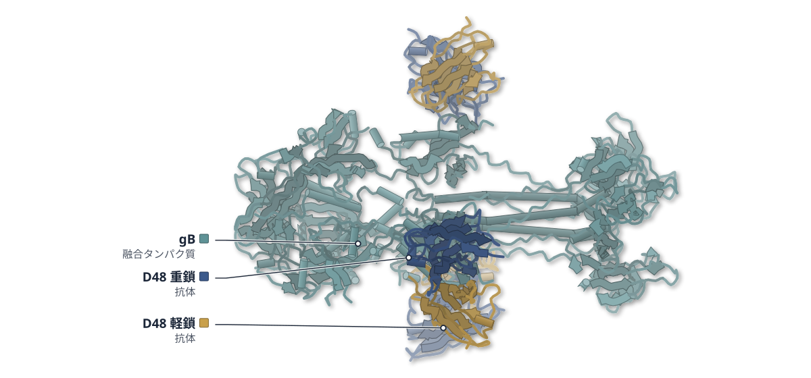

色（順に）：D48 重鎖（抗体） / D48 軽鎖（抗体） / gB（融合タンパク質）

**HSV-1 gBに結合する抗体D48は、ドメインIIの軽鎖側に触れる**

gBとD48 Fabの3.04 Åクライオ電顕構造。DIIは他のヘルペスウイルスでも抗体の標的になる

- **疑問・課題**：gB の抗体がウイルスをどう中和するのか、構造の基盤は分かっていなかった。
- **アプローチ**：HSV-1 gB の細胞外領域と D48 Fab を HEK293F で発現して複合体を作り、クライオ電顕で解析した。
- **結果**：gB 三量体の各分子に D48 Fab が 1 つずつ付き、主に軽鎖が DII ドメインと極性相互作用していた（3.04 Å）。
- **わかったこと**：HCMV・EBV の gB 抗体も DII に結合し、融合前の gB でも抗体と衝突しない。DII は共通の抗原領域らしい。

この紹介文の根拠（論文本文）

> While gB antibodies have been demonstrated to be effective in HSV neutralization [9], currently the structural basis for the antibody neutralization remains elusive  
> — 疑問・課題／Abstract

> To achieve this, we expressed the HSV-1 gB ectodomain and D48 Fab using the 293F expression system, yielding a stable complex (Figure S1A-S1B).  
> — アプローチ／Abstract

> The complex displayed a trimeric configuration, with each gB bound to one D48 Fab along the central axis.  
> — 結果／Abstract

> Specifically, D48 establishes polar interactions with the DII domain via its light chain (VL), encompassing an interface area of 462.6 Å2.  
> — 結果／Abstract

> revealing a potentially conserved antigenic domain gB DII, across the herpesvirus family, spanning pre- and post-fusion configurations.  
> — わかったこと／Abstract

> with all three antibodies exhibiting superficial binding to pre-fusion gB DII domains devoid of structural conflict (Figure 1K).  
> — わかったこと／Abstract

分類：免疫（抗体・MHC・TCR・自然免疫）・感染・ウイルス・防御系

#### 読みどころ

D48 の軽鎖の LCDR1・LCDR3・FR2 が gB の DII ドメインと水素結合や塩橋を作る。重鎖側には極性の接触がなく、疎水性残基のまとまりが支えると考えられる。

根拠（論文本文）

> Polar contacts, including hydrogen bonds (H-bonds) and salt bridges, were discovered within this interaction region (Figure 1G).  
> — Abstract

> indicating potential hydrophobic interactions in stabilizing the D48 VH-HSV-1 gB interface (Figure S4).  
> — Abstract

接触残基を個別にアラニンへ置換すると、どの変異体でも D48 Fab への親和性が約 10 分の 1 に下がった。

根拠（論文本文）

> we introduced single-residue alanine mutants to disrupt polar contacts, resulting in an approximate 10-fold decrease in binding affinity (KD) across all mutants (Figures 1G and S3).  
> — Abstract

HCMV の SM5-1 と EBV の 3A3 も、gB の DII 表面に結合する。DII の配列には保存された残基があるが、3 種の抗体の接触残基は HSV-1・HCMV・EBV で同一ではなく、交差結合は限られると考えられる。

根拠（論文本文）

> We found that D48, SM5-1, and 3A3 each bind and extensively cover the superficial surface of the post-fusion DII domain of gB (Figure 1I).  
> — Abstract

> However, no interaction residues of D48, SM5-1, and 3A3 were found to be identical across HSV-1, HCMV, and EBV, suggesting limited cross-herpesvirus binding capability of these antibodies.  
> — Abstract

#### 構造データ

| PDB | 手法 | 分解能 | 公開 | 生物種 | リガンド |
|---|---|---|---|---|---|
| [8KFA](https://www.rcsb.org/structure/8KFA) | Cryo-EM | 3.04 Å | 2024-01-03 | Homo sapiens, Human herpesvirus 1 (strain KOS) | — |

- [P06437](https://www.uniprot.org/uniprotkb/P06437) gB Envelope glycoprotein B — *Human herpesvirus 1 (strain KOS)* （既存の PDB 構造 13 件）

#### 実験メモ

- **発現系**：HEK293F 細胞で一過性発現（gB、D48 Fab、IgG1）。
- **コンストラクト**：gB は HSV-1 KOS の 31–730 残基で、C 末端に Twin-Strep と 8×His タグ。
- **精製**：gB と D48 Fab は Ni Sepharose、IgG1 は Protein A で精製。
- **結晶化／グリッド作製**：Quantifoil R2/1 の Au グリッドに 4 μL を載せ、Vitrobot Mark IV で凍結。
- **データ収集・解析**：Titan Krios G3i と K3 で撮影し、cryoSPARC で解析（C3 対称）。

根拠（論文本文）

> the sequence of HSV-1 strain KOS gB 31–730 (gB730) [5] was cloned into the pcDNA3.1 mammalian expression vector fused with N-terminal TPA signal peptide and C-terminal Twin-Strep-tag plus 8∗His tag.  
> — Methods

> All plasmids were expressed in HEK293F cells (ThermoFisher, Waltham, Massachusetts, USA) by transient transfection [17].  
> — Methods

> The gB and D48 Fab were purified with Ni Sepharose resin (Cytiva, Shanghai, China) and D48 IgG1 was purified with Protein A Sepharose resin (Cytiva, Shanghai, China).  
> — Methods

> holey-carbon Au grids (Quantifoil R2/1, 300 mesh) were glow discharged and 4 μL of samples were applied onto the front side of glow-discharged grids.  
> — Methods

> Datasets of the HSV gB-D48 complex were collected on a 300-kV Titan Krios electron microscope G3i  
> — Methods

> 📝 編集者への確認事項：短報で Abstract が空のため、packet の Abstract 節に入っている導入・結果の文から引用した。凡例の順序（gB・軽鎖・重鎖）は render 後に確認。

---

## 12｜HKU1 RBD・TMPRSS2

### High-resolution crystal structure of human coronavirus HKU1 receptor binding domain bound to TMPRSS2 receptor

*hLife*（2024-10-01） · [論文](https://doi.org/10.1016/j.hlife.2024.09.005) · ライセンス: cc by-nc-nd

筆頭著者：Wei Wang（Nanjing Agricultural University, China）　責任著者：Rong Chen（Jiangsu Academy of Agricultural Sciences, China）、Ying Xu, Shuijun Zhang（Nanjing Agricultural University, China）

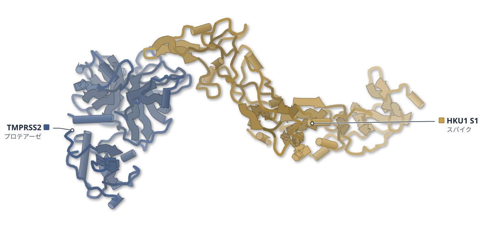

色（順に）：TMPRSS2（プロテアーゼ） / HKU1 S1（スパイク）

**HKU1のRBDは、未切断のTMPRSS2にも結合する**

2.4 Åの結晶構造で、RBDの向きとβ鎖の形が他の報告と異なっていた

- **疑問・課題**：TMPRSS2 は HKU1 の受容体として見つかったばかりで、認識の仕組みを構造で調べる必要があった。
- **アプローチ**：自己切断しない R255Q 変異の TMPRSS2 と HKU1A の RBD を昆虫細胞で作り、複合体の結晶構造を解いた。
- **結果**：2.4 Å の構造で、界面は 1737 Å2。RBD の R517 や W515 などが TMPRSS2 のループ 1〜3 と接していた。
- **わかったこと**：他の報告と比べて RBD の向きとβ10–β11 鎖の形が異なり、HKU1 の受容体結合には柔軟さがあると考えられる。

この紹介文の根拠（論文本文）

> Transmembrane protease serine 2 (TMPRSS2) is a newly identified proteinaceous receptor for HCoV-HKU1  
> — 疑問・課題／Abstract

> To understand the mechanism of receptor recognition by HCoV-HKU1, we determined the crystal structure of viral RBD complexed with human TMPRSS2.  
> — アプローチ／Abstract

> R255Q did not undergo autocleavage and also showed the highest protein yield compared to the other two mutants  
> — アプローチ／Abstract

> The crystal structure of the HKU1A RBD-TMPRSS2 complex was determined at a resolution of 2.4 Å  
> — 結果／Abstract

> The complex formation of TMPRSS2 and HKU1A RBD buries an accessible surface area of 1737 Å2.  
> — 結果／Abstract

> In comparison with these structures, HKU1A RBD solved in this study displays a noticeable difference in the conformation of β10-β11 strands  
> — わかったこと／Abstract

> This suggests the plasticity and complexity of receptor binding by HCoV-HKU1.  
> — わかったこと／Abstract

分類：感染・ウイルス・防御系・プロテアーゼ

#### 読みどころ

RBD の向きは、報告済みの HKU1A–TMPRSS2 のクライオ電顕構造に対して 6.4°、HKU1B の結晶構造に対して 13.7° 回転している。

根拠（論文本文）

> HKU1A RBD undergoes rotation by 6.4° and 13.7°, respectively, compared to the Cryo-electron microscopy (Cryo-EM) structure of HKU1A RBD-TMPRSS2 complex (PDB code: 8VGT)  
> — Abstract

TMPRSS2 は未切断型で、ループ 1 の中心が切断型より約 4.6 Å 外側にずれている。このため G432 の主鎖 N と RBD の D529 の水素結合など、切断型では見られない接触が加わった。

根拠（論文本文）

> Compared to the active form, the center of loop 1 in the inactive TMPRSS2 was rotated outward and shifted about 4.6 Å (Figure 1F).  
> — Abstract

> The backbone nitrogen of G432 of TMPRSS2 forms a hydrogen bond with D529 of RBD (Figure 1I).  
> — Abstract

> G432 and N433 of cleaved TMPRSS2 have not been observed to interact with HKU1A RBD.  
> — Abstract

R517 は TMPRSS2 の V415 と水素結合し、D417 は RBD の H488 と塩橋を作る。この界面は、ワクチンや抗ウイルス薬の開発に使える情報になると著者は述べている。

根拠（論文本文）

> Here, we show that R517 is hydrogen-bonded to TMPRSS2 V415 (Figure 1G).  
> — Abstract

> Reciprocally, D417 of TMPRSS2 forms a salt bridge interaction with H488 of HKU1A RBD (Figure 1G).  
> — Abstract

> The interface between HCoV-HKU1 RBD and receptor also provides information for the development of vaccines and antivirals against HCoV-HKU1.  
> — Abstract

#### 構造データ

| PDB | 手法 | 分解能 | 公開 | 生物種 | リガンド |
|---|---|---|---|---|---|
| [9IZN](https://www.rcsb.org/structure/9IZN) | X-ray | 2.40 Å | 2024-10-23 | Homo sapiens, Human coronavirus HKU1 (isolate N1) | — |

- [O15393](https://www.uniprot.org/uniprotkb/O15393) TMPRSS2 Transmembrane protease serine 2 — *Homo sapiens* （既存の PDB 構造 33 件）
- [Q5MQD0](https://www.uniprot.org/uniprotkb/Q5MQD0) S Spike glycoprotein — *Human coronavirus HKU1 (isolate N1)* （既存の PDB 構造 31 件）

#### 実験メモ

- **発現系**：RBD（残基 307–677）と TMPRSS2（残基 107–492）を Hi5 昆虫細胞で発現。
- **コンストラクト**：TMPRSS2 は自己切断を防ぐ R255Q 変異体。
- **精製**：Ni-NTA 親和性クロマトグラフィー、続いて Superdex 200 Increase でゲルろ過。
- **結晶化／グリッド作製**：RBD と TMPRSS2 を 1:1 で混ぜ、シッティングドロップ蒸気拡散法、18°C で結晶化。
- **データ収集・解析**：上海放射光 BL18U で回折データを収集し、8S0N と 5GNB を鋳型に分子置換で解いた。

根拠（論文本文）

> TMPRSS2 (residues 107–492) and RBD (residues 307–677) of HCoV-HKU1 genome type A (HCoV-HKU1A) were both expressed in Hi5 insect cells.  
> — Abstract

> Therefore, we used TMPRSS2 R255Q mutant for structural studies.  
> — Abstract

> These proteins were purified by Ni-NTA affinity chromatography  
> — Abstract

> HKU1A RBD-TMPRSS2 complex was formed via incubation of respective proteins at a 1:1 stoichiometry, and crystallized by the sitting-drop vapor diffusion method at 18°C  
> — Abstract

> The diffraction data were collected at the Shanghai Synchrotron Radiation Facility beamline BL18U.  
> — Abstract

> The structures were solved by molecular replacement in the Phaser program, using TMPRSS2 (PDB code: 8S0N) and HKU1A RBD (PDB code: 5GNB) as search models.  
> — Abstract

> 📝 編集者への確認事項：短報（brief report）で本文は Abstract 節に集約されているため、引用の section は Abstract とした。PDB 9IZN（2.4 Å）。

---

# Structure-Based Study

## 13｜β1AR（七面鳥）

### Uncoupling of the allosteric signalling network in the β1-adrenergic receptor by a negative allosteric modulator

*Nature Communications*（2026-09-18） · [論文](https://doi.org/10.1038/s41467-026-77802-8) · ライセンス: cc by

筆頭著者：Thomas H Harman（University of Cambridge, UK）　責任著者：Graham Ladds, Daniel Nietlispach（University of Cambridge, UK）

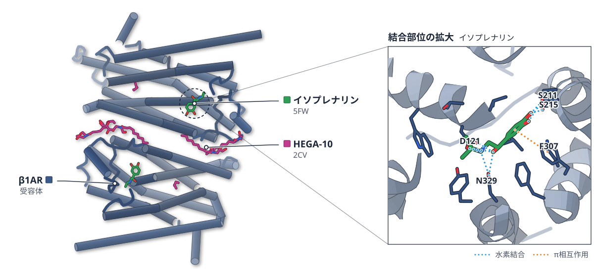

PDB 2Y03（論文が使った既存の構造）

色（順に）：β1AR（受容体）　スティック：HEGA-10（2CV）、イソプレナリン（5FW）

**阻害薬AS408は、βアドレナリン受容体の細胞内側を切り離す**

既存の構造を土台に、溶液NMRと変異体で調べた

- **疑問・課題**：GPCRのアロステリック修飾薬が、受容体の状態の分布をどう変えるかはまだ十分に分かっていなかった。
- **アプローチ**：既存の構造を土台に、E130の変異体と負のアロステリック修飾薬AS408を、機能測定・MD・溶液NMRで比べた。
- **結果**：E130変異は活性の低い状態へ分布を寄せたが、AS408は細胞内側の面を薬の結合部位から切り離し、G タンパク質と結合しにくい配置にした。
- **わかったこと**：2つは同程度にシグナルを下げても仕組みが異なり、AS408 は Gタンパク質と結合できない細胞内側の配置を作る。

この紹介文の根拠（論文本文）

> yet the ways in which allosteric modulators reshape these equilibria remain incompletely understood.  
> — 疑問・課題／Abstract

> Here we characterise how changes to the allosteric signalling network influence the conformational dynamics of the β1-adrenergic receptor (β1AR) through mutations at the E1303.41 position or using the negative allosteric modulator, AS408.  
> — アプローチ／Abstract

> E1303.41 mutations reduce agonist-stimulated signalling as a side chain-dependent rheostat, shifting receptor equilibria to populate states with weaker G protein affinities.  
> — 結果／Abstract

> AS408 uncouples the intracellular region of β1AR from the influence of the orthosteric pocket and reduces G protein coupling by adoption of an alternative signalling-incompetent intracellular surface arrangement.  
> — 結果／Abstract

> Both act through a known transmembrane (TM)3-TM4-TM5 site, reducing signalling to similar extents, but through distinct molecular mechanisms as revealed by pharmacological assays, MD simulations, and solution nuclear magnetic resonance spectroscopy.  
> — わかったこと／Abstract

分類：GPCR・受容体

#### 読みどころ

E130 を疎水性や芳香族のアミノ酸に替えると、アゴニスト（受容体を活性化する薬）が結合していても活性状態の割合が下がった。活性の下がり方は側鎖の種類で段階的に変わった。

根拠（論文本文）

> Unlike β1AR-E, which favours occupation of the active state14, the hydrophobic E130X3.41 variants predominantly occupied the pre-active state as previously observed for isoprenaline-bound β1AR-W26 (Fig. 2c).  
> — Results

AS408 は G タンパク質経路のシグナルを下げる負のアロステリック修飾薬（NAM）と確かめられた。結合の強さは μM 程度で、アゴニストの効き方（効力）に左右されず作用した。

根拠（論文本文）

> For AS408, the log(αβ) is −3.2 ± 0.5, thereby confirming AS408 as a NAM at the β1AR.  
> — Results

> Overall, AS408 acted as a NAM to generate a signalling deficient receptor independently of orthosteric ligand efficacy by uncoupling ligand binding from intracellular activation.  
> — Results

19F NMR では AS408 を加えると活性状態と前活性状態のシグナルが減り、これまで見られなかった位置に新しいピークが現れた。AS408 は既知のどの状態とも異なる細胞内側の配置を作ると考えられる。

根拠（論文本文）

> Interestingly, the position of the signal for the AS408-bound receptor did not match with any previously observed state, including the inactive state, suggesting β1AR adopted an alternative conformation in the presence of AS408.  
> — Results

#### 構造データ

| PDB | 手法 | 分解能 | 公開 | 生物種 | リガンド |
|---|---|---|---|---|---|
| [2Y03](https://www.rcsb.org/structure/2Y03) | X-ray | 2.85 Å | 2011-01-12 | MELEAGRIS GALLOPAVO | 2CV, 5FW |
| [6OBA](https://www.rcsb.org/structure/6OBA) | X-ray | 3.10 Å | 2020-03-25 | Enterobacteria phage T4, Homo sapiens | JTZ, M3J |
| [7JJO](https://www.rcsb.org/structure/7JJO) | Cryo-EM | 2.60 Å | 2020-09-02 | Bos taurus, Lama glama, Meleagris gallopavo | 5FW |

- [D9IEF7](https://www.uniprot.org/uniprotkb/D9IEF7) e Endolysin — *Enterobacteria phage T4* （既存の PDB 構造 0 件）
- [P04896](https://www.uniprot.org/uniprotkb/P04896) GNAS Guanine nucleotide-binding protein G(s) subunit alpha isoforms short — *Bos taurus* （既存の PDB 構造 0 件）
- [P07550](https://www.uniprot.org/uniprotkb/P07550) ADRB2 Beta-2 adrenergic receptor — *Homo sapiens* （既存の PDB 構造 0 件）
- [P07700](https://www.uniprot.org/uniprotkb/P07700) ADRB1 Beta-1 adrenergic receptor — *Meleagris gallopavo* （既存の PDB 構造 0 件）
- [P62871](https://www.uniprot.org/uniprotkb/P62871) GNB1 Guanine nucleotide-binding protein G(I)/G(S)/G(T) subunit beta-1 — *Bos taurus* （既存の PDB 構造 0 件）
- [P63212](https://www.uniprot.org/uniprotkb/P63212) GNG2 Guanine nucleotide-binding protein G(I)/G(S)/G(O) subunit gamma-2 — *Bos taurus* （既存の PDB 構造 0 件）

#### 実験メモ

- **発現系**：Sf9 昆虫細胞で発現し、LMNG で精製。
- **コンストラクト**：七面鳥 β1AR を熱安定化。N 末端・C 末端・IL3 を欠失。
- **結晶化／グリッド作製**：NMR 試料は 13C メチルメチオニンまたは 19F で標識した受容体 20–60 μM。

根拠（論文本文）

> Receptor was prepared in the apo form, with 1 mM isoprenaline (Sigma), or 1 mM propranolol (Sigma) to saturate in the ligand-bound receptor population and ensure changes to NMR spectra reflected conformational exchange of the ligand-bound states.  
> — Methods

> NMR samples containing 13C-methyl-methionine labelled or 19F labelled β1AR at 20–60 μM in 20 mM TrisHCl, pH 8.0, 150 mM NaCl and 0.02% LMNG  
> — Methods

> The N-terminus (Δ3-32), C-terminus (Δ368-483) and IL3 (Δ244-271) were truncated66.  
> — Methods

> Spodoptera frugiperda (Sf9) cells (Thermofisher, 12659017) were transfected with pBacPAK8 plasmids  
> — Methods

> lauryl maltose neopentyl glycol (LMNG)  
> — Methods

> 📝 編集者への確認事項：既存の PDB 構造（2Y03・6OBA・7JJO）を土台にした研究で、新しい構造ではない。実験で決めた構造データは自前の NMR（19F・13C）。MD も使うが結論は NMR と機能測定で確かめている。

---

## 注目の構造の採点（29 本を確認し、5 本を採点）

基準は `pipeline/impact.py`（10 点満点、6 点以上から最大 3 本）。

| 選定 | 論文 | 種類 | novelty | reach | structure | support | 計 | 理由 |
|---|---|---|---|---|---|---|---|---|
| ◯ | PMC13680373 Uncoupling of the allosteric signalling network in the β1-ad | 既存構造で機構を解明 | 2 | 2 | 1 | 2 | 7 | 既存の GPCR 研究の枠組みの上で、負のアロステリック修飾薬 AS408 が受容体の細胞内側を薬剤結合部位から切り離す仕組みを、溶液 NMR と変異体の機能測定で示した。 |
|  | SN-s44318-026-00923-9 Activator mimicry by PP6 regulatory subunits directs Aurora  | 既存構造で機構を解明 | 2 | 1 | 0 | 2 | 5 | A-box が Aurora A の活性化因子と同じ面に結合するという機構は新しいが、構造の根拠は AlphaFold3 のモデルと変異・結合実験で、実験で決めた構造がない（structure 0）。 |
|  | SN-s44318-026-00943-5 DZIP3 is a viral RNA co-sensor for RIG-I that promotes type- | 既存構造で機構を解明 | 2 | 1 | 0 | 2 | 5 | DZIP3 を RIG-I の共センサーとする点は新しいが、構造データがなく細胞・生化学の研究（structure 0）。 |
|  | PMC13682919 Solution characterization of TrhW, a type 4 secretion system | 新しい手法・ソフト | 2 | 1 | 1 | 1 | 5 | T4SS 因子 TrhW の初の実験的な構造解析だが、SAXS による低分解能の形の情報にとどまる。合計 5 点で基準（6 点）に届かない。 |
|  | PMC13681609 De novo design of covalent bonding peptides for target prote | 構造予測・AI・デザイン | 2 | 1 | 0 | 1 | 4 | 共有結合ペプチドの設計は新しいが、設計は docking と力場による予測で、設計した構造を X 線・クライオ電顕・NMR で確かめていない（structure 0）。 |

novelty：何が初めてか / reach：誰に効くか / structure：実験で決めた構造（X 線・クライオ電顕・NMR / support：裏付けの強さ（2＝独立した実験で検証：変異体・機能測定・既存手法との比較など／1＝一部の検証のみ／0＝計算のみで実験的検証なし）
