

# 2026-10-23 号

**今日の新しい構造：14 本**　PMC に 2026-10-22 に登録されたオープンアクセス論文 125 本のうち、新しい構造を報告した論文は 14 本。うち 16 本を紹介する（残りは末尾に一覧）。

出典：この号の論文情報と全文は、米国国立医学図書館（NLM）の PMC オープンアクセスデータセット（AWS Open Data）から取得した。

**New Structure 4 本** · **Structure Update 9 本** · **Structure-Based Study 3 本**（New Structure：構造が初めて解かれたタンパク質。Structure Update：既知のタンパク質の新しい構造。Structure-Based Study：既存の構造を使った注目の研究）

## Today's Structure（今日の一本）

**1｜3つの調節薬の併用で、ドーパミンの効きが1000倍以上に**（ドーパミンD1受容体（ヒト））

選んだ理由（構造生物学・創薬）：D1 受容体の 3 つの正のアロステリック部位に、別々の調節薬が同時に結合する構造を示し、併用でドーパミンの効力が 1000 倍超になることを測った。

> Our structures demonstrate the simultaneous binding of the chemically distinct PAMs (LY3154207, BMS-A1, and UNC9815/UNC10062) in three nonoverlapping pockets.  
> — Abstract

- 迷った論文：DAB1（Thermocrinis albus） — 初構造で機構も見えるが、創薬への直結度で D1 受容体を上に置いた。
- 迷った論文：ScMK（出芽酵母） — 5 種の阻害剤を 1 か所で受け止める仕組みが明快だが、酵母の酵素で波及が限られる。

| # | 標的 | 手法・分解能 | 見出し |
|---|---|---|---|
| 1 | ドーパミンD1受容体（ヒト） | Cryo-EM・2.44–2.65 Å（3 構造） | 3つの調節薬の併用で、ドーパミンの効きが1000倍以上に |
| 2 | ScMK（出芽酵母） | X-ray・1.93–2.15 Å（6 構造） | 大小5種の阻害剤を、酵母のMKは同じ部位で受け止める |
| 3 | DAB1（Thermocrinis albus） | Cryo-EM・2.29 Å（2 構造） | DAB1複合体のクライオ電顕で、活性部位の2状態が見えた |
| 4 | CAPADH（B. fragilis・C. leptum） | X-ray・2.50–2.91 Å（2 構造） | アグマチンは、細菌の脱水素酵素のNADPH結合を34倍強める |
| 5 | Blm10:13S（酵母） | Cryo-EM・2.75–3.55 Å（5 構造） | Blm10とPba1は、並行する別の経路で働くらしい |
| 6 | DNMT1・ヌクレオソーム | Cryo-EM・3.19–3.93 Å（2 構造） | DNMT1のCXXCは、CpGを捉えて自らの働きを抑える |
| 7 | Regnase-1 PIN・スラミン（マウス） | X-ray・2.62 Å | スラミンは、Regnase-1の活性部位に結合する |
| 8 | NS3（ノロウイルス） | Cryo-EM・2.90 Å | ノロウイルスのNS3は、割れた座金型の六量体をつくる |
| 9 | AAV2 VP1・IMPα2 | X-ray・2.15–2.60 Å（3 構造） | AAV2のVP1は、別の組み合わせでもインポーチンαに結合する |
| 10 | Sup35プリオン（酵母） | Cryo-EM・2.70 Å | 酵母由来のSup35プリオンは、試験管内のSc4線維と構造が違う |
| 11 | CnMetXS（ネクトル菌） | X-ray・1.86 Å | MetXSの二量体は、蓋の形が左右で違う |
| 12 | YAPWW1・TAZWW（ヒト） | X-ray・1.03 Å | YAPWW1はTAZWWより熱安定性が低い |
| 13 | CHIKV VLP（ChAdOx1 Chik） | Cryo-EM・全体 5.7 Å／三量体 約4 Å | ChAdOx1 ChikのVLPは、天然のウイルスに似ている |
| 14 | ユビキチンなど10種のタンパク質 | NMR・既存のX線／クライオ電顕構造との照合 | 高いpHのNMRで、タンパク質の水素結合を見分ける |
| 15 | タウ（jR2R3-P301Lペプチド線維） | NMR・EPR・ODNP・既存のクライオ電顕構造（MDを含む） | タウの線維化は、V300付近の1か所から始まる |
| 16 | SfbI-TED（化膿レンサ球菌） | BLI・DSC・チオール定量・既存の結晶構造 | 細菌の接着ドメインは、pHで共有結合を外す |

> この号は AI が論文本文から作成した**レビュー用の下書き**です。数値・ID・リガンドは PDB / UniProt から取得し、AI の記述には本文からの引用を付けています。

---

# Picked up Today's Structure

## 1｜ドーパミンD1受容体（ヒト）

### Multiple allosteric sites allow for synergistic enhancement of GPCR signaling

*Science Advances*（2026-10-23） · [論文](https://doi.org/10.1126/sciadv.aeh3401) · ライセンス: cc by

筆頭著者：Kai Wang（Chinese Academy of Sciences, China）　責任著者：Kevin J. Frankowski（UNC Eshelman School of Pharmacy, USA）、Yue Wang（Chinese Academy of Sciences, China）、Lei Shi（National Institutes of Health, USA） ほか 2 名

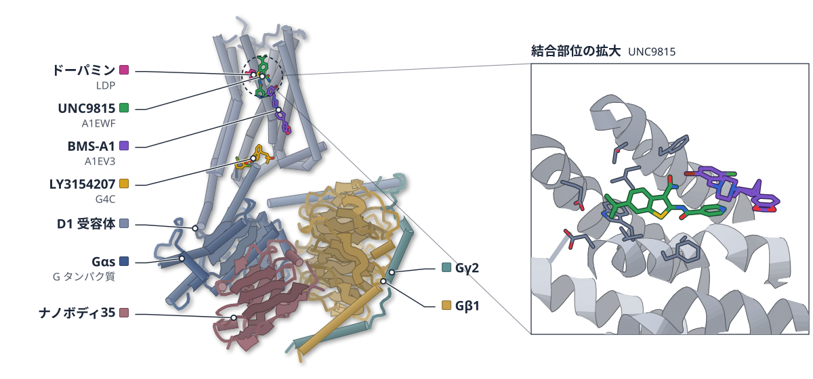

色（順に）：Gαs（G タンパク質） / Gβ1 / Gγ2 / ナノボディ35 / D1 受容体　スティック：ドーパミン（LDP）、UNC9815（A1EWF）、BMS-A1（A1EV3）、LY3154207（G4C）

**3つの調節薬の併用で、ドーパミンの効きが1000倍以上に**

TM1とTM7の間にある新しい2つの溝に結合する調節薬を、クライオ電顕で解いた

- **疑問・課題**：アロステリック部位（作動薬と別の結合場所）が協調する仕組みは分かっていなかった。結合部位が確かめられた調節薬は LY3154207 だけだった。
- **アプローチ**：新しい調節薬 UNC9815・UNC10062 を作り、BMS-A1 などと組み合わせた D1R-Gs 複合体をクライオ電顕で解き、変異体と MD でも調べた。
- **結果**：2.44〜2.65 Å の構造で、BMS-A1 は TM1・TM7 間の下の溝、UNC 化合物は真上の溝に入った。3種の併用でドーパミンの EC50 は1000倍以上下がった。
- **わかったこと**：3つの調節薬は重ならない3か所に同時に結合して協調する。MD は、複数部位への結合が受容体の活性型を安定化することを示した。
- **残された課題**：治療効果の向上や副作用の軽減につながるかは、今後の薬理学や in vivo の研究で確かめる必要がある。

この紹介文の根拠（論文本文）

> Although multiple allosteric binding sites have been identified in GPCRs, whether and how these spatially distinct sites cooperate to regulate receptor activation remain poorly understood.  
> — 疑問・課題／Abstract

> the molecular basis underlying this allosteric cooperativity remains poorly understood, with only the binding site of LY3154207 definitively characterized to date  
> — 疑問・課題／Introduction

> We developed two novel D1R positive allosteric modulators (PAMs), UNC9815 and UNC10062, and used cryo–electron microscopy to structurally identify two previously uncharacterized D1R allosteric sites occupied by UNC9815/UNC10062 and another D1R PAM, BMS-A1.  
> — アプローチ／Abstract

> To confirm the above structural findings, we performed extensive mutagenesis experiments targeting the PAM contact residues within the D1R TM1-TM7 upper and lower allosteric pockets.  
> — アプローチ／Results

> The cryo-EM structures of D1R-Gs in complex with SKF81297/LY3154207/BMS-A1, SKF81297/LY3154207/BMS-A1/UNC10062, and DA/LY3154207/BMS-A1/UNC9815 were determined at global resolutions of 2.65, 2.59, and 2.44 Å, respectively  
> — 結果／Results

> are organized in a spatially complementary manner as vertically adjacent binding pockets  
> — 結果／Results

> When all three chemically distinct classes of PAMs were combined with DA, we observed a ≥1000-fold shift in the DA EC50  
> — 結果／Results

> Our structures demonstrate the simultaneous binding of the chemically distinct PAMs (LY3154207, BMS-A1, and UNC9815/UNC10062) in three nonoverlapping pockets.  
> — わかったこと／Abstract

> Molecular dynamics (MD) simulations revealed that multisite PAM engagement restricts intracellular loop 3 dynamics  
> — わかったこと／Abstract

> However, whether this strategy can ultimately improve therapeutic efficacy, broaden therapeutic windows, or reduce adverse effects remains to be determined through future pharmacological and in vivo studies.  
> — 残された課題／Discussion

分類：GPCR・受容体

#### 読みどころ

下の溝に BMS-A1、その真上の溝に UNC9815/UNC10062 が入る。2つの調節薬が縦に積み重なる配置は、論文の知る限り他の GPCR で報告がない。上の溝にはコレステロールが入った構造もあった。

根拠（論文本文）

> The stacked arrangement of two PAMs sandwiched between TM1 and TM7 represents, to our knowledge, a previously unknown allosteric binding configuration in other GPCRs.  
> — Results

> In the map of D1R-SKF81297/LY3154207/BMS-A1, we observed a clear density of cholesterol at a site similar to that occupied by the UNC compounds  
> — Results

UNC 化合物は MLS6585 を最適化したもの。上の溝の3残基（V315A・F319L・A322S）を置換すると、UNC9815 は効きを弱める調節薬（NAM）に変わった。下の溝の変異では BMS-A1 が働かなくなった。

根拠（論文本文）

> we first optimized MLS6585 through medicinal chemistry, yielding two analogs, UNC10062 and UNC9815, with enhanced potency and efficacy  
> — Introduction

> However, UNC9815 unexpectedly behaved as a weak negative allosteric modulator (NAM) when tested alone or in combination with BMS-A1 or LY3154207  
> — Results

> BMS-A1 was rendered functionally inactive for altering DA potency either alone or in combination with UNC9815 or LY3154207  
> — Results

G タンパク質のない MD では、ICL3 の動きと NPxxY モチーフのゆらぎが、3種そろうと LY3154207 だけのときより小さくなった。細胞外ループ ECL2 のゆらぎも 2.46 ± 0.77 Å から 0.87 ± 0.11 Å に減った。

根拠（論文本文）

> Multisite PAM engagement produced stabilizing effects not achieved by LY3154207 alone.  
> — Results

> Root mean square fluctuation analyses revealed a progressive reduction in ECL2 flexibility: from 2.46 ± 0.77 Å in the D1R-SKF81297-only system to 1.98 ± 0.09 Å in the D1R-SKF81297/LY3154207 system and 0.87 ± 0.11 Å in the triple PAM-bound system  
> — Results

#### 構造データ

| PDB | 手法 | 分解能 | 公開 | 生物種 | リガンド |
|---|---|---|---|---|---|
| [9WEU](https://www.rcsb.org/structure/9WEU) | Cryo-EM | 2.65 Å | 2026-08-26 | Bos taurus, Homo sapiens, Oplophorus gracilirostris (Luminous shrimp), Rattus norvegicus, Vicugna pacos | A1EV3, SK0, G4C |
| [9WG0](https://www.rcsb.org/structure/9WG0) | Cryo-EM | 2.59 Å | 2026-08-26 | Bos taurus, Homo sapiens, Oplophorus gracilirostris, Rattus norvegicus, Vicugna pacos | A1EWL, A1EV3, SK0, G4C |
| [9WG6](https://www.rcsb.org/structure/9WG6) | Cryo-EM | 2.44 Å | 2026-08-26 | Bos taurus, Homo sapiens, Oplophorus gracilirostris, Rattus norvegicus, Vicugna pacos | LDP, A1EWF, A1EV3, G4C |

- [P07550](https://www.uniprot.org/uniprotkb/P07550) ADRB2 Beta-2 adrenergic receptor — *Homo sapiens* （既存の PDB 構造 146 件）
- [P21728](https://www.uniprot.org/uniprotkb/P21728) DRD1 Dopamine receptor D1 — *Homo sapiens* （既存の PDB 構造 32 件）
- [P54311](https://www.uniprot.org/uniprotkb/P54311) Gnb1 Guanine nucleotide-binding protein G(I)/G(S)/G(T) subunit beta-1 — *Rattus norvegicus* （既存の PDB 構造 183 件）
- [P63092](https://www.uniprot.org/uniprotkb/P63092) GNAS Guanine nucleotide-binding protein G(s) subunit alpha isoforms short — *Homo sapiens* （既存の PDB 構造 487 件）
- [P63212](https://www.uniprot.org/uniprotkb/P63212) GNG2 Guanine nucleotide-binding protein G(I)/G(S)/G(O) subunit gamma-2 — *Bos taurus* （既存の PDB 構造 226 件）

#### 実験メモ

- **発現系**：Sf9 昆虫細胞に D1R・miniGαs_DN・Gβ1・Gγ2 のバキュロウイルスを 1:1:1:1 で共感染。
- **コンストラクト**：ヒト D1R の N 末に FLAG と β2AR N 末断片、C 末に 8×His。miniGαs は G226A・A366S 変異体。
- **精製**：LMNG と CHS で可溶化し、FLAG 樹脂とゲルろ過で精製。全試料に LY3154207 を加えた。
- **結晶化／グリッド作製**：Quantifoil R1.2/1.3 に 3 μL（10.9〜16.0 mg/ml）をのせ、Vitrobot Mark IV で凍結。
- **データ収集・解析**：Titan Krios で 6,244〜8,517 本の動画を収集。RELION 4.0 と cryoSPARC v4 で処理し、7LJC を初期モデルに精密化。

根拠（論文本文）

> For the expression of the D1R-Gs complexes, Sf9 cells (Spodoptera frugiperda; Expression Systems, catalog no. 94-001F; RRID:CVCL_0549) were coinfected with the four types of baculoviruses prepared at 1:1:1:1 ratio.  
> — Expression, assembly, and purification of D1R-Gs complexes

> The N-terminal of D1R sequence was induced with FLAG tag followed by a fragment of β2AR N-terminal tail region (BN, hereafter) as fusion protein while the C-terminal was attached with an 8 × His tag to facilitate the protein expression and purification  
> — Construct design

> A miniGαs format of Gαs with dominant negative mutations, G226A and A366S, was engineered (miniGαs_DN)  
> — Construct design

> solubilized directly by 0.5% (w/v) lauryl maltose neopentyl glycol (LMNG; Anatrace) and 0.1% (w/v) cholesteryl hemisuccinate tris salt (CHS; Anatrace)  
> — Expression, assembly, and purification of D1R-Gs complexes

> For the preparation of cryo-EM grids, 3 μl of the purified complexes at 10.9 mg/ml for the D1R-Gs complex with SKF81297/LY3154207/BMS-A1  
> — Cryo-EM grid preparation and data collection

> Grids were plunge-frozen in liquid ethane using Vitrobot Mark IV (Thermo Fisher Scientific).  
> — Cryo-EM grid preparation and data collection

> all collected movie stacks were motion-corrected and dose-weighted in RELION 4.0  
> — Image processing and map construction

> was used as initial model for model rebuilding and refinement against the cryo-EM density maps of D1R-Gs complexes  
> — Model building and refinement

> 📝 編集者への確認事項：candidates.json の source は impact_search だが kind は new_structure（9WEU・9WG0・9WG6 の3エントリ、PDB の引用題は別題 'Molecular insights into the cooperative allosteric modulation of D1 dopamine receptor' で DOI 未登録）。1000倍以上は β-arrestin 回収アッセイの DA の EC50 シフト（SKF81297 では3種でも2種を超えず頭打ち）。MD は補助的な裏付けとして書き、結果は著者の解釈（示唆）の範囲にとどめた。legend_labels は未設定（β2AR-D1R-NanoLuc 融合鎖・Nb35・Gα/β/γ の順を render 後に確認してほしい）。

---

# New Structure

## 2｜ScMK（出芽酵母）

### Structural basis of mevalonate pathway regulation by feedback inhibition of mevalonate kinase

*The Journal of Biological Chemistry*（2026-09-17） · [論文](https://doi.org/10.1016/j.jbc.2026.113566) · ライセンス: cc by

筆頭著者：Rachel L.S. D’Emilia（Bryn Mawr College, USA）　責任著者：Yan Kung（Bryn Mawr College, USA）

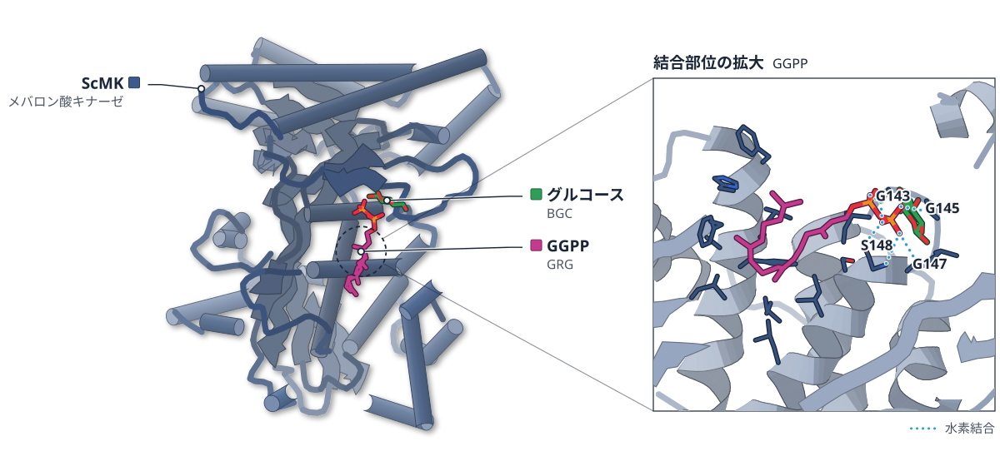

色（順に）：ScMK（メバロン酸キナーゼ）　スティック：GGPP（GRG）、グルコース（BGC）

**大小5種の阻害剤を、酵母のMKは同じ部位で受け止める**

5つの阻害剤複合体の結晶構造で、小さなループと側鎖の動きが鎖長の差を吸収していた

- **疑問・課題**：メバロン酸キナーゼ（MK）は下流の産物で阻害される。ATP と同じ一か所に大きさの違う阻害剤がどう収まるかは不明だった。
- **アプローチ**：出芽酵母の MK（ScMK）で 5 種の阻害剤の Ki を測り、apo 型と 5 種の阻害剤結合型の結晶構造を解いた。
- **結果**：Ki は FPP の 0.29 μM から IPP の 46 μM まで約 2 桁に及んだ。ピロリン酸部は共通で、長い鎖は疎水ポケットの壁に沿って曲がっていた。
- **わかったこと**：阻害剤は ATP 結合部位の同じ疎水領域に入り、長い鎖は曲がって収まる。必要な動きは小さなループと側鎖の変化だけだった。
- **残された課題**：ATP が結合した ScMK の構造はまだなく、Phe110 を含むループが ATP と阻害剤を切り替える可能性は未検証だ。

この紹介文の根拠（論文本文）

> but how MK is able to accommodate so many different inhibitors of such varying sizes at a single site that must also bind the ATP substrate is unknown.  
> — 疑問・課題／Introduction

> In this work, we first characterized the inhibition kinetics of MK from Saccharomyces cerevisiae (ScMK) in the presence of IPP, DMAPP, GPP, FPP, and GGPP.  
> — アプローチ／Introduction

> We then solved crystal structures of ScMK bound to all of these inhibitors, in addition to the structure of apo ScMK  
> — アプローチ／Introduction

> Interestingly, Ki values for all five ScMK inhibitors span two orders of magnitude.  
> — 結果／Results

> Upon refinement, the pyrophosphate head groups of all inhibitors occupy a similar position and coordinate Mg2+  
> — 結果／Results

> Taken together, these structures depict all inhibitors occupying the same hydrophobic region within the ATP-binding site of MK, with larger inhibitors curling up to adopt a compact size in order to fit within the binding pocket.  
> — わかったこと／Results

> Only small loop and side chain movements are necessary to enable the enzyme to accommodate and adapt to inhibitors of varying sizes.  
> — わかったこと／Results

> Corroborating evidence of this idea awaits structural information on ATP binding in ScMK.  
> — 残された課題／Discussion

分類：キナーゼ・酵素（その他）

#### 読みどころ

鎖が GPP まで伸びると Phe54 が一つの向きに固定され、ポケットの奥が開く。FPP は壁で約90°曲がり、GGPP は Phe59 に阻まれてさらに曲がり、J 字形に折り返して収まる。

根拠（論文本文）

> As the inhibitor chain lengthens by five carbons from IPP/DMAPP to GPP, Phe54 adopts a single conformation that no longer blocks larger inhibitors  
> — Results

> Finally, when the alkyl chain lengthens even further to GGPP, Phe59 sterically blocks a linear continuation of the chain  
> — Results

最も強い阻害剤は中くらいの GPP と FPP（0.33・0.29 μM）で、IPP と DMAPP は弱い。GGPP は 3.3 μM で、曲がって収まる負担が弱さの一因かもしれないと論文は考えている。

根拠（論文本文）

> The strongest inhibition potency is afforded by intermediate-sized GPP and FPP, with Ki values one order of magnitude lower still, at 0.33 ± 0.02 μM and 0.29 ± 0.02 μM, respectively.  
> — Results

> Therefore, it is possible that weaker binding may instead be attributed to a penalty associated with the need for the large GGPP molecule to adopt a more compact conformation for binding.  
> — Discussion

ScMK の構造はこれが初めてで、真菌の MK としても最初の報告だ。代謝工学で広く使われる酵素なので、フィードバック阻害を弱める酵素改変の足がかりになると論文は述べている。

根拠（論文本文）

> yet no structure of this MK has been determined until now.  
> — Discussion

> notably, the structures of ScMK here are also the first structures reported of a fungal MK.  
> — Discussion

#### 構造データ

| PDB | 手法 | 分解能 | 公開 | 生物種 | リガンド |
|---|---|---|---|---|---|
| [36WI](https://www.rcsb.org/structure/36WI) | X-ray | 2.15 Å | 2026-09-30 | Saccharomyces cerevisiae | — |
| [36WJ](https://www.rcsb.org/structure/36WJ) | X-ray | 2.07 Å | 2026-09-30 | Saccharomyces cerevisiae | IPE |
| [36WK](https://www.rcsb.org/structure/36WK) | X-ray | 1.93 Å | 2026-09-30 | Saccharomyces cerevisiae | DMA |
| [36WL](https://www.rcsb.org/structure/36WL) | X-ray | 2.05 Å | 2026-09-30 | Saccharomyces cerevisiae | BGC, GPP |
| [36WM](https://www.rcsb.org/structure/36WM) | X-ray | 2.09 Å | 2026-09-30 | Saccharomyces cerevisiae | FPP |
| [36WN](https://www.rcsb.org/structure/36WN) | X-ray | 1.95 Å | 2026-09-30 | Saccharomyces cerevisiae | BGC, GRG |

- [P07277](https://www.uniprot.org/uniprotkb/P07277) ERG12 Mevalonate kinase — *Saccharomyces cerevisiae (strain ATCC 204508 / S288c)* （PDB で初めての構造）

#### 実験メモ

- **発現系**：大腸菌 BL21(DE3) で発現し、0.5 mM IPTG で誘導して 20 °C で一晩培養。
- **コンストラクト**：コドン最適化した ScMK を、TEV で切れる N 末端 His タグ付きの pSKB3 に組み込んだ。
- **精製**：Ni-NTA アフィニティークロマトグラフィーで精製し、透析して約 20 mg/ml に濃縮。
- **結晶化／グリッド作製**：ハンギングドロップ蒸気拡散で結晶化（MES pH 6.0・酒石酸 Na/K）。阻害剤は apo 結晶に 5 mM で 30〜45 分ソーキング。
- **データ収集・解析**：APS 24-ID-C/E で 100 K に収集。1KVK の RnMK を鋳型に分子置換し、Phenix と Coot で精密化。

根拠（論文本文）

> Expression was induced with 0.5 mM isopropyl β-d-thiogalactopyranoside (IPTG) and continued at 20 °C overnight.  
> — Protein expression and purification

> was cloned by Gibson assembly (50) into the plasmid pSKB3, a modified pET28b vector with a tobacco etch virus protease-cleavable N-terminal hexahistidine tag  
> — Protein expression and purification

> ScMK was purified using Ni-NTA affinity chromatography.  
> — Protein expression and purification

> The best condition contained 2 μl of 6 to 10 mg/ml purified ScMK mixed with 1 μl of crystallization solution (100 mM MES pH 6.0 and 900–1100 mM sodium potassium tartrate)  
> — Protein crystallization

> apo ScMK crystals were soaked in a solution that contained a 50-50 mixture of the crystallization solution and the cryoprotectant solution plus 5 mM of IPP, DMAPP, GPP, FPP, or GGPP for 30 to 45 min before flash-freezing in liquid nitrogen.  
> — Protein crystallization

> X-ray diffraction data were collected at the Advanced Photon Source beamlines 24-ID-C and 24-ID-E at 100 K.  
> — X-ray data collection, model building, and refinement

> with one protein monomer without any ligands bound from the prior structure of RnMK (43), PDB entry 1KVK, as a search model (31% sequence identity).  
> — X-ray data collection, model building, and refinement

> 📝 編集者への確認事項：PDB の 6 エントリ（apo 36WI、IPP 36WJ、DMAPP 36WK、GPP 36WL、FPP 36WM、GGPP 36WN）すべてが本論文の構造。ScMK は PDB に既存構造がなく candidates.json で first_structure=true（New Structure）。図は GGPP 結合型（36WN）。BGC（グルコース）は GPP・GGPP 型で低温保護剤を当てはめたもので、阻害剤ではない。結晶中の活性部位に未帰属の電子密度があると論文が断っている。

---

## 3｜DAB1（Thermocrinis albus）

### Structural insights into the coupling mechanism of vectorial CO2 uptake by DAB1

*Proceedings of the National Academy of Sciences of the United States of America*（2026-10-12） · [論文](https://doi.org/10.1073/pnas.2616712123) · ライセンス: cc by

筆頭著者：Naiya R. Phillips（University of California）　責任著者：David F. Savage（University of California）

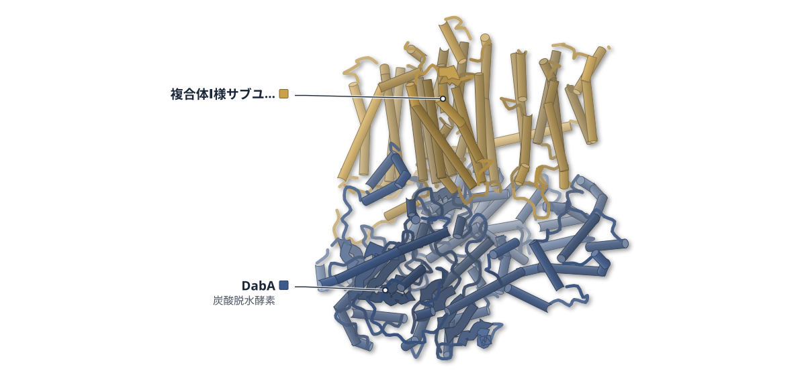

色（順に）：DabA（炭酸脱水酵素） / 複合体Ⅰ様サブユニット

**DAB1複合体のクライオ電顕で、活性部位の2状態が見えた**

状態Aは反応物の入口、状態BはHCO3−の出口とみられる通路が開いていた

- **疑問・課題**：DAB1 は膜のプロトン勾配と結びつき、CO2 を一方向に水和する炭酸脱水酵素（CA）だが、その仕組みは不明だった。
- **アプローチ**：好熱菌 Thermocrinis albus の DAB1 複合体をクライオ電顕（2.29 Å）で解き、変異体のスクリーニングも行った。
- **結果**：活性部位は DabA の内部で溶媒から 10 Å 以上奥にあった。3D 分類で、周囲の残基の動きが異なる状態 A と状態 B が得られた。
- **わかったこと**：状態 A で CO2 と水の入口が開き、状態 B でそれが閉じて HCO3− の出口が開く、という機構が提案された。
- **残された課題**：活性部位のプロトンを除く最終段階は、構造からは分からない。

この紹介文の根拠（論文本文）

> The mechanism of this vectorial CA activity has remained unclear.  
> — 疑問・課題／Abstract

> it is an open question how these complexes mechanistically act as vectorial CAs, rather than reversibly catalyzing hydration, as all other CAs do.  
> — 疑問・課題／Introduction

> To that end, we used cryoelectron microscopy (Cryo-EM) to solve the structure of the DAB1 complex from the thermophile, Thermocrinis albus, to 2.29 Å resolution.  
> — アプローチ／Introduction

> We investigated the molecular basis of this mechanism using a suppressor screen in CAFree  
> — アプローチ／Results and Discussion

> In contrast, the DabA active site is buried more than 10 Å from solvent, sequestered by a flexible lid domain comprising residues 471 to 509  
> — 結果／Results and Discussion

> We therefore performed 3D classification, which revealed two distinct states with sufficient quality cryo-EM density for model building.  
> — 結果／Results and Discussion

> Together, these structures support a model in which the substrates enter through CO2 and water channels for CO2 hydration, after which a transition to State B closes the entry routes and opens a separate exit channel to release HCO3− to the cytosol.  
> — わかったこと／Results and Discussion

> Our structural data do not provide an obvious mechanism for the final step in the cycle.  
> — 残された課題／Results and Discussion

分類：トランスポーター・酵素（その他）

#### 読みどころ

状態 B では F476 が大きく動いて疎水性の通路 A1 を閉じ、C494 が約 5 Å 動いて水の通路 A2 をふさぐ。同時に G474 と S716 が約 3 Å ずれ、反対側に親水性の通路 B が開く。

根拠（論文本文）

> Relative to State A, the GI(A/G)GFFG motif adopts a more helical conformation, forcing F476 to undergo a dramatic movement  
> — Results and Discussion

> Meanwhile, both G474 and S716 shift ~3 Å to open a new hydrophilic channel (Channel B) opposite to the State A channels, which opens to the solvent near the membrane leaflet.  
> — Results and Discussion

DabA の活性部位は典型的な β 型 CA で、Zn2+ に C449・C709・H694 と水が配位する。HCO3− と水素結合する位置が Leu825 で、HCO3− を放しやすくしている可能性がある。

根拠（論文本文）

> Our structural analysis confirms that these residues do in fact form a typical β-CA active site in which a Zn2+ ion is coordinated by two cysteines (C449 and C709), a histidine (H694), and a water in a tetrahedral geometry  
> — Results and Discussion

> It is possible that this lack of an H-bond donor in DabA raises the barrier to HCO3− binding and encourages product release after hydration.  
> — Results and Discussion

プロトン伝達を壊した DabB の H229A でも空気中で増える DabA 変異体を選ぶと、C494 や N901 の置換が見つかった。通路の閉鎖と DabA–DabB の連結が、共役の維持に必要と解釈されている。

根拠（論文本文）

> These mutants highlight two features of the complex that are required to normally maintain coupling: regulation of channel opening and closure, and mechanical linkage to transmit structural changes from the proton translocation pathway to the DabA active site.  
> — Results and Discussion

> Only one tested variant, epS1, which contains a mutation to C494 that likely perturbs the State A - State B transition, demonstrated in vitro CA activity.  
> — Results and Discussion

#### 構造データ

| PDB | 手法 | 分解能 | 公開 | 生物種 | リガンド |
|---|---|---|---|---|---|
| [38RH](https://www.rcsb.org/structure/38RH) | Cryo-EM | 2.29 Å | 2026-09-30 | Thermocrinis albus DSM 14484 | — |
| [38RI](https://www.rcsb.org/structure/38RI) | Cryo-EM | 2.29 Å | 2026-09-30 | Thermocrinis albus DSM 14484 | — |

- [D3SP01](https://www.uniprot.org/uniprotkb/D3SP01) dabA Probable inorganic carbon transporter subunit DabA — *Thermocrinis albus (strain DSM 14484 / JCM 11386 / HI 11/12)* （PDB で初めての構造）
- [D3SP02](https://www.uniprot.org/uniprotkb/D3SP02)  NADH/Ubiquinone/plastoquinone (Complex I) — *Thermocrinis albus (strain DSM 14484 / JCM 11386 / HI 11/12)* （PDB で初めての構造）

#### 実験メモ

- **発現系**：T. albus の DAB1 を、DabC の C 末端に His タグを付けて大腸菌 BL21-AI で発現。
- **精製**：LMNG で膜から可溶化し、Ni-IMAC、70 °C 加熱、ゲルろ過で精製。
- **結晶化／グリッド作製**：グラフェンオキサイドを付けた C-Flat 2/2 グリッドに 3 μL（0.06〜0.2 mg/mL）をのせ、Vitrobot Mark IV で凍結。
- **データ収集・解析**：Krios G3i と K3 で 6,032 本のムービーを収集。cryoSPARC で、活性部位にマスクをかけた 3D 分類により 2 状態を分離。

根拠（論文本文）

> We expressed the DAB1 complex from T. albus with a C-terminal His-tag on DabC in BL21-AI E. coli.  
> — DAB1 Is a Heterotrimer Containing DabA, DabB, and DabC.

> purified by Ni-IMAC, heat treatment at 70 °C, and gel filtration chromatography  
> — DAB1 Is a Heterotrimer Containing DabA, DabB, and DabC.

> then graphene oxide was deposited on all grids using the drop cast method (49) modified to include cleaning with chloroform and coating the grid in PEI as described in ref. 50.  
> — Cryo-EM Sample Preparation and Data Acquisition.

> 3 μL of sample at various concentrations (0.06 to 0.2 mg/mL) were placed on the grid, blotted, and plunge-frozen in liquid ethane using an FEI Mark IV Vitrobot set to 6 °C, 100% humidity.  
> — Cryo-EM Sample Preparation and Data Acquisition.

> A total of 6,032 movies were acquired using Serial EM  
> — Cryo-EM Sample Preparation and Data Acquisition.

> A mask surrounding the active site and its surrounding flexible region was constructed in ChimeraX (55), then used as a focus map in 3D classification to classify six classes at a filter resolution of 4 Å.  
> — Cryo-EM Image Processing.

> 📝 編集者への確認事項：PDB の 2 エントリ（38RH 状態 A、38RI 状態 B）はどちらも 2.29 Å（密度修正後の論文値は 2.12・2.13 Å）で、引用情報は未登録（寄託の記載から対応づけ）。candidates.json の polymers は 2 つ（DabA、DabB 相当）のみで DabC が PDB に入っているか不明のため、legend_labels は未記入（render 後に要確認。D3SP02 が DabB のはず）。リガンドは PDB 上になく（Zn2+ のみ）、ligand_names・site_ligand は未記入。状態 A・B は『触媒サイクルの一部の状態』と論文が書いており、機構は提案として記述した。

---

## 4｜CAPADH（B. fragilis・C. leptum）

### Agmatine as the initiating substrate for aspartate semialdehyde-dependent bacterial spermidine biosynthesis

*The Journal of Biological Chemistry*（2026-09-17） · [論文](https://doi.org/10.1016/j.jbc.2026.113570) · ライセンス: cc by

筆頭著者：Johnette C. Ostlund（Fort Lewis College, USA）　責任著者：Jeffrey S. McFarlane（Fort Lewis College, USA）

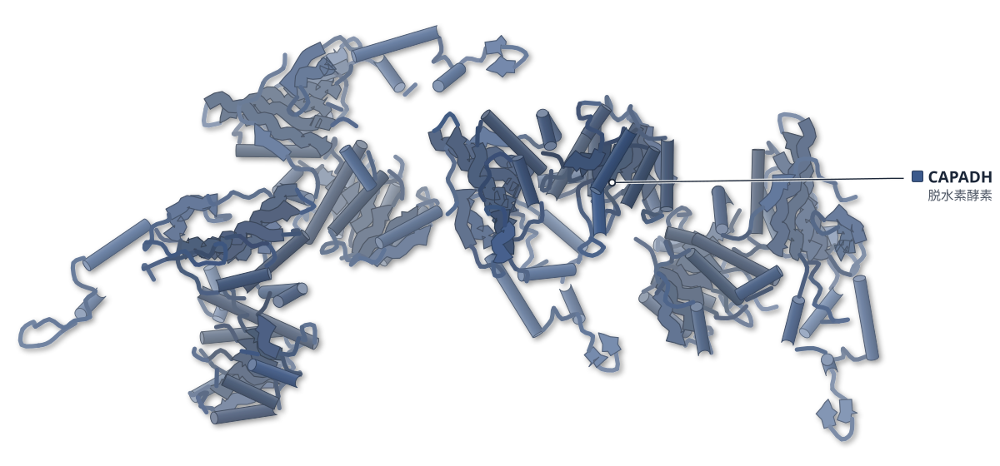

色（順に）：CAPADH（脱水素酵素）

**アグマチンは、細菌の脱水素酵素のNADPH結合を34倍強める**

apo結晶構造とSAXSで、NADP+が加わると酵素が閉じた配置になることを示した

- **疑問・課題**：細菌のスペルミジン合成は、プトレッシンから始まると考えられてきた。アグマチンを好む酵素がある理由は分かっていなかった。
- **アプローチ**：アグマチンを使う脱水素酵素（CAPADH）を B. fragilis と C. leptum で、速度論・熱シフト・SAXS・apo 結晶構造で調べた。
- **結果**：アグマチンでは kcat/Km がプトレッシンの 115 倍（B. fragilis）と 811 倍（C. leptum）になり、NADPH の結合は 34 倍強まった。
- **わかったこと**：両酵素はアグマチンを初発基質とする CAPADH だった。アグマチンが構造変化を促して NADPH の結合を高める誘導適合が示唆された。
- **残された課題**：アグマチン結合型の構造はなく、認識ループの役割は変異体解析で確かめる必要がある。

この紹介文の根拠（論文本文）

> Putrescine has long been considered the initiating substrate for aspartate semialdehyde-dependent bacterial spermidine biosynthesis.  
> — 疑問・課題／Abstract

> This variation appears to be common, but the mechanistic basis for substrate preference was unknown.  
> — 疑問・課題／Abstract

> Here, we investigate the aspartate semialdehyde-dependent dehydrogenases from Bacteroides fragilis and Clostridium leptum using steady-state and transient-state kinetic assays, mass spectrometry, thermal shift protein stability assays, X-ray crystallography, small-angle X-ray scattering, and computational modeling.  
> — アプローチ／Abstract

> Indeed, the kcat/Km increased 115-fold for B. fragilis and 811-fold for C. leptum in comparison to putrescine.  
> — 結果／Results

> Agmatine enhances NADPH binding affinity by 34-fold, whereas putrescine has a modest effect  
> — 結果／Abstract

> Both enzymes exhibit dramatically enhanced catalytic efficiency with agmatine, demonstrating that these homologs function as carboxyaminopropylagmatine dehydrogenases rather than carboxyspermidine dehydrogenases.  
> — わかったこと／Abstract

> These structural transitions, together with thermal stability measurements and transient-state binding assays, support an induced-fit mechanism in which agmatine promotes conformational rearrangements that enhance NADPH-binding.  
> — わかったこと／Abstract

> mutagenesis studies are needed to confirm our hypothesis of substrate recognition.  
> — 残された課題／Results

分類：酵素（その他）

#### 読みどころ

アグマチンがあると、NADPH の解離定数は 61 μM から 1.8 μM へ 34 倍下がった。プトレッシンは 2 mM でも NADPH の解離速度を 29 s−1 までしか下げなかった。

根拠（論文本文）

> Accordingly, the equilibrium value decreased 34-fold from KNADPH = 61 μM to KAgm:NADPH = 1.8 μM (Table 3).  
> — Results

> but the off rate only decreases to 29 s−1 indicating 6-fold weaker NADPH binding  
> — Results

apo 型では NADPH の結合部位がふさがれていた。B. fragilis では β7-α8 ループの残基 174〜178 が結合溝に入り込み、C. leptum では L84・P85・N107 の位置が NADPH と衝突する。

根拠（論文本文）

> In the BfCAPADH-Apo structure, residues 174 to 178 of the β7-α8 loop are positioned within the NADPH binding channel, forming a hydrogen bond with G11, and must be displaced to allow the association of NADPH.  
> — Results

> The NADPH binding site is still occluded, but by more subtle repositioning of L84, P85, and N107 that would cause steric clash with NADPH  
> — Results

SAXS の回転半径は B. fragilis の NADP+ 型 35.4 Å、apo 型 36.7 Å、C. leptum の apo 型 40.3 Å で、結晶構造の傾向と合った。NADP+ や NADPH があると両酵素は、より閉じた配置をとる。

根拠（論文本文）

> BfCAPADH-NADP+ forms a compact crystal structure with a SAXS Rg = 35.4 ± 0.2 Å, while BfCAPADH-Apo is more extended with a SAXS Rg = 36.7 ± 0.1 Å.  
> — Results

> the presence of NADP+ or NADPH causes both proteins to adopt a more compact domain arrangement, and that the crystal structures are representative of the conformational trends observed in solution.  
> — Results

#### 構造データ

| PDB | 手法 | 分解能 | 公開 | 生物種 | リガンド |
|---|---|---|---|---|---|
| [9YQ9](https://www.rcsb.org/structure/9YQ9) | X-ray | 2.50 Å | 2026-09-30 | [Clostridium] leptum | — |
| [36YL](https://www.rcsb.org/structure/36YL) | X-ray | 2.91 Å | 2026-09-30 | Bacteroides fragilis CL05T12C13 | — |

- [A7VSG1](https://www.uniprot.org/uniprotkb/A7VSG1) LYS1 Saccharopine dehydrogenase — *[Clostridium] leptum DSM 753* （PDB で初めての構造）
- [I9VY56](https://www.uniprot.org/uniprotkb/I9VY56)  Saccharopine dehydrogenase — *Bacteroides fragilis CL05T12C13* （既存の PDB 構造 1 件）

#### 実験メモ

- **精製**：CAPADH の発現・精製は既報の方法。SAXS 用にはニッケルアフィニティーの後にゲルろ過を追加した。
- **結晶化／グリッド作製**：シッティングドロップ、4 °C。B. fragilis は 4 mg/ml・クエン酸アンモニウム・PEG 3350、C. leptum は 5 mg/ml・LiCl・Tris・PEG 8000。
- **データ収集・解析**：SSRL 12-1/12-2 で 100 K、XDS で処理。8DEB のチェーン A で分子置換。B. fragilis は B 因子が高く、平均 100 超の残基は除いた。

根拠（論文本文）

> The expression and purification of BfCAPADH (WP_005801052.1) and ClCAPADH (EDO61991.1) followed our previously published methods.  
> — Expression and purification of BfCAPADH, ClCAPADH, and BfCAPADC

> A size exclusion chromatography purification step was added after nickel affinity chromatography as described previously (7).  
> — SAXS sample preparation and data analysis

> All crystals were grown in sitting drop trays with a 1 μl: 1 μl ratio of protein and well solution at 4 °C.  
> — CAPADH crystallization

> BfCAPADH crystals were grown using 4 mg/ml protein in a well solution of 0.15 M ammonium citrate dibasic and 22% PEG 3350.  
> — CAPADH crystallization

> ClCAPADH crystals were grown using 5 mg/ml protein in a well solution of 0.85 M lithium chloride, 0.1 M Tris HCl pH 7.5, and 28% PEG 8000.  
> — CAPADH crystallization

> The ClCAPADH structure was solved by molecular replacement using Phenix Phaser (24) with 8DEB, Chain A as a model.  
> — ClCAPADH data collection and structure determination

> Residues with average B-factors >100 were removed even when apparent electron density was visible.  
> — BfCAPADH data collection and structure determination

> 📝 編集者への確認事項：構造は apo 型 2 つ（C. leptum 9YQ9 2.5 Å、B. fragilis 36YL 2.91 Å）のみで、アグマチン結合部位は Boltz-2 の予測と配列比較による仮説（論文が変異体解析待ちと明記）。そのため記事ではアグマチンによる構造変化を「示唆」にとどめた。本文は PDB ID を「36GY」と誤記し、データ可用性の節と Table 4 では 36YL と 9YQ9 の対応が図の凡例と逆になっている（PDB 側の 9YQ9=C. leptum, 36YL=B. fragilis に従った）。Table 4 の B. fragilis の精密化分解能（1.94 Å）も本文の 2.91 Å と食い違う。C. leptum 酵素は PDB 初の構造（first_structure=true）なので New Structure に入る。

---

## 5｜Blm10:13S（酵母）

### Structure of Blm10:13S proteasome intermediate reveals parallel assembly pathways for the proteasome core particle

*Nature Communications*（2026-09-21） · [論文](https://doi.org/10.1038/s41467-026-77943-w) · ライセンス: cc by

筆頭著者：Mandeep Kaur（University of Kansas Medical Center, USA）　責任著者：Kylie J. Walters（National Institutes of Health, USA）、Jeroen Roelofs（University of Kansas Medical Center, USA）

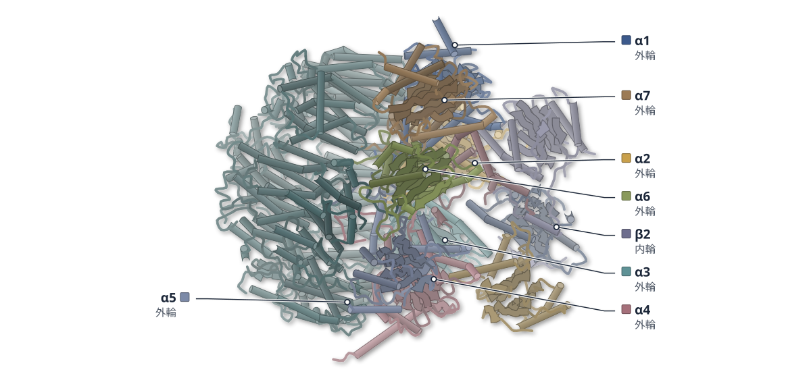

色（順に）：α1（外輪） / α2（外輪） / α3（外輪） / α4（外輪） / α5（外輪） / α6（外輪） / α7（外輪） / β2（内輪） / β3（内輪） / β4（内輪） / Blm10（キャップ） / Ump1（成熟因子）

**Blm10とPba1は、並行する別の経路で働くらしい**

組み立て中間体5種をクライオ電顕で解き、両者の結合は排他的と分かった

- **疑問・課題**：Blm10 は組み立て中のプロテアソームにも結合するが、Pba1/Pba2 との順序は不明確で、中間体との複合体の構造もなかった。
- **アプローチ**：酵母（pba1 欠失株）から中間体を精製し、5種の構造をクライオ電顕で解いた。プルダウンで Blm10 と Pba1/Pba2 が現れる時期も調べた。
- **結果**：Blm10:13S は 2.84 Å で解け、Blm10 の C 末端が α5/α6 の溝に入っていた。両者とも早期と後期の中間体で検出された。
- **わかったこと**：両者は同じ α5/α6 の溝を使い同時には結合できない。順番に交代するのではなく、並行する別の経路で働くと考えられる。
- **残された課題**：Blm10 結合 CP の量が、成熟 CP をめぐる競合で決まるのか、この組み立て経路で決まるのかは、まだ分かっていない。

この紹介文の根拠（論文本文）

> The assembly process that leads to Blm10-CP proteasomes remains unresolved and Blm10 is present not only at mature proteasomes but also bound to assembly intermediates.  
> — 疑問・課題／Abstract

> there is no structure of Blm10 bound to an assembly intermediate, limiting our ability to understand the changes that occur during assembly  
> — 疑問・課題／Introduction

> We identified and solved structures of five CP intermediate complexes by cryo-electron microscopy, two of which include Blm10.  
> — アプローチ／Abstract

> Performing pulldowns from Pba4-tagged (early) and Ump1-tagged (late) yeast strains, we detected Pba1/Pba2 in both purifications (Fig. 6b).  
> — アプローチ／Results

> Blm10:13S, comprising α1-α7, β2/β3/β4, and Ump1, was the most abundant complex and was resolved to 2.84 Å resolution  
> — 結果／Results

> Blm10 adopts a hollow dome architecture, with its C-terminal HbYX motif inserted into the α5/α6 inter-subunit pocket  
> — 結果／Results

> Thus, both Blm10 and Pba1 are present in early as well as late stages of CP assembly, which is consistent with parallel assembly pathways.  
> — 結果／Results

> The binding of Blm10 and Pba1/Pba2 to an α-ring is mutually exclusive, and previous models have proposed that they bind sequentially  
> — わかったこと／Results

> Instead, we propose a model whereby Blm10:13S, Pba1/2:13S, and capless13S represent intermediates in parallel pathways of CP assembly  
> — わかったこと／Discussion

> It remains to be determined to what extent these are formed from competition between RP and Blm10 for mature CP binding versus being driven by this alternative assembly pathway directly.  
> — 残された課題／Discussion

分類：プロテアーゼ

#### 読みどころ

Blm10 のドーム側面の開口は、Blm10:13S では 6.3 × 11 Å と、成熟 CP との複合体（約 14 × 23.2 Å）より狭い。Ump1 のない Blm10:α-ring では中間の大きさで、ドームは開閉すると考えられている。

根拠（論文本文）

> The Blm10 dome in Blm10:CP contains a large lateral opening measuring approximately 14 × 23.2 Å that is situated laterally above α2 and α3  
> — Results

> The corresponding opening in Blm10:13S is substantially narrower, at 6.3 × 11 Å  
> — Results

Blm10 と Pba1 の HbYX モチーフは同じ溝に入る。Pba1 は Ump1 とも接するが、Blm10 は Ump1 から 34.9 Å 離れていて接しない。このため成熟後にも Blm10 が外れにくい構造上の理由になると論文は考えている。

根拠（論文本文）

> The HbYX motifs of Blm10 and Pba1 occupy the same α5/α6 inter-subunit pocket in CP  
> — Results

> In contrast, Blm10 does not directly contact Ump1; the closest residue, A2143, lies 34.9 Å away (Fig. 5d).  
> — Results

α1・α2・α3・α4・α7 と Ump1 に β サブユニットが結合し、α5 と α6 を欠く中間体も見つかった。α リングが先にできるという通説に対し、少なくともこの欠失株では常にそうとは限らない。

根拠（論文本文）

> The identification of intermediates that have β subunits while lacking a complete α-ring was unexpected as the α-ring is generally thought to form first  
> — Results

> Thus, at least in this pba1Δ background, we find evidence that assembly does not always proceed by formation of the α-ring first.  
> — Results

#### 構造データ

| PDB | 手法 | 分解能 | 公開 | 生物種 | リガンド |
|---|---|---|---|---|---|
| [9D0T](https://www.rcsb.org/structure/9D0T) | Cryo-EM | 2.84 Å | 2024-12-04 | Saccharomyces cerevisiae | — |
| [9D4C](https://www.rcsb.org/structure/9D4C) | Cryo-EM | 2.75 Å | 2025-08-20 | Saccharomyces cerevisiae | — |
| [9D4U](https://www.rcsb.org/structure/9D4U) | Cryo-EM | 3.55 Å | 2025-08-20 | Saccharomyces cerevisiae | — |
| [9D35](https://www.rcsb.org/structure/9D35) | Cryo-EM | 3.26 Å | 2025-08-20 | Saccharomyces cerevisiae | — |
| [9D3I](https://www.rcsb.org/structure/9D3I) | Cryo-EM | 3.11 Å | 2025-08-20 | Saccharomyces cerevisiae | — |

- [A4IFM7](https://www.uniprot.org/uniprotkb/A4IFM7) MYLK2 Myosin light chain kinase 2, skeletal/cardiac muscle — *Bos taurus* （PDB で初めての構造）
- [P21242](https://www.uniprot.org/uniprotkb/P21242) PRE10 Probable proteasome subunit alpha type-7 — *Saccharomyces cerevisiae (strain ATCC 204508 / S288c)* （既存の PDB 構造 377 件）
- [P21243](https://www.uniprot.org/uniprotkb/P21243) SCL1 Proteasome subunit alpha type-1 — *Saccharomyces cerevisiae (strain ATCC 204508 / S288c)* （既存の PDB 構造 377 件）
- [P22141](https://www.uniprot.org/uniprotkb/P22141) PRE1 Proteasome subunit beta type-4 — *Saccharomyces cerevisiae (strain ATCC 204508 / S288c)* （既存の PDB 構造 374 件）
- [P23638](https://www.uniprot.org/uniprotkb/P23638) PRE9 Proteasome subunit alpha type-3 — *Saccharomyces cerevisiae (strain ATCC 204508 / S288c)* （既存の PDB 構造 371 件）
- [P23639](https://www.uniprot.org/uniprotkb/P23639) PRE8 Proteasome subunit alpha type-2 — *Saccharomyces cerevisiae (strain ATCC 204508 / S288c)* （既存の PDB 構造 377 件）
- [P25043](https://www.uniprot.org/uniprotkb/P25043) PUP1 Proteasome subunit beta type-2 — *Saccharomyces cerevisiae (strain ATCC 204508 / S288c)* （既存の PDB 構造 364 件）
- [P25451](https://www.uniprot.org/uniprotkb/P25451) PUP3 Proteasome subunit beta type-3 — *Saccharomyces cerevisiae (strain ATCC 204508 / S288c)* （既存の PDB 構造 374 件）
- [P32379](https://www.uniprot.org/uniprotkb/P32379) PUP2 Proteasome subunit alpha type-5 — *Saccharomyces cerevisiae (strain ATCC 204508 / S288c)* （既存の PDB 構造 378 件）
- [P38293](https://www.uniprot.org/uniprotkb/P38293) UMP1 Proteasome maturation factor UMP1 — *Saccharomyces cerevisiae (strain ATCC 204508 / S288c)* （既存の PDB 構造 13 件）
- [P38624](https://www.uniprot.org/uniprotkb/P38624) PRE3 Proteasome subunit beta type-1 — *Saccharomyces cerevisiae (strain ATCC 204508 / S288c)* （既存の PDB 構造 370 件）
- [P40302](https://www.uniprot.org/uniprotkb/P40302) PRE5 Proteasome subunit alpha type-6 — *Saccharomyces cerevisiae (strain ATCC 204508 / S288c)* （既存の PDB 構造 377 件）
- [P40303](https://www.uniprot.org/uniprotkb/P40303) PRE6 Proteasome subunit alpha type-4 — *Saccharomyces cerevisiae (strain ATCC 204508 / S288c)* （既存の PDB 構造 377 件）
- [P43583](https://www.uniprot.org/uniprotkb/P43583) BLM10 Proteasome activator BLM10 — *Saccharomyces cerevisiae (strain ATCC 204508 / S288c)* （既存の PDB 構造 7 件）

#### 実験メモ

- **発現系**：酵母の内在複合体を使用。Ump1 に TAP タグを付けた PBA1 欠失株から中間体を精製。
- **精製**：IgG ビーズ、TEV 切断、カルモジュリン樹脂の 2 段階の TAP 精製。
- **結晶化／グリッド作製**：Quantifoil R 1.2/1.3 Cu 400 メッシュに 3 μL をのせ、Leica EM GP 2 で凍結。
- **データ収集・解析**：Titan Krios G3i と K3 で 5,235 本の動画を収集。cryoSPARC 4.4.1 で処理し、5 種を再構成。

根拠（論文本文）

> we purified CP assembly intermediates by using a yeast strain with the CP chaperone Ump1 C-terminally TAP-tagged  
> — Results

> Proteasome assembly intermediate purification was carried out by two step TAP purification method  
> — Assembly intermediate purification

> Grids were vitrified in 100% liquid ethane using a Leica EM GP 2 plunge freezer (Leica Microsystems) with a blot time of 1 s or 3 s  
> — Cryo-EM sample preparation and data acquisition

> A total of 5235 movies were collected using the EPU program (v.3.3.0; Thermo Fisher Scientific)  
> — Cryo-EM sample preparation and data acquisition

> All cryo-EM data were processed using cryoSPARC (v.4.4.1)  
> — Cryo-EM image processing

> 📝 編集者への確認事項：candidates.json の proteins で MYLK2 (A4IFM7) が first_structure=true だが、9D0T の Ump1 融合鎖に付いた別タンパク質（Myosin light chain kinase 2）の UniProt 対応で、論文の主題ではない。サイトの自動判定で New Structure になる可能性があるので確認してほしい（論文は初構造とは主張していない）。Blm10 と Pba1/Pba2 の並行経路は著者のモデル（propose/suggest）で、記事も推測の書き方にした。legend_labels は render 後に要設定（12 鎖の複合体）。

---

# Structure Update

## 6｜DNMT1・ヌクレオソーム

### The DNMT1 CXXC domain senses CpG islands for DNA methylation inhibition

*Nature Communications*（2026-09-18） · [論文](https://doi.org/10.1038/s41467-026-77872-8) · ライセンス: cc by

筆頭著者：Jian Fang（University of California, USA）　責任著者：Gang Greg Wang（Duke University School of Medicine, USA）、Jikui Song（University of California, USA）

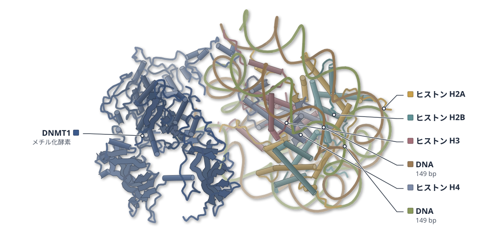

色（順に）：DNMT1（メチル化酵素） / ヒストン H2A / ヒストン H2B / ヒストン H3 / ヒストン H4 / DNA（149 bp） / DNA（149 bp）

**DNMT1のCXXCは、CpGを捉えて自らの働きを抑える**

ヌクレオソームとの複合体のクライオ電顕構造で、CXXCがTRDへのDNAの接近を塞ぐ配置が見えた

- **疑問・課題**：DNMT1が、CpGアイランド（CpGが多く低メチル化の領域）でメチル化を抑える仕組みは、不明だった。
- **アプローチ**：CpGが未修飾のヌクレオソームとDNMT1断片の複合体をクライオ電顕で解いた。変異体の活性と、マウスES細胞のゲノムも調べた。
- **結果**：CXXCは未修飾のCpGに結合し、標的認識ドメイン（TRD）へのDNAの接近を塞いでいた。結合を壊す変異体では、CpGアイランドのメチル化が増えた。
- **わかったこと**：CXXCは未修飾のCpGを感知してDNMT1の活性を抑え、CpGアイランドの低メチル化を守る役割をもつ。分化の異常にも関わる。
- **残された課題**：CpGアイランドにDNMT1が集まる仕組みの詳細は、まだ分かっていない。

この紹介文の根拠（論文本文）

> While DNMT1-mediated DNA methylation mainly occurs outside the active chromatin domains, such as CpG islands, how DNMT1 interplays with hypomethylated nucleosome environment to restrict CpG island methylation remains unclear.  
> — 疑問・課題／Abstract

> To assess impact of the hypomethylated nucleosome environment on DNMT1-mediated DNA methylation, we determined the structure of DNMT1 in complex with an H3Ub2-modified nucleosome core particle (NCP) harboring unmodified CpG sites, representing the product of UHRF1-catalyzed substrate.  
> — アプローチ／Introduction

> Our integrated structural, biochemical and genomic analyses demonstrate that recognition of unmodified CpG within the NCP by the DNMT1 CXXC domain leads to an autoinhibitory conformation  
> — アプローチ／Introduction

> On the other hand, the CXXC domain is positioned in a manner that blocks the target recognition domain of DNMT1 from accessing potential DNA substrates.  
> — 結果／Abstract

> Furthermore, our whole-genome bisulfite-sequencing analysis reveals that introducing the CXXC-CpG interaction-defective DNMT1 mutation leads to substantial increase in CpG island methylation but not so much in overall genomic methylation  
> — 結果／Abstract

> Together, this study establishes a role for the CXXC domain in safeguarding the CpG island hypomethylation, vital to DNA methylation homeostasis during development.  
> — わかったこと／Abstract

> causing severe defects in transcriptional programming and stem cell differentiation  
> — わかったこと／Abstract

> The exact mechanism behind the enrichment of DNMT1 in CGIs remains unclear.  
> — 残された課題／Discussion

分類：クロマチン・ヒストン・酵素（その他）

#### 読みどころ

CXXCドメインは折れ曲がったヘアピン状で、ヌクレオソームの中心（ダイアド）のDNAを囲む。K683とQ684などの側鎖が水素結合をつくり、CpGの塩基を特異的に認識する。

根拠（論文本文）

> Notably, the CXXC domain adopts a bent-hairpin conformation to encircle nucleosomal DNA at the dyad  
> — Results

> Of note, the sidechain amino group of CXXC residue K683 donates a hydrogen bond to the N7 atom of the CpG guanine  
> — Results

RFTSドメイン（触媒ドメインへのDNA結合を妨げる領域）がH3の近くに移って抑制が解けても、CXXCがCpGに結合しているためDNMT1は自己阻害の形のままだった。RFTSとCXXCがTRDを別々に塞ぐ多層の制御が示唆される。

根拠（論文本文）

> Despite the RFTS repositioning, DNMT1 in the DNMT1-umNCP complex remains in an autoinhibitory conformation owing to the CXXC-CpG interaction  
> — Results

> suggesting that DNMT1 is regulated by a multi-layered autoinhibitory mechanism that at least involves the independent blockades of TRD by the RFTS and CXXC domains  
> — Results

K683A/Q684A変異体（MutKQ）は、ヌクレオソーム上の未メチルCpGがあるとき活性が上がった。マウスES細胞では、CpGアイランドのメチル化が増え、発生に関わる遺伝子の発現と分化が乱れた。

根拠（論文本文）

> Relative to WT DNMT1, the MutKQ mutant shows increased DNA methylation efficiency on nucleosomes with unmethylated linker CpG sites  
> — Results

> Consistently, Gene Set Enrichment Analysis (GSEA) using MSigDB demonstrated that pathways fundamentally required for embryogenesis, axis specification, and lineage commitment were systematically downregulated or disrupted in the MutKQ cells at day 5  
> — Results

#### 構造データ

| PDB | 手法 | 分解能 | 公開 | 生物種 | リガンド |
|---|---|---|---|---|---|
| [9Z07](https://www.rcsb.org/structure/9Z07) | Cryo-EM | 3.19 Å | 2026-09-09 | Escherichia coli, Homo sapiens, Xenopus laevis | — |
| [9MYS](https://www.rcsb.org/structure/9MYS) | Cryo-EM | 3.93 Å | 2026-09-09 | Escherichia coli, Homo sapiens, Xenopus laevis | — |

- [A0A310TTQ1](https://www.uniprot.org/uniprotkb/A0A310TTQ1) LOC121398065 Histone H3 — *Xenopus laevis* （既存の PDB 構造 65 件）
- [P02281](https://www.uniprot.org/uniprotkb/P02281)  Histone H2B 1.1 — *Xenopus laevis* （既存の PDB 構造 392 件）
- [P26358](https://www.uniprot.org/uniprotkb/P26358) DNMT1 DNA (cytosine-5)-methyltransferase 1 — *Homo sapiens* （既存の PDB 構造 27 件）
- [P62799](https://www.uniprot.org/uniprotkb/P62799)  Histone H4 — *Xenopus laevis* （既存の PDB 構造 409 件）
- [Q6AZJ8](https://www.uniprot.org/uniprotkb/Q6AZJ8) LOC494591 Histone H2A — *Xenopus laevis* （既存の PDB 構造 93 件）

#### 実験メモ

- **発現系**：DNMT1 は大腸菌 BL21 DE3 (RIL) で発現。ヒストンも大腸菌で作り、H3 に K18/K23 のユビキチン、H4 に H4K20me3 の模倣を付けた。
- **コンストラクト**：ヒト DNMT1 の残基 351–1600。変異体は MutKQ（K683A/Q684A）と MutMHKKKQ。
- **精製**：Ni-NTA、陰イオン交換、TEV プロテアーゼでタグ除去、再度 Ni 親和、Superdex 200 のゲルろ過。
- **結晶化／グリッド作製**：DNMT1 とヌクレオソームを 3:1 で混合し、GraFix で架橋・精製。Quantifoil に塗布し Vitrobot Mark IV で凍結。
- **データ収集・解析**：Titan Krios（K3）で 16,915 本の動画を取得し、cryoSPARC で処理した。

根拠（論文本文）

> The plasmid for DNMT1351–1600 was transformed into Escherichia coli BL21 DE3 (RIL) cells for expression.  
> — Methods

> Subsequently, the His6-MBP-tagged fusion protein was subjected to anion exchange chromatography on a HiTrap Q XL column (Cytiva), tag removal by Tobacco etch virus (TEV) protease, and a second-round nickel affinity chromatography.  
> — Methods

> DNMT1351–1600 was mixed with the umNucDNA nucleosome in a molar ratio of 3:1 in a binding buffer containing 20 mM HEPES (pH 7.5), 50 mM NaCl, 5 mM DTT and 5% glycerol.  
> — Methods

> A total of 16,915 movies were recorded at a nominal magnification of 81,000× in super-resolution mode with a pixel size of 1.1 Å per pixel  
> — Methods

> The movies were motion-corrected and dose-weighted using the patch-based motion correction module in CryoSPARC  
> — Methods

> 📝 編集者への確認事項：PDB は 9Z07（3.19 Å、野生型）と 9MYS（3.93 Å、MutMHKKKQ 変異体）。いずれも primary citation 未登録で、寄託の記述から対応づけ。本文は野生型を 3.12 Å と書く（PDB と差あり）。紹介文には分解能を書いていない。legend_labels は複合体（DNMT1・ヒストン・DNA 2 本）の凡例順が render 前に不明なため未記入。lab_notes は野生型の条件。

---

## 7｜Regnase-1 PIN・スラミン（マウス）

### Identification of small-molecule inhibitors of the immune system repressor Regnase-1

*NAR Molecular Medicine*（2026-10-01） · [論文](https://doi.org/10.1093/narmme/ugag043) · ライセンス: cc by

筆頭著者：Arthur Millius（The University of Osaka, Japan）　責任著者：Soyoung Park, Daron M Standley（The University of Osaka, Japan）

**スラミンは、Regnase-1の活性部位に結合する**

RNA分解酵素のPINドメインとの2.62 Å結晶構造で、Mg2+への配位とR283との相互作用を示した

- **疑問・課題**：Regnase-1 を直接阻害する低分子は報告がなく、炎症応答を一時的に高める化学ツールがなかった。
- **アプローチ**：404 化合物で RNA の置換を調べ、候補の suramin と PIN ドメインの複合体を X 線（2.62 Å）で解いた。
- **結果**：suramin は RNA 結合を IC50 48 nM で阻害した。構造では各 PIN 分子の活性部位で Mg2+ に配位していた。
- **わかったこと**：suramin は競合阻害剤とみられ、向かい合う分子の R283 が結合に重要だった。細胞では IL-6 を増やした。
- **残された課題**：野生型 PIN での結合様式は、高分解能の構造解析が必要である。

この紹介文の根拠（論文本文）

> but no direct small-molecule inhibitors of Regnase-1 have been reported  
> — 疑問・課題／Introduction

> a chemical inhibitor of Regnase-1 activity would be a valuable tool to perturb Regnase-1 function and transiently boost inflammatory responses  
> — 疑問・課題／Introduction

> In vitro screening of 404 candidate molecules identified suramin  
> — アプローチ／Introduction

> X-ray crystallographic analysis revealed that suramin bound directly to the Regnase-1 catalytic site, coordinating with the essential Mg2+ ion.  
> — アプローチ／Introduction

> Suramin inhibited RNA binding with an IC50 of 48 nM (Fig. 2D), the lowest among all library compounds screened.  
> — 結果／Results and discussion

> Suramin was bound with 1:1 stoichiometry within the active site of each PIN protomer, with clear electron density for its terminal sulfonate groups and coordination with the catalytic Mg2+ ion  
> — 結果／Results and discussion

> the overall constant Vmax and concentration-dependent Km suggested a competitive inhibition mechanism  
> — わかったこと／Results and discussion

> which demonstrates that residue R283 is critical for Regnase-1 binding to suramin  
> — わかったこと／Results and discussion

> suramin increased IL-6 production and Il6 mRNA levels in stimulated MEFs  
> — わかったこと／Results and discussion

> but future high-resolution structural studies are needed to answer this question definitively  
> — 残された課題／Results and discussion

分類：DNA・RNA に関わるもの・免疫（抗体・MHC・TCR・自然免疫）

#### 読みどころ

suramin の末端のスルホン酸基は活性部位の Mg2+ に配位し、反対側の端は向かい合う PIN 分子の R283 と H284 に、水素結合や π–π スタッキングで結びつく。

根拠（論文本文）

> Interestingly, residues R283 and H284 from the opposing protomer interacted with the opposite end of suramin via hydrogen bonding and π–π stacking  
> — Results and discussion

R283A 変異体は RNA 結合も細胞での切断も野生型並みだったが、suramin による阻害には耐性を示した。量子化学（FMO）計算は結合の種類と場所を知る定性的な指標であり、結合エネルギーの定量値ではないと著者は断っている。

根拠（論文本文）

> However, only wild-type PIN was susceptible to suramin inhibition, whereas R283A PIN was resistant  
> — Results and discussion

> the binding free energies should be considered as qualitative indicators of the interaction type and location, not as quantitative energetics  
> — Results and discussion

結晶構造を手がかりに、suramin の類縁体と新たに合成した骨格 SO802（IC50 4.3 µM）を調べた。阻害にはスルホン酸基の数と配置が効き、大阪大学の化合物ライブラリーのヒットにもスルホン酸基を持つものが多かった。

根拠（論文本文）

> Our scaffold SO802 inhibited Regnase-1 NPZC D141N with an IC50 of 4.3 µM  
> — Results and discussion

> Notably, most University of Osaka Compound Library hits contained sulfonate groups  
> — Results and discussion

#### 構造データ

| PDB | 手法 | 分解能 | 公開 | 生物種 | リガンド |
|---|---|---|---|---|---|
| 23KX | — | — | 公開待ち | — | — |

#### 実験メモ

- **発現系**：マウス Regnase-1 を大腸菌 Lemo21(DE3) で発現。
- **コンストラクト**：結晶化には PIN ドメイン（残基 134–305、D226N・D244N）を使用。
- **精製**：結晶化用の PIN はグリセロールを含まない緩衝液でゲル濾過した。
- **結晶化／グリッド作製**：シッティングドロップ蒸気拡散（20°C）。結晶を suramin 溶液に浸漬した（最終 1 mM）。
- **データ収集・解析**：SPring-8 BL44XU で測定し、xds で処理。PDB 5h9v を初期モデルに Phenix で精密化した。

根拠（論文本文）

> Plasmids were transformed into bacteria Lemo21(DE3) (NEB).  
> — Expression and purification of Regnase-1

> Regnase-1 PIN DDNN (residues 134–305; D226N, D244N)  
> — X-ray crystallography

> Regnase-1 PIN protein for crystallization was size separated in the same buffer lacking glycerol.  
> — Expression and purification of Regnase-1

> crystals were formed by sitting drop vapor diffusion at 20°C after 24–48 h  
> — X-ray crystallography

> to a final concentration of 20% glycerol and 1 mM suramin  
> — X-ray crystallography

> Diffraction data were collected at SPring-8 beamline BL44XU, and images were processed with xds  
> — X-ray crystallography

> An initial model was built based on PDB ID: 5h9v  
> — X-ray crystallography

> 📝 編集者への確認事項：PDB 23KX は未公開のため図なし。構造は変異体（D226N・D244N）の PIN ドメインで、野生型結晶は低分解能で使えなかった。野生型での結合様式は未確認と著者が書いている。細胞での suramin の効果は多面的な可能性があると著者も述べている。

---

## 8｜NS3（ノロウイルス）

### Integrative structure of norovirus NS3 suggests a role in RNA transport

*Nature Communications*（2026-09-21） · [論文](https://doi.org/10.1038/s41467-026-77946-7) · ライセンス: cc by

筆頭著者：Meryl Haas（Utrecht University, The Netherlands）　責任著者：Daniel L. Hurdiss（Utrecht University, The Netherlands）

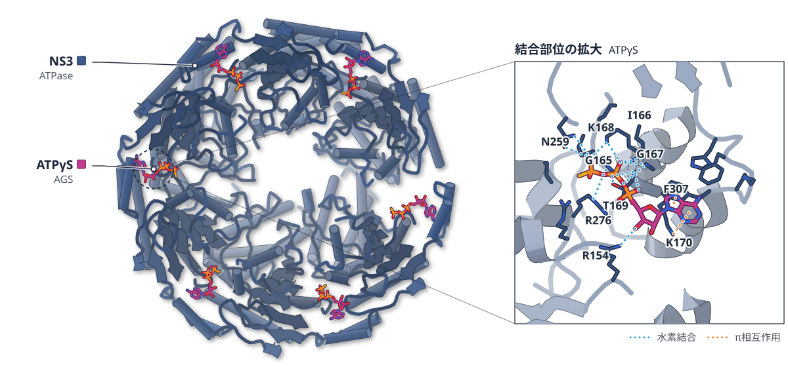

色（順に）：NS3（ATPase）　スティック：ATPγS（AGS）

**ノロウイルスのNS3は、割れた座金型の六量体をつくる**

可溶型の六量体を2.9 Åで解き、膜を貫くRNA輸送体である可能性をモデルで示した

- **疑問・課題**：ノロウイルスのNS3（AAA+ ATPase）は、構造も、複製や膜の再編での働きも分かっていなかった。
- **アプローチ**：膜結合部を六量体化ドメインに置き換えた可溶型を作り、ATPγS結合状態を2.9 Åで解析した。さらにAlphaFold3で全長モデルを作った。
- **結果**：六量体は割れた座金のような形で、6か所にATPγSが結合した。pore loopの変異の大半は、マウスノロウイルスの感染性を失わせた。
- **わかったこと**：NS3は、膜をまたぐRNA輸送体として働く候補と考えられる。ただし可溶型はRNAをほどかず、RNA結合もATP分解と連動しなかった。
- **残された課題**：NS3の輸送体としての働きは、全長で膜に埋め込まれた状態で調べる必要がある。

この紹介文の根拠（論文本文）

> However, the structure of NS3, and the mechanisms by which it contributes to genome replication and membrane remodeling, have remained unknown.  
> — 疑問・課題／Abstract

> We engineered a soluble, hexameric, and catalytically active form of NS3 and determined its cryo-EM structure in the presence of a nucleotide analogue at 2.9 Å resolution.  
> — アプローチ／Abstract

> Using integrative modeling with AlphaFold3, supported by targeted mutagenesis, we generated a full-length, membrane-associated model in which NS3 forms a continuous conduit across the membrane.  
> — アプローチ／Abstract

> The structure adopts a split lock-washer architecture characteristic of AAA+ motors that operate via a hand-over-hand translocation mechanism.  
> — 結果／Abstract

> In our NS3 cryo-EM reconstruction, clear density corresponding to ATPγS is visible in all six nucleotide-binding sites  
> — 結果／Results

> In line with our structural observations, most mutations completely abolished viral infectivity  
> — 結果／Results

> This model supports a role for NS3 as a candidate membrane-spanning RNA translocase that may couple ATP hydrolysis to genome movement.  
> — わかったこと／Abstract

> Collectively, these findings indicate that hex-NS3 binds single-stranded RNA in an oligomerization-dependent manner but lacks detectable RNA duplex unwinding activity under the conditions tested.  
> — わかったこと／Results

> While technically challenging, future efforts to dissect the proposed translocase activity of NS3 and possible helicase activity, should focus on the full-length, membrane-embedded protein.  
> — 残された課題／Discussion

分類：酵素（その他）・感染・ウイルス・防御系

#### 読みどころ

6つのサブユニットは右巻きのらせん状に並び、両端の間に約6.5 Åの隙間がある。AからEはATPγSをアルギニンフィンガーで捉えるが、継ぎ目にあるFはそれが外れ、ヌクレオチドのない状態に近い。

根拠（論文本文）

> The six subunits form a right-handed spiral with a rise of ~1.5 Å per protomer and a gap of ~6.5 Å between the topmost and bottommost subunits.  
> — Results

> In contrast, subunit F adopts an apo-like conformation, as the arginine finger is displaced across the seam and does not engage the bound nucleotide  
> — Results

pore loop 2は、ssRNAが通れる直径約15 Åの中央の通路を作る。pore loopや触媒部位の残基は46本のNS3配列で保存され、変異は酵素活性とウイルスの感染性を損なった。論文は汎遺伝子型の抗ウイルス標的になりうるとしている。

根拠（論文本文）

> Pore loop 2 defines a central channel approximately 15 Å in diameter, sufficient to accommodate single-stranded RNA, into which the hydrophobic side chain of I242 projects.  
> — Results

> Together with our mutational data, this supports their functional importance and highlights their potential as targets for pan-genotypic antiviral intervention  
> — Results

六量体化させた型はssRNAに結合したが、巻き戻し活性は検出されなかった。全長の膜貫通モデルは、AlphaFold3の入力にオレイン酸を加えて作った予測で、2本の膜貫通ヘリックスがRNAの通る孔を作るとされる。

根拠（論文本文）

> Collectively, these findings indicate that hex-NS3 binds single-stranded RNA in an oligomerization-dependent manner but lacks detectable RNA duplex unwinding activity under the conditions tested.  
> — Results

> Indeed, supplementing the prediction with 50 oleic acid molecules resulted in markedly improved confidence for the NTD, with pLDDT values ranging from 70 to 100 for both HuNoV and MNV  
> — Results

#### 構造データ

| PDB | 手法 | 分解能 | 公開 | 生物種 | リガンド |
|---|---|---|---|---|---|
| [9R34](https://www.rcsb.org/structure/9R34) | Cryo-EM | 2.90 Å | 2025-10-29 | Norwalk virus | AGS |

- [Q83883](https://www.uniprot.org/uniprotkb/Q83883)  Genome polyprotein — *Norovirus (strain Human/NoV/United States/Norwalk/1968/GI)* （既存の PDB 構造 33 件）

#### 実験メモ

- **発現系**：大腸菌 Rosetta 2 (DE3) で発現。0.5 mM IPTG、18 °C で一晩。
- **コンストラクト**：GI 型NS3の62-363に、六量体化ドメイン cc-hex と MBP タグを付けた。
- **精製**：HisTrap、3C プロテアーゼでタグ除去、Superdex 200 のゲルろ過で精製。
- **結晶化／グリッド作製**：0.35 mg/ml を 1 mM ATPγS と混ぜ、カーボン膜付き Quantifoil R1.2/1.3 に塗布。Vitrobot Mark IV で凍結。
- **データ収集・解析**：Glacios＋Falcon 4i で1010本の動画を取得。cryoSPARC で処理し、123,643粒子から C1 で再構成。

根拠（論文本文）

> NS3 proteins were expressed in E. coli Rosetta 2 (DE3) (Sigma-Aldrich).  
> — Methods

> To obtain cleaved constructs, the samples were incubated with HRV type 14 3C protease (Sigma-Aldrich) overnight at 4 °C  
> — Methods

> Cleaved hex-NS3 was diluted to 0.35 mg/ml in ATPase reaction buffer containing 1 mM ATPγS, on ice.  
> — Methods

> A total of 1010 movies were collected at a nominal magnification of ×130,000 in EER format at 0.9 Å per pixel with a total dose of 50.5 electrons per Å2.  
> — Methods

> Five rounds of heterogeneous refinement yielded a well-defined reconstruction of the NS3 complex containing 123,643 particles.  
> — Methods

> 📝 編集者への確認事項：全長の膜貫通モデルと RNA 通過の経路は AlphaFold3 の予測で、実験構造は可溶型（N 末端 61 残基を cc-hex に置換）の ATPγS 結合状態のみ。紹介文ではこの区別を保った。既存構造のある 2C 等の近縁タンパク質があるため first_structure は false（初構造とは書いていない）。論文は「SF3 の RNA ウイルス由来の機能的オリゴマーは未解明だった」と書くが、見出しでは使っていない。legend_labels は 1 エンティティ（NS3）と推定して書いた。

---

## 9｜AAV2 VP1・IMPα2

### Alternative bipartite arrangements of VP1 BR1-3 drive efficient nuclear import of AAV2 capsids

*The Journal of Biological Chemistry*（2026-09-16） · [論文](https://doi.org/10.1016/j.jbc.2026.113562) · ライセンス: cc by

筆頭著者：Mikayla Hoad（Charles Sturt University, Australia）　責任著者：筆頭著者と同じ

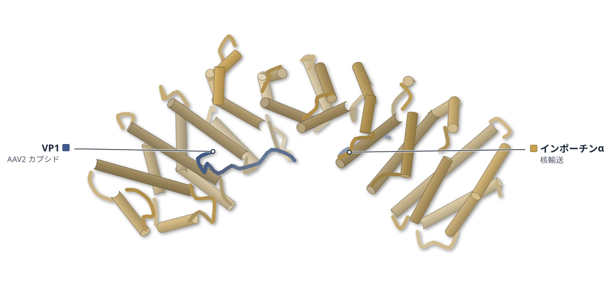

色（順に）：VP1（AAV2 カプシド） / インポーチンα（核輸送）

**AAV2のVP1は、別の組み合わせでもインポーチンαに結合する**

BR2が主要・副次どちらの結合ポケットにも入ることを、結晶構造3つで示した

- **疑問・課題**：AAV2 の核への移行にどの宿主インポーチンと VP1 のどの領域が関わるのかは、はっきりしていなかった。
- **アプローチ**：VP1 の塩基性領域（BR1〜3）と IMPα2 の複合体の結晶構造を、野生型と BR1・BR3 変異体で解き、結合と核移行も測った。
- **結果**：野生型では BR1 と BR3 が副次・主要ポケットに入った。BR1 変異体では BR2 が副次ポケットに、BR3 変異体では BR2 が主要ポケットに入った。
- **わかったこと**：BR のうち2つが無傷なら IMPα に結合して核へ移行でき、1つだけでは足りない。VP1 の核移行シグナルは、組み合わせが1通りに決まっていない。
- **残された課題**：ペプチドでの結果であり、これらの配置がウイルス粒子全体の核移行に効くかは、今後の課題とされている。

この紹介文の根拠（論文本文）

> Despite this, neither the specific host importins (IMPs) involved nor the viral signals within that drive this process have been unequivocally identified.  
> — 疑問・課題／Introduction

> It is there notable that the precise mechanisms governing its nuclear entry have remained unclear.  
> — 疑問・課題／Discussion

> Here, we combine cellular, biophysical, structural, and computational modelling approaches to define the nuclear import mechanism of AAV2 VP1 at molecular resolution.  
> — アプローチ／Abstract

> we determined crystal structures of AAV2 VP1-BR peptides bearing alanine substitutions in either BR1 (mBR1: K123A/R124A) or BR3 (mBR3: R168A/K169A/R170A) in complex with mIMPα2.  
> — アプローチ／Results

> The crystal structure of AAV2 VP1-BR in complex with mIMPα2 suggests that nuclear import of AAV2 VP1 is mediated by the IMPα/β1 heterodimer through recognition of a bipartite NLS formed by BR1 and BR3, which engage the minor and major binding sites of IMPα, respectively.  
> — 結果／Results

> Notabley, BR2 is resolved in the minor binding site (Fig. 5A)  
> — 結果／Results

> Conversely, in the AAV2 VP1-mBR3:mIMPα2 complex, BR2 occupies the major binding site  
> — 結果／Results

> Importantly, simultaneous mutation of any two BRs completely abrogated both IMPα binding and nuclear import (Fig. 4), indicating that AAV2 VP1 can utilize multiple combinations of BR segments to form a functional bipartite NLS.  
> — わかったこと／Discussion

> AAV2 VP1 does not possess a single canonical bipartite NLS but instead utilizes a flexible, modular nuclear localization architecture  
> — わかったこと／Discussion

> Future studies should investigate how these alternative NLS arrangements influence nuclear entry of intact virions  
> — 残された課題／Discussion

分類：感染・ウイルス・防御系・その他

#### 読みどころ

野生型の結晶構造では見えなかった BR2 が、BR1 変異体では副次ポケットに、BR3 変異体では主要ポケットに収まった。BR2 はどちらのポケットにも入れる。

根拠（論文本文）

> Notably, mutation of BR2, which is not resolved in the AAV2 VP1-BR:mIMPα2 crystal structure, also significantly reduced nuclear import  
> — Results

> Notabley, BR2 is resolved in the minor binding site (Fig. 5A)  
> — Results

> Conversely, in the AAV2 VP1-mBR3:mIMPα2 complex, BR2 occupies the major binding site  
> — Results

BR1・BR2・BR3 のどれか1つを置換しても、IMPα7 への結合は 4〜14 倍弱まるだけで、核移行も残った。2つを同時に置換すると、核移行は完全になくなった。

根拠（論文本文）

> Surprisingly, substitution of either BR1 or BR3 reduced, but did not abolish, nuclear accumulation of AAV2 VP1-GFP (Fig. 4, B and C).  
> — Results

> FP assays showed that individual substitutions in BR1 (KD ∼518 nM, ∼10 fold reduction), BR2 (KD ∼740 nM, ∼14 fold reduction), or BR3 (KD ∼207 nM, ∼4 fold reduction) reduced, but did not eliminate binding to IMPα7  
> — Results

> In contrast, simultaneous substitutions of two BRs (mBR1+2, mBR1+3, or mBR2+3) completely abolished nuclear import  
> — Results

BR2 と BR3 の組み合わせで足りることから、BR1 を持たない VP2 も核へ移行できる理由になると論文は考える。また BR を1つずつ調節してカプシドの核への移行を設計する道を示唆する。

根拠（論文本文）

> The demonstration that the BR2-BR3 combination is sufficient to mediate productive IMPα recognition indicates that VP2 retains a fully functional bipartite NLS despite lacking BR1.  
> — Discussion

> offers new opportunities to engineer capsid nuclear targeting by modulating individual BRs rather than introducing entirely new localization signals  
> — Discussion

#### 構造データ

| PDB | 手法 | 分解能 | 公開 | 生物種 | リガンド |
|---|---|---|---|---|---|
| [23QB](https://www.rcsb.org/structure/23QB) | X-ray | 2.25 Å | 2026-10-14 | Adeno-associated virus 2 Srivastava/1982, Mus musculus | — |
| [23QC](https://www.rcsb.org/structure/23QC) | X-ray | 2.60 Å | 2026-10-14 | Adeno-associated virus 2 Srivastava/1982, Mus musculus | — |
| [23QF](https://www.rcsb.org/structure/23QF) | X-ray | 2.15 Å | 2026-10-14 | Adeno-associated virus 2 Srivastava/1982, Mus musculus | — |

- [P03135](https://www.uniprot.org/uniprotkb/P03135) VP1 Capsid protein VP1 — *Adeno-associated virus 2 (isolate Srivastava/1982)* （既存の PDB 構造 24 件）
- [P52293](https://www.uniprot.org/uniprotkb/P52293) Kpna2 Importin subunit alpha-1 — *Mus musculus* （既存の PDB 構造 154 件）

#### 実験メモ

- **発現系**：大腸菌 pLysS で自動誘導発現（23 °C、30〜38 時間）。VP1-BR と mIMPα2 を別々に発現。
- **コンストラクト**：VP1 の残基 115〜175（BR1〜3 を含む）を GST-TEV 融合で発現。IMPα は IBB ドメインを除いた ΔIBB。
- **精製**：溶解液を混ぜて HisTrap で精製し、TEV で GST を除いて Superdex 200 のゲルろ過にかけた。
- **結晶化／グリッド作製**：ハンギングドロップ蒸気拡散法。野生型は 0.7 M クエン酸ナトリウム、pH 6.5 で 2 日で結晶化。変異ペプチドは 3:1 のモル比で混合。
- **データ収集・解析**：オーストラリアン・シンクロトロンの MX2 で収集。4OIH を探索モデルに Phaser で分子置換。

根拠（論文本文）

> AAV2 VP1-BR and mIMPα2 were individually overexpressed in E. coli pLysS cells using auto-induction method (64) at 23 °C, with shaking at 150 rpm for 30 to 38 h.  
> — Recombinant bacterial protein expression and purification

> A gene fragment corresponding to residues 115 to 175 of VP1, encompassing BRs BR1-3  
> — Expression plasmids

> IMPα constructs used for crystallization, fluorescence polarization (FP), and EMSAs lacked the N-terminal IMPβ1 binding (IBB) domain (ΔIBB).  
> — Expression plasmids

> Eluted fractions were pooled and incubated overnight at 4 °C with TEV protease to remove the GST tag from AAV2 VP1-BR.  
> — Recombinant bacterial protein expression and purification

> The sample was then subjected to size-exclusion chromatography using a HiLoad 26/600 Superdex 200 column  
> — Recombinant bacterial protein expression and purification

> The AAV2 VP1-BR:mIMPα2 complex crystalized in a condition 0.7 M sodium citrate, 0.01 M DTT, 0.1 M Hepes (pH 6.5), yielding rod-shaped crystals after 2 days.  
> — Crystallization, data collection and structure determination of AAV2 VP1-BR:mIMPα2 complexes

> AAV2 VP1-mBR1 and AAV2 VP1-mBR3 peptides were mixed with purified mIMPα2 at a 3:1 M ratio prior to crystallization.  
> — Crystallization, data collection and structure determination of AAV2 VP1-BR:mIMPα2 complexes

> X-ray diffraction data were collected at the Australian Synchrotron on the MX2 beamline (66).  
> — Crystallization, data collection and structure determination of AAV2 VP1-BR:mIMPα2 complexes

> Structures were solved by molecular replacement in Phaser (70) using the Protein Data Bank (PDB) entry 4OIH (54) as the search model.  
> — Crystallization, data collection and structure determination of AAV2 VP1-BR:mIMPα2 complexes

> 📝 編集者への確認事項：FoldX の結合エネルギーは、本文と Table 1 で値と単位（kcal/mol と kJ/mol）が食い違っているため記事では使っていない。論文の分解能は 2.3/2.6/2.1 Å、PDB は 2.25/2.6/2.15 Å で、記事は PDB の値を採用。『初めて示した』という著者の主張は記事に載せていない。mBR2 の構造はなく、BR2 の役割は変異体 2 構造と変異の機能測定からの推定。legend_labels は未設定（IMPα と VP1 ペプチドの 2 鎖、render 後に確認）。

---

## 10｜Sup35プリオン（酵母）

### Cryo-EM structure of ex vivo Sup35 yeast prion and the factors defining prion phenotype

*Nature Communications*（2026-09-19） · [論文](https://doi.org/10.1038/s41467-026-77823-3) · ライセンス: cc by

筆頭著者：Alexander A. Dergalev（Federal Research Center of Biotechnology of the Russian Academy of Sciences）　責任著者：Alexander A. Dergalev, Konstantin M. Boyko, Vitaly V. Kushnirov（Federal Research Center of Biotechnology of the Russian Academy of Sciences）

色（順に）：Amyloid of yeast prion Sup35

**酵母由来のSup35プリオンは、試験管内のSc4線維と構造が違う**

強い型[PSI+]-S7の線維を2.7 Åで解き、線維の安定性が分裂のしやすさを左右するとみられる

- **疑問・課題**：酵母プリオンの強い型と弱い型で性質が違う分子の理由は、分かっていなかった。
- **アプローチ**：強い型[PSI+]-S7の線維を酵母から精製してクライオ電顕で解いた。線維の熱や尿素への耐性、変異体の影響も調べた。
- **結果**：残基2–64の核が、内側と外側の2つのステリックジッパー（側鎖がかみ合う接合面）で固められていた。Sc4線維とは2-26付近だけがよく似ていた。
- **わかったこと**：強い型プリオンの線維は、in vitro で作ったSc4線維と構造が大きく異なる。分裂のしやすさは、シャペロンの結合でなく線維の安定性で決まると考えられる。
- **残された課題**：弱い型[PSI+]のクライオ電顕構造は、まだ解かれていない。

この紹介文の根拠（論文本文）

> The molecular origin of these distinctions remains unclear.  
> — 疑問・課題／Abstract

> We established the cryo-EM structure of a strong Sup35 prion variant purified from yeast, comprising residues 2–64, with 2.7 Å resolution.  
> — アプローチ／Abstract

> To test this hypothesis, we analyzed the effects on the [PSI+]-S7 and [PSI+]-W2 prions of several uncharged-to-charged prion-destabilizing amino acid substitutions in the Core1A and Core1B areas using plasmid shuffle.  
> — アプローチ／Results

> An “inner” zipper, formed by a short β-arch spanning Y13–G25, stabilizes the central Q/N-rich subdomain of the core (Core1A).  
> — 結果／Results

> Comparison of the structures of Sc4 amyloid with that of the strong [PSI+]-S7 prion reveals both a significant similarity and a substantial difference  
> — 結果／Results

> The similarity relates to region 2-26, which we consider to be the most significant and defining part of the [PSI+]-S7 structure.  
> — 結果／Results

> Here, we show that the different frequency of prion fragmentation is determined by their stability, rather than the efficiency of chaperone binding.  
> — わかったこと／Abstract

> Thus, the conversion of Sc4 amyloid into a yeast prion can be accompanied by a significant change in its structure.  
> — わかったこと／Discussion

> Although the cryo-EM structure of the weak [PSI+] variant has not been solved, some important notes about the relation of the Sc37 structure and the natural weak [PSI+] prions can be made.  
> — 残された課題／Discussion

分類：その他

#### 読みどころ

強い型[PSI+]-S7の線維は、弱い型[PSI+]-W2より熱や尿素に弱く壊れやすいが、Hsp104の結合量は同程度だった。分裂頻度の差は、シャペロンの認識でなく線維の安定性で説明されると考えられる。

根拠（論文本文）

> The [PSI+]-S7 prion was less resistant to heating and high-molar urea  
> — Results

> Sup35 fibrils of [PSI+]-S7 and [PSI+]-W2 variants bind similar amounts of the Hsp104 chaperone  
> — Results

外側のジッパー（N8–Q18とQ47–Y63の逆平行の詰め込み）が、Core1AとCore1Bを1つの折りたたみにまとめる。論文は、Core1Aが強い型・弱い型の両方の維持に必須で、Core1Bは強い型で安定化に重要と結論している。

根拠（論文本文）

> An “outer” zipper is generated by the antiparallel packing of N8–Q18 against Q47–Y63, thereby linking Core1A to the peripheral subdomain (Core1B) and integrating both into a single ordered fold  
> — Results

> Therefore, we conclude that Core1A is essential for the maintenance of both strong and weak prions variants, while Core1B is less important for weak variants and highly important for strong ones as a stabilizer of strong-type prion polymers.  
> — Results

GFPとM領域を酵素で除くと線維が沈殿したため、負電荷の酸性クラスターを挿入して線維どうしを反発させ、解析を可能にした。構造は、この改変を加えた構築のものである。

根拠（論文本文）

> The issue was solved by the introduction of a negatively charged D/E-rich cluster after residue G96  
> — Results

> To cause repulsion of fibrils, we introduced an acidic cluster DDDNEDSEEDDEDGGPRGSR between G96 and A155 residues, resulting in the Sup35DE-GFP protein  
> — Methods

#### 構造データ

| PDB | 手法 | 分解能 | 公開 | 生物種 | リガンド |
|---|---|---|---|---|---|
| [21BQ](https://www.rcsb.org/structure/21BQ) | Cryo-EM | 2.70 Å | 2026-07-22 | Saccharomyces cerevisiae | — |

#### 実験メモ

- **発現系**：酵母 74-D694 株で Sup35DE-GFP を GAL1 プロモーターから過剰発現（15時間）。毒性を抑える SUP35C プラスミドを併用。
- **コンストラクト**：Sup35NM-GFP（残基1-239）の G96 と A155 の間に酸性クラスターを挿入。トリプシンで GFP と M 領域を除去。
- **精製**：ガラスビーズで破砕後、ショ糖密度勾配、SDS 処理、サルコシル入りの勾配遠心、トリプシン処理で精製（純度約95%）。
- **結晶化／グリッド作製**：線維 0.38 mg/ml を 3 μl、Quantifoil R1.2/1.3 に塗布し、Vitrobot Mark IV で凍結。
- **データ収集・解析**：Titan Krios（K3）で動画を取得。Warp・crYOLO・CryoSPARC でらせん再構成し、2.69 Å。

根拠（論文本文）

> Cells were grown to the stationary phase in selective SD-glucose medium, and then a twofold volume of selective SD-Gal medium was added.  
> — Methods

> To remove GFP and “fuzzy coat” part of Sup35DE-GFP fibrils, the samples were diluted twofold with TBS buffer and treated with 0.1 mg/ml trypsin (Sigma) for 60 min at 37 °C.  
> — Methods

> The purity of the final sample, as determined by the SDS-PAGE, was ~95%  
> — Methods

> 3 μl of the fibril suspension (0.38 mg/ml) were applied to the grids, blotted for 3 s at 100% humidity and 4 °C, and plunge-frozen in liquid ethane using a Vitrobot Mark IV  
> — Methods

> Movies were motion-corrected and CTF parameters were estimated in Warp.  
> — Methods

> 📝 編集者への確認事項：PDB 21BQ はタンパク質を UniProt に対応づけられず（proteins が空）、論文も「初めての構造」とは書いていないため first_claim なし（Structure Update になる見込み）。構造は GFP・M 領域を除き酸性クラスターを挿入した構築由来。見出しの「Sc4線維」は Tanaka らの in vitro 線維（PDB 9XBN）で、Sc37（9XBO）は 2 つのジッパーなど似た点もあると本文にある。弱い型 W2 の構造は未解明。

---

## 11｜CnMetXS（ネクトル菌）

### Characterization and Crystal Structure Elucidation of the l‐Homoserine O‐Succinyltransferase MetXS From Cupriavidus necator H16

*Chembiochem*（2026-10-20） · [論文](https://doi.org/10.1002/cbic.70564) · ライセンス: cc by

筆頭著者：Hannah Pia Franziska Meier（University of Groningen, The Netherlands）　責任著者：Sandy Schmidt（University of Groningen, The Netherlands）

**MetXSの二量体は、蓋の形が左右で違う**

apo構造を1.86 Åで決定。Arg335がスクシニルCoAの選択に関わる可能性がある

- **疑問・課題**：C. necator のメチオニン合成酵素 MetXS は、ゲノム注釈だけで、実験では確かめられていなかった。
- **アプローチ**：CnMetXS を大腸菌で発現して活性を測り、X 線結晶構造（1.86 Å）を決めた。基質のドッキングも行った。
- **結果**：スクシニル CoA を使い、アセチル CoA では不活性だった。二量体の2分子は、蓋の領域の形が互いに違っていた。
- **わかったこと**：MetX-G2 型の酵素と分類できた。Arg335 がスクシニル中間体を安定化し、特異性を説明する可能性がある。
- **残された課題**：鎖 B の形が溶液中でも現れるかは未解決である。

この紹介文の根拠（論文本文）

> This includes l‐methionine biosynthesis, for which genome‐based functional annotations of key enzymes have not been validated experimentally.  
> — 疑問・課題／Abstract

> Here, we report the identification, heterologous expression, and in vitro characterization of the HST from C. necator (CnMetXS).  
> — アプローチ／Introduction

> Furthermore, we determined the X‐ray structure at 1.86 Å resolution of CnMetXS  
> — アプローチ／Introduction

> catalyzes the transsuccinylation of l‐homoserine to O‐succinyl‐l‐homoserine but exhibits no transacetylase activity  
> — 結果／Abstract

> More notably, the two CnMetXS monomers adopt distinct conformations of this region  
> — 結果／Results and Discussion

> The active‐site composition supports classification of CnMetXS as a MetX‐G2 homoserine O‐succinyltransferase  
> — わかったこと／Results and Discussion

> Structural analysis and docking suggest that Arg335 stabilizes the succinylated enzyme intermediate and explains the observed succinyl‐CoA specificity.  
> — わかったこと／Abstract

> the functional significance of the crystallographic asymmetry in solution remains unresolved  
> — 残された課題／Conclusion

分類：酵素（その他）

#### 読みどころ

二量体の2分子で、蓋の領域（Thr244–Ala291）の配置が異なる。鎖 B では Tyr245 を含むループが活性部位の入口を狭め、Arg335 も触媒部位から離れていた。ただし鎖 B の形は結晶中の接触で支えられた可能性があり、慎重に解釈すべきだと著者は述べている。

根拠（論文本文）

> In chain B, the loop containing Tyr245 is rearranged into the active site, seemingly narrowing the entrance  
> — Results and Discussion

> However, it cannot be ruled out that the chain B conformation is influenced by crystal packing  
> — Results and Discussion

活性部位には Ser168・Asp333・His366 の触媒三つ組がある。アセチル基を使う近縁酵素（HAT）ではロイシンになる位置を、CnMetXS では Arg335 が占めており、スクシニル CoA への特異性に関わる残基に当たる。

根拠（論文本文）

> The active site sits between the two domains and contains a classical α/β‐hydrolase catalytic triad formed by Ser168, Asp333, and His366  
> — Results and Discussion

> Arg335, associated with succinyl‐CoA specificity in CnMetXS, occupies the structural position corresponding to a leucine residue in all four HAT homologs  
> — Results and Discussion

基質は浸漬でも共結晶化でも密度が見えなかったため、スクシニル化した Ser168 にホモセリンを計算でドッキングした。鎖 A でだけ妥当な配置が得られ、Arg335 がスクシニル基と相互作用した。これは計算モデルである。

根拠（論文本文）

> no interpretable electron density was observed for either substrate or for a succinylated Ser168 intermediate  
> — Results and Discussion

> While l‐homoserine could be successfully docked into the active site of chain A of succinylated CnMetXS, no reasonable docking position was obtained for chain B.  
> — Results and Discussion

#### 構造データ

| PDB | 手法 | 分解能 | 公開 | 生物種 | リガンド |
|---|---|---|---|---|---|
| 30UN | — | — | 公開待ち | — | — |

#### 実験メモ

- **発現系**：pET-28a(+) の N 末端ヘキサヒスチジンタグ付きで大腸菌 BL21 (DE3) に発現。
- **結晶化／グリッド作製**：結晶に 50 mM のホモセリンを浸漬したが、基質の密度は見えなかった。
- **データ収集・解析**：空間群 P21 で 1.86 Å。異常分散シグナルが 5σ を超えるピークを臭化物としてモデル化した。

根拠（論文本文）

> The recombinant enzyme was heterologously expressed in E. coli BL21 (DE3)  
> — Results and Discussion

> the gene was subcloned into a pET‐28a(+) expression vector with an N‐terminal hexahistidine tag for purification  
> — Results and Discussion

> The protein was soaked with 50 mM homoserine, but no density corresponding to the substrate was observed.  
> — Results and Discussion

> The crystal structure of CnMetXS was solved to a resolution of 1.86 Å in space group P21  
> — Results and Discussion

> Peaks with anomalous signals greater than 5σ were modeled as bromide  
> — Results and Discussion

> 📝 編集者への確認事項：PDB 30UN は未公開のため図なし。first_claim は付けていない（論文は構造の初報とは書かず、HAT ホモログの構造と比較している）ため Structure Update になる見込み。Arg335 の役割はドッキングによる提案で、変異体実験はこの論文にない。

---

## 12｜YAPWW1・TAZWW（ヒト）

### Comparing YAPWW1 and TAZWW: Similar Binding Sites but Different Stability and Conformational Dynamics

*Biomolecules*（2026-09-17） · [論文](https://doi.org/10.3390/biom16091355) · ライセンス: cc by

筆頭著者：Clara Merlen（Switzerland）　責任著者：Patrick Chène（Switzerland）

色（順に）：YAP1（WW1 ドメイン） / LATS2（ペプチド）

**YAPWW1はTAZWWより熱安定性が低い**

LATS2との1.03 Å結晶構造を解き、ペプチドの柔軟さと選択性の関係を探った

- **疑問・課題**：配列が似た YAPWW1 と TAZWW は、安定性やペプチドとの結合について十分に比べられていなかった。
- **アプローチ**：単離した両ドメインを NanoDSF・CD・NMR で比べ、PPxY ペプチドの結合を SPR で測り、LATS2 との複合体を X 線で解いた。
- **結果**：TAZWW の Tm は YAPWW1 より 8.3 °C 高かった。親和性の差は 2〜3 倍だが、SMAD7 では 4.4 倍だった。
- **わかったこと**：柔軟な SMAD7 ペプチドは YAPWW1 を好み、ペプチドの柔軟さが選択性に関わる可能性がある。著者はこれを定性的な傾向と述べている。
- **残された課題**：TAZWW とペプチドの複合体の実験構造はまだなく、MD は Boltz-2 のモデルから始めた。

この紹介文の根拠（論文本文）

> Given that the properties of YAPWW1 and TAZWW have not been extensively compared (but see [27])  
> — 疑問・課題／Introduction

> Nano-differential scanning fluorimetry, circular dichroism, and NMR indicate that both isolated domains populate partially folded or exchanging states in solution, but TAZWW is more thermally stable and has a larger folded population.  
> — アプローチ／Abstract

> Surface plasmon resonance measurements with PPxY peptides show micromolar affinities and generally modest differences between YAPWW1 and TAZWW  
> — アプローチ／Abstract

> Therefore, we have elucidated the structure of this complex using X-ray crystallography.  
> — アプローチ／Results and Discussion

> with an 8.3 °C difference observed between the untagged proteins  
> — 結果／Results and Discussion

> Indeed, we observe only a small difference in affinity between the two WW domains, approximately 2- to 3-fold (Table 2).  
> — 結果／Results and Discussion

> A larger difference was observed for SMAD7, which binds 4.4-fold more strongly to YAPWW1 than to TAZWW (Table 3).  
> — 結果／Results and Discussion

> The rigid LATS2 peptide binds with similar affinity to both WW domains, whereas the flexible SMAD7 shows higher affinity for YAPWW1  
> — わかったこと／Conclusions

> These findings reflect qualitative trends, and are hence a plausible mechanistic framework linking WW domain stability to ligand conformational plasticity  
> — わかったこと／Conclusions

> Finally, although experimental structures of TAZWW-peptide complexes are not currently available  
> — 残された課題／Results and Discussion

分類：転写調節・シグナル伝達

#### 読みどころ

LATS2 ペプチドは伸びた形で YAPWW1 に結合し、SMAD7 の Ω 型とは異なる。Arg512 と Trp199 は 3.5 Å 離れ、カチオン-π 相互作用の可能性がある。結晶に使ったのは Cys を Ser にした mLATS2 である。

根拠（論文本文）

> The SMAD7-bound form assumes an Ω-like shape, whereas bound mLATS2 adopts an extended conformation (Figure 4A).  
> — Results and Discussion

> The guanidinium group of Arg512mLATS2 and the indole ring of Trp199YAP are positioned 3.5 Å apart potentially forming a cation-pi interaction (Figure 4B).  
> — Results and Discussion

YAPWW1 は 23 °C で 7 残基の NMR シグナルが構造の交換で消え、5 °C やペプチド結合で現れた。TAZWW では見えており、折りたたまれた割合が高いと考えられる。

根拠（論文本文）

> This observation suggests that at 23 °C these seven residues are in an intermediate exchange state on the NMR time scale between different conformations, which broadens the NMR signals beyond detection.  
> — Results and Discussion

> These data are consistent with a model in which TAZWW is more stable than YAPWW1 at room temperature  
> — Results and Discussion

SMAD7 の Ser212 を Pro にして硬くすると、TAZ/YAP の Kd 比は 4.4 から 2.3 に下がった。TAZWW 側の MD は Boltz-2 モデルから始めており、解釈に注意が要ると著者は述べている。

根拠（論文本文）

> As predicted, this rigidification reduces the difference in affinity, with the SPR-determined KdTAZ/KdYAP ratio dropping from 4.4 for wild-type SMAD7 to only 2.3 for 6 (Table 3).  
> — Results and Discussion

> Because the TAZWW-bound simulations were initiated from Boltz-2 predicted complexes rather than experimentally determined structures  
> — Results and Discussion

#### 構造データ

| PDB | 手法 | 分解能 | 公開 | 生物種 | リガンド |
|---|---|---|---|---|---|
| [32DH](https://www.rcsb.org/structure/32DH) | X-ray | 1.03 Å | 2026-10-07 | Homo sapiens | — |

- [P46937](https://www.uniprot.org/uniprotkb/P46937) YAP1 Transcriptional coactivator YAP1 — *Homo sapiens* （既存の PDB 構造 41 件）
- [Q9NRM7](https://www.uniprot.org/uniprotkb/Q9NRM7) LATS2 Serine/threonine-protein kinase LATS2 — *Homo sapiens* （既存の PDB 構造 1 件）

#### 実験メモ

- **発現系**：大腸菌 NiCo21 (DE3) で 18 °C 一晩、IPTG で誘導。
- **コンストラクト**：YAPWW1（F165–Q209）。His-Lipoyl タグを TEV プロテアーゼで切る。
- **精製**：HisTrap、TEV 切断後の再 HisTrap、Superdex 75 のゲルろ過。
- **結晶化／グリッド作製**：3.6 mM YAPWW1 と 4 mM mLATS2 を、酢酸アンモニウムと PEG3350 を含む液で結晶化（20 °C）。
- **データ収集・解析**：ESRF ID23-1 で測定。Phaser で分子置換し、phenix.refine で精密化。

根拠（論文本文）

> Protein expression was performed in the NiCo21 (DE3) E. coli strain at 18 °C overnight with 0.2 mM IPTG.  
> — Material and Methods

> Genes encoding either YAPWW1 (F165-Q209) or TAZWW (Y118-P162) with an AMG N-terminal extension were fused at the N-terminus with a polyhistidine tag followed by a Lipoyl tag and a TEV-protease cleavage site  
> — Material and Methods

> The clarified lysate was loaded onto a HisTrap HP column (Cytiva, Marlborough, MA, USA).  
> — Material and Methods

> loaded onto a HiLoad Superdex 75 16/600 column  
> — Material and Methods

> The final crystallization conditions were created by mixing 0.2 µL of the well solution containing 0.2 M ammonium acetate, 0.1 M Bis-Tris pH 6.5, and 25% (w/v) PEG3350 with 0.2 µL of the protein solution consisting of 3.6 mM YAPWW1 and 4 mM mLATS2 in 0.02 M Tris-HCl pH 8.0.  
> — Material and Methods

> The crystals were measured at the ESRF (Grenoble, France) on beamline ID23-1.  
> — Material and Methods

> The structure of YAPWW1 in complex with mLATS2 was solved by molecular replacement using Phaser 2.7.17 [35] and an unpublished in-house structure of YAP165–209 as the search model.  
> — Material and Methods

> 📝 編集者への確認事項：PDB ID は本文に「32dh」とあるが、Data availability に表記はなく PDB と照合できないため図なし（kind: new_structure_ids_unlisted）。結晶構造は YAPWW1 と LATS2 ペプチド（Cys を Ser にした mLATS2）の複合体で、YAPWW1 の SMAD7 複合体（PDB 2ltw）は既存。論文は「初めて」とは書いていないので first_claim なし。TAZWW 複合体は Boltz-2 モデルで、紹介文は実験で得た部分（結晶構造・NanoDSF・NMR・SPR）を中心に書いた。（2026-10-27：PDBe で論文の引用から PDB エントリーを逆引きして見つけ、構造図を付けた）

---

## 13｜CHIKV VLP（ChAdOx1 Chik）

### Structural and immunogenic characterisation of ChAdOx1 Chik-derived Chikungunya VLPs supports a mechanistic rationale for vaccine-induced protection

*npj Viruses*（2026-06-30） · [論文](https://doi.org/10.1038/s44298-026-00207-3) · ライセンス: cc by

筆頭著者：Young Chan Kim（University of Oxford, UK）　責任著者：筆頭著者と同じ

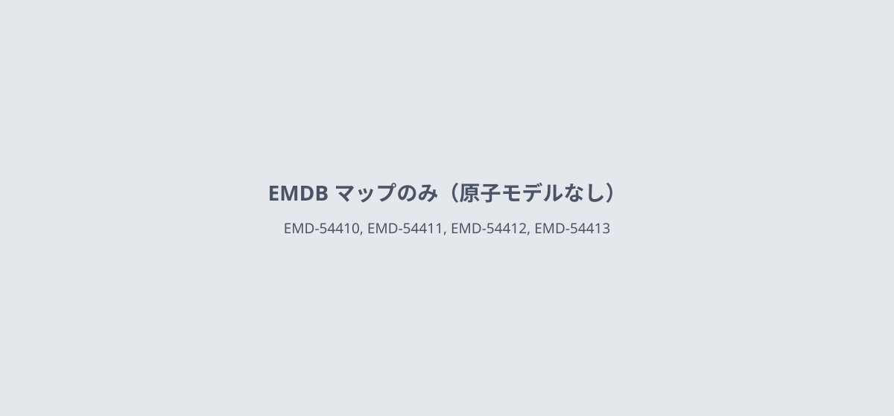

**ChAdOx1 ChikのVLPは、天然のウイルスに似ている**

VLPのクライオ電顕マップは4 Å、既報のウイルス粒子との相関は0.92

- **疑問・課題**：ChAdOx1 Chik ワクチンの抗原が、本物のウイルス粒子に似た VLP を作るという仮説は、確かめる必要があった。
- **アプローチ**：HEK293T 細胞で作った VLP を精製し、クライオ電顕の単粒子解析と糖鎖の LC-MS で、天然のウイルス粒子と比べた。
- **結果**：局所再構成で E1–E2 三量体は 5.7 Å から 4 Å に上がり、既報のウイルス粒子マップとの相関係数は 0.92 だった。
- **わかったこと**：VLP は T = 4 に並んだ 80 個の糖タンパク質三量体とカプシド層をもち、E1・E2 の糖鎖の位置も天然のウイルスと似ていた。

この紹介文の根拠（論文本文）

> we hypothesised that our clinically relevant ChAdOx1 Chik vaccine would similarly direct host cells to secrete the encoded structural polyprotein in the form of VLPs  
> — 疑問・課題／Introduction

> we determined the cryo-EM structure of our CHIKV VLP by single particle analysis (Fig. 2a)  
> — アプローチ／Results

> we analysed the glycosylation status of purified CHIKV VLPs by LC-MS  
> — アプローチ／Results

> The localised reconstruction method was used to improve the resolution of the conventional icosahedral reconstruction of the E1–E2 trimers from 5.7 Å to 4 Å.  
> — 結果／Results

> with a high cross-correlation coefficient of 0.92 (Fig. 2e)  
> — 結果／Results

> showing the characteristic T = 4 arrangement of the 80 glycoprotein trimers made of E1 and E2 glycoproteins in addition to the capsid protein layer (Fig. 2b-d)  
> — わかったこと／Results

> Additional densities corresponding to glycans are present in positions of E1 N141 and E2 N263 glycosylation sites similar to that of CHIKV virion structure reported earlier  
> — わかったこと／Results

分類：感染・ウイルス・防御系

#### 読みどころ

粒子全体の再構成は 5.7 Å だった。5 回軸と 3 回軸の周りの三量体を切り出す局所再構成で、どちらも約 4 Å にした。4 種のマップが EMDB に登録されている。

根拠（論文本文）

> resulting in the structures of trimer1 and trimer2 at 4.02-Å and 3.96-Å resolution  
> — Methods

> have been deposited in the Electron Microscopy Data Bank (EMDB) under the accession codes EMD-54410, EMD-54411, EMD-54412 and EMD-54413  
> — Data availability

LC-MS では、E1 の N141 はハイブリッド型のみ、E2 の N263 は高マンノース型が主だった。著者は、この糖鎖は典型的なアルファウイルスの糖タンパク質と同様だと述べている。

根拠（論文本文）

> was occupied exclusively by hybrid-type glycosylation, whereas the N263 site on the E2 glycoprotein (N588 on sCHIKV) carried a mixture of predominantly high mannose glycans  
> — Results

> the glycosylation of our CHIKV VLP antigen derived from the ChAdOx1 Chik vaccine is representative of typical alphavirus glycoprotein glycosylation  
> — Results

アジュバントなしの VLP 5 µg を 2 回接種すると、ウイルス血症のピークが約 2.0 log10 下がり、足の腫れも 5.75 から 5.18 mm2 に減った。1 回では約 0.4 log10 の低下だった。

根拠（論文本文）

> This corresponds to approximately 0.4 log10 and 2.0 log10 reduction in peak viremia compared with PBS controls.  
> — Results

> the mean footpad area in PBS-vaccinated mice was 5.75 mm2, compared with 5.18 mm2 in the prime-boost CHIKV VLP group  
> — Results

#### 構造データ

原子モデルのない cryo-EM マップ（EMDB）：[EMD-54410](https://www.ebi.ac.uk/emdb/EMD-54410), [EMD-54411](https://www.ebi.ac.uk/emdb/EMD-54411), [EMD-54412](https://www.ebi.ac.uk/emdb/EMD-54412), [EMD-54413](https://www.ebi.ac.uk/emdb/EMD-54413), [EMD-26466](https://www.ebi.ac.uk/emdb/EMD-26466), [EMD-26446](https://www.ebi.ac.uk/emdb/EMD-26446)

#### 実験メモ

- **発現系**：HEK293T 細胞に PEI でトランスフェクションし、ローラーボトルで 4〜5 日培養。
- **コンストラクト**：構造ポリプロテイン sCHIKV（C-E3-E2-6K-E1）を、分泌シグナルなしで pHLsec に入れた。
- **精製**：PEG で沈殿させ、20–60% ショ糖密度勾配で精製。
- **結晶化／グリッド作製**：精製 VLP 3.5 µl をグロー放電したグリッドにのせ、Vitrobot Mark IV で 4 °C・湿度 100% で凍結。
- **データ収集・解析**：Titan Krios と K2 Summit で撮影。RELION 3.1 で 20 面体対称の再構成をし、局所再構成で三量体を精密化。

根拠（論文本文）

> The large-scale transfection of CHIKV VLP was carried out in roller bottles using the standard PEI transfection of HEK293T cells  
> — Methods

> To clone the transgenes into the pHLsec expression plasmid without its secretory signal, an EcoRI site was included in the forward primer  
> — Methods

> secreted protein fractions were precipitated by using PEG virus precipitation kit (Abcam, ab 102538) according to the protocol from the manufacturer and loaded on a sucrose gradient 20-60% prepared by gradient master (BioComp Instruments).  
> — Methods

> A 3.5-μl aliquot of purified VLP samples was applied to glow-discharged EM grids (UltraAuFoil, Quantifoil, or Lacey carbon grid, Ted Pella) and vitrified by plunge-freezing into liquid ethane using Vitrobot mark IV (Thermo Fisher Scientific) operated at 4 °C, 100% relative humidity.  
> — Methods

> Cryo-EM data were acquired on a 300-kV Titan Krios (Thermo Fisher Scientific) equipped with an energy filter and a direct electron detector (K2 summit; Gatan) in counting mode.  
> — Methods

> Localised reconstruction was performed to account for the flexibility of the E1-E2 layer  
> — Methods

> 📝 編集者への確認事項：EMDB のマップ（EMD-54410〜54413）のみで、PDB の原子モデルは本文に書かれていない。論文の糖鎖解析の記述に番号の揺れがある（Results は E1 N141・E2 N263、Discussion は E947・N271・N586）。紹介文は Results の記述に従った。論文の中心はワクチン免疫原性で、構造は VLP が天然ウイルスに似ていることの確認として報告されている。

---

# Structure-Based Study

## 14｜ユビキチンなど10種のタンパク質

### High-pH NMR to Identify Macromolecular Hydrogen-Bonds and Foldons

*Journal of the American Chemical Society*（2026-04-27） · [論文](https://doi.org/10.1021/jacs.6c04516) · ライセンス: tdm

筆頭著者：Andrei T. Alexandrescu（University of Connecticut, United States）　責任著者：筆頭著者と同じ

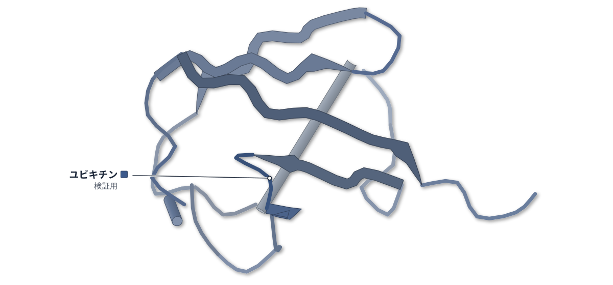

PDB 1UBQ（論文が使った既存の構造）

色（順に）：ユビキチン（検証用）

**高いpHのNMRで、タンパク質の水素結合を見分ける**

既存の構造をもつ10種で、残る信号が水素結合と約91%一致した

- **疑問・課題**：NMRの構造決定に欠かせない水素結合を、不安定な構造で実験的に見分けるのは難しかった。
- **アプローチ**：構造が既知の10種のタンパク質で、pH 10〜11のNMRにより約750か所のアミド水素（主鎖の水素）を調べた。
- **結果**：高pHで残るアミド水素の信号は、既存の構造にある水素結合と約91%一致した。重水中の交換実験は約80%だった。
- **わかったこと**：アミド水素の信号の消え方をpHごとに追うと、構造の中で最後まで水素結合が残る部分（フォルドン）も分かる。

この紹介文の根拠（論文本文）

> Hydrogen bond restraints are critical for NMR structure determination, yet their experimental identification can be challenging for marginally stable structures affording insufficient exchange protection in D2O.  
> — 疑問・課題／Abstract

> We analyzed ~750 amide sites distributed across ten proteins with known structures.  
> — アプローチ／Abstract

> As an alternative, we explored the use of NMR between pH 10 and 11, conditions that promote rapid exchange, for identifying backbone amide protons involved in H-bonds.  
> — アプローチ／Abstract

> Survival of amide protons at high pH in standard 2D 1H–15N HSQC spectra for 15N-labeled proteins in H2O, or TOCSY for unlabeled proteins, identifies H-bonds with ~91% accuracy, exceeding the ~80% accuracy of traditional H/D exchange experiments in D2O.  
> — 結果／Abstract

> High-pH NMR experiments provide a sensitive, fast, and broadly applicable approach to map H-bonding.  
> — わかったこと／Abstract

> Increasing the pH led to a progressive loss of native amide proton NMR signals  
> — わかったこと／Abstract

分類：その他

#### 読みどころ

pH 10〜11ではアミド水素の交換が速く進み、水素結合で守られた水素の信号だけが残る。10種・約750か所で、残る信号と結晶・クライオ電顕の構造にある水素結合の一致率は約91%だった。

根拠（論文本文）

> The presence or absence of amide proton NMR signals between pH 10 and 11 can be used to ascertain H-bonds (protected amides) or the absence of H-bonds (unprotected amides) with ~91% accuracy.  
> — Results

同じデータで従来の重水（D2O）中の交換実験は約80%だった。不安定な構造の水素結合は守られず見逃されやすい（偽陰性）ためで、高pHではこの見逃しが減った。

根拠（論文本文）

> The lower accuracy of the D2O isotope exchange method is due to a higher number of false negatives—amide protons that are H-bonded in marginally stable structure that offers insufficient protection to be detected in D2O.  
> — Discussion

球状のP22iDとCUS3iDでは、配列上は離れた6本のβストランドが作る逆平行βバレルが最後まで残った。信号が残るpHは、残基間の接触の多さと相関した（R=0.68と0.66、ユビキチンは0.45）。

根拠（論文本文）

> For the two related globular proteins P22iD and Cus3iD, the most persistent structure corresponds to the six β-strands that are not contiguous in the sequence but come together in the structure to form a conserved antiparallel β-barrel motif.  
> — Results

> The R-values for correlations between the pH value at which amide protons are last observed and the number of Cα–Cα distance contacts in the structure <5 Å, were 0.68 for P22iD, 0.66 for CUS3iD, and somewhat lower at 0.45 for ubiquitin.  
> — Results

#### 構造データ

| PDB | 手法 | 分解能 | 公開 | 生物種 | リガンド |
|---|---|---|---|---|---|
| [1UBQ](https://www.rcsb.org/structure/1UBQ) | X-ray | 1.80 Å | 1987-04-16 | Homo sapiens | — |
| [3KIN](https://www.rcsb.org/structure/3KIN) | X-ray | 3.10 Å | 1998-10-14 | Rattus norvegicus | ADP |
| [1MJC](https://www.rcsb.org/structure/1MJC) | X-ray | 2.00 Å | 1994-06-22 | Escherichia coli | — |
| [1BBU](https://www.rcsb.org/structure/1BBU) | X-ray | 2.70 Å | 2000-11-10 | Escherichia coli | LYS |
| [1STN](https://www.rcsb.org/structure/1STN) | X-ray | 1.70 Å | 1994-07-31 | Staphylococcus aureus | — |
| [2ZTA](https://www.rcsb.org/structure/2ZTA) | X-ray | 1.80 Å | 1992-10-15 | Saccharomyces cerevisiae | — |
| [8I1V](https://www.rcsb.org/structure/8I1V) | Cryo-EM | 2.60 Å | 2023-03-08 | Salmonella phage P22 | — |
| [8SKG](https://www.rcsb.org/structure/8SKG) | Cryo-EM | 2.80 Å | 2025-02-19 | Enterobacteria phage CUS-3 | — |
| [1G6X](https://www.rcsb.org/structure/1G6X) | X-ray | 0.86 Å | 2001-05-09 | Bos taurus | — |
| [1TM6](https://www.rcsb.org/structure/1TM6) | Solution NMR | — | 2004-10-12 | Escherichia coli | — |

- [A0A0H2Z132](https://www.uniprot.org/uniprotkb/A0A0H2Z132)  Coat protein — *Escherichia coli O1:K1 / APEC* （既存の PDB 構造 0 件）
- [P00644](https://www.uniprot.org/uniprotkb/P00644) nuc Thermonuclease — *Staphylococcus aureus* （既存の PDB 構造 0 件）
- [P00974](https://www.uniprot.org/uniprotkb/P00974)  Pancreatic trypsin inhibitor — *Bos taurus* （既存の PDB 構造 0 件）
- [P03069](https://www.uniprot.org/uniprotkb/P03069) GCN4 General control transcription factor GCN4 — *Saccharomyces cerevisiae (strain ATCC 204508 / S288c)* （既存の PDB 構造 0 件）
- [P0A8N3](https://www.uniprot.org/uniprotkb/P0A8N3) lysS Lysine--tRNA ligase — *Escherichia coli (strain K12)* （既存の PDB 構造 0 件）
- [P0A9X9](https://www.uniprot.org/uniprotkb/P0A9X9) cspA Cold shock protein CspA — *Escherichia coli (strain K12)* （既存の PDB 構造 0 件）
- [P0CG48](https://www.uniprot.org/uniprotkb/P0CG48) UBC Polyubiquitin-C — *Homo sapiens* （既存の PDB 構造 0 件）
- [P10408](https://www.uniprot.org/uniprotkb/P10408) secA Protein translocase subunit SecA — *Escherichia coli (strain K12)* （既存の PDB 構造 0 件）
- [P26747](https://www.uniprot.org/uniprotkb/P26747) 5 Major capsid protein — *Salmonella phage P22* （既存の PDB 構造 0 件）
- [P26748](https://www.uniprot.org/uniprotkb/P26748) 8 Scaffolding protein — *Salmonella phage P22* （既存の PDB 構造 0 件）
- [P56536](https://www.uniprot.org/uniprotkb/P56536) Kif5c Kinesin heavy chain isoform 5C — *Rattus norvegicus* （既存の PDB 構造 0 件）
- [Q6QLM7](https://www.uniprot.org/uniprotkb/Q6QLM7) Kif5a Kinesin heavy chain isoform 5A — *Rattus norvegicus* （既存の PDB 構造 0 件）

#### 実験メモ

- **発現系**：ユビキチンなどは大腸菌で発現し、ユビキチンは15N標識。Aβ(40)は15N標識品を購入。
- **結晶化／グリッド作製**：濃度0.1〜1 mM、25 °C（キネシンneckは37 °C）。pHは1 N HClとNaOHの少量で調整。
- **データ収集・解析**：1H–15N HSQC（標識なしはTOCSY）でpH滴定。水素結合は既存構造からHBPLUSで計算。

根拠（論文本文）

> Uniform 15N-isotope labeling of ubiquitin and its purification were done as previously described.  
> — Methods

> 15N-labeled Aβ(40) was from rPeptide (Watkinsville, GA).  
> — Methods

> Unless otherwise noted all the NMR spectra in this study were obtained at a temperature of 25 °C, with protein concentrations ranging from 0.1 to 1 mM.  
> — Methods

> The pH of samples contained in 1.5 mL Eppendorf centrifuge tubes was adjusted with small (0.3–3 μL) aliquots of 1 N HCl and NaOH stocks.  
> — Methods

> H-bonds were calculated with the program HBPLUS  
> — Methods

> NMR assignments at the various pH values employed in this study were extended with 2D titration experiments using 1H–15N HSQC  
> — Methods

> 📝 編集者への確認事項：新しい構造ではなく、10種の既存PDB構造（1UBQ・3KIN・1MJC・1BBU・1STN・2ZTA・8I1V・8SKG・1G6X・1TM6）と自前のNMRを照合した方法論の論文。ライセンスは tdm（テキストマイニング用）のため、記事は事実のみを自分の言葉で書いた。構造図はユビキチン（1UBQ）で代表させている。

---

## 15｜タウ（jR2R3-P301Lペプチド線維）

### A water-pinning hot spot drives templated tau aggregation

*Proceedings of the National Academy of Sciences of the United States of America*（2026-10-12） · [論文](https://doi.org/10.1073/pnas.2611158123) · ライセンス: cc by-nc-nd

筆頭著者：Chung-Ta Han（Northwestern University）　責任著者：Songi Han（Northwestern University）

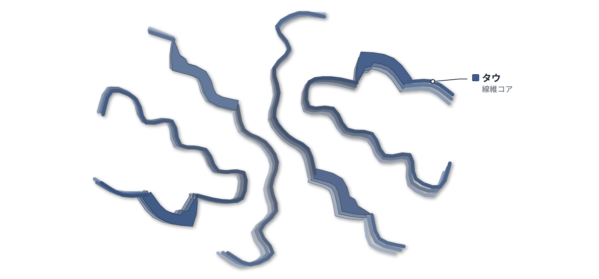

PDB 8V1N（論文が使った既存の構造）

色（順に）：タウ（線維コア）

**タウの線維化は、V300付近の1か所から始まる**

既存のクライオ電顕構造を使い、NMRとEPRで結合の順を追った

- **疑問・課題**：タウが既存の線維の端にそろって積み重なる最初の接触点は、はっきりしていなかった。
- **アプローチ**：既存のクライオ電顕構造（8V1N）をもつペプチド線維に、可溶性のペプチドを加え、NMRで残基ごとの結合の順を追った。
- **結果**：V300の信号が最も速く消えた。V300にスピンラベルを付けると、線維の伸長が最も抑えられた。
- **わかったこと**：結合は線維の表面の1つの支配的な接触点から始まる。水の放出しやすさがその特徴だと著者は考える。
- **残された課題**：可溶性オリゴマーごとの水の性質の違いは、今後の課題だ。

この紹介文の根拠（論文本文）

> Tau proteins must align and stack precisely with existing fibril ends to propagate pathology, yet the molecular signature that initiates and ensures this in-register alignment has been unclear.  
> — 疑問・課題／Abstract

> This study aims to directly track, with residue-level resolution, the time course of soluble jR2R3-P301L tau peptide association with preformed tau jR2R3-P301L fibril seeds upon mixing.  
> — アプローチ／Introduction

> Site V300 is clearly a dominant interaction site with the highest decay rates, with α = 5.74 ± 0.78  
> — 結果／Results

> Among the three spin-labeled variants, jR2R3-P301L labeled at site 300 in CR1 gave the lowest plateau ThT intensity (Fig. 4A), indicating the strongest inhibition of templated seeding when CR1 is blocked.  
> — 結果／Results

> Our work demonstrates that templated tau aggregation is governed by a single dominant pinning site whose defining signature is locally populated, release-prone hydration water that facilitates in-register stacking into seeding-competent fibrils.  
> — わかったこと／Discussion

> how hydration varies across soluble oligomeric states is an important direction for future work.  
> — 残された課題／Discussion

分類：その他

#### 読みどころ

1H-15N SOFAST-HMQC で、可溶性ペプチドが線維に付いて固定される順を残基ごとに追った。V300が最初で、L301・V306・I297が続き、I308・V309・V313は最も遅かった。

根拠（論文本文）

> 2D contour spectra showed the peak volume of site V300 (red) decayed the fastest (Fig. 2B, contact region 1, CR1), followed progressively by contact region 2 (CR2) with L301 (light red), V306 (orange), and I297 (pink).  
> — Results

線維表面の水を、既存構造（8V1N）に基づくMDと、スピンラベルを使うODNP測定で調べた。ODNPでは、V300のある領域で動きの遅い構造化した水が最も多かった。MDによる解析は計算である。

根拠（論文本文）

> Among the three sites, klow is highest at site 300 in CR1 (1,477 ± 70 s–1M–1), above site 306 in CR2 (1,041 ± 189 s–1M–1) and site 314 in CR3 (957 ± 98 s–1M–1), indicating enhanced slow, structured water in CR1 on the fibril surface (Fig. 3D).  
> — Results

V300をスピンラベルで塞いでも結合は起きたが、その後の固定（ロック）と伸長が遅くなった。他の部位のラベルでは伸長が続いた。伸長を止める標的になりうる。

根拠（論文本文）

> Blocking site 300 thus leaves initial docking intact but kinetically impedes locking and elongation, consistent with the reduced fibril formation seen by ThT and TEM (Fig. 4 A and B).  
> — Results

#### 構造データ

| PDB | 手法 | 分解能 | 公開 | 生物種 | リガンド |
|---|---|---|---|---|---|
| [8V1N](https://www.rcsb.org/structure/8V1N) | Cryo-EM | 3.00 Å | 2024-12-11 | Homo sapiens | — |

- [P10636](https://www.uniprot.org/uniprotkb/P10636) MAPT Microtubule-associated protein tau — *Homo sapiens* （既存の PDB 構造 0 件）

#### 実験メモ

- **コンストラクト**：VLIを13C/15Nで標識した19残基の合成ペプチド。
- **結晶化／グリッド作製**：ペプチド50 µMをヘパリンと4:1で混ぜ、37 °Cで24時間以上振とうして線維化。超音波処理で種にした。
- **データ収集・解析**：Bruker 600 MHz のNMRで 1H-15N SOFAST-HMQC を約16分ごとに取得。

根拠（論文本文）

> The peptides with 13C/15N isotope-enriched on valine, leucine, and isoleucine (13C/15N-VLI-jR2R3-P301L) were synthesized by the Peptide Synthesis Core at Northwestern University using the solid-phase synthesis method.  
> — Materials and Methods

> and then diluted to 50 μM to be mixed with heparin at a 4:1 molar ratio to induce fibril formation.  
> — Materials and Methods

> The mixture was shaken continuously at 200 rpm in an incubator at 37 °C for over 24 h.  
> — Materials and Methods

> The total measurement time per 2D spectrum is 16 min with a number of scans (NS) of 16 and a recycle delay of 0.1 s.  
> — Materials and Methods

> All solution NMR experiments were done at 25 °C using a Bruker Neo 600 MHz system with a QCI-F cryoprobe.  
> — Materials and Methods

> 📝 編集者への確認事項：新しい構造ではなく、既存のクライオ電顕構造 8V1N（先行研究）の上で、自前のNMR・EPR・ODNPを行った研究。19残基のモデルペプチドでの結果で、全長タウや病気の線維でも同じかは未確認。水の解析にはMDを含む。ライセンスは CC BY-NC-ND のため、記事は事実のみを自分の言葉で書いた。

---

## 16｜SfbI-TED（化膿レンサ球菌）

### Chemically encoded pH-tunable covalent adhesion by a bacterial thioester domain

*Science Advances*（2026-10-23） · [論文](https://doi.org/10.1126/sciadv.aeg7646) · ライセンス: cc by-nc

筆頭著者：Yuki Tokunaga（The University of Tokyo, Japan）　責任著者：Ryo Matsunaga, Kouhei Tsumoto（The University of Tokyo, Japan）

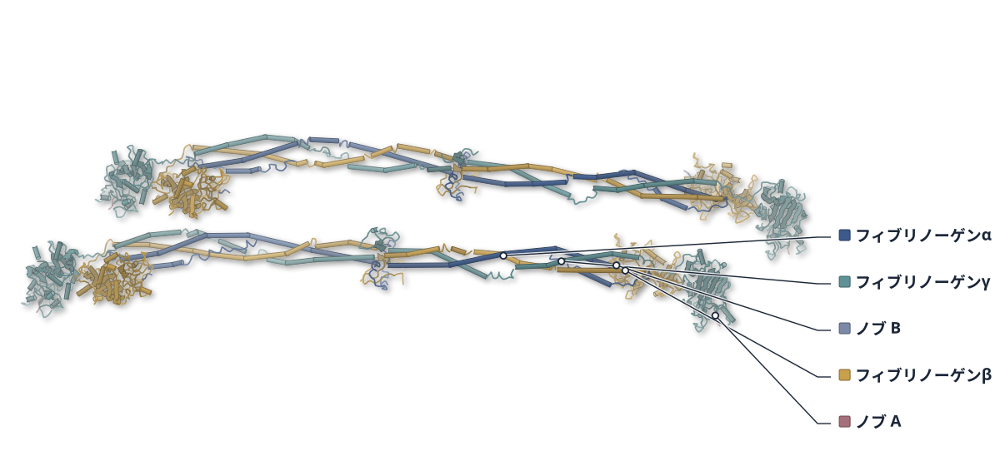

PDB 3GHG（論文が使った既存の構造）

色（順に）：フィブリノーゲンα / フィブリノーゲンβ / フィブリノーゲンγ / ノブ A / ノブ B

**細菌の接着ドメインは、pHで共有結合を外す**

SfbI-TEDとフィブリノーゲンの結合は、pH6.0で速くほどける

- **疑問・課題**：細菌のチオエステルドメイン（TED）が作る共有結合は、元に戻らないと考えられてきた。
- **アプローチ**：SfbI-TEDとフィブリノーゲンの結合を、干渉法・チオール定量・変異体の網羅解析で調べ、既存の結晶構造と照らした。
- **結果**：pH 7.3で結合した複合体は、pH 6.0で速くほどけた。チオエステルが切れた割合は、pH 6.0で6.3%、pH 7.3で45.4%だった。
- **わかったこと**：pHへの応答は、チオエステルの化学反応そのものの性質に由来し、別のTEDでも見られた。
- **残された課題**：感染時の混み合いなどが、このpHスイッチにどう影響するかは今後の課題だ。

この紹介文の根拠（論文本文）

> Recent studies challenged the prevailing view that TED-mediated chemistry is irreversible (19, 20).  
> — 疑問・課題／Introduction

> Biolayer interferometry (BLI) revealed a multistep binding process: initial noncovalent recognition, followed by thioester-mediated formation of an intermolecular cross-link, which is in dynamic equilibrium with the reverse reaction.  
> — アプローチ／Introduction

> In contrast, the wild type exhibited marked pH dependence, with normalized A324 values being 6.3±1.1% (means±SD,n=3) at pH 6.0 and 45.4±8.9% at pH 7.3 (Fig. 2, C and D).  
> — 結果／Results

> Specifically, SfbI-TED from group A Streptococcus binds tightly to fibrinogen at physiological pH, whereas mild acidification to pH 6.0 induces rapid dissociation of the complex.  
> — 結果／Abstract

> Thermodynamic analyses indicated that this pH responsiveness is largely dictated by the intrinsic pH sensitivity of the thioester-mediated acyl transfer reaction conserved within TEDs, rather than by surface residues specific to individual TEDs.  
> — わかったこと／Abstract

> how the complex microenvironment during infection—including molecular crowding and competing host factors—modulates this pH switch remains to be fully elucidated.  
> — 残された課題／Discussion

分類：感染・ウイルス・防御系

#### 読みどころ

結合は、非共有結合での認識のあとに共有結合ができる2段階だった。pHで変わるのは共有結合の切れ方で、非共有結合の部分はpHに左右されなかった。

根拠（論文本文）

> These results indicate that noncovalent interactions are insensitive to pH, whereas the equilibrium governing the formation and cleavage of the intermolecular cross-link is strongly influenced by pH.  
> — Results

37残基の変異解析で、認識の中心はHis93と分かった。Leu112・Tyr115・Arg118がその周りを支える。結合の姿はAlphaFold3の予測に基づくもので、実験構造ではない。

根拠（論文本文）

> Thus, noncovalent target recognition by SfbI-TED was primarily mediated by the hotspot residue His93 (∆∆Gnoncovalent>2 kcal/mol) (31), together with auxiliary interactions contributed by Leu112, Tyr115, and Arg118, which cluster around His93.  
> — Results

L112TはpH7.3でほぼ元に戻らない結合を作ったが、pH6.0では速くほどけた。遠縁のCpTIE-TEDでもチオエステルの切れ方がpHで変わった。

根拠（論文本文）

> Both mutants markedly stabilized the covalent complex, with L112T exhibiting almost irreversible binding at pH 7.3. Nevertheless, dissociation of both mutants was still accelerated at pH 6.0 compared with pH 7.3.  
> — Results

> Consistent with SfbI-TED, CpTIE-TED displayed a clear pH dependence of thioester bond cleavage (Fig. 6A).  
> — Results

#### 構造データ

| PDB | 手法 | 分解能 | 公開 | 生物種 | リガンド |
|---|---|---|---|---|---|
| [3GHG](https://www.rcsb.org/structure/3GHG) | X-ray | 2.90 Å | 2009-05-19 | Homo sapiens | — |

- [P02671](https://www.uniprot.org/uniprotkb/P02671) FGA Fibrinogen alpha chain — *Homo sapiens* （既存の PDB 構造 0 件）
- [P02675](https://www.uniprot.org/uniprotkb/P02675) FGB Fibrinogen beta chain — *Homo sapiens* （既存の PDB 構造 0 件）
- [P02679](https://www.uniprot.org/uniprotkb/P02679) FGG Fibrinogen gamma chain — *Homo sapiens* （既存の PDB 構造 0 件）

#### 実験メモ

- **発現系**：大腸菌BL21(DE3)で発現し、15 °Cで一晩誘導。
- **コンストラクト**：SfbI-TEDはN末端に6×His-SpyTag003を付けた。
- **精製**：Ni-NTAのあと、Superdex 75でゲルろ過。
- **データ収集・解析**：結合はOctet RED384のバイオレイヤー干渉法で、30 °Cで測定。

根拠（論文本文）

> With the exception of the mutants analyzed by FASTIA, all TEDs and SpyCatcher003 (40, 41) used in this study were expressed in E. coli BL21(DE3) (Novagen).  
> — Materials and Methods

> followed by overnight incubation at 15°C.  
> — Materials and Methods

> Wild-type and mutant SfbI-TED constructs contained N-terminal 6×His-SpyTag003 tags.  
> — Materials and Methods

> The protein was further purified via SEC on a HiLoad 26/600 Superdex 75-pg column (Cytiva) connected to an ÄKTA prime system equilibrated with SEC buffer.  
> — Materials and Methods

> BLI measurements were performed using an Octet RED384 system (Sartorius).  
> — Materials and Methods

> 📝 編集者への確認事項：新しい構造ではない。構造の根拠は、既存のCys→Ala変異体の結晶構造（番号は本文になし）による変異体の結合欠失の説明と、フィブリノーゲンの既存構造 3GHG（AlphaFold3 の入力）だけで、structure は1点止まり。図は 3GHG（フィブリノーゲン）で、TED 自体の構造ではない。ライセンスは CC BY-NC のため、記事は事実のみを自分の言葉で書いた。

---

## 注目の構造の採点（111 本を確認し、10 本を採点）

基準は `pipeline/impact.py`（10 点満点、6 点以上から最大 3 本）。

| 選定 | 論文 | 種類 | novelty | reach | structure | support | 計 | 理由 |
|---|---|---|---|---|---|---|---|---|
| ◯ | PMC13681069 High-pH NMR to Identify Macromolecular Hydrogen-Bonds and Fo | 新しい手法・ソフト | 2 | 2 | 2 | 2 | 8 | 構造が既知の10種のタンパク質で、高pHのNMRにより水素結合を約91%の精度で特定できると示した新しい手法。精度の評価も、フォルドンの解釈も、既存のX線・クライオ電顕・NMR構造との照合に頼る。 |
| ◯ | PMC13684300 A water-pinning hot spot drives templated tau aggregation | 既存構造で機構を解明 | 2 | 2 | 1 | 2 | 7 | タウの線維が可溶性ペプチドを取り込むとき、最初に接触する部位（V300）を残基ごとのNMRで特定し、スピンラベルで塞ぐと伸長が止まると示した。ただしモデルのペプチド線維（既存のクライオ電顕構造 8V1N）での結果で、水の解析にはMDを含む。 |
| ◯ | PMC13685950 Chemically encoded pH-tunable covalent adhesion by a bacteri | 既存構造で機構を解明 | 2 | 2 | 1 | 2 | 7 | 細菌の共有結合型接着ドメイン（TED）の結合が元に戻る反応で、pHによって切り替わると示した。構造の裏付けは既存の結晶構造との照合にとどまり、結合の姿は AlphaFold3 の予測に頼る。 |
|  | PMC13625682 Inhibitor fluorination pattern modulates protein surface dyn | 既存構造で機構を解明 | 2 | 1 | 1 | 2 | 6 | フッ素の位置で誘導二量体の親和性が2桁変わると示したが、その系（トリパレドキシン）だけの知見で、合計6点でも上位3本に入らなかった。構造の根拠は自前のNMRの化学シフト変化を既存の結晶構造 6GXG に写したもの。 |
|  | PMC13684282 Distinct functional open states of the polymodal nociceptor  | 既存構造で機構を解明 | 2 | 2 | 0 | 2 | 6 | TRPV1が刺激ごとに異なる開状態をとるという主張は新しいが、根拠は電気生理・蛍光測定と Rosetta のモデルで、2-APB の開状態はクライオ電顕で決まっていない（structure 0）。 |
|  | PMC13685990 CCAN forms the spherical shell-like structure in interphase  | 既存構造で機構を解明 | 2 | 2 | 0 | 2 | 6 | 間期キネトコアでCCANが球殻状に並ぶという像は新しいが、構造の根拠は AlphaFold3 と粗視化MD、および発現顕微鏡（ExM）で、X線・クライオ電顕・NMRで決めた構造による確かめがない（structure 0）。 |
|  | PMC13679058 Multivalent weak contacts shape chaperone-nascent protein in | 既存構造で機構を解明 | 2 | 1 | 0 | 2 | 5 | トリガー因子が新生鎖に結合する動きを1分子蛍光と光ピンセットで調べた研究。実験で決めた構造による裏付けがなく（structure 0）、reach も限られる。 |
|  | PMC13686171 The N-terminus of alpha-1 giardin, a parasitic annexin ortho | 既存構造で機構を解明 | 1 | 1 | 1 | 2 | 5 | α1-ジアルジンのN末端がオリゴマー化に要ることを変異体と質量フォトメトリーで示したが、構造の根拠は AlphaFold の予測・MD と自前の架橋MSで、その系だけの知見（novelty 1）。 |
|  | PMC13604702 Structural and Functional Interrogation of Active Streptococ | 既存構造で機構を解明 | 1 | 1 | 1 | 1 | 4 | 肺炎球菌ソルターゼAの再折りたたみ単量体のNMR帰属と基質ペプチドによる化学シフト変化を報告したが、既知の酵素の特性解析の延長（novelty 1）。 |
|  | PMC13605537 Structural basis for the procoagulant activity of Staphyloco | 既存構造で機構を解明 | 2 | 1 | 0 | 0 | 3 | ブドウ球菌コアグラーゼのC末端がMORN型の一層βシートをとるという提案だが、根拠は AlphaFold2・ColabFold などの予測モデルだけで、実験構造がない（structure 0）。 |

novelty：何が初めてか / reach：誰に効くか / structure：実験で決めた構造（X 線・クライオ電顕・NMR / support：裏付けの強さ（2＝独立した実験で検証：変異体・機能測定・既存手法との比較など／1＝一部の検証のみ／0＝計算のみで実験的検証なし）

## 記事にしていない新しい構造

- [A novel double-mAb sandwich ELISA utilizing broad-spectrum neutralizing antibodies as an in vitro alternative to the rabies vaccine NIH potency assay](https://doi.org/10.3389/fimmu.2026.1960986) — *Front Immunol*（新しい構造：7U90）
