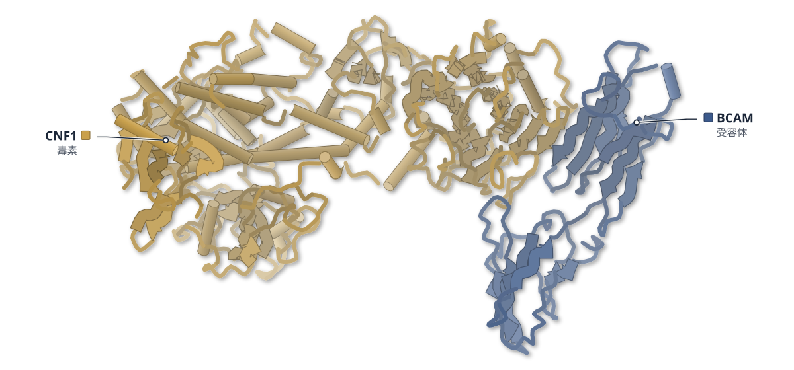
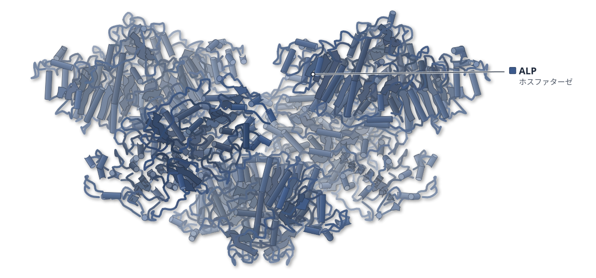
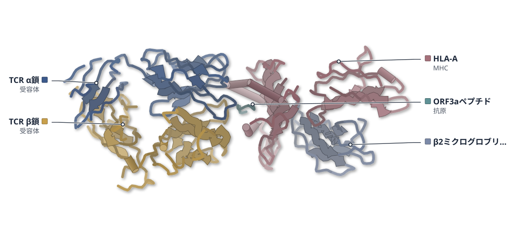
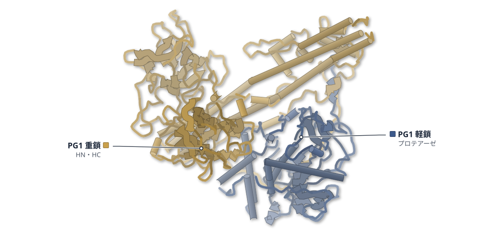
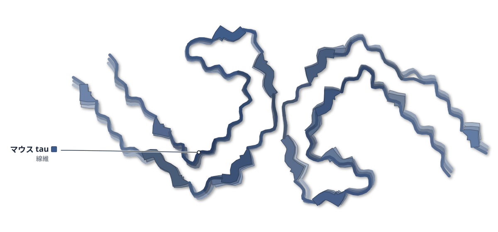
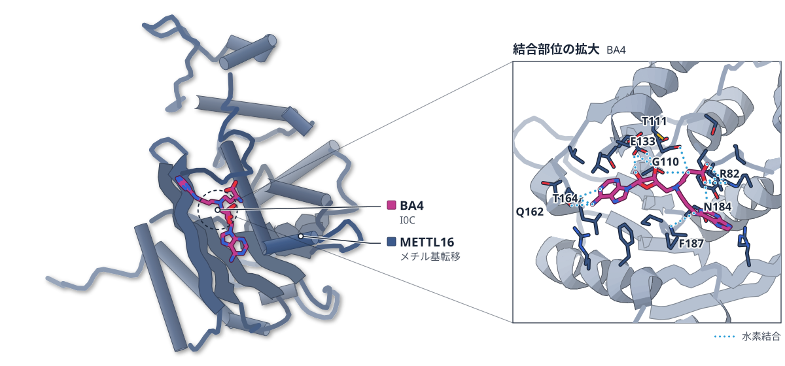
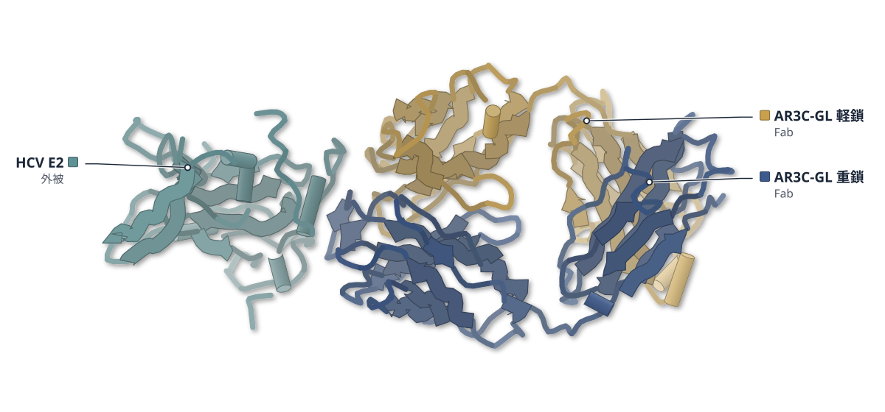
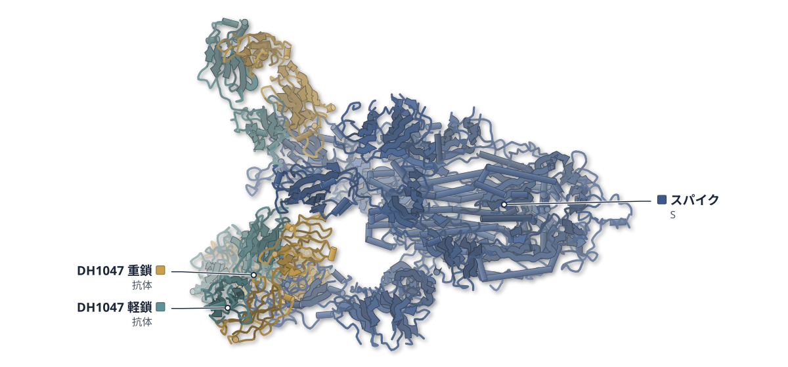

# 2026-10-24 号

**今日の新しい構造：14 本**　PMC に 2026-10-23 に登録されたオープンアクセス論文 113 本のうち、新しい構造を報告した論文は 14 本。うち 13 本を紹介する（残りは末尾に一覧）。

出典：この号の論文情報と全文は、米国国立医学図書館（NLM）の PMC オープンアクセスデータセット（AWS Open Data）から取得した。

**New Structure 2 本** · **Structure Update 10 本** · **Structure-Based Study 1 本**（New Structure：構造が初めて解かれたタンパク質。Structure Update：既知のタンパク質の新しい構造。Structure-Based Study：既存の構造を使った注目の研究）

## Today's Structure（今日の一本）

**1｜大腸菌の毒素CNF1は、ラミニンに似た形で受容体BCAMに結合する**（CNF1–BCAM（大腸菌））

選んだ理由（構造生物学・生命科学・創薬）：CNF1 が BCAM の V2 に、ラミニン 511 と同じ様式で結合する構造を示し、この結合を使ったT細胞エンゲージャーが腫瘍を抑えた。

> Structural analysis uncovers that CNF1 targets the V2 domain of BCAM, mimicking the interaction mode of laminin 511.  
> — Abstract

> This TCE potently directs T cells to kill BCAM-overexpressing tumor cells in vitro and suppresses tumor progression in a metastatic ovarian cancer mouse model in female mice.  
> — Abstract

- 迷った論文：MBOAT1（ヒト） — MBOAT1 の基質・産物結合状態から脂質リモデリングの経路が見える。創薬・生物学への直結度で CNF1 を優先。
- 迷った論文：ALP・ProtK（緑膿菌ほか） — ALP と ProtK が繊維を作る意外な発見だが、機能的な意味は未検証。

| # | 標的 | 手法・分解能 | 見出し |
|---|---|---|---|
| 1 | CNF1–BCAM（大腸菌） | Cryo-EM / X-ray・2.60–3.00 Å（4 構造） | 大腸菌の毒素CNF1は、ラミニンに似た形で受容体BCAMに結合する |
| 2 | ALP・ProtK（緑膿菌ほか） | Cryo-EM・3.18–3.70 Å（2 構造） | アルカリホスファターゼとプロテイナーゼKが、繊維を作る |
| 3 | ORF3a特異的TCR（SARS-CoV-2） | Cryo-EM・3.00–3.26 Å（2 構造） | 同じβ鎖でも、α鎖が違うとT細胞受容体の抱き方が変わる |
| 4 | MBOAT1（ヒト） | Cryo-EM・3.07–3.42 Å | MBOAT1はリゾPSを側面の入口から受け入れ、PSを放出する |
| 5 | PG1毒素（P. ghonii） | Cryo-EM・2.73 Å | ボツリヌス毒素に似たPG1は、ジスルフィド結合なしで2本の鎖を抱え込む |
| 6 | tau線維（マウス脳） | Cryo-EM・3.40–3.60 Å（2 構造） | ヒト脳のtau線維の形は、マウス脳の中でそのまま受け継がれる |
| 7 | METTL16（ヒト） | X-ray・2.17–2.29 Å（2 構造） | SAMを緩く握るMETTL16は、RNAが結合すると動きが収まる |
| 8 | HCV E2 コア（HK6a） | X-ray・1.93–3.31 Å（4 構造） | C型肝炎の抗体は、成熟前でも同じ形でE2に結合する |
| 9 | SARS-CoV-2 Mac1 | X-ray（Mac1–12p 複合体）・FP・酵素アッセイ | GS-441524を作り変え、コロナウイルスのMac1に効く阻害剤を得た |
| 10 | FtsZ（結核菌） | X-ray・2–3 Å | 結核菌FtsZに、断片が結合する新しい部位が15か所見つかった |
| 11 | SRP54 変異体（P. furiosus） | X-ray・1.32–1.83 Å | SRP54の好中球減少症変異を、古細菌の高分解能構造で調べた |
| 12 | カーボンナノチューブ支持膜 | Cryo-EM・3.1–4.1 Å（EMDB のマップ） | カーボンナノチューブの膜は、クライオ電顕の粒子を溶液から直接つかまえる |
| 13 | SARS-CoV-2 スパイク | Cryo-EM・X-ray（既存構造の解析） | RBDを下に固定する抗体は、マクロファージへの侵入を起こさなかった |

> この号は AI が論文本文から作成した**レビュー用の下書き**です。数値・ID・リガンドは PDB / UniProt から取得し、AI の記述には本文からの引用を付けています。

---

# Picked up Today's Structure

## 1｜CNF1–BCAM（大腸菌）

### Structural basis of laminin mimicry by E. coli CNF1 and its therapeutic potential for cancer immunotherapy

*Nature Communications*（2026-09-22） · [論文](https://doi.org/10.1038/s41467-026-77975-2) · ライセンス: cc by-nc-nd

筆頭著者：Yuyuan Zheng（Zhejiang University School of Medicine, China）　責任著者：Jie Sun, Chun Zhou（Zhejiang University School of Medicine, China）

色（順に）：BCAM（受容体） / CNF1（毒素）

**大腸菌の毒素CNF1は、ラミニンに似た形で受容体BCAMに結合する**

毒素の全長・受容体との複合体・ラミニン511との複合体を解き、毒素由来のT細胞エンゲージャーを作った

- **疑問・課題**：CNF1 毒素が受容体 BCAM に結合する仕組みと、BCAM のラミニン 511 との関係は十分に分かっていなかった。
- **アプローチ**：全長 CNF1、CNF1–BCAM、ラミニン 511E8–BCAM の構造をクライオ電顕で解き、結合親和性や競合も測った。
- **結果**：CNF1 の D5 ドメインは BCAM の V2 ドメインに、ラミニンと同様の平行β シートで結合し、Kd は約 3 nM と強かった。
- **わかったこと**：CNF1 はラミニン 511 を細胞表面から押しのけられる。この高親和性の結合を使ったT細胞エンゲージャーは、がん細胞を殺した。
- **残された課題**：実際の感染での毒素と宿主タンパク質の濃度は確定が難しく、置換の規模は予測できない。

この紹介文の根拠（論文本文）

> Crucially, the molecular mechanisms governing the CNF1-Lu/BCAM and laminin 511-Lu/BCAM complexes remain incompletely elucidated.  
> — 疑問・課題／Introduction

> Here, we present the high-resolution cryo-EM structures of full-length CNF1, the CNF1-BCAM complex, and the physiological laminin 511-BCAM complex.  
> — アプローチ／Abstract

> Structural analysis uncovers that CNF1 targets the V2 domain of BCAM, mimicking the interaction mode of laminin 511.  
> — 結果／Abstract

> ITC titration demonstrated that full-length CNF1 and D5 alone bind to BCAM with similar high affinity (Kd ≈ 3 nM)  
> — 結果／Results

> We demonstrate that CNF1 binds BCAM with higher affinity than laminin 511, effectively displacing the physiological ligand from the cell surface.  
> — わかったこと／Abstract

> This TCE potently directs T cells to kill BCAM-overexpressing tumor cells in vitro and suppresses tumor progression in a metastatic ovarian cancer mouse model in female mice.  
> — わかったこと／Abstract

> However, it is important to acknowledge that the local physiological concentrations of the toxin and host matrix proteins during an actual in vivo infection are difficult to establish definitively  
> — 残された課題／Discussion

分類：感染・ウイルス・防御系・GPCR・受容体

#### 読みどころ

全長 CNF1 では触媒ドメイン D5 の入口が溶媒に露出していたが、全長の脱アミド化活性は D5 単独より弱かった。著者は D2 と D5 の相互作用が D5 の動きを制限する可能性を挙げている。

根拠（論文本文）

> We also found that full-length CNF1 displayed weaker activity than D5 alone, despite the fact that in CNF1, the catalytic pocket is unobstructed (Fig. 1I-K).  
> — Results

> It’s possible that the D5-D2, D5-D4 interaction in full-length CNF1 limits certain conformation changes required for full catalytic activity.  
> — Results

CNF1 の D5 のβ26（770–776）が BCAM V2 のβ17 と平行β シートを作る。ラミニン α5 の LG1 も同様にβ17 と結合し、毒素はラミニンの結合様式をまねている。β26 を丸ごとアラニンにした M7 変異では結合がほぼ消えた。

根拠（論文本文）

> At site1, β10 in LG1 forms a parallel beta sheet with β17 in BCAM V2, analogous to CNF1 D5-BCAM V2 interaction (Fig. 4C and Fig. 3A).  
> — Results

> Taken together, our study provides strong evidence that CNF1 β26 (770-776), rather than previously reported the 709-734 region28,34,51, is critical for BCAM interaction.  
> — Results

CNF1 の D5 に抗 CD3 の scFv をつないだT細胞エンゲージャーは、BCAM が多い卵巣がん細胞を低 pM で殺し、マウスのモデルでは腫瘍の進行を抑えた。親和性を下げた Y772A 型は効きが弱く、親和性で効力を調節できる可能性がある。

根拠（論文本文）

> scFvCD3-D5C866S functioned effectively as a TCE and induced potent tumor lysis by T cells at low pM concentrations.  
> — Results

> This result suggests that the potency of TCEs can be tuned by adjusting the affinity of the tumor-cell-targeting moiety, which could reduce toxicity against normal tissues.  
> — Discussion

#### 構造データ

| PDB | 手法 | 分解能 | 公開 | 生物種 | リガンド |
|---|---|---|---|---|---|
| [21IM](https://www.rcsb.org/structure/21IM) | Cryo-EM | 3.00 Å | 2026-09-30 | Escherichia coli | — |
| [21IQ](https://www.rcsb.org/structure/21IQ) | Cryo-EM | 2.78 Å | 2026-10-07 | Escherichia coli, Homo sapiens | — |
| [21IR](https://www.rcsb.org/structure/21IR) | Cryo-EM | 2.60 Å | 2026-10-07 | Homo sapiens | — |
| [21KE](https://www.rcsb.org/structure/21KE) | X-ray | 2.90 Å | 2026-10-07 | Escherichia coli, Homo sapiens | — |

- [O15230](https://www.uniprot.org/uniprotkb/O15230) LAMA5 Laminin subunit alpha-5 — *Homo sapiens* （既存の PDB 構造 2 件）
- [P07942](https://www.uniprot.org/uniprotkb/P07942) LAMB1 Laminin subunit beta-1 — *Homo sapiens* （既存の PDB 構造 3 件）
- [P11047](https://www.uniprot.org/uniprotkb/P11047) LAMC1 Laminin subunit gamma-1 — *Homo sapiens* （既存の PDB 構造 4 件）
- [P50895](https://www.uniprot.org/uniprotkb/P50895) BCAM Basal cell adhesion molecule — *Homo sapiens* （既存の PDB 構造 2 件）
- [Q47106](https://www.uniprot.org/uniprotkb/Q47106) cnf1 Cytotoxic necrotizing factor 1 — *Escherichia coli* （既存の PDB 構造 2 件）

#### 実験メモ

- **発現系**：CNF1 は大腸菌 Rosetta (DE3)、BCAM は Hi-5 昆虫細胞、ラミニン 511E8 は 293 F 細胞で発現。
- **コンストラクト**：全長 CNF1 は N 末端に MBP タグを付けて解析。BCAM は V1–C3 の細胞外領域、ラミニンは E8 断片。
- **精製**：MBP カラムと陰イオン交換、BCAM は Ni-NTA とゲルろ過。
- **結晶化／グリッド作製**：Quantifoil R1.2/1.3 に 3 μL をのせ、20 °C・湿度100%で Vitrobot 凍結。結晶は D5–BCAM V1-C1 を約 8 mg/mL でハンギングドロップ。
- **データ収集・解析**：Titan Krios（300 kV）と Falcon4 で収集し、cryoSPARC で処理。

根拠（論文本文）

> The full-length E. coli CNF1 gene was cloned into a modified pRSFDuet-1 vector (Novagen) with MBP tag and expressed in E. coli Rosetta (DE3) cells (Novagen).  
> — Methods

> Baculoviruses were produced with SF9 cells and were used to infect Hi-5 insect cells for protein expression.  
> — Methods

> Baculoviruses were produced with SF9 cells and used to infect 293 F cells for protein expression.  
> — Methods

> The cryo-EM data were collected at the Center of Cryo-Electron Microscopy at Zhejiang University.  
> — Methods

> Crystals of CNF1 D5-BCAMV1-C1 were grown at 4˚C using the hanging drop vapor diffusion method  
> — Methods

> 📝 編集者への確認事項：PDB は 21IM（CNF1）・21IQ（CNF1–BCAM）・21IR（ラミニン511–BCAM）・21KE（D5–BCAM 結晶）。CNF1 の D5 単独・BCAM V1-V2 の構造は既存のため first_structure は false。BCAM との複合体、全長 CNF1、ラミニン511–BCAM は新しい。TCE の in vivo は女性マウスの OV90 腹腔内モデル（免疫不全）と同系モデル。著者が『strong evidence』と書く競合は ELISA・細胞結合・接着の実験で、感染時の濃度は不明と本人が限界を述べている。

---

# New Structure

## 2｜ALP・ProtK（緑膿菌ほか）

### Protein polymers proliferate: polymerization of phosphatases and proteases

*Microbiology Spectrum*（2026-10-01） · [論文](https://doi.org/10.1128/spectrum.02439-26) · ライセンス: cc by

筆頭著者：Ravi R. Sonani（University of Virginia Medical School, USA）　責任著者：Edward H. Egelman（University of Virginia Medical School, USA）、Romé Voulhoux（Aix Marseille Université, France）、Mike Sleutel（Vrije Universiteit Brussel, Belgium）

色（順に）：ALP（ホスファターゼ）

**アルカリホスファターゼとプロテイナーゼKが、繊維を作る**

クライオ電顕で、緑膿菌ALPのフィラメントとProtKのナノチューブの構造を決めた

- **疑問・課題**：酵素が繊維になって活性を調節する例は知られるが、よく使う2つの酵素の重合は報告がなかった。
- **アプローチ**：細菌試料のクライオ電顕像に写った未知の繊維を、再構成とモデル構築で同定した。
- **結果**：緑膿菌ALPの二量体がらせん状に並ぶ繊維（約3.7 Å）と、ProtKの中空ナノチューブ（3.2 Å）が見つかった。
- **わかったこと**：ALPの繊維は未同定の密度が足場らしく、ProtKの管は濃度による詰まりと整合する。
- **残された課題**：生理的な意義は不明で、活性への影響は今後の実験が必要だ。

この紹介文の根拠（論文本文）

> Filamentation has been abundantly documented to be responsible for either enzyme activation (6) or repression (7), and thus the polymeric state of an enzyme can provide a new level of biological regulation.  
> — 疑問・課題／OBSERVATION

> we have serendipitously discovered a previously unreported filamentation of two commonly used enzymes in molecular microbiology: alkaline phosphatase (ALP) and proteinase K (ProtK).  
> — 疑問・課題／OBSERVATION

> To overcome this problem, we employed asymmetric reconstruction by relaxing symmetry constraints, a strategy successfully leveraged in prior challenging filament studies (9).  
> — アプローチ／OBSERVATION

> allowing for automated de novo model building using ModelAngelo (15), which identified the subunit as proteinase K  
> — アプローチ／OBSERVATION

> This approach substantially improved the map, yielding a ~3.7 Å resolution density map that enabled unambiguous atomic model building and identified the filament-forming protein as ALP  
> — 結果／OBSERVATION

> These micrographs revealed the presence of 17 nm diameter nanotubes of unknown composition (Fig. 2A and B).  
> — 結果／OBSERVATION

> However, the true structural anchors appear to be the unassigned central and peripheral densities.  
> — わかったこと／OBSERVATION

> Such minimal interfaces are more consistent with a concentration-driven packing than with a cooperatively regulated polymer.  
> — わかったこと／OBSERVATION

> While the physiological significance of fibrillation in alkaline phosphatase and proteinase K is unknown,  
> — 残された課題／Abstract

> Distinguishing an evolved function from an incidental property of a sticky, hyperstable enzyme will require direct tests of concentration dependence and of catalytic activity in the polymeric versus monomeric state.  
> — 残された課題／OBSERVATION

分類：酵素（その他）・プロテアーゼ

#### 読みどころ

ALP の二量体は 1 個ごとに 28.4 Å 進み 83.2° ねじれて並び、らせんになる。軸の中心と外周には、タンパク質ではない正体不明の密度が走る。

根拠（論文本文）

> Tilted at ~40° relative to the central filament axis, these ALP dimers assemble into a 1-start helix with a rise of 28.4 Å and a twist of 83.2° per dimer.  
> — OBSERVATION

> the map revealed two striking, unassigned densities: one running directly down the central axis of the filament and another wrapping along the outer periphery (Fig. 1C).  
> — OBSERVATION

密度に接する ALP の表面は正に帯電し、39-KKK-41 や R219・R248 が接する。大腸菌 ALP にこれらの残基はない。著者は、密度の正体を負電荷の分子（DNA や多糖など）と考えている。

根拠（論文本文）

> The 39-KKK-41 motif surrounds the central axis density, while residues R219 and R248 contact the peripheral density (Fig. 1F).  
> — OBSERVATION

> Intriguingly, these positively charged residues are completely absent in the homologous periplasmic E. coli ALP (UniProt P00634), which shares 74% sequence identity (Fig. 1G).  
> — OBSERVATION

> Such concentrated electropositive tracks indicate that these unknown densities represent negatively charged biomolecules  
> — OBSERVATION

ProtK は 8 本のプロトフィラメントが逆向きに並び、外径約 170 Å・内径約 90 Å の管になる。単量体は既存の結晶構造とほぼ同じで、活性部位は管の外に開いている。

根拠（論文本文）

> The hollow tubes (with an inner diameter of ~90 Å) are composed of eight ProtK protofilaments that run in an antiparallel fashion as a result of the global dihedral (D1) symmetry (Fig. 2E and F).  
> — OBSERVATION

> The structural overlay between 3PRK and our model (Fig. 2G) shows that the active site of ProtK is solvent accessible in the nanotube assembly (Fig. 2D through F).  
> — OBSERVATION

> Outer diameter: ~170 Å, inner diameter: ~90 Å.  
> — Figure legends

#### 構造データ

| PDB | 手法 | 分解能 | 公開 | 生物種 | リガンド |
|---|---|---|---|---|---|
| [36PY](https://www.rcsb.org/structure/36PY) | Cryo-EM | 3.70 Å | 2026-09-09 | Pseudomonas aeruginosa | — |
| [28EP](https://www.rcsb.org/structure/28EP) | Cryo-EM | 3.18 Å | 2026-09-02 | Parengyodontium album | — |

- [P06873](https://www.uniprot.org/uniprotkb/P06873) PROK Proteinase K — *Parengyodontium album* （既存の PDB 構造 262 件）
- [Q02QC9](https://www.uniprot.org/uniprotkb/Q02QC9) phoA Alkaline phosphatase H — *Pseudomonas aeruginosa (strain UCBPP-PA14)* （PDB で初めての構造）

#### 実験メモ

- **結晶化／グリッド作製**：ALP はリン酸制限下で育てた緑膿菌の細胞外の剪断試料、ProtK は市販品で分解したケーブル細菌の細胞壁（サッキュラス）の試料。
- **データ収集・解析**：ALP は対称性を課さない再構成（約3.7 Å）、二量体は C2 で局所精製（約3.3 Å）。ProtK はらせんパラメータ rise 8.36 Å・twist −83.72°（3.2 Å）で、ModelAngelo で自動構築。

根拠（論文本文）

> Cryo-EM micrographs of an extracellular sheared sample from Pseudomonas aeruginosa grown under phosphate-limiting conditions revealed filaments of unknown identity  
> — OBSERVATION

> we collected cryo-EM data on ProtK (commercial source: cat. no. 124568, Merck/Sigma-Aldrich) digested sacculi of the cable bacterium Electrothrix gigas.  
> — OBSERVATION

> Local refinement focused on a single ALP dimer with imposed C2 symmetry improved the resolution to ~3.3 Å, providing additional confirmation of the ALP assignment.  
> — OBSERVATION

> Standard helical processing was used to refine the rise and twist to 8.36 Å and −83.72° and yielded a 3.2 Å reconstruction (Fig. 2C)  
> — OBSERVATION

> 📝 編集者への確認事項：ALP（Q02QC9）は PDB にそれまで構造がなく first_structure=true。ただし論文は『初構造』とは書かず、重合が未報告と述べている。ProtK は既存の結晶構造が多数ある別状態（ナノチューブ）。PDB の引用は『To be provided later』で、2 エントリは deposition statement から対応づけた。Methods は補足資料で、packet にない。ProtK ナノチューブは濃度によるアーティファクトの可能性を著者自身が述べている。

---

## 3｜ORF3a特異的TCR（SARS-CoV-2）

### Unveiling structural determinants of peptide recognition by public and private SARS-CoV-2-specific T-cell receptors

*Nature Communications*（2026-09-22） · [論文](https://doi.org/10.1038/s41467-026-77827-z) · ライセンス: cc by

筆頭著者：Caner Akıl（University of Oxford, UK）　責任著者：Ricardo A. Fernandes, Tao Dong, Peijun Zhang（University of Oxford, UK）

色（順に）：TCR α鎖（受容体） / TCR β鎖（受容体） / ORF3aペプチド（抗原） / HLA-A（MHC） / β2ミクログロブリン

**同じβ鎖でも、α鎖が違うとT細胞受容体の抱き方が変わる**

SARS-CoV-2 ORF3aペプチドを認識するパブリックTCRとプライベートTCRを約3 Åで比べた

- **疑問・課題**：多くの人に現れるパブリックTCRと個人固有のプライベートTCRで、構造の違いが十分に分かっていなかった。
- **アプローチ**：同じペプチド–HLA複合体を認識する2つのTCRを、クライオ電顕とアラニン置換で比べた。
- **結果**：親和性はどちらも約7〜10 μMだが、TCRpubはペプチド中心、TCRprivはHLAの両ヘリックスに接触が分かれた。
- **わかったこと**：α鎖の組み合わせが変わると、共通のβ鎖の上でも抗原結合面の作りが変わる。
- **残された課題**：1組の比較なので、一般性は他のTCR/pMHCでの調査が必要だ。

この紹介文の根拠（論文本文）

> Public T cell receptors (TCRs) recurrently emerge across individuals in response to common pathogens, yet the structural and biophysical basis distinguishing public from private clonotypes remains incompletely defined.  
> — 疑問・課題／Abstract

> Here, we combine epitope mapping, single-cell TCR sequencing, and single-particle cryo-electron microscopy to dissect CD8+ T cell responses to the immunodominant SARS-CoV-2 ORF3a(207-215) epitope presented by HLA-A*01:01.  
> — アプローチ／Abstract

> Despite comparable micromolar affinities and functional avidities, cryo-EM structures at ~3 Å resolution reveal that the two receptors engage the peptide-MHC complex through distinct CDR-loop configurations and contact footprints.  
> — 結果／Abstract

> TCRpub establishes contacts with the peptide and the MHC α2-helix primarily through the CDR2β and CDR3β loops, whereas TCRpriv distributes contacts across both MHC α-helices and engages the peptide via multiple CDR loops.  
> — 結果／Abstract

> These findings demonstrate how alternative α-chain pairing reconfigures the antigen-binding interface within a shared β-chain.  
> — わかったこと／Abstract

> These observations from a single public-private pair suggest that public TCRs may adopt CDR engagement modes that favour structural complementarity, although broader surveys across additional TCR/pMHC systems will be needed to establish the generality of this pattern.  
> — 残された課題／Results

分類：免疫（抗体・MHC・TCR・自然免疫）・感染・ウイルス・防御系

#### 読みどころ

2 つの TCR は CDR3β の 4 残基だけが違う（TCRpub は AGDL、TCRpriv は WTGV）。TCRpriv の Trp94 はペプチドの Leu8 と HLA の Thr71 に接するが、TCRpub では Ala94 になり、この接触がなくなる。

根拠（論文本文）

> A key distinction lies at position 94: Trp94 in TCRpriv mediates dual contacts with Leu8 of the peptide and Thr71 of the MHC (Fig. 5h, i), whereas its replacement by Ala94 in TCRpub eliminates these interactions (Fig. 5e, f) and instead supports the peptide-centric AGDL docking mode.  
> — Results

> In TCRpub, the backbone of peptide residue Asp4 forms a hydrogen bond with Arg53, and Ala94 of the CDR3β loop (within the AGDL motif) makes a moderate hydrophobic contact with Tyr5 of the peptide (Fig. 4b).  
> — Results

ペプチドを 1 残基ずつアラニンに替えると、TCRpub はより多くの位置で活性が下がり、Asp4 の置換で特に大きく下がった。TCRpriv は置換に強く、Asp4 の置換も比較的よく許した。

根拠（論文本文）

> TCRpub was affected by alanine substitutions across more positions of the peptide, indicating a greater dependence on peptide side chains for productive recognition.  
> — Results

> In particular, substitution at Asp4 caused a marked reduction in TCRpub activation, whereas substitutions at Asp4 and, to a lesser extent, at Gln7 were comparatively well tolerated by TCRpriv.  
> — Results

約 93 kDa と小さく、親和性が μM 程度の野生型 TCR/pMHC を、各 400〜600 万粒子と 30° 傾斜像で解析した。親和性を高めた改変体を使わず、野生型の配列のまま約 3 Å の地図が得られた。

根拠（論文本文）

> we collected a large dataset for each complex (4-6 million particles) and additionally recorded images at a 30° tilt angle.  
> — Results

> our results indicate that cryo-EM can also be applied to wild-type CDR sequences to resolve TCR/pMHC complexes with micromolar affinity.  
> — Discussion

#### 構造データ

| PDB | 手法 | 分解能 | 公開 | 生物種 | リガンド |
|---|---|---|---|---|---|
| [9RXM](https://www.rcsb.org/structure/9RXM) | Cryo-EM | 3.00 Å | 2025-08-13 | Homo sapiens | — |
| [9RU5](https://www.rcsb.org/structure/9RU5) | Cryo-EM | 3.26 Å | 2025-08-13 | Homo sapiens, Severe acute respiratory syndrome coronavirus 2 | — |

- [A7WPI8](https://www.uniprot.org/uniprotkb/A7WPI8) HLA-A MHC class I antigen — *Homo sapiens* （PDB で初めての構造）
- [F6IQR9](https://www.uniprot.org/uniprotkb/F6IQR9) HLA-A MHC class I antigen — *Homo sapiens* （既存の PDB 構造 3 件）
- [P0DTC3](https://www.uniprot.org/uniprotkb/P0DTC3)  ORF3a protein — *Severe acute respiratory syndrome coronavirus 2* （既存の PDB 構造 7 件）
- [P61769](https://www.uniprot.org/uniprotkb/P61769) B2M Beta-2-microglobulin — *Homo sapiens* （既存の PDB 構造 1408 件）

#### 実験メモ

- **発現系**：TCR は Expi293F 細胞に α・β 鎖を共発現。HLA-A*01:01 重鎖と β2m は大腸菌の封入体から調製してリフォールディング。
- **コンストラクト**：TCR は膜貫通領域を除いた細胞外ドメインのヘテロ二量体。HLA-A*01:01 重鎖は 1–276 にビオチン化配列を付加。
- **精製**：TCR は Ni-NTA の後 HRV 3C でタグを切り、Superdex 200 Increase でゲルろ過。
- **結晶化／グリッド作製**：0.5–1.0 mg/mL の複合体を架橋せず、Quantifoil R1.2/1.3 に Vitrobot Mark IV で凍結した。
- **データ収集・解析**：Titan Krios（300 kV）で撮影し、cryoSPARC と RELION-5 で解析。初期モデルは AlphaFold3 で作り、Coot・Phenix で精密化。

根拠（論文本文）

> Recombinant TCRs were expressed in Expi293F cells (Thermo Fisher) maintained at 37 °C with 5% CO2, shaking at 160 rpm.  
> — Methods

> These modified heavy chains (amino acids 1–276) and β2-microglobulin were expressed in a prokaryotic system (pET; R&D Systems), purified from bacterial inclusion bodies, and solubilized in 8 M urea.  
> — Methods

> we generated soluble TCR heterodimers by removing the transmembrane regions and co-expressing the ectodomains of α- and β-chains in mammalian cells  
> — Results

> His-tagged TCRs were eluted by IMAC, concentrated to ~500 µL, and treated overnight with HRV 3 C protease (ab285999) to remove tags and leucine zippers.  
> — Methods

> Proteins were further purified by size-exclusion chromatography (SEC) on a Superdex 200 Increase 10/300 GL column (Cytiva) using an ÄKTA Pure system equilibrated with HBS.  
> — Methods

> Cryo-EM grids of TCRpriv/pMHC and TCRpub/pMHC complexes were prepared by directly freezing the purified complexes at ~0.5–1.0 mg/mL onto glow-discharged Quantifoil R1.2/1.3 Cu 300 mesh grids (Quantifoil Micro Tools GmbH) using a Vitrobot Mark IV (Thermo Fisher Scientific), without chemical crosslinking.  
> — Methods

> Final data collection was performed on a Titan Krios transmission electron microscope (Thermo Fisher Scientific) operated at 300 kV.  
> — Methods

> All datasets were processed using CryoSparc v4.4.156, following standard single-particle analysis workflows, including motion correction, CTF estimation, iterative classification, and refinement.  
> — Methods

> Initial atomic models of TCRα, TCRβ, the ORF3a(207-215) peptide, and HLA-A*01:01 heavy chain were generated using AlphaFold3 multimer predictions57.  
> — Methods

> 📝 編集者への確認事項：first_structure=true は HLA-A*01:01 に当たる UniProt エントリ（A7WPI8）の PDB 件数が 0 だったため。HLA-A*01:01 と TCR/pMHC の構造はすでに多数あり、論文も初構造とは主張していない。サイトが New Structure に分けると不自然なので、必要なら Structure Update に直してほしい。PDB 9RU5 が TCRpub、9RXM が TCRpriv（本文の Methods に従う）。TCRpub の MHC α3 と β2m は分解能が低く、焦点を絞ったマップで α1/α2 部分だけをモデル化している。

---

# Structure Update

## 4｜MBOAT1（ヒト）

### Cryo-EM structures reveal the mechanism of phosphatidylserine remodeling by membrane-bound glycerophospholipid O-acyltransferase 1

*bioRxiv*（2026-09-02） · [論文](https://doi.org/10.64898/2026.09.01.748671) · ライセンス: cc by

筆頭著者：Leehyeon Kim（Memorial Sloan Kettering Cancer Center, USA）　責任著者：Robert V. Farese, Tobias C. Walther（Memorial Sloan Kettering Cancer Center, USA）

**MBOAT1はリゾPSを側面の入口から受け入れ、PSを放出する**

基質・供与体・産物が結合した状態をクライオ電顕で捉え、PS の脂質リモデリングを説明した

- **疑問・課題**：MBOAT 酵素がアシル CoA を選び、リゾリン脂質を受け入れ、産物を放出する仕組みは不明だった。
- **アプローチ**：ヒト MBOAT1 の野生型と触媒変異体のクライオ電顕構造を、脂質解析・酵素活性・MD と組み合わせて調べた。
- **結果**：MBOAT1 はリゾ PS を優先して一価不飽和脂肪酸を持つ PS を作り、基質・供与体・産物の結合した構造が得られた。
- **わかったこと**：リゾ PS は膜側の側面ゲートから入り、PS はその同じ経路で放出されると考えられる。
- **残された課題**：ER 内のリゾ PS・リゾ PE の量は情報が乏しく、実際の基質の解明が課題だ。

この紹介文の根拠（論文本文）

> How MBOAT enzymes recognize specific acyl-CoA donors, select lysophospholipid acceptors, and release products is unclear.  
> — 疑問・課題／Abstract

> Here, we address these questions by combining cryo-electron microscopy (cryo-EM), quantitative biochemical analyses, molecular dynamics (MD) simulations, and cell-based lipidomics.  
> — アプローチ／Introduction

> Here, we showed that MBOAT1 preferentially generates monounsaturated fatty acid–containing PS from lyso-PS.  
> — 結果／Abstract

> High-resolution cryo-electron microscopy structures of human MBOAT1 captured distinct binding poses of the fatty acyl donor, lyso-PS acceptor, and PS product.  
> — 結果／Abstract

> These structures revealed a lateral gate as an entry pathway for lyso-PS and showed how the substrate advances from a partially inserted entry state to a catalytically competent acceptor pose.  
> — わかったこと／Results

> In coarse-grained (CG) MD simulations, the PS product was released into the membrane within 800 ns through the lateral gate  
> — わかったこと／Results

> The relevant substrate pool, however, is the local ER lyso-phospholipid pool, and quantitative information on ER lyso-PS and lyso-PE abundance is limited.  
> — 残された課題／Discussion

分類：酵素（その他）・転写調節・シグナル伝達

#### 読みどころ

精製した MBOAT1 はリゾ PS に強い活性を示し（kcat/Km = 5.77 × 10^4 M^-1 s^-1）、リゾ PE への活性はその約6分の1（0.95 × 10^4）だった。MBOAT1 を欠く細胞では MUFA を持つ PS が減った。

根拠（論文本文）

> Acyltransferase activity of purified MBOAT1 using different lyso-phospholipid acceptors and oleoyl-CoA as the acyl donor showed robust, saturable activity toward lyso-PS  
> — Results

> Cells lacking MBOAT1 specifically had lower levels of MUFA-containing PS species, including PS 18:0/18:1 and PS 16:0/18:1, than WT cells (Fig. 2a).  
> — Results

触媒残基を替えた H381A と N350A で、リゾ PS が側面ゲートから入って触媒ヒスチジンへ近づく2段階の姿が見えた。Arg125 は基質が奥へ進むにつれて約1.5 Å 頭部へ寄った。

根拠（論文本文）

> In contrast, the side chain of Arg125 shifted by approximately 1.5 Å towards the phosphoserine head group as the substrate advanced into the acceptor-binding site (Fig. 3h).  
> — Results

> The position and geometry of the substrate were consistent with a catalytically competent acceptor pose, in which His381 was positioned to activate the lyso-PS sn-2 hydroxyl group for nucleophilic attack on the acyl-CoA thioester.  
> — Results

オレオイル CoA 結合型では、18 炭素のアシル鎖が疎水性トンネルに入り、Δ9 の二重結合の曲がりに合う狭まりがあった。MBOAT7 より狭く、多価不飽和のアシル CoA を受け入れにくいと考えられる。

根拠（論文本文）

> These residues create a narrower pocket that is less compatible with accommodation of acyl-CoA donors carrying multiple cis double bonds.  
> — Results

#### 構造データ

| PDB | 手法 | 分解能 | 公開 | 生物種 | リガンド |
|---|---|---|---|---|---|
| 37FF | — | — | 公開待ち | — | — |
| 37FG | — | — | 公開待ち | — | — |
| 37FH | — | — | 公開待ち | — | — |
| 37FI | — | — | 公開待ち | — | — |

#### 実験メモ

- **発現系**：HEK293S GnTI− 細胞にバキュロウイルスで導入して発現。
- **コンストラクト**：全長ヒト MBOAT1（C 末端に 3C 切断部位と FLAG タグ）。H381A・N350A 変異体も作製。
- **精製**：GDN で可溶化し、抗 FLAG 樹脂とSuperose 6 Increase ゲルろ過で精製。
- **結晶化／グリッド作製**：Quantifoil R1.2/1.3 に 3.5 μL をのせ、Vitrobot Mark IV で凍結。基質は凍結の20〜30分前に加えた。
- **データ収集・解析**：Titan Krios（300 keV）で収集し、cryoSPARC で処理。AlphaFold 3 モデルを初期モデルに使った。

根拠（論文本文）

> All proteins were expressed in HEK293S GnTI− suspension cells (ATCC) by baculovirus-mediated transduction.  
> — Methods

> cDNA with the sequence of full-length human MBOAT1 (UniProt: Q6ZNC8) was synthesized and cloned into a modified pEG-BacMam vector containing a C-terminal 3C protease cleavage site and followed by a FLAG tag.  
> — Methods

> membranes were solubilized by addition of 2% (w/v) glycol-diosgenin (GDN; Anatrace, GDN101) for 1–2 h at 4°C with gentle agitation.  
> — Methods

> Grids were blotted and plunge-frozen in liquid ethane using a Vitrobot Mark IV (Thermo Fisher Scientific) operated at 4°C and 100% humidity.  
> — Methods

> Cryo-EM data processing was performed in cryoSPARC software (v4.5.0-v4.7.0)28.  
> — Methods

> An AlphaFold 3 model of human MBOAT1 was used as the initial model for building into the cryo-EM density maps30.  
> — Methods

> 📝 編集者への確認事項：PDB ID は 37FF・37FG・37FH・37FI（候補データでは未公開扱い）。本文は初構造を主張していないので first_claim は付けていない。D137A の結果は本文中に data not shown。MD は粗視化で、放出経路の裏づけは計算のみ。

---

## 5｜PG1毒素（P. ghonii）

### Structure and functional divergence of the non-canonical BoNT-like toxin PG1 and PG2

*Nature Communications*（2026-09-22） · [論文](https://doi.org/10.1038/s41467-026-77991-2) · ライセンス: cc by-nc-nd

筆頭著者：JinBo Yang（Northwest Agriculture and Forestry University, China）　責任著者：Peng Chen（Wuhan University, China）、Sicai Zhang（Northwest Agriculture and Forestry University, China）

色（順に）：PG1 軽鎖（プロテアーゼ） / PG1 重鎖（HN・HC）

**ボツリヌス毒素に似たPG1は、ジスルフィド結合なしで2本の鎖を抱え込む**

PG1の軽鎖・重鎖複合体をクライオ電顕で2.73 Åで解き、昆虫SNAP-25を切る活性も調べた

- **疑問・課題**：PG1 と PG2 は軽鎖と重鎖が別の遺伝子にあるボツリヌス毒素様の毒素で、酵素活性と鎖どうしの結びつきは調べられていなかった。
- **アプローチ**：軽鎖の切断活性を細胞やショウジョウバエの幼虫で調べ、軽鎖と重鎖をリンカーでつないだ PG1 をクライオ電顕で解析した。
- **結果**：PG1 の軽鎖はショウジョウバエの SNAP-25 を N196–E197 で切り、複合体の構造は2.73 Å で決まった。重鎖のベルトはドアのちょうつがい状に軽鎖と接していた。
- **わかったこと**：PG1 は鎖間のジスルフィド結合がなくても非共有結合で緊密に折りたたまれ、従来のボツリヌス毒素とは異なる構造をとる。
- **残された課題**：PG 毒素の自然宿主は特定されておらず、他の昆虫での検証が必要とされている。

この紹介文の根拠（論文本文）

> However, the enzymatic activity of PG-toxin LCs and physical interaction between LC and HC, which would enable function similar to canonical BoNTs, remain to be investigated41.  
> — 疑問・課題／Introduction

> To gain deeper insights into PG-toxins, we rationally designed fusion constructs of PG-toxin LCs and HCs, covalently linked via a flexible 14-amino acid peptide linker to provide inter-domain flexibility (Fig. 4a).  
> — アプローチ／Results

> The best subset of particles yielded a cryo-EM reconstruction of the PG1 LC–HC complex at approximately 2.73 Å resolution.  
> — 結果／Results

> It forms a door-hinge-like arrangement, interlocking with the LC through localized contacts rather than fully encircling it (Fig. 4b, c).  
> — 結果／Results

> Most notably, the PG1 LC–HC complex is stabilized by extensive inter-chain non-covalent interactions, rather than the quintessential inter-chain disulfide bond that defines canonical BoNTs.  
> — わかったこと／Discussion

> Further testing in other insect species, particularly those in the order of Diptera with conserved SNAP-25 sequence similar to Drosophila, is necessary to confirm the true host of PG-toxins.  
> — 残された課題／Discussion

分類：感染・ウイルス・防御系・プロテアーゼ

#### 読みどころ

PG1 の複合体は、軽鎖・転位ドメイン（HN）・受容体結合ドメインの3ドメイン構成を保ちつつ、軽鎖と重鎖が HN の同じ側に寄った緊密な形をとる。大きさは約107 × 107 × 78 Å。

根拠（論文本文）

> The overall structural arrangement of PG1 complex closely resembles the conserved BoNT-like three-domain organization (Dimension: ~ 107 Å × 107 Å × 78 Å), yet exhibits notable differences that distinguish it from canonical counterparts12–14(Fig. 4a–c).  
> — Results

従来の毒素では重鎖のベルトが軽鎖を巻き込むが、PG1 のベルト（E37–I71）は短く、ところどころの接触で軽鎖とかみ合う。軽鎖の F387 は重鎖側の疎水性ポケットに埋まる。

根拠（論文本文）

> Most notably, the PG1 HC contains the BoNT-specific “belt” region (residues E37–I71), which in canonical BoNTs wraps around the LC to stabilize the di-chain configuration.  
> — Results

> Notably, F387 of the LC acts as a structural anchor, embedding into a hydrophobic pocket formed by the spatial convergence of HC residues A6, V8, V13, I66, V68, and Y74 (Supplementary Fig. 11a, c).  
> — Results

PG1 の軽鎖だけでヨトウガの仲間（アワヨトウ）の幼虫を70%以上死なせ、重鎖を加えても死亡率は上がらなかった。昆虫向けの殺虫剤候補になる可能性がある。

根拠（論文本文）

> Injection of PG1 LC alone caused over 70% mortality, with no further increase upon HC addition (Fig. 6e), consistent with cellular results.  
> — Results

#### 構造データ

| PDB | 手法 | 分解能 | 公開 | 生物種 | リガンド |
|---|---|---|---|---|---|
| [9VI0](https://www.rcsb.org/structure/9VI0) | Cryo-EM | 2.73 Å | 2026-10-07 | Paraclostridium ghonii | — |

#### 実験メモ

- **発現系**：大腸菌 BL21 (DE3) で発現。
- **コンストラクト**：PG1 の軽鎖（R333A/Y336A の不活性変異）と重鎖（I5C）を14残基のリンカーでつないだ融合タンパク質。
- **精製**：ニッケルカラムとイオン交換（HiRes S5/50）で精製。構造解析用に20 mM MES pH 6.0、100 mM NaCl に調製。
- **結晶化／グリッド作製**：約1.3 mg/ml の試料3 μL を Quantifoil R1.2/1.3 Cu 300 メッシュにのせ、Vitrobot で8 °C・湿度100%で凍結。
- **データ収集・解析**：Titan Krios G4、Gatan K3、300 keV。ピクセルサイズ0.84 Å、総線量50 e-/Ų、8,815本のムービー。

根拠（論文本文）

> PG1 LC-HC protein was expressed in BL21 (DE3) and purified using a nickel column and followed by HiRes S5/50 ion-exchange chromatography.  
> — Methods

> To generate the fusion protein, a 14-amino acid peptide linker (GSGSLVPRGSGSGS) was introduced to connect the LC with double mutations (R333A/Y336A) and the HC carrying the I5C mutation.  
> — Methods

> Final proteins were prepared in buffer containing 20 mM MES, pH 6.0, 100 mM NaCl for structural analysis.  
> — Methods

> Grids were blotted with a blot force 3, blot time of 3 s and wait time of 3 s using a FEI Vitrobot plunger at 8 °C and 100% humidity, then plunge-frozen in liquid ethane cooled by liquid nitrogen.  
> — Methods

> Cryo-EM imaging was performed on a Titan Krios G4 electron microscope equipped with a Gatan K3 direct electron detector and a GIF BioQuantum energy filter.  
> — Methods

> The microscope was operated at 300 keV with a magnification of 105 kX in super-resolution mode, resulting in a pixel size of 0.84 Å.  
> — Methods

> 📝 編集者への確認事項：軽鎖と重鎖を人工リンカーでつないだ融合タンパク質の構造で、重鎖に I5C、軽鎖に R333A/Y336A の変異が入っている（著者が明記）。論文は『ジスルフィド結合は観察されなかった』と書く。著者が提案する『ベルトが軽鎖の活性中心を覆う』役割はモデルで、実験では確かめていない。ライセンスは CC BY-NC-ND。

---

## 6｜tau線維（マウス脳）

### Prion-like transmission of human tau strains in the mouse brain

*Nature*（2026-09-30） · [論文](https://doi.org/10.1038/s41586-026-11061-x) · ライセンス: cc by

筆頭著者：Sofia Lövestam（MRC Laboratory of Molecular Biology, UK）　責任著者：Masato Hasegawa（Tokyo Metropolitan Institute of Medical Science, Japan）、Michel Goedert, Sjors H. W. Scheres（MRC Laboratory of Molecular Biology, UK）

色（順に）：マウス tau（線維）

**ヒト脳のtau線維の形は、マウス脳の中でそのまま受け継がれる**

アルツハイマー病と大脳皮質基底核変性症の線維をクライオ電顕で比べた

- **疑問・課題**：プリオンのように、tau 線維の形（株）が別の個体の脳に伝わっても保たれるかは、実証されていなかった。
- **アプローチ**：アルツハイマー病（AD）または大脳皮質基底核変性症（CBD）の脳から取ったtau線維を野生型マウスの脳に注入し、できた線維をクライオ電顕で調べた。
- **結果**：マウス自身のtauが、AD種では3.6 Å、CBD種では3.4 Åの構造の線維をつくり、種のヒト線維と同じ構造だった。
- **わかったこと**：tau線維は鋳型にそって増える性質（テンプレート播種）で株の構造を保ち、マウスは機構の研究に使える可能性がある。
- **残された課題**：tau種の注入で臨床症状が出るか、毒性が別の段階で起こるかは分かっていない。

この紹介文の根拠（論文本文）

> However, a central pillar of the prion hypothesis, that strains retain their structural identity upon transmission, has not been demonstrated.  
> — 疑問・課題／Abstract

> Here we show that the injection of tau filaments from the brains of individuals with Alzheimer’s disease or corticobasal degeneration into the brains of wild-type mice leads to the seeded assembly of amyloid filaments made of mouse tau with the same structures as those of the seeds.  
> — アプローチ／Abstract

> In mice injected with AD seeds, most of the filaments (83%) were paired helical filaments (PHFs), for which we calculated a reconstruction to a resolution of 3.6 Å.  
> — 結果／Seeded filaments identical to the seeds

> We reconstructed the singlets to a resolution of 3.4 Å.  
> — 結果／Seeded filaments identical to the seeds

> Thus, we show that, similar to prion strains, tau filaments propagate through templated seeding, and that the mouse is a suitable model to study the molecular mechanisms by which distinct tau folds drive disease-specific pathology in the brain.  
> — わかったこと／Abstract

> It therefore remains unknown whether tau seed propagation and downstream toxicity occur in two separate phases, as has been suggested for prions38.  
> — 残された課題／Discussion

分類：感染・ウイルス・防御系・その他

#### 読みどころ

AD 種を注入したマウスでは線維の83%が対らせん状線維（PHF）だった。この構造はヒト AD 脳のアルツハイマー型の折りたたみと重なり、原子位置のずれ（RMSD）は0.906 Åだった。

根拠（論文本文）

> This structure was identical (with a root mean square deviation for all non-hydrogen atoms of 0.906 Å) to the Alzheimer fold from AD brains30,31.  
> — Seeded filaments identical to the seeds

CBD 種を注入した場合は、74%が1本のプロトフィラメントで、ヒトの I 型 CBD 線維と同じ構造（RMSD 0.576 Å）だった。2本組の線維は10 Å までしか解けず、II 型 CBD 線維の可能性がある。

根拠（論文本文）

> A reconstruction of the doublets, to a resolution of 10 Å, suggested that they may be type II CBD filaments.  
> — Seeded filaments identical to the seeds

ヒトとマウスの tau は線維の中心部分で配列が同じなので、種の壁がない。注入したヒト tau は1週間後には検出できなくなり、見つかった線維はマウス tau でできていた。

根拠（論文本文）

> The human tau seeds were visible by staining immediately after injection, but they could no longer be detected after 1 week.  
> — Phosphorylated mouse tau filaments

> Human and mouse sequences are identical within the ordered cores of tau filaments from human brains, indicating that there may be no species barrier for the transmission of human disease-specific tau strains to the mice.  
> — Main

#### 構造データ

| PDB | 手法 | 分解能 | 公開 | 生物種 | リガンド |
|---|---|---|---|---|---|
| [29OS](https://www.rcsb.org/structure/29OS) | Cryo-EM | 3.60 Å | 2026-05-27 | Mus musculus | — |
| [29OU](https://www.rcsb.org/structure/29OU) | Cryo-EM | 3.40 Å | 2026-05-27 | Mus | — |

- [P10637](https://www.uniprot.org/uniprotkb/P10637) Mapt Microtubule-associated protein tau — *Mus musculus* （既存の PDB 構造 2 件）

#### 実験メモ

- **精製**：脳のサルコシル不溶画分を調製した。
- **結晶化／グリッド作製**：AD または CBD 患者脳由来の種を、6〜18週齢の野生型マウスの線条体に注入し、9〜12か月後の脳から線維を抽出。グリッドは Quantifoil R1.2/1.3 で、Vitrobot Mark IV で凍結。
- **データ収集・解析**：Titan Krios（300 kV）、Falcon4i、Selectris-X エネルギーフィルター。線量は40 e/Å2。

根拠（論文本文）

> Sarkosyl-insoluble pellets were prepared from about 0.5 g tissue, as described in ref. 50.  
> — Methods

> Three microlitres of sarkosyl-insoluble fractions from wild-type mice that had been injected bilaterally with AD or CBD seeds 9–12 months earlier were applied to glow-discharged (Edwards S150B; Edwards High Vacuum International) holey carbon grids (Quantifoil Au R1.2/1.3, 300 mesh) that were subjected to plunge-freezing in liquid ethane using a Vitrobot Mark IV (Thermo Fisher Scientific) at 100% humidity and 4 °C.  
> — Methods

> Cryo-EM images were acquired on a Titan Krios electron microscope operated at 300 kV, equipped with a Falcon4i direct electron detector (Thermo Fisher Scientific) and a Selectris-X energy filter.  
> — Methods

> Images were recorded at a dose of 40 electrons per Å2 using EPU software (Thermo Fisher Scientific).  
> — Methods

> 📝 編集者への確認事項：PDB 29OS（AD 種）と 29OU（CBD 種）が公開済み。first_structure の判定はサイトが決める。CBD の2本組は10 Å で構造は未確定と書いた。

---

## 7｜METTL16（ヒト）

### Catalysis tuned for metabolic sensing: dynamics and mechanism of the RNA methyltransferase METTL16

*RSC Chemical Biology*（2026-10-07） · [論文](https://doi.org/10.1039/d6cb00242k) · ライセンス: cc by

筆頭著者：Fiona Stamm（University of Zurich, Switzerland）　責任著者：Qiang Cui（Boston University, USA）、Amedeo Caflisch（University of Zurich, Switzerland）

色（順に）：METTL16（メチル基転移）　スティック：BA4（I0C）

**SAMを緩く握るMETTL16は、RNAが結合すると動きが収まる**

遷移状態を模す二基質アナログとの結晶構造（約2.2 Å）に、MDとQM/MMを組み合わせた

- **疑問・課題**：RNA と SAM が同時に結合した構造がなく、METTL16 の触媒の仕組みを構造から調べにくかった。
- **アプローチ**：SAM 様の部分とアデノシンをつないだ二基質アナログとの結晶構造を解き、MD と QM/MM で調べた。
- **結果**：結晶構造は遷移状態を模した配置を示し、RNA ヘアピンがあると MD で SAM が受け口に安定した。
- **わかったこと**：メチル基移動は N6 の脱プロトン化なしに進むと計算され、続く生成物の放出が律速らしい。
- **残された課題**：アナログが小さく、Rループは結晶構造では秩序化しなかった。

この紹介文の根拠（論文本文）

> Even though structures of METTL16 in complex with a substrate RNA and in complex with SAH are known, no structure of METTL16 bound to both the substrate RNA and cofactor SAH/SAM simultaneously has been solved.  
> — 疑問・課題／Introduction

> We first solved the crystal structures of METTL16 in complex with bisubstrate analogs (BAs), conjugates of a SAM-like moiety connected to the N6-atom of adenosine.  
> — アプローチ／Abstract

> The METTL16/BA crystal structures provide an atomistic picture of a transition-state mimic of methyl transfer.  
> — 結果／Abstract

> The presence of the MAT2A hairpin 1 RNA stabilizes SAM in its recognition pocket, and substantially reduces the intrinsic flexibility of the R-loop and N-terminal segment of METTL16.  
> — 結果／Abstract

> Quantum mechanics/molecular mechanics (QM/MM) free energy calculations provide evidence that methyl transfer occurs without prior deprotonation of adenosine-N6.  
> — わかったこと／Abstract

> Overall, our study suggests that the latter step is rate-limiting.  
> — わかったこと／Abstract

> The RNA mimicking adenosine of the BAs is too small to trigger the ordering of the R-loop, since the structural feature of the RNA substrate seems to be most important for the recognition by METTL16.  
> — 残された課題／Results and discussion

分類：酵素（その他）・DNA・RNA に関わるもの

#### 読みどころ

BA2・BA4 の結晶構造では、メチル基の供与側と受容側のアデニン N6 が 2.5・2.8 Å、反応に最適な 180° に対し角度は 141°・174° と、メチル基転移に近い配置だった。N184 が触媒に向く向きをとったのは BA4 だけだった。

根拠（論文本文）

> Indeed, in the BA2 and BA4 structures, this angle is very close to the optimal value (141° and 174°, respectively) and the donor methyl and acceptor N6 groups are very close (2.5 and 2.8 Å, respectively).  
> — Results and discussion

> Only in the complex with BA4 is N184 in the active conformation.  
> — Results and discussion

METTL3 の D395 に当たる N184 は電荷をもたず、結晶構造ごとに向きが乱れる。SAM のアデニン N1 は METTL16 では水を介した水素結合で、METTL3 の直接の水素結合より弱い。著者は、これが SAM への低い親和性の一因とみている。

根拠（論文本文）

> In METTL16, the equivalent of D395 is the uncharged N184, which exhibits more disorder than D395 in METTL3, as it can be observed in different conformations among the various METTL16 crystal structures.  
> — Results and discussion

> This difference explains, at least in part, the lower SAM affinity of METTL16, which is essential to its function.  
> — Results and discussion

計算では、SAM は 1 µs 未満で外れた。QM/MM のメチル基転移の障壁は AMP で約 22、RNA ヘアピンで約 18 kcal/mol で、実測の速度と合う。MD と QM/MM は計算で、実験構造そのものではない。

根拠（論文本文）

> The unbinding of SAM from METTL16 was observed within a sub-microsecond time scale in the presence of AMP or CAGA.  
> — Results and discussion

> The QM(GFN2-xTB38)/MM free energy simulations yielded methyl transfer reaction barriers of approximately 22 and 18 kcal mol−1 for AMP and RNA hairpin 1 substrates, respectively (Fig. 7A).  
> — Results and discussion

#### 構造データ

| PDB | 手法 | 分解能 | 公開 | 生物種 | リガンド |
|---|---|---|---|---|---|
| [28WE](https://www.rcsb.org/structure/28WE) | X-ray | 2.29 Å | 2026-10-14 | Homo sapiens | HZ2 |
| [28ZC](https://www.rcsb.org/structure/28ZC) | X-ray | 2.17 Å | 2026-10-14 | Homo sapiens | I0C |

- [Q86W50](https://www.uniprot.org/uniprotkb/Q86W50) METTL16 RNA N(6)-adenosine-methyltransferase METTL16 — *Homo sapiens* （既存の PDB 構造 9 件）

#### 実験メモ

- **発現系**：大腸菌 Rosetta (DE3) で 18 °C 一晩発現（0.5 mM IPTG）。
- **コンストラクト**：His6 タグ付き METTL16(1–291) を pET-duet に挿入。
- **精製**：TEV プロテアーゼでタグを切り、HiLoad 16/600 Superdex 75 でゲルろ過。27 mg/mL に濃縮。
- **結晶化／グリッド作製**：ハンギングドロップで結晶化し、25 mM の BA2 または BA4 に 3 時間ソーキング。
- **データ収集・解析**：DESY の P13 ビームラインで測定し、autoPROC で処理。6B91 を探索モデルに分子置換。

根拠（論文本文）

> The protein was overexpressed in Rosetta (DE3) E. coli cells over night at 18 °C, induced with 0.5 mM Isopropyl β-d-1-thiogalactopyranoside (IPTG) at OD600 above 1.0.  
> — Methods

> Hexahistidine-tagged METTL16(1–291) was cloned into a pET-duet plasmid vector using the BamHI and XhoI restriction enzymes.  
> — Methods

> The protein was further purified by size-exclusion chromatography on a HiLoad 16/600 Superdex 75 pg gel filtration column (Cytiva) in size-exclusion buffer (25 mM HEPES pH 7.5, 100 mM KCl, 50 mM NaCl, 1 mM TCEP).  
> — Methods

> 4 µL protein at 27 mg mL−1 was mixed with 2 µL reservoir solution (1.435 M K2HPO4, 45 mM NaH2PO4) and incubated in a hanging drop set-up at 21 °C.  
> — Methods

> the crystals were transferred into a drop containing 1.435 M K2HPO4, 45 mM NaH2PO4, 25% ethylene glycol and 25 mM BA2 or BA4 and incubated for 3 h.  
> — Methods

> Diffraction data was collected at the P13 beamline of the Deutsches Elektronen-Synchotron (DESY) in Hamburg, Germany.  
> — Methods

> The structures were solved by molecular replacement with phaser, using the apo-crystal structure of METTL16(1–291) (PDB: 6B91) as search model.  
> — Methods

> 📝 編集者への確認事項：実験で決めたのは BA2（28WE）・BA4（28ZC）との 2 つの結晶構造だけで、SAM の外れやすさ・R ループの安定化・反応障壁・律速段階は MD と QM/MM（計算）の結果。記事では計算と明記した。METTL16 には既存の PDB 構造が 9 件ある（初構造ではない）。

---

## 8｜HCV E2 コア（HK6a）

### Structural and biochemical insights into HCV envelope proteins for germline-targeting vaccines

*PLOS Pathogens*（2026-10-12） · [論文](https://doi.org/10.1371/journal.ppat.1014651) · ライセンス: cc by

筆頭著者：ItaiG. Yechezkel（The Hebrew University of Jerusalem, Israel）　責任著者：Netanel Tzarum（The Hebrew University of Jerusalem, Israel）

色（順に）：AR3C-GL 重鎖（Fab） / AR3C-GL 軽鎖（Fab） / HCV E2（外被）

**C型肝炎の抗体は、成熟前でも同じ形でE2に結合する**

生殖系列に戻した抗体とE2の結晶構造。親和性を上げた改良E2でも、ナイーブB細胞は増えなかった

- **疑問・課題**：C型肝炎ウイルスに効く広域中和抗体の前駆体が、E2をどう認識するのかは分かっていなかった。
- **アプローチ**：生殖系列型に戻した4種の抗体 Fab と E2 コアの複合体を結晶構造で調べ、構造を手がかりに E2 を改良した。
- **結果**：どの複合体でも成熟抗体と近い結合様式だった。改良 E2 は親和性が上がったが、ナイーブB細胞への結合は増えなかった。
- **わかったこと**：E2 を認識する鍵の特徴は成熟前から使えるが、親和性を上げるだけではナイーブB細胞を呼び込めない。
- **残された課題**：ワクチン候補の設計には、E2 と前駆体抗体の追加の構造・生化学の解析が必要だ。

この紹介文の根拠（論文本文）

> However, the structural basis of GL recognition remains unclear.  
> — 疑問・課題／Abstract

> we determined the crystal structures of the HK6a E2c3 core in complex with the Fab domain of four reverted Abs: AR3A1-69, AR3CGL, U11–69, and U1GL at 2.0, 1.9, 2.7, and 3.3 Å resolution, respectively  
> — アプローチ／Results

> Guided by these insights, we engineered E2 variants to enhance GL Ab interactions and stability.  
> — アプローチ／Abstract

> High-resolution structures reveal a conserved mode of engagement, indicating that key epitope features are accessible prior to affinity maturation.  
> — 結果／Abstract

> Although these designs increased affinity, they did not improve engagement of naïve B cells, highlighting a key constraint in GL-targeting strategies.  
> — 結果／Abstract

> The lack of enhanced naïve B-cell engagement despite improved biochemical affinity suggests that increasing Ab affinity alone is insufficient to promote productive activation of germline B-cell receptors.  
> — わかったこと／Discussion

> Further structural and biochemical characterization of the interactions between E2 and GL reverted Abs, combined with structure-guided immunogen design and functional validation, will be required  
> — 残された課題／Discussion

分類：免疫（抗体・MHC・TCR・自然免疫）・感染・ウイルス・防御系

#### 読みどころ

4種の生殖系列型 Fab とE2の結晶構造では、抗体の接近角度や CDR ループの位置に大きな違いはなく、重鎖が主役という VH1-69 抗体の結合様式も保たれた。成熟抗体との接触の多くも維持されていた。

根拠（論文本文）

> These observations suggest that GL precursors engage the antigen in a manner that closely resembles that of mature Abs.  
> — Results

> Overall, no substantial redistribution of the angle of approach (S3A Fig) or change in the CDRs’ position and conformation was observed (Fig 3A), and HC dominance was preserved  
> — Results

生殖系列型の抗体は E2 に結合できるが、解離が速く、親和性は成熟型より5〜10倍（AR3A、AR3C、U1）から1000倍超（212.1.1）低かった。構造では特定の相互作用の欠落を指摘できず、著者は CDR ループの動きやすさの違いが影響すると推測している。

根拠（論文本文）

> This reduced binding was mainly due to faster dissociation rates (koff), emphasizing the importance of SHM in stabilizing the E2-Ab interaction  
> — Results

> We could not identify a single specific interaction responsible for the decreased binding affinity observed in the GL-reverted Abs.  
> — Discussion

FuncLib と PROSS で E2 を設計し、成熟型抗体とは同程度、生殖系列型の AR3C とは最大で約4倍強く結合する改良型ができた。しかしヒト血液やアカゲザルのナイーブB細胞への結合は野生型と変わらず、PROSS 設計の PD1.0 はむしろ減った。

根拠（論文本文）

> These findings indicate that while our computational designs improved the biochemical binding affinity to mature Abs in vitro, these improvements did not translate to enhanced B-cell binding in the NHP model.  
> — Results

#### 構造データ

| PDB | 手法 | 分解能 | 公開 | 生物種 | リガンド |
|---|---|---|---|---|---|
| [30BC](https://www.rcsb.org/structure/30BC) | X-ray | 2.04 Å | 2026-10-07 | Homo sapiens, Recombinant Hepatitis C virus HK6a/JFH-1 | — |
| [30CP](https://www.rcsb.org/structure/30CP) | X-ray | 1.93 Å | 2026-10-07 | Homo sapiens, Recombinant Hepatitis C virus HK6a/JFH-1 | — |
| [30BG](https://www.rcsb.org/structure/30BG) | X-ray | 3.31 Å | 2026-10-07 | Homo sapiens, Recombinant Hepatitis C virus HK6a/JFH-1 | — |
| [30BH](https://www.rcsb.org/structure/30BH) | X-ray | 2.75 Å | 2026-10-07 | Homo sapiens, Recombinant Hepatitis C virus HK6a/JFH-1 | — |

#### 実験メモ

- **発現系**：抗体は HEK293expi GnTI− 細胞、E2c3 は HEK293T GnTI− の安定発現株などで発現。
- **コンストラクト**：E2c3 は E2 の 412–645 番で、VR2・VR3 を内部欠失し N448・N576 の糖鎖部位を除いた。
- **精製**：抗体 AR3A を固定した Protein G カラムで精製し、Superdex 200 Increase でゲルろ過。
- **結晶化／グリッド作製**：シッティングドロップ蒸気拡散法で20 °C、タンパク質 10 mg/ml。
- **データ収集・解析**：ESRF の ID30-A1・ID30-A3・ID23-2 で100 K 測定し、Phaser による分子置換で解いた。

根拠（論文本文）

> E2c3 cloning - the genes of HCV H77 and HK6a E2c3 (E2 residues 412–645 with an internal truncation of VR2, VR3, and the removal of N448 and N576 glycosylation sites) were cloned into the pCMVtpa vector [37].  
> — Materials and methods

> H77 E2c3 and HK6a E2c3 were expressed in stable HEK293T GnTI- cell lines that constitutively express the E2c3 core domain.  
> — Materials and methods

> The media were loaded onto an IgG AR3A-conjugated Protein G column using PBS as the binding buffer and eluted with 100 mM Glycine, (pH 2.2).  
> — Materials and methods

> Crystallization trays were set up using the sitting-drop vapor-diffusion method at 20°C.  
> — Materials and methods

> Diffraction datasets were collected at the European Synchrotron Radiation Facility (ESRF) beamlines ID30-A1 (HK6a E2c3-AR3A1-69), ID30-A3 (HK6a E2c3-AR3CGL, HK6a E2c3-U1GL), and ID23–2 (HK6a E2c3-U11–69), Grenoble, France, at 100 K.  
> — Materials and methods

> 📝 編集者への確認事項：PDB ID は 30BC・30CP・30BG・30BH（entry に論文の引用なし、データ可用性の記述で対応づけ）。本文は『AR3-targeted GL-reverted Abs と E2 の最初の構造的解析』と書くが、E2 の構造自体は既存。first_claim は付けていない。AR3C-GL 複合体で CDRH2 の接触が消えたのは結晶パッキングによる可能性と著者が述べている。BLI と ELISA で結果が食い違う点も論文に記載あり。

---

## 9｜SARS-CoV-2 Mac1

### Development of GS-441524 Derivatives as Potent SARS-CoV-2 Mac1 Inhibitors via a Direct-to-Biology Approach

*European journal of medicinal chemistry*（2026-09-10） · [論文](https://doi.org/10.1016/j.ejmech.2026.119280) · ライセンス: tdm

筆頭著者：Kewen Peng（The University of Chicago, USA）　責任著者：Hening Lin（The University of Chicago, USA）

**GS-441524を作り変え、コロナウイルスのMac1に効く阻害剤を得た**

反応液をそのまま測る方法で最適化し、12pとの結晶構造から結合様式を示した。マウスでは効かなかった。

- **疑問・課題**：GS-441524 は Mac1 への結合が弱く、薬として使える強さと代謝の安定性を持つ誘導体が必要だった。
- **アプローチ**：反応液を精製せずに蛍光偏光で測る方法でアミド誘導体を繰り返し最適化し、12p との結晶構造を解いた。
- **結果**：最良の KP-S54 は、SARS-CoV-2 Mac1 に IC50 44 nM、MERS-CoV Mac1 に 91 nM で結合を阻害した。
- **わかったこと**：KP-S54 は両ウイルスの Mac1 に効く足がかりだが、薬物動態が悪く、マウスでは感染を抑えなかった。
- **残された課題**：KP-S54 の代謝されやすい部位を調べ、薬物動態を改善する必要がある。

この紹介文の根拠（論文本文）

> GS-441524 was found to be a moderate binder of SARS-CoV-2 Mac1 with dissociation constant (Kd) of about 10 μM  
> — 疑問・課題／Introduction

> Thus, new analogs with better metabolic stability and cellular permeability are needed.  
> — 疑問・課題／Introduction

> Here we describe our effort to discover some potent and druglike GS-441524 derivatives using a direct-to-biology17 approach.  
> — アプローチ／Introduction

> We were able to obtain crystals and solve the structure of 12p with SARS-CoV-2 Mac1.  
> — アプローチ／Results

> we converted GS-441524 (IC50 of ~10 μM for SARS-CoV-2 Mac1) to KP-S54 (18c), a potent inhibitor of both SARS-CoV-2 Mac1 (IC50: 44 nM) and Middle East respiratory syndrome coronavirus (MERS-CoV) Mac1 (IC50: 91 nM) through an iterative direct-to-biology approach.  
> — 結果／Abstract

> its ability to potently inhibit both SARS-CoV-2 and MERS-CoV macrodomains justifies its future development as it may lead to inhibitors with broad specificity.  
> — わかったこと／Results

> The inactivity of KP-S54 in mice may be largely attributed to its poor pharmacokinetic profile.  
> — わかったこと／Results

> Therefore, further structural modification of KP-S54 to improve its PK profile is warranted.  
> — 残された課題／Results

分類：酵素（その他）・感染・ウイルス・防御系

#### 読みどころ

GS-441524 の 5 位のアミノ基に、数百種のカルボン酸をアミド結合でつなぐ化合物ライブラリを作った。見つかった有力化合物はグリシンのリンカーを共通に持ち、これが ADP-リボースのピロリン酸の代わりになっていた。

根拠（論文本文）

> Initial library construction of a GS-441524 5-NH2 analogue leveraging amide-coupling chemistry with hundreds of different carboxylic acids led to hit structures that share a glycine linker mimicking the pyrophosphate in ADPr.  
> — Introduction

12p との結晶構造では、ヌクレオシド部分の水素結合が保たれ、スルホニル基が Gly46・Gly47 の主鎖 NH と相互作用していた。結合に関わる構造水のうち、ADP-リボースと共通なのは 1 つだけで、残りは 12p に特有だった。

根拠（論文本文）

> The −SO2- moiety in 12p interacts with the backbone NH of Gly46 and Gly47, which explains why changing the −OH in 7 with −NHSO2Me (12d) led to 10-fold increase in binding affinity.  
> — Results

> Among these, only HOH36 is maintained in ADPr binding to SARS-CoV-2 Mac1 while the other three are unique to 12p.  
> — Results

KP-S54 の膜透過性（PAMPA）は Remdesivir に近かったが、マウス肝ミクロソームでの半減期は 17 分だった。マウスの感染実験では、処置群と対照群でウイルス量に差がなかった。

根拠（論文本文）

> Although KP-S54 showed less-than-ideal mouse liver microsomal stability with half-life of only 17 min  
> — Results

> The PCR results showed similar viral loads in the lungs and the brains between the control and treated groups (Figure S2).  
> — Results

#### 構造データ

| PDB | 手法 | 分解能 | 公開 | 生物種 | リガンド |
|---|---|---|---|---|---|
| [8GIA](https://www.rcsb.org/structure/8GIA) | X-ray | 1.86 Å | 2023-05-17 | Severe acute respiratory syndrome coronavirus 2 | ZJ3 |

- [P0DTD1](https://www.uniprot.org/uniprotkb/P0DTD1) rep Replicase polyprotein 1ab — *Severe acute respiratory syndrome coronavirus 2* （既存の PDB 構造 0 件）

#### 実験メモ

- **発現系**：Mac1 は既報の方法で発現・精製（本文に詳細なし）。
- **結晶化／グリッド作製**：Mac1–12p をハンギングドロップ法、20 ℃ で結晶化（31% PEG-4000 など）。
- **データ収集・解析**：CHESS ID7B-2 でデータ収集。PDB 8GIA を鋳型に Phaser で分子置換。

根拠（論文本文）

> The macrodomain proteins were expressed and purified as previously described.  
> — Methods

> The Mac1-compound 12p complex was crystallized by the hanging-drop method at 20 °C by mixing 1 μL of the concentrated Mac1-12p solution with 1 μL of well solution (200 mM sodium acetate, 100 mM Tris–HCl pH 8, and 31% (w/v) PEG-4000).  
> — Methods

> Diffraction data was collected on beamline ID7B-2 at the Center for High-Energy X-ray Sciences (CHEXS) at the Cornell High Energy Synchrotron Source (CHESS).  
> — Methods

> The structure was solved by molecular replacement using Phaser31 in Phenix32 with a previously published structure of SARS-CoV-2 Mac1 (PDB: 8GIA).  
> — Methods

> 📝 編集者への確認事項：論文自身の 12p 複合体の PDB ID が本文・候補データにないため、図なしの新しい構造（Structure Update）として書いた。当初は注目の構造（7 点）として採点したが、自前の結晶構造を報告しているため新しい構造の部に移した。ライセンスは tdm。

---

## 10｜FtsZ（結核菌）

### X-ray crystallographic fragment screening reveals novel and conformationally dynamic ligand-binding sites in Mycobacterium tuberculosis FtsZ

*bioRxiv*（2026-09-02） · [論文](https://doi.org/10.64898/2026.09.01.748605) · ライセンス: cc0

筆頭著者：Kaylen R. Meeks（Brookhaven National Laboratory, United States）　責任著者：Dale F. Kreitler（Brookhaven National Laboratory, United States）

**結核菌FtsZに、断片が結合する新しい部位が15か所見つかった**

ONとOFFの2状態が同居する結晶で、断片の結合は状態によって大きく偏った

- **疑問・課題**：結核菌の細胞分裂に必要な FtsZ には、薬の足がかりになる結合部位がどれだけあるのかが課題だった。
- **アプローチ**：FtsZ の結晶1,070個に低分子の断片を浸し、X線結晶構造解析と PanDDA で結合する断片を探した。
- **結果**：149個のデータで断片の結合が見え、結合部位は20か所に分かれた。そのうち15か所はこれまで報告のない部位だった。
- **わかったこと**：FtsZ には薬の足がかりになりうる表面が多く、ON と OFF の2つの形で断片の結合のしかたが大きく違った。
- **残された課題**：結合の強さや FtsZ の重合・GTP 分解への効果は未測定で、機能への影響は今後の検証が必要とされている。

この紹介文の根拠（論文本文）

> FtsZ, a GTPase that assembles into protofilaments at the division site of a replicating cell to produce two individual cells, is an attractive target as an essential protein in bacterial cell division.  
> — 疑問・課題／Abstract

> 1,070 crystals were soaked with fragments and 714 datasets were used for downstream PanDDA analysis.  
> — アプローチ／Abstract

> Spatial grouping of the fragments identified 20 distinct binding sites distributed across the MtbFtsZ structure (Fig. 2 and S3).  
> — 結果／Results

> The remaining 15 sites have not previously been described as ligand-binding sites in MtbFtsZ.  
> — 結果／Results

> These results demonstrate that MtbFtsZ contains a substantially broader range of ligandable surfaces than indicated by the relatively limited number of previously reported inhibitor-bound structures.  
> — わかったこと／Discussion

> The fragments identified here are expected to represent starting points, and quantitative binding affinities and effects on MtbFtsZ polymerization or GTPase activity were not measured as part of this screen.  
> — 残された課題／Discussion

分類：感染・ウイルス・防御系・酵素（その他）

#### 読みどころ

結晶1,070個のうち714個のデータを解析し、149個で断片の電子密度が見えた（ヒット率21%）。ヒットしたデータの平均分解能は2.08 ± 0.22 Å だった。

根拠（論文本文）

> Manual inspection of PanDDA event maps identified 149 datasets containing electron density supporting placement of one or more fragments, corresponding to an overall crystallographic hit rate of 21%.  
> — Results

> The average resolution of the hit datasets was 2.08 ± 0.22 Å.  
> — Results

1つの結晶に ON 型と OFF 型の2分子があり、同じ条件で比べられた。隠れたポケット2には OFF 型の部位1に59個、ON 型の部位4に23個が結合し、共通するのは6個だけだった。

根拠（論文本文）

> The strongest example is cryptic pocket 2, where 59 fragments bind site 1 in the OFF protomer compared with 23 at the corresponding site 4 in the ON protomer, with only six fragments shared between the two sites.  
> — Discussion

H9 と C 末端のβシートの間の部位2には、ON 型に52個の断片が入る。OFF 型では構造の動きでこの領域に近づきにくくなっていた。

根拠（論文本文）

> A similarly pronounced conformational dependence was observed at site 2, where 52 fragments occupy a pocket between H9 and the C-terminal β-sheet in the ON protomer, while structural rearrangement substantially reduces accessibility to the corresponding region in the OFF protomer.  
> — Discussion

#### 構造データ

寄託の記載はあるが、ID は補足資料にのみ記載されている。

#### 実験メモ

- **発現系**：大腸菌 BL21 Star (DE3)、pET-28b(+)。
- **コンストラクト**：コドンを最適化した FtsZ。N 末端の His タグはトロンビンで切断。
- **精製**：サイズ排除クロマトグラフィーで精製し、2.19 mg/ml に濃縮。
- **結晶化／グリッド作製**：0.1 M 硫酸アンモニウム、15.6% PEG 3350、0.1 M Bis-Tris pH 5.0 で結晶化（マイクロシーディング）。断片はエコー式液体ハンドラーで加え、平均152分浸漬。
- **データ収集・解析**：NSLS-II の AMX ビームライン（17-ID-1）で回折データを収集。解析は PanDDA。

根拠（論文本文）

> FtsZ was purified as described previously using thrombin cleavage of an N-terminal His-tag14.  
> — Methods

> The protein was concentrated to 2.19 mg/ml and flash frozen in liquid nitrogen.  
> — Methods

> FtsZ was codon optimized, cloned into the pET-28b(+) vector, and expressed in BL21 Star™ (DE3).  
> — Methods

> A grid search of nearby concentrations led to the final condition of 0.1 M ammonium sulfate, 15.6% (w/v) PEG 3350, 0.1 M Bis-Tris pH 5.0.  
> — Methods

> The average soak time was 152 ± 59 minutes (ranging from 67 to 305 minutes).  
> — Methods

> X-ray diffraction data were collected at the AMX beamline (17-ID-1) at the National Synchrotron Light Source II at Brookhaven National Laboratory (Upton, NY).  
> — Methods

> 📝 編集者への確認事項：bioRxiv のプレプリント（査読前の可能性）。PDB は group deposition G_1002379 として個別エントリで登録されたとあるが、本文に個々の PDB ID はなく補足表 S1 にある。そのため図は付かない。結合の強さや機能への影響は未測定と著者が明記。

---

## 11｜SRP54 変異体（P. furiosus）

### Structure and Function of Archaeal SRP54 Protein Mutants Associated with Human Severe Congenital Neutropenia

*ACS Omega*（2026-10-05） · [論文](https://doi.org/10.1021/acsomega.6c06315) · ライセンス: cc by-nc-nd

筆頭著者：Ming Yang（University of Florida, United States）　責任著者：Steven D. Bruner（University of Florida, United States）

**SRP54の好中球減少症変異を、古細菌の高分解能構造で調べた**

Thr114Ala・Thr116del・Gly225Gluの3変異体の結晶構造を、ヒトの報告と比べた

- **疑問・課題**：SRP54 の変異は重症先天性好中球減少症を起こすが、病気の変異が構造をどう変えるのか、高分解能の構造は乏しかった。
- **アプローチ**：好熱性古細菌 P. furiosus の SRP54 NG ドメインで、病気の変異に対応する 3 変異体と野生型の結晶構造を解いた。
- **結果**：分解能は 1.32〜1.83 Å で、変異ごとに GTP 結合部位のまわりの構造が乱れる様子が見えた。
- **わかったこと**：Thr114Ala と Thr116del の構造は、ヒトの変異体で報告された結論をおおむね支持した。
- **残された課題**：Gly225Glu の構造は、複合体の中でどう働くかを調べる必要がある。

この紹介文の根拠（論文本文）

> Recent studies have shown that mutations in the SRP54 gene cause severe neutropenia and are associated with an increased risk of pediatric leukemias.  
> — 疑問・課題／Abstract

> Solution of a high-resolution structure can provide additional molecular details and help validate the human Thr117del SRP54 model.  
> — 疑問・課題／Results and Discussion

> Here, we present high-resolution structures of clinically relevant SRP54 mutant proteins from the archaea Pyrococcus furiosus.  
> — アプローチ／Abstract

> The structures of three mutants are presented along with the model wild type.  
> — アプローチ／Abstract

> The structure of PfSRP54 delThr116 was solved to 1.50 Å resolution (Figure A) and largely supports conclusions from analysis of the human structure that rationalize dysfunction.  
> — 結果／Results and Discussion

> The asymmetric unit is a monomeric form and the crystals diffracted to 1.32 Å, in P22121.  
> — 結果／Results and Discussion

> The structures of Thr114Ala and delThr116 largely support the corresponding structures of the human variants, but the high-resolution data provide additional details on structural perturbations and dysfunction.  
> — わかったこと／Conclusions

> Additionally, structural changes at the NG interface could alter interactions within the targeting complex, leading to stalled assemblies.  
> — 残された課題／Conclusions

分類：転写調節・シグナル伝達・酵素（その他）

#### 読みどころ

Thr116 を欠いた変異体では、ヌクレオチドの結合部位で触媒に働く Lys113 が Asp189 から離れ、結合したヌクレオチドとぶつかる位置に来る。GDP を加えて結晶化してもヌクレオチドは結合しておらず、等温滴定熱量測定でも GMPPNP への親和性が下がっていた。

根拠（論文本文）

> The loss of secondary structure in the G1 element shifts Lys113 away from Asp189, placing it in a position that would clash with a bound substrate (Figure B).  
> — Results and Discussion

> have revealed a loss of GMPPNP affinity in PfSRP54 delThr116 (Figure S7), consistent with the observed steric clash in the nucleoside-binding pocket.  
> — Results and Discussion

Thr114Ala の結晶には、GDP ではなくグアノシンと硫酸イオンが入っていた。マグネシウムイオンを配位する側鎖が失われたためと解釈され、G2 モチーフのらせんがほどけ、i-box が結合部位から離れていた。グアノシンは GDP の分解産物と推定されている。

根拠（論文本文）

> The loss of Mg+2 coordination supports the observation of a stable complex with guanosine instead of nucleoside diphosphate.  
> — Results and Discussion

> The α-helix is unwound from Gln149 to the N-terminus of the α-helix and the C-terminal loop is pushed away from the G3 strand.  
> — Results and Discussion

Gly225Glu の構造（1.70 Å）では、GDP とマグネシウムイオンが結合し、G ドメインは野生型の相同体とほぼ重なった。変異の位置は N ドメインと G ドメインをつなぐループで、グルタミン酸への置換でβターンが崩れ、N ドメインが動いていた。

根拠（論文本文）

> The change to a glutamate at position 225 breaks the turn element and shifts the N domain at the interface.  
> — Results and Discussion

> The presented structure of PfSRP54 Gly225Glu shows little change in the G domain compared to a wild-type homolog with the same active-site occupancy.  
> — Conclusions

#### 構造データ

| PDB | 手法 | 分解能 | 公開 | 生物種 | リガンド |
|---|---|---|---|---|---|
| [6FRK](https://www.rcsb.org/structure/6FRK) | Cryo-EM | 3.70 Å | 2018-03-28 | Canis lupus familiaris, Oryctolagus cuniculus, Saccharomyces cerevisiae | GTP, GNP |
| [6Y32](https://www.rcsb.org/structure/6Y32) | X-ray | 2.60 Å | 2020-09-23 | Homo sapiens | GNP |
| [3DM5](https://www.rcsb.org/structure/3DM5) | X-ray | 2.51 Å | 2008-11-04 | Pyrococcus furiosus | GDP |

- [G1STG2](https://www.uniprot.org/uniprotkb/G1STG2) SRPRB Signal recognition particle receptor subunit beta — *Oryctolagus cuniculus* （既存の PDB 構造 0 件）
- [G1TCX6](https://www.uniprot.org/uniprotkb/G1TCX6) SRPRA SRP receptor subunit alpha — *Oryctolagus cuniculus* （既存の PDB 構造 0 件）
- [J9PAS6](https://www.uniprot.org/uniprotkb/J9PAS6) SRP19 Signal recognition particle 19 kDa protein — *Canis lupus familiaris* （既存の PDB 構造 0 件）
- [P08240](https://www.uniprot.org/uniprotkb/P08240) SRPRA Signal recognition particle receptor subunit alpha — *Homo sapiens* （既存の PDB 構造 0 件）
- [P16255](https://www.uniprot.org/uniprotkb/P16255) SRP14 Signal recognition particle 14 kDa protein — *Canis lupus familiaris* （既存の PDB 構造 0 件）
- [P21262](https://www.uniprot.org/uniprotkb/P21262) SRP9 Signal recognition particle 9 kDa protein — *Canis lupus familiaris* （既存の PDB 構造 0 件）
- [P33731](https://www.uniprot.org/uniprotkb/P33731) SRP72 Signal recognition particle subunit SRP72 — *Canis lupus familiaris* （既存の PDB 構造 0 件）
- [P61010](https://www.uniprot.org/uniprotkb/P61010) SRP54 Signal recognition particle subunit SRP54 — *Canis lupus familiaris* （既存の PDB 構造 0 件）
- [P61011](https://www.uniprot.org/uniprotkb/P61011) SRP54 Signal recognition particle subunit SRP54 — *Homo sapiens* （既存の PDB 構造 0 件）
- [Q00004](https://www.uniprot.org/uniprotkb/Q00004) SRP68 Signal recognition particle subunit SRP68 — *Canis lupus familiaris* （既存の PDB 構造 0 件）
- [Q8U070](https://www.uniprot.org/uniprotkb/Q8U070) srp54 Signal recognition particle 54 kDa protein — *Pyrococcus furiosus (strain ATCC 43587 / DSM 3638 / JCM 8422 / Vc1)* （既存の PDB 構造 0 件）

#### 実験メモ

- **発現系**：N 末端にヘキサヒスチジンタグを付けて大腸菌 BL21 (DE3) で発現。16 ℃、IPTG 200 μM で一晩誘導。
- **コンストラクト**：P. furiosus SRP54（UniProt Q8U070）の野生型と、Thr114Ala・Thr116del・Gly225Glu の変異体。pET28 に組み込んだ。
- **精製**：Ni-NTA 樹脂で精製後、透析し、Superdex 75 のサイズ排除クロマトグラフィーで仕上げた。
- **結晶化／グリッド作製**：シッティングドロップ蒸気拡散法。10 mM GDP を加えて共結晶化し、20% グリセロールを含む結晶化液で凍結した。
- **データ収集・解析**：APS（NE-CAT）と NSLS-II（AMX・FMX）で回折データを収集し、PDB 3DM5 を鋳型に分子置換で解いた。

根拠（論文本文）

> Growth continued at 16 °C overnight (∼16 h) and cells were pelleted and resuspended in lysis buffer  
> — Material and Methods

> In the final purification step, the dialysis products were subjected to size exclusion chromatography (Superdex 75, 16/600, Cytiva, equilibrated in SEC buffer).  
> — Material and Methods

> Crystals were harvested and flash-frozen in crystallization conditions containing 20% glycerol.  
> — Material and Methods

> The structures were solved by molecular replacement employing the P. furiosus NG domain (PDB code 3DM5).  
> — Material and Methods

> 📝 編集者への確認事項：PDB ID が本文になく図なし（候補データでも未特定）。古細菌のタンパク質を使った研究で、ヒトの変異体の構造ではない。ライセンスは CC BY-NC-ND。

---

## 12｜カーボンナノチューブ支持膜

### Carbon nanotubes as the supporting film for cryo-EM specimen preparation

*Nature Communications*（2026-09-21） · [論文](https://doi.org/10.1038/s41467-026-77953-8) · ライセンス: cc by

筆頭著者：Jiling Song（Tsinghua University, China）　責任著者：Zi Yuan（Tsinghua University, China）、Nan Liu（The University of Hong Kong, China）

**カーボンナノチューブの膜は、クライオ電顕の粒子を溶液から直接つかまえる**

標識したナノチューブに細胞抽出液から目的の複合体だけを捕まえ、向きの偏りも減らした

- **疑問・課題**：クライオ電顕の試料づくりでは、気液界面（空気と水の境目）がタンパク質に与える影響が大きな障害になっている。
- **アプローチ**：カーボンナノチューブ（CNT）の膜を電顕グリッドの支持膜にし、親和性タグで修飾して20Sプロテアソームや GroES/GroEL で試した。
- **結果**：修飾した CNT は目的の粒子だけを捕まえ、GroES/GroEL では向きの偏りの指標 SCF が0.322から0.943に上がった。
- **わかったこと**：CNT は粒子を氷の中でいろいろな向きに配置し、細胞抽出液から目的の複合体を直接精製して電顕にかけられる。

この紹介文の根拠（論文本文）

> Specimen preparation is a critical and rate-limiting step in cryo-EM structural analysis, primarily due to challenges posed by the air-water interface.  
> — 疑問・課題／Abstract

> In this study, we introduce carbon nanotubes (CNTs) as a one-dimensional fibrous support material to address this issue.  
> — アプローチ／Abstract

> Furthermore, CNTs biofunctionalized with affinity tags exhibit strong specificity in binding target macromolecules, facilitating direct purification of targets from cell lysates and on-grid assembly of complexes for subsequent cryo-EM analysis.  
> — アプローチ／Abstract

> In contrast, structural reconstruction of the GroES/GroEL complex using particles along the streptavidin-activated CNT grid not only validated on-grid assembly of the GroES/GroEL complex, but also showed a much more diverse orientational distribution than that in the open regions, with a much higher SCF value of 0.943 (Fig. 4f).  
> — 結果／Results

> The CNTs, embedded within the vitreous ice, provide target macromolecules with greater freedom to interact in an omnidirectional configuration, which yields a diverse orientational distribution of particles.  
> — わかったこと／Discussion

> The results showed minimal capture of proteasome particles, with only small dots visible along the CNTs (Fig. 5a).  
> — わかったこと／Results

分類：その他

#### 読みどころ

Ni-NTA で修飾した CNT には、His タグ付きの20Sプロテアソームが100 nm あたり5.9個ついた。イミダゾールで洗うと2.0個に減り、修飾なしの対照（2.4個）と同程度になった。

根拠（論文本文）

> On average, 5.9 particles per 100 nm on the Ni²⁺-NTA-modified CNTs were observed, and after being washed with 500 mM imidazole, 2.0 particles per 100 nm remained, which was comparable to the 2.4 particles per 100 nm on the NTA-modified CNTs group.  
> — Results

PEG24-ビオチンで修飾した CNT は、ストレプトアビジンで活性化しないと粒子が付かなかった。大腸菌の細胞抽出液から Avi タグ付きの20Sプロテアソームだけを捕まえ、その密度マップも再構成できた。

根拠（論文本文）

> Based on the on-grid purification setup, we could reconstruct the density map of 20S proteasome from cell lysates overexpressing Avi-tagged 20S proteasome (Fig. 5d).  
> — Results

CNT に固定した GroES/GroEL の局所分解能では、GroES と反対側の端が低かった。論文は、気液界面に出た側が壊れた可能性を述べ、界面が構造決定を損なうことの直接の証拠とみている。

根拠（論文本文）

> Consequently, these results provide direct evidence that the air-water interface can compromise cryo-EM structural determination and that functionalized CNTs could mitigate this effect.  
> — Results

#### 構造データ

原子モデルのない cryo-EM マップ（EMDB）：[EMD-80845](https://www.ebi.ac.uk/emdb/EMD-80845), [EMD-80844](https://www.ebi.ac.uk/emdb/EMD-80844), [EMD-80843](https://www.ebi.ac.uk/emdb/EMD-80843)

#### 実験メモ

- **コンストラクト**：Avi タグ付き GroES や His6 タグ付き20Sプロテアソームを使用。
- **結晶化／グリッド作製**：超配向 CNT アレイから CNT 膜を引き出して電顕グリッドに載せ、Ni2+-NTA または PEG24-ビオチンで修飾。ビオチン修飾はストレプトアビジンで活性化して使用。
- **データ収集・解析**：Titan Krios（300 kV）、K3 カメラ。ピクセルサイズ1.0742 Å、線量50 e-/Å2。再構成は cryoSPARC。

根拠（論文本文）

> The CNT arrays were synthesized on a silicon wafer using a low-pressure chemical vapor deposition method27, spun to form crossed CNT films, and then transferred onto EM grids (Fig. 2a and Supplementary Fig. 1, see Methods for details)28,29.  
> — Results

> To endow the CNTs with specific binding capacity, we next sought to functionalize the CNTs with various affinity ligands, such as Ni²⁺-NTA or PEG24-biotin, using our previously established protocols31,32.  
> — Results

> During data collection, all the micrographs were fractioned to 32 frames with a total electron dose of 50 e−/Å2 and motion-corrected using MotionCor247.  
> — Methods

> The motion-corrected micrographs were imported into CryoSPARC for patch CTF estimation, micrograph selection, Topaz particle picking, 2D classification, and 3D homo-refinement48.  
> — Methods

> 📝 編集者への確認事項：手法の論文。登録されたのは EMDB のマップ3つ（EMD-80843〜80845）で PDB エントリはなく、構造図は付かない。ここでの 20S プロテアソームや GroES/GroEL は既知の複合体で、新しい構造の報告というより手法の実証。注目の構造ではなく Structure Update に入る形でよいか編集者に確認したい。

---

# Structure-Based Study

## 13｜SARS-CoV-2 スパイク

### Antibody-mediated SARS-CoV-2 entry and conformational regulation

*Microbiology Spectrum*（2026-10-01） · [論文](https://doi.org/10.1128/spectrum.00120-26) · ライセンス: cc by

筆頭著者：Casey L. Kiyohara（University of Washington, USA）　責任著者：Casey L. Kiyohara, Wendy E. Thomas（University of Washington, USA）

PDB 7LD1（論文が使った既存の構造）

色（順に）：スパイク（S） / DH1047 重鎖（抗体） / DH1047 軽鎖（抗体）

**RBDを下に固定する抗体は、マクロファージへの侵入を起こさなかった**

公開済みの抗体・スパイク複合体の構造を重ねて立体衝突を数え、偽ウイルスの侵入実験と照らした。

- **疑問・課題**：SARS-CoV-2 の抗体のうち、免疫細胞への侵入（AME）を起こすものと起こさないものを何が分けるかは、まだよく分かっていなかった。
- **アプローチ**：既存の抗体・スパイク構造を RBD の上下の状態で 4 群に分け、立体衝突を数え、偽ウイルスで侵入を測った。
- **結果**：THP1 由来マクロファージへの侵入は Group 3 の 2 抗体だけで有意だった。Group 1・2 の抗体はその侵入を阻害した。
- **わかったこと**：RBD の状態の調節の仕方と AME の有無には関連があり、AME を避けるワクチンや抗体の設計に役立つ可能性がある。
- **残された課題**：上向き優先型や一部の上向き専用抗体が AME を起こす理由は、未解決のままだ。

この紹介文の根拠（論文本文）

> why some antibodies and serum mediate entry, and others do not, is not fully understood.  
> — 疑問・課題／Introduction

> Notably, it is unknown whether or how the conformational changes of the SARS-CoV-2 spike that are associated with viral fusion with ACE2-expressing cells (16) are involved in antibody-mediated viral fusion with FcγR-expressing cells.  
> — 疑問・課題／Introduction

> we aligned each antibody to baseline spike structures representing the four possible trimer states (i.e., 3-RBD-down, 1-up, 2-up, and 3-up).  
> — アプローチ／Results

> From this analysis, we thus identified four unique antibody groups that share conformational regulation and AME characteristics.  
> — アプローチ／Results

> with statistically significant AME shown only for DH1046 and DH1047.  
> — 結果／Results

> All the tested Group 1 and Group 2 antibodies were able to inhibit AME by both Group 3 antibodies in a concentration-dependent manner (Fig. 4A and B).  
> — 結果／Results

> Overall, our work indicates a correlation between conformational regulation and AME abilities of antibodies, which may contribute to why some, but not all, antibodies mediate FcγR-dependent entry.  
> — わかったこと／Discussion

> This connection improves understanding of the AME mechanism and how to inhibit AME for SARS-CoV-2  
> — わかったこと／Abstract

> It remains an open question why up-preferring antibodies and some up-exclusive antibodies mediate AME.  
> — 残された課題／Discussion

分類：免疫（抗体・MHC・TCR・自然免疫）・感染・ウイルス・防御系

#### 読みどころ

既発表の抗体構造を、RBD の上下の状態の取り方と AME の有無で 4 群に分けた。同じ群の抗体はエピトープ（抗原の結合面）が似ており、群どうしでは重なりが小さかった。

根拠（論文本文）

> We therefore found that antibodies grouped by conformational regulation and AME share similar epitopes.  
> — Results

各抗体を RBD が上または下の 4 種類のスパイク三量体に重ね、立体衝突を数えた。性質が正反対の Group 2 と Group 4 で衝突の分布が似ていたため、衝突の数だけでは優勢な状態を予測できないと著者は述べている。

根拠（論文本文）

> Interestingly, Group 2 (down-exclusive) and Group 4 (FcγRIIb AME) antibodies had remarkably similar profiles of clashes across the four spike structures (Fig. 2C)  
> — Results

> This result demonstrates that the presence of steric clashing can predict some disallowed structures, but predicting which structures dominate in the presence of antibodies would likely require a structural analysis that allows for flexibility and additional favorable interactions.  
> — Results

Group 1・2 の中和抗体は、Group 3 抗体による侵入を中和濃度以下で阻害した。アイソタイプ対照では 50% 阻害に届かなかったため、FcγR の取り合いだけでは説明できないという。

根拠（論文本文）

> Overall, all tested up-exclusive (Group 1) and down-exclusive (Group 2) antibodies were able to inhibit entry mediated by two different Group 3 mAbs at neutralizing concentrations or lower.  
> — Results

> This isotype control failed to reach 50% inhibition of AME for both Group 3 antibodies in the equivalent tested concentrations.  
> — Results

#### 構造データ

| PDB | 手法 | 分解能 | 公開 | 生物種 | リガンド |
|---|---|---|---|---|---|
| [6XE1](https://www.rcsb.org/structure/6XE1) | X-ray | 2.75 Å | 2020-07-01 | Homo sapiens, Severe acute respiratory syndrome coronavirus 2 | — |
| [6XCM](https://www.rcsb.org/structure/6XCM) | Cryo-EM | 3.42 Å | 2020-07-01 | Homo sapiens, Severe acute respiratory syndrome coronavirus 2 | — |
| [7DK2](https://www.rcsb.org/structure/7DK2) | X-ray | 3.00 Å | 2021-12-08 | Homo sapiens, Severe acute respiratory syndrome coronavirus 2 | — |
| [7LD1](https://www.rcsb.org/structure/7LD1) | Cryo-EM | 3.40 Å | 2021-01-27 | Homo sapiens, Severe acute respiratory syndrome coronavirus 2 | — |
| [7LAA](https://www.rcsb.org/structure/7LAA) | Cryo-EM | 3.42 Å | 2021-03-17 | Homo sapiens, Severe acute respiratory syndrome coronavirus 2 | — |
| [7LJR](https://www.rcsb.org/structure/7LJR) | Cryo-EM | 3.66 Å | 2021-03-31 | Homo sapiens, Severe acute respiratory syndrome coronavirus 2 | — |
| [7DJZ](https://www.rcsb.org/structure/7DJZ) | X-ray | 2.40 Å | 2021-06-09 | Homo sapiens, Severe acute respiratory syndrome coronavirus 2 | — |
| [7DK0](https://www.rcsb.org/structure/7DK0) | X-ray | 3.20 Å | 2021-06-09 | Homo sapiens, Severe acute respiratory syndrome coronavirus 2 | — |
| [6XEY](https://www.rcsb.org/structure/6XEY) | Cryo-EM | 3.25 Å | 2020-07-22 | Homo sapiens, Severe acute respiratory syndrome coronavirus 2 | — |
| [7K90](https://www.rcsb.org/structure/7K90) | Cryo-EM | 3.24 Å | 2020-10-21 | Homo sapiens, Severe acute respiratory syndrome coronavirus 2 | — |

- [A0A5C2GJG2](https://www.uniprot.org/uniprotkb/A0A5C2GJG2)  IGH + IGL c137_light_IGLV2-8_IGLJ2 — *Homo sapiens* （既存の PDB 構造 0 件）
- [P0DTC2](https://www.uniprot.org/uniprotkb/P0DTC2) S Spike glycoprotein — *Severe acute respiratory syndrome coronavirus 2* （既存の PDB 構造 0 件）

#### 実験メモ

- **発現系**：HEK293T に 5 種類のプラスミドを同時導入して偽ウイルスを作製。
- **結晶化／グリッド作製**：HIV-1 由来の非増殖型レンチウイルスにスパイクを載せた偽ウイルスを使った。
- **データ収集・解析**：PDB の公開構造を PyMOL で重ね、ファンデルワールス重なり 1 Å 以上を Chimera で数えた。

根拠（論文本文）

> human embryonic kidney (HEK) 293T cells were co-transfected with five plasmids  
> — Methods

> Non-replicative HIV-1-derived lentiviral particles pseudotyped with SARS-CoV-2 spike were produced as previously described (45).  
> — Methods

> clashes were defined as van der Waals overlap ≥1 Å after subtracting 0.40 Å for H-bonding and quantified using Chimera.  
> — Methods

> 📝 編集者への確認事項：既存の PDB 構造（6XE1・7LD1 など）の再解析と、偽ウイルスによる侵入実験。自前の構造決定はない。立体衝突の解析は計算で、著者も衝突数だけでは優勢な状態を予測できないと書いている。構造図の凡例（legend_labels）は描画後に確認する。

---

## 注目の構造の採点（29 本を確認し、9 本を採点）

基準は `pipeline/impact.py`（10 点満点、6 点以上から最大 3 本）。

| 選定 | 論文 | 種類 | novelty | reach | structure | support | 計 | 理由 |
|---|---|---|---|---|---|---|---|---|
|  | PMC13643707 Development of GS-441524 Derivatives as Potent SARS-CoV-2 Ma | 構造に基づく創薬 | 2 | 1 | 2 | 2 | 7 | 採点は 7 点（2/1/2/2）だが、自前の Mac1–12p 結晶構造（PDB ID は本文になし）を報告しているため、注目の構造ではなく新しい構造（図なし）として記事にした。 |
|  | PMC13686932 Functional chimeric mRNAs encode proteins in mammalian immun | 既存構造で機構を解明 | 3 | 2 | 0 | 2 | 7 | キメラ mRNA から GSDMD–TMEM106A が生まれ、細胞・マウスで機能することを示した分野を変える成果だが、構造は AlphaFold 3 の予測だけで、実験構造による裏付けがない。 |
| ◯ | PMC13689087 Antibody-mediated SARS-CoV-2 entry and conformational regula | 既存構造で機構を解明 | 2 | 1 | 1 | 2 | 6 | 公開済みの抗体・スパイク構造から、AME を起こす抗体の群に固有のエピトープと RBD 調節の特徴を見つけ、偽ウイルス実験で確かめた。6 点の続報寄りだが、AME を起こさない群があることを構造と実験で示した点が新しい。立体衝突は計算で、構造の優勢は予測できないと著者も書いている。 |
|  | PMC13687109 A phage DUF669 protein mediates post-cleavage DNA repair aga | 既存構造で機構を解明 | 2 | 1 | 0 | 2 | 5 | ファージ由来の CRISPR 対抗系 Healer を見つけた。Gp63 の結合部位の根拠は AlphaFold 3 の予測で、実験で決めた構造がない（structure 0）。 |
|  | PMC13689292 Structure and Function of Archaeal SRP54 Protein Mutants Ass | 既存構造で機構を解明 | 1 | 1 | 2 | 1 | 5 | 古細菌 SRP54 の変異体 3 種と野生型の高分解能構造を自前で報告しており、新しい構造の論文。PDB ID が本文・候補データになく uses_existing に分類されたため、注目の構造ではなく新しい構造の記事の候補（親エージェントに報告）。5 点で基準未満。 |
|  | PMC13689173 Mechanistic blockade of RSV infection by a pre-F targeting s | 構造に基づく創薬 | 2 | 1 | 0 | 2 | 5 | プレフュージョン F に結合する sdAb-Fc の Hu3F5 は中和活性が高いが、構造は取っておらず、著者も「高分解能の構造による裏付けがない」と書いている（structure 0）。 |
|  | PMC13687069 Cross-talk of filter gate and lower helices drives polymodal | 既存構造で機構を解明 | 1 | 2 | 0 | 1 | 4 | TREK-2 の enhanced-sampling MD が中心で、電気生理は変異の予測を確かめた一部のみ。実験構造による裏付けがない（structure 0）。 |
|  | PMC13689465 In vivo emergence of ceftazidime/avibactam resistance in Pse | 構造に基づく創薬 | 1 | 1 | 0 | 2 | 4 | OXA-2 の W157L 変異体が ceftazidime/avibactam 耐性を与えることを速度論で示した。構造は既存の 1K38 の上でのモデリングだけ（structure 0）、novelty 1。 |
|  | PMC13685925 Physical confinement modulates the rate-limiting transition  | 既存構造で機構を解明 | 1 | 1 | 0 | 1 | 3 | アクチンのリン酸放出を全原子 MD で調べた計算研究。既存構造は出発点のみ（structure 0）。 |

novelty：何が初めてか / reach：誰に効くか / structure：実験で決めた構造（X 線・クライオ電顕・NMR / support：裏付けの強さ（2＝独立した実験で検証：変異体・機能測定・既存手法との比較など／1＝一部の検証のみ／0＝計算のみで実験的検証なし）

## 記事にしていない新しい構造

- [Multiple allosteric sites allow for synergistic enhancement of GPCR signaling](https://doi.org/10.1126/sciadv.aeh3401) — *Sci Adv*（新しい構造：9WEU, 9WG0, 9WG6）
- [The pan-African natural products library compounds oleanolic acid, poinsettifolin B, and rhuschalcone III disrupt SARS-CoV-2 spike-host ACE2 interactions and SARS-CoV-2 replication](https://doi.org/10.1186/s40360-026-01264-3) — *BMC Pharmacol Toxicol*（新しい構造：28PS, 27PS）
- [A novel double-mAb sandwich ELISA utilizing broad-spectrum neutralizing antibodies as an in vitro alternative to the rabies vaccine NIH potency assay](https://doi.org/10.3389/fimmu.2026.1960986) — *Front Immunol*（新しい構造：7U90）
- [Identification of small-molecule inhibitors of the immune system repressor Regnase-1](https://doi.org/10.1093/narmme/ugag043) — *NAR Mol Med*（新しい構造：23KX）
