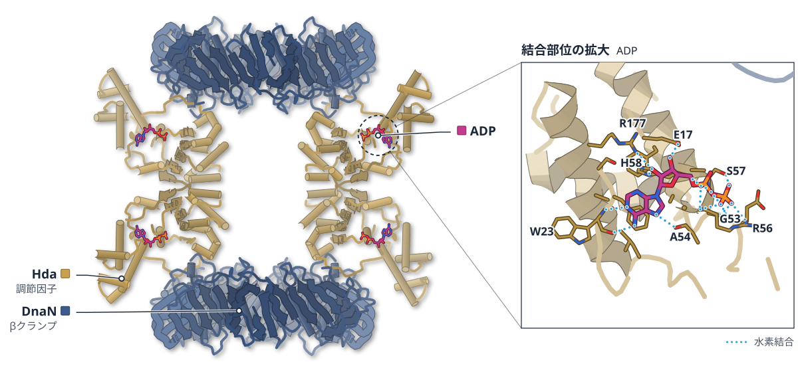
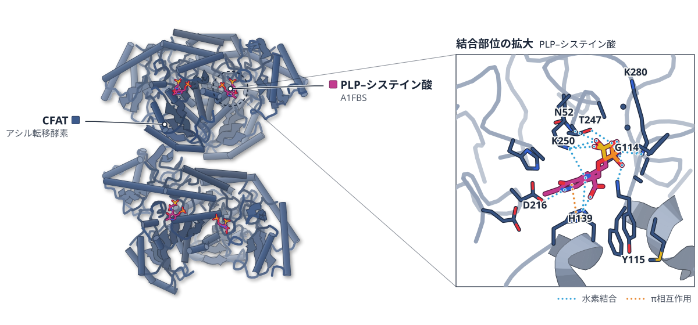
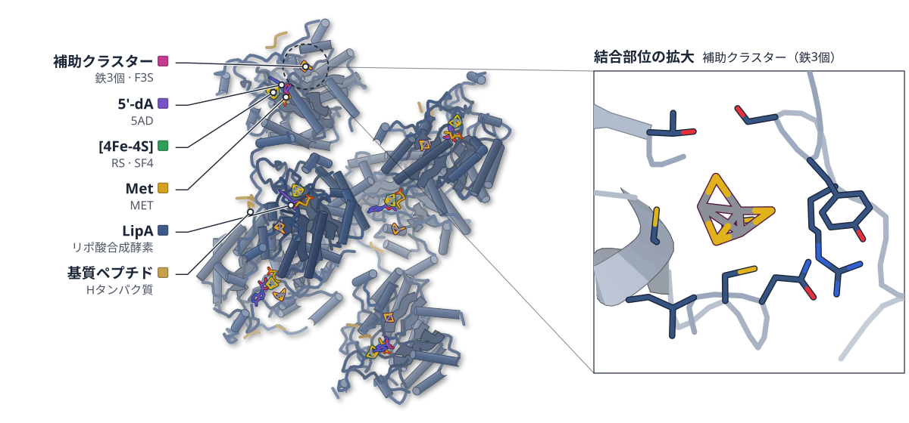

# 2026-10-25 号

**今日の新しい構造：6 本**　Europe PMC に 2026-10-24 に登録されたオープンアクセス論文 92 本のうち、新しい構造を報告した論文は 6 本。うち 4 本を紹介する（残りは末尾に一覧）。

**New Structure 2 本** · **Structure Update 1 本** · **Structure-Based Study 1 本**（New Structure：構造が初めて解かれたタンパク質。Structure Update：既知のタンパク質の新しい構造。Structure-Based Study：既存の構造を使った注目の研究）

## Today's Structure（今日の一本）

**1｜Hda–βクランプ複合体は、濃度に応じて組み合わせを変える**（Hda–DnaN（大腸菌））

選んだ理由（構造生物学・生命科学）：複製の再開始を防ぐ Hda–DnaN が、八量体から三量体へ濃度で組み替わり、触媒のArg153が埋まる状態と露出する状態を構造で示した。

> Importantly, in this state, the arginine finger (Arg153) and surrounding functional surfaces are fully exposed (Fig. 5c), consistent with a RIDA-compatible conformation capable of engaging DnaA.  
> — Results

- 迷った論文：CFAT（C. ochracea） — CFAT は基質結合型の構造が明快だが、対象が細菌の脂質合成の一酵素で、構造生物学の軸のみ。
- 迷った論文：CorA KS-AT（粘液細菌） — CorA は KS のふたの違いが分かりやすいが、図がなく、解けたのは二ドメインだけ。

| # | 標的 | 手法・分解能 | 見出し |
|---|---|---|---|
| 1 | Hda–DnaN（大腸菌） | Cryo-EM・3.12–3.55 Å（4 構造） | Hda–βクランプ複合体は、濃度に応じて組み合わせを変える |
| 2 | CFAT（C. ochracea） | X-ray・2.15–2.46 Å（2 構造） | システイン酸を選ぶ酵素は、二量体の境目に結合ポケットを持つ |
| 3 | CorA KS-AT（粘液細菌） | Cryo-EM・全体 3.13 Å | ループ状のふたが、CorAに多様な基質を受け入れさせる |
| 4 | LipA（大腸菌） | 活性測定・ITC・Mössbauer／EPR 分光 | リポ酸合成酵素は、Ser308が鉄を離すかどうかで反応が分かれる |

> この号は AI が論文本文から作成した**レビュー用の下書き**です。数値・ID・リガンドは PDB / UniProt から取得し、AI の記述には本文からの引用を付けています。

---

# Picked up Today's Structure

## 1｜Hda–DnaN（大腸菌）

### Reversible autoinhibition of the bacterial replication-licensing Hda–β clamp complex

*Nucleic Acids Research*（2026-10-23） · [論文](https://doi.org/10.1093/nar/gkag1010) · ライセンス: cc by

筆頭著者：Xuguang Jiang（The University of Tokyo, Japan）　責任著者：Masahide Kikkawa（The University of Tokyo, Japan）

色（順に）：DnaN（βクランプ） / Hda（調節因子）　スティック：ADP

**Hda–βクランプ複合体は、濃度に応じて組み合わせを変える**

クライオ電顕で4つの状態を解析。八量体では活性中心のアルギニンが埋まる

- **疑問・課題**：DNA複製の再開始を防ぐ Hda–DnaN 複合体が、不活性な八量体からどう活性な形に切り替わるかは不明だった。
- **アプローチ**：クライオ電顕と質量フォトメトリーで、濃度を変えながら複合体の分子量と構造を調べた。
- **結果**：濃度で割合が変わる複数の集合状態があり、八量体・六量体・三量体の構造を3.12〜3.43 Åで得た。
- **わかったこと**：八量体ではArg153が界面に埋まり、三量体では露出する。濃度が下がると活性な形が増えるという制御が考えられる。
- **残された課題**：生きた細胞でこれらの状態がどれだけ存在するかは、今後の確認が必要である。

この紹介文の根拠（論文本文）

> Yet this structure also raised a central mechanistic question: how can an apparently stable self-inhibited oligomer access lower-order configurations compatible with RIDA activity?  
> — 疑問・課題／Introduction

> Here, we combine cryo-electron microscopy (cryo-EM) and mass photometry (MP) to reveal that the Hda–DnaN complex is not a static, inactive particle, but a concentration-dependent dynamic ensemble that samples multiple oligomeric states.  
> — アプローチ／Introduction

> Using cryo-electron microscopy and mass photometry, we resolve multiple structural states, including an autoinhibited hetero-octamer, a hetero-hexamer intermediate, and a RIDA-compatible hetero-trimer.  
> — 結果／Abstract

> Our extensive classification and particle-cleaning procedures successfully reconstructed four distinct cryo-EM maps at resolutions of 3.12, 3.43, 3.17, and 3.55 Å, corresponding to Hda4–DnaN4, Hda2–DnaN4, Hda1–DnaN2, and DnaN2, respectively (Fig. 2a, Supplementary Fig. S3, and Table 2).  
> — 結果／Results

> Importantly, in this state, the arginine finger (Arg153) and surrounding functional surfaces are fully exposed (Fig. 5c), consistent with a RIDA-compatible conformation capable of engaging DnaA.  
> — わかったこと／Results

> Higher-order assemblies are favored at higher concentrations, whereas lower-order species become enriched upon dilution.  
> — わかったこと／Discussion

> Nevertheless, direct determination of the oligomeric distribution of Hda–DnaN in living cells will be required to establish the extent to which the higher-order assemblies identified here are populated in vivo.  
> — 残された課題／Discussion

分類：転写調節・シグナル伝達

#### 読みどころ

八量体のクライオ電顕構造は、以前の結晶構造とよく重なった（RMSD 約 1.8 Å）。DnaA の ATP 加水分解に必要な Arg153 は、Hda どうしの界面に埋まっていた。

根拠（論文本文）

> The cryo-EM structure of the hetero-octamer exhibits clear D2 symmetry and closely matches the previously reported crystal structure [20] (RMSD ∼1.8 Å), indicating that the autoinhibited assembly is preserved in solution (Fig. 3a).  
> — Results

> Notably, the catalytic Arg153 is buried within this interface, consistent with an autoinhibited state that prevents interaction with DnaA.  
> — Results

八量体から Hda の二量体が1つ外れた六量体では、Hda どうしの界面だけが大きく変形し、Hda と DnaN の界面はほぼ保たれた。この中間状態は、八量体と三量体をつなぐ分解の経路を示すと著者は考えている。

根拠（論文本文）

> Our interface comparison shows that the HD interface remains largely unchanged, whereas the HH interface undergoes distortion, particularly in helices α7 and α9 (Fig. 4c), consistent with the reduced binding energy (Fig. 2d, right panel).  
> — Results

ゲルろ過では状態を分けられなかったが、質量フォトメトリーは濃度を下げるごとに低分子量側へ移る複数の集団を直接捉えた。単粒子の分類と組み合わせて、共存する状態を構造と結びつけた。

根拠（論文本文）

> In contrast, MP directly detected multiple coexisting species in solution, while cryo-EM provided structural snapshots of these assemblies.  
> — Discussion

#### 構造データ

| PDB | 手法 | 分解能 | 公開 | 生物種 | リガンド |
|---|---|---|---|---|---|
| [25RY](https://www.rcsb.org/structure/25RY) | Cryo-EM | 3.12 Å | 2026-10-07 | Escherichia coli | ADP |
| [25RZ](https://www.rcsb.org/structure/25RZ) | Cryo-EM | 3.43 Å | 2026-10-07 | Escherichia coli | ADP |
| [25SA](https://www.rcsb.org/structure/25SA) | Cryo-EM | 3.17 Å | 2026-10-07 | Escherichia coli | ADP |
| [25WZ](https://www.rcsb.org/structure/25WZ) | Cryo-EM | 3.55 Å | 2026-10-07 | Escherichia coli | — |

- [P0A990](https://www.uniprot.org/uniprotkb/P0A990) dnaN Beta sliding clamp — *Escherichia coli O157:H7* （PDB で初めての構造）
- [P69931](https://www.uniprot.org/uniprotkb/P69931) hda DnaA regulatory inactivator Hda — *Escherichia coli (strain K12)* （既存の PDB 構造 1 件）

#### 実験メモ

- **発現系**：Hda と His タグ付き DnaN を大腸菌 BL21 (DE3) で共発現。0.3 mM IPTG、16 ℃ で 20 時間。
- **コンストラクト**：大腸菌の DnaN は N 末端 His6 タグ付きで pET-28a、Hda はタグなしで pET-21b に入れた。
- **精製**：Ni–NTA アフィニティのあと Superdex 200 Increase でゲルろ過。約 10 mg/ml に濃縮した。
- **結晶化／グリッド作製**：1.5 mg/ml（約 6 μM）の複合体 3 μl を Quantifoil R1.2/1.3 に載せ、Vitrobot Mark IV で急速凍結した。
- **データ収集・解析**：JEOL CRYO ARM 200（200 kV）と Gatan K3 で 12 396 本の動画を収集。ピクセルサイズ 0.571 Å。cryoSPARC で処理。

根拠（論文本文）

> The two plasmids were co-transformed into E. coli BL21 (DE3) cells (Novagen), and transformants were selected using both ampicillin and kanamycin.  
> — Materials and methods

> The gene encoding Hda (NCBI accession: NP_416991.2) was cloned into a pET-21b vector without an affinity tag.  
> — Materials and methods

> Purified proteins were concentrated to ∼10 mg/ml using ultrafiltration, flash-frozen in liquid nitrogen, and stored at −80°C.  
> — Materials and methods

> Three microliters of the Hda–DnaN complex at 1.5 mg/ml (∼6 μM) was applied to glow-discharged holey carbon grids (Cu, R1.2/1.3, 300 mesh, Quantifoil).  
> — Materials and methods

> A total of 12 396 movies were collected with a total exposure of 76.4 e⁻/Ų over 80 frames.  
> — Materials and methods

> The eluate was further purified by size-exclusion chromatography (SEC) using a Superdex 200 Increase column (Cytiva)  
> — Materials and methods

> 📝 編集者への確認事項：ライセンスは CC BY。DnaN には多数の既存構造があり、論文が初構造と言うのは Hda2–DnaN4 の六量体（中間体）の状態。サイトの New Structure 判定が不自然なら確認してほしい。MD は 1 ns と短く、結合エネルギーの値は参考程度（記事では数値を使っていない）。

---

# New Structure

## 2｜CFAT（C. ochracea）

### Structural and Functional Characterization of Cysteate Fatty Acyltransferases Involved in Bacterial Sulfonolipid Biosynthesis

*ACS Bio & Med Chem Au*（2026-10-24） · [論文](https://doi.org/10.1021/acsbiomedchemau.6c00154) · ライセンス: cc by-nc-nd

筆頭著者：Cuiping Pang（Shenzhen University Medical School, China）　責任著者：Jiahai Zhou（Chinese Academy of Sciences, China）、Xiaoyu Tang（Institute of Chemical Biology, China）

色（順に）：CFAT（アシル転移酵素）　スティック：PLP–システイン酸（A1FBS）

**システイン酸を選ぶ酵素は、二量体の境目に結合ポケットを持つ**

細菌のスルホ脂質をつくるCFATの結晶構造。基質結合型は2.46 Å

- **疑問・課題**：細菌のスルホ脂質（スルホ基を持つ脂質）の材料になるシステイン酸を、合成酵素がどう受け止めるかは未解明だった。
- **アプローチ**：系統解析、6種の酵素の活性測定、X線結晶構造解析、構造をもとにした変異体解析を組み合わせた。
- **結果**：二量体の境目にポケットがあり、触媒の骨格はSPTと同じで、基質結合ポケットだけが作り替えられていた。
- **わかったこと**：セリンを使うSPTと触媒の骨格は共通で、二量体の境目での基質結合部位の作り替えが、基質の違いに関わる可能性がある。
- **残された課題**：SPT型の残基に置き換えても、セリンを使う活性は生まれなかった。

この紹介文の根拠（論文本文）

> A central unresolved question is how these enzymes accommodate cysteate as a substrate.  
> — 疑問・課題／Introduction

> Here, we combined phylogenetic analysis, biochemical reconstitution, X-ray crystallography, and structure-guided mutagenesis to characterize CFAT homologues involved in bacterial sulfonolipid biosynthesis.  
> — アプローチ／Introduction

> This structure reveals a composite active-site pocket formed across the dimer interface, where the conserved PLP-dependent catalytic scaffold is retained but the substrate-binding pocket is significantly remodeled compared to canonical SPTs.  
> — 結果／Abstract

> The concentration of these substitutions at the dimer interface suggests that remodeling of the intersubunit substrate-binding environment may contribute to accommodation of the larger and more highly charged cysteate substrate.  
> — わかったこと／Results and Discussion

> Structure-guided mutagenesis identified key residues important for cysteate-dependent catalysis but failed to generate serine activity.  
> — 残された課題／Abstract

分類：酵素（その他）

#### 読みどころ

基質のシステイン酸は、補因子 PLP（ビタミン B6 由来）と結びついた中間体の形で見えた。スルホ基には Asn52・His139・Lys250 が水素結合し、隣のサブユニットの残基もポケットをつくる。

根拠（論文本文）

> Several residues directly contact the cysteate moiety: Asn52, His139 and Lys250 form hydrogen bonds with the sulfonate group (Figures B and S5), whereas Gly81, Ala82, Met277 and Phe278 from the neighboring protomer contribute to the steric environment around the cysteate side chain (Figures B and S5).  
> — Results and Discussion

セリンを使う通常の SPT（セリン パルミトイル転移酵素）と比べると、PLP まわりの触媒の配置はほぼ同じで、違いは基質の側鎖を受ける環境に集中していた。

根拠（論文本文）

> Together, these observations indicate that CFAT and SPT retain a highly conserved PLP-dependent catalytic framework but differ substantially in the architecture of the substrate-binding pocket.  
> — Results and Discussion

ポケットの周りをSPT型の残基に置き換えても、セリンを使う活性は出なかった。19 か所を置換した変異体は正しく折りたたまれなかった。両者の配列の一致は約 30% で、基質の選び方は局所の置換だけでは変えにくいらしい。

根拠（論文本文）

> The most extensively redesigned COCFAT variant, containing 19 substitutions, was not properly folded, limiting the extent to which the pocket could be rewired within the native protein scaffold.  
> — Results and Discussion

#### 構造データ

| PDB | 手法 | 分解能 | 公開 | 生物種 | リガンド |
|---|---|---|---|---|---|
| [28EH](https://www.rcsb.org/structure/28EH) | X-ray | 2.46 Å | 2026-08-26 | Capnocytophaga ochracea (strain ATCC 27872 / DSM 7271 / CCUG 9716 / JCM 12966 / NCTC 12371 / SS31 / VPI 2845) | A1FBS |
| [28FA](https://www.rcsb.org/structure/28FA) | X-ray | 2.15 Å | 2026-08-26 | Capnocytophaga ochracea (strain ATCC 27872 / DSM 7271 / CCUG 9716 / JCM 12966 / NCTC 12371 / SS31 / VPI 2845) | — |

- [C7M8J6](https://www.uniprot.org/uniprotkb/C7M8J6) capB Cysteate-C-fatty acyltransferase — *Capnocytophaga ochracea (strain ATCC 27872 / DSM 7271 / CCUG 9716 / JCM 12966 / NCTC 12371 / SS31 / VPI 2845)* （PDB で初めての構造）

#### 実験メモ

- **発現系**：大腸菌で発現。N 末端に His6 タグ。16 ℃ で 22 時間培養。
- **コンストラクト**：C. ochracea の COCFAT など 6 種の遺伝子を大腸菌用にコドン最適化し、pET28a(+) に組み込んだ。
- **精製**：Ni 親和性カラムのあと、PLP 0.2 mM を含む緩衝液で Superdex 200 のゲルろ過。
- **結晶化／グリッド作製**：10–12 mg/mL に濃縮し、シッティングドロップ蒸気拡散法で 16 ℃ で結晶化。基質結合型はシステイン酸との共結晶化。
- **データ収集・解析**：上海放射光施設（SSRF）の BL19U1 で回折データを収集。AlphaFold の予測モデルを検索モデルに分子置換で解いた。

根拠（論文本文）

> All constructs contained an N-terminal His6 tag.  
> — Materials and Methods

> Fractions containing CFAT proteins were pooled and further purified by size-exclusion chromatography on a Superdex 200 10/300 GL column equilibrated with 20 mM Tris–HCl (pH 8.0), 100 mM NaCl, and 0.2 mM PLP (Figure S8).  
> — Materials and Methods

> Purified COCFAT was concentrated to 10–12 mg mL–1 and crystallized using the sitting-drop vapor-diffusion method at 16 °C.  
> — Materials and Methods

> X-ray diffraction data for the holo and ligand-bound COCFAT crystals were collected at the BL19U1 beamline of the Shanghai Synchrotron Radiation Facility (SSRF, Shanghai, China).  
> — Materials and Methods

> Both structures were solved by molecular replacement using PHASER, with AlphaFold Colab-predicted CFAT coordinates as the search model.  
> — Materials and Methods

> Cells were harvested by centrifugation and resuspended in lysis buffer containing 20 mM Tris–HCl (pH 8.0), 300 mM NaCl, and 10% glycerol.  
> — Materials and Methods

> Cultures were grown at 37 °C until the OD600 reached 0.6–0.8, induced with 0.2 mM IPTG, and further incubated at 16 °C for 22 h.  
> — Materials and Methods

> 📝 編集者への確認事項：ライセンスは CC BY-NC-ND。PDB 28EH（基質結合型 2.46 Å）、28FA（holo 2.15 Å）。

---

# Structure Update

## 3｜CorA KS-AT（粘液細菌）

### Insights into pyrazinone biosynthesis from biochemical and cryo-EM studies of the hybrid NRPS-PKS enzyme CorA

*Engineering Microbiology*（2026-10-08） · [論文](https://doi.org/10.1016/j.engmic.2026.100308) · ライセンス: cc by

筆頭著者：Qingyu Yang（Shandong University, China）　責任著者：Hang Zhang, Wei Zhang（Shandong University, China）

**ループ状のふたが、CorAに多様な基質を受け入れさせる**

NRPS-PKS融合酵素CorAのKS-ATをクライオ電顕で解析。12種の産物ができる

- **疑問・課題**：ペプチド合成とポリケチド合成の融合酵素 CorA が、多様な基質をどう受け入れるのかは未解明だった。
- **アプローチ**：全長 CorA の試験管内反応、KS-AT 二ドメインのクライオ電顕、変異体、ドッキングで調べた。
- **結果**：全長 CorA は12種の産物をつくった。KS-AT 二量体は3.13 Åで、KS のふたがらせんでなくループだった。
- **わかったこと**：KS のふたがループであることが大きな基質の受け入れを支え、AT の SGFH モチーフが2種の伸長基質を受け入れるらしい。
- **残された課題**：解けたのは KS-AT 二ドメインだけで、NRPS 側の領域は見えなかった。

この紹介文の根拠（論文本文）

> Even so, the structural and functional origins of this promiscuity, especially within the KS domain that accommodates multiple amino acid‑derived peptidyl intermediates, remain largely undefined.  
> — 疑問・課題／Introduction

> Here, combining in vitro biochemistry, structure determination by cryo-electron microscopy (EM), mutagenesis, and molecular docking, we show that full-length CorA generates twelve distinct 5-alkylated pyrazinone products using six amino acid combinations and two acyl-CoA extenders, highlighting an unusually permissive gating mechanism within the KS domain.  
> — アプローチ／Abstract

> The 3.1-Å cryo-EM structure of the CorA KS-AT didomain provides structural insights into its substrate-binding architecture.  
> — 結果／Abstract

> In contrast, the α-helical element that serves as the active-site cap to enclose the substrate-binding pocket is conserved in canonical KS domains but is absent in CorA-KS domain, where it is replaced by a flexible loop (Fig. 4a).  
> — 結果／Results and discussion

> The atypical SGFH motif of the AT domain permits dual binding of M-CoA and MM-CoA, and an irregular non-helical loop in the KS domain creates an open pocket for large amino acid-derived intermediates.  
> — わかったこと／Abstract

> Despite these efforts, iterative rounds of 2D classification and 3D refinement yielded clear density maps only for the KS-AT didomain, whereas the remaining regions of CorA, particularly the NRPS module, remained invisible (Figures S9a and S9c).  
> — 残された課題／Results and discussion

分類：酵素（その他）

#### 読みどころ

ふつうの PKS の KS ドメインでは、活性部位のふたがらせんをつくる。CorA ではこれが柔らかいループに置き換わり、アミノ酸由来の大きな中間体が入る内側のポケットが広く開いていた。

根拠（論文本文）

> Specifically, the inner acyl pockets of CorA-KS domain and other NRPS-PKS hybrid KS domains are substantially more spacious and open than those of canonical type I PKSs (Figure S23).  
> — Results and discussion

CorA の KS のふたを DEBS モジュール 5 のらせん型に置き換えた変異体では、6 つの産物のうち 5 つが完全に消え、残る1つもごく微量になった。ふたがループであることが、基質の幅広さに必要だった。

根拠（論文本文）

> The chimeric enzyme produced only trace amounts of product 2 (Ile-Leu-M-CoA), whereas the formation of the other five products was completely abolished (Fig. 4d).  
> — Results and discussion

AT ドメインの基質認識モチーフは、ふつうと違う SGFH 配列だった。M-CoA 用の HAFH や MM-CoA 用の YASH に近づけた変異体でも、基質の好みはほとんど変わらなかった。

根拠（論文本文）

> Notably, none of these variants displayed a significant shift in substrate selectivity (Fig. 3d), suggesting that residues outside the conserved SGFH motif also contribute to substrate recognition and binding.  
> — Results and discussion

#### 構造データ

原子モデルのない cryo-EM マップ（EMDB）：[EMD-81083](https://www.ebi.ac.uk/emdb/EMD-81083), [EMD-81084](https://www.ebi.ac.uk/emdb/EMD-81084)

#### 実験メモ

- **発現系**：大腸菌 BAP1 で発現。
- **コンストラクト**：全長 corA を pET28a(+) に組み込んだ。Strep-tag II を持つ。
- **精製**：Ni-NTA、Strep-Tactin、Superdex 200 ゲルろ過の順に精製。
- **結晶化／グリッド作製**：2 mg/mL の CorA 3 μL を Quantifoil R1.2/1.3 金グリッドに載せ、Vitrobot Mark IV で急速凍結した。
- **データ収集・解析**：Glacios G2（200 kV）と Falcon 4i で 5,816 本の動画を収集。cryoSPARC で処理し、AlphaFold3 の予測モデルを土台にモデルを作った。

根拠（論文本文）

> The corA gene fragment was ligated into the pET28a(+) vector, and the resultant recombinant plasmid was transformed into Escherichia coli BAP1 cells.  
> — Materials and methods

> Imidazole-containing elution buffer (20 mM Tris, pH 7.5, 100 mM NaCl, 300 mM Imidazole) was used to retrieve crude CorA, which was further purified through Strep‑Tag II affinity chromatography.  
> — Materials and methods

> A Superdex 200 gel filtration column equilibrated with 20 mM Tris (pH 8.0) and 100 mM NaCl was applied for final purification.  
> — Materials and methods

> For cryo-EM, 3 μL CorA (2 mg·mL⁻¹) was loaded onto glow-discharged Quantifoil R1.2/1.3 gold grids (Quantifoil Micro Tools, Jena, Germany) and then blotted and plunge-frozen with a Vitrobot Mark IV (Thermo Fisher Scientific, Waltham, MA, USA).  
> — Materials and methods

> A total of 5,816 movies with defocus values from −2.5 to −1.0 μm were recorded, each split into 40 frames over an exposure of 3 s.  
> — Materials and methods

> The AlphaFold3-predicted CorA structure served as the template for KS-AT didomain de novo modeling.  
> — Materials and methods

> 📝 編集者への確認事項：ライセンスは CC BY。PDB 登録は拡張形式の ID（本文は 000027DN）で、通常の 4 文字 ID としてたどれないため図なし。EMDB は EMD-81083（全体）、EMD-81084（AT の局所マップ）。ドッキング・MD の結果は記事に使っていない。

---

# Structure-Based Study

## 4｜LipA（大腸菌）

### Amino Acids in the RSSY Motif of Lipoyl Synthase Control Substrate Binding and Reactivity

*ACS Bio & Med Chem Au*（2026-10-24） · [論文](https://doi.org/10.1021/acsbiomedchemau.6c00105) · ライセンス: cc by

筆頭著者：Vivian Robert Jeyachandran（The Pennsylvania State University, United States）　責任著者：Carsten Krebs, Squire J. Booker（The Pennsylvania State University, United States）

PDB 5EXK（論文が使った既存の構造）

色（順に）：LipA（リポ酸合成酵素） / 基質ペプチド（Hタンパク質）　スティック：補助クラスター（鉄3個）（F3S）、[4Fe-4S]（RS）（SF4）、5'-dA（5AD）、Met（MET）

**リポ酸合成酵素は、Ser308が鉄を離すかどうかで反応が分かれる**

既存の結晶構造を土台に、変異体の活性と分光で調べた

- **疑問・課題**：補助クラスターの鉄に配位する Ser308 を含む RSSY モチーフが、反応にどう関わるかを調べる課題があった。
- **アプローチ**：大腸菌 LipA の変異体を作り、活性・ITC・Mössbauer と EPR 分光で調べ、結核菌 LipA の結晶構造で解釈した。
- **結果**：R306K は基質にほぼ結合しなかった。S308C は鉄3個の中間体の代わりに、S = 7/2 の中間体と 6-オクテノイル産物を生んだ。
- **わかったこと**：Ser308 が鉄を離すかどうかが、硫黄の付加へ進むか別の産物へ向かうかを分けると、著者は考えている。

この紹介文の根拠（論文本文）

> The auxiliary cluster is ligated by three cysteines in a CX4CX5C motif and one serine residue (Ser308 in Escherichia coli) in a highly conserved R306SS308Y motif in the C-terminal region of the protein.  
> — 疑問・課題／Abstract

> Because the structure of Ec LipA has not been determined, the X-ray crystal structure of Mt LipA was used as a structural reference to interpret Ec LipA’s activity analyses.  
> — アプローチ／Results

> Substitution of Arg306 with Lys results in an essentially inactive protein due to poor substrate binding and positioning in the active site.  
> — 結果／Abstract

> Instead, the auxiliary cluster remains tetranuclear and forms a monothiolated cross-linked species with a high-spin, S = 7/2 configuration that decays to the 6-octenoyl-containing  
> — 結果／Abstract

> These results demonstrate that retention of the fourth iron inhibits cluster degradation and promotes an alternative reaction pathway.  
> — わかったこと／Discussion

分類：酵素（その他）

#### 読みどころ

Arg306 を Lys に替えた変異体では、基質タンパク質の結合による熱がITCで検出されなかった。Arg306 が基質のオクタノイル基への結合に必要だと考えられる。

根拠（論文本文）

> No detectable heat of binding was observed in the ITC experiment, suggesting that the binding affinity is drastically decreased for the variant (Figure C).  
> — Results

Ser308 を Cys に替えると、リポ酸の代わりに 6-オクテノイル産物が増えた（30 μM の酵素で約 8.6 μM、野生型は約 1.6 μM）。Cys は Ser より鉄に強く配位するため鉄が離れず、補助クラスターが壊れないらしい。

根拠（論文本文）

> In 2.5 h, 30 μM of the Ec LipA S308C variant produced approximately 8.6 μM of the 6-octenoyl peptide product.  
> — Results

> Cysteine, being a stronger ligand than serine, is more likely to coordinate with the unique iron.  
> — Results

S308C の反応では、EPR と Mössbauer 分光で S = 7/2 の短命な中間体が見えた。著者はこれを、オクタノイル基のラジカルが補助クラスターの硫黄を攻撃して生じた [4Fe-4S]+ 様の状態と帰属している。

根拠（論文本文）

> We assign the species with the S = 7/2 ground state to a reduced [4Fe-4S]+-like auxiliary cluster, which we propose is formed by the attack of the octano-6-yl radical on one of the μ3-sulfides of the [4Fe-4S]2+ auxiliary cluster  
> — Results

#### 構造データ

| PDB | 手法 | 分解能 | 公開 | 生物種 | リガンド |
|---|---|---|---|---|---|
| [5EXJ](https://www.rcsb.org/structure/5EXJ) | X-ray | 1.64 Å | 2016-08-10 | Mycobacterium tuberculosis (strain ATCC 25618 / H37Rv) | DTV, SF4 |
| [5EXK](https://www.rcsb.org/structure/5EXK) | X-ray | 1.86 Å | 2016-08-10 | Mycobacterium tuberculosis, Mycobacterium tuberculosis (strain ATCC 25618 / H37Rv) | 5AD, MET, SF4, F3S |

- [P9WK91](https://www.uniprot.org/uniprotkb/P9WK91) lipA Lipoyl synthase — *Mycobacterium tuberculosis (strain ATCC 25618 / H37Rv)* （既存の PDB 構造 0 件）
- [P9WN55](https://www.uniprot.org/uniprotkb/P9WN55) gcvH Glycine cleavage system H protein — *Mycobacterium tuberculosis (strain ATCC 25618 / H37Rv)* （既存の PDB 構造 0 件）

#### 実験メモ

- **発現系**：大腸菌 BL21(DE3) で発現。N 末端に His6 タグ。
- **結晶化／グリッド作製**：Fe–S クラスターは塩化鉄・硫化ナトリウム・DTT で化学的に再構成した。
- **データ収集・解析**：活性測定は嫌気チャンバー内で室温。ITC は VP-ITC を使い、23 ℃ で測定した。

根拠（論文本文）

> N-terminal hexahistidine-tagged WT Ec NfuA and WT or variant forms of Ec LipA were expressed in Ec BL21  
> — Methods

> For each protein, Fe-S cluster cofactors were chemically reconstituted with excess ferric chloride, sodium sulfide, and DTT using established procedures  
> — Methods

> All activity assays were performed under anoxic conditions in a Coy (Grasslake, MI) anaerobic chamber at room temperature.  
> — Methods

> Isothermal titration calorimetry (ITC) was performed on a VP-ITC (GE Healthcare, Piscataway, NJ) housed in a Coy anaerobic chamber  
> — Methods

> 📝 編集者への確認事項：ライセンスは未確認（candidates.json を参照）。大腸菌 LipA の構造は未決定で、論文は結核菌 LipA の結晶構造（5EXJ・5EXK）を参照して解釈している。構造図は結核菌のもの。6 点でぎりぎり（structure は 1 点）。

---

## 注目の構造の採点（62 本を確認し、5 本を採点）

基準は `pipeline/impact.py`（10 点満点、6 点以上から最大 3 本）。

| 選定 | 論文 | 種類 | novelty | reach | structure | support | 計 | 理由 |
|---|---|---|---|---|---|---|---|---|
| ◯ | PMC13692730 Amino Acids in the RSSY Motif of Lipoyl Synthase Control Sub | 既存構造で機構を解明 | 2 | 1 | 1 | 2 | 6 | S308C 変異体で、鉄3個の中間体の代わりに S = 7/2 の中間体と 6-オクテノイル産物が見えた点が新しい。大腸菌 LipA の構造は未決定で、結核菌の結晶構造に当てはめて解釈している（structure は 1 点）。対象は LipA という一つの系なので reach は 1。6 点でぎりぎり。 |
|  | PMC13693507 Conserved IQ motifs, divergent apo‐calmodulin recognition in | 既存構造で機構を解明 | 1 | 1 | 1 | 1 | 4 | ITC と NMR（自前）で UBE3B と UBE3C の結合の違いを示したが、既知の IQ–アポCaM 結合様式の延長で novelty 1。構造モデルは AlphaFold3 と MD。 |
|  | PMC13692751 Protein Thioether Crosslinks Installed by a SPASM-Containing | 新しい手法・ソフト | 2 | 1 | 0 | 1 | 4 | ラジカル SAM 酵素 CrpC が大きなタンパク質基質にランチオニン架橋を入れることを質量分析で示したが、構造の実験はない（structure 0）。 |
|  | PMC13692733 Structure-Based Design of New Nonpeptidic Covalent Mpro Inhi | 構造に基づく創薬 | 1 | 1 | 0 | 1 | 3 | 既存の Mpro 構造からの設計とドッキングが根拠で、自前の実験構造がない（structure 0）。質量分析で共有結合は確かめている。 |
|  | PMC13683858 Structure-guided computational design and mechanistic unders | 構造予測・AI・デザイン | 1 | 0 | 0 | 1 | 2 | 計算で設計した抗体変異体を ELISA と Biacore で確かめたが、親抗体より親和性が下がり、実験構造もない（structure 0）。 |

novelty：何が初めてか / reach：誰に効くか / structure：実験で決めた構造（X 線・クライオ電顕・NMR / support：裏付けの強さ（2＝独立した実験で検証：変異体・機能測定・既存手法との比較など／1＝一部の検証のみ／0＝計算のみで実験的検証なし）

## 記事にしていない新しい構造

- [Catalysis tuned for metabolic sensing: dynamics and mechanism of the RNA methyltransferase METTL16](https://doi.org/10.1039/d6cb00242k) — *RSC Chem Biol*（新しい構造：28WE, 28ZC）
- [A novel double-mAb sandwich ELISA utilizing broad-spectrum neutralizing antibodies as an in vitro alternative to the rabies vaccine NIH potency assay](https://doi.org/10.3389/fimmu.2026.1960986) — *Front Immunol*（新しい構造：7U90）
- [Identification of small-molecule inhibitors of the immune system repressor Regnase-1](https://doi.org/10.1093/narmme/ugag043) — *NAR Mol Med*（新しい構造：23KX）
