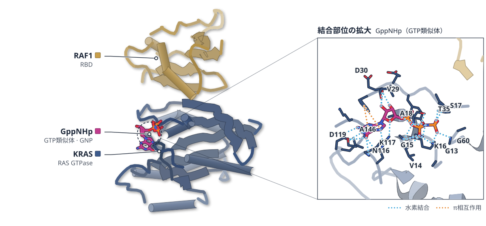

# 2026-10-26 号

**今日の新しい構造：0 本**　PMC に 2026-10-25 に登録されたオープンアクセス論文 37 本のうち、新しい構造を報告した論文は 0 本。すべて紹介する。

出典：この号の論文情報と全文は、米国国立医学図書館（NLM）の PMC オープンアクセスデータセット（AWS Open Data）から取得した。

**Structure-Based Study 1 本**（New Structure：構造が初めて解かれたタンパク質。Structure Update：既知のタンパク質の新しい構造。Structure-Based Study：既存の構造を使った注目の研究）

| # | 標的 | 手法・分解能 | 見出し |
|---|---|---|---|
| 1 | KRAS・CYPA（ヒト） | X-ray・生化学・細胞アッセイ | RAS阻害剤への耐性は、薬が結ぶ複合体を壊す変異で起こる |

> この号は AI が論文本文から作成した**レビュー用の下書き**です。数値・ID・リガンドは PDB / UniProt から取得し、AI の記述には本文からの引用を付けています。

---

# Structure-Based Study

## 1｜KRAS・CYPA（ヒト）

### Disrupted molecular glue complex drives RAS inhibitor resistance

*Cell*（2026-05-05） · [論文](https://doi.org/10.1016/j.cell.2026.03.031) · ライセンス: cc by-nc-nd

筆頭著者：Ben Sang（Memorial Sloan Kettering Cancer Center, USA）　責任著者：Piro Lito（Memorial Sloan Kettering Cancer Center, USA）

PDB 6VJJ（論文が使った既存の構造）

色（順に）：KRAS（RAS GTPase） / RAF1（RBD）　スティック：GppNHp（GTP類似体）（GNP）

**RAS阻害剤への耐性は、薬が結ぶ複合体を壊す変異で起こる**

患者検体の耐性変異を結晶構造と変異体で解析し、Y64変異にも効く化合物を示した

- **疑問・課題**：RAS阻害剤ダラキソンラシブへの耐性が、どう生じるかは十分に分かっていなかった。
- **アプローチ**：患者40人の検体で耐性変異を探し、結晶構造と生化学・細胞の測定で仕組みを調べた。
- **結果**：KRAS Y64変異は薬との芳香環の積み重なりを壊し、Y71HはCRAFのRBDとの結合を強めた。
- **わかったこと**：耐性変異は、薬がRASとCYPAをつなぐ分子糊の働きを壊す点で共通していた。
- **残された課題**：Y71HがCYPA結合にも作用する可能性は、今回のデータでは除外できない。

この紹介文の根拠（論文本文）

> Although these agents have shown clinical activity in RAS mutant cancers, resistance mechanisms remain poorly defined.  
> — 疑問・課題／Abstract

> Here, we analyzed paired baseline and end-of-treatment samples from 40 patients treated with the RAS inhibitor daraxonrasib and identified recurrent alterations in 18 cases.  
> — アプローチ／Abstract

> we solved the tertiary structure of KRAS Y71H in complex with the RBD of CRAF at a 1.76-Å resolution (Figure 4D; Table S1).  
> — アプローチ／Results

> The crystal structure of KRAS G12D in complex with the RAS(ON) inhibitor RMC-7977 revealed that Y64 forms a π-π stacking interaction with the indole ring of the inhibitor (Figure 3A).  
> — 結果／Results

> The structure shows that H71 forms a neomorphic interaction involving both an H-bond and a π-cation interaction with the arginine 67 (R67) residue in the CRAF RBD.  
> — 結果／Results

> These findings uncover convergent resistance mechanisms that undermine the molecular glue function  
> — わかったこと／Abstract

> the data do not exclude the possibility of a dual mechanism where Y71H also modulates CYPA binding (also allosterically)  
> — 残された課題／Discussion

分類：転写調節・シグナル伝達

#### 読みどころ

KRAS Y71HとCRAFのRBDの結晶構造で、H71がRBDのArg67と水素結合とπ-カチオン相互作用を作っていた。この余分な結合でRAFへの親和性が上がり、薬でRAFを追い出しにくくなると考えられる。

根拠（論文本文）

> Our structural data suggest that the additional interaction of Y71H is responsible for the higher affinity for the CRAFRBD  
> — Results

> The structure shows that H71 forms a neomorphic interaction involving both an H-bond and a π-cation interaction with the arginine 67 (R67) residue in the CRAF RBD.  
> — Results

別の阻害剤RMC-4791とKRAS・CYPAの複合体では、Y64の積み重なる相手が薬の尾部のピリジン環に変わっていた。この化合物はY64変異体でも効果を保った。

根拠（論文本文）

> Moreover, the Y64 residue formed a π-π stacking interaction with the pyridine ring at the tail end of RMC-4791  
> — Results

> Together, these data suggest that RMC-4791 is a promising lead to overcome the resistance driven by Y64 mutations  
> — Results

キナーゼ活性のないBRAF変異も耐性を生んだ。RAFが二量体になるとCRDがKRASに結合しやすい向きになり、薬で外れにくくなるらしい。この部分はAlphaFoldのモデルと細胞の実験による。

根拠（論文本文）

> The live-cell data argue that RAF dimerization repositions the CRD of RAF in an orientation where it can optimally interact with KRAS, a conformation that is harder to displace by TCIs, thus leading to attenuated inhibition.  
> — Results

#### 構造データ

| PDB | 手法 | 分解能 | 公開 | 生物種 | リガンド |
|---|---|---|---|---|---|
| [6VJJ](https://www.rcsb.org/structure/6VJJ) | X-ray | 1.40 Å | 2020-11-25 | Homo sapiens | GNP |
| [5US4](https://www.rcsb.org/structure/5US4) | X-ray | 1.83 Å | 2017-03-22 | Homo sapiens | GDP |
| [3K0N](https://www.rcsb.org/structure/3K0N) | X-ray | 1.39 Å | 2009-12-08 | Homo sapiens | — |

- [P01116](https://www.uniprot.org/uniprotkb/P01116) KRAS GTPase KRas — *Homo sapiens* （既存の PDB 構造 0 件）
- [P04049](https://www.uniprot.org/uniprotkb/P04049) RAF1 RAF proto-oncogene serine/threonine-protein kinase — *Homo sapiens* （既存の PDB 構造 0 件）
- [P62937](https://www.uniprot.org/uniprotkb/P62937) PPIA Peptidyl-prolyl cis-trans isomerase A — *Homo sapiens* （既存の PDB 構造 0 件）

#### 実験メモ

- **発現系**：KRAS（1–169）とCRAFのRBD（52–131）を大腸菌BL21(DE3)で発現。N末端にHisタグ。
- **精製**：Ni–NTAで精製し、TEVでタグを外してSuperdex 75でゲルろ過した。
- **結晶化／グリッド作製**：シッティングドロップ蒸気拡散法、18 ℃で結晶化。
- **データ収集・解析**：NSLS-IIのFMXビームラインで回折データを収集し、6VJJを探索モデルに分子置換で解いた。

根拠（論文本文）

> residues 1–169 of KRAS and residues 52–131 of the RBD were expressed in E. coli BL21(DE3) as N-terminal His-tagged constructs and purified by Ni–NTA affinity chromatography.  
> — Methods

> The His tag was removed by TEV protease digestion overnight at 4 °C, followed by size-exclusion chromatography on a Superdex 75 column.  
> — Methods

> Crystallization was carried out by sitting-drop vapor diffusion in 96-well format, mixing 0.5 μL protein solution with 0.5 μL reservoir solution at 18 °C.  
> — Methods

> Diffraction data were collected at beamline 17-ID-2 (FMX) at NSLS-II, processed with XDS and scaled with AIMLESS.  
> — Methods

> The structure was solved by molecular replacement with Phaser (Phenix) using the KRAS–CRAF RBD complex (PDB: 6VJJ) as the search model.  
> — Methods

> 📝 編集者への確認事項：collect は『既存構造の利用』に分類したが、本文は自前の結晶構造2つ（KRAS Y71H–CRAF RBD 1.76 Å、KRAS–RMC-4791–CYPA 1.57 Å）を報告している。PDB ID は本文に書かれておらず（Table S1 のみ）、照合できないため新しい構造としては扱わず、注目の構造（8点）として書いた。構造図は既存の KRAS–CRAF RBD 複合体（6VJJ）。

---

## 注目の構造の採点（37 本を確認し、5 本を採点）

基準は `pipeline/impact.py`（10 点満点、6 点以上から最大 3 本）。

| 選定 | 論文 | 種類 | novelty | reach | structure | support | 計 | 理由 |
|---|---|---|---|---|---|---|---|---|
| ◯ | PMC13695080 Disrupted molecular glue complex drives RAS inhibitor resist | 既存構造で機構を解明 | 2 | 2 | 2 | 2 | 8 | 患者検体とモデルで見つかったRAS阻害剤の耐性変異を、自前の結晶構造2つと変異体の測定で説明し、耐性を回避する化合物まで示した。 |
|  | PMC13694986 E. coli RsmF activity depends on prior modification of 16S r | 既存構造で機構を解明 | 2 | 1 | 1 | 2 | 6 | rRNAメチル化の順序依存を示した点は新しいが、構造データは化学プロービング（SHAPE-MaP）で、原子分解能の実験構造はなく、MDは既存構造9Q87を出発点にしている。reachも1（この酵素の系に限られる）。 |
|  | PMC13695568 Sacrificial Methionine Residues Protect Active-Site Histidin | 既存構造で機構を解明 | 2 | 2 | 0 | 2 | 6 | メチオニンが活性部位のヒスチジンを酸化から守るという着想は新しいが、実験で決めた構造による検証がなく（structure 0）、既存構造の距離解析と化学合成・酸化実験が根拠。 |
|  | PMC13695380 Design of an engineered Gαq protein for high-yield expressio | 新しい手法・ソフト | 1 | 2 | 1 | 1 | 5 | Gαqを大腸菌で作る発現法の改良で、HSQCスペクトルは出したが構造決定や機構の新規性は小さい（5点）。 |
|  | PMC13694243 Functional characterization and pharmacochaperone rescue of  | 構造予測・AI・デザイン | 1 | 1 | 0 | 2 | 4 | SLC6A1変異の安定性をAI予測と細胞実験で調べたが、構造は既存のGAT-1構造（7Y7W）に予測ツールを当てただけで、実験構造による検証はない。 |

novelty：何が初めてか / reach：誰に効くか / structure：実験で決めた構造（X 線・クライオ電顕・NMR / support：裏付けの強さ（2＝独立した実験で検証：変異体・機能測定・既存手法との比較など／1＝一部の検証のみ／0＝計算のみで実験的検証なし）
