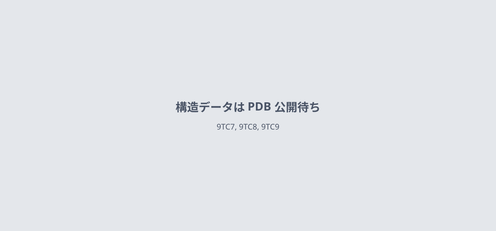
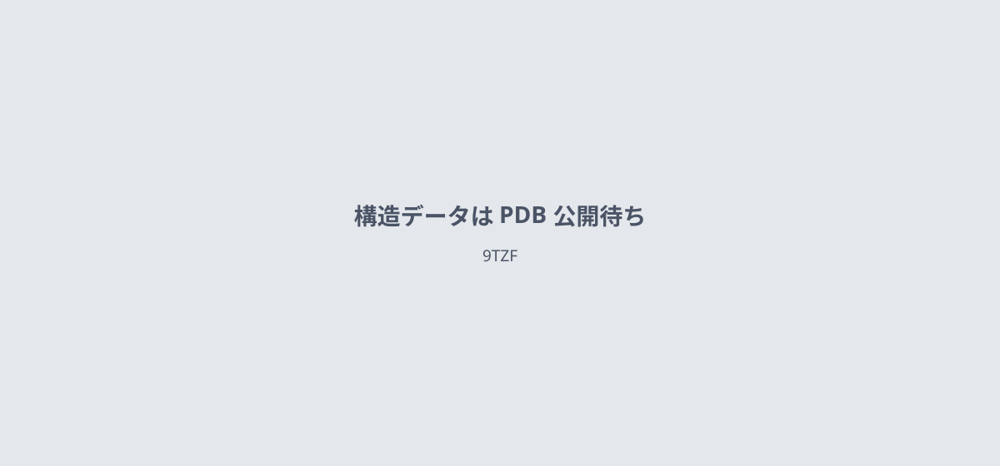

# 2026-10-27 号

**今日の新しい構造：2 本**　Europe PMC に 2026-10-26 に登録されたオープンアクセス論文 6 本のうち、新しい構造を報告した論文は 2 本。すべて紹介する。

**Structure Update 2 本**（New Structure：構造が初めて解かれたタンパク質。Structure Update：既知のタンパク質の新しい構造。Structure-Based Study：既存の構造を使った注目の研究）

| # | 標的 | 手法・分解能 | 見出し |
|---|---|---|---|
| 1 | GPR55（脂質受容体） | Cryo-EM・2.66–2.88 Å | 糖鎖の部位を変えると、GPR55の阻害剤が作動薬になる |
| 2 | DnaB・DciA（コレラ菌） | Cryo-EM・3.5 Å | DciAは、DnaBの輪を楔のように割って開く |

> この号は AI が論文本文から作成した**レビュー用の下書き**です。数値・ID・リガンドは PDB / UniProt から取得し、AI の記述には本文からの引用を付けています。

---

# Structure Update

## 1｜GPR55（脂質受容体）

### Molecular insights into GPR55 modulation reveal an atypical activation mechanism and glycosylation-dependent efficacy regulation

*Nature Communications*（2026-10-24） · [論文](https://doi.org/10.1038/s41467-026-78538-1) · ライセンス: cc by-nc-nd

筆頭著者：Tobias Claff（Boehringer Ingelheim Pharma GmbH & Co. KG, Germany）　責任著者：Tobias Claff, Dietmar Weichert（Boehringer Ingelheim Pharma GmbH & Co. KG, Germany）

**糖鎖の部位を変えると、GPR55の阻害剤が作動薬になる**

阻害剤との不活性型と活性型をクライオ電顕で解き、ヘリックスVIIの約90°の回転による活性化を示した

- **疑問・課題**：GPR55の阻害剤がどう結合するかの理解が乏しく、使いやすい化学プローブも不足していた。
- **アプローチ**：阻害剤CID16020046との不活性型と、糖鎖部位N171Qの変異体で得た活性型を、クライオ電顕で解析した。
- **結果**：不活性型は2.66 Å、活性型は2.77 Åで決まった。N171Qで阻害剤は作動薬になり、ヘリックスVIIは約90°回った。
- **わかったこと**：ヘリックスVIの外向きの動きではなく、ヘリックスVII/VIIIの切り替えで活性化するという、非典型的な機構が示された。
- **残された課題**：糖鎖の付く部位を変えると阻害剤が作動薬に変わる分子的な理由は、完全には分かっていない。

この紹介文の根拠（論文本文）

> progress in understanding GPR55 function has still been limited by suboptimal chemical probes  
> — 疑問・課題／Abstract

> a broader understanding of how structurally distinct antagonists bind to this receptor is crucial to guide drug discovery efforts  
> — 疑問・課題／Introduction

> Here, we present cryo-electron microscopy (cryo-EM) structures of GPR55 in both inactive and active states.  
> — アプローチ／Abstract

> Surprisingly, mutation of a glycosylation site in extracellular loop 2 converted CID16020046 into a potent agonist, enabling co-structure determination of the active, G13-bound receptor.  
> — アプローチ／Abstract

> yielded a 3D reconstruction at 2.66 Å global resolution  
> — 結果／Results

> The cryo-EM structure was resolved at 2.77 Å global resolution  
> — 結果／Results

> activation involves a helix VII/VIII switch enabled by a pronounced ~90° rotation of helix VII  
> — 結果／Results

> Comparative analysis of both states bound to the same ligand provides insights into an atypical activation mechanism that diverges from the typical helix VI outward movement observed in other GPCRs.  
> — わかったこと／Abstract

> the precise molecular basis by which the glycosylation removal converts CID16020046 and its charged derivatives from inverse agonists to potent agonists is not completely understood  
> — 残された課題／Discussion

分類：GPCR・受容体

#### 読みどころ

不活性型ではヘリックスVIIがそのままC末端側へ伸びている。活性化するとヘリックスVIIが約90°回ってヘリックスVIIIができ、Gタンパク質が結合できるようになる。

根拠（論文本文）

> In the inactive state, GPR55 lacks the amphipathic helix VIII, as helix VII extends into a continuous C-terminal helix.  
> — Results

> Only upon activation, helix VIII is formed by rotation around V2917.56, enabling G protein binding that would otherwise be sterically blocked  
> — Results

糖鎖の付くN171をQに変えると、CID16020046はEC50 10.2 nM・Emax 83%の強い作動薬になった。ただしこの切り替えはG13経路だけで、β-アレスチン2では見られない。

根拠（論文本文）

> Remarkably, CID16020046 transformed from a weak inverse agonist into a potent agonist at N171ECL2Q and N171ECL2A  
> — Results

> the efficacy switch of CID16020046 was exclusively present in the G13 pathway  
> — Discussion

不活性型の構造を手がかりに、溶解性と選択性に難のある化合物4を改良してBI-8310を作った。膜透過性が低いため、in vitro用のプローブとして位置づけられる。

根拠（論文本文）

> showed markedly enhanced solubility across a broad range of pH values  
> — Results

> BI-8310 displays low membrane permeability and should therefore be regarded primarily as an in vitro tool compound  
> — Discussion

#### 構造データ

| PDB | 手法 | 分解能 | 公開 | 生物種 | リガンド |
|---|---|---|---|---|---|
| 9TC7 | — | — | 公開待ち | — | — |
| 9TC8 | — | — | 公開待ち | — | — |
| 9TC9 | — | — | 公開待ち | — | — |

#### 実験メモ

- **発現系**：ICL3にbRILを入れ、C末端を削った受容体をTni昆虫細胞（High Five）で発現した。
- **コンストラクト**：ICL3の213–215をbRILに置換し、C末端を306残基で切って、S108Kを導入した。
- **精製**：LMNG/CHS-Tris可溶化し、StrepTactin XT樹脂で精製した。
- **結晶化／グリッド作製**：Vitrobot Mark IVを使い、液体エタンに落として凍結した。
- **データ収集・解析**：Titan Krios G4にSelectrisXフィルターを組み合わせて撮影し、cryoSPARCで処理した。

根拠（論文本文）

> The construct was expressed in Tni insect cells (High Five Cells, Thermo Fisher Scientific)  
> — Methods

> amino acids 213-215 of the ICL3 of GPR55 were replaced by bRIL, the C-terminus was truncated to amino acid 306 and a single stabilizing point mutation  
> — Methods

> The complex was solubilized from the membranes using a LMNG/CHS-Tris solubilization buffer and bound to a StrepTactin XT 4flow high-capacity resin  
> — Methods

> Samples were vitrified by plunging into liquid ethane.  
> — Methods

> equipped with a cold-field emission gun and a SelectrisX energy filter (10 eV slit width)  
> — Methods

> Cryo-EM data processing was performed with cryoSPARC (Structura Biotechnology)  
> — Methods

> 📝 編集者への確認事項：PDB 9TC7・9TC8・9TC9 は未公開のため構造図なし。GPR55 は 9GE2・9GE3 など既存構造があるため Structure Update の見込み。原文は CC BY-NC-ND。

---

## 2｜DnaB・DciA（コレラ菌）

### Structural basis of DnaB ring opening by the ancestral helicase loader DciA

*Nucleic Acids Research*（2026-10-26） · [論文](https://doi.org/10.1093/nar/gkag977) · ライセンス: cc by-nc

筆頭著者：Lidia Araújo-Bazán（Centro de Investigaciones Biológicas Margarita Salas, Spain）　責任著者：Ernesto Arias-Palomo（Centro de Investigaciones Biológicas Margarita Salas, Spain）

**DciAは、DnaBの輪を楔のように割って開く**

DnaBとDciAの複合体を3.5 Åのクライオ電顕で解析。1本のN末端ドメインが輪の切れ目に入り込む

- **疑問・課題**：DNAをほどく輪状の酵素DnaBを、DciAがどう開いて装填するのかは分かっていなかった。
- **アプローチ**：コレラ菌のDnaB・DciA複合体をクライオ電顕で解析し、DciAの断片や変異体で機能を調べた。
- **結果**：3.5 Åの構造で、DnaBは切れ目を1か所もつ右巻きの開いた螺旋になり、約16 Åの隙間ができていた。
- **わかったこと**：DciAのC末端が輪の外側で土台になり、N末端ドメインの1つが切れ目に入って、輪を開いた状態に保つ。
- **残された課題**：ヘリカーゼがDNAに載った後、DciAがいつ外れるのかは分かっていない。

この紹介文の根拠（論文本文）

> In bacteria, most species lack canonical AAA+ helicase loaders and instead rely on DciA, an evolutionarily conserved, ATP-independent factor whose mechanism has remained unclear.  
> — 疑問・課題／Abstract

> How this ancestral factor remodels the DnaB hexamer and whether its distinct domains contribute differentially to efficient helicase deposition remain unknown.  
> — 疑問・課題／Introduction

> Here we address these questions using the V. cholerae DnaB–DciA system.  
> — アプローチ／Introduction

> To investigate the respective contributions of the two DciA domains to helicase regulation we produced separate N-terminal and C-terminal constructs  
> — アプローチ／Results

> The helicase adopts a right-handed, open-helical arrangement in which one subunit interface is disrupted in both the N-terminal and C-terminal tiers  
> — 結果／Results

> A 3.5 Å cryo-EM structure reveals a DnaB6·DciA3 complex in which DciA binds the periphery of the helicase and stabilizes a right-handed open-helical conformation with a single cracked interface.  
> — 結果／Abstract

> one N-terminal domain (NTD) engages the cracked interface, occupying the pocket vacated by the displaced linker helix and acting as a wedge to promote ring opening  
> — わかったこと／Abstract

> Whether DciA dissociates before, during or after this process remains unknown.  
> — 残された課題／Discussion

分類：酵素（その他）・DNA・RNA に関わるもの

#### 読みどころ

DciAの3分子は、1つおきのリンカーヘリックス・ドッキングヘリックスの対に結合する。うち1分子のN末端ドメインが、はずれたリンカーヘリックスの跡に入り、輪を割る楔になる。

根拠（論文本文）

> Three DciA molecules dock onto alternate linker-helix/docking-helix modules, while one N-terminal domain (NTD) engages the cracked interface, occupying the pocket vacated by the displaced linker helix and acting as a wedge to promote ring opening.  
> — Abstract

大腸菌のDnaCやファージλのPが作る開いた形と、DnaBの構造がよく一致した。配列も構造も無関係な因子が、同じ継ぎ目に短いヘリックスを差し込んで輪を開く。

根拠（論文本文）

> The open-helical architecture closely matches that of E. coli DnaB bound to either DnaC or the phage λ loader P  
> — Results

> Although unrelated in sequence and structure, DnaC, λP and DciA exploit the same mechanical gateway of DnaB.  
> — Discussion

断片で調べると役割が分かれた。ATP分解の抑制は主にN末端側が担い、C末端側だけでは装填できなかった。N末端の変異T9E/I13Eでは装填活性が下がった。

根拠（論文本文）

> These data indicate that ATPase suppression is primarily mediated by the N-terminal region of DciA  
> — Results

> whereas the isolated C-terminal fragment was completely inactive  
> — Results

> These findings support a specific role for residues T9 and I13 in the function of the N-terminal wedge during helicase loading.  
> — Results

#### 構造データ

| PDB | 手法 | 分解能 | 公開 | 生物種 | リガンド |
|---|---|---|---|---|---|
| 9TZF | — | — | 公開待ち | — | — |

#### 実験メモ

- **発現系**：コレラ菌のdnaBをC41株、dciAをBL21 codon-plus (DE3) RIL株の大腸菌で発現した。
- **コンストラクト**：DnaBはC末端にTEV切断可能なMBP-His6タグ、DciAはN末端にHis6-MBP-TEVタグを付けた。
- **精製**：Ni-Sepharose、TEV処理、再度のNiカラムの後、DnaBはSuperdex S200でゲルろ過した。
- **結晶化／グリッド作製**：DnaBとDciAをモル比1:1.5で混合し、薄いカーボン膜つきのQuantifoil金グリッドに載せて凍結した。
- **データ収集・解析**：Krios G4で撮影した4507枚の動画をRELION-5.0で処理し、3.5 Åのマップを得た。

根拠（論文本文）

> The plasmid was then transformed into a C41 E. coli strain  
> — Methods

> The plasmid was then transformed into a BL21 codon-plus (DE3) RIL E. coli strain  
> — Methods

> cloned into a pET-derived vector encoding a C-terminal Tobacco Etch Virus (TEV)-cleavable MBP-His6 tag (2CcT vector)  
> — Methods

> cloned into a pET derived vector behind an N-terminal His6-MBP-TEV protease cleavage sequence tag (1C vector)  
> — Methods

> applied to a Superdex S200 gel filtration column (Cytiva)  
> — Methods

> DnaB was mixed with DciA at a 1:1.5 molar ratio and diluted into buffer  
> — Methods

> applied to glow-discharged Quantifoil Gold 2/1, 300 mesh grids coated with a second layer of homemade thin continuous carbon  
> — Methods

> A total of 4507 movies were imported into RELION-5.0  
> — Methods

> resulting in the final 3.5 Å-resolution map  
> — Methods

> 📝 編集者への確認事項：PDB 9TZF は未公開のため構造図なし。同じ DnaB・DciA の既報（閉じた環の結晶構造）があるが、本論文は開いた環の初のクライオ電顕構造とは明言していないので「初」とは書いていない。原文は CC BY-NC。

---
