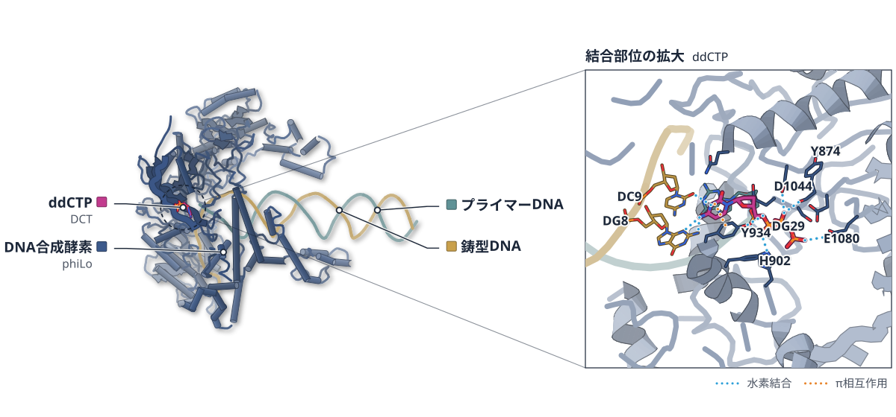
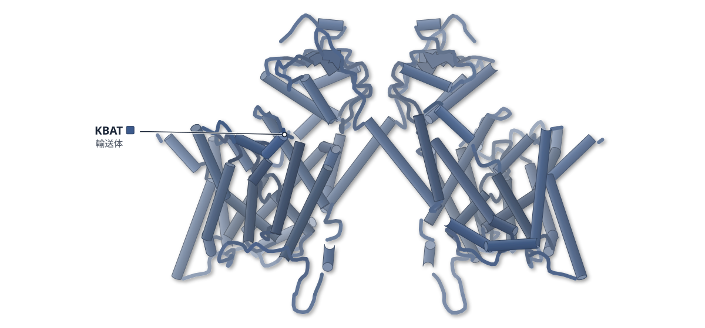
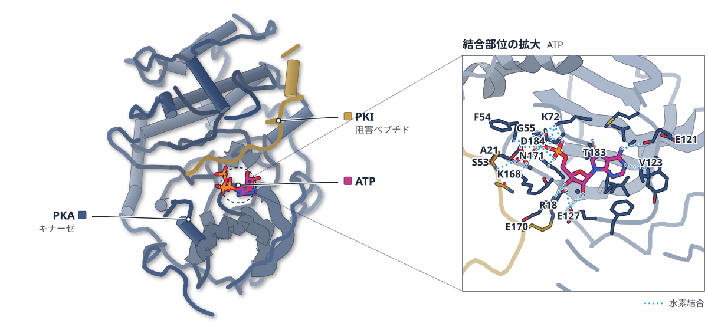
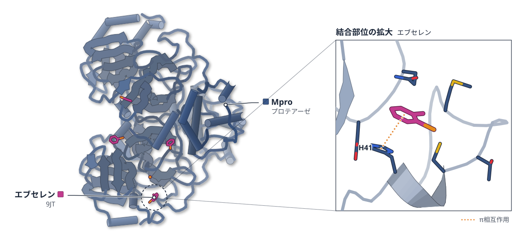

# 2026-10-28 号

**今日の新しい構造：2 本**　Europe PMC に 2026-10-27 に登録されたオープンアクセス論文 145 本のうち、新しい構造を報告した論文は 2 本。すべて紹介する。

**Structure Update 2 本** · **Structure-Based Study 2 本**（New Structure：構造が初めて解かれたタンパク質。Structure Update：既知のタンパク質の新しい構造。Structure-Based Study：既存の構造を使った注目の研究）

## Today's Structure（今日の一本）

**1｜ファージのDNA合成酵素は、複製の手前でウラシルを外す**（SP15型DNA合成酵素（ファージ））

選んだ理由（構造生物学・生命科学）：ウラシルを外すUDGを融合した大型のDNA合成酵素を、2つのファージでクライオ電顕により解析し、複製の手前でのdU除去を構造と活性測定の両方で示した。

> The structures reveal how these large DNAPs function as replicative DNAPs, and how they can recognize dU bases ahead of the replication fork through their UDG domain, generating abasic sites that are preferentially bypassed through dA incorporation.  
> — Abstract

- 迷った論文：ヒトKBAT（SLC26A11） — KBATの内向き型構造と塩化物イオンの結合部位は新しいが、プロトン化の効果と輸送機構の議論はMDが根拠で、実験による検証が本論文にない。
- 迷った論文：プロテインキナーゼA — 2DTMは手法として広く効くが、検証は公開済みの1データセットのキナーゼに限られる。

| # | 標的 | 手法・分解能 | 見出し |
|---|---|---|---|
| 1 | SP15型DNA合成酵素（ファージ） | Cryo-EM・3.80–5.00 Å（2 構造） | ファージのDNA合成酵素は、複製の手前でウラシルを外す |
| 2 | ヒトKBAT（SLC26A11） | Cryo-EM・3.82 Å | KBATの塩化物イオン結合は、E320のプロトン化と関係する |
| 3 | プロテインキナーゼA | Cryo-EM・2DTM | 小さなキナーゼのATP結合部位が、鋳型照合で見えた |
| 4 | SARS-CoV-2 Mpro | Native MS・HDX-MS・MD | エブセレンは、C300への結合でMproの二量体を不安定にする |

> この号は AI が論文本文から作成した**レビュー用の下書き**です。数値・ID・リガンドは PDB / UniProt から取得し、AI の記述には本文からの引用を付けています。

---

# Picked up Today's Structure

## 1｜SP15型DNA合成酵素（ファージ）

### Structural basis for coupled DNA replication and uracil repair by a family of DNA polymerases from phages with T-modified genomes

*Nucleic Acids Research*（2026-10-01） · [論文](https://doi.org/10.1093/nar/gkag1018) · ライセンス: cc by-nc

筆頭著者：Sophia Missoury（Université Paris Cité, France）　責任著者：Marc Delarue（Université Paris Cité, France）

色（順に）：DNA合成酵素（phiLo） / 鋳型DNA / プライマーDNA　スティック：ddCTP（DCT）

**ファージのDNA合成酵素は、複製の手前でウラシルを外す**

UDGドメインを融合した2種の酵素をクライオ電顕で解析。DNAを締める2つの挿入部も見えた

- **疑問・課題**：ウラシルを外す酵素（UDG）を自らに融合したファージのDNA合成酵素が、複製とウラシルの除去をどう両立するかを調べた。
- **アプローチ**：YerA41とphiLoという2つのファージの酵素を、DNAとの複合体でクライオ電顕により解析し、活性も測った。
- **結果**：DNAを挟む2つの大きな挿入部が約30 Å離れて並んでいた。dUを含む鋳型の5′端は、UDGドメインの活性部位の近くに届いていた。
- **わかったこと**：UDGドメインが複製部位の手前でdUを外し、できた脱塩基部位をdAを入れて通り越すことを示した。
- **残された課題**：糖で修飾されたYerA41のDNAを基質にした実験が、まだ必要だとされている。

この紹介文の根拠（論文本文）

> The association of the UDG domain with PolA provides an opportunity to recognize dU when it becomes exposed in the ssDNA template at the replication fork, immediately before nucleotide incorporation, tightly coupling uracil surveillance to DNA synthesis.  
> — 疑問・課題／Introduction

> Here, we identify a new group of A-family DNAPs in phages that are fused to an active UDG domain and contain other large insertions.  
> — 疑問・課題／Abstract

> We determined the atomic cryo-EM structures for two of its members in various active functional and conformational states, from YerA41 and phiLo phages.  
> — アプローチ／Abstract

> In this study, we present a structural and functional characterization of two A-family DNAPs fused with active UDG domains  
> — アプローチ／Introduction

> These structural insertions create two extended arms located ~30 Å apart  
> — 結果／Results

> We observed electron density corresponding to the 5′ end of the DNA template strand near the active site of the UDG-like domain, hereafter referred to as the template entry region  
> — 結果／Results

> how they can recognize dU bases ahead of the replication fork through their UDG domain, generating abasic sites that are preferentially bypassed through dA incorporation.  
> — わかったこと／Abstract

> However, experimental studies using glycosylated YerA41 DNA as a substrate are needed to fully establish the molecular adaptations of SP15-like DNAPs to T-modified DNA.  
> — 残された課題／Discussion

分類：酵素（その他）・DNA・RNA に関わるもの

#### 読みどころ

dUを含む鋳型との複合体（3.6 Å）では、鋳型の5′端がUDGドメインの活性部位の入口に届き、dUの塩基が外に出て活性部位の近くに置かれた。ただし、占有率が一部のモデルである。

根拠（論文本文）

> allowing the modeling of partially occupied dU base flipped into the active site of the UDG domain  
> — Results

> A map at 3.6 Å resolution was obtained, allowing for a more precise modeling of the DNA substrate.  
> — Results

2つの挿入部がDNAを両側から挟み、複製中の酵素をDNAに固定する。位置はT7のチオレドキシンに似ており、複製の処理能力を高める可能性がある。

根拠（論文本文）

> Their combined role is clearly to tighten the grip on the DNA  
> — Results

> This suggests that Insert 2 may play a role analogous to thioredoxin-mediated polymerase processivity enhancement  
> — Results

dUは外されたが、5位にC6アミノ基をもつチミジンは外されなかった。この修飾チミジンは複製中に許容され、複製もされた。ファージ自身の修飾DNAは、UDGの基質にならないとみられる。

根拠（論文本文）

> indicating that these hypermodified thymidines are tolerated during replication and are not substrates for UDG activity  
> — Results

> SP15-like DNAPs efficiently replicated the modified base, as demonstrated by the full-length primer extension products  
> — Results

#### 構造データ

| PDB | 手法 | 分解能 | 公開 | 生物種 | リガンド |
|---|---|---|---|---|---|
| [9QHS](https://www.rcsb.org/structure/9QHS) | Cryo-EM | 3.80 Å | 2026-03-25 | DNA molecule, Thermus phage phiLo | DCT |
| [9QLH](https://www.rcsb.org/structure/9QLH) | Cryo-EM | 5.00 Å | 2026-04-08 | DNA molecule, Escherichia coli 'BL21-Gold(DE3)pLysS AG' | DG3 |
| 9QHU | — | — | 公開待ち | — | — |

- [A0AA86MGY1](https://www.uniprot.org/uniprotkb/A0AA86MGY1)  DNA polymerase — *Yersinia phage vB_Yru_GN1* （既存の PDB 構造 1 件）

#### 実験メモ

- **発現系**：大腸菌BL21 Star (DE3)で発現した。IPTGで誘導し、YerA41は15℃、phiLoは20℃で一晩培養した。
- **コンストラクト**：N末端に14個のHisタグとTEV切断部位をつけた。構造解析にはエキソヌクレアーゼ活性を欠く変異体（Exo−）を使った。
- **精製**：HisTrapで精製した後、HiTrap Heparinカラムにかけ、1 M NaClで溶出した。
- **結晶化／グリッド作製**：YerA41のExo−酵素とDNA二本鎖を1:2で混ぜ、ゲルろ過で精製した。取り込まれるヌクレオチドを4℃で5分加えてグリッドにした。
- **データ収集・解析**：Glacios（200 kV）で撮影し、CryoSPARCで処理した。YerA41はTitan Krios G4の追加データも使った。

根拠（論文本文）

> Escherichia coli BL21 Star (DE3) cells (Invitrogen) were transformed with the engineered plasmids.  
> — Methods

> After incubation overnight at 20°C for YerA_127, YerA_158, and phiLo_158, and 15°C for YerA_144  
> — Methods

> These genes were cloned into a modified pRSF1-Duet expression vector, which includes an N-terminal 14-histidine tag and a TEV protease cleavage site.  
> — Methods

> Exonuclease-deficient mutants (Exo−) of the DNAPs from YerA and phiLo phages were subcloned for further studies.  
> — Methods

> The proteins of interest were isolated by purification of the lysates on a HisTrap column  
> — Methods

> Collected proteins were diluted to 50 mM NaCl and repurified on a HiTrap Heparin column with an elution at 1 M NaCl.  
> — Methods

> 50 μM exo− YerA41_144 was mixed with the duplex osM0072/oSM0074 at a 1:2 molar ratio and purified by size-exclusion chromatography  
> — Methods

> The purified complex was then incubated with the incoming nucleotide for 5 min at 4°C prior to grid preparation.  
> — Methods

> using a Glacios transmission electron microscope (Thermo Fisher Scientific), operated at 200 kV  
> — Methods

> The movie stacks collected were processed in CryoSPARC [40].  
> — Methods

> An additional dataset of DNAP YERA41 in complex with DNA was collected on a Titan Krios G4  
> — Methods

> 📝 編集者への確認事項：PDB 9QHS・9QLH は公開済み、9QHU は未公開。UniProt は YerA41 の 1 つだけ対応し、phiLo は対応なし。タンパク質の初構造かは論文が明言していないので「初」とは書いていない。dU 複合体の 3.6 Å は 9QHU と思われるが未公開で照合できない。原文は CC BY-NC。

---

# Structure Update

## 2｜ヒトKBAT（SLC26A11）

### Structure Basis for Chloride Recognition and Transport by Human Kidney Brain Anion Transporter (KBAT)

*Biomolecules*（2026-09-23） · [論文](https://doi.org/10.3390/biom16101384) · ライセンス: cc by

筆頭著者：Yurou Wang（Xiamen University）　責任著者：Renhong Yan（Southern University of Science and Technology）、Ximin Chi（Xiamen University）

色（順に）：KBAT（輸送体）

**KBATの塩化物イオン結合は、E320のプロトン化と関係する**

ヒトSLC26A11の内向き型構造をクライオ電顕で解き、MDでE320の働きとエレベーター型の輸送を調べた

- **疑問・課題**：KBAT（SLC26A11）が塩化物イオンをどう認識し、どう輸送するのか、その分子の仕組みは不明だった。
- **アプローチ**：全長のヒトKBATをクライオ電顕で解き、分子動力学（MD）シミュレーションで結合と構造変化を調べた。
- **結果**：内向き型の構造で、TM3とTM10の間に塩化物イオンが見えた。MDでは、E320がプロトン化するとS363との接触が67.4%から1.4%に減った。
- **わかったこと**：E320のプロトン化が塩化物イオンを取り込むスイッチになると提案された。輸送はエレベーター型と考えられる。
- **残された課題**：E320がプロトン化しているかどうかは、クライオ電顕の密度からは決められない。

この紹介文の根拠（論文本文）

> Despite its physiological significance, the molecular basis of substrate recognition and transport by KBAT remains elusive.  
> — 疑問・課題／Abstract

> Here, we present the structure of full-length human KBAT in an inward-facing conformation with chloride ions (Cl−) bound.  
> — アプローチ／Abstract

> Protonation of E320 abolishes its interaction with S363 and correlates with Cl− binding in the canonical substrate pocket, as substantiated by molecular dynamics (MD) simulations.  
> — アプローチ／Abstract

> A well-defined extra cryo-EM density is present at this site and was assigned to a chloride ion  
> — 結果／Results

> In the charged state, E320 maintains a tight interaction with S363 (67.4% contact occupancy).  
> — 結果／Results

> upon protonation, this contact occupancy drastically drops to 1.4%  
> — 結果／Results

> We thus propose that E320 protonation constitutes a molecular switch that modulates both substrate stability and transport function.  
> — わかったこと／Results

> Quantitative MD contact analysis delineates the rearrangements of residue interactions underlying the alternative access transport, consistent with an elevator-like transport mechanism.  
> — わかったこと／Abstract

> Yet the protonation state of E320 cannot be defined through Cryo-EM density maps.  
> — 残された課題／Results

分類：トランスポーター

#### 読みどころ

塩化物イオンは、S363・Q65・Y69の側鎖と、ほどけかけたTM3・TM10の主鎖のアミドで保持される。イオンの位置は、SLC26ファミリーの他の構造でも共通している。

根拠（論文本文）

> The chloride ion is mostly coordinated by side-chains of S363, Q65, and Y69, and mainchain amide nitrogen from F364, G365, A106, and T105  
> — Results

> The locations of the substrate halide ions are highly conserved among SLC26 homologs, further supporting the assignment of Cl− ion in this pocket  
> — Results

MDでは、E320がプロトン化すると塩化物イオンが結合部位に入り、90 ns以上とどまった。電荷をもつ状態では安定に結合しなかった。いずれもシミュレーション上の結果である。

根拠（論文本文）

> a chloride ion from the bulk solution spontaneously entered the binding cavity within the first 5 ns and remained stably coordinated for over 90 ns  
> — Results

> when E320 was charged, chloride ions only occasionally approached the pocket vestibule with substantial positional fluctuations, failing to establish stable occupancy  
> — Results

AlphaFold3が予測した外向き型では、コアドメインが実験構造より細胞外側へ上がっていた。両方のMDを比べると、ゲートドメインの16残基が、コアドメインの接触相手を切り替えていた。

根拠（論文本文）

> the Core domain undergoes a pronounced displacement toward the extracellular side in the predicted structure  
> — Results

> This analysis found that 16 Gate residues systematically switch interaction partners in the Core domain  
> — Results

#### 構造データ

| PDB | 手法 | 分解能 | 公開 | 生物種 | リガンド |
|---|---|---|---|---|---|
| [9XQF](https://www.rcsb.org/structure/9XQF) | Cryo-EM | 3.82 Å | 2026-09-30 | Homo sapiens | — |

- [Q86WA9](https://www.uniprot.org/uniprotkb/Q86WA9) SLC26A11 Sodium-independent sulfate anion transporter — *Homo sapiens* （既存の PDB 構造 2 件）

#### 実験メモ

- **発現系**：全長のヒトSLC26A11を、ヒトの培養細胞（HEK細胞株）で発現した。C末端にFlagタグとStrepタグをつけた。
- **コンストラクト**：cDNAから増幅した全長のコード配列を、pSQベクターに入れた。
- **精製**：1.5% DDMで可溶化して抗Flag樹脂で精製し、0.01% GDN中でSuperose 6 Increaseのゲルろ過にかけた。
- **結晶化／グリッド作製**：約12 mg/mLに濃縮し、Quantifoil Cu R1.2/1.3のグリッドに載せた。3.5秒ブロットし、Vitrobot Mark IVで凍結した。
- **データ収集・解析**：Titan Krios G3（300 kV、K3）で撮影し、cryoSPARC 4.6.2で処理した。AlphaFold 3の予測を初期モデルにして、COOTとPHENIXで精密化した。

根拠（論文本文）

> The full-length protein-coding DNA segment for human SLC26A11 (UniProt ID: Q86WA9) was amplified from a cDNA library and subcloned into the pSQ vector.  
> — Methods

> The Flag tag and Strep tag was fused to the C-terminus of KBAT.  
> — Methods

> HEK 293F cells were cultured in SMM 293-TII medium under 5% CO2, 37 °C, 130 rpm  
> — Methods

> Then the cells were lysed in 1.5% n-dodecyl-β-D-maltopyranoside (DDM) with 0.2 mM phenylmethylsulfonyl fluoride (PMSF) at 4 °C for 2 h.  
> — Methods

> The resin was washed with 0.01% glyco-diosgenin (GDN) and eluted in the same buffer with an additional 0.25 mg/mL Flag peptide.  
> — Methods

> Then the protein was further purified by size exclusion chromatography (Superose 6 Increase 10/300 GL  
> — Methods

> The purified KBAT sample was concentrated to approximately 12 mg/mL before being applied to glow-discharged holey carbon grids  
> — Methods

> The grids were then blotted for 3.5 s and flash-frozen in liquid ethane cooled by liquid nitrogen using the Vitrobot  
> — Methods

> operating at 300 kV, equipped with a Gatan K3 Summit detector  
> — Methods

> The Cryo-EM structures of KBAT were solved in cryoSPARC 4.6.2 [21].  
> — Methods

> Molecular model of human KBAT predicted by AlphaFold 3 (AF3, AF-Q86WA9-F1) [22] was fit to the cryo-EM map by Chimera  
> — Methods

> 📝 編集者への確認事項：本文は全体の分解能を 3.5 Å と書くが、PDB 9XQF は 3.82 Å。数値は記事に書いていない。E320 のプロトン化との関係と輸送機構の議論は MD が根拠で、変異体などの実験は本論文にない。

---

# Structure-Based Study

## 3｜プロテインキナーゼA

### Improved cryo-EM reconstruction of sub-50 kDa complexes using 2D template matching

*eLife*（2026-10-26） · [論文](https://doi.org/10.7554/elife.109790) · ライセンス: cc by

筆頭著者：Kexin Zhang（University of Massachusetts Chan Medical School, United States）　責任著者：Kexin Zhang, Nikolaus Grigorieff（University of Massachusetts Chan Medical School, United States）

PDB 1ATP（論文が使った既存の構造）

色（順に）：PKA（キナーゼ） / PKI（阻害ペプチド）　スティック：ATP

**小さなキナーゼのATP結合部位が、鋳型照合で見えた**

既知の構造を鋳型に粒子の向きを決める2DTMで、公開データから約43 kDaの酵素を再構成した

- **疑問・課題**：50 kDa未満の小さな複合体は画像のコントラストが弱く、単粒子クライオ電顕で高分解能の構造を決めにくい。
- **アプローチ**：既知の高分解能構造を鋳型にする2Dテンプレートマッチング（2DTM）で粒子の向きを決め、公開済みのキナーゼのデータを再解析した。
- **結果**：ATPを鋳型から外しても、ATPとMn2+の密度が戻った。2DTMの向きを使った地図は3.1 Åで、RELIONの3.7 Åより明瞭だった。
- **わかったこと**：この方法は、50 kDaを大きく下回る薬剤結合複合体にも広げられると理論解析は予測する。鋳型の精度が結果を左右する。
- **残された課題**：AlphaFold3の鋳型で残基ごとに検証する作業は計算量が大きく、今後の課題とされている。

この紹介文の根拠（論文本文）

> Despite recent advances in single-particle cryo-EM, structure determination for sub-50 kDa complexes remains challenging.  
> — 疑問・課題／Introduction

> Small complexes contain fewer atoms and scatter fewer electrons, leading to images with lower signal-to-noise ratios (SNRs).  
> — 疑問・課題／Introduction

> We apply this method to a previously published dataset of the ∼43 kDa catalytic domain of protein kinase A (Herzik et al., 2019) and demonstrate improved reconstruction of its ligand-binding sites.  
> — アプローチ／Introduction

> In this work, we demonstrate that the alignment and reconstruction of small macromolecular complexes can be improved using high-resolution structures as priors, combined with 2D template matching.  
> — アプローチ／Abstract

> In all three cases, the reconstructions showed well-defined ATP and Mn2+ densities in the binding pocket.  
> — 結果／Results

> The reconstruction using 2DTM orientations reached 3.1 Å at the FSC = 0.143 threshold, compared with 3.7 Å for the RELION auto-refined reconstruction  
> — 結果／Results

> Our theoretical analysis predicts that this method can further extend single-particle cryo-EM to important drug-binding complexes well below 50 kDa.  
> — わかったこと／Abstract

> highlighting the importance of template accuracy in enabling efficient detection and reconstruction of small complexes  
> — わかったこと／Results

> extending this approach to AlphaFold3-based templates remains computationally expensive and we consider this an important direction for future work  
> — 残された課題／Discussion

分類：キナーゼ

#### 読みどころ

元の報告の地図は約4.3 Å（74,413粒子）で、ATP結合部位が解けなかった。本研究は画像と粒子を厳しく選び、ATPと数残基を鋳型から外したまま、7,353粒子でATPの密度を取り出した。

根拠（論文本文）

> In the original publication (Herzik et al., 2019), a final stack of 74,413 particles was used to obtain a reconstruction at ∼4.3 Å resolution by gold-standard FSC.  
> — Results

> In particular, the ATP-binding pocket was not resolved in the map  
> — Results

ATPから3.0 Åと5.5 Å以内の残基まで鋳型から外して試した。ATPの密度は安定して戻ったが、周りの残基は削る範囲が広いほど戻りにくかった。

根拠（論文本文）

> We also found that nearby protein residues were more affected by template deletion than ATP.  
> — Results

> In contrast, ATP density was consistently recovered more robustly than nearby residues.  
> — Results

約10残基ずつ外した36通りの鋳型から合成した地図では、タンパク質の各所で密度が戻った。ただし、戻りやすさは場所によって違った。

根拠（論文本文）

> The resulting composite map shows that density can be recovered at distributed locations across the structure, including regions far from the alignment center.  
> — Results

> Recovery is variable across sites  
> — Results

#### 構造データ

| PDB | 手法 | 分解能 | 公開 | 生物種 | リガンド |
|---|---|---|---|---|---|
| [1ATP](https://www.rcsb.org/structure/1ATP) | X-ray | 2.20 Å | 1993-04-15 | Mus musculus | ATP |
| [2DTM](https://www.rcsb.org/structure/2DTM) | X-ray | 2.25 Å | 2007-05-29 | Mus musculus | — |

- [A2NHM3](https://www.uniprot.org/uniprotkb/A2NHM3) Igkc If kappa light chain — *Mus musculus* （既存の PDB 構造 0 件）
- [P05132](https://www.uniprot.org/uniprotkb/P05132) Prkaca cAMP-dependent protein kinase catalytic subunit alpha — *Mus musculus* （既存の PDB 構造 0 件）
- [P18527](https://www.uniprot.org/uniprotkb/P18527)  Ig heavy chain V region 914 — *Mus musculus* （既存の PDB 構造 0 件）
- [P63248](https://www.uniprot.org/uniprotkb/P63248) Pkia cAMP-dependent protein kinase inhibitor alpha — *Mus musculus* （既存の PDB 構造 0 件）

#### 実験メモ

- **データ収集・解析**：公開データ（EMPIAR-10252、4809枚）を使った。MotionCor2で補正し、鋳型は1ATPからcisTEMのsimulateで作った。再構成もcisTEMで行った。

根拠（論文本文）

> Unaligned movies of the protein kinase were downloaded from EMPIAR-10252 (Herzik et al., 2019). The dataset contains 4809 images  
> — Methods

> Motion correction and exposure weighting were performed using the MotionCor2 program  
> — Methods

> was simulated using the simulate program in cisTEM with a uniform B-factor of 30 Å2  
> — Results

> A 3D reconstruction was generated using the cisTEM program reconstruct3d.  
> — Methods

> 📝 編集者への確認事項：新しい構造ではなく、公開済みの EMPIAR-10252 データの再解析（手法の論文）。構造図は鋳型に使った X 線構造 1ATP。FSC はどちらも鋳型由来の向きを使うため gold-standard ではないと本文が断っており、記事の 3.1 Å / 3.7 Å もその前提。点数は 7（novelty 2・reach 2・structure 2・support 1）。

---

## 4｜SARS-CoV-2 Mpro

### SARS-CoV-2 main protease inhibition through dimerization promotion by peptidomimetic inhibitors and disruption by ebselen

*eLife*（2026-10-26） · [論文](https://doi.org/10.7554/elife.109956) · ライセンス: cc by

筆頭著者：Chengxi Liu（The Hong Kong Polytechnic University, China）　責任著者：Zhong-Ping Yao（The Hong Kong Polytechnic University, China）

PDB 7BFB（論文が使った既存の構造）

色（順に）：Mpro（プロテアーゼ）　スティック：エブセレン（9JT）

**エブセレンは、C300への結合でMproの二量体を不安定にする**

ペプチド模倣阻害剤は二量体を安定にする。ネイティブMSとHDX-MSで、阻害のしかたの違いを分けた

- **疑問・課題**：SARS-CoV-2のMproは活性のある二量体と不活性な単量体の平衡にあり、二量体の界面が薬の標的になりうる。
- **アプローチ**：13C標識を使うネイティブMSとHDX-MSで、複数の阻害剤がMproの二量体化と構造の揺らぎに与える影響を比べた。
- **結果**：ペプチド模倣阻害剤は二量体を増やして界面を硬くし、エブセレンは二量体を減らして界面の揺らぎを増やした。
- **わかったこと**：エブセレンはC300を修飾し、二量体界面の水素結合網を変えて二量体の崩れに寄与する。C300はアロステリックな標的になりうる。
- **残された課題**：AT7519とpelitinibの結合は、HDX-MSの限界のため変化として検出できなかった可能性がある。

この紹介文の根拠（論文本文）

> The SARS-CoV-2 main protease (Mpro) is a key antiviral target that equilibrates between an active dimer and inactive monomer, making the dimerization interface a promising therapeutic vulnerability.  
> — 疑問・課題／Abstract

> This study investigates Mpro monomer-dimer equilibrium and conformational changes induced by inhibitor binding using 13C labeling with native mass spectrometry and hydrogen/deuterium exchange mass spectrometry (HDX-MS).  
> — アプローチ／Abstract

> peptidomimetic inhibitors significantly shifted the equilibrium towards the dimeric state, suppressing subunit exchange dynamics and rigidifying the dimer interface; in contrast, ebselen impaired dimer formation and increased interface flexibility.  
> — 結果／Abstract

> Molecular dynamics simulations and mutational analyses demonstrated that this C300 modification allosterically alters the hydrogen bond network of the dimer interface, directly contributing to ebselen-mediated dimer disruption and enzymatic inhibition.  
> — わかったこと／Abstract

> The lack of observed HDX might stem from experimental limitations in studying the weak interactions of binders using HDX-MS.  
> — 残された課題／Results

分類：プロテアーゼ・感染・ウイルス・防御系

#### 読みどころ

PF-07321332を結合させると、単量体の割合は5.35%から0.48%に下がり、13C標識体との交換で生じるヘテロ二量体も30分間検出されなかった。二量体が強く固定されたことを示す。

根拠（論文本文）

> PF-07321332 markedly reduced the monomer fraction to 0.48±0.06%, consistent with stabilization of the dimeric state.  
> — Results

> In contrast to free Mpro, the heterodimer Mpro signal was undetected after PF-07321332 binding over the course of 30 min  
> — Results

エブセレンは活性部位のC145ではなく、C44とC300を修飾した。C44への結合は、既存の結晶構造7BFBとも合う。C300は二量体の界面にある。

根拠（論文本文）

> Incubation of Mpro with ebselen revealed ebselen-mediated cysteine modifications at C44 and C300  
> — Results

> The crystal structure of the ebselen-Mpro complex demonstrates that ebselen forms a covalent bond with C44 (PDB: 7BFB), aligning with our MS findings.  
> — Results

C300をSerに変えると、エブセレンによる阻害は約47%から約22%に下がった。C300Fは主に単量体で、活性は約10%だった。

根拠（論文本文）

> Ebselen reduced WT activity to approximately 53%, corresponding to approximately 47% inhibition. Under the same conditions, C300S retained approximately 78% activity and showed only approximately 22% inhibition  
> — Results

> C300S retained approximately 70% activity, whereas C300F retained only approximately 10%  
> — Results

#### 構造データ

| PDB | 手法 | 分解能 | 公開 | 生物種 | リガンド |
|---|---|---|---|---|---|
| [7BFB](https://www.rcsb.org/structure/7BFB) | X-ray | 2.05 Å | 2021-03-03 | Severe acute respiratory syndrome coronavirus 2 | 9JT |
| [7ALI](https://www.rcsb.org/structure/7ALI) | X-ray | 1.65 Å | 2020-12-02 | Severe acute respiratory syndrome coronavirus 2 | — |

- [P0DTD1](https://www.uniprot.org/uniprotkb/P0DTD1) rep Replicase polyprotein 1ab — *Severe acute respiratory syndrome coronavirus 2* （既存の PDB 構造 0 件）

#### 実験メモ

- **発現系**：タグなしの組換えMpro（C300S・C300F・13C標識体を含む）は、Beijing Anbiqi Biotechnology社が調製した。
- **結晶化／グリッド作製**：共有結合性の阻害剤は1:3、アロステリック阻害剤は1:50でMproと混ぜ、室温で30分置いてからHDXを行った。
- **データ収集・解析**：ネイティブMSとHDX-MSはWaters Synapt G2-Siで測り、結合部位はトリプシン消化後にtimsTOF Pro 2で調べた。MDは7ALIを出発点にし、1000 nsを3回行った。

根拠（論文本文）

> Tag-free SARS-CoV-2 Mpro, C300S Mpro, C300F Mpro, and 13C-labeled SARS-CoV-2 Mpro were produced by Beijing Anbiqi Biotechnology Co., Ltd (Beijing, China).  
> — Methods

> Mpro was incubated with covalent inhibitors at a ratio of 1:3 or allosteric inhibitors at a ratio of 1:50 for 30 min at room temperature before HDX experiments.  
> — Methods

> HDX-MS experiments were performed on a Waters Synapt G2-Si  
> — Methods

> Samples were analyzed on a Bruker timsTOF Pro 2 Mass Spectrometer  
> — Methods

> The initial conformation of the SARS-CoV-2 Mpro model was obtained from the PDB database (PDB ID: 7ALI).  
> — Methods

> We performed 1000 ns of MD simulations in triplicate  
> — Results

> 📝 編集者への確認事項：新しい構造ではない（既存構造 7BFB・7ALI を参照）。構造の根拠は自前の HDX-MS とネイティブ MS で、点数は 6 点ちょうど（novelty 2・reach 1・structure 1・support 2）。C300 が阻害に効く部分は変異体で確かめているが、結合の構造は MD の予測を含む。7BFB はエブセレンが C300 付近にあるが電子密度はほぼセレンのみと本文が断っている。

---

## 注目の構造の採点（143 本を確認し、5 本を採点）

基準は `pipeline/impact.py`（10 点満点、6 点以上から最大 3 本）。

| 選定 | 論文 | 種類 | novelty | reach | structure | support | 計 | 理由 |
|---|---|---|---|---|---|---|---|---|
| ◯ | PMC13707379 Improved cryo-EM reconstruction of sub-50 kDa complexes usin | 新しい手法・ソフト | 2 | 2 | 2 | 1 | 7 | 既存の高分解能構造を鋳型にした2Dテンプレートマッチングで、43 kDaのキナーゼの未解決だったATP結合部位をクライオ電顕のデータから再構成した。新しいのは、鋳型に入れなかった原子の密度まで取り戻せることを示した点。検証は公開済みの1データセットに限られるため、support は1点。 |
| ◯ | PMC13707381 SARS-CoV-2 main protease inhibition through dimerization pro | 構造に基づく創薬 | 2 | 1 | 1 | 2 | 6 | ぎりぎりの6点。ペプチド模倣阻害剤は二量体を安定にし、エブセレンは二量体を壊す、という2つの作用をネイティブMSとHDX-MSで分け、エブセレンの新しい共有結合部位C300を変異体で確かめた。構造データは自前のHDX-MSで、結晶構造は新しく解いていない。 |
|  | PMC13709427 The Architecture of Selectivity: Molecular Basis of BlTx2 Di | 既存構造で機構を解明 | 1 | 1 | 0 | 2 | 4 | 電気生理と変異体の測定は丁寧だが、構造の根拠は構造モデリングだけで、実験で決めた構造がない（structure 0）。 |
|  | PMC13708272 Functional Characterization of Uracil-DNA Glycosylase from S | 既存構造で機構を解明 | 1 | 1 | 0 | 2 | 4 | 黄色ブドウ球菌のUNGの生化学的な性質づけで、結果は既知のファミリー1と同じ。実験で決めた構造は使われていない（structure 0）。 |
|  | PMC13706394 Structural Conservation and Assembly Plasticity of a Diverge | 既存構造で機構を解明 | 1 | 1 | 1 | 0 | 3 | 構造の根拠はクライオ電顕の2Dクラスだけで、原子モデルはAlphaFoldの予測。スラミンの結合はドッキングと100 nsのMD 1本で、新規性も1点。 |

novelty：何が初めてか / reach：誰に効くか / structure：実験で決めた構造（X 線・クライオ電顕・NMR / support：裏付けの強さ（2＝独立した実験で検証：変異体・機能測定・既存手法との比較など／1＝一部の検証のみ／0＝計算のみで実験的検証なし）
