

# 2026-10-29 号

**今日の新しい構造：19 本**　PMC に 2026-10-28 に登録されたオープンアクセス論文 88 本のうち、新しい構造を報告した論文は 19 本。すべて紹介する。

出典：この号の論文情報と全文は、米国国立医学図書館（NLM）の PMC オープンアクセスデータセット（AWS Open Data）から取得した。

**New Structure 3 本** · **Structure Update 16 本** · **Structure-Based Study 2 本**（New Structure：構造が初めて解かれたタンパク質。Structure Update：既知のタンパク質の新しい構造。Structure-Based Study：既存の構造を使った注目の研究）

## Today's Structure（今日の一本）

**1｜テロメラーゼ阻害剤は、予想外の場所に結合していた**（ヒトテロメラーゼ（TERT））

選んだ理由（構造生物学・創薬）：ヒトテロメラーゼと阻害剤の初の複合体構造（9 本）で、阻害剤が TERT の指とパームの間の未知のポケットに結合すると示した。

> BIBR1532 binds a previously unknown pocket between TERT finger and palm.  
> — Abstract

> to date there are no reported structures of human telomerase with inhibitor, impeding structure-based drug design and optimization.  
> — Abstract

- 迷った論文：OmcE ナノワイヤー（D. soudanensis） — 電子伝達ナノワイヤーの初構造で有力だったが、創薬への直結度で劣るため見送り。
- 迷った論文：鞭毛の輸送装置（ライム病菌） — in situ の鞭毛輸送装置で有力だったが、分解能の幅が大きく主張の突出度で劣るため見送り。

| # | 標的 | 手法・分解能 | 見出し |
|---|---|---|---|
| 1 | ヒトテロメラーゼ（TERT） | Cryo-EM・2.70–3.40 Å（9 構造） | テロメラーゼ阻害剤は、予想外の場所に結合していた |
| 2 | OmcE ナノワイヤー（D. soudanensis） | Cryo-EM・3.11 Å | 電気を運ぶ細菌のナノワイヤーは、逆向きに束ねて並ぶ |
| 3 | 鞭毛の輸送装置（ライム病菌） | Cryo-EM / Cryo-ET・3.25–16.00 Å（7 構造） | 鞭毛の輸送装置は、脂質の層を挟んでFlhAとつながる |
| 4 | WDR82–PNUTS–Symplekin–Ssu72 | X-ray・1.61–3.79 Å（2 構造） | WDR82は、2つの短い配列で分かれた相手をつなぐ |
| 5 | ZNFX1（RNAヘリカーゼ） | Cryo-EM・3.37–3.71 Å（4 構造） | ZNFX1は、RNAに出会うまで自分でRNAの溝をふさいでいる |
| 6 | TIM23（酵母） | Cryo-EM・3.20 Å | 抗生物質が、ミトコンドリアの入口にらせんで栓をする |
| 7 | MurJ（大腸菌） | Cryo-EM・3.20 Å | ファージの溶菌タンパク質は、MurJの空洞に尾を差し込む |
| 8 | PFKL（解糖系酵素） | Cryo-EM・3.20 Å | 共有結合の活性化剤は、PFKLを活性型に固定する |
| 9 | RIOK1（古細菌） | X-ray・2.76 Å | 大腸がん向けRIOK1阻害剤CINS-1の結合を結晶で確認 |
| 10 | M1R/L1R（ポックスウイルス） | Cryo-EM・3.30–3.46 Å（2 構造） | 別の場所に結合する2つの抗体が、ポックスウイルスを中和する |
| 11 | ジカウイルスEタンパク質 | Cryo-EM・3.20 Å | ジカウイルスだけを見分けて中和する、ワクチン由来のサル抗体 |
| 12 | 麻疹ウイルスFタンパク質 | Cryo-EM・2.90 Å | 2つのヒト抗体が、麻疹ウイルスFタンパク質の別の面に結合する |
| 13 | B型インフルエンザHA＋抗体 | Cryo-EM・2.40–3.98 Å（3 構造） | B型インフルの広域抗体は、結合部位ごとに働きが違う |
| 14 | H1 HA（A/California/04/2009） | Cryo-EM・3.06–3.76 Å（2 構造） | インフルエンザHAの側面パッチは、変異で抗体を逃れてきた |
| 15 | RamR（大腸菌の転写因子） | X-ray・1.80–4.01 Å（6 構造） | 転写因子RamRは、2か所の変異で鏡像体を見分ける |
| 16 | GRW-L16CL30H（設計ペプチド） | X-ray・1.9 Å | ヘムが、コイルドコイルの並びを一ヘプタッドずらす |
| 17 | エストロゲン受容体α | X-ray・6構造 | 甘草のスチルベンは、プレニル基の数と位置で効き方が変わる |
| 18 | FlhG（ライム病ボレリア） | Cryo-ET・サブトモグラム平均 | FlhGがないと、スピロヘータのべん毛の数と並びが乱れる |
| 19 | PARP10（RRM1–3） | Cryo-EM・中分解能マップ | PARP10は、RRMが環状に連なって凝縮する |
| 20 | YTHDF1（ヒト） | X-ray | エラグ酸は、YTHDF3種すべてのm6A認識を妨げる |
| 21 | PDCoV スパイク（ブタ） | Cryo-EM・2.83 Å | 胃酸のpHで、PDCoVのスパイクが受容体に結合しやすくなる |

> この号は AI が論文本文から作成した**レビュー用の下書き**です。数値・ID・リガンドは PDB / UniProt から取得し、AI の記述には本文からの引用を付けています。

---

# Picked up Today's Structure

## 1｜ヒトテロメラーゼ（TERT）

### Structures of human telomerase with BIBR1532 reveal novel mechanism of inhibition

*Nature Chemical Biology*（2026-06-02） · [論文](https://doi.org/10.1038/s41589-026-02238-6) · ライセンス: cc by

筆頭著者：Yuqing Wang（University of California, Los Angeles, USA）　責任著者：Juli Feigon（University of California, Los Angeles, USA）

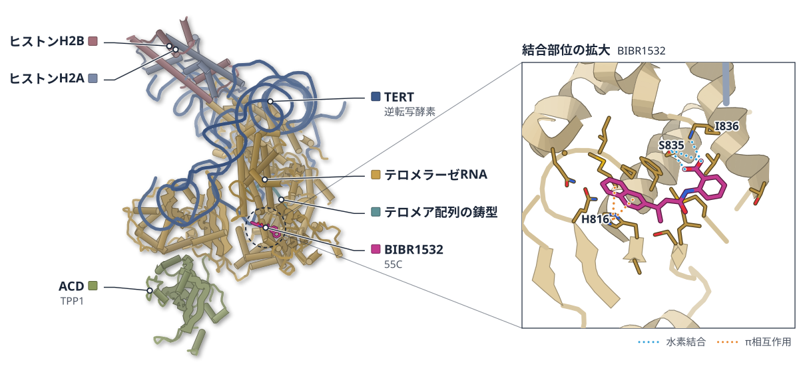

色（順に）：TERT（逆転写酵素） / テロメラーゼRNA / テロメア配列の鋳型 / ヒストンH2B / ヒストンH2A / ACD（TPP1）　スティック：BIBR1532（55C）

**テロメラーゼ阻害剤は、予想外の場所に結合していた**

BIBR1532との複合体を9つ解き、活性部位から離れた袋で最初の伸長段階を遅らせると示した

- **疑問・課題**：テロメラーゼと阻害剤の複合体の構造がなく、阻害剤を構造から設計し改良することが難しかった。
- **アプローチ**：阻害剤BIBR1532の有無とヌクレオチド類似体の有無で、ヒトテロメラーゼの9つの構造をクライオ電顕で調べた。
- **結果**：BIBR1532はTERTのフィンガーとパームの間の袋に入っていた。阻害は最初の伸長段階で約60%と大きかった。
- **わかったこと**：BIBR1532は活性部位を直接ふさがず、鋳型とDNAの二本鎖が位置を移す動きを妨げて阻害すると考えられる。

この紹介文の根拠（論文本文）

> However, to date there are no reported structures of human telomerase with inhibitor, impeding structure-based drug design and optimization.  
> — 疑問・課題／Abstract

> We report nine cryo-electron microscopy structures of human telomerase with and without BIBR1532, a highly selective small-molecule telomerase inhibitor.  
> — アプローチ／Abstract

> Unexpectedly, BIBR1532 binds a previously unknown pocket between TERT finger and palm.  
> — 結果／Abstract

> BIBR1532 causes a modest reduction in activity (10–20%) across most steps but a much larger inhibitory effect (~60%) at the first step of nucleotide addition  
> — 結果／Results

> The single-step direct telomerase assays and cryo-EM structures showed that BIBR1532 inhibits telomerase by affecting the movement of the template–DNA duplex needed to vacate the active site, especially during the first slow, rate-limiting step.  
> — わかったこと／Discussion

分類：DNA・RNA に関わるもの・酵素（その他）

#### 読みどころ

BIBR1532はTERT C末端側の領域に結合するという従来の予想とは違い、逆転写ドメインのフィンガーとパームの間の深い袋に入っていた。活性部位から約12 Å離れている。

根拠（論文本文）

> Instead, we observed a distinct density within a deep pocket on the RT domain  
> — Results

> BIBR1532 does not directly interact with either the RNA template or the active-site residues but is in close proximity to both, ~6 Å and 12 Å away, respectively  
> — Results

多くのDNAポリメラーゼはdNTPが入るとフィンガーが閉じるが、TERTではTRBDがフィンガーを固定し、動きは1 Å未満だった。この硬さが、テロメラーゼの遅い反応と低い正確さを説明すると論文は述べている。

根拠（論文本文）

> Notably, the finger loop in the nucleotide-binding pocket shifts <1 Å when dTpNHpp is added, with or without BIBR1532  
> — Results

> The structural rigidity of the finger induced by interactions with the TRBD offers a structural explanation for these enzymological properties of telomerase.  
> — Results

従来の誘導体設計は別の昆虫由来TERTの結合部位を手がかりにしていた。ヒトTERTの結合袋の構造は、それらが効果を高められなかった理由を説明し、改良の道すじを示す。

根拠（論文本文）

> These findings also explain why previous SAR studies to optimize the original BIBR1532 on the basis of the TcTERT model have not produced more effective inhibitors.  
> — Discussion

#### 構造データ

| PDB | 手法 | 分解能 | 公開 | 生物種 | リガンド |
|---|---|---|---|---|---|
| [9Q0Z](https://www.rcsb.org/structure/9Q0Z) | Cryo-EM | 3.10 Å | 2026-06-17 | Homo sapiens | 55C |
| [9Q10](https://www.rcsb.org/structure/9Q10) | Cryo-EM | 2.90 Å | 2026-06-17 | Homo sapiens | 1FZ |
| [9Q11](https://www.rcsb.org/structure/9Q11) | Cryo-EM | 2.90 Å | 2026-06-17 | Homo sapiens | 1FZ, 55C |
| [9Q12](https://www.rcsb.org/structure/9Q12) | Cryo-EM | 2.80 Å | 2026-06-17 | Homo sapiens | — |
| [9Q14](https://www.rcsb.org/structure/9Q14) | Cryo-EM | 3.00 Å | 2026-06-17 | Homo sapiens | 55C |
| [9Q16](https://www.rcsb.org/structure/9Q16) | Cryo-EM | 2.70 Å | 2026-06-17 | Homo sapiens | XG4 |
| [9Q17](https://www.rcsb.org/structure/9Q17) | Cryo-EM | 3.30 Å | 2026-06-17 | Homo sapiens | 55C, XG4 |
| [9Q18](https://www.rcsb.org/structure/9Q18) | Cryo-EM | 3.30 Å | 2026-06-17 | Homo sapiens | 55C |
| [9Q19](https://www.rcsb.org/structure/9Q19) | Cryo-EM | 3.40 Å | 2026-06-17 | Homo sapiens | 55C |

- [O14746](https://www.uniprot.org/uniprotkb/O14746) TERT Telomerase reverse transcriptase — *Homo sapiens* （既存の PDB 構造 23 件）
- [P62807](https://www.uniprot.org/uniprotkb/P62807) H2BC4 Histone H2B type 1-C/E/F/G/I — *Homo sapiens* （既存の PDB 構造 99 件）
- [Q96AP0](https://www.uniprot.org/uniprotkb/Q96AP0) ACD Adrenocortical dysplasia protein homolog — *Homo sapiens* （既存の PDB 構造 19 件）
- [Q9BTM1](https://www.uniprot.org/uniprotkb/Q9BTM1) H2AJ Histone H2A.J — *Homo sapiens* （既存の PDB 構造 4 件）

#### 実験メモ

- **発現系**：ヒト培養細胞（HEK）でTERTとTERを共発現してテロメラーゼを再構成した。
- **コンストラクト**：TERTにZZタグとStrepタグを付け、TPP1のOBドメイン（88–249）を後から加えた。
- **精製**：IgGアガロース、ストレプトアビジンアガロース、MagStrep XTの順に精製した。
- **結晶化／グリッド作製**：1 µMのBIBR1532と1 mMのdNTP類似体を加え、グラフェン酸化物の膜つきグリッドをVitrobot Mark IVで凍結した。
- **データ収集・解析**：Titan Krios（300 kV）で撮影し、cryoSPARCで処理した。

根拠（論文本文）

> HEK 293T cells, cultured on 150-mm plates with DMEM (Gibco) supplemented with 10% FBS (Atalanta)  
> — Methods

> 500 nM TPP1 OB was added to human telomerase and incubated for 1 h before vitrification.  
> — Methods

> The supernatant was further incubated with MagStrep XT3 resin (IBA LifeSciences) overnight at 4 °C.  
> — Methods

> flash-frozen in a liquid propane–ethane mixture (63%:37%) with a Vitrobot Mark IV (Thermo Fisher)  
> — Methods

> All steps described below were performed with cryoSPARC53 unless otherwise indicated.  
> — Methods

> 📝 編集者への確認事項：論文は「ヒトテロメラーゼと阻害剤の初の構造」とは明記していないが、既報の構造がないと書いている。TERT は既存 PDB 構造があるため Structure Update の見込み。今日の一本の候補（創薬の軸）。凡例ラベルは描画後に確認が必要。

---

# New Structure

## 2｜OmcE ナノワイヤー（D. soudanensis）

### A bundled anti-parallel cytochrome nanowire structure suggests roles in cell-cell electron transfer and biofilm formation

*mBio*（2026-10-01） · [論文](https://doi.org/10.1128/mbio.00906-26) · ライセンス: cc by

筆頭著者：Holly A. Petersen（University of Alabama at Birmingham, USA）　責任著者：Allon I. Hochbaum（University of California Irvine, USA）、Daniel R. Bond（University of Minnesota, USA）、Fengbin Wang（University of Alabama at Birmingham, USA）

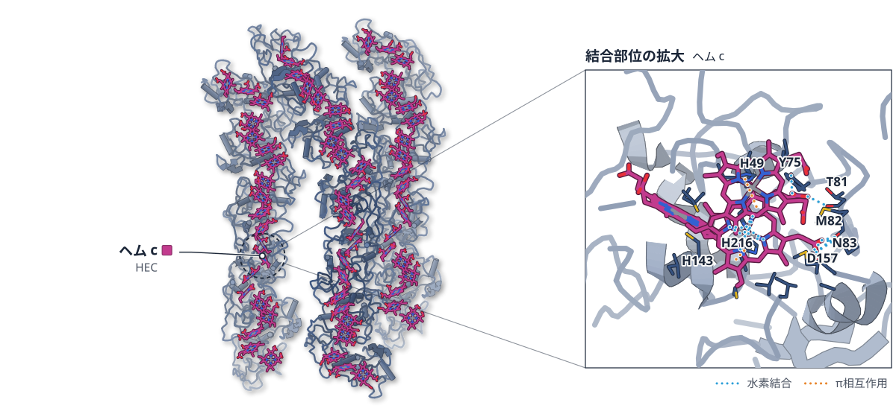

色（順に）：omcE　スティック：ヘム c（HEC）

**電気を運ぶ細菌のナノワイヤーは、逆向きに束ねて並ぶ**

深部地下の塩水に棲む菌のシトクロム線維をクライオ電顕で解き、束の接触面を示した

- **疑問・課題**：シトクロムナノワイヤーどうしが繰り返し接する様子を示した原子構造は、これまで報告がなかった。
- **アプローチ**：深部地下の塩水から単離した菌のナノワイヤーを、クライオ電顕で解析した。導電性と酸化還元も測った。
- **結果**：線維は逆向きに束ねて並び、非対称再構成は3.1 Åで決まった。接触面は2種類あり、束の中点電位は−145 mVだった。
- **わかったこと**：シトクロムナノワイヤーは特別な束の接触面を作れる。これが導電性のバイオフィルムの形成に役立つ可能性がある。
- **残された課題**：束が実際のバイオフィルムの中にあるかは、まだ確かめられていない。

この紹介文の根拠（論文本文）

> To date, no atomic structures showing direct repeated interactions between any class of nanowire have been reported.  
> — 疑問・課題／Introduction

> In this work, we present the cryo-EM structure of a bundle formed by cytochrome nanowires produced by Desulfuromonas soudanensis WTL, a halophilic iron-reducing bacterium isolated from anoxic deep subsurface brine.  
> — アプローチ／Introduction

> Electronic measurements of purified nanowire bundle films reveal that these bundles are conductive, with conductance increasing in a concentration-dependent manner.  
> — アプローチ／Abstract

> Manual inspection of all these volumes consistently showed the same anti-parallel packing arrangement between cytochrome nanowires  
> — 結果／Results

> which reached a global resolution of 3.1 Å as judged by map-to-map FSC  
> — 結果／Results

> The apparent midpoint potential of these OmcE bundles was −145 mV vs SHE.  
> — 結果／Abstract

> Our findings demonstrate that cytochrome nanowires are widespread and can form specialized bundle interfaces.  
> — わかったこと／Abstract

> This novel state could facilitate conductive biofilm formation and form the basis for direct microbial electron exchange.  
> — わかったこと／Abstract

> although direct in vivo confirmation within intact biofilms remains a future goal  
> — 残された課題／Abstract

分類：光合成・電子伝達・その他

#### 読みどころ

Geobacter sulfurreducens以外の細菌で決まった、初めてのシトクロムナノワイヤー構造。OmcEの相同体で、ヘムの並びはG. sulfurreducensのものとほぼ同じだった。

根拠（論文本文）

> This is the first structure of a cytochrome nanowire in a bacterium outside of G. sulfurreducens.  
> — Introduction

> Despite their significant structural and sequence differences, the heme arrangement in the D. soudanensis OmcE filament is nearly identical to that of G. sulfurreducens  
> — Results

線維どうしの接触面は2種類で、埋もれる面積は110 Å2と220 Å2と小さい。ただ線維に沿って繰り返されるため、隣り合う2本の間では21.7 nmごとに440 Å2が積み重なる。

根拠（論文本文）

> two unique interfaces were observed, with buried surface areas of 110 Å (2) (type 1 interface) and 220 Å (2) (type 2 interface)  
> — Results

> between two adjacent cytochrome filaments, the interface area is 440 Å (2) per 21.7 nm  
> — Results

束の酸化還元は約370 mVの幅にわたり、5つのヘムが静電的に連動する挙動を示した。ただし導電性の測定は乾燥した膜の全体を測ったもので、単一の線維の値ではない。

根拠（論文本文）

> They exhibit redox activity over a ~370 mV window attributable to five electrostatically coupled hemes  
> — Abstract

> we acknowledge that they represent an ensemble measurement of dried material  
> — Results

#### 構造データ

| PDB | 手法 | 分解能 | 公開 | 生物種 | リガンド |
|---|---|---|---|---|---|
| [9YUQ](https://www.rcsb.org/structure/9YUQ) | Cryo-EM | 3.11 Å | 2026-08-26 | Desulfuromonas soudanensis | HEC |

- [A0A0M4DKA8](https://www.uniprot.org/uniprotkb/A0A0M4DKA8) omcE Putative multiheme cytochrome c — *Desulfuromonas soudanensis* （PDB で初めての構造）

#### 実験メモ

- **発現系**：D. soudanensis WTLを改変Soudan Mine培地で1 L培養した。
- **精製**：細胞懸濁液を注射器と針に通して細胞外の線維を切り離した。
- **結晶化／グリッド作製**：濃縮した試料を放電処理したレーシーカーボングリッドに載せ、EM GP2で急速凍結した。
- **データ収集・解析**：Titan Krios（300 keV）とK3カメラで撮影した。ピクセルサイズ1.07 Å、総線量50 e⁻/Å2。

根拠（論文本文）

> D. soudanensis cells were collected from 1 L of culture in a modified Soudan Mine (SM) medium.  
> — Methods

> Extracellular filaments were sheared by drawing and expelling the cell suspension through a 5 mL syringe attached to a 25 G × 7/8-inch needle 10 times.  
> — Methods

> the enriched cytochrome nanowire sample (4.5 μL) was applied to glow-discharged lacey carbon grids and then plunge-frozen using an EM GP2 Plunge Freezer (Leica).  
> — Methods

> Cryo-EM micrographs were collected on a 300 keV Titan Krios microscope equipped with a K3 camera at a pixel size of 1.07 Å and a total dose of 50 e⁻/Ų.  
> — Methods

> 📝 編集者への確認事項：論文は「Geobacter sulfurreducens 以外の細菌で初めてのシトクロムナノワイヤー構造」「ナノワイヤーの束の初めての報告」と明言している。導電性は乾燥膜の測定で、論文自身が限界として書いている。束が試料調製で生じた可能性を論文も排除していない。

---

## 3｜鞭毛の輸送装置（ライム病菌）

### In situ structure of the flagellar export apparatus reveals membrane remodeling and lipid-mediated coupling between FlhA and the export gate

*Nature Communications*（2026-09-25） · [論文](https://doi.org/10.1038/s41467-026-77713-8) · ライセンス: cc by-nc-nd

筆頭著者：Jian Yue（Yale School of Medicine, USA）　責任著者：Jian Yue, Jun Liu（Yale School of Medicine, USA）、Md A. Motaleb（East Carolina University, USA）

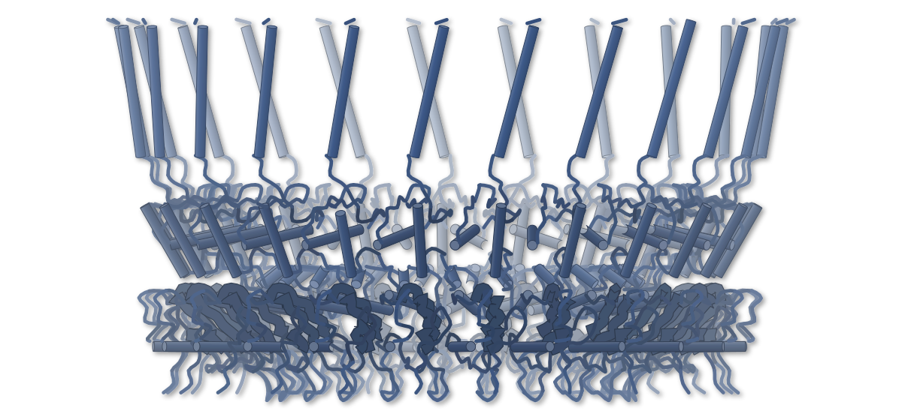

色（順に）：fliF

**鞭毛の輸送装置は、脂質の層を挟んでFlhAとつながる**

ライム病菌の細胞内でin situクライオ電顕により解析。膜が大きく曲がり、漏斗状の通り道ができていた

- **疑問・課題**：鞭毛の輸送装置が天然の膜の中でどう組み上がり、働くのかは、よく分かっていなかった。
- **アプローチ**：ライム病菌の細胞内で、in situ単粒子クライオ電顕とクライオ電子トモグラフィーにより輸送装置を解析した。
- **結果**：FlhAと輸送ゲートは膜内で直接触れず、脂質のような薄い密度で隔てられていた。膜は深さ10 nm曲がっていた。
- **わかったこと**：輸送装置は膜を大きく曲げて組み上がる。FlhBのヒンジヘリックスが、プロトン駆動力と輸送を結びつける可能性がある。
- **残された課題**：FlhAの細胞質ドメインは単粒子解析では十分に解けず、約16 Åにとどまった。

この紹介文の根拠（論文本文）

> However, how the export apparatus assembles and functions within native membranes remains poorly understood.  
> — 疑問・課題／Abstract

> Here, using in situ single-particle cryo-electron microscopy and cryo-electron tomography, we resolve high-resolution structures of the flagellar export apparatus within intact cells of the Lyme disease spirochete Borrelia burgdorferi.  
> — アプローチ／Abstract

> The FlhA nonamer and FliPQR–FlhB export gate lack direct transmembrane contacts and are separated by a thin, bilayer-like density, revealing a lipid-mediated interface.  
> — 結果／Abstract

> The membrane underneath the MS-ring bends sharply toward the cytoplasmic side, forming a pronounced hemispherical deformation with a depth of 10 nm  
> — 結果／Results

> The conserved FlhB hinge helix extends into the FlhA tunnel and may couple PMF-driven energy transduction to substrate translocation.  
> — わかったこと／Abstract

> Together, these findings establish a mechanistic framework for export apparatus assembly and energy transduction, providing broader insights into type III secretion.  
> — わかったこと／Abstract

> Although the FlhACTD nonamer was not well resolved by in situ single-particle cryo-EM, likely due to conformational flexibility or interference from the cellular background  
> — 残された課題／Results

分類：トランスポーター・感染・ウイルス・防御系

#### 読みどころ

MS-リングが組み上がると、細胞膜が深さ10 nmの半球状にへこむ。輸送ゲートがないとU字形、あるとW字形の膜になり、輸送ゲートとの相互作用が間の膜を持ち上げていると考えられる。

根拠（論文本文）

> suggesting that MS-ring assembly drives membrane deformation, while interactions between the MS-ring and the export gate locally elevate the intervening membrane  
> — Results

> MS-ring assembly without the export gate or its core components (FliP, FliQ, and FliR) induces a U-shaped membrane deformation  
> — Discussion

FlhAと輸送ゲートの間には、FliQ側で約18 Å、FlhB側で約7 Åの非対称なすき間があり、薄い脂質層のような密度が詰まっている。はっきりした脂質分子は見えず、脂質は動的だと考えられる。

根拠（論文本文）

> a pronounced asymmetric gap separates the two assemblies, with a wider separation on the FliQ-facing side (~18 Å) and a narrower distance on the FlhB-facing side (~7 Å)  
> — Results

> However, no rigid or well-defined lipid molecules are resolved in situ, suggesting that these lipids are dynamic.  
> — Results

FlhAの親水性の通り道に沿った酸性残基のうち、Asp158をAsnにすると運動性も桿・フック・線維の形成も失われた。Gluでは鞭毛が短くなった。一方、Asp199は不要だった。

根拠（論文本文）

> flhA-D158E cells showed reduced motility and produced short flagella  
> — Results

> flhA-D158N cells were non-motile and lacked rod-hook-filament structures  
> — Results

> Asp199, located above Asp158 in the tunnel, is dispensable  
> — Results

#### 構造データ

| PDB | 手法 | 分解能 | 公開 | 生物種 | リガンド |
|---|---|---|---|---|---|
| [12DR](https://www.rcsb.org/structure/12DR) | Cryo-EM | 3.37 Å | 2026-08-26 | Borreliella burgdorferi B31 | — |
| [12DS](https://www.rcsb.org/structure/12DS) | Cryo-EM | 3.25 Å | 2026-08-26 | Borreliella burgdorferi B31 | — |
| [12DT](https://www.rcsb.org/structure/12DT) | Cryo-EM | 6.42 Å | 2026-08-26 | Borreliella burgdorferi B31 | — |
| [12DU](https://www.rcsb.org/structure/12DU) | Cryo-EM | 3.87 Å | 2026-08-26 | Borreliella burgdorferi B31 | — |
| [12DV](https://www.rcsb.org/structure/12DV) | Cryo-EM | 4.32 Å | 2026-08-26 | Borreliella burgdorferi B31 | — |
| [12DW](https://www.rcsb.org/structure/12DW) | Cryo-EM | 5.00 Å | 2026-08-26 | Borreliella burgdorferi B31 | — |
| [12EQ](https://www.rcsb.org/structure/12EQ) | Cryo-ET | 16.00 Å | 2026-08-26 | Borreliella burgdorferi B31 | — |

- [P52608](https://www.uniprot.org/uniprotkb/P52608) flgB Flagellar basal body rod protein FlgB — *Borreliella burgdorferi (strain ATCC 35210 / DSM 4680 / CIP 102532 / B31)* （PDB で初めての構造）
- [P52609](https://www.uniprot.org/uniprotkb/P52609) fliE Flagellar hook-basal body complex protein FliE — *Borreliella burgdorferi (strain ATCC 35210 / DSM 4680 / CIP 102532 / B31)* （PDB で初めての構造）
- [Q44760](https://www.uniprot.org/uniprotkb/Q44760) flhB Flagellar biosynthetic protein FlhB — *Borreliella burgdorferi (strain ATCC 35210 / DSM 4680 / CIP 102532 / B31)* （PDB で初めての構造）
- [Q44763](https://www.uniprot.org/uniprotkb/Q44763) fliP Flagellar biosynthetic protein FliP — *Borreliella burgdorferi (strain ATCC 35210 / DSM 4680 / CIP 102532 / B31)* （PDB で初めての構造）
- [Q44906](https://www.uniprot.org/uniprotkb/Q44906) fliQ Flagellar biosynthetic protein FliQ — *Borreliella burgdorferi (strain ATCC 35210 / DSM 4680 / CIP 102532 / B31)* （PDB で初めての構造）
- [Q44907](https://www.uniprot.org/uniprotkb/Q44907) fliR Flagellar biosynthetic protein FliR — *Borreliella burgdorferi (strain ATCC 35210 / DSM 4680 / CIP 102532 / B31)* （PDB で初めての構造）
- [Q44909](https://www.uniprot.org/uniprotkb/Q44909) flhA Flagellar biosynthesis protein FlhA — *Borreliella burgdorferi (strain ATCC 35210 / DSM 4680 / CIP 102532 / B31)* （PDB で初めての構造）
- [Q44912](https://www.uniprot.org/uniprotkb/Q44912) fliF Flagellar M-ring protein — *Borreliella burgdorferi (strain ATCC 35210 / DSM 4680 / CIP 102532 / B31)* （PDB で初めての構造）
- [Q57466](https://www.uniprot.org/uniprotkb/Q57466) flgC Flagellar basal-body rod protein FlgC — *Borreliella burgdorferi (strain ATCC 35210 / DSM 4680 / CIP 102532 / B31)* （PDB で初めての構造）

#### 実験メモ

- **発現系**：B. burgdorferi B31A株を、ウサギ血清6%入りのBSK-II培地で35 °C、二酸化炭素3%の条件で培養した。
- **結晶化／グリッド作製**：細胞懸濁液（OD600 約0.2）5 μlを放電処理したグリッドに載せ、GP2で液体エタンに急速凍結した。
- **データ収集・解析**：Titan Krios（K3検出器）で撮影した。総線量は約70 e−/Å2を40フレームに分割した。画像処理はCryoSPARC。

根拠（論文本文）

> High-passage B. burgdorferi strain B31A (WT) and its isogenic mutants (Supplementary Table 1) were grown in BSK-II liquid medium supplemented with 6% rabbit serum  
> — Methods

> A 5 μl aliquot of the cell suspension (OD600 ≈ 0.2) was applied to freshly glow-discharged holey carbon grids (Quantifoil) or lacey carbon grids (Ted Pella).  
> — Methods

> Data were collected on a Titan Krios electron microscope (Thermo Fisher Scientific) operated at 300 kV and equipped with a K3 direct electron detector  
> — Methods

> Each movie was recorded with a total electron dose of ~70 e−/Å2 fractionated over 40 frames, with a defocus range of −1.5 to −2.2 μm.  
> — Methods

> All image processing and structural analyses were performed in CryoSPARC  
> — Methods

> 📝 編集者への確認事項：論文は「初めての構造」とは明言していない（サイトの判定では複数のタンパク質で初構造）。in situ 構造の分解能は部分ごとに 3.4〜6.5 Å で、FlhA の細胞質ドメインは約16 Å（クライオ ET）。12 個の PDB エントリ（12DR〜12DW、12EQ）のうち主なものは複合体の全体図 12DW。今日の一本の候補に値する（in situ・膜のリモデリング・変異体で検証）。

---

## 4｜WDR82–PNUTS–Symplekin–Ssu72

### WDR82 code coordinates transcription and pre-mRNA 3′-end processing through regulated phosphorylation

*Nature Communications*（2026-09-15） · [論文](https://doi.org/10.1038/s41467-026-77611-z) · ライセンス: cc by

筆頭著者：Alex Au（University of Oxford, UK）　責任著者：Jonathan M. Grimes, Lidia Vasiljeva（University of Oxford, UK）

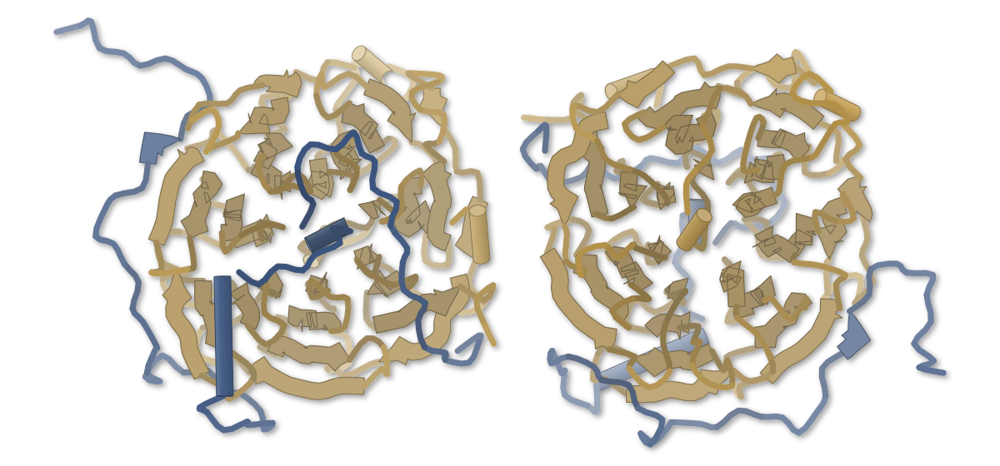

色（順に）：Cleavage and polyadenylation factor complex subunit C74.02c / Uncharacterized WD repeat-containing protein C824.04

**WDR82は、2つの短い配列で分かれた相手をつなぐ**

PNUTSとSymplekinがWD40タンパク質WDR82の別々の面に結合する構造を、X線結晶構造で示した

- **疑問・課題**：PP1ホスファターゼが転写の場でどう組み立てられ、活性化されるのかは不明だった。
- **アプローチ**：分裂酵母のPNUTS・WDR82・Symplekin・Ssu72の複合体を、X線結晶構造解析と変異体の遺伝学で調べた。
- **結果**：PNUTSとSymplekinはWDR82の別々の部位に結合した。SymplekinのDPR配列を変えると結合が消え、終結が乱れた。
- **わかったこと**：WDR82がPNUTS-PP1とSymplekinをつなぐ橋渡し役になり、PP1を3′末端のプロセシング装置に結びつけると考えられる。
- **残された課題**：WDR82が複数の相手を使い分ける仕組みは、実験構造による検証が今後必要だという。

この紹介文の根拠（論文本文）

> Despite the conserved role of PP1 in transcription, how PP1 holoenzymes are organised and activated on chromatin to regulate this process remains unclear.  
> — 疑問・課題／Introduction

> We present the structure of a PNUTS-WDR82-Symplekin-Ssu72 complex, revealing that PNUTS and Symplekin bind WDR82 through distinct interfaces using conserved short linear motifs.  
> — アプローチ／Abstract

> This demonstrates that the DPR motif in Symplekin is essential for binding WDR82.  
> — 結果／Results

> SymplekinDPR-AAA lost the ability to interact with PPW, however interactions with the rest of CPA were retained  
> — 結果／Results

> Normalisation confirmed that the 3′-end processing and termination defects associated with SymplekinDPR-AAA globally affect transcription across the genome  
> — 結果／Results

> We demonstrate that WDR82 bridges PNUTS-PP1 to the CPA machinery via Symplekin.  
> — わかったこと／Results

> Our findings demonstrate that the PP1 complex is essential for coupling transcription to pre-mRNA 3′-end maturation, ensuring production of functional mRNA.  
> — わかったこと／Abstract

> Future structural studies with experimental techniques will be required to validate this combinatorial WDR82-binding code.  
> — 残された課題／Discussion

分類：DNA・RNA に関わるもの・転写調節・シグナル伝達

#### 読みどころ

PNUTSの565〜644番付近が、WDR82の溝に疎水的な接触で入り込む。結合面積は約3500 Å2で、PNUTS側には保存されたWPL/Iモチーフと、LI様モチーフが使われる。

根拠（論文本文）

> PNUTSWBR interacts extensively with WDR82, burying a surface area of ~3500 Å2  
> — Results

> A stretch of hydrophobic residues 565EIIWYKPVPIKF576 (WPL/I) makes contacts along a groove in WDR82  
> — Results

Symplekinの長いループの先端にあるDPR（Asp-Pro-Arg）配列が、WDR82のWD40ドメインのポケットに差し込まれる。この3残基をアラニンにするとWDR82と結合できなくなり、細胞の増殖も回復しなかった。

根拠（論文本文）

> with the tip of the loop protruding outwards from Symplekin and inserting into a pocket in WDR82 formed by two blades of the WD40 domain  
> — Results

> Complementing the Symplekin-AID strain with a wild-type copy of Symplekin verified that SymplekinWT and SymplekinDPR-AAA were expressed at similar levels  
> — Results

PNUTSはPP1を結びつけるだけでなく、Spt5の脱リン酸化を約1.5倍に高める。WDR82自体にはPP1を活性化する働きがなく、役割は複合体を処理装置につなぐことにある。

根拠（論文本文）

> The addition of PNUTS stimulated PP1 activity 1.5-fold for all the substrates  
> — Results

> The addition of WDR82 did not stimulate PP1 activity with or without functional PNUTS present  
> — Results

#### 構造データ

| PDB | 手法 | 分解能 | 公開 | 生物種 | リガンド |
|---|---|---|---|---|---|
| [9SCE](https://www.rcsb.org/structure/9SCE) | X-ray | 1.61 Å | 2026-08-05 | Schizosaccharomyces pombe | — |
| [9SYQ](https://www.rcsb.org/structure/9SYQ) | X-ray | 3.79 Å | 2026-08-05 | Schizosaccharomyces pombe, Schizosaccharomyces pombe (strain 972 / ATCC 24843) | — |

- [O42868](https://www.uniprot.org/uniprotkb/O42868) ssu72 RNA polymerase II subunit A C-terminal domain phosphatase ssu72 — *Schizosaccharomyces pombe (strain 972 / ATCC 24843)* （PDB で初めての構造）
- [O74535](https://www.uniprot.org/uniprotkb/O74535)  Cleavage and polyadenylation factor complex subunit C74.02c — *Schizosaccharomyces pombe (strain 972 / ATCC 24843)* （既存の PDB 構造 1 件）
- [Q10222](https://www.uniprot.org/uniprotkb/Q10222) pta1 mRNA cleavage and polyadenylation specificity factor complex subunit pta1 — *Schizosaccharomyces pombe (strain 972 / ATCC 24843)* （PDB で初めての構造）
- [Q9UT39](https://www.uniprot.org/uniprotkb/Q9UT39)  Uncharacterized WD repeat-containing protein C824.04 — *Schizosaccharomyces pombe (strain 972 / ATCC 24843)* （既存の PDB 構造 1 件）

#### 実験メモ

- **発現系**：PNUTSなどは大腸菌Rosetta (DE3)、複合体の各成分はSf9昆虫細胞のバキュロウイルス系で発現した。
- **結晶化／グリッド作製**：PNUTSWBR-WDR82は9.85 mg/mLで、シッティングドロップ蒸気拡散法により20 °Cで結晶化した。
- **データ収集・解析**：Diamond Light Sourceのビームライン I04でX線回折データを収集した。

根拠（論文本文）

> Proteins were expressed in E. coli Rosetta (DE3) cells grown in 2 × TY medium  
> — Methods

> All proteins expressed from Sf9 were cloned into pACEBac1.  
> — Methods

> PNUTSWBR-WDR82 at 9.85 mg/mL was crystallised using the sitting-drop vapour diffusion set-up at 20 °C.  
> — Methods

> X-ray diffraction data were collected on the I04 beamline at Diamond Light Source (Harwell, UK).  
> — Methods

> 📝 編集者への確認事項：論文は「初めての構造」とは明言していない（サイトの判定では Ssu72・Pta1 の初構造が New Structure になる）。9SYQ は 3.79 Å で Ssu72 の密度が弱く、論文もその点を書いている。

---

# Structure Update

## 5｜ZNFX1（RNAヘリカーゼ）

### Cryo-EM structures of autoinhibited and RNA-activated ZNFX1 helicase

*Nature Communications*（2026-09-25） · [論文](https://doi.org/10.1038/s41467-026-78145-0) · ライセンス: cc by

筆頭著者：Qing He（Van Andel Institute, USA）　責任著者：Huilin Li（Van Andel Institute, USA）

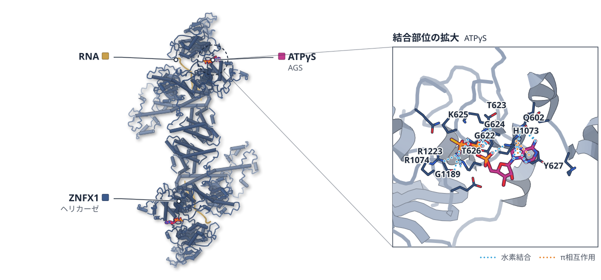

色（順に）：ZNFX1（ヘリカーゼ） / RNA　スティック：ATPγS（AGS）

**ZNFX1は、RNAに出会うまで自分でRNAの溝をふさいでいる**

RNAなしの四量体フィラメントとRNA結合型の二量体を比べ、ヘリカーゼの活性化の仕組みを描いた

- **疑問・課題**：ZNFX1はRNAが結合するとどう活性化されるのか。RNAなしで解かれた構造は不活性型とみられるだけだった。
- **アプローチ**：全長のヒトZNFX1を、RNAなしと一本鎖RNA結合型の2つの状態でクライオ電顕により解析し、生化学実験と合わせた。
- **結果**：RNAなしでは阻害ヘリックスが溝をふさぎ、四量体が連なる短いフィラメントを作る。RNAで溝が開き、二量体になる。
- **わかったこと**：阻害ヘリックスが溝をふさぐ自己阻害が基本で、RNA結合が構造を作り替えてヘリカーゼを活性化すると考えられる。
- **残された課題**：RNAと結合する際に二量体になる理由や、C末端のE3リガーゼ部分の構造は、まだ分かっていない。

この紹介文の根拠（論文本文）

> However, because the structure was determined in the absence of nucleic acid, it likely represents an inactive state.  
> — 疑問・課題／Introduction

> raising fundamental questions about how RNA-binding activates this multifunctional enzyme  
> — 疑問・課題／Abstract

> Here, we combine cryo-electron microscopy with biochemical analyses to define the structural basis of ZNFX1 regulation.  
> — アプローチ／Abstract

> In the absence of RNA, ZNFX1 adopts an autoinhibited conformation in which a blocking helix occludes the RNA-binding groove.  
> — 結果／Abstract

> Binding of single-stranded RNA (ssRNA) remodels these higher-order assemblies into RNA-bound ZNFX1 monomers and dimers.  
> — 結果／Abstract

> Together, these findings support a regulatory mechanism in which autoinhibited ZNFX1 exists as monomers or concentration-dependent higher-order oligomers, whereas RNA binding promotes structural remodeling and helicase activation.  
> — わかったこと／Abstract

> Stabilization of the E3 ligase module, potentially through binding of E2 enzyme, ubiquitin, or RNA substrates, will be an important goal for future structural studies  
> — 残された課題／Discussion

分類：DNA・RNA に関わるもの・免疫（抗体・MHC・TCR・自然免疫）

#### 読みどころ

RNAなしのZNFX1では、1Zドメインから伸びるヘリックスがRNA結合溝に入り込んでいる。このヘリックスは負電荷の残基に富み、RNAの結合を妨げる。

根拠（論文本文）

> Because the helix is enriched in negatively charged residues and sterically occludes the RNA-binding groove, we refer to it as the blocking helix.  
> — Results

一本鎖RNAが結合すると、阻害ヘリックスが押し出され、1B領域が約7.8 Å離れて溝が広がる。13個のリボヌクレオチドが溝に収まり、UPF1などより長い範囲でRNAをつかむ。

根拠（論文本文）

> Notably, ssRNA binding displaces the blocking helix that occupies the RNA-binding groove in the autoinhibited state  
> — Results

> Thirteen ribonucleotides are well resolved and interact extensively with each ZNFX1 protomer  
> — Results

阻害ヘリックスを置換した変異体は、ATPを分解する基本活性が高いのに、RNAをほどく活性は野生型より低かった。ATPの分解が増えるだけではほどけないことが分かる。

根拠（論文本文）

> indicating that increasing ATP hydrolysis alone is insufficient for efficient RNA unwinding  
> — Results

#### 構造データ

| PDB | 手法 | 分解能 | 公開 | 生物種 | リガンド |
|---|---|---|---|---|---|
| [11HT](https://www.rcsb.org/structure/11HT) | Cryo-EM | 3.71 Å | 2026-10-07 | Homo sapiens | AGS |
| [11IM](https://www.rcsb.org/structure/11IM) | Cryo-EM | 3.71 Å | 2026-10-07 | Homo sapiens | AGS |
| [13FZ](https://www.rcsb.org/structure/13FZ) | Cryo-EM | 3.37 Å | 2026-10-07 | Homo sapiens, synthetic construct | AGS |
| [13FU](https://www.rcsb.org/structure/13FU) | Cryo-EM | 3.37 Å | 2026-10-07 | Homo sapiens, synthetic construct | AGS |

- [Q9P2E3](https://www.uniprot.org/uniprotkb/Q9P2E3) ZNFX1 NFX1-type zinc finger-containing protein 1 — *Homo sapiens* （既存の PDB 構造 5 件）

#### 実験メモ

- **発現系**：cryo-EM用にはBacMamウイルスを感染させたFreeStyle 293-F細胞で発現した。
- **コンストラクト**：N末端に3xFLAGタグを付けた全長のヒトZNFX1。
- **精製**：抗FLAG樹脂で精製し、Superose 6 Increaseのサイズ排除クロマトグラフィーで仕上げた。
- **結晶化／グリッド作製**：ZNFX1 1 µMにATPγS 1 mMを加え、RNA結合型では60 nt ssRNA 10 µMも加えて、Vitrobot Mark IVで凍結した。
- **データ収集・解析**：Titan Krios（300 kV）とK3検出器で撮影し、cryoSPARCとRELION 5.0で処理した。

根拠（論文本文）

> P2 virus was harvested and used to infect FreeStyle™ 293-F cells (Thermo Fisher Scientific)  
> — Methods

> cloned into the pEG BacMam vector with an N-terminal 3xFLAG tag for mammalian expression  
> — Methods

> further purified by size-exclusion chromatography on a Superose 6 Increase column (GE Healthcare)  
> — Methods

> 1 µM ZNFX1 was mixed with 10 µM 60-nt ssRNA in the presence of 1 mM ATPγS  
> — Methods

> Cryo-EM data were collected using a Titan Krios electron microscope (Thermo Fisher Scientific) operating at 300 kV  
> — Methods

> 📝 編集者への確認事項：ZNFX1 は既報の単量体構造（PDB あり）があるため New Structure ではなく Structure Update の見込み。1Z–1Z と ARM–ZnF の界面は AlphaFold 予測をあてはめた部分があり、論文も限定つきで書いている。E3 リガーゼ部分は未解像。

---

## 6｜TIM23（酵母）

### Topogenic sequence recognition at TIM complexes revealed by a stendomycin-bound structure

*Nature Chemical Biology*（2026-08-26） · [論文](https://doi.org/10.1038/s41589-026-02304-z) · ライセンス: cc by

筆頭著者：Yuanyuan Chen（University of California, USA）　責任著者：Eunyong Park（University of California, USA）

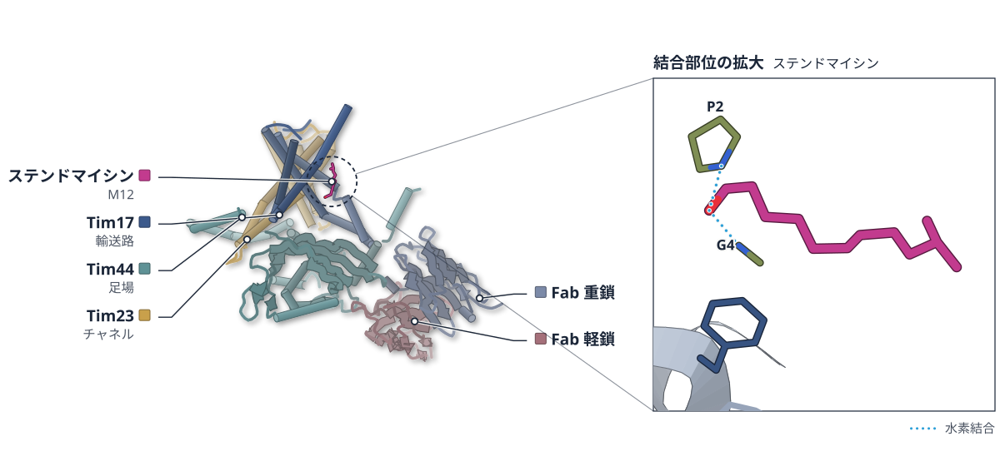

色（順に）：Tim17（輸送路） / Tim23（チャネル） / Tim44（足場） / Fab 軽鎖 / Fab 重鎖　スティック：ステンドマイシン（M12）

**抗生物質が、ミトコンドリアの入口にらせんで栓をする**

ステンドマイシンが結合したTIM23をクライオ電顕で解き、Tim17の空洞をふさぐ姿を示した

- **疑問・課題**：ミトコンドリア内膜のTIM23とTIM22が、輸送するタンパク質の目印をどう見分けるかは、よく分かっていなかった。
- **アプローチ**：TIM23の阻害剤ステンドマイシンを結合させた酵母のTIM23をクライオ電顕で解き、変異体で調べた。
- **結果**：3.2 Å分解能で、ステンドマイシンがTim17の空洞にらせん状に収まる姿が見えた。Tim22も1か所の変異で結合した。
- **わかったこと**：ステンドマイシンは輸送基質の目印のらせんを真似て空洞をふさぐ。Tim17とTim22の空洞は、機能を保ったまま入れ替えが効く。
- **残された課題**：目印配列（MTS）が結合した状態の構造は、まだ実験で得られていない。

この紹介文の根拠（論文本文）

> The mechanisms underlying the recognition of these sequences and client engagement remain poorly understood.  
> — 疑問・課題／Main

> Cryogenic-electron microscopy shows that stendomycin binds to the protein translocation cavity of Tim17, mimicking α-helical topogenic sequences.  
> — アプローチ／Abstract

> Here we addressed these questions by determining the structure of stendomycin-bound TIM23 and performing mutational studies.  
> — アプローチ／Main

> we obtained a cryo-EM map of the stendomycin-bound TIM23 complex at an overall resolution of 3.2 Å  
> — 結果／Results

> Even the single T52G mutation enabled stendomycin binding to Tim22, despite the substantial surface differences between Tim22 and Tim17 cavities.  
> — 結果／Results

> Taken together, our data indicate that the Tim17 and Tim22 cavities are largely interchangeable while maintaining their respective functions.  
> — わかったこと／Results

> These findings reveal a mechanistic overlap between protein translocases and insertases.  
> — わかったこと／Abstract

> Although experimental structures of MTS-bound TIM23 complexes will be needed for a detailed mechanistic understanding  
> — 残された課題／Discussion

分類：トランスポーター

#### 読みどころ

ステンドマイシンはTim17の空洞に栓のように収まる。結合の大部分はファンデルワールス力で、TIM23の構造は何も結合していない状態とほとんど同じだった。

根拠（論文本文）

> Stendomycin binds to the concave cavity of Tim17, adopting a cork stopper-like structure (Fig. 2a–d).  
> — Results

> The binding is mediated largely by van der Waals interactions between the hydrophobic surfaces of stendomycin and the Tim17 cavity.  
> — Results

ステンドマイシンの一部は、D型アミノ酸が多いため左巻きのαヘリックスになる。この形が、ミトコンドリアへの目印配列のらせんを真似て空洞に入る手がかりになると著者は考えている。

根拠（論文本文）

> Notably, parts of the stem and the cyclic peptide together form a left-handed α-helix (Fig. 2b,c).  
> — Results

> As MTSs are generally thought to form a helical conformation, the stendomycin-bound structure may thus mimic an MTS-engaged state  
> — Results

Tim22は通常ステンドマイシンと結合しないが、空洞内のThr52をGlyに変えるだけで感受性になった。7〜14残基を入れ替えた変異体でも、IC50は約0.85〜1.0 µMだった。

根拠（論文本文）

> The T52G mutant showed an IC50 of ~1.0 µM, whereas 22mut1 and 22mut2 exhibited IC50 values of 0.93 µM and 0.85 µM, respectively.  
> — Results

#### 構造データ

| PDB | 手法 | 分解能 | 公開 | 生物種 | リガンド |
|---|---|---|---|---|---|
| [9N84](https://www.rcsb.org/structure/9N84) | Cryo-EM | 3.20 Å | 2026-09-16 | Mus musculus, Saccharomyces cerevisiae, synthetic construct | M12 |

- [P32897](https://www.uniprot.org/uniprotkb/P32897) TIM23 Mitochondrial import inner membrane translocase subunit TIM23 — *Saccharomyces cerevisiae (strain ATCC 204508 / S288c)* （既存の PDB 構造 3 件）
- [P39515](https://www.uniprot.org/uniprotkb/P39515) TIM17 Mitochondrial import inner membrane translocase subunit TIM17 — *Saccharomyces cerevisiae (strain ATCC 204508 / S288c)* （既存の PDB 構造 2 件）
- [Q01852](https://www.uniprot.org/uniprotkb/Q01852) TIM44 Mitochondrial import inner membrane translocase subunit TIM44 — *Saccharomyces cerevisiae (strain ATCC 204508 / S288c)* （既存の PDB 構造 4 件）

#### 実験メモ

- **発現系**：酵母（S. cerevisiae）の株にβ-エストラジオールを加えて発現を誘導
- **コンストラクト**：Tim17・Tim23・Tim44からなるコアTIM23複合体。Tim44に対する抗体断片（Fab）を目印に使った
- **精製**：ミトコンドリアをGDNとLMNGで可溶化し、抗BC2ナノボディ樹脂で精製。ペプチディスクに再構成してからステンドマイシンを加えた
- **結晶化／グリッド作製**：Quantifoil R 1.2/1.3 の金グリッドに3 µlを載せ、Vitrobot Mark IVで凍結
- **データ収集・解析**：Titan Krios G3i（300 kV）とK3検出器で撮影。Warp・cryoSPARCで処理し、3,348枚の画像から105,256粒子で3.2 Åに到達

根拠（論文本文）

> The complex was then reconstituted to peptidiscs by mixing with the NSPr peptide (Peptidisc Laboratory) at a ratio of 1.2:1 (w/w, TIM23/NSPr) and incubated on ice for 45 min.  
> — Methods

> The final reconstruction was refined to a nominal resolution of 3.2 Å from 105,256 particles.  
> — Methods

> 📝 編集者への確認事項：UniProt 上は酵母のTIM23・TIM17・TIM44。Tim22側は既存構造との比較・変異解析で、新規構造は1つ。

---

## 7｜MurJ（大腸菌）

### Structural basis for inhibition of the lipid flippase MurJ by phage lysis protein SglPP7 suggests convergent evolution with other Sgl peptides

*PLOS Biology*（2026-10-27） · [論文](https://doi.org/10.1371/journal.pbio.3004039) · ライセンス: cc by

筆頭著者：Kaito Hosoda（Nara Institute of Science and Technology, Japan）　責任著者：Hidetaka Kohga, Tomoya Tsukazaki（Nara Institute of Science and Technology, Japan）

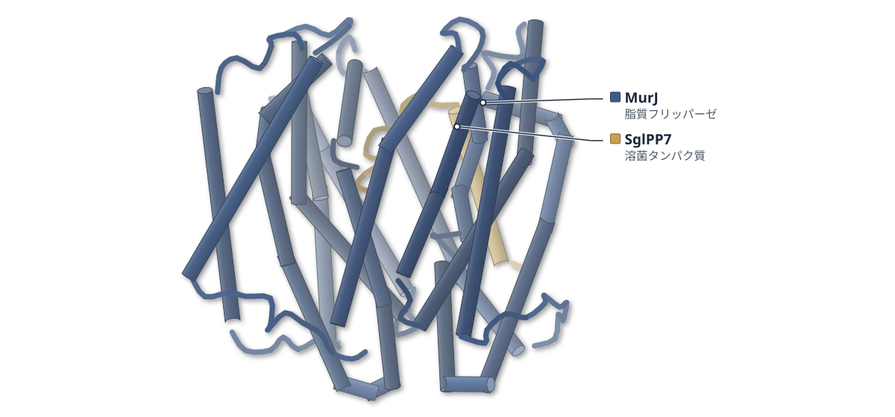

色（順に）：MurJ（脂質フリッパーゼ） / SglPP7（溶菌タンパク質）

**ファージの溶菌タンパク質は、MurJの空洞に尾を差し込む**

MurJとSglPP7の複合体を3.2 Åで解析。外向き型に固定され、脂質IIの輸送が止まると考えられる

- **疑問・課題**：SglPP7はLysMと配列が似ないが、同じMurJを標的にするらしい。結合様式を調べる必要があった。
- **アプローチ**：ナノディスクのMurJ/SglPP7複合体をクライオ電顕で解き、変異体解析とMDで補った。
- **結果**：3.2 Åで、SglPP7は膜貫通ヘリックス1本と短い尾から成り、尾（50–55番）がMurJの空洞に入っていた。
- **わかったこと**：SglPP7はMurJを外向き型に安定化する。LysMやSglCJ3とは結合様式が違い、収斂進化と矛盾しない。
- **残された課題**：MurJの溝に見えた脂質様の密度は、頭部が見えず、どの脂質か特定できなかった。

この紹介文の根拠（論文本文）

> recent genetic screening suggested that SglPP7, a 55-residue Sgl of Pseudomonas aeruginosa phage PP7, also targets MurJ  
> — 疑問・課題／Introduction

> In contrast to LysM, SglPP7 is encoded at a distinct genomic position and shows no amino acid sequence similarity  
> — 疑問・課題／Introduction

> reconstituted into nanodiscs with E. coli lipids, and its cryo-EM structure was determined at an overall resolution of 3.2 Å  
> — アプローチ／Results

> Structural, mutational, and molecular dynamics (MD) simulation analyses revealed that SglPP7 binds along the intramembrane cleft of MurJ  
> — アプローチ／Abstract

> The modeled region of SglPP7 in each structure forms a single transmembrane helix followed by a short C-terminal tail that inserts deeply into a positively charged internal cavity  
> — 結果／Results

> The C-terminal embedded tail (residues 50–55) inserts deeply into the positively charged interior of MurJ  
> — 結果／Results

> these sequence-divergent Sgl proteins stabilize MurJ in the outward-facing conformation through distinct binding modes, consistent with the possibility of convergent evolution toward MurJ inhibition  
> — わかったこと／Abstract

> However, the map does not contain features corresponding to the hydrophilic headgroup of lipid II, precluding identification of its molecular species.  
> — 残された課題／Results

分類：トランスポーター・感染・ウイルス・防御系

#### 読みどころ

尾のW53が鍵になる。W53KとW53Rでは溶菌活性が失われ、53番までの配列が残っていないと活性が出なかった。

根拠（論文本文）

> W53K and W53R lost lytic activity  
> — Results

> retention of the sequence through residue 53 was required for lytic activity  
> — Results

3つの溶菌タンパク質は、MurJの別の領域に結合する。尾が空洞を占めるSglPP7、表面に結合するLysM、溝に入るSglCJ3と、結合様式が異なる。

根拠（論文本文）

> Thus, the three Sgl proteins interact with different regions of MurJ through their C-terminal regions and stabilize MurJ in the outward-facing conformation through distinct binding modes characterized as cavity-occupying, surface-binding, and cleft-binding for SglPP7, LysM, and SglCJ3, respectively.  
> — Results

AlphaFold3はSglPP7の位置を予測できず、MurJも内向き型で予測した。実験で決めた構造が重要だと論文は述べる。

根拠（論文本文）

> failed to predict the experimentally observed positioning of SglPP7 on MurJ and showed low confidence in this region  
> — Results

#### 構造データ

| PDB | 手法 | 分解能 | 公開 | 生物種 | リガンド |
|---|---|---|---|---|---|
| [9X2N](https://www.rcsb.org/structure/9X2N) | Cryo-EM | 3.20 Å | 2026-09-23 | Escherichia coli, Pseudomonas phage PP7 | — |

- [P0AF16](https://www.uniprot.org/uniprotkb/P0AF16) murJ Lipid II flippase MurJ — *Escherichia coli (strain K12)* （既存の PDB 構造 7 件）
- [Q38063](https://www.uniprot.org/uniprotkb/Q38063)  Lysis protein — *Pseudomonas phage PP7* （既存の PDB 構造 1 件）

#### 実験メモ

- **発現系**：MurJとSglPP7を大腸菌BL21 ΔrecA (DE3)で共発現し、IPTGとアラビノースで誘導した。
- **コンストラクト**：N末端Met-His10付きSglPP7（1–55）と、MurJ（2–511）を用いた。
- **精製**：DDM・LMNG・CHSで可溶化し、Ni-NTAとSuperose 6 Increaseで精製した。
- **結晶化／グリッド作製**：MSP1D1と大腸菌リン脂質を1.4:1:120で混ぜ、ナノディスクに再構成した。
- **データ収集・解析**：SPring-8のCRYO ARM 300で17,650ムービーを集め、cryoSPARCで処理した。

根拠（論文本文）

> Protein expression was induced with 1 mM isopropyl β-D-thiogalactopyranoside (IPTG) and 0.2% (w/v) L-arabinose.  
> — Methods

> N-terminally Met-His10-tagged SglPP71–55(WT) and Met-Ala-E. coli MurJ2–511  
> — Results

> The protein was subsequently purified using Ni-NTA agarose resin (QIAGEN), followed by a Superose 6 Increase 10/300 GL column (Cytiva).  
> — Methods

> The purified MurJ/SglPP7 complex was mixed with MSP1D1 [31] and E. coli phospholipids (Avanti) at a molar ratio of 1.4:1:120  
> — Methods

> A total of 17,650 movies were aligned using patch motion correction  
> — Methods

> 📝 編集者への確認事項：別グループによる3.70 ÅのMurJ/SglPP7構造が既報（論文が本文で比較）。MD解析は短時間（120 ns×3）で、補助的な位置づけ。

---

## 8｜PFKL（解糖系酵素）

### A covalent PFKL activator suppresses tumor growth

*Nature Chemical Biology*（2026-08-05） · [論文](https://doi.org/10.1038/s41589-026-02289-9) · ライセンス: cc by-nc-nd

筆頭著者：Xiaoding Jiang（The University of Texas at Austin, USA）　責任著者：Xiaolu A. Cambronne, Ku-Lung Hsu（The University of Texas at Austin, USA）

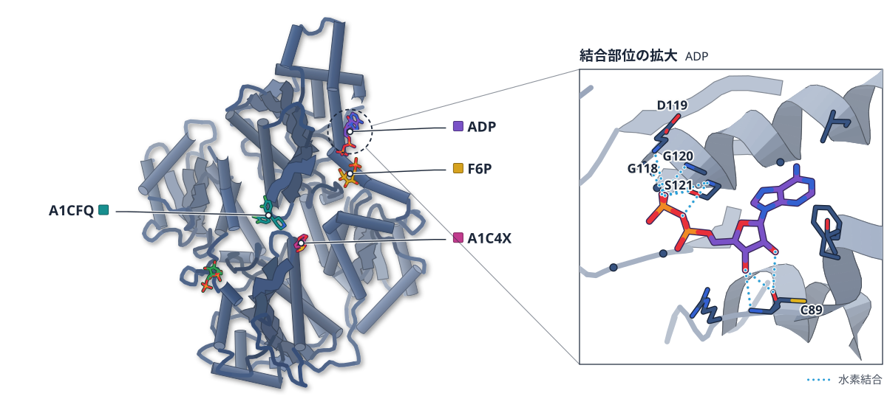

色（順に）：PFKL　スティック：A1C4X、FBP、ADP、F6P、A1CFQ

**共有結合の活性化剤は、PFKLを活性型に固定する**

K677に結合するXJ-4-85とPFKLの複合体をクライオ電顕で解き、R状態の維持を示した

- **疑問・課題**：がん細胞は代謝を変えて解糖に頼るが、その柔軟さのために、解糖を標的にした抗がん剤を作るのは難しい。
- **アプローチ**：PFKLのK677に共有結合する活性化剤XJ-4-85を作り、F6PとATPを加えた複合体をクライオ電顕で解析した。
- **結果**：3.2 Å分解能の構造で、離れた薬剤部分がアロステリック部位に入り、PFKLは活性なR状態だった。
- **わかったこと**：XJ-4-85は薬剤部分が入ることでT状態への変化を妨げ、PFKLを活性型に保つと考えられる。
- **残された課題**：PFKLとCPT2の両方を欠くモデルでの検証など、作用機構の細部は今後の課題とされている。

この紹介文の根拠（論文本文）

> Nevertheless, inhibition of upregulation of glycolysis in cancer cells remains a challenge owing to the inherent metabolic plasticity of these cells  
> — 疑問・課題／Main

> To determine the activation mechanism of XJ-4-85, we solved the cryo-EM structure of PFKL in complex with XJ-4-85 and substrates ATP and F6P  
> — アプローチ／Results

> exhibited clear density for the XJ-4-85 leaving group in the allosteric activating site between the PFKL catalytic and regulatory domains  
> — 結果／Results

> XJ-4-85-bound PFKL was in the active R-state conformation, with F6P and ADP bound at active sites  
> — 結果／Results

> XJ-4-85 seemed to activate PFKL by sterically preventing compression of the allosteric activating site, thereby resisting transition to the T-state conformation.  
> — わかったこと／Results

> Future studies should include testing of the PFKL activator in a PFKL/CPT2 double-KO model.  
> — 残された課題／Discussion

分類：酵素（その他）・キナーゼ

#### 読みどころ

XJ-4-85はPFKLのK677に共有結合し、切り離される薬剤部分がCPT2を阻害する。結合部位が似たPFKMやPFKPは活性化せず、K315の違いが選択性に関わる。

根拠（論文本文）

> XJ-4-85 failed to activate PFKP or PFKM, even though these isoforms contained a homologous lysine residue  
> — Results

> Given the proximity of K315 to the leaving group, we substituted this nonconserved residue with arginine  
> — Results

結合部位はAMPやADPなど天然の活性化因子と重なる。T状態へ移ると薬剤部分と触媒ドメインが衝突するため、PFKLはR状態にとどまる。

根拠（論文本文）

> The XJ-4-85 binding pose overlapped with those of native activators (AMP and ADP) and reversible PFKL activator NA-11  
> — Results

> Rotation to the T-state would result in steric clashes between the XJ-4-85 leaving group and incoming catalytic domain  
> — Results

共有結合部のK677は柔らかく、密度は一部の分類でしか見えなかった。このためK677だけの修飾ではT状態を防ぐのに十分でなく、薬剤部分と合わせて効くと論文は推定している。

根拠（論文本文）

> This suggests that both the covalent modification and the leaving group contribute to the steric effect on activation.  
> — Results

#### 構造データ

| PDB | 手法 | 分解能 | 公開 | 生物種 | リガンド |
|---|---|---|---|---|---|
| [9P0J](https://www.rcsb.org/structure/9P0J) | Cryo-EM | 3.20 Å | 2026-09-23 | Homo sapiens | A1CFQ, F6P, ADP, FBP, A1C4X |

- [P17858](https://www.uniprot.org/uniprotkb/P17858) PFKL ATP-dependent 6-phosphofructokinase, liver type — *Homo sapiens* （既存の PDB 構造 5 件）

#### 実験メモ

- **発現系**：コドンを最適化したPFKLを、Expi293F細胞にPEIで導入して発現した。
- **コンストラクト**：N末端にTwin-StrepタグとTEV切断部位を付けた。
- **精製**：Strep-Tactin XTのカラムで精製し、F6P入りの緩衝液に置換した。
- **結晶化／グリッド作製**：4.2 µMのPFKLに25 µMのXJ-4-85を加え、F6PとATPを足してVitrobotで凍結した。
- **データ収集・解析**：Glacios（200 kV）とK3カメラで撮影し、cryoSPARCで処理した。

根拠（論文本文）

> PFKL was expressed in Expi293F cells (Thermo Fisher).  
> — Methods

> It was subcloned into the pcDNA3.1(+) vector with an amino-terminal Twin-Strep tag and TEV cleavage site using Gibson assembly.  
> — Methods

> passed over a pre-equilibrated 1-ml Strep-Tactin XT 4Flow (IBA Life Sciences) gravity column  
> — Methods

> we combined 4.2 µM PFKL in 20 mM HEPES (pH 8.0), 150 mM KCl, 3% glycerol, 500 µM F6P and 2 mM DTT with 25 µM XJ-4-85  
> — Methods

> Movies were acquired using a Glacios microscope (Thermo Fisher) operated at 200 kV, equipped with a K3 Direct Detect camera  
> — Methods

> 📝 編集者への確認事項：PFKL は既存の PDB 構造があるため Structure Update の見込み。共有結合した部分と薬剤部分の密度は一部しか見えず、直鎖アルキル鎖は未モデル。論文の多くは化学プロテオミクスと担がんマウスで、構造は活性化機構の部分。ligand_names / site_ligand は描画後にリガンド ID（A1CFQ・A1C4X など）を見て決める必要あり。創薬の軸で今日の一本の候補。

---

## 9｜RIOK1（古細菌）

### Discovery of a small molecule RIOK1 inhibitor CINS-1 against colorectal cancer via disrupting ribosomal biosynthesis

*Acta Pharmaceutica Sinica. B*（2026-07-08） · [論文](https://doi.org/10.1016/j.apsb.2026.07.004) · ライセンス: cc by-nc-nd

筆頭著者：Ying Jiang（Southern Medical University, China）　責任著者：Jianjun Chen, Wei Xu, Jiajie Zhang（Southern Medical University, China）

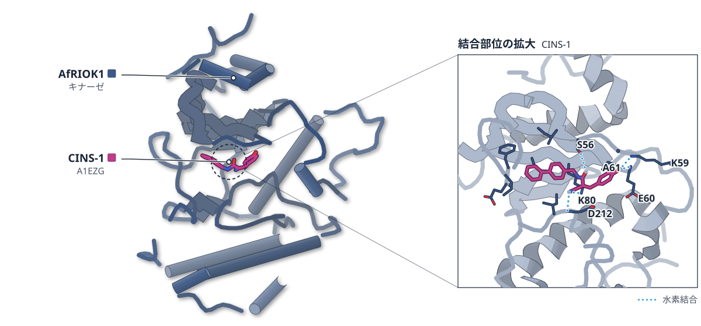

色（順に）：AfRIOK1（キナーゼ）　スティック：CINS-1（A1EZG）

**大腸がん向けRIOK1阻害剤CINS-1の結合を結晶で確認**

好熱性古細菌のRIOK1との複合体を2.76 Åで解き、ATP結合ポケットへの入り方を示した

- **疑問・課題**：RIOK1を狙う化合物は少なく、大腸がんでの抗腫瘍効果も十分に調べられていなかった。
- **アプローチ**：既知の阻害剤WP1086を土台に誘導体を作り、強いCINS-1を選んで古細菌RIOK1との結晶構造を解いた。
- **結果**：複合体は2.76 Åで決まり、CINS-1はATP結合部位の近くに入った。Kdは0.097 μMで、WP1086の50.6 μMより強い。
- **わかったこと**：CINS-1はATPポケットに結合する。ヒトRIOK1にも強く結合し、大腸がん細胞の増殖を抑えた。
- **残された課題**：ヒトRIOK1とCINS-1の複合体は結晶化できず、結合様式はドッキングによる推定にとどまる。

この紹介文の根拠（論文本文）

> However, few compounds have been designed to target RIOK1, and the antitumor activity of RIOK1 inhibitors has yet to be thoroughly investigated.  
> — 疑問・課題／Abstract

> Leveraging the crystal structure of AfRIOK1 protein and the inhibitor WP1086 reported in the literature26, we synthesized a series of compounds by modifying the polarity of the pyridine ring and benzene ring of WP1086.  
> — アプローチ／Introduction

> we resolved the crystal structure of the complex of CINS-1 and Archaeoglobusfulgidus RIOK1 (AfRIOK1) protein.  
> — アプローチ／Results

> In the overall structure of the complex at a resolution of 2.76 Å  
> — 結果／Results

> WP1086 bound to AfRIOK1 with weak binding affinity (Kd = 50.6 μmol/L) (Fig. 8C), whereas CINS-1 exhibited much stronger binding affinity (Kd = 0.097 μmol/L) under the same conditions  
> — 結果／Results

> These results indicate that compound CINS-1 can stably bind to RIOK1 (HsRIOK1) and AfRIOK1, and the binding of the two proteins to CINS-1 has high similarity.  
> — わかったこと／Results

> In this study, we report the optimization of pyridine caffeic acid benzyl amide derivatives as RIOK1 inhibitors and identified CINS-1 as a potent compound with markedly enhanced binding affinity for AfRIOK1 and RIOK1.  
> — わかったこと／Abstract

> we were unable to obtain crystals of sufficient diffraction quality to resolve the human RIOK1–CINS-1 complex  
> — 残された課題／Discussion

分類：キナーゼ

#### 読みどころ

WP1086のベンゼン環側を二つのフェニル基をもつ構造に変えたCINS-1は、HCT116細胞での増殖抑制のIC50がWP1086の27.55 μMから7.81 μMへ下がった。

根拠（論文本文）

> Notably, compound 5e (CINS-1) exhibited significantly better inhibitory activity (IC50 = 7.81 μmol/L) than WP1086 (IC50 = 27.55 μmol/L) in HCT116 cells.  
> — Results

結晶構造では、CINS-1はAfRIOK1のGlu148と水素結合し、周囲の残基15個と疎水的に接する。結合に関わる主要な残基はヒトRIOK1と同じで、ドッキングでも同じ部位を占めた。

根拠（論文本文）

> the glutamic acid at position 148 in AfRIOK1 protein formed an intermolecular hydrogen bond with the oxygen atom at position one in CINS-1, and the hydrophobic interaction involved 15 nearby residues in the binding interface between AfRIOK1 and CINS-1  
> — Results

> The key residues responsible for anchoring CINS-1 (e.g., Lys59, Glu60, Glu148, Phe149, Ile150) were identical between species.  
> — Results

CINS-1を加えた大腸がん細胞では、成熟前の18S rRNAが細胞質に溜まり、p53が増えた。著者はリボソーム合成の乱れがp53を介した核小体ストレス応答を起こすと提案するが、因果関係の確認は今後の課題としている。

根拠（論文本文）

> In control cells, only weak signals were detected in the cytoplasm, whereas treatment with CINS-1 resulted in an increased signal, indicating impaired processing.  
> — Results

> It is proposed that CINS-1 inhibits the formation of 18S rRNA by affecting RIOK1 function, thereby inducing a P53-mediated nucleolar stress response (Fig. 13).  
> — Conclusions

#### 構造データ

| PDB | 手法 | 分解能 | 公開 | 生物種 | リガンド |
|---|---|---|---|---|---|
| [9X8Y](https://www.rcsb.org/structure/9X8Y) | X-ray | 2.76 Å | 2026-10-28 | Archaeoglobus fulgidus (strain ATCC 49558 / DSM 4304 / JCM 9628 / NBRC 100126 / VC-16) | A1EZG |

- [O28471](https://www.uniprot.org/uniprotkb/O28471) rio1 RIO-type serine/threonine-protein kinase Rio1 — *Archaeoglobus fulgidus (strain ATCC 49558 / DSM 4304 / JCM 9628 / NBRC 100126 / VC-16)* （既存の PDB 構造 6 件）

#### 実験メモ

- **コンストラクト**：古細菌 Archaeoglobus fulgidus のRIOK1（AfRIOK1）を使用
- **結晶化／グリッド作製**：AfRIOK1（約30 mg/mL）にCINS-1をモル比1:5で氷上1時間混ぜ、1.5 M硫酸リチウム・酢酸ナトリウム pH 4.6の条件で蒸気拡散法により結晶化
- **データ収集・解析**：上海放射光施設でデータ収集。XDSで処理し、4JINを探索モデルに分子置換。Coot・Refmac5で精密化

根拠（論文本文）

> The best crystals were produced in a reservoir solution containing 1.5 mol/L lithium sulfate monohydrate, 0.1 mol/L sodium acetate trihydrate pH 4.6, and crystals appeared within 12 days.  
> — Experimental

> Molecular replacement was performed with Phaser using the known structure of AfRIOK1 (PDB ID: 4JIN) as a search model.  
> — Experimental

> 📝 編集者への確認事項：構造は古細菌AfRIOK1との複合体で、ヒトRIOK1との対応はドッキングによる。

---

## 10｜M1R/L1R（ポックスウイルス）

### Structural basis for broad orthopoxvirus neutralization by two antibodies targeting distinct L1R epitopes

*Cell Reports Medicine*（2026-09-28） · [論文](https://doi.org/10.1016/j.xcrm.2026.103077) · ライセンス: cc by-nc-nd

筆頭著者：Li Chen（Zhejiang University, China）　責任著者：Congwen Wei, Xiangyang Chi, Xiaodong Zai（Academy of Military Medical Sciences, China） ほか 1 名

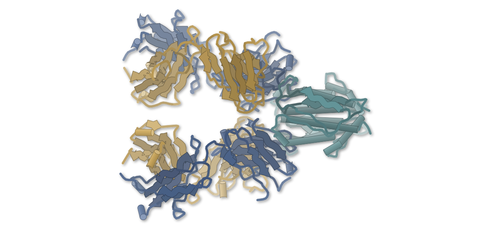

色（順に）：G4 heavy chain / G4 light chain / OPG099

**別の場所に結合する2つの抗体が、ポックスウイルスを中和する**

サル由来G4・B9のFabとM1Rの複合体を解析。G4は変異D35Nでも結合を保つ

- **疑問・課題**：オルソポックスウイルスには承認された抗体医薬がなく、広く効く抗体が求められていた。
- **アプローチ**：サルの免疫で得たG4とB9のFabをM1Rとの複合体にして、クライオ電顕で解析した。
- **結果**：B9は3.46 Å、G4は3.31 Åで決まり、結合部位は重ならなかった。G4はループ、B9は側面のβシートに結合する。
- **わかったこと**：G4は従来抗体が頼るD35が変わった系でも結合を保ち、B9はβ2鎖に未報告の直線状エピトープを持つ。
- **残された課題**：G4とB9の中和の仕組み、特にウイルス侵入のどの段階に効くかは、今後の検討課題である。

この紹介文の根拠（論文本文）

> Yet, approved antibody-based therapeutics for OPXVs are lacking.  
> — 疑問・課題／Abstract

> we isolated and characterized two M1R-targeting neutralizing mAbs from Macaca fascicularis  
> — アプローチ／Introduction

> we generated the M1R–B9 Fab complex and determined its structure using cryo-electron microscopy (cryo-EM)  
> — アプローチ／Results

> achieving a final reconstruction at 3.46 Å resolution  
> — 結果／Results

> ultimately obtaining a dimeric complex structure at a resolution of 3.31 Å  
> — 結果／Results

> In summary, the cryo-EM structural analysis demonstrates that G4 and B9 bind to distinct regions on the M1R surface, possessing non-overlapping epitopes.  
> — 結果／Results

> G4 recognizes a conventional conformational epitope but overcomes neutralization escape associated with the Asp35 residue, whereas B9 binds to an epitope on the lateral β-sheets of M1R.  
> — わかったこと／Abstract

> Notably, the β2 strand (residues C49–V53 and N55) represents a previously unreported linear neutralizing epitope  
> — わかったこと／Results

> the neutralization mechanisms of G4 and B9 still require further investigation  
> — 残された課題／Limitations of the study

分類：免疫（抗体・MHC・TCR・自然免疫）・感染・ウイルス・防御系

#### 読みどころ

G4は、ECTVで置き換わっているD35Nの変異体にも2.08 nMのKDで結合した。同じ場所に結合する従来抗体7D11は、この変異体に結合しなかった。

根拠（論文本文）

> BLI assays confirmed that G4 maintained binding affinity to the M1R-D35N with a KD value of 2.08 nM, whereas 7D11 showed no detectable binding to this mutant  
> — Results

B9はβ1・β2鎖とα5–β3ループにまたがって結合する。β2鎖（C49–V53、N55）を、著者は未報告の直線状の中和エピトープとしている。

根拠（論文本文）

> Notably, the β2 strand (residues C49–V53 and N55) represents a previously unreported linear neutralizing epitope  
> — Results

MPXVに対するIC50は、G4が4.40 nM、B9が84.47 nMだった。2つを混ぜると1.57 nMまで下がり、単独より強く中和した。

根拠（論文本文）

> Neutralization assays against MPXV yielded IC50 of 4.40, 84.47, and 20.33 nM for G4, B9, and 7D11, respectively  
> — Results

> Notably, the combination of G4 and B9 resulted in an IC50 value of 1.57 nM  
> — Results

#### 構造データ

| PDB | 手法 | 分解能 | 公開 | 生物種 | リガンド |
|---|---|---|---|---|---|
| [9XJK](https://www.rcsb.org/structure/9XJK) | Cryo-EM | 3.46 Å | 2026-09-02 | Macaca fascicularis, Monkeypox virus | — |
| [22LL](https://www.rcsb.org/structure/22LL) | Cryo-EM | 3.30 Å | 2026-09-02 | Macaca fascicularis, Monkeypox virus | — |

- [M1LBP0](https://www.uniprot.org/uniprotkb/M1LBP0) OPG099 Entry-fusion complex associated protein OPG095 — *Monkeypox virus* （既存の PDB 構造 5 件）

#### 実験メモ

- **発現系**：Fabは重鎖にヒトIgG1のCH1とC末端6×Hisを付け、Expi293Fで発現した。
- **コンストラクト**：M1Rは細胞外ドメイン（1–183）にC末端6×Hisを付けた。クライオ電顕用は大腸菌で発現した。
- **精製**：M1RはNiアフィニティーとゲルろ過（Superdex 200 Increase）で精製した。
- **結晶化／グリッド作製**：Vitrobotで凍結した（M1R–B9は5.3 mg/mL、M1R–G4は1.0 mg/mL）。
- **データ収集・解析**：Krios G4とEPUを300 kVで使って撮影した。

根拠（論文本文）

> For Fab expression, the variable region gene of heavy chain was constructed into pcDNA3.4 vector with the CH1 domain of human IgG1 and a C-terminal 6×His tag.  
> — Methods

> For cryo-EM, the M1R protein was constructed on the pTIG vector with C-terminal 6×His tag and expressed using Escherichia coli expressing system.  
> — Methods

> Proteins were harvested from the supernatant and purified using Ni affinity chromatography  
> — Methods

> the M1R–B9 Fab complex (4 μL, 5.3 mg/mL) and the M1R–G4 Fab complex (4 μL, 1.0 mg/mL) was applied to the Au grids  
> — Methods

> Cryo-EM dataset acquisition was conducted on a Krios G4 microscope and EPU software operating at 300 kV.  
> — Methods

> 📝 編集者への確認事項：β2鎖の範囲が本文でN50–V53（序論）とC49–V53（結果）と揺れているため、結果の記述に合わせた。PDB 9XJK・22LLは引用なしの登録。結合に関わる実験は動物免疫由来の抗体で、MPXVのマウスモデルはBALB/c（論文の限界に明記）。

---

## 11｜ジカウイルスEタンパク質

### Fusion-loop-engineered Zika mRNA vaccine elicits convergent B cell immunodominance to uncouple protection from ADE in macaques

*Cell Reports Medicine*（2026-10-07） · [論文](https://doi.org/10.1016/j.xcrm.2026.103091) · ライセンス: cc by-nc-nd

筆頭著者：Chenxi Yang（Chinese Academy of Sciences, China）　責任著者：Shuaiyao Lu（Chinese Academy of Medical Sciences and Peking Union Medical College, China）、George F. Gao, Lianpan Dai（Chinese Academy of Sciences, China）

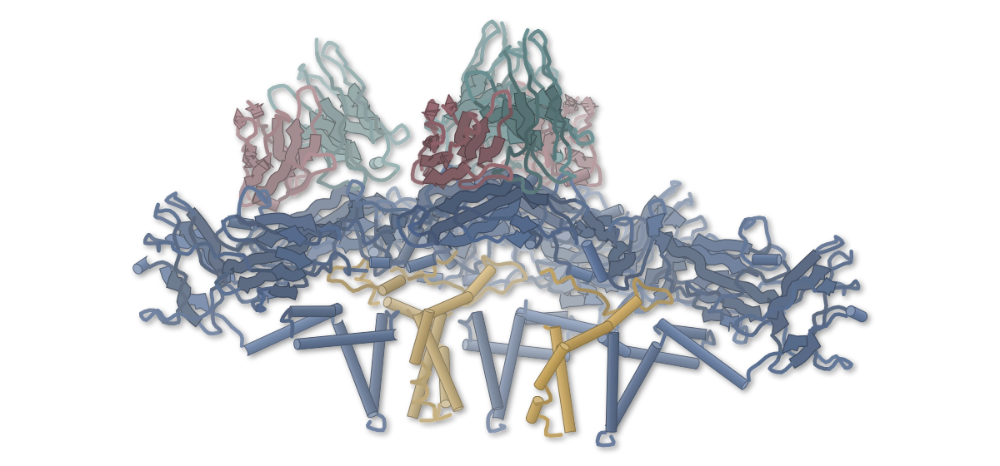

色（順に）：Envelope protein E / Small envelope protein M / 1C11 Fab heavy chain variable region / 1C11 Fab light chain variable region

**ジカウイルスだけを見分けて中和する、ワクチン由来のサル抗体**

1C11 Fabとウイルス粒子を約3.2 Åで解析。D67を含む部位が見分けの鍵になる

- **疑問・課題**：フュージョンループを改変したジカワクチンの効果は、マウスでの検証にとどまっていた。
- **アプローチ**：改変ワクチンを接種したサル由来の抗体1C11のFabと、ジカウイルス粒子の複合体をクライオ電顕で解いた。
- **結果**：約3.2 Åで、粒子表面の180個のEタンパク質すべてにFabが結合し、ドメインIIの表面に乗っていた。
- **わかったこと**：エピトープのD67-M68-A69がジカ特異性を決め、デングのN67糖鎖が立体障害になると考えられる。
- **残された課題**：近縁のエピトープで抗体を回避するウイルスが出るリスクは、今後の評価が必要だという。

この紹介文の根拠（論文本文）

> yet validations restricted to murine models limit human translatability due to profound species divergence  
> — 疑問・課題／Abstract

> we determined the cryo-EM structure of the ZIKV virion in complex with the fragment antigen-binding (Fab) of an ultrapotent nAb RM1.1C11  
> — アプローチ／Results

> The map density revealed full occupancy of all 180 E proteins on the icosahedral viral surface by Fab 1C11  
> — 結果／Results

> The 1C11 footprint primarily locates on the solvent-exposed surface of domain II in the E protomer  
> — 結果／Results

> Notably, ZIKV specificity is dictated by the epitope residues D67-M68-A69, whereas a homologous DENV N67-linked glycan imposes steric shielding to preclude cross-reactivity.  
> — わかったこと／Abstract

> It will be important to evaluate the risk of antibody-driven viral escape for the closely related epitopes in this hotspot  
> — 残された課題／Discussion

分類：感染・ウイルス・防御系・免疫（抗体・MHC・TCR・自然免疫）

#### 読みどころ

ジカのD67NとA69Tを入れてデング型の糖鎖が付く配列にすると、1C11を含む43抗体すべてが結合しなくなった。

根拠（論文本文）

> D67N/A67T mutations abolished binding by mAb 1C11 (100% reduction) (Figure 5B) and all the other 42 1C11-like nAbs  
> — Results

> This indicated that the epitope residues D67-M68-A69 determined the specificity of these public and dominant IGHV5-20 antibodies  
> — Results

ワクチンを打った4頭のサルすべてで、重鎖遺伝子IGHV5-20（ヒトIGHV5-10-1に近い）の抗体が優勢だった。ヒト型に置換した16抗体のうち12がジカに結合した。

根拠（論文本文）

> Analysis of individual repertoires identified IGHV5-20 as the predominant V gene convergent across all four macaques (RM1–RM4)  
> — Results

> Notably, 12 out of 16 human IGHV5-10-1-substituted mAbs bound to ZIKV virions  
> — Results

1C11のIgGは、Fabより1,440倍以上強くジカを中和した。IgGは粒子を凝集させるが、Fabは凝集を起こさなかった。

根拠（論文本文）

> IgG 1C11 demonstrated over 1,440-fold enhanced neutralization potency (IC50) relative to its monovalent Fab counterpart  
> — Results

> By contrast, monovalent Fab failed to induce aggregation.  
> — Results

#### 構造データ

| PDB | 手法 | 分解能 | 公開 | 生物種 | リガンド |
|---|---|---|---|---|---|
| [9VWM](https://www.rcsb.org/structure/9VWM) | Cryo-EM | 3.20 Å | 2026-09-09 | Macaca mulatta, Zika virus ZIKV/H. sapiens/FrenchPolynesia/10087PF/2013 | — |

- [A0A024B7W1](https://www.uniprot.org/uniprotkb/A0A024B7W1)  Genome polyprotein — *Zika virus (isolate ZIKV/Human/French Polynesia/10087PF/2013)* （既存の PDB 構造 67 件）

#### 実験メモ

- **結晶化／グリッド作製**：ウイルスとFabをE:Fab＝1:3で混ぜ、Vitrobotで凍結した（4°C、ブロット7秒）。
- **データ収集・解析**：Falcon 4iで23,051枚を撮影し、50,154粒子を正二十面体対称で精密化して3.21 Åを得た。

根拠（論文本文）

> Purified ZIKV was incubated with a slight molar excess of the 1C11 Fab fragment (E protein:Fab, molar ratio 1:3) at 4°C for 30 min  
> — Methods

> In total, 23,051 micrographs were collected for the ZIKV:Fab 1C11 complex.  
> — Methods

> 50,154 particles were subjected to non-uniform refinement with icosahedral (I) symmetry, resulting in a 3.21 Å resolution reconstruction  
> — Methods

> 📝 編集者への確認事項：PDB 9VWM（3.2 Å）。デングN67糖鎖の立体障害は、モデリングと変異体の結合実験に基づく論文の解釈。ワクチンの動物試験が主題の論文だが、構造は1C11 Fabとウイルス粒子の複合体。

---

## 12｜麻疹ウイルスFタンパク質

### Potently neutralizing and protective human monoclonal antibodies against the measles fusion protein trimer

*Cell Reports Medicine*（2026-09-28） · [論文](https://doi.org/10.1016/j.xcrm.2026.103081) · ライセンス: cc by-nc

筆頭著者：Laura S. Handal（Vanderbilt University Medical Center, USA）　責任著者：James E. Crowe（Vanderbilt University Medical Center, USA）

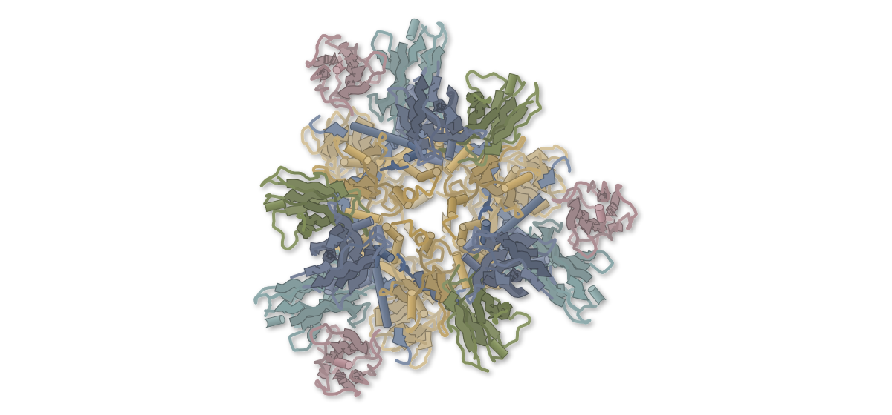

色（順に）：F / F / MeV-15 Fab Heavy Chain / MeV-15 Fab Light Chain / MeV-104 Fab Heavy Chain / MeV-104 Fab Light Chain

**2つのヒト抗体が、麻疹ウイルスFタンパク質の別の面に結合する**

MeV-15・MeV-104のFabと融合前Fを約2.9 Åで解析。どちらも隣り合う2単位にまたがる

- **疑問・課題**：麻疹ウイルスの表面タンパク質に対し、ヒト抗体が中和する構造上の決め手は分かっていなかった。
- **アプローチ**：回復者から得た抗体のうち、MeV-15とMeV-104のFabと融合前Fの複合体をクライオ電顕で解いた。
- **結果**：全体で約3 Å。Fabは3コピーずつ結合し、MeV-15は頭部の側面に、MeV-104は上面に付いていた。
- **わかったこと**：どちらも2つのプロトマーにまたがり、融合前の形を保つと考えられる。MeV-15は耐性ウイルスが得られなかった。
- **残された課題**：保護が中和だけによるのか、Fcの働きも関わるのかは、調べていないと論文は述べる。

この紹介文の根拠（論文本文）

> There is limited knowledge about the human antibody response to a measles infection or vaccination or the structural determinants of antibody-mediated neutralization  
> — 疑問・課題／Abstract

> We determined the structural basis of molecular recognition and virus neutralization using cryo-electron microscopy (cryo-EM) for two antibodies that recognize distinct sites of the F protein, MeV-15 and MeV-104.  
> — アプローチ／Abstract

> The preF/MeV-15/MeV-104 complex structure was resolved to an overall ∼3 Å resolution  
> — 結果／Results

> three Fab molecules of MeV-15 and three Fab molecules of MeV-104 are simultaneously bound to the preF protein trimer  
> — 結果／Results

> suggest MeV-104 conformationally locks the F protein in the prefusion state  
> — わかったこと／Results

> we never selected an MeV-15 escape mutant virus  
> — わかったこと／Results

> we did not determine whether this protection is due solely to neutralizing activity or whether engagement of Fc effector functions also plays a role  
> — 残された課題／Limitations of the study

分類：免疫（抗体・MHC・TCR・自然免疫）・感染・ウイルス・防御系

#### 読みどころ

MeV-15の結合面積は1,591 Å2で、一般的な抗体の約800 Å2を大きく上回る。融合ループとドメインI・IIIを含み、隣のプロトマーにもまたがる。

根拠（論文本文）

> The total buried surface area of MeV-15 is 1,591 Å2, which is considerably larger than the average antibody-epitope buried surface area  
> — Results

> The epitope involves regions from multiple functional domains of the F trimer, including domain III (DIII), domain I (DI), and the fusion loop (FL)  
> — Results

MeV-104は、頂部のN67糖鎖を約9 Å、143°動かし、R70と水素結合や塩橋を作る。R70Gの変異ウイルスはMeV-104に中和されなくなった。

根拠（論文本文）

> pushing the glycan by 9 Å, 143° compared to the apo form of the F protein  
> — Results

> MeV-104 selected viruses with a R70G mutation in the F protein in both variant viruses  
> — Results

2つの抗体は、マウスでの予防投与と、コットンラットでの治療投与のどちらでもウイルスの複製を抑えた。

根拠（論文本文）

> These antibodies also strongly inhibited viral replication in vivo when administered prophylactically in a murine transgenic model and when administered therapeutically in a cotton rat model of established infection.  
> — Abstract

#### 構造データ

| PDB | 手法 | 分解能 | 公開 | 生物種 | リガンド |
|---|---|---|---|---|---|
| [9YBY](https://www.rcsb.org/structure/9YBY) | Cryo-EM | 2.90 Å | 2026-09-02 | Homo sapiens, Measles morbillivirus | — |

- [Q786F3](https://www.uniprot.org/uniprotkb/Q786F3) F Fusion glycoprotein F0 — *Measles virus (strain Ichinose-B95a)* （既存の PDB 構造 18 件）

#### 実験メモ

- **発現系**：融合前安定化F三量体はExpi293F、抗体とFabはExpiCHOで発現した。
- **コンストラクト**：F三量体はGCN4三量体化ドメインとTwin Strepタグを付けた。
- **精製**：FabはCaptureSelect CH1-XLで精製した。
- **結晶化／グリッド作製**：F:Fabを1:4:4で混ぜてゲルろ過し、0.3 mg/mLでVitrobotにより凍結した。
- **データ収集・解析**：配向の偏りを避けるため、グリッドの種類と傾斜を変えた複数のデータを統合した。

根拠（論文本文）

> The construct contained an IL-2 signal peptide, a GCN4 trimerization domain, an HRV 3C cleavage site, and a Twin Strep-tag.  
> — Methods

> The plasmids were transiently transfected into ExpiCHO cells using the ExpiCHO expression system  
> — Methods

> Fab proteins were purified using CaptureSelect CH1-XL  
> — Methods

> After incubation of preF:Fabs for 2 h at room temperature the mixture in a molar ratio of 1:4:4 was purified by gel filtration on Superose 6 increase 10/300 column  
> — Methods

> To overcome preferred orientation problems, multiple datasets were collected on different grid types and with different tilt angles.  
> — Methods

> 📝 編集者への確認事項：PDB 9YBY（2.9 Å）。耐性ウイルスの選択はVSVにMeVの糖タンパク質を載せた系で、本物の麻疹ウイルスの挙動とは限らないと論文が限界に書いている。

---

## 13｜B型インフルエンザHA＋抗体

### Broadly reactive antibodies against influenza B virus hemagglutinin neutralize and protect through distinct structural mechanisms

*Journal of Virology*（2026-10-01） · [論文](https://doi.org/10.1128/jvi.00802-26) · ライセンス: cc by

筆頭著者：Disha Bhavsar（Icahn School of Medicine at Mount Sinai, USA）　責任著者：Florian Krammer, Goran Bajic（Icahn School of Medicine at Mount Sinai, USA）

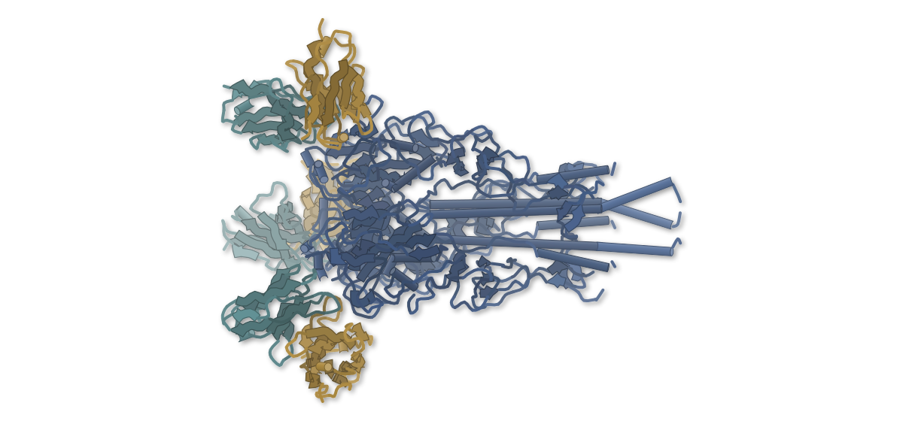

色（順に）：Hemagglutinin / KL-BHA-3F4 heavy chain / KL-BHA-3F4 light chain

**B型インフルの広域抗体は、結合部位ごとに働きが違う**

3種のFab–HA複合体を解き、受容体の模倣とHA基部への結合で作用が分かれると示した

- **疑問・課題**：B型インフルエンザのHAは、抗体の認識の仕方と抗ウイルス作用の関係がA型より分かっていなかった。
- **アプローチ**：マウス由来の広域抗体4種を調べ、うち3種のFabとHAの複合体をクライオ電顕で解析し、機能試験と照らし合わせた。
- **結果**：3F4は受容体結合部位に入り、3D7と4C2はHA頭部と茎部の間の側面に結合した。4抗体とも予防投与でマウスを守った。
- **わかったこと**：広い防御は、受容体の遮断や、ウイルスの放出・ノイラミニダーゼの阻害、免疫細胞の動員など、複数の経路で生じうる。
- **残された課題**：抗体はマウスで得たもので、防御試験も1つの動物モデルと主に1つのウイルスに限られる。

この紹介文の根拠（論文本文）

> In contrast, the structural basis of antibody recognition of influenza B virus HA remains comparatively underdeveloped.  
> — 疑問・課題／Introduction

> the relationship between epitope specificity, mechanism of action, and protective function for influenza B virus-specific antibodies remains unclear  
> — 疑問・課題／Introduction

> we determined the cryo-EM structures of influenza B virus-specific mAbs KL-BHA-3F4, KL-BHA-3D7, and KL-BHA-4C2 in complex with influenza B virus HA  
> — アプローチ／Results

> The structures revealed that mAb KL-BHA-3F4 (Fig. 3A) engaged the viral RBS, whereas KL-BHA-3D7 and KL-BHA-4C2 recognized partially overlapping epitopes  
> — 結果／Results

> When administered prophylactically 2 h before infection, all four mAbs conferred complete protection, resulting in 100% survival  
> — 結果／Results

> Together, these data support the view that broad protection against influenza B virus need not be restricted to a single neutralization mechanism  
> — わかったこと／Discussion

> the in vivo protection studies relied on a single mouse model and primarily one challenge virus, which limits inference about protection across hosts, viral backgrounds, and disease settings  
> — 残された課題／Discussion

分類：免疫（抗体・MHC・TCR・自然免疫）・感染・ウイルス・防御系

#### 読みどころ

3F4は重鎖のCDR3にあるD105とY106で、シアル酸（受容体）のカルボキシ基とアセトアミド基の接触を真似て、受容体結合部位に入り込む。凝集阻害活性はこの抗体にだけ見られた。

根拠（論文本文）

> superposition with α2,6-linked sialic acid demonstrates that KL-BHA-3F4 D105 mimics the carboxylate and the Y106 the acetamido moieties of sialic acid  
> — Results

> Among the four antibodies, KL-BHA-3F4 was the only mAb with detectable HAI activity in vitro.  
> — Results

3D7と4C2は、HAの頭部と茎部の間にある保存された側面（「medial junction」）に結合する。結合の向きや範囲は異なり、3D7はウイルスの放出段階で、4C2は免疫細胞を介した細胞傷害（ADCC）で強く働いた。

根拠（論文本文）

> KL-BHA-3D7 additionally exhibits post-entry antiviral activity, whereas KL-BHA-4C2 mediates robust Fc-dependent effector activity.  
> — Results

4C2は試験管内の中和は弱いが、感染24時間後や48時間後の投与でもマウスを死亡から守った。中和力だけでは抗体の効き目を測れないことを示している。

根拠（論文本文）

> mice treated with KL-BHA-4C2 began to recover as early as day 4 after infection and were fully protected from virus-induced mortality when the antibody was administered at either 24 or 48 h  
> — Results

#### 構造データ

| PDB | 手法 | 分解能 | 公開 | 生物種 | リガンド |
|---|---|---|---|---|---|
| [12ID](https://www.rcsb.org/structure/12ID) | Cryo-EM | 2.40 Å | 2026-08-26 | Influenza B virus (B/Lee/1940), Mus musculus | — |
| [12IE](https://www.rcsb.org/structure/12IE) | Cryo-EM | 2.61 Å | 2026-08-26 | Influenza B virus (B/Lee/1940), Mus musculus | — |
| [12IF](https://www.rcsb.org/structure/12IF) | Cryo-EM | 3.98 Å | 2026-08-26 | Influenza B virus (B/Beijing/13-21/2013), Mus musculus | — |

- [A0A4P8YRB6](https://www.uniprot.org/uniprotkb/A0A4P8YRB6) HA Hemagglutinin — *Influenza B virus* （既存の PDB 構造 1 件）

#### 実験メモ

- **発現系**：HAはExpiSf9細胞でバキュロウイルスを使って発現した。
- **コンストラクト**：抗体のFabはIgGをパパインで切って作った。
- **精製**：TALON樹脂とサイズ排除クロマトグラフィーでHAを精製した。
- **結晶化／グリッド作製**：HAにFabを1.2倍モル過剰で加え、n-オクチル-β-D-グルコシドを0.1%加えてVitrobot Mark IVなどで凍結した。
- **データ収集・解析**：cryoSPARCで処理し、モデルはModelAngeloとCootで作った。

根拠（論文本文）

> Recombinant B/Lee/1940 and B/Phuket/3073/2013 HAs were expressed in ExpiSf9 cells (Thermo Fisher) using the baculovirus expression system.  
> — Methods

> KL-BHA-3F4, KL-BHA-3D7, and KL-BHA-4C2 Fabs were generated by papain digestion (Thermo Fisher) of IgG mAbs.  
> — Methods

> Recombinant proteins were purified from the filtered supernatant using TALON metal affinity resin (Takara Bio)  
> — Methods

> using a 1.2-fold molar excess of Fab  
> — Methods

> Initial models for the KL-BHA-3F4 and KL-BHA-4C2 complexes were generated with ModelAngelo (50) and then manually refined in Coot (51).  
> — Methods

> 📝 編集者への確認事項：HA（インフルエンザB型）は既存の PDB 構造が多数あるため Structure Update の見込み。3D7 複合体は B/Phuket/3073/2013 HA、3F4・4C2 は B/Lee/1940 HA。論文はマウス抗体で、防御試験の限界を自ら述べている。legend_labels は描画後に抗体とHAの凡例を確認して付ける必要あり。

---

## 14｜H1 HA（A/California/04/2009）

### Antigenic and structural analysis of the influenza hemagglutinin lateral patch

*Journal of Virology*（2026-10-01） · [論文](https://doi.org/10.1128/jvi.01265-26) · ライセンス: cc by

筆頭著者：Jordan I. Lemus-Reyes（University of Colorado Anschutz Medical Campus, USA）　責任著者：Andrew B. Ward（The Scripps Research Institute, USA）、Jenna J. Guthmiller（University of Colorado Anschutz Medical Campus, USA）

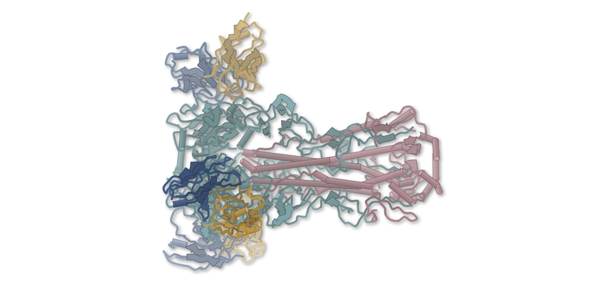

色（順に）：2F03 light chain / 2F03 heavy chain / HA / HA

**インフルエンザHAの側面パッチは、変異で抗体を逃れてきた**

抗体2種とHAの複合体をクライオ電顕で解き、A259Tなど離れた変異も抗体結合を弱めると示した

- **疑問・課題**：H1のHAの側面パッチ（HAの頭部の裏側の保存された領域）が、時間や動物種を超えてどれだけ保存されているかは定まっていなかった。
- **アプローチ**：ヒト由来の側面パッチ抗体28種を、1918〜2022年のH1の組換えHAにぶつけて結合を調べ、2種の抗体との複合体をクライオ電顕で解いた。
- **結果**：2009年以降のH1N1では、K166Q・A259T・S83Rなどが抗体を逃れていた。解いた構造は3.06 Åなどだった。
- **わかったこと**：側面パッチは約100年間よく保存されてきた。ブタやトリのH1にも広く保たれ、既存の抗体が将来のH1Nx流行に効く可能性がある。
- **残された課題**：側面パッチの機能は分かっておらず、保存される理由は未解明である。

この紹介文の根拠（論文本文）

> The conservation of the lateral patch across time and animal reservoirs remains ill-defined.  
> — 疑問・課題／Introduction

> We assessed lateral patch-specific mAb binding affinity to H1 HA antigens from 1918 to 2022 to understand the conservation of the lateral patch  
> — アプローチ／Introduction

> by determining the cryo-EM structures of 047-09 1A02 (Fig. 3B, Fig. S2 and Table S4) and 047-09M 2F03 (Fig. 3C; Fig. S3, Table S4) in complex with CA/09 HA.  
> — アプローチ／Results

> We found that both class 1 and class 2 antibodies lost binding to pH1N1 strains around 2014, suggesting antigenic drift affected mAb binding (Fig. 2C).  
> — 結果／Results

> resulted in a final map for 047-09 1A02 and 047-09M 2F03 at 3.7 and 3.06 Å resolutions, respectively  
> — 結果／Results

> Our study supports that the lateral patch was well conserved for nearly 100 years, except for mutations arising in the 1950s and 1977 sH1N1 viruses that evade class 1 antibodies and mutations in post-2014 pH1N1 viruses that evade both class 1 and class 2 mAbs.  
> — わかったこと／Discussion

> suggesting that existing lateral patch antibodies could protect against a future zoonotic H1Nx pandemic  
> — わかったこと／Abstract

> Understanding the function, or lack thereof, of the lateral patch could reveal why this region has been well conserved across human and enzootic H1Nx isolates.  
> — 残された課題／Discussion

分類：免疫（抗体・MHC・TCR・自然免疫）・感染・ウイルス・防御系

#### 読みどころ

3つのクラス1抗体はどれもHCDR3のY-x-Rモチーフで側面パッチに結合し、N170はY100bと水素結合する。同じ遺伝子と同じモチーフを使っても、細部の接触は抗体ごとに異なっていた。

根拠（論文本文）

> Notably, all three mAbs used a Y-x-R motif in the HCDR3 that contacted residues within the 120 β-strand or the 170-loop, with HA N170 forming a hydrogen bond with Y100b within the HCDR3 of all three mAbs (Fig. 3A through D).  
> — Results

A259Tは抗体と直接接触せず、表面にも出ていない。MDシミュレーションでは、170ループの柔軟さが増し、これが抗体結合の低下の理由と著者は考えている。この点は計算による推定である。

根拠（論文本文）

> However, our structural characterization of class 1 lateral patch mAbs revealed that A259 is neither in direct contact with these antibodies nor is it surface exposed.  
> — Results

> Introduction of T259 into CA/09 increased the flexibility of the 170-loop, as well as the β-strand where residue 259 resides (Fig. S5A and B).  
> — Results

クラス1抗体の047-09M 2F03は、2009年以降のH1N1すべてに結合を保った。同じクローンの1A02はA259Tで結合を失ったので、2F03がなぜ逃れられないのかは分かっていない。

根拠（論文本文）

> It remains unknown what mechanism allows 047-09M 2F03 to retain binding to post-2014 H1N1 viruses.  
> — Discussion

> We identified 047-09M 2F03 retained binding to all post-2009 pH1N1 viruses tested (Fig. 2C).  
> — Results

#### 構造データ

| PDB | 手法 | 分解能 | 公開 | 生物種 | リガンド |
|---|---|---|---|---|---|
| [12IU](https://www.rcsb.org/structure/12IU) | Cryo-EM | 3.06 Å | 2026-09-16 | Homo sapiens | — |
| [12IV](https://www.rcsb.org/structure/12IV) | Cryo-EM | 3.76 Å | 2026-09-23 | Homo sapiens, Influenza A virus (A/California/04/2009(H1N1)) | — |

- [C3W5S1](https://www.uniprot.org/uniprotkb/C3W5S1) HA Hemagglutinin — *Influenza A virus (strain swl A/California/04/2009 H1N1)* （既存の PDB 構造 29 件）

#### 実験メモ

- **発現系**：HEK293TまたはExpi293FでHAを一過性発現し、Ni-NTAで精製
- **コンストラクト**：三量体化ドメイン（foldon）・AviTag・6×Hisを付けたH1 HA外部ドメイン。Y98F変異を共通で入れた
- **精製**：抗体はProtein Aで精製
- **結晶化／グリッド作製**：Fab:HAをモル比3:1で1時間混合し、0.1% octyl-β-glucosideを加えて、Vitrobot Mark IVで凍結
- **データ収集・解析**：Glacios（200 kV）とFalcon 4iで撮影し、CryoSPARC v4.7.1で処理。最終分解能は047-09M 2F03が3.06 Å

根拠（論文本文）

> HA complexes were prepared by mixing Fab with a 3:1 molar ratio of Fab:HA (i.e., 3 Fabs per HA trimer) and incubated for 1 h at room temperature.  
> — Materials and methods

> Final map resolutions determined by gold-standard Fourier shell correlation, were 3.06 Å for 047-09M 2F03 and 3.93 Å for 047-09-1A02.  
> — Materials and methods

> 📝 編集者への確認事項：1A02の分解能が本文3.7 Å、方法3.93 Å、PDB 3.76 Åと食い違うため、要約には2F03の3.06 Åだけを使った。A259TのMDは計算による推定で、記事ではそう書いた。

---

## 15｜RamR（大腸菌の転写因子）

### Using enantioselective biosensors to evolve asymmetric biocatalysts

*Nature Chemical Biology*（2026-07-23） · [論文](https://doi.org/10.1038/s41589-026-02275-1) · ライセンス: cc by-nc-nd

筆頭著者：Simon d’Oelsnitz（Harvard Medical School, USA）　責任著者：筆頭著者と同じ

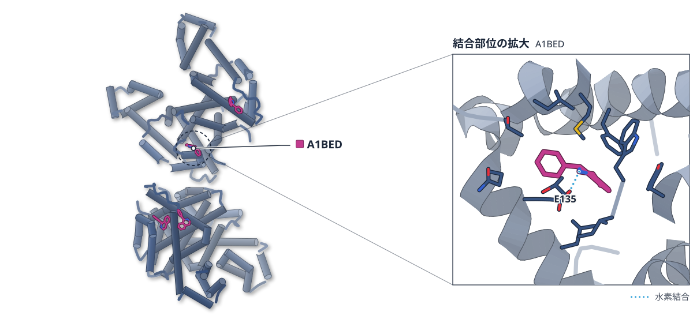

色（順に）：ramR　スティック：A1BED

**転写因子RamRは、2か所の変異で鏡像体を見分ける**

30万種超の変異体を測り、結晶構造で立体障害と電荷の役割を示した。酵素の選択性の反転にも使えた

- **疑問・課題**：不斉触媒の改良はキラルな分析の遅さが壁になる。鏡像体を見分ける転写因子は、酵素の改良に使われてこなかった。
- **アプローチ**：転写因子RamRの30万種超の変異体で用量応答を測った。選択性の高い変異体は、結晶構造で調べた。
- **結果**：選択性の高い6つの変異体を解いた。S体用ではGluの塩橋が、R体用ではAspが、プロトン化したアミンを認識した。
- **わかったこと**：電荷がイミンとアミンを区別し、ポケットの形による立体障害が鏡像体を区別する。2つのセンサーで酵素の選択性を反転できた。
- **残された課題**：センサーはLC–MSより感度が低く、活性の低い酵素は測れなかった。

この紹介文の根拠（論文本文）

> which is often bottlenecked by the speed of chiral screening  
> — 疑問・課題／Main

> Despite this promise, the TF enantioselectivity has never been leveraged to evolve asymmetric biocatalysts  
> — 疑問・課題／Main

> Here we measure the dose–response curves for over 300,000 TF mutants to enantiomeric intermediates and an achiral precursor of the pharmaceutical solifenacin.  
> — アプローチ／Main

> High-resolution crystal structures reveal how sterics discriminate enantioselectivity, while charge–charge interactions are used to differentiate an imine precursor from amine reaction products.  
> — アプローチ／Main

> we obtained structures for all six high-selectivity variants—four in complex with their cognate ligand and two in their apo form  
> — 結果／Results

> a negatively charged glutamate introduced by the C135E mutation strongly interacts with the protonated amine of S-THIQ by salt-bridge interactions  
> — 結果／Results

> the R2.1 variant uses a negatively charged Asp153 to specifically recognize the positively charged amine group of R-THIQ  
> — 結果／Results

> High-resolution structures of evolved eTFs elucidate how steric effects enforce enantioselectivity, while charge interactions distinguish the imine from the amines.  
> — わかったこと／Abstract

> Using two eTFs, we create an ultrahigh-throughput chiral screen to evolve an imine reductase with inverted enantioselectivity.  
> — わかったこと／Abstract

> our eTFs, with a ~5 µmol l−1 limit of detection, could not reliably measure the activity of poorly active IREDs  
> — 残された課題／Discussion

分類：転写調節・シグナル伝達・酵素（その他）

#### 読みどころ

S体用の変異体ではC135Eで入ったGluが、プロトン化したアミンと塩橋を作る。イミン（DHIQ）用のD2.3ではC135Rが、中性のイミンと相互作用する。

根拠（論文本文）

> a negatively charged glutamate introduced by the C135E mutation strongly interacts with the protonated amine of S-THIQ by salt-bridge interactions  
> — Results

> the DHIQ-selective D2.3 variant contains a C135R mutation that selectively interacts with the neutral imine group of DHIQ at a distance of 3.5 Å  
> — Results

S体用とR体用の2つのセンサーとFACSで、イミン還元酵素IR35の選択性を反転させた。3か所の変異（P130A、N177E、M184W）で鏡像体過剰率は86%になった。この酵素の構造は予測モデルへのドッキングで、結晶構造ではない。

根拠（論文本文）

> we identified a mutant of IR35, referred to as IR35_C4, bearing the substitutions P130A, N177E and M184W, with inverted enantioselectivity  
> — Results

> For IRED modeling (Fig. 5e), AlphaFold3 was used to generate a structure of IR35 (MCP2166807.1) in complex with NADP, which was then docked with R-THIQ using SwissDock54.  
> — Methods

S-THIQ用のセンサーは、C135EとS138Eの2変異だけで50倍超の選択性に達した。ライブラリの比較では、相同体を混ぜる遺伝子シャッフリングが、高性能なセンサーの割合で最も高かった。

根拠（論文本文）

> only two mutations (C135E and S138E) were needed to create a RamR variant with >50-fold enantioselectivity and an EC50 under 2 μmol l−1 for S-THIQ  
> — Discussion

> the shuffle library yielded a substantially higher ratio of performant sensors for each ligand compared to the random and site-saturation libraries  
> — Results

#### 構造データ

| PDB | 手法 | 分解能 | 公開 | 生物種 | リガンド |
|---|---|---|---|---|---|
| [9DN8](https://www.rcsb.org/structure/9DN8) | X-ray | 2.12 Å | 2026-04-08 | Salmonella enterica subsp. enterica serovar Typhimurium | A1BED |
| [9DN9](https://www.rcsb.org/structure/9DN9) | X-ray | 1.80 Å | 2026-04-08 | Salmonella enterica subsp. enterica serovar Typhimurium | A1BED |
| [9DNC](https://www.rcsb.org/structure/9DNC) | X-ray | 1.90 Å | 2026-04-08 | Salmonella enterica subsp. enterica serovar Typhimurium | — |
| [9DNH](https://www.rcsb.org/structure/9DNH) | X-ray | 2.37 Å | 2026-04-08 | Salmonella enterica subsp. enterica serovar Typhimurium | A1BGD |
| [9DNK](https://www.rcsb.org/structure/9DNK) | X-ray | 2.50 Å | 2026-04-08 | Salmonella enterica subsp. enterica serovar Typhimurium | A1BEC |
| [9DNL](https://www.rcsb.org/structure/9DNL) | X-ray | 4.01 Å | 2026-04-08 | Salmonella enterica subsp. enterica serovar Typhimurium | — |

- [Q8ZR43](https://www.uniprot.org/uniprotkb/Q8ZR43) ramR Transcriptional regulator RamR — *Salmonella typhimurium (strain LT2 / SGSC1412 / ATCC 700720)* （既存の PDB 構造 7 件）

#### 実験メモ

- **発現系**：タンパク質の発現に大腸菌BL21(DE3)を、精製にTerrific brothを使った。
- **結晶化／グリッド作製**：X線結晶構造解析は過去の報告と同様の手順で、詳細は補足資料にある。

根拠（論文本文）

> E. coli BL21(DE3) (New England Biolabs) was used for protein expression.  
> — Methods

> Terrific broth (Thermo Fisher Scientific, 22711022) was used for protein purification.  
> — Methods

> A protocol similar to that in ref. 10 was used for X-ray crystallography.  
> — Methods

> 📝 編集者への確認事項：RamR には既存の PDB 構造（3VVX）があり、論文は『初めての構造』とは書いていない（サイトでは Structure Update になる見込み）。IR35 の変異体の構造は AlphaFold3 とドッキングによるモデルで、実験構造ではない。9DNL（R2.2 apo）は 4.0 Å と低分解能。

---

## 16｜GRW-L16CL30H（設計ペプチド）

### The X‐ray crystallographic structure of a designed, self‐assembling, and heme‐binding protein

*Protein Science : A Publication of the Protein Society*（2026-10-27） · [論文](https://doi.org/10.1002/pro.70829) · ライセンス: cc by

筆頭著者：Iago de Assis Modenez（University of Michigan, USA）　責任著者：Philippe Leone, Anabella Ivancich（Aix‐Marseille Université, France）、Vincent L. Pecoraro（University of Michigan, USA）

**ヘムが、コイルドコイルの並びを一ヘプタッドずらす**

設計ペプチドのヘム結合型を1.9 Åで解き、各ヘムが2つのHisで配位する四本鎖を示した

- **疑問・課題**：設計したコイルドコイルにヘムが結合した状態の、高分解能の構造データは乏しかった。
- **アプローチ**：強塩基性で調製したヘム結合型の設計ペプチドを結晶化し、1.9 Åの回折データから構造を決めた。
- **結果**：4本のらせんが1ヘプタッドずれて束ねられ、2つのヘムを各2個のHisが配位していた。Fe–N距離は約2.0 Åだった。
- **わかったこと**：ヘムのHis配位が、並びのずれた逆平行の四本鎖をつくる構造要素として働く可能性がある。
- **残された課題**：結晶中の構造が溶液中の平衡状態に当たるかは断定できず、試料の履歴などとも区別できていない。

この紹介文の根拠（論文本文）

> yet high‐resolution structural data for these systems remain scarce  
> — 疑問・課題／Abstract

> There is no reported crystal structure of a purely self‐assembling and heme‐binding coiled coil.  
> — 疑問・課題／Introduction

> The holo protein prepared under these strongly basic conditions was subsequently subjected to crystallization  
> — アプローチ／Introduction

> determined at 1.9 Å resolution  
> — アプローチ／Abstract

> with an out‐of‐register ABAB arrangement that accommodates two bis‐histidine ligated hemes  
> — 結果／Results and Discussion

> The Fe‐NHis bond lengths are approximately 2.0 Å on average for all four coordinating His  
> — 結果／Results and Discussion

> In this context, the heme cofactors may act as structural organizing elements that guide the peptide into a specific oligomeric state through Fe‐N(His) coordination.  
> — わかったこと／Results and Discussion

> The bis‐His state may reflect sample history, kinetic trapping, and/or crystallization‐induced stabilization, but the present data do not distinguish between these possibilities.  
> — 残された課題／Results and Discussion

分類：その他

#### 読みどころ

ヘムが加わると、平行な三本鎖は逆平行の四本鎖に変わる。塩基性では一部の鎖が約1ヘプタッド（7残基の繰り返し）ずれ、ヘムをはさむHisの位置がそろう。

根拠（論文本文）

> Heme alters peptide assembly in two ways: first, by converting a parallel 3SCC into an antiparallel 4SCC across all pH ranges, and second, by inducing slip stacking at basic pH.  
> — Results and Discussion

> chains B and D are slip‐stacked relative to chains A and C by approximately one full heptad repeat  
> — Results and Discussion

2つのヘムの縁どうしは38 Å離れ、ほぼ同一平面にある。軸のHis二つのイミダゾール面は99°と108°で、ほぼ直交する配置だった。

根拠（論文本文）

> the edge‐to‐edge distance between the conjugated tetrapyrrole rings for the two hemes is 38 Å  
> — Results and Discussion

> indicating a near‐orthogonal arrangement  
> — Results and Discussion

結晶では、隣り合う四量体のヘムどうしの接触とGlu–Lysの塩橋が格子を支える。著者はヘムが結晶化の鋳型として働いた可能性を挙げている。

根拠（論文本文）

> Heme‐heme contacts between symmetry‐related tetramers contribute to the crystal packing, generating an extended supramolecular lattice  
> — Results and Discussion

> These findings suggest that heme may act as a self‐organizing crystallographic template  
> — Introduction

#### 構造データ

| PDB | 手法 | 分解能 | 公開 | 生物種 | リガンド |
|---|---|---|---|---|---|
| 3SCC | — | — | 公開待ち | — | — |

#### 実験メモ

- **発現系**：化学合成ペプチド（合成・精製・ヘム錯形成は既報の手順）
- **結晶化／グリッド作製**：50 mg/mLに濃縮し、シッティングドロップ蒸気拡散（293 K）。2.0 M NaCl・2.0 M硫酸アンモニウム（pH 5.04）で結晶化
- **データ収集・解析**：Soleil Proxima-1でネイティブデータ1.9 Åを収集

根拠（論文本文）

> Conducted according to our previously reported procedure (Koebke et al., 2021).  
> — Materials and Methods

> Crystallization trials (see Figure S1a) were performed using the sitting‐drop vapor‐diffusion method at 293 K in 96‐well Swissci‐3 plates  
> — Materials and Methods

> Suitable crystals, that grew using the crystallization solution of 2.0 M NaCl and 2.0 M ammonium sulfate (pH = 5.04)  
> — Materials and Methods

> while native diffraction data of holo‐GRW‐L16CL30H were collected to 1.9 Å resolution on the beamline Proxima‐1 at the Soleil synchrotron (Paris, France)  
> — Materials and Methods

> 📝 編集者への確認事項：candidates.json の PDB ID「3SCC」は三本鎖コイルドコイル（3SCC）の略語の誤検出で、図の凡例では PDB code 32MQ とある（未公開）。図は描けない。論文は「純粋に自己会合するヘム結合コイルドコイルの結晶構造の報告はない」と書くが『初めて』とは明言しないため first_claim は付けなかった（Structure Update）。

---

## 17｜エストロゲン受容体α

### The prenylation code regulating estrogenic activity of synthetic and natural product derivatives of resveratrol

*PNAS Nexus*（2026-10-09） · [論文](https://doi.org/10.1093/pnasnexus/pgag351) · ライセンス: cc by-nc

筆頭著者：Manal Alhusban（University of Mississippi, USA）　責任著者：Kendall W Nettles（The Herbert Wertheim UF Scripps Institute for Biomedical Innovation & Technology, USA）、Amar G Chittiboyina（University of Mississippi, USA）

**甘草のスチルベンは、プレニル基の数と位置で効き方が変わる**

合成した類縁体とERαの結晶構造6つから、5桁に及ぶ活性差が同じ受容体の形で説明された

- **疑問・課題**：甘草のプレニル化ポリフェノールが、受容体の結合や活性をどう変えるかは、分かっていなかった。
- **アプローチ**：レスベラトロールなどを土台にプレニル基を付けた16種を合成し、細胞での活性とERαとの結晶構造を調べた。
- **結果**：活性は5桁の幅で広がった。結晶構造では、結合ポケットの片端の側鎖の向きだけが違った。
- **わかったこと**：プレニル基の数・位置・環化が、ポケットの片端の柔らかさを使って活性を決める。この規則をプレニル化の「暗号」と呼んでいる。
- **残された課題**：最も強い化合物7-C2C6について、他の核内受容体への選択性は調べられておらず、今後の確認が必要である。

この紹介文の根拠（論文本文）

> the specific mechanisms by which prenylated polyphenolics in licorice regulate ER ligand binding and activity remain unknown  
> — 疑問・課題／Abstract

> we synthesized 16 mono- or diprenylated stilbennoid analogs based on common resveratrol or dihydroresveratrol cores  
> — アプローチ／Abstract

> Crystal structures of six of the stilbene compounds in complex with the ERα LBD enabled us to identify structural features of prenyl substitution that control the potency of ER activation  
> — アプローチ／Results

> These variously prenylated stilbenoid compounds exhibited ER agonistic effects on cell growth with a remarkable 5-log range of cellular potencies.  
> — 結果／Abstract

> Remarkably, the >5-log range of potencies were accounted for by changes in ER sidechain rotamers that were concentrated at only one end of the ligand binding pocket  
> — 結果／Results

> Thus, chemical diversity from a simple class of stilbenoids generated biological diversity through the modular combination of prenyl substitutions that revealed localized structural flexibility in an otherwise highly stable ER agonist conformation.  
> — わかったこと／Abstract

> Broader receptor counter-screening will therefore be required to establish its specificity profile.  
> — 残された課題／Discussion

分類：GPCR・受容体・転写調節・シグナル伝達

#### 読みどころ

プレニル基を2つ付けた7-C2C6は、EC50が約10 pMでレスベラトロール誘導体の中で最も強い。2つのプレニル基はそれぞれヘリックス8側と12側に伸び、アゴニスト型の構造をさらに安定にする。

根拠（論文本文）

> The two prenyl groups in 7-C2C6, the most potent resveratrol analog, formed flexible winged shapes orthogonal to the axis of the ligand core (Fig. 4D).  
> — Results

> The second prenyl in 7-C2C6 extended toward helix 12, contacting both helices 3 and 11 to further stabilize the agonist conformation (Fig. 4D).  
> — Results

ポケットのフェノール側の端は側鎖の向きがほぼ固定され、プレニル基を受け入れる反対の端だけが動く。動く6残基のうち3つはメチオニンで、その柔らかさが関わるとみられている。

根拠（論文本文）

> Notably, 3 of these 6 conformationally dynamic residues are methionines, highlighting a special role for this amino acid in providing a degree of steric “softness” in ligand binding in that region (29).  
> — Discussion

プレニル基を環化して硬くすると、位置によっては活性が下がる。3つの環が縮合した18-C2(3)C6(5)は、ポケットの両側に張り出して活性が大きく落ちた。

根拠（論文本文）

> which greatly reduced activity (Fig. 3E), suggesting that there is additional space mostly on one side of the A-ring of the stilbenoids.  
> — Results

#### 構造データ

| PDB | 手法 | 分解能 | 公開 | 生物種 | リガンド |
|---|---|---|---|---|---|
| 9OUD | — | — | 公開待ち | — | — |
| 9OVG | — | — | 公開待ち | — | — |
| 9OW0 | — | — | 公開待ち | — | — |
| 9OXR | — | — | 公開待ち | — | — |
| 9OXT | — | — | 公開待ち | — | — |
| 9OXY | — | — | 公開待ち | — | — |

#### 実験メモ

- **発現系**：ERα LBD（残基298–554、Y537S変異）を大腸菌 BL21(DE3) で発現
- **コンストラクト**：ERα リガンド結合ドメイン（298–554、Y537S）
- **結晶化／グリッド作製**：各リガンドと共結晶化（以前の報告と同じ方法）
- **データ収集・解析**：SSRL BL12-2とAPS SER-CATで100 Kで測定。autoPROCとSTARANISOで処理し、分子置換・PHENIXで精密化

根拠（論文本文）

> The ERα LBD (amino acid residues 298–554) with a Y537S mutation was expressed in BL21 (DE3) Escherichia coli cells, purified, and co-crystallized with the various ligands as previously described (27, 30).  
> — Materials and methods

> and scaled using autoPROC (31) and STARANISO (Global Phasing Ltd) to accommodate anisotropic diffraction.  
> — Materials and methods

> 📝 編集者への確認事項：PDB（9OUD 他6件）は未公開で、UniProt に対応づけられず図なし。ERαは既存構造が多数あり、初構造とは書いていない。

---

## 18｜FlhG（ライム病ボレリア）

### MinD-like ATPase FlhG synchronizes flagellation and cell division in spirochetes

*mBio*（2026-10-01） · [論文](https://doi.org/10.1128/mbio.01834-26) · ライセンス: cc by

筆頭著者：Kai Zhang（Virginia Commonwealth University, USA）　責任著者：Chunhao Li（Virginia Commonwealth University, USA）

**FlhGがないと、スピロヘータのべん毛の数と並びが乱れる**

クライオ電子線トモグラフィーで、欠失株ではモーターの輪状の構造が見えなかった

- **疑問・課題**：スピロヘータで、べん毛の形成を細胞分裂とどう結びつけているかは分かっていなかった。
- **アプローチ**：ボレリアのflhG欠失株を、遺伝学・蛍光顕微鏡・クライオ電子線トモグラフィーで調べた。
- **結果**：欠失株ではべん毛が1つの極あたり2〜15本とばらつき、束もできなかった。野生型は7〜11本だった。
- **わかったこと**：FlhGはFlhFとFliFを極に配置してべん毛の数と並びを整え、分裂の進行とも連動させると結論している。
- **残された課題**：FlhG自身が極や分裂部位にどう配置されるのかは、まだ分かっていない。

この紹介文の根拠（論文本文）

> However, the mechanism coupling flagellar biogenesis to cell division in spirochetes remains unclear.  
> — 疑問・課題／Abstract

> Using an integrated approach combining genetics, biochemistry, fluorescence microscopy, and cryo-ET  
> — アプローチ／Introduction

> In ΔflhG cells, however, this pattern was severely disrupted: PF numbers were highly variable, ranging from 2 to 15 per cell pole  
> — 結果／Results

> B. burgdorferi cells typically have 7–11 PFs per pole  
> — 結果／Results

> Through this spatial regulation, FlhG coordinates flagellar biogenesis with cytokinetic progression.  
> — わかったこと／Abstract

> These findings demonstrate that FlhGBb is required for the polar targeting of both FlhF and FliF, thereby coordinating flagellar assembly, number, and spatial organization.  
> — わかったこと／Results

> An important remaining question is how FlhGBb is positioned at the cell poles and division site in B. burgdorferi.  
> — 残された課題／Discussion

分類：感染・ウイルス・防御系・転写調節・シグナル伝達

#### 読みどころ

FlhGはMinDに似たATPaseで、脂質を加えると活性が上がる。ATP分解を失ったD69A変異体では、運動性が戻らなかった。

根拠（論文本文）

> The addition of polar lipid significantly (P < 0.0001) enhanced the ATPase activity of FlhGBb  
> — Results

> complementation with an ATPase-deficient point mutant (ΔflhGD69A) failed to rescue motility  
> — Results

flhF欠失株ではFlhF-GFPが極に約2個ずつ集まったが、flhGを欠くと1細胞に約19個の点として散らばった。FliFも極から細胞全体に広がった。

根拠（論文本文）

> deletion of flhG completely disrupted the polar localization of FlhF, resulting in numerous dispersed FlhF-GFP puncta distributed throughout the cell (18.93 ± 5.43 puncta per cell, n = 29)  
> — Results

サブトモグラム平均で、野生型のモーターにある輪状の構造が欠失株では見えず、相補株で戻った。この構造はスピロヘータ特有のカラーの上にあるが、できる仕組みは未解明である。

根拠（論文本文）

> subtomogram averaging revealed that a ring-like structure present in the wild-type flagellar motor (Fig. 5A and D) was absent in the ΔflhG mutant  
> — Results

> This ring-like structure sits atop the flagellar collar, a hallmark feature unique to spirochetal flagellar motors  
> — Results

#### 構造データ

原子モデルのない cryo-EM マップ（EMDB）：[EMD-76329](https://www.ebi.ac.uk/emdb/EMD-76329)

#### 実験メモ

- **発現系**：ATPase測定用はE. coli Lemo21で発現（1 mM IPTG、16°C、18時間）
- **精製**：Ni-NTAアガロースで精製（ネイティブ条件）
- **結晶化／グリッド作製**：細胞をPBSでOD600 1.0にし、10 nm金粒子を加えてQuantifoilグリッドに載せ、凍結
- **データ収集・解析**：Titan Krios G2・300 kV・K3。サブトモグラム平均はProtomoで算出

根拠（論文本文）

> Protein expression was induced with 1 mM IPTG for 18 h at 16°C.  
> — Materials and Methods

> Cells were harvested for protein purification using Ni-NTA agarose columns under native conditions.  
> — Materials and Methods

> B. burgdorferi cells in liquid culture were resuspended in PBS to a final OD600 of 1.0.  
> — Materials and Methods

> Tilt series were recorded with SerialEM software (78) at 42,000 × magnification, with a physical pixel size of 2.148 Å and a defocus of 4.8 μm.  
> — Materials and Methods

> Protomo (85) was used to determine in situ structure of the flagellar motors as described previously  
> — Materials and Methods

> 📝 編集者への確認事項：EMD-76329 はΔflhG変異体のモーターのサブトモグラム平均で、分解能の記載は本文にない。FlhG自体の構造はAlphaFoldモデルの比較のみで、実験構造はない。論文の中心は遺伝学・細胞学で、構造は補助的。

---

## 19｜PARP10（RRM1–3）

### PARP10 condensation inhibits viral replication via targeting NAD+ homeostasis

*Nature Communications*（2026-09-26） · [論文](https://doi.org/10.1038/s41467-026-78058-y) · ライセンス: cc by-nc-nd

筆頭著者：Xiaoxin Chen（Fudan University, China）　責任著者：Zhubing Shi, Peiguo Yang（Westlake University, China）

**PARP10は、RRMが環状に連なって凝縮する**

RRM1–3が頭尾でつながる開いた環を捉え、変異で静電的な接点を確かめた

- **疑問・課題**：相分離が酵素の活性をどう左右するのかは、まだよく分かっていなかった。
- **アプローチ**：精製PARP10をクライオ電顕で調べ、マップにAlphaFoldモデルをはめて、変異体を細胞で試した。
- **結果**：開いた環や9量体の閉じた環が見え、RRM1のR34–R36とRRM3のE190・E194・E196が接するモデルが得られた。
- **わかったこと**：RRM1とRRM3の頭尾の静電的な接触が、PARP10の集合と凝縮に必要だと考えられる。
- **残された課題**：アルギニン領域以外のドメイン間の相互作用は、今後の検討課題とされている。

この紹介文の根拠（論文本文）

> Despite growing interest, the extent to which phase separation regulates enzymatic activity and the functional consequences of elevated activity within condensates remain poorly understood.  
> — 疑問・課題／Introduction

> We further examined the self-association behavior of recombinant PARP10 using single-particle cryogenic electron microscopy (cryo-EM)  
> — アプローチ／Results

> We thus fitted the predicted models of the head-to-tail dimer of RRM1-3 into our cryo-EM density  
> — アプローチ／Results

> A closed ring composed of nine protomers was observed, exhibiting an internal angle of ~140°.  
> — 結果／Results

> At this interface, residues R34, R35, and R36 of RRM1 are positioned to interact with a negatively charged patch on RRM3  
> — 結果／Results

> All mutations abolished condensate formation, phenocopying RRM deletion  
> — わかったこと／Results

> Cryo-EM structural analysis combined with mutagenesis experiments demonstrates that an arginine-rich tract is essential for PARP10 oligomerization and phase separation in cells.  
> — わかったこと／Discussion

> Further investigations will elucidate the precise inter-domain interactions, in addition to the arginine tract identified here, that govern PARP10 oligomerization.  
> — 残された課題／Discussion

分類：酵素（その他）・免疫（抗体・MHC・TCR・自然免疫）

#### 読みどころ

環はRRM1と隣のRRM3が頭尾でつながってできる。電荷を保つR→K変異では凝縮が残り、電荷を消す・反転させる変異では凝縮が起きなかった。

根拠（論文本文）

> Ring assembly occurs through a head-to-tail interaction between RRM1 of one protomer and RRM3 of the adjacent protomer.  
> — Results

> In contrast, a 3 RK mutant, which preserves the positive charge, retained the ability to form condensates  
> — Results

マップで見えたのはN末端のRRM1–3だけで、触媒ドメインなどは柔軟なため見えなかった。六量体のモデルは、AlphaFoldの予測をマップにはめて作られている。

根拠（論文本文）

> Other regions of PARP10, including the catalytic domain, were not visible, likely due to intrinsic flexibility  
> — Results

> Clear density was observed for four of the six subunits, while the remaining two were partially resolved  
> — Results

凝縮体は酵素活性を高めてNAD+の消費を増やし、ウイルスの複製を抑えると著者は述べている。

根拠（論文本文）

> PARP10 condensates enhance enzymatic activity, resulting in increased NAD⁺ consumption that ultimately inhibits viral replication.  
> — Abstract

#### 構造データ

原子モデルのない cryo-EM マップ（EMDB）：[EMD-65291](https://www.ebi.ac.uk/emdb/EMD-65291)

#### 実験メモ

- **結晶化／グリッド作製**：0.45 mg/mLのPARP10に0.05% n-オクチル-β-D-グルコシドを加え、Quantifoilグリッドに載せて凍結
- **データ収集・解析**：Titan Krios G4・300 kV・Falcon 4i。12,772ムービーを収集し、CryoSPARCで処理

根拠（論文本文）

> 0.45 mg/mL purified PARP10 was supplemented with 0.05% n-octyl-β-D-glucoside (Anatrace, O311) before being applied onto glow-discharged holey carbon grids  
> — Methods

> A total of 12,772 movies were collected on Titan Krios G4 Cryo-TEM (Thermo Fisher Scientific) operating at 300 kV  
> — Methods

> 📝 編集者への確認事項：EMD-65291 は中分解能のマップ（本文に分解能の数値なし）で、モデルはAlphaFoldの予測をはめたもの。論文の中心は細胞・生化学の実験で、構造は補助的。PDB 登録はない。

---

# Structure-Based Study

## 20｜YTHDF1（ヒト）

### Allosteric modulation of YTHDFs by ellagic acid suppresses triple-negative breast cancer via non-canonical activation of the HIF-1α pathway

*Cell Reports Medicine*（2026-09-16） · [論文](https://doi.org/10.1016/j.xcrm.2026.103045) · ライセンス: cc by-nc-nd

筆頭著者：Jianheng Zhou（China Pharmaceutical University）　責任著者：Jun Zhou, Zhengyu Jiang（China Pharmaceutical University）、Ke Xu（Tongji University, China）

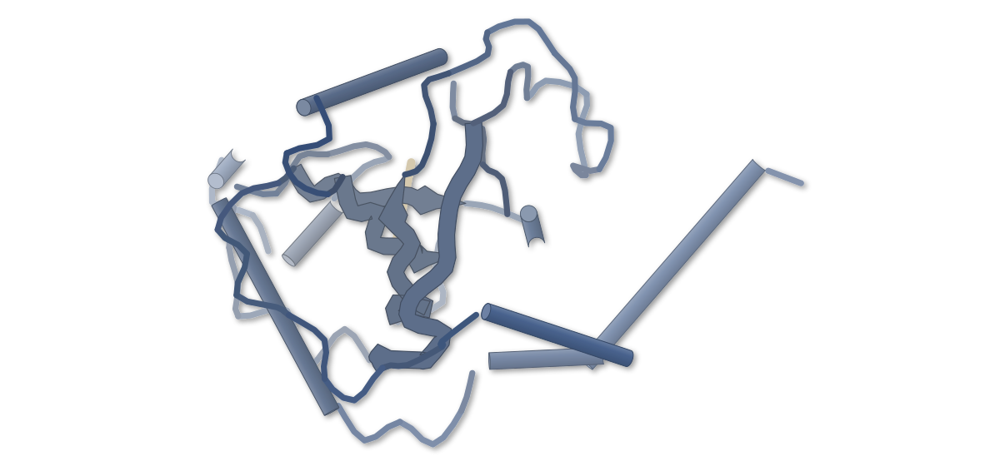

PDB 4RCJ（論文が使った既存の構造）

色（順に）：YTHDF1 / RNA (5'-R(*GP*GP*(6MZ)P*CP*U)-3')

**エラグ酸は、YTHDF3種すべてのm6A認識を妨げる**

共結晶構造でm6A結合ポケット隣の結合部位を示し、三陰性乳がんの増殖も抑えた

- **疑問・課題**：YTHDF1〜3は互いに補い合うため、3つを同時に抑える低分子が求められていた。
- **アプローチ**：蛍光偏光法で276化合物を調べて見つけたエラグ酸（EA）を、YTHDF1のYTHドメインとの共結晶構造で解析した。
- **結果**：EAはm6A結合ポケットの隣の未知の部位に結合した。近くのH416をAlaに変えると結合が大きく弱まった。
- **わかったこと**：EAは保存されたヒスチジンに依存する非典型の部位に結合し、YTHDFのm6A認識を妨げると考えられる。
- **残された課題**：天然ポリフェノールのEAはYTHDF以外の標的にも働く可能性があり、選択性の改良が課題だ。

この紹介文の根拠（論文本文）

> Due to the compensatory interplay of YTHDF1–3, simultaneously targeting all three paralogs may provide a superior m6A-targeting strategy by overcoming compensatory resistance and expanding therapeutic applications.  
> — 疑問・課題／Introduction

> Using this assay, we screened a focused library of 276 structurally diverse compounds at 1.0 μM and identified two primary hits, EA and Kobe2602  
> — アプローチ／Results

> To define the molecular basis of EA recognition, we solved the co-crystal structure of the YTHDF1-YTH domain bound to EA  
> — アプローチ／Results

> The structure showed that EA does not occupy the canonical m6A-binding pocket.  
> — 結果／Results

> ITC measurements confirmed that alanine substitution of these conserved histidine residues  
> — 結果／Results

> The co-crystal structure, histidine-mutant binding data, and CD spectroscopy collectively support a model in which EA perturbs the m6A-recognition-competent state of YTHDF proteins and impairs YTHDF-m6A RNA interactions.  
> — わかったこと／Results

> Finally, as a natural polyphenol, EA likely engages targets beyond the YTHDF family.  
> — 残された課題／Discussion

分類：転写調節・シグナル伝達・DNA・RNA に関わるもの

#### 読みどころ

EAはm6Aが入るポケットではなく、その隣の未知の部位に結合する。近くのH416は3種のYTHDFで保存され、AlaにするとEAの結合は大きく弱まった。

根拠（論文本文）

> Instead, EA binds to a previously unrecognized non-canonical site located adjacent to the m6A-recognition pocket.  
> — Results

> this histidine residue is strictly conserved across all three YTHDF paralogs  
> — Results

3種のYTHDFに対するIC50は0.18〜0.56 μMで、ITCのKdは約1 μMだった。EAは三陰性乳がん細胞の増殖を抑え、マウスの異種移植腫瘍も小さくした。

根拠（論文本文）

> indicating comparable potency across all three paralogs  
> — Results

> EA administration markedly reduced tumor volume and weight  
> — Results

EAでPFKFB4のmRNAが安定になり、PFKFB4が増えてHIF-1αの分解が抑えられ、BNIP3を介して細胞死が起きる。これは細胞での解析に基づく経路だ。

根拠（論文本文）

> Mechanistically, EA binds to YTHDF proteins, disrupting their interaction with PFKFB4 mRNA and consequently enhancing PFKFB4 transcript stability and protein expression.  
> — Results

#### 構造データ

| PDB | 手法 | 分解能 | 公開 | 生物種 | リガンド |
|---|---|---|---|---|---|
| [4RCJ](https://www.rcsb.org/structure/4RCJ) | X-ray | 1.60 Å | 2014-11-12 | Homo sapiens, synthetic construct | — |

- [Q9BYJ9](https://www.uniprot.org/uniprotkb/Q9BYJ9) YTHDF1 YTH domain-containing family protein 1 — *Homo sapiens* （既存の PDB 構造 0 件）

#### 実験メモ

- **発現系**：YTHDF1のYTHドメイン（361–559）を大腸菌BL21(DE3)で発現した。
- **結晶化／グリッド作製**：タンパク質とEAをモル比1:2で氷上で30分preincubationし、ハンギングドロップ蒸気拡散法で結晶化した。
- **データ収集・解析**：上海放射光施設のBL19U1でデータを集め、XDSで処理して、PHENIXの分子置換で解いた。

根拠（論文本文）

> The YTH domain of human YTHDF1 (residues 361–559) was subcloned into pET-28a (+) with an N-terminal, thrombin-cleavable His6 tag and overproduced in Escherichia coli BL21(DE3).  
> — Methods

> The protein was pre-incubated with EA on ice at a 1:2 molar ratio for 30 min. Crystallization was subsequently performed using the hanging-drop vapor diffusion method.  
> — Methods

> X-ray diffraction data were collected at BL19U1 beamline of Shanghai Synchrotron Radiation Facility and processed using program XDS.  
> — Methods

> 📝 編集者への確認事項：本文に PDB ID・分解能の記載がなく、候補では既存構造の利用に分類されたが、EA との共結晶構造は自前のもの（新しい構造に近い）。図の既定は引用された 4RCJ（m6A 結合型）なので、EA 結合型として見せないこと。EA と H416 のπ-π積層は結晶中の対称分子の H416 との間と本文にある。原文は CC BY-NC-ND。

---

## 21｜PDCoV スパイク（ブタ）

### Low-pH-induced conformational changes in the spike protein promote porcine deltacoronavirus infection by enhancing viral binding efficiency to the porcine aminopeptidase receptor

*Journal of Virology*（2026-10-01） · [論文](https://doi.org/10.1128/jvi.01168-26) · ライセンス: cc by

筆頭著者：Ruiming Yu（Lanzhou University, China）　責任著者：Xinsheng Liu（Lanzhou University, China）

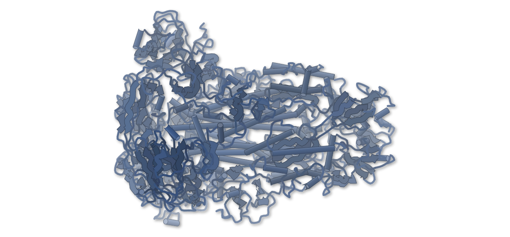

PDB 6B7N（論文が使った既存の構造）

色（順に）：S

**胃酸のpHで、PDCoVのスパイクが受容体に結合しやすくなる**

pH 4.0のクライオ電顕構造で、受容体結合ドメインが約14°外へ回っていた

- **疑問・課題**：ブタの胃の酸性環境にPDCoVがどう適応するかは、分子レベルでは分かっていなかった。
- **アプローチ**：pH 4.0で処理したスパイクのクライオ電顕構造を解き、受容体pAPNとの結合を表面プラズモン共鳴で測った。
- **結果**：pH 4.0で結合のKDは20.20 μMから1.69 μMに下がった。構造では受容体結合ドメインが14°外へ回っていた。
- **わかったこと**：低pHでスパイクは閉じた型と開いた型の中間の活性化型になり、受容体に結合しやすくなる。
- **残された課題**：構造はpH 4.0の1条件だけで、pHを段階的に変えた影響は調べていない。

この紹介文の根拠（論文本文）

> However, the molecular mechanism underlying PDCoV adaptation to the acidic gastric environment of hosts remains elusive.  
> — 疑問・課題／Abstract

> We solved the high-resolution cryo-electron microscopy (cryo-EM) structure of the PDCoV S protein under acidic conditions, representing the first deltacoronavirus S structure determined at low pH.  
> — アプローチ／Abstract

> We further quantified the binding affinity between the two proteins via surface plasmon resonance (SPR).  
> — アプローチ／Results

> with the dissociation constant (KD) decreasing from 20.20 μM at pH 7.2 to 1.69 μM at pH 4.0  
> — 結果／Abstract

> low pH drives a 14° outward rotation of the S1 C-terminal receptor-binding domain  
> — 結果／Abstract

> generating an intermediate activated conformation between the fully closed and fully open states, while the S2 fusion core remains structurally conserved  
> — わかったこと／Abstract

> acidic pH induces functionally important conformational rearrangements of the PDCoV spike (S) protein, which markedly increases its binding affinity for the cellular receptor porcine aminopeptidase N (pAPN)  
> — わかったこと／Abstract

> we have only resolved the structure of the PDCoV S protein at a single pH condition (pH 4.0)  
> — 残された課題／Discussion

分類：感染・ウイルス・防御系

#### 読みどころ

pH 4.0のスパイク（2.83 Å）は、6B7Nに基づく中性pHのモデルより三量体の頭部が開き、S1の受容体結合ドメインが14°外へ回っていた。S2の融合コアはほぼ変わらない。

根拠（論文本文）

> We finally resolved the prefusion conformation of PDCoV S protein under pH 4.0 (designated S4.0) at an overall resolution of 2.83 Å.  
> — Results

> the trimer head of S4.0 is more extended and adopts a more open conformation  
> — Results

受容体結合モチーフの大半はS1の内側に隠れている。ドッキング計算では閉じた型だとpAPNが近づけず、14°の回転はこの障害を和らげると論文は論じている。

根拠（論文本文）

> Molecular docking simulations demonstrated that when S1-CTD is in the closed (down) conformation under neutral conditions, severe steric hindrance prevents pAPN from accessing the RBM.  
> — Results

> The 14° outward rotation of S1-CTD in the S4.0 structure, while not forming a full up conformation, greatly reduces the spatial constraint imposed by S1-NTD on S1-CTD  
> — Results

子ブタに水酸化アルミニウムを飲ませて胃酸を中和すると、PDCoVの感染と病原性が弱まった。pH 4.0の前処理で、腸上皮細胞への感染性も高まった。

根拠（論文本文）

> neutralization of gastric acid in piglets effectively attenuates PDCoV infection and pathogenicity in vivo  
> — Abstract

> low-pH pretreatment at pH 4.0 significantly enhances the infectivity of PDCoV in porcine intestinal epithelial cells  
> — Results

#### 構造データ

| PDB | 手法 | 分解能 | 公開 | 生物種 | リガンド |
|---|---|---|---|---|---|
| [6B7N](https://www.rcsb.org/structure/6B7N) | Cryo-EM | 3.30 Å | 2017-10-25 | Deltacoronavirus PDCoV/USA/Ohio137/2014 | — |

- [A0A075E3D7](https://www.uniprot.org/uniprotkb/A0A075E3D7) S Spike protein — *Deltacoronavirus PDCoV/USA/Ohio137/2014* （既存の PDB 構造 0 件）

#### 実験メモ

- **発現系**：スパイクの外領域の三量体をExpiCHO発現系で発現・精製し、pH 4.0のバッファーで処理した。
- **コンストラクト**：シグナルペプチドと膜貫通領域を除き、残基20–1077を残した。
- **結晶化／グリッド作製**：4 μLを乗せたグリッドをVitrobotで4°C・湿度100%の条件で凍結した。
- **データ収集・解析**：9,408枚の顕微鏡写真から993,371粒子を選んで再構成した。処理はRELION 4.0かcryoSPARCで行った。

根拠（論文本文）

> The ectodomain trimer of PDCoV S protein was expressed and purified using the ExpiCHO eukaryotic expression system, then treated with pH 4.0 buffer for structural analysis.  
> — Results

> The N-terminal signal peptide and the C-terminal transmembrane region of the S protein were removed, whereas amino acid residues 20-1077 were retained.  
> — Methods

> A 4 μL aliquot of protein sample was applied to the treated grids, which were then vitrified with a Vitrobot under conditions of 4°C and 100% humidity  
> — Methods

> After screening 9,408 micrographs, a total of 993,371 valid particles were selected for 3D reconstruction and refinement  
> — Results

> Image processing was performed with RELION 4.0 or cryoSPARC.  
> — Methods

> 📝 編集者への確認事項：本文に新しい PDB ID の記載がなく、候補では既存構造の利用に分類されたが、pH 4.0 のクライオ電顕構造は自前のもの（新しい構造に近い）。比較相手の中性 pH 構造は 6B7N に基づくホモロジーモデルで実測ではない。図の既定は引用された 6B7N（中性 pH）になるので注意。

---

## 注目の構造の採点（45 本を確認し、7 本を採点）

基準は `pipeline/impact.py`（10 点満点、6 点以上から最大 3 本）。

| 選定 | 論文 | 種類 | novelty | reach | structure | support | 計 | 理由 |
|---|---|---|---|---|---|---|---|---|
| ◯ | PMC13710142 Allosteric modulation of YTHDFs by ellagic acid suppresses t | 構造に基づく創薬 | 2 | 2 | 2 | 2 | 8 | 自前の共結晶構造でYTHDFにm6Aポケット隣の未知の結合部位を示し、変異体のITCと細胞・マウスで確かめた。3種のYTHDFを同時に抑える点が新しい。 |
| ◯ | PMC13712870 Low-pH-induced conformational changes in the spike protein p | 既存構造で機構を解明 | 2 | 1 | 2 | 2 | 7 | 低pHで解いた自前のデルタコロナウイルスのスパイク構造で、受容体結合ドメインの14°の回転を示し、SPRとブタの実験で感染性の上昇と結びつけた。対象はPDCoV一種に近い。 |
|  | PMC13712852 Targeting conserved interaction surfaces of alphavirus nsP4  | 構造に基づく創薬 | 1 | 2 | 1 | 2 | 6 | 既存のレプリカーゼ構造に基づく変異の網羅的な試験とマウスでの弱毒化は有用だが、構造は変異の選び方に使われただけで構造データは自前になく、新しさは続報の域。6点だが novelty が1点。 |
|  | PMC13713018 A conserved antioxidant defense at the endoplasmic reticulum | 構造予測・AI・デザイン | 2 | 2 | 0 | 1 | 5 | AlphaFold2と遺伝学でERGU-1を見つけた新しい発見だが、実験で決めた構造がなく、structureが0点。 |
|  | PMC13711793 Conserved C-terminal tails link PilC1 and PilC2 to the Kinge | 構造予測・AI・デザイン | 1 | 1 | 0 | 1 | 3 | AlphaFold Multimerの予測を変異体で確かめた研究で、実験構造による裏付けがない（structure 0点）。 |
|  | PMC13713030 A GCN1-independent activator of the kinase GCN2 | 構造に基づく創薬 | 1 | 1 | 0 | 1 | 3 | 細胞でのスクリーニングで見つけたGCN2活性化剤で、結合様式はモデリングの推定のみ。実験構造がなく structure 0点。 |
|  | PMC13710742 Early insights into predicted efficacy of Ebola monoclonal a | 新しい手法・ソフト | 1 | 2 | 0 | 0 | 3 | 配列と構造モデリングによる計算だけの予測で、論文自身が中和試験などによる実験的な検証が必要と書いている。 |

novelty：何が初めてか / reach：誰に効くか / structure：実験で決めた構造（X 線・クライオ電顕・NMR / support：裏付けの強さ（2＝独立した実験で検証：変異体・機能測定・既存手法との比較など／1＝一部の検証のみ／0＝計算のみで実験的検証なし）
