

# 2026-10-30 号

**今日の新しい構造：14 本**　PMC に 2026-10-29 に登録されたオープンアクセス論文 81 本のうち、新しい構造を報告した論文は 14 本。すべて紹介する。

出典：この号の論文情報と全文は、米国国立医学図書館（NLM）の PMC オープンアクセスデータセット（AWS Open Data）から取得した。

**New Structure 2 本** · **Structure Update 12 本** · **Structure-Based Study 2 本**（New Structure：構造が初めて解かれたタンパク質。Structure Update：既知のタンパク質の新しい構造。Structure-Based Study：既存の構造を使った注目の研究）

## Today's Structure（今日の一本）

**1｜ClpPを遠くから止める、新しい阻害剤**（ヒトClpP（ミトコンドリア））

選んだ理由（構造生物学・創薬）：活性部位から約30 Å離れたポケットに結合するClpP阻害剤の作用を、クライオ電顕で触媒三残基のずれとして示した。

> binds sub-stoichiometrically to a distal hydrophobic pocket ~30 Å from the active sites, disrupts a conserved inter-subunit cluster, and induces a conformational change that misaligns the catalytic triad, thereby inactivating ClpP  
> — Abstract

- 迷った論文：US28–Gq（サイトメガロウイルス） — ウイルスGPCRのGq活性化中間状態を3つ捉えた構造研究。機構の示し方は強いが、創薬への直結度でClpPを選んだ。

| # | 標的 | 手法・分解能 | 見出し |
|---|---|---|---|
| 1 | ヒトClpP（ミトコンドリア） | Cryo-EM・3.20–3.40 Å（2 構造） | ClpPを遠くから止める、新しい阻害剤 |
| 2 | EIGHT fold（結び目タンパク質） | X-ray・2.20–2.92 Å（3 構造） | 腸内細菌に、8交差の複雑な結び目をもつタンパク質が見つかった |
| 3 | ChOGRE23（ニワトリDNA） | Solution NMR | ニワトリの複製起点のDNAは、Cが飛び出したG4を作る |
| 4 | US28–Gq（サイトメガロウイルス） | Cryo-EM・2.58–2.89 Å（6 構造） | ウイルスGPCRで、Gq活性化の途中の状態を3つ捉えた |
| 5 | VSV L-P-N0複合体 | Cryo-EM・3.80 Å | VSVのポリメラーゼは、N0をRNAの出口そばに留める |
| 6 | FtsEX・EnvC（大腸菌） | Cryo-EM・3.40–3.70 Å（2 構造） | 対称な大腸菌FtsEXが、非対称なEnvCを受け止める |
| 7 | HCN112／HCN1ΔC（ヒト） | Cryo-EM・3.34–3.92 Å（3 構造） | HCN2の細胞質ドメインを移したチャネルは、縮んだ形をとる |
| 8 | c-di-GMP-IIリボスイッチ変異体 | X-ray・1.70–2.90 Å（4 構造） | RNAは、cGAMPの異性体を結合の向きで見分ける |
| 9 | HCV E2コア×抗体RM3-26 | X-ray・1.60–2.78 Å（3 構造） | サルの抗体は、ヒトの抗体と似た向きでHCVのE2に結合した |
| 10 | GFRAL D3＋抗体Fab | X-ray・2.3 Å | 抗GFRAL抗体は、GFRALの表面を作り替えてRETをふさぐ |
| 11 | BeHepI（B. eggerthii） | X-ray・1.72–1.85 Å（2 構造） | 3-O-硫酸の隣も切れる、腸内細菌のヘパリン酵素 |
| 12 | DTX4（ヒト） | X-ray・2.8 Å | DTX4のRINGは、結晶中でドメインを入れ替えた二量体を作る |
| 13 | PKA（ハムスター） | X-ray・1.38 Å | 合成した15化合物のうち5つが、PKAをナノモルで阻害した |
| 14 | PGK1（ヒト） | NMR | テラゾシンは、PGK1が閉じるのを妨げて開いた状態に保つ |
| 15 | MbnH（メタン酸化菌） | UV-Vis・EPR・ストップトフロー・変異体解析 | 二ヘム酵素の電子は、トリプトファンなしでも運ばれる |
| 16 | シクロフィリンA（ヒト） | NMR・19F–19F NOESY | 19F–19F NOESYで、タンパク質中の約5 Å以内の距離が測れる |

> この号は AI が論文本文から作成した**レビュー用の下書き**です。数値・ID・リガンドは PDB / UniProt から取得し、AI の記述には本文からの引用を付けています。

---

# Picked up Today's Structure

## 1｜ヒトClpP（ミトコンドリア）

### Allosteric inhibition of human mitochondrial ClpP by hijacking the dordaviprone (ONC201) binding site

*Nature Communications*（2026-09-28） · [論文](https://doi.org/10.1038/s41467-026-78140-5) · ライセンス: cc by-nc-nd

筆頭著者：Monica M. Goncalves（University of Guelph, Canada）　責任著者：Aaron D. Schimmer（Ontario Institute for Cancer Research, Canada）、Natalie Zeytuni（McGill University, Canada）、Siavash Vahidi（University of Guelph, Canada）

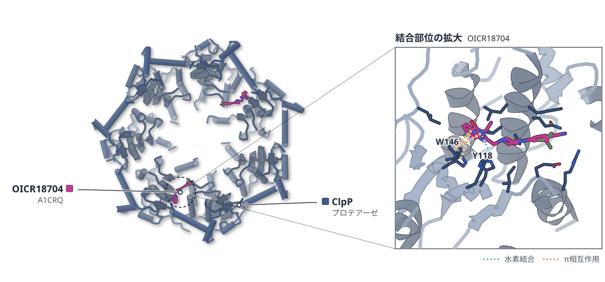

色（順に）：ClpP（プロテアーゼ）　スティック：OICR18704（A1CRQ）

**ClpPを遠くから止める、新しい阻害剤**

活性部位から約30 Å離れたポケットに結合し、触媒残基の並びをずらして不活性にする

- **疑問・課題**：ClpPの阻害剤は、活性部位に結合すると逆に活性化する現象があり、開発が難しかった。
- **アプローチ**：キナゾリノン系の阻害剤OICR18704と結合したヒトClpPの構造をクライオ電顕で決め、HDX-MSで動きも調べた。
- **結果**：7つのポケットのうち阻害剤が入るのは2つだけで、触媒のHis178を置く取っ手のβシートはどのサブユニットでも消えていた。
- **わかったこと**：結合部位は活性部位から約30 Å離れており、クラスターが壊れると触媒三残基がずれて活性を失う。
- **残された課題**：生体内での効果がClpP阻害によるのか、PRKCIなどによるのかは今後の課題とされる。

この紹介文の根拠（論文本文）

> the development of ClpP inhibitors has been hampered by paradoxical activation upon orthosteric inhibitor binding  
> — 疑問・課題／Abstract

> we used cryo-EM to determine the structure of human ClpP bound to one of our representative inhibitors, OICR18704  
> — アプローチ／Results

> Cryo-EM and H/D exchange mass spectrometry reveal that our lead compound binds sub-stoichiometrically  
> — アプローチ／Abstract

> clear inhibitor density was observed in only two of the seven inter-subunit hydrophobic pockets on the apical surface of ClpP  
> — 結果／Results

> Notably, the handle β-sheet that positions the catalytic His178 was absent in all subunits, resulting in misalignment of the catalytic triad and loss of proteolytic activity.  
> — 結果／Results

> binds sub-stoichiometrically to a distal hydrophobic pocket ~30 Å from the active sites, disrupts a conserved inter-subunit cluster, and induces a conformational change that misaligns the catalytic triad, thereby inactivating ClpP  
> — わかったこと／Abstract

> Future studies will determine whether the in vivo efficacy was due to inhibition of ClpP, PRKCI, a combination of these, or additional targets.  
> — 残された課題／Discussion

分類：プロテアーゼ

#### 読みどころ

阻害剤は、活性化剤ドルダビプロン（ONC201）の結合ポケットと一部重なる場所に入る。キナゾリノン部分はドルダビプロンに似た結合をするが、トリフルオロメチルベンゾニトリル基が軸孔側へ伸びて疎水性クラスターをこじ開け、阻害に転じる。

根拠（論文本文）

> Unlike dordaviprone, the trifluoromethyl benzonitrile group of OICR18704 extends toward the axial pore and acts as a wedge that disrupts a conserved hydrophobic cluster  
> — Results

> The disruption of this critical allosteric hotspot at the interface of adjacent ClpP subunits enables OICR18704 to act as an inhibitor rather than an activator.  
> — Results

クラスターを壊すV62A変異体も、非対称なヘプタマー（7量体）で不活性になり、ドルダビプロンで活性が戻る。HDX-MSでも、取っ手ドメインが不安定になることが示された。

根拠（論文本文）

> Both the V62A substitution and OICR18704 binding stabilize the inactive heptameric state of ClpP and thereby abolish activity.  
> — Results

> the loss of activity resulting from the perturbation of the N-terminal cluster is restored by the stoichiometric addition of dordaviprone  
> — Results

活性部位に結合する阻害剤は、低濃度でClpPを活性化してしまう。この化合物群は別の部位を使い、白血病のマウスモデルで経口投与後に腫瘍量を減らした。

根拠（論文本文）

> we previously demonstrated that they elicit a hormetic response, characterized by bell-shaped dose-response curves where low inhibitor concentrations paradoxically activate ClpP  
> — Discussion

> In a xenograft mouse model of leukemia, our lead compound significantly reduced tumor burden following short-term oral administration.  
> — Abstract

#### 構造データ

| PDB | 手法 | 分解能 | 公開 | 生物種 | リガンド |
|---|---|---|---|---|---|
| [9XYH](https://www.rcsb.org/structure/9XYH) | Cryo-EM | 3.40 Å | 2026-10-14 | Homo sapiens | A1CRQ |
| [9XYJ](https://www.rcsb.org/structure/9XYJ) | Cryo-EM | 3.20 Å | 2026-10-14 | Homo sapiens | — |

#### 実験メモ

- **発現系**：大腸菌T7 Expressで発現。
- **コンストラクト**：ミトコンドリア標的配列（1–56）を除いた野生型とV62A変異体。切断可能なHis6-SUMOタグ付き。
- **精製**：Niカラム、Ulp1でタグ切断、再度Niカラム、Superdex 200 Increaseでゲル濾過。
- **結晶化／グリッド作製**：ClpP 15 mg/mlに1 mMのOICR18704を加え、0.025%のIGEPAL CA-630を添加。Vitrobot Mark IV（4 °C、湿度100%）で凍結。
- **データ収集・解析**：Titan Krios、K3検出器、SerialEMで収集。cryoSPARC v4で処理。

根拠（論文本文）

> Plasmids were transformed into competent T7 Express Escherichia coli cells by heat-shock  
> — Methods

> A cleavable N-terminal His6-SUMO tag was incorporated into both plasmids.  
> — Methods

> The eluted sample was incubated with Ulp1 protease for His-SUMO tag cleavage and was dialyzed against lysis buffer for 18 h.  
> — Methods

> subjected to size exclusion chromatography (SEC) on a Superdex 200 Increase 10/300 GL column (Cytiva)  
> — Methods

> IGEPAL CA-630 was added to the sample in both cases to a final concentration of 0.025% to improve particle orientation.  
> — Methods

> Sample vitrification was performed using a Vitrobot Mark IV (Thermo Fisher Scientific) at 4 °C and 100% humidity.  
> — Methods

> on a Titan Krios microscope (Thermo Fisher Scientific)  
> — Methods

> All cryo-EM data processing was performed using cryoSPARCv4  
> — Methods

> 📝 編集者への確認事項：論文はOICR18704の立体化学（3位のS体）を密度から決められなかったと書いている。ヘプタマー環の構造（9XYH）を主図に使う。創薬の軸で今日の一本の候補になりうる。

---

# New Structure

## 2｜EIGHT fold（結び目タンパク質）

### Unique features of EIGHT fold—Proteins with the most complex 83 knotted topology

*Proceedings of the National Academy of Sciences of the United States of America*（2026-10-19） · [論文](https://doi.org/10.1073/pnas.2523017123) · ライセンス: cc by-nc-nd

筆頭著者：Mariusz Mozajew（University of Warsaw, Poland）　責任著者：Sophie E. Jackson（University of Cambridge, United Kingdom）、Joanna I. Sulkowska（University of Warsaw, Poland）

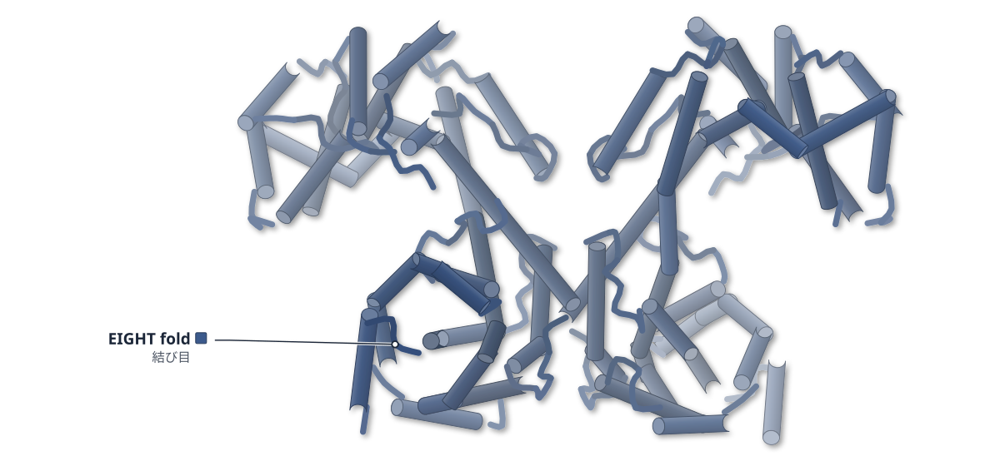

色（順に）：EIGHT fold（結び目）

**腸内細菌に、8交差の複雑な結び目をもつタンパク質が見つかった**

X線構造で結び目を確かめ、変性は6段階で進むと分かった

- **疑問・課題**：結び目をもつタンパク質のうち、実験で構造が確かめられた結び目の種類は少なく、交差が8回のものは未確認だった。
- **アプローチ**：AlphaFoldが交差8回の結び目をもつと予測した細菌タンパク質を発現し、X線結晶構造を決め、安定性と変性の速さも測った。
- **結果**：結晶構造3つが結び目を確かめた。変性は少なくとも6段階で進み、半減期は約0.1秒から25時間超に及んだ。
- **わかったこと**：同じ折りたたみは細菌の296タンパク質に見つかった。折りたたみの経路は既知の理論では説明できないと著者は述べる。
- **残された課題**：このタンパク質の機能は分かっていない。

この紹介文の根拠（論文本文）

> There are only a few types of knots with confirmed experimental structure, based on the KnotProt Database  
> — 疑問・課題／Introduction

> Here, we report X-ray structures of proteins containing an 83 knot and adopting a previously unrecognized fold.  
> — アプローチ／Introduction

> Based on the X-ray structures, we confirm that the protein backbone forms an 83 knot.  
> — 結果／Results

> Studies of the unfolding kinetics of 83 proteins reveal at least six distinct unfolding phases  
> — 結果／Results

> We identified 296 proteins in the UniProtKB Database with the same 83 knotted fold, all of which originated from bacteria.  
> — わかったこと／Conclusions

> Native contacts allow the EIGHT fold to self-tie, but the observed folding pathway cannot be explained by any known protein-folding theory.  
> — わかったこと／Abstract

> The 83 knotted proteins possess a novel fold and topology whose function is unknown.  
> — 残された課題／Results

分類：その他

#### 読みどころ

タンパク質εとαの結晶構造3つ（2.2〜2.92 Å）が、交差8回の結び目を確かめた。結び目は約470残基のほぼ全長にわたり、全体が1ドメインのα-ヘリックスだけでできている。

根拠（論文本文）

> The monomer is a single-domain protein with a purely α-helical structure (20 helices; Fig. 2).  
> — Results

> In protein ϵ, the knot spans residues 36 to 467, while in protein α, it extends from residues 29 to 453  
> — Results

構造決定にはAlphaFold2モデルを使った分子置換を用いたため、モデルの偏りが入る恐れがある。著者は、結び目のないモデルでは解けず結び目のあるモデルでは解けたことを、結び目を支持する独立の証拠としている。

根拠（論文本文）

> the unknotted search model failed to yield a molecular-replacement solution, whereas the knotted model succeeded.  
> — Conclusions

> While molecular replacement with the AlphaFold model carries a risk of bias  
> — Conclusions

構造は、似た2つの半分（ジグザグのヘリックス束・長いヘリックス・二重のHLH領域）からなる。著者は、単純な祖先の重複で生じた可能性を挙げている。

根拠（論文本文）

> The 83 protein’s structure is composed of two structurally similar halves.  
> — Results

> The similarity between the two halves might be due to the duplication  
> — Results

#### 構造データ

| PDB | 手法 | 分解能 | 公開 | 生物種 | リガンド |
|---|---|---|---|---|---|
| [9TMH](https://www.rcsb.org/structure/9TMH) | X-ray | 2.20 Å | 2026-10-21 | Coprococcus sp. OM06-34AC | — |
| [9RH0](https://www.rcsb.org/structure/9RH0) | X-ray | 2.92 Å | 2026-10-21 | Lachnospiraceae bacterium | — |
| [32UY](https://www.rcsb.org/structure/32UY) | X-ray | 2.54 Å | 2026-10-21 | Lachnospiraceae bacterium | — |

#### 実験メモ

- **コンストラクト**：AlphaKnotで8交差の結び目をもつとされたタンパク質から、結晶化しやすそうな6種を選んだ。
- **データ収集・解析**：分子置換（AlphaFold2モデル）で決定した。SeMet置換の結晶は6 Åを超えて回折しなかった。

根拠（論文本文）

> we selected six proteins based on their crystallizability potential  
> — Results

> All of the structures were determined with molecular replacement based on Alpha Fold 2 models.  
> — Materials and Methods

> none of the crystals that were obtained diffracted beyond 6 Å  
> — Materials and Methods

> 📝 編集者への確認事項：UniProt に対応づけられず proteins が空のため first_claim を付けた（論文は「previously unrecognized fold」と書くが「初の構造」とは明記していない。Structure Update に直すなら first_claim を外す）。発現・精製・結晶化の詳細は SI にあり packet にない。ライセンスは CC BY-NC-ND なので要旨や構成をなぞらないよう注意した。

---

## 3｜ChOGRE23（ニワトリDNA）

### A Cytosine‑Bulged (3+1) Hybrid G‑Quadruplex Formed by the Chicken DNA Replication Origin

*Chemistry (Weinheim an Der Bergstrasse, Germany)*（2026-07-15） · [論文](https://doi.org/10.1002/chem.71389) · ライセンス: cc by

筆頭著者：Yingying You（Sun Yat‐sen University, China）　責任著者：Changdong Liu, Guang Zhu（The Hong Kong University of Science and Technology, China）

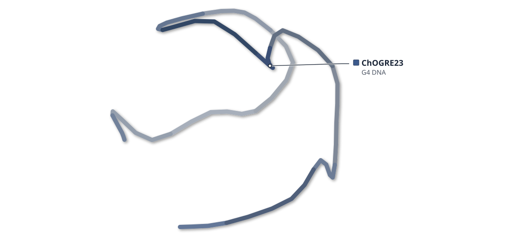

色（順に）：ChOGRE23（G4 DNA）

**ニワトリの複製起点のDNAは、Cが飛び出したG4を作る**

NMRで決めた3層の(3+1)ハイブリッド型で、5'端のGがanti型で外側の層に入る

- **疑問・課題**：複製起点のG-rich配列（OGRE）がつくるG4の構造は、よく分かっていなかった。
- **アプローチ**：ニワトリβグロビン複製起点の23塩基（ChOGRE23）をK+溶液中でNMR解析し、NOEから構造を計算した。
- **結果**：3枚のG-カルテットが重なる分子内の(3+1)ハイブリッド型G4で、2本目のGの並びを割るC8が外に飛び出していた。Tmは64.6℃だった。
- **わかったこと**：5'端のGがanti型で外側のカルテットに入る並びは、既報の分子内(3+1)型G4にないと論文は述べる。Cのバルジとあわせ独自の表面を作る。
- **残された課題**：ChOGRE23は最小単位で、長い配列や染色体上の起点でも同じG4ができるかは今後の課題だ。

この紹介文の根拠（論文本文）

> However, G4 structures formed by OGRE remain poorly understood.  
> — 疑問・課題／Abstract

> The NMR structure of ChOGRE23 in K+ solution was calculated on the basis of NOE restraints (Table S1) derived from NOESY spectra.  
> — アプローチ／Results

> we analyzed a 36‐nt DNA fragment from the β‐globin replication origin in chicken  
> — アプローチ／Introduction

> Accordingly, ChOGRE23 folds into a three‐layer intramolecular (3 + 1) G4  
> — 結果／Results

> Notably, the second G‐tract is interrupted by a cytosine residue at position 8, giving rise to an extruded bulge  
> — 結果／Results

> with a Tm of 64.6°C in 70 mM KCl and 20 mM phosphate buffer at pH 7.0  
> — 結果／Results

> the first 5'‐ guanosine adopts an anti conformation and is involved in an outermost G‐quartet, differing from all previously reported unimolecular (3+1) hybrid G4 structures  
> — わかったこと／Discussion

> these unusual structural features create a distinct molecular surface that may facilitate selective recognition by replication‑associated proteins or small molecules  
> — わかったこと／Abstract

> Future studies using longer constructs, chromatinized templates, and replication‐associated protein‐binding assays will be required to determine whether this cytosine‐bulged G4 topology is formed and recognized in a genomic replication context.  
> — 残された課題／Discussion

分類：DNA・RNA に関わるもの

#### 読みどころ

ニワトリβグロビン複製起点のOGREがつくるG4として、論文が初めてと述べる高分解能構造。36塩基では複数の構造が混ざったため、均一なスペクトルを示す23塩基に切り詰めて解析した。

根拠（論文本文）

> we report the first high‑resolution G4 structure formed by OGRE from the β‐globin replication origin of chicken  
> — Abstract

> was selected for further study as its well‐dispersed spectrum indicated a single predominant G4 conformation in solution  
> — Introduction

C8が2本目のGの並び（G7とG9の間）を割ってカルテットの外へ突き出し、バルジをつくる。ループのC6、C11、C14はG-カルテットの上に積み重なり、非対称な分子表面ができる。

根拠（論文本文）

> Interestingly, C8 interrupts the second G‐tract between G7 and G9 and is extruded from the G‐quartet core.  
> — Results

> C6 lies over the G3·G7·G18·G22 G‐quartet in an approximately coplanar orientation, capping the G‐quartet through stacking interactions  
> — Results

グアニンのイミノ陽子は、5%の15N標識を部位ごとに入れた試料で帰属した。H1–H8のNOEから3枚のG-カルテットと、水素結合の向きの違いを決めた。

根拠（論文本文）

> were unambiguously assigned by using a site‐specific low‐enrichment (5%) 15N‐labeling strategy  
> — Results

> Analysis of H1‐H8 NOE cross‐peaks established the presence of three stacked G‐quartets formed by G1·G10·G16·G20, G2·G9·G17·G21 and G3·G7·G18·G22  
> — Results

#### 構造データ

| PDB | 手法 | 分解能 | 公開 | 生物種 | リガンド |
|---|---|---|---|---|---|
| [9WNM](https://www.rcsb.org/structure/9WNM) | Solution NMR | — | 2026-09-09 | Gallus gallus | — |

#### 実験メモ

- **発現系**：DNAは化学合成品（BGI GenomicsとTakara）。部位特異的に5%の15N,13Cで標識したオリゴも用いた。
- **コンストラクト**：ChOGRE23（23塩基）。36塩基のChickOG36を切り詰めたもの。
- **結晶化／グリッド作製**：70 mM KCl・20 mMリン酸カリウム（pH 7.0）で0.1 mMとし、95℃で15分加熱して一晩かけて室温まで徐冷した。
- **データ収集・解析**：Varian INOVA 500・800 MHzで25℃にNOESYなどを測定。XPLOR-NIHで構造を計算し、違反のない低エネルギー10構造を採用した。

根拠（論文本文）

> Unlabeled nucleotides and site‐specific 5% 15N, 13C‐labeled low‐enrichment nucleotides were synthesized by BGI Genomics and Takara.  
> — Methods

> Samples were annealed by heating to 95°C for 15 min, followed by gradual cooling to room temperature overnight.  
> — Methods

> NMR experiments were conducted on Varian INOVA 500 and 800 MHz spectrometers at 25°C.  
> — Methods

> The 10 lowest‑energy structures without NOE violations were selected as the final ensemble.  
> — Methods

> 📝 編集者への確認事項：タンパク質を含まないため first_claim（論文の 'the first high-resolution G4 structure formed by OGRE'）で New Structure 扱いにした。DNA の 'first' であり、タンパク質の初構造ではない点を確認してほしい。PDB 9WNM は NMR（分解能なし）。

---

# Structure Update

## 4｜US28–Gq（サイトメガロウイルス）

### Structural basis of stepwise G protein activation by the viral chemokine receptor US28

*Nature Communications*（2026-09-28） · [論文](https://doi.org/10.1038/s41467-026-78122-7) · ライセンス: cc by

筆頭著者：Kevin M. Jude（Stanford University School of Medicine, USA）　責任著者：Carl-Mikael Suomivuori（Yale School of Medicine, USA）、Asuka Inoue（Kyoto University, Japan）、K. Christopher Garcia（Stanford University School of Medicine, USA） ほか 1 名

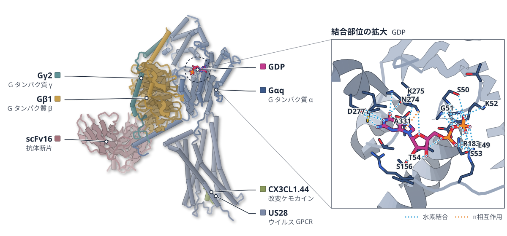

色（順に）：Gαq（G タンパク質 α） / Gβ1（G タンパク質 β） / Gγ2（G タンパク質 γ） / scFv16（抗体断片） / US28（ウイルス GPCR） / CX3CL1.44（改変ケモカイン）　スティック：GDP

**ウイルスGPCRで、Gq活性化の途中の状態を3つ捉えた**

クライオ電顕でE・T2C・C状態を解析し、α5の形成が塩橋の切断を介してGDP放出を促すと提案

- **疑問・課題**：GPCRがGタンパク質と出会ってからGDPを放すまでの構造変化は、構造としては捉えにくかった。
- **アプローチ**：ウイルスのGPCRであるUS28と改変ケモカインでGqとの複合体を作り、クライオ電顕に、MDと変異体解析を組み合わせた。
- **結果**：GDP結合のE状態（2.6 Å）、中間体とみられるT2C状態（2.9 Å）、GDPのないC状態（2.6 Å）が得られた。
- **わかったこと**：α5ヘリックスの挿入がP-loopのGlu49とSwitch IのArg183の塩橋を切り、この解錠はAHDが大きく開くより先に起きると提案している。
- **残された課題**：状態の起きる時間的な順序は、リアルタイムの1分子解析などがないと決められない。

この紹介文の根拠（論文本文）

> the initial recognition of the inactive, GDP-bound G protein by the receptor and the subsequent conformational transitions that catalyze GDP release have remained structurally elusive  
> — 疑問・課題／Introduction

> However, the sequence of structural events from G protein recognition to GDP release has remained elusive.  
> — 疑問・課題／Abstract

> Using cryo-electron microscopy and an engineered chemokine superagonist, we determined three distinct complex structures, capturing a GDP-bound Encounter state, the nucleotide-free Canonical state, and a putative intermediate bridging the two states, the Transition-to-Canonical state.  
> — アプローチ／Abstract

> These structures, along with simulations and functional data, provide high-resolution snapshots of a plausible G protein activation trajectory  
> — アプローチ／Abstract

> This structure, refined to 2.6 Å resolution, is analogous to the previously reported TL-state CX3CL1-US28-G11 structure but at substantially higher resolution  
> — 結果／Results

> Notably, 3D classification resolved a putative intermediate bridging these two states: the “Transition-to-Canonical” state (T2C-state), refined to 2.9 Å resolution (Fig. 2a).  
> — 結果／Results

> we focused on the particle subset that yielded the highest-quality map at 2.6 Å resolution  
> — 結果／Results

> Based on comparative analysis, we propose that the transition from initial engagement to the nucleotide-free state is driven by α5 engagement, which acts through an allosteric conduit to disrupt the salt bridge between the conserved glutamate and arginine in the P-loop and Switch I, respectively.  
> — わかったこと／Introduction

> Crucially, our structures, combined with MD simulations, demonstrate that the unlocking of the nucleotide-binding pocket is a distinct event that precedes the large-scale opening of the AHD.  
> — わかったこと／Discussion

> Defining the precise temporal sequence would require real-time single-molecule or time-resolved assays, which remain technically challenging here.  
> — 残された課題／Discussion

分類：GPCR・受容体・感染・ウイルス・防御系

#### 読みどころ

E状態からT2C状態でα5がほぼ完成すると、TCATモチーフが乱れ、Glu49–Arg183の塩橋が切れる。Glu49はArg247と新しい塩橋を作り、Arg247とGln152（AHD）の結合が切れて、AHDとRHDの界面が不安定になる。

根拠（論文本文）

> This sequential breakage and formation of ionic interactions constitute a “salt bridge relay” that transmits the allosteric signal from Switch I to the AHD interface.  
> — Results

> The transition from the E- to T2C-state triggers a sequence of allosteric rearrangements, initiated as the Gαq α5 helix is almost fully formed (Fig. 5c).  
> — Results

C状態ではα5が完成してα1ヘリックスがずれ、その衝突でGDPが押し出され、AHDも離れる。E状態からC状態までに、GqはUS28に対して約33°回転する。

根拠（論文本文）

> The displaced α1 helix creates a steric clash that physically expels GDP and subsequently pushes the AHD away  
> — Results

> Gq rotates by approximately 33° accompanied by a slight translation of less than 2 Å along the αN helix  
> — Results

T2C状態から始めた16本の約2 µsのMDのうち、6本がC状態へ、1本がE状態へ部分的に向かった。GDP放出は見られなかった。変異体R129Aでは、Gq活性化が完全に消えた。

根拠（論文本文）

> In 6 simulations, we identified partial transitions toward the C-state.  
> — Results

> We did not observe GDP release at the simulated timescales.  
> — Results

> This mutation completely abolished Gq activation in response to CX3CL1.44.  
> — Results

#### 構造データ

| PDB | 手法 | 分解能 | 公開 | 生物種 | リガンド |
|---|---|---|---|---|---|
| [9XH2](https://www.rcsb.org/structure/9XH2) | Cryo-EM | 2.60 Å | 2026-09-23 | Homo sapiens, Human betaherpesvirus 5, Mus musculus | GDP |
| [9XJP](https://www.rcsb.org/structure/9XJP) | Cryo-EM | 2.74 Å | 2026-09-23 | Homo sapiens, Human betaherpesvirus 5, Mus musculus | GDP |
| [9XIY](https://www.rcsb.org/structure/9XIY) | Cryo-EM | 2.86 Å | 2026-09-23 | Cytomegalovirus, Homo sapiens, Mus musculus | GDP |
| [9XIX](https://www.rcsb.org/structure/9XIX) | Cryo-EM | 2.58 Å | 2026-09-23 | Cytomegalovirus, Homo sapiens, Mus musculus | — |
| [9XJ5](https://www.rcsb.org/structure/9XJ5) | Cryo-EM | 2.81 Å | 2026-09-23 | Homo sapiens, Human betaherpesvirus 5, Mus musculus | — |
| [9XJ7](https://www.rcsb.org/structure/9XJ7) | Cryo-EM | 2.89 Å | 2026-09-23 | Homo sapiens, Human betaherpesvirus 5, Mus musculus | — |

#### 実験メモ

- **発現系**：CX3CL1.44とUS28はBacMam系でHEK293S GnTI−細胞に、GαqiN18とGβ1・Gγ2はTrichoplusia ni細胞に発現させた。
- **コンストラクト**：Gαqの先頭18残基をGαi1の配列に替えたGαqiN18を使い、scFv16が結合できるようにした。
- **精製**：アピラーゼで残ったGDPを分解し、FLAGカラムで余分なGqiN18を除いた。scFv16を加え、Superdex 200のSECで精製した。
- **結晶化／グリッド作製**：試料に0.1% fOMまたは10 mM CHAPSOを加え、Quantifoilグリッドに3 µLを載せ、Leica EM GPで凍結した。
- **データ収集・解析**：Titan Krios（300 kV、K3）で収集し、cryoSPARCで処理した。E状態は193,867粒子で2.6 Åになった。

根拠（論文本文）

> CX3CL1.44, an engineered version of the chemokine domain of CX3CL1, and full-length US28 were expressed separately with the BacMam system using HEK293S GnTI- cells  
> — Methods

> GαqiN18 was co-expressed with 6xHis-tagged Gβ1 and Gγ2 in Trichoplusia ni cells (Expression Systems)  
> — Methods

> GαqiN18 was designed similarly to Gα11iN18 (ref. 27) by replacing the N-terminal 18 amino acid residues with the corresponding region of Gαi1 for scFv16 binding  
> — Methods

> Residual GDP in the reaction buffer was hydrolyzed with apyrase (NEB), reducing the chance of GDP rebinding from the buffer solution.  
> — Methods

> 3 µL of each mixture was applied to glow-discharged 300 mesh gold grids (Quantifoil R1.2/1.3).  
> — Methods

> The cryo-EM movies were collected on a Titan Krios operated at 300 kV and equipped with a Gatan K3 camera and BioQuantum imaging filter in super-resolution mode.  
> — Methods

> The selected 193,867 particles yielded the E-state map with 2.6 Å nominal-resolution determined by gold-standard FSC with the 0.143 criterion  
> — Methods

> 📝 編集者への確認事項：T2C 状態は著者自身が putative intermediate と書いているため『中間体とみられる』とした。構造は界面活性剤ミセル中・scFv16 つきで、MD は T2C 状態からの 16 本のみ（著者が限界として明記）。図は GDP 結合の E 状態 9XH2 を使用。比較図（compare）は付けていない。

---

## 5｜VSV L-P-N0複合体

### Structure of vesicular stomatitis virus L-P-N0 complex by cyro-electron microscopy

*Science Advances*（2026-10-30） · [論文](https://doi.org/10.1126/sciadv.aej0664) · ライセンス: cc by

筆頭著者：Louis-Marie Bloyet（Washington University in St. Louis School of Medicine, USA）　責任著者：Louis-Marie Bloyet, Sean P. J. Whelan（Washington University in St. Louis School of Medicine, USA）

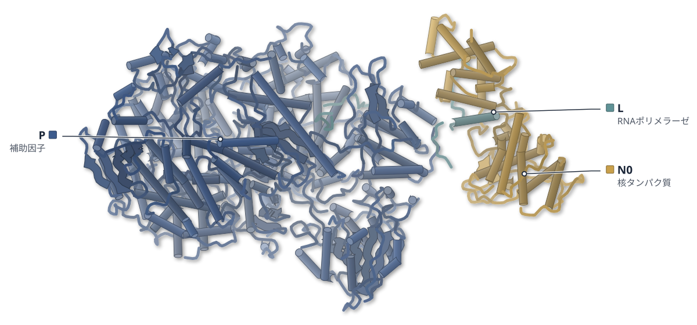

色（順に）：P（補助因子） / N0（核タンパク質） / L（RNAポリメラーゼ）

**VSVのポリメラーゼは、N0をRNAの出口そばに留める**

L-P-N0のクライオ電顕で、N0がLCTD付近を動く様子と3.8 Åの安定な状態を得た

- **疑問・課題**：複製中のLが、新生RNAを包む可溶性のN0をどう呼び込むかは、答えの出ていない問いだった。
- **アプローチ**：VSVのL-P-N0複合体を精製タンパク質から再構成し、単粒子クライオ電顕で解析した。
- **結果**：N0はLCTD付近を連続的に動いていた。一部（約13%）は出口近くで安定し、3.8 Åの地図でモデルを作れた。
- **わかったこと**：LCTDは複製に特化した足場で、Pに保持されたN0をRNAの出口へ導くと考えられる。
- **残された課題**：RNAがNに渡る瞬間は未観察で、時間分解やRNAを捕えた状態の解析が必要だ。

この紹介文の根拠（論文本文）

> how the replication machinery recruits N0 to the nascent RNA and couples encapsidation to polymerase elongation  
> — 疑問・課題／Introduction

> we reconstituted a VSV L-P-N0 complex from purified proteins, using the N-terminal region of P  
> — アプローチ／Results

> Here, we reconstitute the VSV L-P-N0 complex and determine its structure by cryo–electron microscopy (cryo-EM).  
> — アプローチ／Introduction

> This analysis indicates that the N protein is in a dynamic continuum of positions  
> — 結果／Results

> we identified a stable conformation for which 3DFlex yielded a map with an average resolution of 3.8 Å  
> — 結果／Results

> The relatively low percentage of L-P-N0 complexes found in the stable conformation (∼13%)  
> — 結果／Discussion

> Here, we define a structural solution to that problem for the VSV polymerase in which the LCTD operates as a replication-specific docking platform that is engaged by the PNTR to recruit N0 to the RNA exit path.  
> — わかったこと／Discussion

> This study reveals a function for LCTD in encapsidation of nascent RNAs  
> — わかったこと／Abstract

> we do not visualize RNA threaded through the exit tunnel and into the N-binding cleft, which will require time-resolved or RNA-trapped states to capture the moment of hand-off  
> — 残された課題／Discussion

分類：感染・ウイルス・防御系・DNA・RNA に関わるもの

#### 読みどころ

N0を抱えたPの先頭部分（PNTD）がLCTDに近づいて触れる状態が、焦点を絞った3D分類で複数分かれた。3DFlexの解析は、N0が連続した位置をとることを示した。

根拠（論文本文）

> First, focused cryo-EM classification centered on PY53 resolves multiple states in which an N-like, bilobed body, identified by signal subtraction and rigid-body fitting as N0-PNTD, approaches and contacts the LCTD.  
> — Discussion

> This analysis indicates that the N protein is in a dynamic continuum of positions  
> — Results

安定な状態の原子モデル（9T53）では、N0がLCTDの端に置かれ、PNTDがPのLBS1とLCTDの両方に接していた。既知のL-P構造とN0-P構造は、目立った変化なく地図に収まった。

根拠（論文本文）

> The model highlights an N0 protomer positioned at the edge of the LCTD platform and contacts between the PNTD and both PLBS1 and LCTD  
> — Results

> We rigid-body fitted the available structures of the L-P and N0-P complexes in the density map and did not detect any notable conformational changes  
> — Results

界面の埋もれ面積を比べると、N0-PとL-Pをつなぐ接触はPによるもの（325 Å2）がN-L間（187 Å2）より大きい。Nの動きはPNTDとLの接点を中心にしており、Pが安定化の中心と著者は読み取る。

根拠（論文本文）

> show that P, rather than N or L, provides the largest contact surface between N0-P and L-P complexes (PNTD-L + PLBS1-PNTD + PLBS1-N = 325 Å2; N-L = 187 Å2)  
> — Results

> Overall, these results highlight a central role of P in the formation and stabilization of the conformation.  
> — Results

#### 構造データ

| PDB | 手法 | 分解能 | 公開 | 生物種 | リガンド |
|---|---|---|---|---|---|
| [9T53](https://www.rcsb.org/structure/9T53) | Cryo-EM | 3.80 Å | 2026-10-07 | Vesicular stomatitis Indiana virus strain San Juan | — |

#### 実験メモ

- **発現系**：N0-P（NとPの1–106）は大腸菌Rosetta 2 (DE3)で、Lは組換えVSVを感染させたBSR-T7細胞から調製した。
- **コンストラクト**：Pは全長ではなくN末端領域（1–106）を使った。LはN末端に8xHis-3Cタグを付けた組換えウイルスから得た。
- **精製**：Ni-NTAビーズ上でLにN0-Pを結合させ、anti-Flagビーズで精製してHRV-3Cでタグを外した。
- **結晶化／グリッド作製**：0.2 mg/mlの複合体3 μLをlacey carbonの銅グリッドに載せ、Vitrobot Mark IVで液体エタンに凍結した。
- **データ収集・解析**：200 keVのGlacios・Falcon IVで10,322本の動画を撮り、CryoSPARC 4.6.0で処理した。3DFlexで3.8 Åの地図を得た。

根拠（論文本文）

> The N0-P complex was expressed in Rosetta 2 (DE3) cells transformed with the plasmid  
> — Methods

> L was purified from BSR-T7 cells infected with rVSV-eGFP-8xHis-3C-L.  
> — Methods

> The purified and cleaved N0-P complexes were then added to the beads and incubated at 4°C for 4 hours.  
> — Methods

> Cryo-EM grids were prepared using a Vitrobot Mark IV  
> — Methods

> Movies and particles were processed using CryoSPARC version 4.6.0  
> — Methods

> 📝 編集者への確認事項：legend_labels は candidates の polymers の順（P・N・L）で書いた。render で凡例の順を確かめて直してほしい。図の 9T53 は 3.8 Å。N-L の接触面積など数値は論文の記述。「約13%」は論文の 'percentage ... found in the stable conformation (~13%)'。

---

## 6｜FtsEX・EnvC（大腸菌）

### Structural insights into peptidoglycan hydrolysis by the FtsEX system in Escherichia coli during cell division

*eLife*（2026-10-28） · [論文](https://doi.org/10.7554/elife.94336) · ライセンス: cc by

筆頭著者：Jianwei Li（National University of Singapore）　責任著者：Min Luo（National University of Singapore）

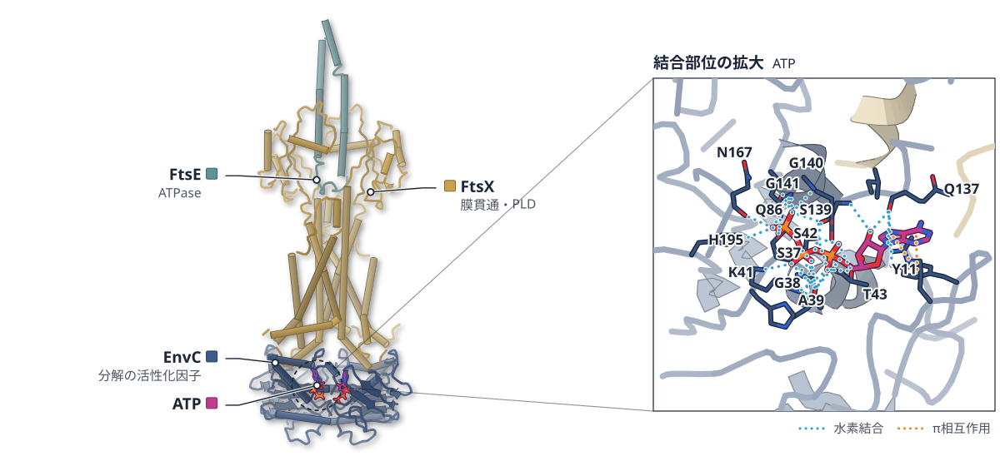

色（順に）：EnvC（分解の活性化因子） / FtsX（膜貫通・PLD） / FtsE（ATPase）　スティック：ATP

**対称な大腸菌FtsEXが、非対称なEnvCを受け止める**

ATP結合状態の構造をクライオ電顕で解析。柔らかいループが相手の形に合わせて結合する

- **疑問・課題**：大腸菌でFtsEXとEnvCが細胞壁の分解をどう制御するかは、構造から調べられていなかった。
- **アプローチ**：ATP類似体を結合したFtsEXと、EnvCとの複合体を、ペプチディスクに再構成してクライオ電顕で解析した。
- **結果**：FtsEXは3.7 Å、EnvCとの複合体は3.4 Åの構造が得られた。EnvCが結合しても、2つのPLDは対称のままだった。
- **わかったこと**：柔軟なループと疎水性の接触により、対称なFtsEXが非対称なEnvCに対応すると考えられる。
- **残された課題**：EnvC・AmiBとの全体の複合体は、クライオ電顕で明瞭な密度図が得られなかった。

この紹介文の根拠（論文本文）

> the structural intricacies governing PG degradation by the FtsEX complex and EnvC in Escherichia coli cytokinesis remain unexplored  
> — 疑問・課題／Abstract

> we subjected the WT EcoFtsEX sample, incubated with 3 mM ATPγS, to single-particle cryo-EM analysis and achieved a resolution of 3.7 Å  
> — アプローチ／Results

> purified FtsEXE163Q mutant was reconstituted in peptidiscs and incubated with EnvC in the presence of 2 mM ATP for cryo-EM analysis  
> — アプローチ／Results

> a major conformation stands out with resolution determined at 3.4 Å  
> — 結果／Results

> even when bound to the asymmetrical EnvC, FtsEX—including its two PLD domains interacting directly with EnvC—maintains a symmetrical conformation  
> — 結果／Results

> Thus, our data suggest that the flexible loops, along with the hydrophobic interactions they facilitate, equip the symmetrical FtsEX to effectively engage with asymmetrical partners.  
> — わかったこと／Results

> The attempt to obtain a cryo-EM structure of the complex was also unsuccessful, possibly because of its inherent flexibility, preventing the reconstruction of a clear EM map.  
> — 残された課題／Results

分類：トランスポーター・感染・ウイルス・防御系

#### 読みどころ

ATPγS、AMP-PNP、ADPでも複合体が安定になり、FtsEの加水分解できないE163Q変異体でも安定だった。安定化にはATPの加水分解でなく結合で足りる。EnvCが加わるとATPase活性は約2.2倍になる。

根拠（論文本文）

> it indicates that ATP binding, rather than hydrolysis, is sufficient for complex stabilization  
> — Results

> in the presence of EnvC, the Vmax (92.7±5.1 nmol/mg/min) was approximately 2.2-fold higher than that observed for FtsEX (42.7±2.1 nmol/mg/min) alone  
> — Results

既報の結晶構造（6TPI）ではPLDが非対称で、EnvCのコイルドコイルが開いていた。今回の構造ではコイルドコイルのヘリックス間が24 Åから10 Åに縮み、LytMドメインの密度も見えない。著者はATPの存在下でLytMが放出されると推測している。

根拠（論文本文）

> the distance between the terminal residue of the α1 helix (Q127) and the initial residue of the α2 helix (Q143) within the CCD domain is reduced from 24 Å to a mere 10 Å  
> — Results

> Together, we hypothesize that in the presence of ATP, the LytM domain is released, facilitating AmiB recruitment.  
> — Results

FtsEX・EnvC・AmiBの複合体をネガティブ染色で観察すると、膜から約290 Å伸びた棒状の像が得られた。緑膿菌の系と同様の伸びた形で、活性化状態に近いと著者は考えるが、分解活性は確かめられていない。

根拠（論文本文）

> extending about 290 Å into the periplasm, which we attribute to the bound EnvC and AmiB  
> — Results

> A 2D classification analysis presented an elongated structure, mirroring previous observations in P. aeruginosa  
> — Results

#### 構造データ

| PDB | 手法 | 分解能 | 公開 | 生物種 | リガンド |
|---|---|---|---|---|---|
| [8W6I](https://www.rcsb.org/structure/8W6I) | Cryo-EM | 3.70 Å | 2023-12-20 | Escherichia coli K-12 | AGS |
| [8W6J](https://www.rcsb.org/structure/8W6J) | Cryo-EM | 3.40 Å | 2023-12-20 | Escherichia coli K-12 | ATP |

#### 実験メモ

- **発現系**：大腸菌BL21(DE3) pLysSで発現し、IPTGで誘導。
- **コンストラクト**：His6タグ付きの全長FtsEXと、ATPを加水分解できないFtsE E163Q変異体。
- **精製**：DDMで膜を可溶化し、TALON樹脂上でペプチディスクに再構成。Superose 6でゲル濾過。精製の全過程で2 mM ATP/MgCl2を維持。
- **結晶化／グリッド作製**：3 mg/mlの試料をQuantifoilグリッドに載せ、ATPγS（FtsEX）またはATP（E163Q/EnvC）とともに37 °Cで8分置いてから凍結。
- **データ収集・解析**：Titan KriosとK3検出器、SerialEMで収集（ピクセル1.06 Å）。cryoSPARCで処理。

根拠（論文本文）

> FtsEX and its mutants are expressed in E. coli strain BL21(DE3) pLysS (Invitrogen) using lysogeny broth (LB)  
> — Methods

> to produce pTD68 [PT7::his6-FtsEX]  
> — Methods

> Mutations to EcoFtsE were generated utilizing the QuikChange kit (Agilent Technologies)  
> — Methods

> solubilization of the membrane takes place in buffer B, containing 50 mM Tris-HCl, 250 mM NaCl, 1.3% DDM, pH 8.0, 10% glycerol, and 2 mM ATP/MgCl2  
> — Methods

> The purified protein was directed through a gel filtration chromatography column (Superose 6 increase 10/300)  
> — Methods

> the sample was incubated at 37°C for 8 minutes with 3 mM ATPγS-2 mM Mg2+ (FtsEX)  
> — Methods

> which corresponded to a calibrated pixel size of 1.06 Å on the specimen level  
> — Methods

> For electron microscopy (EM) data processing, CryoSPARC (Punjani et al., 2017) was utilized.  
> — Methods

> 📝 編集者への確認事項：PDB 8W6I・8W6J は引用情報なし（寄託情報から対応づけ）。凡例の順は 8W6J のポリマー順（EnvC, FtsX, FtsE）と仮定したので、描画後に確認が必要。緑膿菌FtsEXの既報構造があり、初構造とは書かれていない。

---

## 7｜HCN112／HCN1ΔC（ヒト）

### Structural basis of isoform-specific cAMP regulation and autoinhibition in hyperpolarization-activated cyclic nucleotide-gated channels

*The Journal of Biological Chemistry*（2026-09-23） · [論文](https://doi.org/10.1016/j.jbc.2026.113589) · ライセンス: cc by

筆頭著者：Valentina Zorzini（Belgium）　責任著者：Chris Ulens（Belgium）

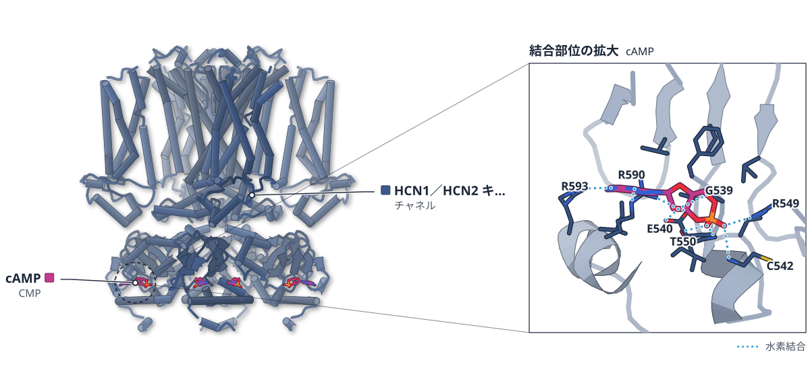

色（順に）：HCN1／HCN2 キメラ（チャネル）　スティック：cAMP（CMP）

**HCN2の細胞質ドメインを移したチャネルは、縮んだ形をとる**

キメラとCNBD欠失体の構造から、cAMP応答と自己抑制を調べた

- **疑問・課題**：HCN2はcAMPに強く応答するがHCN1はほとんど応答せず、その構造上の理由は十分に分かっていなかった。
- **アプローチ**：HCN1にHCN2のC-リンカーとcAMP結合ドメイン（CNBD）を移したHCN112と、細胞質側を欠くHCN1ΔCをクライオ電顕で解析した。
- **結果**：HCN112は膜に垂直な方向に約3.5 Å縮み、サブユニット間の結合が増えた。HCN1ΔCはゲートの細孔半径が1 Åから約2.5 Åに広がった。
- **わかったこと**：縮んだ配置がHCN2でcAMPが効きやすい一因かもしれない。細胞質側を欠くと細孔が中間的に開くことから、野生型ではCNBDが開口を抑えると考えられる。
- **残された課題**：構造だけでは縮みとcAMP感受性の因果は示せず、機能実験が必要だと論文は述べる。

この紹介文の根拠（論文本文）

> with isoform-specific cyclic AMP (cAMP) sensitivity remaining poorly understood  
> — 疑問・課題／Abstract

> While HCN2 exhibits strong cAMP regulation, HCN1 shows minimal response.  
> — 疑問・課題／Abstract

> One variant (HCN112) incorporates the C-linker and cyclic nucleotide-binding domain from HCN2 into the HCN1 backbone  
> — アプローチ／Abstract

> we analyzed two engineered HCN1 variants using cryo-electron microscopy  
> — アプローチ／Abstract

> This compression amounts to ∼3.5 Å when measuring the distance from the top of the S5 helix (residue Q323) to the distal end of the CNBD (residue G547)  
> — 結果／Results

> at the gate residue Q398, the pore radius in HCN112 ligand-free is 1 Å, whereas in HCN1ΔC it increases to ∼2.5 Å  
> — 結果／Results

> We suggest that this compressed conformation is one of the reasons why cAMP works more efficiently in HCN2 than in HCN1 channels.  
> — わかったこと／Results

> supporting auto-inhibitory regulation by the cyclic nucleotide-binding domain in wild-type channels  
> — わかったこと／Abstract

> they do not establish a causal link to the enhanced cAMP sensitivity of HCN112  
> — 残された課題／Results

分類：イオンチャネル

#### 読みどころ

HCN112では膜貫通ドメインとCNBDが近づき、HCN1にはないサブユニット間の水素結合・塩橋が17個みられた。その大半は、cAMPの結合と開口を結びつけるとされるC-リンカーに集まっていた。

根拠（論文本文）

> However, most of the unique interactions in HCN112 between chain A and B are localized in the C-linker, a region that has been shown repeatedly to be important for coupling ligand binding to channel opening  
> — Results

> there are 17 inter-chain H-bonds and salt bridges in the ligand-free form of HCN112  
> — Results

cAMPが結合するとCNBDが回転してC-リンカーから離れ、この17個の大半が切れた。結合による相互作用の解消が開口を助ける可能性を著者は挙げるが、検証は今後の課題だ。

根拠（論文本文）

> Most of these interactions are broken in the cAMP-bound state except for three remaining H-bonds  
> — Results

> The largest conformational change upon cAMP-binding can be observed in the CNBD, which rotates and tilts away from the C-linker  
> — Results

C-リンカーとCNBDを丸ごと欠くHCN1ΔCは、細孔が中間的に開いた形だった。ただし膜貫通部分の分解能は限られ、側鎖の解釈には注意が要ると著者は述べる。

根拠（論文本文）

> In contrast, the truncated HCN1ΔC variant (lacking the cytoplasmic domain) displayed an intermediately open pore conformation  
> — Abstract

> Notably, the TMD of HCN1ΔC shows limited resolution, making detailed side-chain interpretation difficult  
> — Results

#### 構造データ

| PDB | 手法 | 分解能 | 公開 | 生物種 | リガンド |
|---|---|---|---|---|---|
| [9R1V](https://www.rcsb.org/structure/9R1V) | Cryo-EM | 3.53 Å | 2026-05-13 | Homo sapiens | — |
| [9R1T](https://www.rcsb.org/structure/9R1T) | Cryo-EM | 3.34 Å | 2026-05-27 | Homo sapiens | CMP |
| [9R1U](https://www.rcsb.org/structure/9R1U) | Cryo-EM | 3.92 Å | 2026-05-13 | Homo sapiens | — |

#### 実験メモ

- **発現系**：HEK293S GnTI−細胞にバキュロウイルス（BacMam）で発現した。
- **コンストラクト**：HCN1EMを土台に、HCN1のMet1–Leu400にHCN2のAsp401–Leu658をつないだHCN112と、Met1–Asp401までのHCN1ΔCを作った。
- **精製**：LMNG＋CHSで可溶化し、GFPナノボディ樹脂で捕捉してPreScissionでタグを切り、Superose 6でゲルろ過した。
- **結晶化／グリッド作製**：cAMP結合型は3.5 mg/mlのHCN112に0.4 mMのcAMPを加え、AuFoilグリッドにVitrobot IVで凍結した。
- **データ収集・解析**：Titan Krios（300 keV）で撮影し、cryoSPARCでC4対称を課して精密化した。

根拠（論文本文）

> The different HCN constructs were expressed in HEK293S GnTI− cells (Goehring et al., 2014)  
> — Methods

> HCN1ΔC corresponds to the HCN1 gene covering the sequence between Met1-Asp401, with a deletion that spans the entire C-terminal region.  
> — Methods

> The supernatant was incubated with the GFP nanobody-coupled sepharose resin prepared in-house  
> — Methods

> 0.4 mM cAMP was added to 3.5 mg/ml HCN112 in order to perform single particle analysis on the HCN112 cAMP-bound sample.  
> — Methods

> During refinement, C4 symmetry was imposed in all datasets.  
> — Methods

> 📝 編集者への確認事項：UniProt への対応づけがなく proteins が空のため、New/Update の振り分けはサイト側の判定に任せた（論文は HCN1・HCN4 の既存構造に触れており、初構造とは書いていない）。HCN112 は人工キメラ、HCN1ΔC は人工の欠失体。legend_labels は 9R1T のエンティティ数が未確認のため書いていない（描画後に確認が必要）。

---

## 8｜c-di-GMP-IIリボスイッチ変異体

### Molecular basis for discrimination of cGAMP linkage isomers by a c-di-GMP-II riboswitch variant

*Proceedings of the National Academy of Sciences of the United States of America*（2026-10-20） · [論文](https://doi.org/10.1073/pnas.2621568123) · ライセンス: cc by-nc-nd

筆頭著者：Xiaochen Xu（Zhejiang University, China）　責任著者：Dinshaw J. Patel（Memorial Sloan-Kettering Center）、Aiming Ren（Zhejiang University, China）

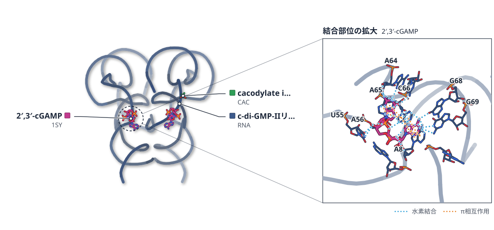

色（順に）：c-di-GMP-IIリボスイッチ（RNA）　スティック：2′,3′-cGAMP（1SY）、cacodylate ion（CAC）

**RNAは、cGAMPの異性体を結合の向きで見分ける**

リボスイッチ変異体の結晶構造では、2種のcGAMPで塩基が逆向きに入り、A64・G68との接し方が変わる

- **疑問・課題**：RNAは、化学構造のよく似た小分子をどう見分けるのかが問われている。ここでは環状ジヌクレオチドの異性体が題材になった。
- **アプローチ**：c-di-GMP-IIリボスイッチの変異体と2′,3′-cGAMP・3′,3′-cGAMPの結晶構造を決め、変異体のITCで結合を比べた。
- **結果**：2種のリガンドは同じポケットに入るが、塩基の向きが逆になり、A64・G68との相互作用が異なった。
- **わかったこと**：ポケットの構成が同じでも、リガンドの塩基の向きの違いで接し方が変わり、RNAは連結の異なる異性体を見分ける。
- **残された課題**：天然の2′,3′-cGAMP応答リボスイッチは、まだ見つかっていない。

この紹介文の根拠（論文本文）

> RNA is emerging as a prominent therapeutic target, raising a fundamental question of how RNA molecules specifically recognize small molecules with highly similar chemical structures.  
> — 疑問・課題／Introduction

> Here, we report the crystal structures of a c-di-GMP-II riboswitch variant, c-di-GMP-II-Bh, bound to 2′,3′-cGAMP and 3′,3′-cGAMP.  
> — アプローチ／Abstract

> Structural comparison together with ligand-binding assays of structure-guided mutants using isothermal titration calorimetry  
> — アプローチ／Abstract

> Unexpectedly, the two ligands adopt inverted orientations within the same binding pockets.  
> — 結果／Introduction

> However, the ligand bases adopt inverted orientations in the binding pocket, resulting in distinct interaction patterns with residues A64 and G68  
> — 結果／Abstract

> reveals the molecular principles by which an RNA riboswitch discriminates among cyclic dinucleotide linkage isomers  
> — わかったこと／Abstract

> Both complexes adopt a similar overall RNA scaffold with an identical binding pocket composition.  
> — わかったこと／Abstract

> However, a natural 2′,3′-cGAMP-responsive riboswitch has not yet been identified.  
> — 残された課題／Introduction

分類：DNA・RNA に関わるもの

#### 読みどころ

2′,3′-cGAMPではGMPが上、AMPが下に入り、GMPはA64と3本の水素結合を作る。3′,3′-cGAMPではAMPが上でA64と2本、GMPが下でG68と直接の水素結合を作る。

根拠（論文本文）

> In 2′,3′-cGAMP-bound structure, GMP occupies the upper position, stacking between A56 and A65.  
> — Results

> In contrast, in 3′,3′-cGAMP-bound structure, AMP occupies the upper position between A56 and A65, whereas GMP is located at the lower position between A65 and A8, and are thus designated Aα and Gβ, respectively  
> — Results

リガンドのリン酸骨格に隣り合うP2のA–U塩基対は、2′,3′-cGAMP結合型では標準のワトソン・クリック対になる。3′,3′-cGAMP結合型では塩基が傾き、水素結合は1本だけになる。

根拠（論文本文）

> The A–U base pair adjacent to the ligand phosphodiester backbone forms a canonical Watson–Crick base pair in 2′,3′-cGAMP-bound state  
> — Results

> In contrast, the deflected A and U bases form only one hydrogen bond in 3′,3′-cGAMP-bound state  
> — Results

A–U対をG–C対に替えたA9G/U55C変異体でも、リガンドの向きは変わらない。一方、ITCでは2′,3′-cGAMPの結合が強まり（Kd 460→139 nM）、3′,3′-cGAMPの結合は弱まる（11.1→33.4 nM）。親和性の差は41.8倍から4.2倍に縮まった。

根拠（論文本文）

> However, isothermal titration calorimetry (ITC) titration revealed that the A9G/U55C mutant exhibits increased binding affinity for 2′,3′-cGAMP (Kd decreased from 460 nM to 139 nM), while its binding affinity for 3′,3′-cGAMP is reduced (Kd increased from 11.1 nM to 33.4 nM).  
> — Results

> The orientations of the two bound ligands, 2′,3′-cGAMP and 3′,3′-cGAMP remain unchanged relative to the wild-type (WT) RNA.  
> — Results

#### 構造データ

| PDB | 手法 | 分解能 | 公開 | 生物種 | リガンド |
|---|---|---|---|---|---|
| [22MT](https://www.rcsb.org/structure/22MT) | X-ray | 2.15 Å | 2026-10-21 | Halalkalibacterium halodurans C-125 | 1SY, CAC |
| [22MX](https://www.rcsb.org/structure/22MX) | X-ray | 2.90 Å | 2026-10-21 | Halalkalibacterium halodurans C-125 | 1SY |
| [22MZ](https://www.rcsb.org/structure/22MZ) | X-ray | 1.70 Å | 2026-10-21 | Halalkalibacterium halodurans C-125 | 4BW |
| [22MW](https://www.rcsb.org/structure/22MW) | X-ray | 2.04 Å | 2026-10-21 | Halalkalibacterium halodurans C-125 | 4BW |

#### 実験メモ

- **発現系**：RNAはすべてin vitro転写で調製した。
- **結晶化／グリッド作製**：リガンドの存在下でRNAを再生し、16 °Cのシッティングドロップ蒸気拡散法で結晶化した。
- **データ収集・解析**：構造は分子置換で決めた。条件の詳細はSI Appendixにある。

根拠（論文本文）

> All RNAs were generated by in vitro transcription method.  
> — Materials and Methods

> For crystallization, RNAs were refolded in the presence of ligand and crystallized by sitting-drop vapor diffusion at 16 °C.  
> — Materials and Methods

> Structures were determined by molecular replacement.  
> — Materials and Methods

> 📝 編集者への確認事項：論文は『初めての構造』とは書いていない（候補にもタンパク質がない）ため Structure Update 扱い。PDB 4 件はいずれも引用なしの寄託として照合された。図は 2′,3′-cGAMP 結合型 22MT。原文は CC BY-NC-ND。

---

## 9｜HCV E2コア×抗体RM3-26

### The conserved bridging domain on HCV E1E2 glycoprotein complex is targeted by neutralizing antibodies from diverse lineages

*Cell reports*（2026-08-04） · [論文](https://doi.org/10.1016/j.celrep.2026.117760) · ライセンス: cc by-nc

筆頭著者：Fang Chen（Department of Immunology and Microbiology and the Scripps Research Institute, USA）　責任著者：Jiang Zhu, Mansun Law（Department of Immunology and Microbiology and the Scripps Research Institute, USA）、Ian A. Wilson（The Scripps Research Institute, USA）

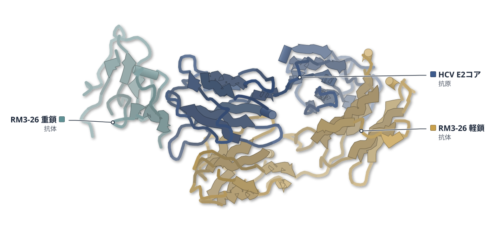

色（順に）：HCV E2コア（抗原） / RM3-26 軽鎖（抗体） / RM3-26 重鎖（抗体）

**サルの抗体は、ヒトの抗体と似た向きでHCVのE2に結合した**

BD抗体25種を調べ、RM3-26とE2コアの結晶構造を2.24 Åで決めた

- **疑問・課題**：C型肝炎ウイルス（HCV）のE1E2にある橋渡しドメイン（BD）を狙う抗体は、まだ十分に理解されていなかった。
- **アプローチ**：感染者とワクチン接種したサルから得たBD抗体25種の配列・エピトープ・中和能を調べ、サルの抗体RM3-26の結晶構造も決めた。
- **結果**：抗体は多様なB細胞系列に由来するが、CDRH3に共通のモチーフが現れ、抗原領域AR4とAR5にまたがるエピトープを認識した。
- **わかったこと**：RM3-26はE2の後ろ層（BL）に結合し、ヒトのhcab40と似た向きをとる。BDはワクチン設計の有望な標的だと論文は述べる。
- **残された課題**：結晶構造はE2コアとのもので、天然のE1E2上のBDは直接見えていない。

この紹介文の根拠（論文本文）

> but BD epitopes and their cognate bnAbs are still poorly understood  
> — 疑問・課題／Discussion

> we characterized the genetic, structural, functional, and epitope features of 25 BD-directed nAbs isolated from HCV-infected individuals or immunized macaques  
> — アプローチ／Abstract

> A crystal structure of the macaque nAb RM3-26 bound to E2 core domain  
> — アプローチ／Abstract

> These antibodies derive from diverse B cell lineages but frequently display recurrent CDRH3 motifs and recognize overlapping epitopes spanning antigenic regions AR4 and AR5  
> — 結果／Abstract

> reveals a BL-directed binding mode analogous to the human nAb hcab40  
> — わかったこと／Abstract

> Together, these findings underscore BD as a promising target for rational HCV vaccine design.  
> — わかったこと／Abstract

> the RM3-26 X-ray structure was determined using a soluble E2 core construct rather than the native membrane-associated E1E2 complex  
> — 残された課題／Limitations of the study

分類：免疫（抗体・MHC・TCR・自然免疫）・感染・ウイルス・防御系

#### 読みどころ

RM3-26とE2コアの界面は592 Å2と小さく、その97%を重鎖が占める。CDRH1とCDRH3がE2の後ろ層（614〜641番付近）に主に接する。

根拠（論文本文）

> The RM3-26-E2c3 interaction is almost entirely mediated by the antibody heavy chain, which accounts for 97% of the buried surface area  
> — Results

RM3-26とヒトのhcab40は結合の角度が約5°しか違わず、CDRH1のSGYモチーフがE2と同じように水素結合する。種の違う抗体が似た解を取っている。

根拠（論文本文）

> Among them, RM3-26 and hcab40 exhibited similar overall binding modes, with approach angles differing by only ~5° (Figure 5B).  
> — Results

> Both antibodies contain an SGY motif within CDRH1 that mediates hydrogen bonding  
> — Results

BD抗体は、中和面（NF）を狙う抗体と組み合わせると、培養細胞での偽ウイルスの中和が加算的に強まり、一部は相乗的だった。動物での防御効果は未評価だ。

根拠（論文本文）

> Combining antibodies targeting non-overlapping epitopes enhanced neutralization potency and breadth, with effects that were largely additive and, in some cases, exceeded Bliss independence predictions  
> — Results

> the protective efficacy of these new antibodies have not been evaluated in vivo  
> — Limitations of the study

#### 構造データ

| PDB | 手法 | 分解能 | 公開 | 生物種 | リガンド |
|---|---|---|---|---|---|
| [9MSK](https://www.rcsb.org/structure/9MSK) | X-ray | 2.23 Å | 2026-07-01 | Hepatitis C virus (isolate 1), Macaca mulatta | — |
| [9YJS](https://www.rcsb.org/structure/9YJS) | X-ray | 2.78 Å | 2026-07-01 | Homo sapiens | — |
| [9YK6](https://www.rcsb.org/structure/9YK6) | X-ray | 1.60 Å | 2026-07-01 | Homo sapiens | — |

#### 実験メモ

- **発現系**：FabはExpi293F細胞に重鎖・軽鎖のベクターを一過性に共導入して発現した。
- **コンストラクト**：E2c3は可変領域3を除いたE2コアで、412–459、486–568、598–645番の残基からなる。
- **精製**：CaptureSelect CH1-XLでFabを精製し、Superdex 200でゲルろ過した。
- **結晶化／グリッド作製**：H77 E2c3とRM3-26 Fabを1:1.2で混ぜ、ゲルろ過後に蒸気拡散法で結晶化した。
- **データ収集・解析**：APS・SSRL・NSLS-IIのビームラインで収集し、Phaser-MRによる分子置換で決定した。

根拠（論文本文）

> antibody Fab format was expressed by transient co-transfection of the Fab heavy- and light-chain expression vectors into Expi293 F cells  
> — Methods

> an E2 core domain variant comprising residues 412–459, 486–568, and 598–645  
> — Introduction

> Affinity chromatography using CaptureSelect CH1-XL affinity matrix (Thermo Fisher Scientific) was used to purify recombinant Fab from culture supernatant  
> — Methods

> H77 E2c3 protein was mixed with RM3-26 Fab in a 1:1.2 molar ratio and incubated overnight at 4°C.  
> — Methods

> Diffraction data were collected at synchrotron beamlines APS 23-ID-D, SSRL 12–1, and NSLS-II 17-ID-2  
> — Methods

> 📝 編集者への確認事項：PDB は 9MSK（RM3-26+E2c3、PDB 2.23 Å／論文 2.24 Å）のほか、抗体 Fab 単独の 9YJS（B098）・9YK6（B107）。E2 は既存の構造がある（6MEJ など）ので Structure Update の見込み。legend_labels の順は PDB の polymer 順（E2、軽鎖、重鎖）を仮定、描画後に確認が必要。CC BY-NC。

---

## 10｜GFRAL D3＋抗体Fab

### Induced-fit anti-GFRAL antibody ameliorates cancer cachexia and attenuates sympathetic outflow in tumor-bearing mice

*Science Advances*（2026-10-30） · [論文](https://doi.org/10.1126/sciadv.aee5992) · ライセンス: cc by-nc

筆頭著者：Sohyun Kim（Korea Advanced Institute of Science and Technology (KAIST), Republic of Korea）　責任著者：Minho Shong, Ho Min Kim（Korea Advanced Institute of Science and Technology (KAIST), Republic of Korea）

**抗GFRAL抗体は、GFRALの表面を作り替えてRETをふさぐ**

Fab–GFRAL D3の結晶構造（2.3 Å）が誘導適合を示し、悪液質のマウスで効果を確かめた

- **疑問・課題**：GDF15を標的にした治療はあるが、受容体GFRALを強く阻む拮抗薬は十分に得られていなかった。
- **アプローチ**：GFRAL D3に結合する抗体（GB2Ab）のFabとD3の複合体を結晶構造解析し、ヒト化抗体をがん悪液質のマウスで調べた。
- **結果**：結合でGFRALのヘリックスがループに変わり、疎水ポケットが現れた。KDは46 pM（親のマウス抗体）で、ヒト化抗体は摂食量と体重を回復させた。
- **わかったこと**：抗体が結合面を作り替える誘導適合で、高い親和性、遅い解離、RETとの結合面のブロックが説明されると著者は考える。
- **残された課題**：長期投与での治療域や神経免疫への影響は、今後の研究で調べる必要がある。

この紹介文の根拠（論文本文）

> which highlights an unmet need for potent and effective GFRAL-targeting antagonists  
> — 疑問・課題／Introduction

> we determined the crystal structure of the chimeric 17F5 Fab–hGFRAL D3 domain complex at 2.3 Å resolution  
> — アプローチ／Results

> we established an orthotopic MC38 cecal allograft model recapitulating the key features of CAC  
> — アプローチ／Results

> this shielding helix underwent a helix-to-loop transition, and the adjacent α3 helix was displaced  
> — 結果／Results

> (KD = 46 pM, kon = 1.3 × 105 M−1 s−1, koff = 5.8 × 10−6 s−1)  
> — 結果／Results

> 3D-hz-GB2Ab treatment progressively increased cumulative food intake  
> — 結果／Results

> reveals an induced-fit mechanism in which GB2Ab sterically occludes the GFRAL–RET interface and remodels the primary RET CLD1–CLD2 binding site, providing a structural basis for high-affinity binding, slow dissociation, and potent antagonism  
> — わかったこと／Abstract

> Nevertheless, longer-term studies will be needed to define the therapeutic window and potential neuroimmune consequences of GFRAL antagonism.  
> — 残された課題／Discussion

分類：免疫（抗体・MHC・TCR・自然免疫）・GPCR・受容体

#### 読みどころ

6つのCDRがすべて、D3のα1・α2・α3・α5にまたがる立体エピトープを認識する。結合でD3の疎水コアを覆う短いヘリックス（D255–T261）がループになり、α3がずれて深い疎水ポケットが露出した。

根拠（論文本文）

> All six CDRs from both heavy and light chains were shown to participate in the recognition of a conformational epitope spanning helices α1, α2, α3, and α5 of hGFRAL D3  
> — Results

> thereby exposing a deep hydrophobic pocket otherwise occluded  
> — Results

重鎖CDR3の3つのTyr（Y102–Y104）が、現れたポケットに深く入る。GB2AbはRETのCLD1–CLD2が触れる側を覆い、別の拮抗抗体（CLD2–CLD3の接合部側に結合する）とはエピトープが重ならない。

根拠（論文本文）

> A triad of tyrosine residues from the heavy-chain CDR3 (Y102, Y103, Y104) inserted deeply into the newly exposed hydrophobic pocket  
> — Results

> they recognize distinct, non-overlapping epitopes to block the GFRAL–RET interface  
> — Results

構造に基づくヒト化として、抗体のCDRを構造が最も近い抗ErbB2抗体（PDB 1L7I）の骨格に移し、配列ベースと比べた。戻し変異で、どちらもKD 0.2 nM台まで親和性が回復した。

根拠（論文本文）

> The second (novel structure-based) approach involved grafting the 17F5 CDRs onto the most structurally homologous human antibody framework (anti-ErbB2 antibody, PDB: 1L7I, RMSD = 1.4 Å)  
> — Results

> which successfully restored high-affinity binding with KD values of 0.23 nM and 0.25 nM, respectively  
> — Results

#### 構造データ

| PDB | 手法 | 分解能 | 公開 | 生物種 | リガンド |
|---|---|---|---|---|---|
| 9X4Y | — | — | 公開待ち | — | — |

#### 実験メモ

- **発現系**：Fabの重鎖・軽鎖は大腸菌Top10Fのペリプラズムで発現（0.02%アラビノース、28℃）。GFRAL D3はExpi293F細胞で発現した。
- **コンストラクト**：ヒトGFRAL D3は218–351残基。FabはキメラGB2Ab（マウスVH/VLにヒトCH1/CLを連結）。
- **精製**：FabはNi-NTAとSEC（Superdex 200 Increase）で精製した。
- **結晶化／グリッド作製**：FabとD3を1:2で混ぜてSECで複合体を分け、4 mg/mlに濃縮して18℃でハンギングドロップ蒸気拡散法で結晶化した。
- **データ収集・解析**：浦項加速器研究所5CでデータをとりHKL2000で処理。Phaserの分子置換（AlphaFold予測のFabと6Q2J）、COOTとPHENIXで精密化した。

根拠（論文本文）

> Protein expression was induced with 0.02% arabinose at an OD600 of 1.0, and the cells were further cultured for 18 h at 28°C  
> — Methods

> Purified chimeric 17F5 Fab and hGFRAL D3 were mixed at a 1:2 molar ratio and incubated overnight at 4°C.  
> — Methods

> Crystals were grown at 18°C using the hanging-drop vapor diffusion method  
> — Methods

> X-ray diffraction data were collected at the Pohang Accelerator Laboratory, Republic of Korea (beamline 5C).  
> — Methods

> initial phases were calculated using the molecular replacement technique with Phaser (v2.8.3)  
> — Methods

> 📝 編集者への確認事項：PDB 9X4Y は未公開のため図なし（method_label は本文の 2.3 Å）。ライセンスは CC BY-NC。マウス実験は結果の1行に留め、構造の読みどころを中心にした。論文の著者（Shong 教授）は THOR Therapeutics と関係があり、データ提供の記載にある。

---

## 11｜BeHepI（B. eggerthii）

### Functional characterization of a 3-O-sulfate tolerant heparin lyase from Bacteroides eggerthii

*Glycobiology*（2026-10-13） · [論文](https://doi.org/10.1093/glycob/cwag097) · ライセンス: cc by

筆頭著者：Taran K Kandola（Universiti Sains Malaysia）　責任著者：Mark A Skidmore（Universiti Sains Malaysia）、Liang Wu（The Rosalind Franklin Institute, United Kingdom）

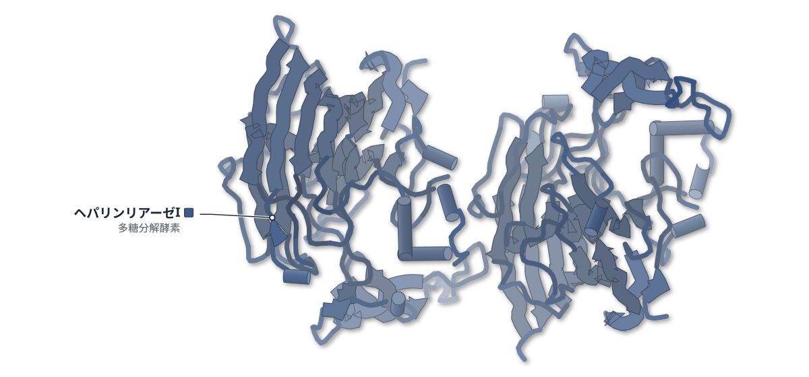

色（順に）：ヘパリンリアーゼI（多糖分解酵素）

**3-O-硫酸の隣も切れる、腸内細菌のヘパリン酵素**

X線結晶構造で切断後の二糖が活性部位に収まる様子を捉え、LC-MSとNMRの結果を裏づけた

- **疑問・課題**：ヘパリン分析の酵素は3-O-硫酸をもつ糖の近くをほとんど切れず、この部分の標準品を作りにくかった。
- **アプローチ**：B. eggerthii由来のヘパリンリアーゼI（BeHepI）が五糖フォンダパリヌクスをどう切るかを、LC-MS・NMR・結晶構造で調べた。
- **結果**：BeHepIは3-O-硫酸グルコサミンの手前も含む2か所を切った。従来のPhHepIは1か所だけだった。
- **わかったこと**：BeHepIは、3-O-硫酸をもつ標準品の調製に向くと著者は考えている。
- **残された課題**：ブタ粘膜ヘパリンから3-O-硫酸二糖を直接得られるかは、まだ確かめられていない。

この紹介文の根拠（論文本文）

> Pedobacter heparinus heparin lyases are currently widely employed for characterization of heparin and its derivatives, but have limited activity near regions of 3-O-sulfation, hindering analyses of anticoagulation relevant sequences.  
> — 疑問・課題／Abstract

> Here, using a panel of biophysical and structural techniques, we show that Bacteroides eggerthii lyase I liberates ΔUA-GlcNS3S6S disaccharides from the defined pentasaccharide, fondaparinux.  
> — アプローチ／Abstract

> consistent with cleavage at both A↓GA*↓IA-OMe to liberate A, GA* and IA-OMe respectively  
> — 結果／Results and discussion

> indicating single cleavage at AGA*↓IA-OMe  
> — 結果／Results and discussion

> Such activity likely renders BeHepI better suited to the preparation of standards containing 3-O-sulfation, which will aid analyses of biologically important heparin/HS sequences.  
> — わかったこと／Results and discussion

> Whilst we have not unequivocally ascertained here whether BeHepI by itself can liberate 3-O-sulfated disaccharides from PMH  
> — 残された課題／Results and discussion

分類：酵素（その他）

#### 読みどころ

フォンダパリヌクスと反応させた結晶には、切断産物の不飽和二糖（GA*）が−1、−2サブサイトに見えた。3-O-硫酸はTyr93とLys99に配位し、切断で生じた二重結合の周りの密度は平面に近かった。

根拠（論文本文）

> 3-O-sulfate coordinated to Tyr93 and Lys99  
> — Results and discussion

> electron density for GA* within the BeHepI active site was highly planar across the C3–C4–C5 region, in line with β-eliminative formation of a π-bond  
> — Results and discussion

PhHepIの実験構造はなく、AlphaFold予測との比較では、BeHepIのループ2に8残基の伸長があり、活性部位を覆う陽性の蓋になっている。これが活性の差の一因かもしれないという推測にとどまる。

根拠（論文本文）

> Loop 2 of BeHepI also contains an eight amino acid extension compared to PhHepI, forming an elongated cationic lid that covers its active site.  
> — Results and discussion

> These differences may rationalize (in part) the improved activity of BeHepI against more negatively charged heparin/HS oligosaccharides carrying 3-O-sulfation  
> — Results and discussion

NMRで切断を時間を追って測ると、AGA*↓IAの結合はA↓GA*IAよりずっと速く切れた。3-O-硫酸の隣も切れるが、ほかの部位が優先される。

根拠（論文本文）

> Quantitation of ΔUA 1H peaks over time revealed that the AGA*↓IA-OMe site was cleaved substantially more rapidly than A↓GA*IA-OMe  
> — Results and discussion

#### 構造データ

| PDB | 手法 | 分解能 | 公開 | 生物種 | リガンド |
|---|---|---|---|---|---|
| [9GRW](https://www.rcsb.org/structure/9GRW) | X-ray | 1.85 Å | 2025-09-24 | Bacteroides eggerthii | — |
| [9GV9](https://www.rcsb.org/structure/9GV9) | X-ray | 1.72 Å | 2025-10-08 | Bacteroides eggerthii | — |

#### 実験メモ

- **発現系**：大腸菌C41(DE3) pLysSでpET-22b(+)から発現し、1 mM IPTGで誘導。
- **コンストラクト**：N末端のリーダー配列を除いた残基21–394（WP_004294077.1）。
- **精製**：HisTrap FF、サイズ排除（S75）、陽イオン交換（Resource S）の順。緩衝液に5 mM CaCl2を含む。
- **結晶化／グリッド作製**：2 M硫酸アンモニウム、0.1 M酢酸Na（pH 5.0）で結晶化。複合体はフォンダパリヌクスの粉末を結晶の滴に直接加え、5分後に回収。
- **データ収集・解析**：Diamond Light Sourceで収集。3IKWを探索モデルにMOLREPで位相を決め、REFMAC5で精密化。

根拠（論文本文）

> Transformed cells were grown to OD600 0.6–0.8, and induced with 1 mM IPTG.  
> — Methods

> lacking the N-terminal leader sequence (21–394), was inserted into pET-22b(+)  
> — Methods

> Initial protein capture was carried out by using a HisTrap FF column (Cytiva)  
> — Methods

> Further polishing was conducted by size-exclusion (Cytiva S75 16/600; 25 mM Tris, 100 mM NaCl, 5 mM CaCl2 pH 7.4 buffer) and ion-exchange  
> — Methods

> Well-diffracting crystals of BeHepI were grown and cryo-harvested from 2 M (NH4)2SO4, 0.1 M CH3CO2Na, pH 5.0.  
> — Methods

> Ligand complexes with fondaparinux were obtained by addition of ligand powder directly into drops containing crystals, followed by incubation for 5 minutes before harvesting.  
> — Methods

> Diffraction data was collected at Diamond Light Source (UK).  
> — Methods

> Structures were solved by molecular replacement with MOLREP (Vagin and Teplyakov 2010), using PDB 3IKW as a search model  
> — Methods

> 📝 編集者への確認事項：本文は apo を 1.7 Å、フォンダパリヌクス処理を 1.9 Å と書くが、PDB では 9GRW が 1.85 Å、9GV9 が 1.715 Å で逆になっている。数値は書かず PDB に任せた。3IKW（B. thetaiotaomicron の相同体）が既報。9GV9 は 3-O 硫酸二糖（GA*）が入った産物複合体。

---

## 12｜DTX4（ヒト）

### Structural and biophysical studies of human E3 ligase Deltex 4

*Biochemical Journal*（2026-10-27） · [論文](https://doi.org/10.1042/bcj20260406) · ライセンス: cc by

筆頭著者：Milan M. Fowkes（University of Oxford）　責任著者：Milan M. Fowkes, Jonathan M. Elkins（University of Oxford）

**DTX4のRINGは、結晶中でドメインを入れ替えた二量体を作る**

ADP-リボース結合型のRING-DTCを2.8 Åで解析し、ADP-リボースへの結合も測った

- **疑問・課題**：E3リガーゼDTX4が基質結合でどう働くかはほとんど分かっておらず、実験で決めた構造もなかった。
- **アプローチ**：DTX4のRING-DTCドメインをADP-リボースとの複合体で結晶化し、DTCドメインの結合を熱量測定で調べた。
- **結果**：RINGドメインの前半が隣の分子と入れ替わった二量体になっていた。DTCドメインはADP-リボースに結合し（KD 44.9 μM）、ADPには結合しなかった。
- **わかったこと**：DTX4のDTCドメインはDTX1・DTX2と同様にADP-リボースを認識する。RINGのドメインスワップが働きに関わるかは未確定だ。
- **残された課題**：二量体が溶液中や細胞内でも生じ、機能を持つのかは分かっていない。

この紹介文の根拠（論文本文）

> However, little is known about the role of the DTX E3 ligase DTX4 in substrate binding and ubiquitination.  
> — 疑問・課題／Abstract

> no experimental protein structures for DTX4 have been published to date  
> — 疑問・課題／Introduction

> we present the crystal structure of the DTX4 RING-DTC domains in complex with ADP-ribose to a final resolution of 2.8 Å  
> — アプローチ／Abstract

> We then analysed its binding to ADP-ribose and ADP using ITC  
> — アプローチ／Results

> with the N-terminal portion of the RING domain (residues 383–428) bound to an adjacent DTX4 molecule in the crystal lattice  
> — 結果／Results

> The DTX4 DTC domain bound ADP-ribose with a KD of 44.9 μM.  
> — 結果／Results

> Conversely, we did not detect binding of the DTC domain to ADP.  
> — 結果／Results

> the data indicate that the DTC domains of DTX4, DTX1 and DTX2 recognise and bind to ADP-ribose  
> — わかったこと／Results

> Overall, the DTX4 RING-DTC domains exist in the crystal as a dimer formed by the extensive RING domain interactions  
> — わかったこと／Results

> We cannot, however, rule out that dimerisation may have been promoted by the effects of buffer composition in the crystallisation experiment or that it could be promoted by other factors present in a cellular environment and therefore have functional relevance.  
> — 残された課題／Results

分類：酵素（その他）

#### 読みどころ

DTX4で初めて報告された構造。RINGドメインの前半（383–428）が結晶中の隣のDTX4分子と結合し、亜鉛イオン1個が2つの分子の残基で配位されていた。

根拠（論文本文）

> we have described the first structure of the catalytic domains of the DTX E3 ligase DTX4, discovering a distinctive domain swap within the RING domain  
> — Discussion

> with one Zn2+ ion coordinated by residues from two different DTX4 molecules  
> — Results

入れ替わりは、DTX4のループ（422–428）がDTX1より2残基短いために可能になると著者は述べる。ただしゲルろ過では約32 μMまで単量体で、二量体は結晶化の高濃度で生じた可能性がある。

根拠（論文本文）

> The formation of the dimer is made possible by DTX4 possessing a loop (residues 422–428) that is two amino acids shorter than the equivalent loop in DTX1  
> — Results

> at analytical SEC concentrations of up to 32 μM the protein is monomeric, while at the higher concentrations achieved during the vapour diffusion crystallisation process dimerisation is possible  
> — Results

二量体のRINGをE2~Ub複合体の模型に重ねても、E2の結合面はふさがれない。一方、ADP-リボースの3'OHとユビキチン側の結合との距離は11.0 Åで、DTX2の7.7 Åより長い。結晶中の詰まり方の影響が大きい可能性もある。

根拠（論文本文）

> This showed that the domain-swapped DTX4 RING domain does not occlude the E2 binding surface.  
> — Results

> the 3′ OH of the ADP-ribose acceptor was located 11.0 Å from the isopeptide bond of the ubiquitin donor  
> — Results

> the difference in distance is likely strongly influenced by crystal packing  
> — Results

#### 構造データ

| PDB | 手法 | 分解能 | 公開 | 生物種 | リガンド |
|---|---|---|---|---|---|
| 30XN | — | — | 公開待ち | — | — |

#### 実験メモ

- **発現系**：ヒトDTX4のGln383–Asp619を、His6-TEVタグ付きで大腸菌に発現した。
- **コンストラクト**：RING-DTCドメイン（383–619）。複数の切り詰めのうち2つだけがタンパク質を発現した。
- **精製**：Ni-IMACでタグ付きタンパク質を精製し、TEVでタグを外して再びNi-IMACにかけ、Superdex 75のSECで精製した。
- **結晶化／グリッド作製**：10 mg/mlのタンパク質を1.5 mMのADP-リボースと氷上で10分混ぜ、Morpheus fusionスクリーンのH11の条件で結晶を得た。
- **データ収集・解析**：Diamond Light SourceのI03でデータを集め、XDSとAIMLESSで処理し、DTX1の構造を鋳型にPhaserの分子置換、REFMAC5で精密化した。

根拠（論文本文）

> Litre-scale expression of the DTX4 construct spanning residues Gln383 to Asp619  
> — Results

> DTX4 RING-DTC domain (10 mg/ml) was incubated with ADP-ribose (1.5 mM) in gel filtration buffer  
> — Methods

> They were then purified by SEC on a Superdex 75 16/600 column  
> — Methods

> X-ray diffraction data were then collected at Diamond Light Source, beamline I03.  
> — Methods

> Molecular replacement was performed in Phaser [43] using the structure of the RING-DTC domain of DTX1 bound to NAD+ (PDB: 6Y5P) as a search model.  
> — Methods

> 📝 編集者への確認事項：PDB 30XN は未公開（candidates では unreleased）のため図なし。method_label は本文の 2.8 Å による。DTX4 に PDB の既存構造がなかったかは UniProt 照合ができず、初構造は論文の記述（the first structure of the catalytic domains of ... DTX4）による。ドメインスワップは結晶中の二量体で、溶液中では単量体と著者が書いているので、見出しは「結晶中で」とした。

---

## 13｜PKA（ハムスター）

### Subpocket-Aware Fragment-Based Docking Pipeline for Kinase Ligand Design: Methodology and a PKA Case Study

*Journal of Chemical Information and Modeling*（2026-10-15） · [論文](https://doi.org/10.1021/acs.jcim.6c01373) · ライセンス: cc by

筆頭著者：Katharina Buchthal（Saarland University, Germany）　責任著者：Wibke E. Diederich（Philipps-Universität Marburg, Germany）、Andrea Volkamer（Saarland University, Germany）

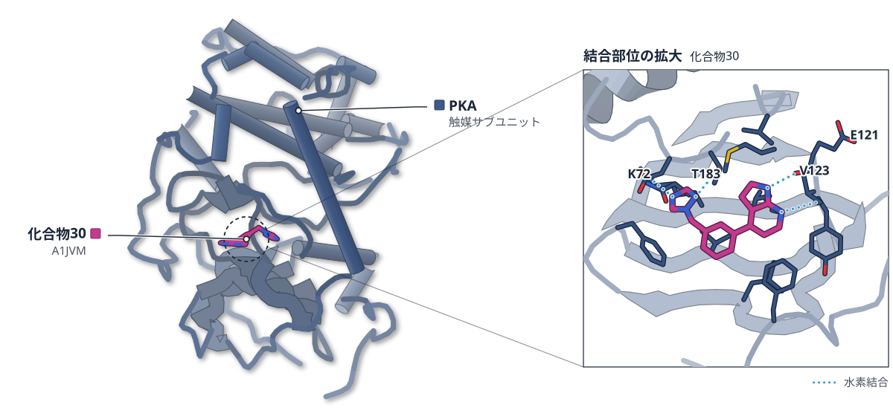

色（順に）：PKA（触媒サブユニット）　スティック：化合物30（A1JVM）

**合成した15化合物のうち5つが、PKAをナノモルで阻害した**

断片をサブポケットごとに成長させる計算法で設計し、最も強い化合物の結晶構造が予測とよく重なった

- **疑問・課題**：断片を使うキナーゼ阻害剤の設計は、キナーゼ特有の構造情報を生かしにくい。断片の全組み合わせを調べるのも計算が重い。
- **アプローチ**：キナーゼ向けの断片ライブラリKinFragLibを、サブポケットの情報を使うテンプレートドッキングで段階的に成長させ、PKAに適用した。
- **結果**：33758分子を生成し、合成した15化合物のうち5つのIC50が2〜3桁のナノモルだった。最小は58 nMだった。
- **わかったこと**：最も強い化合物の結晶構造は予測の結合様式とよく重なり、著者は構造に基づく断片設計を拡張できる探索法とみている。
- **残された課題**：キナーゼ選択性は調べておらず、今後キナーゼパネルでの評価が必要だ。

この紹介文の根拠（論文本文）

> Fragment-based drug design offers a powerful route to kinase inhibitors but often neglects kinase-specific structural insights.  
> — 疑問・課題／Abstract

> exhaustive recombination of its fragments is computationally demanding  
> — 疑問・課題／Abstract

> Here, we present an efficient exploration strategy that integrates subpocket-guided fragment growing with template docking to navigate this vast chemical space.  
> — アプローチ／Abstract

> Applied to the PKA kinase, the approach produced 33758 candidate molecules with promising docking scores, of which 15 were synthesized.  
> — 結果／Abstract

> The IC50 determination ultimately revealed that five of the molecules were effective in the two- to three-digit nanomolar range.  
> — 結果／Abstract

> X-ray crystallography of the most active compound confirmed substantial overlap between the predicted and experimental binding modes.  
> — わかったこと／Conclusion

> This methodology demonstrates how structure-informed guidance can transform fragment-based design into a scalable route for discovering novel kinase inhibitors.  
> — わかったこと／Abstract

> A limitation of the present study is that kinase selectivity was not explicitly studied.  
> — 残された課題／Conclusion

> Future work should therefore include profiling of generated compounds against representative kinase panels to assess selectivity  
> — 残された課題／Conclusion

分類：キナーゼ

#### 読みどころ

ATP結合部位を6つのサブポケットに分け、アデニン結合部位（AP）を核に、FP、GAの順に断片を足していく。各段階で上位の候補だけを残すビーム探索で、128 CPUを使い約17時間で約6万分子を列挙した。

根拠（論文本文）

> we selected the AP subpocket as the core and defined a fragment-growing path through the FP and GA subpockets  
> — Results and Discussion

> The growing process employs a beam search technique, a greedy algorithm to heuristically solve optimization problems.  
> — Introduction

> The total runtime in this setup was approximately 17 h with close to 60000 enumerated molecules.  
> — Results and Discussion

合成した15化合物のうち7つが100 μMでPKA活性を半分以下にし、5つが10 μMで残存活性約25%以下だった。IC50は化合物30の58 nMから39bの940 nMまで。ただし試した化合物は計算上位から人が選んだもので、偏りのない標本ではない。

根拠（論文本文）

> Prescreening at an inhibitor concentration of 100 μM revealed that seven of the 15 compounds tested met our cutoff criterion of reducing kinase activity by significantly more than 50%  
> — Results and Discussion

> In total, five compounds showed promising activity at a concentration of 10 μM, exhibiting residual kinase activity of approximately 25% or less.  
> — Results and Discussion

> therefore do not represent an unbiased sample of the ranked compound set  
> — Results and Discussion

化合物30との共結晶構造（9TEC、1.38 Å）では、リガンドは予測の結合様式とよく重なった。Lys72とThr183の側鎖、Glu121とVal123の主鎖と4本の水素結合を作る。予測にないPhe54とのT字型π–π相互作用も見えた。

根拠（論文本文）

> the crystallized ligand matches the predicted docking pose well  
> — Results and Discussion

> Additionally, a T-shaped π–π interaction involving phenylalanine 54 can be observed in the X-ray structure.  
> — Results and Discussion

#### 構造データ

| PDB | 手法 | 分解能 | 公開 | 生物種 | リガンド |
|---|---|---|---|---|---|
| [9TEC](https://www.rcsb.org/structure/9TEC) | X-ray | 1.38 Å | 2026-10-28 | Cricetulus griseus | A1JVM |

#### 実験メモ

- **発現系**：CHO-PKAを大腸菌で発現した。SLB培地で291.15 K、一晩培養した。
- **コンストラクト**：7xHisタグつきのPKAを使い、TEVプロテアーゼでタグを切った。
- **精製**：Ni-NTAカラム、TEV処理後の再カラムの後、Mono Sの陽イオン交換でリン酸化の程度の違うPKAを分けた。
- **結晶化／グリッド作製**：PKA、PKI、リガンドを混ぜ、微小結晶シーディングを併用して277 Kのシッティングドロップ法で結晶化した。
- **データ収集・解析**：DESYのP13で1.38 Åのデータを集め、5N1Fを鋳型に分子置換した。XDSAPPで処理し、Phenixで精密化した。

根拠（論文本文）

> Expression was carried out in SLB media overnight at 291.15 K.  
> — Materials and Methods

> The eluted protein was treated with TEV protease for 48 h to cleave the 7xHis-tag, followed by affinity chromatography again.  
> — Materials and Methods

> the phosphorylation levels of CHO-PKA were separated by cation exchange chromatography (Mono S, Cytiva) with increasing NaCl gradient (2.5 mM to 500 mM).  
> — Materials and Methods

> Microseed matrix screening was performed on a sitting drop 24-well crystallization plate at 277 K.  
> — Materials and Methods

> The data set was collected at beamline P13 from the electron storage ring DESY Hamburg, Germany on an EIGER 16M pixel detector with a resolution of 1.38 Å.  
> — Materials and Methods

> Molecular replacement was then performed with Phaser MR and a modified PDB structure of PKA from cricetulus griseus (PDB code: 5N1F)  
> — Materials and Methods

> 📝 編集者への確認事項：PKA はすでに多数の PDB 構造があり、9TEC は新しいリガンドとの複合体（Structure Update）。論文の中心は計算手法で、自前の結晶構造 1 件が予測の検証。IC50 は人の PKA（Eurofins）、スクリーニングはハムスター PKA。9TEC の PDB 登録は本文では『公開後に利用可』と書かれているが candidates では公開済み。

---

## 14｜PGK1（ヒト）

### Terazosin Activates or Inhibits Human Phosphoglycerate Kinase 1 on a Dose-Dependent Basis: Mechanistic and Structural Insights by NMR

*JACS Au*（2026-09-24） · [論文](https://doi.org/10.1021/jacsau.6c00823) · ライセンス: cc by

筆頭著者：Matthias Bütikofer（Institute for Molecular Physical Science, Switzerland）　責任著者：Roland Riek（Institute for Molecular Physical Science, Switzerland）、Julien Orts（University of Vienna, Austria）

**テラゾシンは、PGK1が閉じるのを妨げて開いた状態に保つ**

NMR滴定と、NOEだけで決めたNMR²構造が、X線構造と同じ結合部位を溶液中で示した

- **疑問・課題**：テラゾシンは低濃度でPGK1の働きを高め、高濃度で抑えるが、X線構造の結合部位はADPと一部重なっていた。
- **アプローチ**：NMR滴定でPGK1の開閉を追い、リガンドとタンパク質の間のNOEだけで複合体の構造を決めるNMR²法を使った。
- **結果**：テラゾシン（Kd 13 μM）はADPで閉じたPGK1を開く方向へ戻した。NMR²構造はX線構造と同じ結合様式に収束した。
- **わかったこと**：テラゾシンは別の結合部位でなく、通常の活性部位でPGK1の開閉の平衡を変えて働くと、論文は結論している。
- **残された課題**：テラゾシンの中央部（ピペラジン環）には、距離の拘束が直接得られていない。

この紹介文の根拠（論文本文）

> Despite this, terazosin enhances ATP production at low concentrations and acts as an inhibitor at higher concentrations.  
> — 疑問・課題／Introduction

> terazosin binds in the nucleotide binding domain with partial overlap of the ADP binding site, suggesting direct competition  
> — 疑問・課題／Introduction

> we use chemical shift perturbation analysis and solution NMR structure calculation using NMR2  
> — アプローチ／Introduction

> NMR2 is a method that determines the three-dimensional structure of a small-molecule ligand bound to a protein from intermolecular NOE-derived distance restraints alone, without requiring full resonance assignment of the protein.  
> — アプローチ／Introduction

> The binding affinity using peak E318 for ADP and terazosin was measured to be 105 ± 25 μM and 13 ± 7 μM, respectively  
> — 結果／Results and Discussion

> indicating that a reversed transition is induced by terazosin addition  
> — 結果／Results and Discussion

> The structure converges on the same binding mode observed in the X-ray structure of the terazosin complex (4O33)  
> — 結果／Results and Discussion

> Together, these findings establish that terazosin’s functional effects arise from modulation of conformational equilibria within the canonical active site rather than from binding at an alternative site.  
> — わかったこと／Conclusion

> leaving the middle portion of terazosin without direct distance restraints  
> — 残された課題／Results and Discussion

分類：酵素（その他）

#### 読みどころ

テラゾシンはADPと同じヌクレオチド結合ドメインに結合し、3PG-MgF3−とADPで閉じたPGK1のスペクトルを、開いた状態のパターンへ戻した。低濃度で産物の放出を助け、高濃度で競合阻害する機構と合う。

根拠（論文本文）

> indicating that a reversed transition is induced by terazosin addition  
> — Results and Discussion

> support the idea of a mechanism in which terazosin facilitates product release by stabilizing the open conformation at low concentrations, while acting as a competitive inhibitor at higher concentrations  
> — Results and Discussion

NMR²は、タンパク質の全共鳴を帰属せず、リガンドとメチル基の間のNOEだけで構造を決める。44.5 kDaのPGK1に使い、Ala・Leu・Ile・Thrの選択的アンラベルで一部のメチル基を帰属して拘束を補った。

根拠（論文本文）

> NMR2 is a method that determines the three-dimensional structure of a small-molecule ligand bound to a protein from intermolecular NOE-derived distance restraints alone, without requiring full resonance assignment of the protein.  
> — Introduction

> we prepared 13C,15N labeled PGK1 samples with selectively unlabeled residues (alanine, leucine, isoleucine, threonine)  
> — Results and Discussion

NMR²構造（32PI）は、X線構造（4O33）とキナゾリン環・ピペラジン環の配置が近く、フラン環だけ少し傾く。溶液中で強く占有される別の結合部位の証拠はなかった。

根拠（論文本文）

> The NMR2 structure exhibits a slight displacement relative to the X-ray structure, with the quinazoline and the piperazine rings adopting similar conformations, while the furan ring shows a slight tilt.  
> — Results and Discussion

> with no evidence for a distinct, well-defined secondary binding site that would have been strongly populated under solution conditions  
> — Results and Discussion

#### 構造データ

| PDB | 手法 | 分解能 | 公開 | 生物種 | リガンド |
|---|---|---|---|---|---|
| 32PI | — | — | 公開待ち | — | — |

#### 実験メモ

- **発現系**：hPGK1-pET28aをBL21 star大腸菌のM9最少培地（15Nまたは15N,13C）で発現し、0.5 mM IPTG、25℃で誘導した。
- **コンストラクト**：選択的アンラベルは、培地にLeu・Ile・Thr（1 g/L）またはAla（0.5 g/L）を加えて行った。
- **精製**：ニッケル親和性精製、TEVでHisタグ除去、逆ニッケル親和性の後、PD10でNMR緩衝液に交換した。
- **結晶化／グリッド作製**：フィルターNOESYは、800 μMの13C,15N-hPGK1に1 mMのテラゾシンと1 mMの3PGを加えて測定した。
- **データ収集・解析**：900 MHzでフィルターNOESYを測定。NMR²は4O33を出発構造に計算し、HADDOCK 2.4で水中の精密化を行った。

根拠（論文本文）

> hPGK1 was recombinantly expressed using a hPGK1-PET28a vector in BL21 star Escherichia coli cells.  
> — Materials and Methods

> In the case of selective unlabeling, 1 g/L of leucine, isoleucine, or threonine, or 0.5 g/L of alanine was added to the culture before induction.  
> — Materials and Methods

> After reverse nickel affinity chromatography, the buffer was exchanged to NMR buffer  
> — Materials and Methods

> The F1-[13C,15N]-Filtered [1H,1H]-NOESY spectra were acquired with 800 μM 13C,15N-labeled hPGK1, 1 mM terazosin and 1 mM 3PG  
> — Materials and Methods

> Thereby, PDB 4O33 was used as starting structure.  
> — Materials and Methods

> The best resulting structure was submitted into HADDOCK 2.4 web portal water refinement tool.  
> — Materials and Methods

> 📝 編集者への確認事項：PDB 32PI は未公開のため図なし。新しい NMR 構造だが、既知の X 線構造 4O33 と同じ結合様式を溶液で確かめたもので、新規性は小さい（Structure Update 向き）。論文は『活性化は低濃度で産物放出が促進される』を既報のモデルと整合的としており、見出しは滴定で示された『開いた状態に保つ』に限った。

---

# Structure-Based Study

## 15｜MbnH（メタン酸化菌）

### Deciphering Inter-Heme Electron Transfer Pathways in a Diheme Peroxidase from Methane-Oxidizing Bacteria

*Journal of the American Chemical Society*（2026-10-10） · [論文](https://doi.org/10.1021/jacs.6c13740) · ライセンス: tdm

筆頭著者：Riley E. Stein（University of Illinois Urbana Champaign）

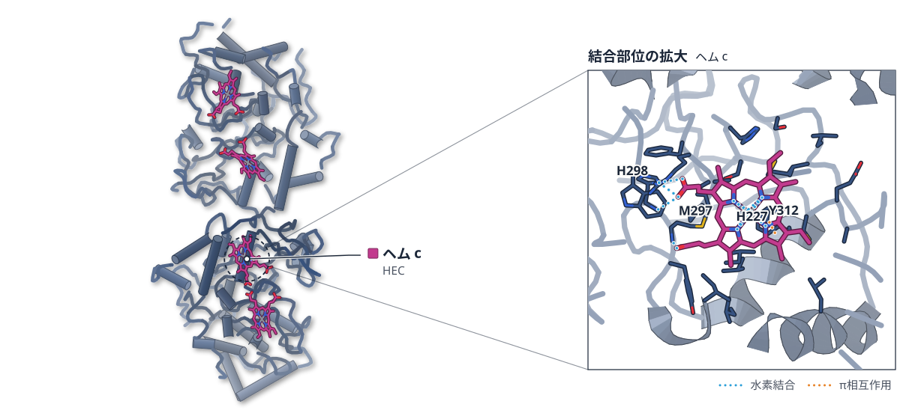

PDB 6E1C（論文が使った既存の構造）

色（順に）：Di-heme enzyme　スティック：ヘム c（HEC）

**二ヘム酵素の電子は、トリプトファンなしでも運ばれる**

MbnHの変異体解析で、ヘムのプロピオン酸基を通る別の電子の通り道が見えた

- **疑問・課題**：二つのヘムの間で電子を運ぶのに、間にあるトリプトファンは欠かせないのかが問われていた。
- **アプローチ**：既存のMbnH結晶構造（6E1C）で電子移動の経路を計算し、Trp113とArg283の変異体を分光と速度論で調べた。
- **結果**：Trp113かArg283の単独変異体はどれも野生型と同じ速度でbis-FeIVを作り、二重変異体W113H/R283Lだけが作れなかった。
- **わかったこと**：MbnHでは、Trp113を通る経路とヘムのプロピオン酸基を通る非共有結合の経路が重なって働き、片方が壊れても電子移動は保たれる。

この紹介文の根拠（論文本文）

> a tryptophan positioned between the two hemes has been proposed as the dominant pathway for inter-heme electron transfer in MauG and MbnH  
> — 疑問・課題／Abstract

> The structural principles governing this shared strategy for ET in bCcPs remain poorly understood.  
> — 疑問・課題／Introduction

> The crystal structure of MbnH (PDB 6E1C) was accessed from the PDB and the coordinates were fed into HARLEM  
> — アプローチ／Experimental

> we prepared a series of Trp mutants in which the native Trp113 residue was mutated to an Ala, Ser, His, Tyr, and Phe  
> — アプローチ／Results

> All mutants exhibited indistinguishable formation kinetics, with an average bimolecular rate constant of  
> — 結果／Results

> In contrast, in the W113H/R283L double mutant, we failed to observe a nIR band under identical conditions  
> — 結果／Results

> this work establishes that diheme peroxidases can rely on redundant electron transfer pathways, a Trp113-mediated route and an additional non-covalent route by leveraging the heme propionate  
> — わかったこと／Conclusions

分類：酵素（その他）

#### 読みどころ

経路計算では、野生型はTrp113を通る経路が最も強く結合した。Trp113を別の残基に替えると、Phe282・Arg283からヘムのプロピオン酸基へ抜ける経路が、同程度の結合の強さで現れた。

根拠（論文本文）

> In the WT protein, the intervening tryptophan, Trp113, is calculated to be the most coupled pathway irrespective of an electron tunneling or hopping mechanism  
> — Results

> Our HARLEM analysis identified a previously overlooked pathway, running through Phe282 and Arg283 to a heme propionate, with electronic coupling comparable to the canonical Trp113 pathway  
> — Discussion

Trp113とArg283の単独変異体はどれもbis-FeIVに特徴的な近赤外の吸収を示した。二重変異体W113H/R283Lだけはこの吸収が出ず、プロピオン酸経路と合わせて両方を壊すとbis-FeIVができなかった。

根拠（論文本文）

> All single point mutants at Trp113 and Arg283 generated the same spectral signatures of bis-FeIV formation as WT when reacted with hydrogen peroxide  
> — Results

> In contrast, in the W113H/R283L double mutant, we failed to observe a nIR band under identical conditions  
> — Results

bis-FeIVを作れる変異体だけが基質MbnPを修飾でき、二重変異体で共発現したMbnPの銅の結合は15%未満だった。bis-FeIVが基質修飾の触媒中間体だと示す結果だ。

根拠（論文本文）

> All MbnH mutants capable of forming bis-FeIV remain competent for substrate turnover, while the double mutant incapable of forming bis-FeIV is not, directly linking this high-valent state to substrate modification  
> — Results

> Copper-binding measurements corroborate this result.  
> — Results

#### 構造データ

| PDB | 手法 | 分解能 | 公開 | 生物種 | リガンド |
|---|---|---|---|---|---|
| [6E1C](https://www.rcsb.org/structure/6E1C) | X-ray | 2.62 Å | 2019-07-17 | Methylosinus trichosporium OB3b | HEC |

#### 実験メモ

- **発現系**：MbnPとMbnHを大腸菌BL21-star (DE3)に共発現し、18°Cで約15時間発現させた。
- **コンストラクト**：Trp113をAla・Ser・His・Tyr・Pheに、Arg283をLys・Leuに置換し、二重変異体W113H/R283Lも作った。
- **精製**：Strep-Tactin 4Flow樹脂で精製し、Superdex 200 pgのゲルろ過で仕上げた。
- **データ収集・解析**：UV-Vis-nIR分光とストップトフローで速度を測り、電子移動の経路計算はHARLEMで行った。

根拠（論文本文）

> was co-transformed into BL21-star (DE3) (Invitrogen) with the pEC86 plasmid  
> — Experimental

> Once the OD600 reached ~0.5, the temperature was reduced to 18 °C, and cells were allowed to express for ~15 hours.  
> — Experimental

> we prepared a series of Trp mutants in which the native Trp113 residue was mutated to an Ala, Ser, His, Tyr, and Phe  
> — Results

> The supernatant was first applied to a self-packed column of Strep-Tactin 4Flow resin (IBA) for the isolation of MbnH.  
> — Experimental

> The affinity column eluents were further purified and buffer exchanged with size-exclusion chromatography using a HiLoad 16/600 Superdex 200 pg (Cytiva)  
> — Experimental

> All UV-Vis-nIR spectra were collected on a Cary 3500 UV-Vis Spectrophotometer at ambient conditions.  
> — Experimental

> ET calculations were performed with HARLEM, a software developed by Kurnikov and coworkers.  
> — Experimental

> 📝 編集者への確認事項：新しい構造ではない。MbnH の既存の結晶構造 6E1C（2.6 Å）を電子移動経路の計算（HARLEM）に使い、変異体の分光・速度論で確かめた論文。実験データは分光・EPR・共鳴ラマンで、論文自身の構造決定はない。structure は 1 点（測った結果が既存構造の上で説明される）としたが、経路計算自体は計算である。

---

## 16｜シクロフィリンA（ヒト）

### Assessment of Attainable Distances in Proteins by Through‐Space 19F–19F Couplings

*Chemistry (Weinheim an Der Bergstrasse, Germany)*（2026-07-24） · [論文](https://doi.org/10.1002/chem.71456) · ライセンス: cc by

筆頭著者：Iker Hernández（University of the Basque Country (EHU), Spain）　責任著者：Angela M. Gronenborn（University of Pittsburgh School of Medicine, USA）

**19F–19F NOESYで、タンパク質中の約5 Å以内の距離が測れる**

シクロフィリンAに入れた二フッ素化トリプトファンで、F–F距離を小分子のX線構造と比べて確かめた

- **疑問・課題**：液体NMRでは、フッ素どうしの空間を通した結合を報告した例がほとんどなかった。
- **アプローチ**：二フッ素化トリプトファン3種をヒトシクロフィリンAに入れ、19F–19F NOESYの積み上がり曲線から交差緩和速度を求めた。
- **結果**：5,6位と4,5位の体では2.63〜2.73 Å、4,6位では4.26〜4.34 Åと求まった。前2者はX線構造の距離と誤差3%以内で合った。
- **わかったこと**：近い距離（2.5〜3.0 Å）は容易に測れ、14.1 Tでの上限は約5 Åだった。タンパク質どうしやリガンドとの相互作用の解析に使える可能性がある。
- **残された課題**：4,6位の体は距離が大きく、NOEは検出限界に近づいた。

この紹介文の根拠（論文本文）

> In liquids NMR, surprisingly, reports on through‐space 19F–19F coupling remain scarce.  
> — 疑問・課題／Abstract

> Three difluorinated tryptophan analogues (4,5‐F2‐Trp, 4,6‐F2‐Trp, 5,6‐F2‐Trp) were synthesized and site‐specifically incorporated into human cyclophilin A (CypA)  
> — アプローチ／Abstract

> Series of 19F–19F NOESY build‐up experiments were recorded for each labeled protein, and the extracted cross‐relaxation rates were compared to fixed reference distances.  
> — アプローチ／Abstract

> This compares to NMR‐derived distances of 2.68 and 2.73 Å for 5,6‐F2‐Trp and of 2.63–2.70 Å for 4,5  
> — 結果／Results and Discussion

> For 4,6‐F2‐Trp, the NMR‐derived distances were 4.26 Å and 4.34 Å, depending on the different normalizing procedures.  
> — 結果／Results and Discussion

> Depending on the fitting and normalization procedure used, errors ranged from ∼1–3% for 5,6‐F2‐Trp, 0–2% for 4,5‐F2‐Trp, and 8–9% for 4,6  
> — 結果／Results and Discussion

> While small distances in the 2.5–3.0 Å range were easily accessible, the upper limit at 14.1 T is ∼5 Å.  
> — わかったこと／Abstract

> These results provide evidence that short distances can be extracted from 19F–19F NOESY spectra, expanding the toolbox for studying protein‐protein or protein‐ligand interactions by NMR.  
> — わかったこと／Abstract

> inherently noisier, naturally reflecting the larger distance between these fluorine atoms on the indole ring with the resulting NOEs approaching the detection limit  
> — 残された課題／Results and Discussion

分類：酵素（その他）

#### 読みどころ

二フッ素化トリプトファン3種（4,5・4,6・5,6位）を化学合成し、Trpを1つだけもつCypAに部位特異的に入れた。インドール環の上でF–F距離が決まっているので、測定の基準になる。

根拠（論文本文）

> We decided to focus on di‐fluoro Trp amino acids since their defined geometry results in fixed fluorine  
> — Results and Discussion

> Three difluorinated tryptophan analogues (4,5‐F2‐Trp, 4,6‐F2‐Trp, 5,6‐F2‐Trp) were synthesized and site‐specifically incorporated into human cyclophilin A (CypA)  
> — Abstract

積み上がり曲線の初期の傾きから交差緩和速度を出せば足りた。直線近似と双曲線正接近似で、誤差は同程度だった。

根拠（論文本文）

> As can be appreciated, all errors are comparable, suggesting that linear extrapolation of the initial NOE build‐up curves suffices.  
> — Results and Discussion

4,6位の体は交差ピークが現れるまで長い混合時間が要り、1秒を過ぎてやっと頭打ちになった。4,5位の体は2本のシグナルが近く、強度の読み取りが難しかった。

根拠（論文本文）

> For the 4,6‐ variant, longer mixing times were required to detect NOE cross peaks, and they plateaued only after 1 s (Figures 2 and S18)  
> — Results and Discussion

> For 4,5‐F2‐Trp CypA, the two resonances in the 19F spectrum are close (Δδ ∼0.4 ppm), making accurate signal intensity measurement more difficult.  
> — Results and Discussion

#### 構造データ

論文が使った PDB 構造はない。

#### 実験メモ

- **発現系**：大腸菌の標準的な発現系で、二フッ素化Trpを入れたCypAを作った。
- **コンストラクト**：二フッ素化Trp（4,5・4,6・5,6位）を化学合成して取り込んだ。
- **データ収集・解析**：25°Cで、リサイクル遅延2.5または2.6秒、1H脱共役なしで19F–19F NOESYを測った。

根拠（論文本文）

> The labeled proteins were produced using a standard E. coli expression protocol, as detailed in the Supporting Information.  
> — Results and Discussion

> of the three difluorinated tryptophan analogues was carried out following our previously established protocol  
> — Results and Discussion

> All spectra were recorded at 25 °C, with a recycle delay of 2.5 or 2.6 s and without 1H decoupling.  
> — Figure legends

> 📝 編集者への確認事項：新しい構造ではなく、NMR の手法の論文。PDB の構造は使っていない（構造図なし）。距離は二フッ素化 Trp 内の F–F 距離で、較正の相手は小分子の X 線構造。structure は自前の NMR データがあるとして 1 点としたが、タンパク質の構造そのものを決めた研究ではない。方法の詳細は補足資料にあり、実験メモは本文の範囲。

---

## 注目の構造の採点（67 本を確認し、7 本を採点）

基準は `pipeline/impact.py`（10 点満点、5 点以上から最大 3 本）。

| 選定 | 論文 | 種類 | novelty | reach | structure | support | 計 | 理由 |
|---|---|---|---|---|---|---|---|---|
| ◯ | PMC13711622 Deciphering Inter-Heme Electron Transfer Pathways in a Dihem | 既存構造で機構を解明 | 2 | 1 | 1 | 2 | 6 | Trp113を替えても二ヘム間の電子移動が保たれ、プロピオン酸基経由の経路との二重変異で初めて止まる点が新しい。既存の結晶構造6E1C上で変異と測定結果が説明されるが、経路計算は計算で、対象はMbnH一種に近い。 |
| ◯ | PMC13715999 Assessment of Attainable Distances in Proteins by Through‐Sp | 新しい手法・ソフト | 2 | 1 | 1 | 2 | 6 | 19F–19F NOESYでタンパク質中のF–F距離を較正した最初の研究で、2.5〜3.0 Åは容易、上限は約5 Åと使える範囲を示した。自前のNMRデータとX線の基準距離との比較がある。距離の基準はTrp内の固定距離で、適用範囲はまだ狭い。 |
|  | PMC13715816 HAP40 functions as a proteostasis regulator by controlling h | 既存構造で機構を解明 | 1 | 1 | 1 | 2 | 5 | HAP40がHTTの必須の相手で、欠くと相互作用相手と自食作用が変わるという細胞生物学の結果。構造はBRETセンサーの設計に使った程度で、新しさもHTT–HAP40の既知の関係の延長。noveltyが1で基準外。 |
|  | PMC13714281 A pathological phosphorylation pattern enhances tau cooperat | 既存構造で機構を解明 | 2 | 1 | 0 | 2 | 5 | リン酸化のパターンがタウの微小管上の協同性とフィラメント形成を変えるという結果は明確に新しいが、構造は決めておらず実験構造の裏付けがない（structure 0）。 |
|  | PMC13715313 Biochemical, bioluminescence and bioreporter properties of f | 新しい手法・ソフト | 1 | 2 | 0 | 2 | 5 | ホタルルシフェラーゼの安定化変異体N116Hとコストの低い二重レポーター系。結晶構造4G36は変異の予測の入力に使っただけで、構造による裏付けはない（structure 0）。 |
|  | PMC13714390 NEK1 autophosphorylation is disrupted by amyotrophic lateral | 既存構造で機構を解明 | 1 | 1 | 0 | 2 | 4 | NEK1の自己リン酸化部位とALS変異体の活性の分類で、構造はAlphaFold3のモデルだけ（4APC・4B9Dはドメインの境界の確認に使った程度）。structureが0で選べない。 |
|  | PMC13715512 Structure-Guided Design of a Subnanomolar Dengue Virus NS4B  | 構造に基づく創薬 | 1 | 1 | 0 | 1 | 3 | デングウイルスNS4Bは実験構造がなく、AlphaFold 3のモデルへのドッキングと3D-QSARで化合物を選んだ。細胞での抗ウイルス活性は測ったが、構造の裏付けがない（structure 0）。 |

novelty：何が初めてか / reach：誰に効くか / structure：実験で決めた構造（X 線・クライオ電顕・NMR / support：裏付けの強さ（2＝独立した実験で検証：変異体・機能測定・既存手法との比較など／1＝一部の検証のみ／0＝計算のみで実験的検証なし）
