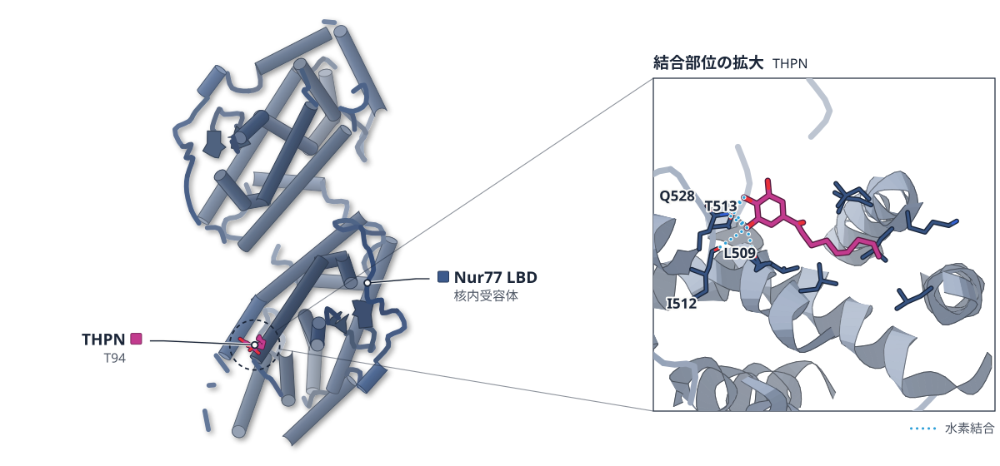

# 2026-10-31 号

**今日の新しい構造：2 本**　Europe PMC に 2026-10-30 に登録されたオープンアクセス論文 32 本のうち、新しい構造を報告した論文は 2 本。すべて紹介する。

**Structure Update 2 本** · **Structure-Based Study 1 本**（New Structure：構造が初めて解かれたタンパク質。Structure Update：既知のタンパク質の新しい構造。Structure-Based Study：既存の構造を使った注目の研究）

## Today's Structure（今日の一本）

**1｜環状RNAを作るリボザイムは、一価イオンを足場に活性部位を組み直す**（Gdi-1 イントロン（酢酸菌））

選んだ理由（構造生物学）：分岐後からバックスプライシング直前まで、金属イオンの入れ替わりを8つの構造でたどり、新しい一価イオン部位 K3 を示した。

> Crucially, we identify a previously unrecognized, highly selective monovalent cation-binding site, K3,  
> — Abstract

- 迷った論文：NanH（T. denticola） — 結晶構造と血清試験で補体回避を示したが、構造は既知の GH33 の枠内で、構造からの新しさは Gdi-1 のほうが大きい。
- 迷った論文：Nur77 LBD（NR4A1） — NMR の2状態の発見は面白いが、論文自身の構造決定はなく、既存構造への対応づけにとどまる。

| # | 標的 | 手法・分解能 | 見出し |
|---|---|---|---|
| 1 | Gdi-1 イントロン（酢酸菌） | Cryo-EM・2.42〜3.20 Å | 環状RNAを作るリボザイムは、一価イオンを足場に活性部位を組み直す |
| 2 | NanH（T. denticola） | X-ray・1.55〜1.81 Å | 細菌のシアリダーゼは、補体のシアル酸を外して免疫を逃れる |
| 3 | Nur77 LBD（NR4A1） | NMR・19F NMR・変異体解析 | Nur77 のリガンド結合ドメインは、2つの状態で共存している |

> この号は AI が論文本文から作成した**レビュー用の下書き**です。数値・ID・リガンドは PDB / UniProt から取得し、AI の記述には本文からの引用を付けています。

---

# Picked up Today's Structure

## 1｜Gdi-1 イントロン（酢酸菌）

### Metal-ion coordination drives active-site remodeling for backsplicing in circularly permuted group II introns

*Nucleic Acids Research*（2026-10-29） · [論文](https://doi.org/10.1093/nar/gkag1053) · ライセンス: cc by-nc

筆頭著者：Jie Zhang（Inner Mongolia University, China）　責任著者：Jinbiao Ma（Fudan University, China）

**環状RNAを作るリボザイムは、一価イオンを足場に活性部位を組み直す**

8つのクライオ電顕構造が、分岐からバックスプライシングへ移る金属イオンの入れ替わりを示した

- **疑問・課題**：分岐反応のあと、バックスプライシングへ移るときに活性部位がどう組み直されるかは、よく分かっていなかった。
- **アプローチ**：Gdi-1 イントロンを K+/Mg2+・K+/Ca2+・Cs+/Mg2+ の3条件に置き、クライオ電顕で8つの状態の構造を決めた。
- **結果**：バックスプライシング直前の構造に、新しい一価イオン結合部位 K3 が見つかった。K+/Ca2+ では K3 も M2 も見えなかった。
- **わかったこと**：K3 が γ–γ′ 相互作用を安定させ、4つの金属イオンからなる触媒の核が再構築されて、第2段階の活性部位ができる。

この紹介文の根拠（論文本文）

> While the initial branching step is structurally characterized, the mechanistic principles that govern the subsequent large-scale active-site remodeling and stringent metal-ion specificity required for backsplicing remain poorly understood.  
> — 疑問・課題／Abstract

> Here, we present a series of high-resolution cryo-EM structures of the CP group II intron from Gluconacetobacter diazotrophicus PAL5 (Gdi-1), capturing the ribozyme at discrete stages along the branching -to- backsplicing pathway under distinct ionic conditions.  
> — アプローチ／Abstract

> In contrast, no corresponding density is detected in the K+/Ca2+ structure (Fig. 5A), indicating that occupancy of the K3 site is associated with backsplicing-competent active-site organization.  
> — 結果／Results

> No corresponding density is detected under K+/Ca2+ conditions, indicating failure to establish a catalytically competent M2 site.  
> — 結果／Results

> Concomitantly, the K3 coordination network is established and the heteronuclear four-metal core is reassembled, generating a catalytically competent second-step active site in which M1 and M2 occupy their functional catalytic positions.  
> — わかったこと／Results

分類：DNA・RNA に関わるもの

#### 読みどころ

分岐反応の直後に触媒金属イオン M1 が外れ、M2 だけが残る。D6 が下向きに動くと bpA が約20 Å回って G209 が遠ざかり、3′ スプライス部位が活性部位に入る。

根拠（論文本文）

> K1 and K2 occupy positions nearly identical to those observed in the pre-branching state, whereas M1 is no longer detected.  
> — Results

> During this transition, bpA undergoes an ∼20 Å clockwise rotation, carrying the covalently linked G209 away from the catalytic center as the 3′SS is docked into the active site  
> — Results

K3 は C84・G210・U134 の間にあり、バックスプライシング直前の状態だけで見える。Cs+ に置き換えた構造でも同じ位置に Cs3 が入り、一価イオンという割り当てを支える。

根拠（論文本文）

> Located between C84 of the 2-nt bulge, G210 in the 5′SS region, and U134 of the 3′SS, this density resides immediately adjacent to both K1 and M1  
> — Results

> A strong density was observed at the equivalent position, where a Cs+ ion (Cs3) occupies the K3 site and engages the same set of ligands observed in the K+/Mg2+ structure, albeit with longer coordination distances consistent with the larger ionic radius of Cs+ (Fig. 5C).  
> — Results

γ–γ′ 相互作用を壊す置換は環状RNAの生成を大きく下げ、塩基対を戻す補償変異でほぼ野生型の活性に戻った。この相互作用が第2段階の活性部位に必要だと示す。

根拠（論文本文）

> Quantification of circRNA production after 10 min of self-splicing at 5 mM Mg2+ showed that disruption of the γ–γ′ interaction markedly reduced circRNA formation under all conditions tested, whereas compensatory mutations restored activity to near wild-type levels  
> — Results

> Together, these structural and biochemical data demonstrate that formation of the γ–γ′ interaction is required for productive assembly of the second-step active site, thereby promoting efficient backsplicing.  
> — Results

#### 構造データ

| PDB | 手法 | 分解能 | 公開 | 生物種 | リガンド |
|---|---|---|---|---|---|
| 20XR | — | — | 公開待ち | — | — |
| 20XQ | — | — | 公開待ち | — | — |
| 20XS | — | — | 公開待ち | — | — |
| 20XO | — | — | 公開待ち | — | — |
| 26VV | — | — | 公開待ち | — | — |
| 25WE | — | — | 公開待ち | — | — |
| 20YB | — | — | 公開待ち | — | — |
| 20YA | — | — | 公開待ち | — | — |

#### 実験メモ

- **精製**：in vitro 転写した RNA を変性尿素 PAGE で分け、切り出して溶出・精製した。
- **結晶化／グリッド作製**：RNA を 20 mM の MgCl2 または CaCl2 とともに 37°C で30分置き、約15 µM に濃縮した。Vitrobot Mark IV で凍結した。
- **データ収集・解析**：Krios G4（300 kV）と Falcon 4i で撮影し、cryoSPARC v4 で解析した。モデルは Phenix.real_space_refine で精密化した。

根拠（論文本文）

> RNA bands were excised and eluted overnight at 4°C in RNase-free water containing 300 mM NaOAc and 50 mM EDTA, filtered through 0.22 μm membranes, precipitated with isopropanol  
> — Materials and methods

> 0.5 µM RNA was annealed as described above, incubated with 20 mM MgCl2 or CaCl2 at 37°C for 30 min in a 1.5 ml reaction volume.  
> — Materials and methods

> Grids were blotted for 1.5 s at 4°C (100% humidity) and plunge-frozen in liquid ethane using a Vitrobot Mark IV (Thermo Fisher Scientific).  
> — Materials and methods

> All datasets were acquired using a Thermo Fisher Krios G4 cryo–electron microscope operating at 300 kV under identical microscope settings.  
> — Materials and methods

> two rounds of reference-free 2D classification in cryoSPARC v4  
> — Materials and methods

> All models were refined against the corresponding cryo-EM maps using Phenix.real_space_refine  
> — Materials and methods

> 📝 編集者への確認事項：PDB ID（20XR など）は未公開のため図なし。論文の PDB ID は '20XR' のように数字で始まる形式で、本文のとおりに扱った。第1著者・責任著者は collect の people を参照。

---

# Structure Update

## 2｜NanH（T. denticola）

### Bacterial sialidases subvert the complement system through desialylation

*Protein Science : A Publication of the Protein Society*（2026-10-29） · [論文](https://doi.org/10.1002/pro.70834) · ライセンス: cc by

筆頭著者：Kurni Kurniyati（Virginia Commonwealth University, USA）　責任著者：Chunhao Li（Virginia Commonwealth University, USA）

**細菌のシアリダーゼは、補体のシアル酸を外して免疫を逃れる**

T. denticola の NanH を結晶構造と血清殺菌試験で調べ、触媒ドメインの共通性も示した

- **疑問・課題**：細菌のシアリダーゼが補体系にどう影響するかは、よく分かっていなかった。
- **アプローチ**：6種のシアリダーゼで補体タンパク質の脱シアル化を調べ、T. denticola の NanH は結晶構造まで決めた。
- **結果**：6種すべてが補体タンパク質のシアル酸を外した。NanH で前処理した血清では、補体の活性化と菌への沈着が減った。
- **わかったこと**：シアリダーゼは補体因子のシアル酸を外して菌を血清殺菌から守る。この仕組みは5種の病原菌の6酵素に共通していた。

この紹介文の根拠（論文本文）

> yet their impact on the complement system, a central component of innate immunity, remains poorly understood.  
> — 疑問・課題／Abstract

> Using the oral pathogen T. denticola and its sialidase NanH as a representative model, we demonstrate that sialidase‐mediated desialylation suppresses complement activation and surface deposition, promoting complement evasion.  
> — アプローチ／Abstract

> We show that major complement proteins, including C1q, C4, and C5, as well as complement regulators Factor I, Factor H, and C4BP, are modified by terminal sialic acids (sialylation) and undergo terminal desialylation by all six sialidases.  
> — 結果／Abstract

> pretreatment of human serum with active Td‐NanH, but not the inactive Td‐NanH* mutant, significantly reduced complement activation and deposition on the surface of T. denticola cells  
> — 結果／Results

> Collectively, these results demonstrate that GH33 sialidases protect bacteria from complement‐mediated killing by desialylating serum complement factors.  
> — わかったこと／Results

> Together, these findings establish a conserved structural and functional mechanism by which diverse bacterial pathogens desialylate complement components to impair innate immune defense.  
> — わかったこと／Abstract

分類：酵素（その他）・感染・ウイルス・防御系

#### 読みどころ

NanH は N 末端の β-grasp ドメインと、六枚羽根 β プロペラの触媒ドメインからなる。活性部位には Tyr463・Glu338・Asp165 と、3つの Arg（140・354・423）が並ぶ。

根拠（論文本文）

> Td‐NanH comprises two major domains: an N‐terminal domain (N0471; residues 44–121) with an undefined function and a C‐terminal catalytic domain (C0471; residues 122–543) adopting the canonical six‐bladed β‐propeller fold characteristic of GH33 sialidases  
> — Results

> Its conserved active site cleft (Figure 7a), located at the center of the β‐propeller, contains Tyr‐463 and Glu‐338 as the catalytic nucleophile and general base, Asp‐165 as the general acid/base for water activation, and three conserved arginine residues (Arg‐140, Arg‐354, and Arg‐423)  
> — Results

Neu5Ac との複合体では、C4 水酸基が Arg159・Asp165・Asp205 と水素結合し、N-アセチル基は疎水性のポケットに入る。DANA は遷移状態アナログの阻害剤で、ほぼ同じ向きに結合する。

根拠（論文本文）

> Clear electron density revealed binding of β‐Neu5Ac in the active site (Figure 7b and Figures S13 and S14), where its C4 hydroxyl forms hydrogen bonds with Arg‐159, Asp‐165, and Asp‐205 and its N‐acetyl group inserts into a hydrophobic pocket formed by Leu‐166, Val‐222, Tyr‐228, Leu‐237, and Phe‐272, and is further stabilized by an ionic interaction with Asp‐205.  
> — Results

> we solved the crystal structures of Td‐NanH in complex with Neu5Ac (Figure 7b) and 2,3‐dehydro‐2‐deoxy‐N‐acetylneuraminic acid (DANA, a transition‐state analogue sialidase inhibitor (Schreiner et al., 1991)) (Figure 7c) at 1.56 and 1.55 Å resolution, respectively.  
> — Results

> DANA binds in an almost identical pose  
> — Results

D165A 変異体と 3′-シアリルラクトースの複合体（1.81 Å）では、末端のシアル酸が DANA とほぼ同じ形で結合した。結合しても大きな構造変化はなく、活性部位は硬い足場として働く。

根拠（論文本文）

> Importantly, the terminal sialic acid of 3′‐SL binds in nearly the same conformation as DANA, with only a slightly less distorted boat conformation of the sugar ring.  
> — Results

> Structural comparisons across unliganded, substrate‐bound, and inhibitor‐bound states reveal a rigid active‐site scaffold  
> — Results

#### 構造データ

寄託の記載はあるが、ID は補足資料にのみ記載されている。

#### 実験メモ

- **発現系**：Lemo21 (DE3) 大腸菌で発現し、IPTG 1 mM で18°C、16時間誘導した。
- **コンストラクト**：野生型と、触媒活性を弱めた D165A 変異体を作った。
- **結晶化／グリッド作製**：Berkeley Screen の G12 条件（Bis-Tris Propane・クエン酸・CdCl2・PEG400）を最適化し、シーディングで結晶化した。
- **データ収集・解析**：APS の 23-ID-B / 23-ID-D で100 K の回折データを集め、Xia2/DIALS で処理した。AlphaFold2 モデルを使い Phaser で分子置換した。

根拠（論文本文）

> Plasmids encoding wild‐type Td‐NanH and point mutant D165A were transformed into Lemo21 (DE3) E. coli.  
> — Crystallography

> The cells were induced by the addition of IPTG to a final concentration of 1 mM and the temperature was lowered to 18°C.  
> — Crystallography

> identified a lead from condition G12 (0.075 M Bis‐Tris Propane, 0.025 M Citric Acid, pH 8.2, 0.02 M Cadmium Chloride, 25% PEG400) of the Berkeley Screen (Rigaku, Bainbridge Island, WA). The initial hit appeared as liquid–liquid phase separation with a strong UV signal and was optimized by standard methods, including seeding.  
> — Crystallography

> X‐ray diffraction data were collected at 100 K on beamlines 23‐ID‐B (unliganded Td‐NanH, Td‐NanH:Neu5Ac, and Td‐NanH:DANA) and 23‐ID‐D (Td‐NanH:3′‐SL) at the Advanced Photon Source  
> — Crystallography

> The structure of unliganded Td‐NanH was determined by molecular replacement using Phaser  
> — Crystallography

> 📝 編集者への確認事項：PDB ID は本文になく（補足資料のみ）、図なし。分解能は本文の値。「初めて」とは書いていないので Structure Update の扱い。

---

# Structure-Based Study

## 3｜Nur77 LBD（NR4A1）

### Uncovering a cryptic allosteric hub governing energy landscape plasticity within the Nur77 ligand-binding domain

*Magnetic Resonance Letters*（2026-10-15） · [論文](https://doi.org/10.1016/j.mrl.2026.200312) · ライセンス: cc by-nc-nd

筆頭著者：Lang Chen（Chinese Academy of Sciences, China）　責任著者：Ling Jiang, Yixiang Liu（Chinese Academy of Sciences, China）

PDB 4JGV（論文が使った既存の構造）

色（順に）：Nur77 LBD（核内受容体）　スティック：THPN（T94）

**Nur77 のリガンド結合ドメインは、2つの状態で共存している**

NMR と変異体解析で、H1–H3 ループ周辺の弱い相互作用網が状態の比率を保つことが分かった

- **疑問・課題**：Nur77 はリガンドの入る空洞が側鎖で埋まっており、アロステリーの仕組みはよく分かっていなかった。
- **アプローチ**：LBD を 1H–15N HSQC と 19F NMR で調べ、既存の結晶構造 4JGV に対応づけた。変異体と THPN の滴定も行った。
- **結果**：apo の LBD は主状態が約56%、副状態が約44%で共存した。副状態は W420 周辺の溶媒への露出が大きかった。
- **わかったこと**：H1–H3 ループと周辺の弱い相互作用網が2状態の比を保つ。THPN には溶媒に開いた副状態のほうが結合しやすい。
- **残された課題**：各状態の高分解能の構造は未解明で、クライオ電顕や溶液構造の決定が必要だと論文は書いている。

この紹介文の根拠（論文本文）

> The poorly understood conformational dynamics and allosteric regulatory mechanisms of the Nur77 LBD have severely impeded progress in deciphering Nur77 signal transduction and in rational drug design.  
> — 疑問・課題／Introduction

> Using NMR spectroscopy, we identified two conformational substates defined by a pocket enclosed by the H1–H3 loop of the ligand-binding domain.  
> — アプローチ／Abstract

> we mapped the residues displaying peak splitting in the 1H–15N HSQC spectrum (Fig. 1A) onto the crystal structure of the Nur77 LBD (Fig. 2A)  
> — アプローチ／Results

> which yielded a major-state population of approximately 56% and a minor-state population of approximately 44%.  
> — 結果／Results

> the minor-state resonance displayed a pronounced SIIS of approximately 11 Hz  
> — 結果／Results

> Thus, the H1–H3 loop serves as an essential, but not exclusive, allosteric regulator of the Nur77 LBD conformational equilibrium.  
> — わかったこと／Results

> firmly establish that the minor substate is the preferred binding conformation  
> — わかったこと／Results

> First, high-resolution structural models of the individual substates are still lacking, and the current structural interpretation relies on an existing crystal structure together with NMR-derived restraints; further structural studies, such as cryo-electron microscopy or solution-state structure determination, will be needed to visualize each substate directly.  
> — 残された課題／Discussion

分類：GPCR・受容体

#### 読みどころ

H1–H3 ループの該当部分を Nurr1 のものに替えると2状態が1つになった。逆に Nurr1 へ Nur77 のループを移しても2状態にならず、ループは必要だが十分ではない。

根拠（論文本文）

> These results demonstrate that the H1–H3 loop is a necessary element for the conformational heterogeneity observed in Nur77, as its replacement by the Nurr1 loop completely eliminates the conformational heterogeneity. However, the reciprocal experiment shows that the loop alone is not sufficient to confer the two-state behavior.  
> — Results

H372・G376・P377・S413・C465 の周りの弱い相互作用網に点変異を入れると、どの変異でも2状態は1つになった。P377A は露出した副状態に偏った。

根拠（論文本文）

> Strikingly, all mutations resulted in the collapse of the dual-peak pattern, yielding a single resonance that is indicative of a uniform conformational state (Fig. 4B).  
> — Results

> the HSQC data unambiguously show that the minor state is preferentially stabilized  
> — Results

THPN の滴定では副状態の信号が先に減った。副状態に偏る P377A は、野生型より2.5倍強く THPN に結合した。ただし試した低分子は THPN だけである。

根拠（論文本文）

> upon incremental addition of the ligand, the resonance corresponding to the minor substate diminished preferentially  
> — Results

> the P377A mutant exhibited a 2.5-fold higher binding affinity than the wild-type protein  
> — Results

#### 構造データ

| PDB | 手法 | 分解能 | 公開 | 生物種 | リガンド |
|---|---|---|---|---|---|
| [4JGV](https://www.rcsb.org/structure/4JGV) | X-ray | 3.01 Å | 2013-12-18 | Homo sapiens | T94 |

- [P22736](https://www.uniprot.org/uniprotkb/P22736) NR4A1 Nuclear receptor subfamily 4immunitygroup A member 1 — *Homo sapiens* （既存の PDB 構造 0 件）

#### 実験メモ

- **発現系**：大腸菌 BL21 (DE3) で発現し、IPTG 0.5 mM、20°C で20時間誘導した。15N は M9 培地、19F は 5-フルオロインドールで標識した。
- **コンストラクト**：Nur77 LBD は残基351–598（His6 タグつき）。ループ交換キメラと点変異体も作った。
- **精製**：Ni-Sepharose のアフィニティーと PG75 のゲルろ過で精製した。
- **データ収集・解析**：1H–15N HSQC は Bruker 850 MHz、19F NMR は 700・600 MHz で、298 K で測定した。

根拠（論文本文）

> followed by induction with 0.5 mM isopropyl-β-d-1-thiogalactopyranoside (IPTG) and incubation at 20 °C for 20 h with agitation at 220 rpm.  
> — Materials and methods

> For 15N labeling, M9 minimal medium with 15NH4Cl as the sole nitrogen source was employed;  
> — Materials and methods

> The recombinant constructs used in this study were His6-Nur77 LBD (residues “351–598”; calculated mass 28.706 kDa including His6 tag  
> — Materials and methods

> the clarified supernatant was subjected to Ni-Sepharose affinity chromatography, and the eluate was concentrated and further purified by PG75 size-exclusion chromatography.  
> — Materials and methods

> NMR spectra for 1H–15N HSQC were recorded using Bruker 850 MHz instruments.  
> — Materials and methods

> NMR spectra for 19F were recorded using Bruker 700 MHz and 600 MHz instruments.  
> — Materials and methods

> 📝 編集者への確認事項：新しい構造ではない。論文自身の構造決定はなく、NMR（HSQC・19F）で既存の結晶構造 4JGV に対応づけた研究。structure は 1 点とした。

---

## 注目の構造の採点（29 本を確認し、6 本を採点）

基準は `pipeline/impact.py`（10 点満点、5 点以上から最大 3 本）。

| 選定 | 論文 | 種類 | novelty | reach | structure | support | 計 | 理由 |
|---|---|---|---|---|---|---|---|---|
| ◯ | PMC13718860 Uncovering a cryptic allosteric hub governing energy landsca | 既存構造で機構を解明 | 2 | 1 | 1 | 2 | 6 | アポ型 LBD が2状態で共存し、弱い相互作用網がその比を保つと NMR と変異体で示した。ただし構造は既存の 4JGV に対応づけたもので、系は Nur77 に限られる（5〜6点のため何が新しいかを書く：空洞のない受容体にも立体構造の可塑性があるという点）。 |
|  | PMC13717755 Discovery and Design of YTHDF2-Selective and Pan-YTHDF Inhib | 構造に基づく創薬 | 1 | 1 | 1 | 2 | 5 | ドッキングで選んだ化合物の結合を HSQC の化学シフト変化と HTRF・MST で確かめた。阻害剤の続報で、新しさは基準未満。 |
|  | PMC13718419 Aptamers without SELEX: De novo design from protein structur | 構造予測・AI・デザイン | 2 | 2 | 0 | 1 | 5 | 配列選択なしでアプタマーを設計する計算パイプライン。既知の共結晶構造との照合が評価の中心で、設計した複合体の実験構造はない（structure 0）。 |
|  | PMC13719170 Lateral opening site of human oligopeptide transporter 2 pla | 構造に基づく創薬 | 1 | 1 | 0 | 2 | 4 | hPepT2 は相同性モデルと MD が根拠で、実験構造による確認がない（structure 0）。変異体の取り込み実験は機能測定。 |
|  | PMC13718768 A fibril-selective single-domain antibody targets pathogenic | 構造に基づく創薬 | 1 | 1 | 0 | 1 | 3 | ファージディスプレイで得た単一ドメイン抗体 J8 の機能研究。自前の構造データはなく、既存のフィブリル構造の引用にとどまる（structure 0）。 |
|  | PMC13717786 Simulating Directed Evolution In Silico with an Iterative, P | 新しい手法・ソフト | 1 | 1 | 0 | 0 | 2 | 物理ベースの in silico 進化ワークフロー。MD とモデリングが中心で、既存の結晶構造 9PHG は出発点にすぎない（structure 0）。 |

novelty：何が初めてか / reach：誰に効くか / structure：実験で決めた構造（X 線・クライオ電顕・NMR / support：裏付けの強さ（2＝独立した実験で検証：変異体・機能測定・既存手法との比較など／1＝一部の検証のみ／0＝計算のみで実験的検証なし）
